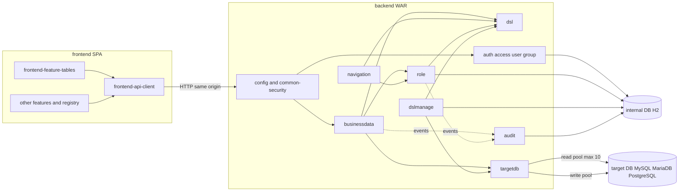
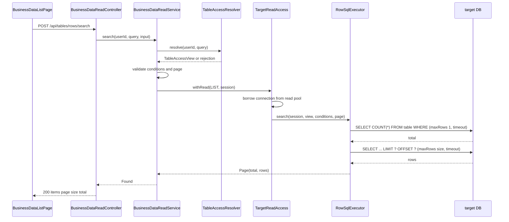
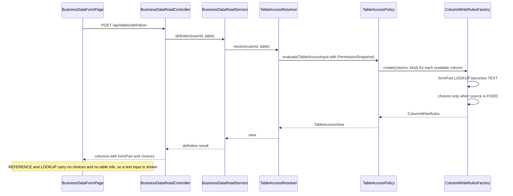
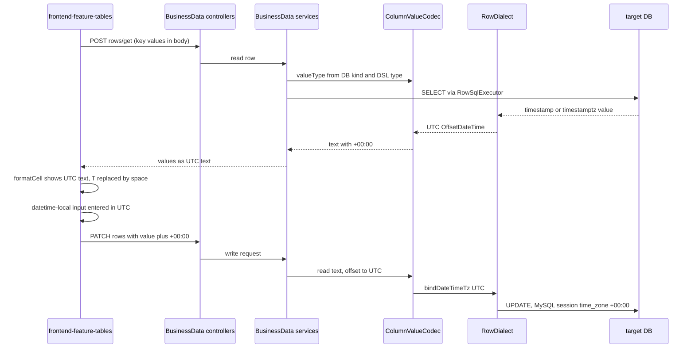
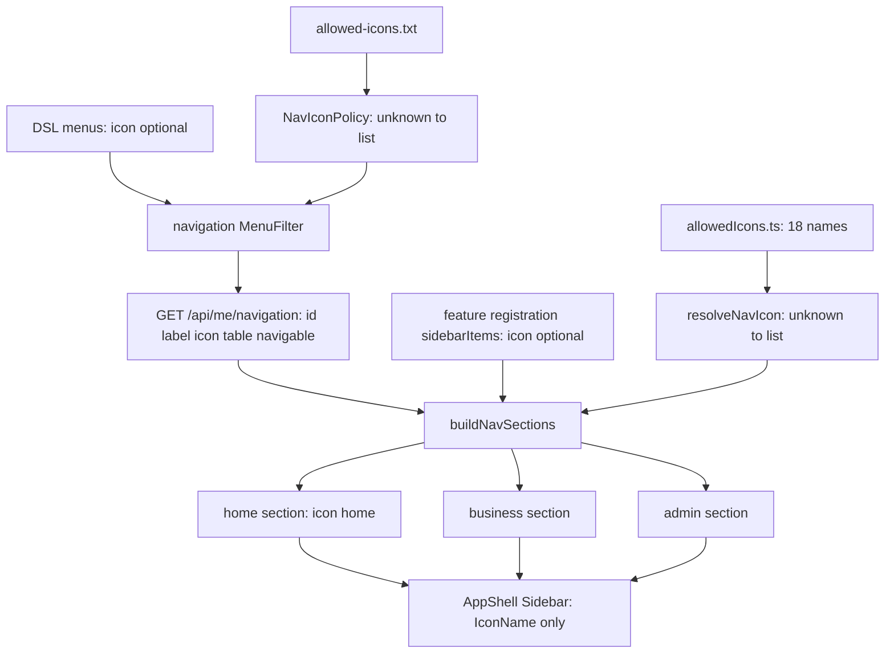
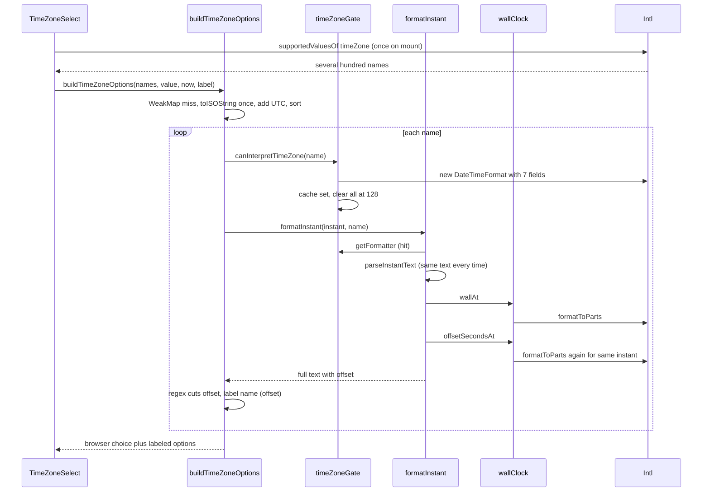
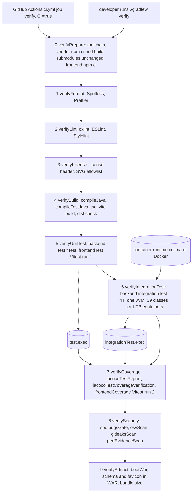
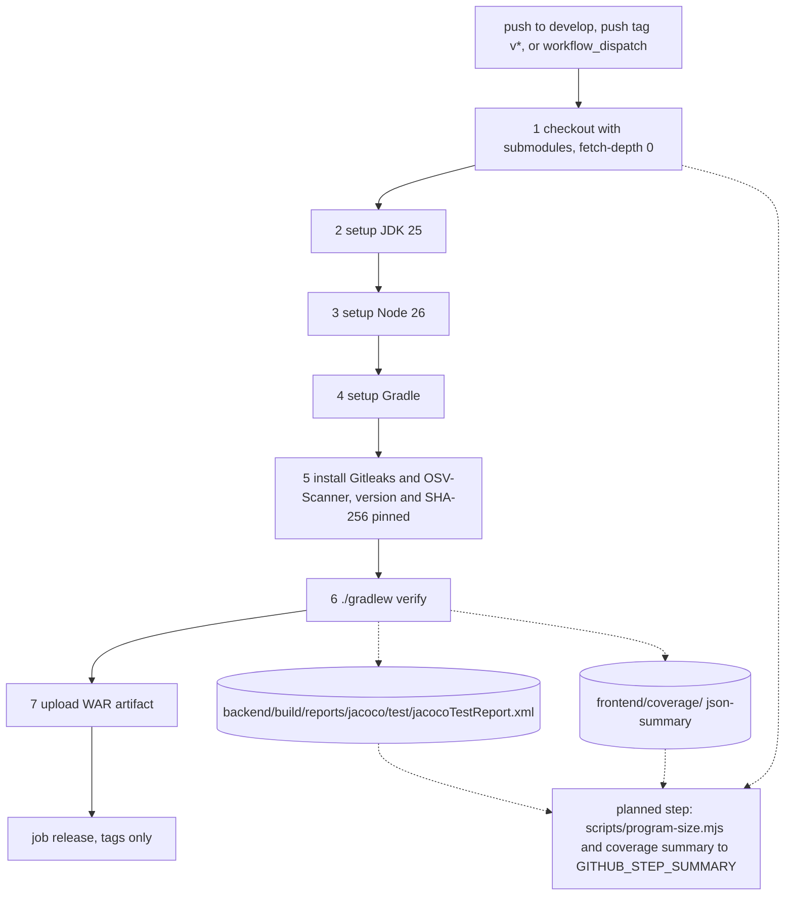
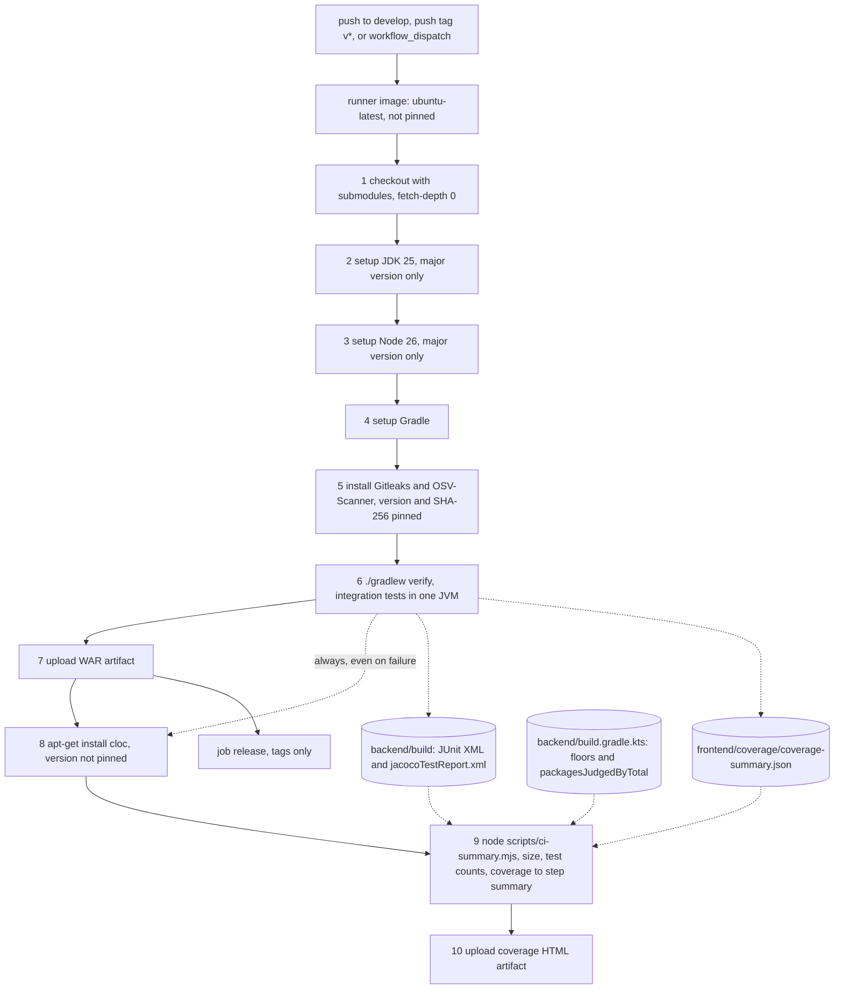

# アーキテクチャ（mastersmith2）

> 2026-11-09（記録のコミット `4fe8e79`）の Intent `261108-ci-checks-release` の Focused scan で更新した。アプリの作りは読み直していない。CI（`.github/workflows/ci.yml` 143 行）・ルートの `scripts/`・検査の入口・`docs/verification.md` を読み直し、「CI の今の形とリリース（2026-11-09）」の節（K-127・K-136）、Interaction Diagrams 10、Improvement Opportunities の K-129 を足した。前の節「検査の入口の今の形と CI」の K-119（7 手順・要約なし）は古い（K-127）。Interaction Diagrams 9 の「予定の手順」は実装された（K-127）。ほかの図と散文は前回以前の記録による。
>
> 前回の記録: 2026-11-08 の2回目（記録のコミット `9fd4f7f`）の Intent `261108-ci-size-coverage` の Focused scan で更新した。アプリの作りは読み直していない。CI（`.github/workflows/ci.yml`）と検査の入口（`build.gradle.kts`・`backend/build.gradle.kts`）を読み直し、「検査の入口の今の形と CI」の節（K-119・K-122）、Interaction Diagrams 9、Improvement Opportunities の K-123・K-124 を足した。前の節「検査の入口 `verify` の流れ」は 2026-11-08 の1回目（`16f46f1`）の記録で、K-113 の並べる口・絞る口の記述は古い（K-122）。ほかの図と散文は前回以前の記録による。
>
> 前回の記録: 2026-11-08（記録のコミット `16f46f1`）の Intent `261107-verify-quick-local` の Focused scan で更新した。アプリの作りは読み直していない。1コマンドの検査 `./gradlew verify` の作り（`build.gradle.kts`・`backend/build.gradle.kts`・`frontend/vitest.config.ts`・`.github/workflows/ci.yml`）を読み、「検査の入口 `verify` の流れ」の節（K-111・K-113）、Interaction Diagrams 8、Improvement Opportunities の K-116 を足した。ほかの図と散文は前回以前の記録による。
>
> 前回の記録: 2026-11-06（記録のコミット `a789a6f`）の Intent `261104-tz-options-perf` の Focused scan で更新した。画面の表示のタイムゾーンの選択肢の組み立て（`features/preferences/buildTimeZoneOptions.ts`）と日時の変換の共有の関数（`shared/format/timeZone/`）を読み、「表示のタイムゾーンの選択肢の組み立て」の節（K-106・K-107）と Interaction Diagrams 7 を足した。K-96 の「利用者ごとの時差の設定は無い」は古い（K-110）。ほかの図と散文は前回以前の記録による。
>
> 前回の記録: 2026-11-03（記録のコミット `fa0b01e`）の Intent `261102-timezone-ui-polish` の Focused scan で更新した。業務データの日時の型の対応と接続の時差を読み、「日時の値の流れ」の節（K-94〜K-99）と Interaction Diagrams 5（日時の値の読み出しと保存）・6（サイドバーの区画とアイコンの決まり方。K-100・K-101）を足した。ほかの図と散文は前回以前の記録による。
>
> 前回の記録: 2026-11-01（記録のコミット `6079f13`）の Intent `261101-maintenance-update` の Focused scan で更新した。アーキテクチャそのものは今回読み直していない。`businessdata` の一覧の並べ替えの文（`RowSqlBuilder.page`・`orderBy`）と参照先の並び（`RowDialect.sortExpression`）を読み、所見 K-92（P1）を Improvement Opportunities に足した。図と散文は前回（2026-10-29）以前の記録による。
>
> 前回の記録: 2026-10-29（記録のコミット `15a25aa`）の Intent `261029-reference-lookup-cleanup` の Focused scan で更新した。今回深く読んだのは `businessdata`（選択肢・書き込みの規則・検索の演算子・定義の応答）・`dsl`（選択肢の型）・`targetdb`（署名レベル）・`role`（`PermissionSnapshot` の口）。Interaction Diagrams に 4（業務データの選択肢 REFERENCE・LOOKUP の現状）を足し、所見 K-74・K-75 を書いた。K-62・K-63 は前回（`261027-perf-targets-review`）の記述のまま（今回は再確認していない）。ほかは前回以前の記録による。

## System Overview

- 1つの実行可能 WAR（Spring Boot 4.1.2、Java 25）が、画面（React の SPA、`frontend/dist` を同梱）と API（`/api/**`）を同じオリジンで配る。CORS は置かない。
- 内部DB は組み込みの H2（利用者・認証・招待・DSL・ロール・グループ・監査）。スキーマは Flyway の V1〜V13。
- 対象DB（MySQL・MariaDB・PostgreSQL のどれか1つ）は設定（環境変数）だけから接続する。読み取り専用のプールと、設定が揃ったときだけ作る書き込み専用のプールの2つ。
- 配備先は開発者の PC 上のコンテナだけ（`Dockerfile`・`compose.yaml`）。
- ビルドと検査は Gradle の1つの入口 `./gradlew verify`（ルートの `build.gradle.kts`）にまとめ、画面の npm と外部の道具（Gitleaks・OSV-Scanner）も Gradle から呼ぶ。CI も同じタスクを呼ぶ（K-111・K-115）。Bolt の統合の前の速い入口 `./gradlew verifyQuick` は同じ段の表から一部のタスクを外したもの（K-122）。CI は `verify` の後に WAR を保存するだけで、実行の要約には何も書かない（K-119。2026-11-09 には古い: 今は `verify` の後に規模・テストの件数・カバレッジを要約に書き、カバレッジの HTML を保存する。報告だけの手順で、成否で CI を落とさない。K-127）。

## Architectural Style

- モジュール化した一枚岩（modular monolith）。1つの Gradle のアプリ（`backend`）の中で、機能ごとのパッケージ（`auth`・`access`・`audit`・`user`・`useradmin`・`invitation`・`mail`・`appearance`・`targetdb`・`dsl`・`dslmanage`・`role`・`group`・`navigation`・`businessdata`・`common/*`・`config`）に分け、各機能の中を `web`・`service`・`domain`・`repository` に分ける。
- 機能の間の依存の向きは ArchUnit の境界テスト 19 ファイルで固定する（`ArchitectureTest`・`ApiAccessArchitectureTest`・機能ごと。内訳は `code-quality-assessment.md`）。逆向きの知らせは Spring の出来事（監査など）。
- 画面は `features/<featureId>/registration.ts` を置くと読み込まれる差し込みの形で、機能どうしの import は ESLint で止める。

## Component Relationships

文字の代わりの説明: 画面の機能（業務データの `frontend-feature-tables` を含む）は `frontend-api-client` を通して同じオリジンの API を呼ぶ。入口は Spring Security の連鎖（`config` と `common-security`）。`businessdata` は `role`（権限の解決の口）・`dsl`（適用中のモデル）・`targetdb`（接続の貸し出し）を使い、対象DB の行を読み書きする。`targetdb` だけが対象DB へつなぎ、読み取りのプール（既定の上限 10）と書き込みのプールを分ける。`navigation` は `role` と `dsl` でメニューを作る。内部DB の H2 には `user`・`role`・`dslmanage`・`audit` などが書く。点線は Spring の出来事で、`businessdata`・`role` などの出来事を `audit` が受けて監査の行にする。依存の向きの細部は `dependencies.md`。図の矢印のうち今回深く確かめたのは `businessdata`→`targetdb`・`role`・`dsl` と `targetdb` の2つのプール、それ以外は前回の記録による。

## Data Flow

- 要求ごとに: 画面 → アクセストークン → `auth` が署名と期限を確かめ主体を作る → 安全の決まり（`/api/**` の既定はログインだけ）→ controller → service → repository。
- 業務データの要求: `BusinessDataReadController` / `BusinessDataWriteController`（`@ApiAccess(AUTHENTICATED)`）→ `BusinessDataReadService` / `BusinessDataWriteService` が `TableAccessResolver` で権限の写しを作り → `targetdb` の `TargetReadAccess.withRead(目的, …)` で読み取りの接続を借り → `RowSqlExecutor` が SQL を組み立てて実行する。権限の判定は API ごとにサーバー側で行う。
- 監査は各機能の出来事を `audit` が確定の後に別のトランザクションで内部DB に追記する。

## 検査の入口 `verify` の流れ（K-111・K-113、2026-11-08）

持ち主の文書はここで、ほかの文書からはこの節を指す。カバレッジ・CI・書き換える決まりは `code-quality-assessment.md` の K-112・K-114・K-115・K-117。この節は 2026-11-08 の1回目（記録のコミット `16f46f1`、`verifyQuick` を足す前）の記録で、行の番号はその時点のもの。今の形は次の節「検査の入口の今の形と CI」（K-119・K-122）。

### K-111 段の構成と順（確かめた事実）

- 入口は `build.gradle.kts` の `verify`（509〜513 行）。`dependsOn(stageTasks)` だけを持ち、段のタスク 10 個に任せる。
- 段の表 `verifyStages`（425〜494 行）は `Triple(段の名前, 説明, 含めるタスク)` の `List`。

| 順 | 段 | 含めるタスク |
|---|---|---|
| 0 | `verifyPrepare` | `checkToolchain`（Node 26・npm・git）・`vendorInstall`・`vendorBuild`・`vendorUnchanged`・`mustacheVendorUnchanged`・`frontendInstall` |
| 1 | `verifyFormat` | ルートと `:backend` の `spotlessCheck`・`frontendFormatCheck`・`perfToolFormatCheck` |
| 2 | `verifyLint` | `frontendLint`（oxlint・ESLint）・`frontendLintCss`・`perfToolLint`・`perfToolEslint` |
| 3 | `verifyLicense` | `frontendLicenseCheck`・`frontendSvgCheck` |
| 4 | `verifyBuild` | `:backend:compileJava`・`:backend:compileTestJava`・`frontendTypecheck`・`perfToolTypecheck`・`frontendBuild`・`frontendDistCheck` |
| 5 | `verifyUnitTest` | `:backend:test`（`*Test`）・`frontendTest`（`npm run test`） |
| 6 | `verifyIntegrationTest` | `:backend:integrationTest`（`*IT`） |
| 7 | `verifyCoverage` | `:backend:jacocoTestReport`・`:backend:jacocoTestCoverageVerification`・`frontendCoverage`（`npm run test:coverage`） |
| 8 | `verifySecurity` | `:backend:spotbugsGate`・`osvScan`・`gitleaksScan`・`perfEvidenceScan` |
| 9 | `verifyArtifact` | `:backend:bootWar`・`:backend:verifyDslSchemaInWar`・`:backend:verifyFaviconInWar`・`frontendBundleSize` |

- 順の決め方（496〜507 行）: 段ごとに「それより前の段のすべてのタスク」を集め、その段の各タスクに `mustRunAfter` を `configure` で付ける。段のタスクどうしにも、前の段の後の `mustRunAfter` を付ける。順の決まりはタスクそのものに付くため、`verify` の外で同じタスクを流しても、両方がグラフに入れば同じ決まりが効く。
- `mustRunAfter` は順だけを決め、流すかどうかは決めない。`--continue` を付けなければ、1つ失敗すると後ろの段は流れない（`docs/verification.md` 11 行も同じ説明）。
- 段ごとに単独でも流せる（例 `./gradlew verifyFormat`）。並列の設定（`gradle.properties` の `org.gradle.parallel` など）は無い。

### K-113 結合テストの分け方と前提（確かめた事実）

- `backend/build.gradle.kts`: 単体 `test` は `includeTestsMatching("*Test")`（ヒープ 1536m、135〜145 行）、結合 `integrationTest` は同じ `src/test/java` の出力から `includeTestsMatching("*IT")`（147〜156 行、`shouldRunAfter(tasks.test)`）。全 `Test` の共通の設定はヒープ 1g・`h2.compactThreads=1`・`user.timezone=Asia/Tokyo`・`java.net.preferIPv4Stack=true` など（107〜133 行）。
- 並列の指定（`maxParallelForks`・`forkEvery`）は無く、Gradle の既定の1つの JVM で流れる。JUnit の並列も無い（`junit-platform.properties` は jqwik の1行だけ。流し読み）。
- IT を絞る口は無い。`-P` で絞る前例は E2E の `-Pe2e.files`（`build.gradle.kts` 812〜818 行）だけ。
- 数（`find`、流し読み）: `*Test.java` 312・`*IT.java` 278。内部DB を H2 のファイル（`TestDatabase.register`、`jdbc:h2:file:<dir>/mastersmith`）で持つクラス 172、対象DB のコンテナを使うクラス 39。
- 対象DB の IT は `TargetDbTestDatabase` がテストのクラスごとに版を固定したイメージのコンテナを1つ起動し、名前の重ならないスキーマと読み取りのアカウントを作ってクラスの終わりに消す。`ContainerRuntimeCheck`（`BeforeAllCallback`）が、Docker に届かず `CI=true` なら失敗、手元なら WARN と中断（飛ばした扱い）にする。テストの出力は `SKIPPED` も出す（`testLogging` の `events("failed", "skipped")`）。
- 待ち受けの番号は `ServerSocket(0)` で空きを取る。`TargetDbStartupIT` 91 行・`MailTestApplication` 97 行は番号を取ってすぐ閉じ、後で使う形（流し読み）。

## 検査の入口の今の形と CI（K-119・K-122、2026-11-08 の2回目）

持ち主の文書はここで、ほかの文書からはこの節を指す。カバレッジの報告の形は `code-quality-assessment.md` の K-120、ルートの `scripts/` は K-121。行の番号は記録のコミット `9fd4f7f` のもの。

### K-122 `verifyQuick`・`-PitTests`・`-PitForks` は実装済み（確かめた事実。前の記録の訂正）

- `verify`（`build.gradle.kts` 509〜513 行）と段の表 `verifyStages`（425〜494 行）・順の決め方（496〜507 行）は、前の節の K-111 と同じ形のまま。
- `verifyQuick`（548〜555 行）は、段の表から次を外した並びに `dependsOn` する（段のタスクには依らない。523〜541 行）: `frontendTest`、`jacocoTestCoverageVerification`、`-PitTests` が無いときの `integrationTest`。`jacocoTestReport` の位置には `:backend:jacocoQuickReport` を置く。順は段の表で付けた `mustRunAfter` がそのまま効き、`jacocoQuickReport` には 0〜6 の段の後・8〜9 の段の前の順を足す（543〜546 行。`verify` のグラフには入らない）。前の記録の K-116 の「段の表を1つにして含めるかどうかだけを入口ごとに切り替える」形になっている。
- `verify` に `-PitTests` を付けると、タスクのグラフができた時点で理由を示して失敗にする（559〜566 行）。
- `-PitTests=<形>[,<形>...]`（`backend/build.gradle.kts` 153〜164 行）は空・空白・カンマだけの値を失敗にし、`integrationTest` の `filter` をその形に替え、当たるものが無ければ失敗（`isFailOnNoMatchingTests`）、読むクラスのファイルを `**/*IT.class` に限り、`mastersmith.requireContainerRuntime=true` を渡す（173〜200 行）。
- `-PitForks=<N>`（166〜171 行）は 1 以上の整数でなければ失敗にし、`maxParallelForks` を N にする（196〜198 行）。付けなければ今までどおり1つの JVM。CI は `-P` を渡さない。
- `jacocoQuickReport`（250〜296 行）は `test.exec` だけから `backend/build/reports/jacoco/quick/` に XML と HTML を作り、毎回作り直して全体の行・分岐の割合を1行表示する（判定はしない）。
- 回帰の確かめの台本 `scripts/verify-graph-check.mjs`（238 行）が、`verify` と `verifyQuick` のタスクの一覧と順、`-P` の誤りの扱いの 8 項目を `./gradlew … --dry-run` だけで確かめる。比べの元は `scripts/verify-graph-baseline.txt`（`verify --dry-run` のタスク 63 行）。手で流すもので、`verify` と CI には入っていない（`docs/verification.md` 69〜71 行）。

### K-119 CI の今の形（確かめた事実。`.github/workflows/ci.yml` 115 行の全文）

- きっかけ: `develop` への push・`v*` のタグの push・手動（`workflow_dispatch`）（19〜23 行）。`permissions` は `contents: read`（25〜26 行）。`concurrency` は `ci-${{ github.ref }}` で、走っているものを取り消さない（28〜30 行）。
- 外部の道具の版と SHA-256 は、ワークフローの `env` に置く（32〜36 行: `GITLEAKS_VERSION`・`GITLEAKS_SHA256`・`OSV_SCANNER_VERSION`・`OSV_SCANNER_SHA256`）。
- ジョブ `verify`（39〜92 行、`ubuntu-latest`・`timeout-minutes: 60`）の手順:

| 順 | 手順の名前（要約） | 中身 |
|---|---|---|
| 1 | リポジトリとサブモジュールを取得する | `actions/checkout` v7.0.1、`submodules: true`、`fetch-depth: 0`（Gitleaks が履歴全体を調べるため、48〜49 行） |
| 2 | JDK 25 を入れる | `actions/setup-java` v6.1.0、temurin |
| 3 | Node.js 26 を入れる | `actions/setup-node` v7.1.0、npm のキャッシュは `frontend/package-lock.json` と `vendor/make-you-chic-ui/package-lock.json` |
| 4 | Gradle を用意する | `gradle/actions/setup-gradle` v6.4.1 |
| 5 | Gitleaks と OSV-Scanner を入れる | `set -euo pipefail` の `run`。`curl -sSfL` で取り、`sha256sum -c -` で確かめ、`$HOME/.local/bin` に置き、`$GITHUB_PATH` に足す（69〜81 行） |
| 6 | 1コマンドの検査を実行する | `./gradlew verify`（83〜84 行、引数なし） |
| 7 | WAR を成果物として保存する | `actions/upload-artifact` v7.0.2、名前 `mastersmith-${{ github.sha }}`、`backend/build/libs/mastersmith.war`、30 日、`if-no-files-found: error`（86〜92 行） |

- どの手順にも `if:` が無い。GitHub Actions の既定では前の手順が失敗すると後ろの手順は流れないため、`verify` が落ちると WAR は保存されない（既定の振る舞いは道具の仕様で、この CI で流して確かめてはいない）。
- ジョブ `release`（94〜115 行）はタグのときだけ `verify` の後に流れ、保存した WAR を取って GitHub のリリースに添付する（`contents: write`）。
- `$GITHUB_STEP_SUMMARY` への書き込み・cloc・カバレッジの報告の保存は、どれも無い（`grep` で 0 件）。カバレッジの報告は CI の機械の上の `backend/build/reports/`・`frontend/coverage/` に作られるが、成果物として残さない。

## CI の今の形とリリース（K-127・K-136、2026-11-09）

持ち主の文書はここ。上の K-119 の表は 2026-11-08 の2回目の 7 手順の記録で、今は下の 10 手順。版を固定していない所は `technology-stack.md` の K-128、ルートの `scripts/` の検査の対象は `code-quality-assessment.md` の K-130。行の番号は記録のコミット `4fe8e79` のもの。

### K-127 CI の今の形（確かめた事実。`.github/workflows/ci.yml` 143 行の全文）

- きっかけ（20〜24 行）・`permissions: contents: read`（26〜27 行）・`concurrency`（29〜31 行、ref ごとで取り消さない）・外部の道具の版と SHA-256 の `env`（33〜37 行）は K-119 と同じ。
- ジョブ `verify`（40〜120 行、`ubuntu-latest`・`timeout-minutes: 60`）の手順:

| 順 | 手順の名前（要約） | 中身 | 失敗のとき |
|---|---|---|---|
| 1〜5 | 取得・JDK 25・Node 26・Gradle・Gitleaks と OSV-Scanner | K-119 と同じ（45〜82 行） | 後ろは流れない |
| 6 | 1コマンドの検査を実行する | `./gradlew verify`（84〜85 行、引数なし。`-PitForks` も付けない） | 後ろは 8〜10 だけ流れる |
| 7 | WAR を成果物として保存する | `mastersmith-${{ github.sha }}`、30 日、`if-no-files-found: error`（87〜93 行） | — |
| 8 | 規模を数える道具（cloc）を入れる | `sudo apt-get update && sudo apt-get install -y cloc`（96〜99 行。版を固定しない） | `if: always()`・`continue-on-error: true` |
| 9 | 規模・テストの件数・カバレッジを実行の要約に書く | `node scripts/ci-summary.mjs --base "$SIZE_BASE"`（101〜108 行）。`SIZE_BASE` は `develop` へのブランチの push のときだけ `github.event.before`、ほかは空 | 同上。台本も終了コード 0 |
| 10 | カバレッジの HTML の報告を保存する | `coverage-html-${{ github.sha }}`、`backend/build/reports/jacoco/test/html/` と `frontend/coverage/`、14 日、`if-no-files-found: ignore`（110〜120 行） | 同上 |

- 95 行のコメント: 8〜10 は報告だけの手順で、`./gradlew verify` が落ちた回にも流し、成否で CI を失敗にしない。CI の合否は今までどおり 6 の手順で決まる（`docs/verification.md` 166 行も同じ）。
- 9 の手順の台本 `scripts/ci-summary.mjs` は、規模（`scripts/program-size.mjs` の関数。`--base` があれば比べる元を `git worktree add --detach` で `build/program-size-base` に取り出して cloc をもう1回流す）→ バックエンドのテストの件数（`backend/build/test-results/{test,integrationTest}/TEST-*.xml`）→ カバレッジ（`jacocoTestReport.xml` を正規表現で読み、下限と `packagesJudgedByTotal` は `backend/build.gradle.kts` から読む。画面は `coverage-summary.json`）の順に `$GITHUB_STEP_SUMMARY` へ追記する。欄が作れなければ理由と `::warning::` を出す。
- ジョブ `release`（122〜143 行）は K-119 と同じ（タグのときだけ、`needs: verify`、`contents: write`）。

### K-136 リリース（`develop` から `main`）の今の形（確かめた事実）

- 手順の置き場: README にリリースの手順は無い（24 行に「リリースの前などで流す」とあるだけ）。リリースの前の確かめは `docs/verification.md` 178〜198 行（全件の `./gradlew verify`・E2E に加えて、`./gradlew osvScan --rerun` の「失敗の条件に当たるもの 0 件」と、`frontend/dist` と WAR に axe-core が入っていないことの `grep`。結果は Deployment Execution の記録に書く）。fast-forward で取り込むこと・依頼者の承認・push は依頼者が行うこと・`v*` のタグを付けないことは `team.md` の Way of Working と Deployment にある。
- CI のきっかけに `main` は無い（`ci.yml` 20〜24 行）。`main` へ push しても CI は流れず、`develop` の同じコミットの CI の結果が取り込むものの確かめになる（`project.md` の Deployment の「試行ごとに確かめる」決まり）。
- 2026-11-09 の時点で `main`（先頭 `b2990415`）は `develop` の祖先で、fast-forward で取り込める。`main..develop` は 23 コミット。
- `scripts/program-size.mjs` の `collectMeta`（356 行〜）は報告に `origin/main` の先頭を載せる（CI の取得は `fetch-depth: 0` のため `origin/main` がある見込み）。

## 日時の値の流れ（K-94〜K-99、2026-11-03）

N6（日時のタイムゾーンの変換）の前提になる今の形。持ち主の文書はここで、ほかの文書からはこの節を指す。

### K-94 型の対応（1か所）

`businessdata/repository/ColumnValueCodec.valueType`（266〜330 行）が、DB の種類と DSL の型の名前（`RowDialect.baseName` で小文字にして `(` から後を落としたもの）から受け渡しの型 `ValueType` を決める。DB の種類が分からないときは3種類の結果がそろえばその型、違えば `OTHER`。

| 対象DB | DSL の型の名前 | 受け渡しの型 | 読み方 | 書き方 |
|---|---|---|---|---|
| MySQL・MariaDB | `timestamp` | `DATETIME_TZ` | 文字で受けて `LocalDateTime` に読み、UTC とみなす（`MysqlFamilyRowDialect.readDateTimeTz`、94〜98 行） | UTC の `LocalDateTime` を `setObject`（89〜91 行） |
| MySQL・MariaDB | `datetime` | `DATETIME` | 文字で受けて `LocalDateTime`（`readsTemporalAsText`） | `setObject(LocalDateTime)` |
| MySQL・MariaDB | `date`・`time` | `DATE`・`TIME` | 文字で受けて `LocalDate`・`LocalTime` | `setObject` |
| PostgreSQL | `timestamptz`・`timestamp with time zone` | `DATETIME_TZ` | `getObject(OffsetDateTime)` を UTC にそろえる | UTC の `OffsetDateTime` を `setObject` |
| PostgreSQL | `timestamp`・`timestamp without time zone` | `DATETIME` | `getObject(LocalDateTime)` | `setObject(LocalDateTime)` |
| PostgreSQL | `timetz`・`time with time zone` | `TIME_TZ` | `getObject(OffsetTime)` を UTC にそろえる。比べる左辺は `(列 AT TIME ZONE 'UTC')` | `setObject(OffsetTime)` |
| PostgreSQL | `time`・`time without time zone`・`date` | `TIME`・`DATE` | `getObject(LocalTime・LocalDate)` | `setObject` |

- 応答の文字の形（`ColumnValueCodec.format`・`readCell`）: `DATE` は `2026-03-08`、`DATETIME` は `2026-03-08T02:30:00`（端数は要る桁だけ）、`TIME` は `02:30:00`、`DATETIME_TZ` は `2026-03-08T02:30:00+00:00`、`TIME_TZ` は `02:30:00+00:00`。時差つきは必ず UTC。
- 要求の文字の読み方（`read` → `parse`）: 時差つきは `Z`・`z`・`±hh:mm` を受け付けて UTC にそろえ、オフセットが無ければ UTC とみなす（`parseDateTimeTz`・`parseTimeTz`、437 行から）。時差の無い型は ISO の形だけ（`LocalDateTime.parse` など）。
- 定義の応答（`web/ColumnDefinitionResponse`）は `valueType` と `listFormat` を返す。秒の端数の上限（`ColumnKind.fractionDigits`）は返さず、サーバーの検証（`WriteRequestValidator` の `TOO_MANY_DIGITS`）だけが使う。

### K-95 接続と実行環境の時差

- MySQL・MariaDB: 読み取りのプールは接続を作るときに1回 `SET time_zone = '+00:00'`（`targetdb/config/TargetDataSourceConfig.java` 61・150〜152 行）、書き込みのプールは同じく `SET time_zone = '+00:00', sql_mode = …STRICT_ALL_TABLES`（68 行、`TargetWriteDataSourceConfig.java` 113〜114 行）。`timestamp` の値はこの上で UTC の壁時計として読み書きされる。
- PostgreSQL: セッションの時差を設定しない（`hikariConfig` は MySQL・MariaDB だけに初期化の文を付ける）。PgJDBC は接続の始めに JVM の既定の時差を送る見込み（未検証）。JVM の既定は `Dockerfile` 52 行の `-Duser.timezone=Asia/Tokyo`、`compose.yaml` 37 行の `TZ: Asia/Tokyo`、テストの JVM は `backend/build.gradle.kts` 118 行で同じ `Asia/Tokyo`（いずれも grep で確かめた）。`timestamptz` は `OffsetDateTime` で UTC にそろえるため影響しないが、`timestamp` との比べ・`CURRENT_TIMESTAMP` を `timestamp` の列に入れる既定値には効く（未検証）。
- 時差の無い型（MySQL・MariaDB の `datetime`、PostgreSQL の `timestamp`）の値がどの時差の壁時計かは、アプリからは分からない。見本の対象DB（`docker/targetdb/{mysql,mariadb}/01-sample-schema.sql`）は `created_at DATETIME NOT NULL DEFAULT CURRENT_TIMESTAMP`、PostgreSQL は `created_at TIMESTAMP WITH TIME ZONE … DEFAULT CURRENT_TIMESTAMP`。MySQL・MariaDB の `CURRENT_TIMESTAMP` はセッションの時差で決まるため、アプリから既定値で作った行（`+00:00`）と別の接続から作った行で意味が変わりうる（未検証）。

### K-96 画面の見せ方と入れ方

- 業務データ（`features/tables`）: `valueFormat.ts` の `formatCell` が、`DATE`・`DATETIME`・`TIME` は `T` を空白に替えるだけ、`DATETIME_TZ`・`TIME_TZ` はさらに末尾の `Z` を `+00:00` に替えるだけ（`formatTemporal` 69〜75 行・120〜126 行）。時差を直さない。表のセル・詳細・行のラベルはすべてこの関数を通る。
- 入力: `BusinessDataFormPage.tsx` は `formPart` が `date` なら `type="date"`、`datetime` なら `type="datetime-local"`（`step=1`）、ほかは文字（945〜962 行）。`DATETIME_TZ` には案内「UTC で入れる」（`tables.form.utc`、894〜896 行）。`formDiff.ts` の `toWireValue`（115〜120 行）が秒を足し、`DATETIME_TZ` には `+00:00` を付けて送る。検索（`SearchPanel.tsx` の `inputAttributes`）は型で決め、`DATETIME`・`DATETIME_TZ` は `datetime-local`、`TIME`・`TIME_TZ` は `time`。`searchConditions.ts` は時差つきの範囲の向きを画面で判定しない（サーバーに任せる）。
- ほかの画面（DSL の管理・招待・利用者の管理）: `shared/format/formatDateTime.ts` が UTC の日時を端末（または渡した）時差に直し、略号を添える（日本語は `2026-09-24 10:15 JST`）。業務データの画面とは別の系統。
- 一覧の書式 `ListFormat` の `DATE`・`DATETIME`・`TIME` は DSL の値・定義の応答にあるが、画面は使わない（`valueFormat.ts` は真偽値と `NUMBER_GROUPED` だけを見る）。`dsl/domain/ListFormat.java` の頭は「書式の中身は画面の Intent で決める」のまま。
- 利用者ごとの時差の設定は無い（表示の設定は言語・テーマ・文字の大きさ。`app/display-settings` は流し読み）。
- **訂正（K-110、2026-11-06）**: 上の行と `shared/format/formatDateTime.ts` の記述は 2026-11-03 の時点のもの。その後の同 Intent の U1・U2・U4 で、日時の変換は `shared/format/timeZone/`（`formatInstant`・`parseLocalDateTime` ほか）に寄り、`formatDateTime.ts` は消え、利用者ごとの表示のタイムゾーン（`preferences` の選択と `app/display-settings` の提供元）が入った。下の「表示のタイムゾーンの選択肢の組み立て」の節を参照。業務データの画面が今どう見せているか（`valueFormat.ts` など）は今回は読み直していない。

### K-97 値の往復で守るもの

- 主キーの値（行を指す本文）・参照の値・検索の値・作成の応答の主キー（`RowSqlExecutor` 288 行の `ColumnValueCodec.format`）・監査に残す値（`BusinessDataWriteService` 458・516・825 行）は、サーバーの UTC の文字のまま往復する。画面は詳細の値をそのまま行の鍵に使う。
- 表示だけを地方時に替えるなら、`formatCell` を替え、鍵・本文の値は替えない。入力も地方時にするなら、画面でオフセットを付けて送る（サーバーは `±hh:mm` を受け付けて UTC にそろえる）か、サーバーで直すかを設計で決める。`datetime-local` は時差を持たないため、端末の時差に従うなら夏時間の切り替えで無い時刻・二重の時刻が出うる（`Asia/Tokyo` には無い。未検証）。
- 時差の無い型を変換の対象にするかは、K-95 の「どの壁時計か分からない」と合わせて要件で決める。

### K-98 秒の端数と型の名前

- `ColumnValueCodec.fractionDigits`: 型の名前の `(n)` → DSL の精度 → DB の種類の既定（PostgreSQL 6、MySQL・MariaDB 0）の順。既定の DSL の生成（`dslmanage/generate`）は MySQL・MariaDB の `DATA_TYPE`（例 `datetime`）だけを型の名前に写し、`targetdb/repository/MysqlSchemaQueries` は `DATETIME_PRECISION` を読まない（grep）。そのため `datetime(6)`・`timestamp(3)` の列でも、生成した DSL では端数の上限が 0 になり、端数つきの値の書き込みは `TOO_MANY_DIGITS` になる見込み（未検証）。
- PostgreSQL の型の名前を手で `timestamp(3) with time zone` と書くと、`baseName` が `timestamp` を返し `DATETIME`（時差なし）になる。生成は `udt_name`（`timestamptz`）を書くため、手書きの DSL のときだけ。
- 画面の更新の初めの値は `formDiff.ts` の `toDateTimeInput`（57〜64 行）で秒までに切られ、端数を落とす（変えなければ送らないため値は失わない）。

### K-99 範囲の端

- MySQL の `time` は 24 時間を超える値・負の値を持てるが、文字で受けて `LocalTime.parse` で読むため `CellValue.Unreadable` になる（`readCell`）。
- MySQL の `year`・PostgreSQL の `interval` は `OTHER`（文字にして読むだけ。書けない）。MySQL・MariaDB の `timestamp` のゼロの日時は読めずに例外になる（`readDateTimeTz` の注記）。

## 表示のタイムゾーンの選択肢の組み立て（K-106・K-107、2026-11-06）

持ち主の文書はここで、ほかの文書からはこの節を指す。パスは `frontend/src/` の下を省く。

### 作りの今の形（確かめた事実）

- 呼び出し: `features/preferences/TimeZoneSelect.tsx`（53〜57 行）が、部品を付けたときに `useState` で名前の一覧（既定は `readSupportedTimeZoneNames()` = `Intl.supportedValuesOf('timeZone')`、取り出せなければ空）と時刻（`now()`）を1回だけ決め、`useMemo` で `buildTimeZoneOptions(names, value, at, browserLabel)` を呼ぶ。`value`・`browserLabel` が変わると呼び直す。
- `features/preferences/buildTimeZoneOptions.ts`:
  - `entriesFor`（57〜74 行）: 名前の配列の参照ごとに `WeakMap` に結果を持つ。無ければ、時点の文字 `now.toISOString()` を1回作り、`new Set(names)` に `UTC` を足し、コード点の順に並べ、1件ごとに `offsetLabel` を呼ぶ。
  - `offsetLabel`（49〜55 行）: `canInterpretTimeZone(name)` で解釈できない名前を除き、`formatInstant(instant, name)` の ok の文字（`YYYY-MM-DD HH:mm:ss ±HH:mm`）から `offsetOf`（44〜47 行、末尾の時差の正規表現）で時差を切り出し、`名前 (±HH:mm)` を作る。
  - `buildTimeZoneOptions`（88〜101 行）: 先頭に「ブラウザに合わせる」（値は空）。保存済みの名前が一覧に無く解釈できるときだけ、`offsetLabel` をもう1回呼んで2番目に足す。
- `shared/format/timeZone/`（U1 の日時の変換。公開の入口 `index.ts`）:
  - `timeZoneGate.ts`: 名前の検査（型・長さ 64・使える文字の正規表現・固定のオフセットの正規表現）と、名前をキーにした `Intl.DateTimeFormat` のキャッシュ（`MAX_FORMATTER_CACHE_SIZE = 128`、超えたら全体を捨てる。24・78〜81 行）。整形器はロケール `en-US-u-ca-gregory-nu-latn`・`timeZone`・`hourCycle: 'h23'`・`era`・`year`・`month`・`day`・`hour`・`minute`・`second` の 7 項目で作る（63〜73 行）。
  - `formatInstant.ts`（48〜76 行）: `getFormatter` → `parseInstantText`（時点の文字の正規表現と日数の計算）→ `wallAt` → `offsetSecondsAt` → 年の範囲 → 表示の文字の組み立て（`formatOffset`）。
  - `wallClock.ts`: `wallAt`（119〜142 行）が `getFormatter` と `formatToParts` で壁時計を読み、`offsetSecondsAt`（145〜148 行）は `wallAt` をもう1回呼んで「壁時計を UTC とみなした秒 − 時点の秒」で時差を出す（`timeZoneName: 'longOffset'` は使わない。前の Intent の NFR Design の Q1: A、ファイルの頭の説明）。

**K-106 1件の名前ごとの仕事**

| 仕事 | 1件あたりの回数 | 出どころ |
|---|---|---|
| `Intl.DateTimeFormat` の生成（7 項目） | 1（測りでは毎回キャッシュが空のため） | `canInterpretTimeZone` → `getFormatter` |
| `getFormatter`（名前の正規表現 2 つ） | 4 | `canInterpretTimeZone`・`formatInstant`・`wallAt` ×2 |
| `formatToParts` | 2（同じ時点） | `wallAt` と `offsetSecondsAt` 経由の `wallAt` |
| 時点の文字の読み取り（正規表現と日数の計算） | 1（名前によらず同じ文字） | `parseInstantText` |
| 表示の文字の組み立てと時差の切り出し | 1 | `formatInstant` の組み立てと `offsetOf` |

- 名前の数は Node の ICU が答える数百（約 400〜430 の見込み。今回は数えていない。未検証）。
- 見立て（未検証）: 時間の大半は名前ごとの整形器の生成で、`formatToParts` 2 回と JS の処理が続く。CI の中央値 106 ms を名前の数で割ると約 0.25 ms／件。内訳は測っていない。

**K-107 整形器のキャッシュの上限が名前の数より小さい**

- 1回の組み立てで数百の整形器を入れるため、キャッシュは 128 件ごとに全体で捨てられる（同じ名前を入れた直後に使うため、1件の中では当たる）。組み立ての後は最後の 128 件以下しか残らず、表示のタイムゾーン（`app/display-settings/decideDisplayTimeZone.ts`・`browserTimeZone.ts` の `canInterpretTimeZone`、ほかの画面の `formatInstant`）の整形器が追い出されうる。結果は変わらず、作り直しが増えるだけ。
- 測りは各回で `clearFormatterCache()` を呼ぶため、上限を変えても測りの値は変わらない。

## Interaction Diagrams

### 1. 業務データの一覧の取得（K-62・K-63）

文字の代わりの説明: 画面の一覧が POST で検索を頼むと、サービスが権限の写しを作り、条件とページの指定を確かめてから、`ReadPurpose.LIST` で読み取りのプールから接続を1本借りる。`RowSqlExecutor.search` はその同じ接続で、まず件数の文 `SELECT COUNT(*) FROM <表><WHERE>` を実行し（`setMaxRows(1)`・問い合わせの時間の上限）、`offset >= total` なら行を読まずに空のページを返す。そうでなければページの文（`LIMIT ? OFFSET ?`。主キーのある表は主キーだけを内側で並べて外側で JOIN する形）を実行して行を読む。応答は `items`・`page`・`size`・`total`。

**K-62 一覧は同じ接続で `COUNT(*)` とページの文を続けて実行する。`COUNT(*)` には上限が無い（`businessdata`）**

- 確かめた事実:
  - `RowSqlBuilder.count(Where)`（`backend/src/main/java/cherry/mastersmith/businessdata/repository/RowSqlBuilder.java` 142〜144 行）は `"SELECT COUNT(*) FROM " + table + where.sql()`。`LIMIT` も上限もない完全な数え方。
  - `RowSqlExecutor.search`（`RowSqlExecutor.java` 78〜122 行（今回再確認。前回から変更なし））の順は、(1) 件数の文（`setQueryTimeout(session.queryTimeoutSeconds())`・`setMaxRows(1)`）→ (2) `page.offset() >= total` なら空のページ → (3) ページの文（`setMaxRows(page.size())`、`LIMIT ? OFFSET ?` の2つの `setLong`）。2つは1つの `TargetReadSession` の同じ接続で続けて流れる。
  - ページの文 `RowSqlBuilder.page`（147〜175 行）は、主キーのある表で `SELECT ... FROM 表 o JOIN (SELECT 主キー FROM 表 WHERE … ORDER BY … LIMIT ? OFFSET ?) i ON …`、主キーの無い表でそのまま `LIMIT ? OFFSET ?`。ページの大きさは 20・50・100、ページの番号は 1〜1,000,000（`domain/PageRequest.java` 24〜31 行）。
  - 部分一致 `CONTAINS` は `LIKE ? ESCAPE '!'` で、値の前後に `%` を付ける（`domain/ContainsPattern.java` 21〜47 行）。前方の `%` のため通常の索引は使えない（見立て。実行計画は見ていない）。
- 見立て（未検証）: 前の Intent の記録（`aidlc/spaces/default/memory/project.md` の Interpretations）は、MySQL・MariaDB の一覧の Not Met 4件を「部分一致が索引を使えず、1要求で件数とページの2回表の全部を読み、読み取りのプール 5（当時の値。今は 10）に 10 VU が集まる」ためとする。今回は再測定していない。
- 今回の Intent への意味: 件数の取り方を変える（上限つきにする・数えない・近似にする）なら、この1か所（`RowSqlBuilder.count`・`RowSqlExecutor.search`）と応答の型（K-64）が中心になる。

**K-63 読み取りのプールは既定の上限 10（前回 5 から引き上げ済み）・借りる待ち 3 秒で、1要求が一覧の間ずっと1本を持つ（`targetdb`）**

- 確かめた事実:
  - `TargetDbProperties.Pool`（`targetdb/config/TargetDbProperties.java` 116〜127 行（今回 2026-10-28 に再確認））: `maximumSize` 既定 10（`TargetDbProperties.java` 117・121・126 行。Intent 261025-deps-perf-carryover の FR4.2 で 5 から引き上げ）、`idleTimeout` 既定 60 秒。書き込み側の `WritePool` は既定 5（158〜164 行）。環境変数は `MASTERSMITH_TARGET_DB_POOL_MAXIMUM_SIZE`・`MASTERSMITH_TARGET_DB_POOL_IDLE_TIMEOUT`（`.env.example` 66〜67 行）。書き込み側は別の `write.pool.maximumSize`（`.env.example` 74 行、`TargetWriteDataSourceConfig` 104 行）。
  - `TargetDataSourceConfig.hikariConfig`（`targetdb/config/TargetDataSourceConfig.java` 約 135〜148 行）: `setReadOnly(true)`・`setMinimumIdle(0)`・`setMaximumPoolSize(…maximumSize())`・`setConnectionTimeout(connectTimeout)`（既定 3 秒）・`setInitializationFailTimeout(-1)`。MySQL・MariaDB には接続を作るときに1回だけセッションのタイムゾーンを UTC にする。Bean は `defaultCandidate = false`。
  - `ReadPurpose` は `GENERATE`・`COMPARE`・`LIST`・`DETAIL` の4つ。問い合わせ1回の上限は `QueryTimeout`（既定 `generate` 20 秒、`compare`・`list`・`detail`・`write` は 5 秒）。一覧の件数とページは `LIST` の同じ上限を共有する（1文ごとに 5 秒）。
- 今回の Intent への意味: 読み取りのプールの値を変える口は環境変数だけ。負荷の試験で変えるには perf のアプリの環境ファイルに足す（K-67）。借りる待ちの 3 秒を超えると、業務データの API は 503 の `BUSINESS_TARGET_DB_UNAVAILABLE`（前回の記録）になる。

### 2. 業務データの書き込み（前回の記録による。今回は外部キー違反の写し先だけ再確認した）

作成・更新・削除は `BusinessDataWriteController`（`POST /api/tables/rows`・`PATCH /api/tables/rows`・`POST /api/tables/rows/delete`）→ `BusinessDataWriteService` → `TargetWriteAccess`（書き込みのプール）→ `RowSqlExecutor` / `RowWriteSqlBuilder`。対象DB の確定の後に、内部DB へ `BusinessDataChangedEvent` を出して `audit` が別のトランザクションで追記する。流れの細部は今回確かめていない。

### 3. 監査の書き込み

各機能の service が出来事を出すと、確定の後（トランザクションが無ければ出した時点）に `AuditEventListener` が受け、`AuditEventRecorder` が `REQUIRES_NEW` の別のトランザクションで `audit_events` に追記する（2本目の内部DB の接続を借りる）。`audit` は `businessdata` の `domain` の出来事の型を import する（5 行の import、アーキテクトが確かめた）。

### 4. 業務データの選択肢 REFERENCE・LOOKUP の現状と、参照先を読む経路の候補（K-74・K-75）

文字の代わりの説明: 画面が定義を頼むと、サービスが `TableAccessResolver` で権限の写し（適用中の DSL を含む）から `TableAccessPolicy` を通して表の見え方を作り、その中でカラムごとに `ColumnWriteRulesFactory.create` が書き込みの規則を作る（呼び出し元は `TableAccessPolicy` 64 行で確かめた）。ここで `formPart: lookup` は `text` に置き換わり、選択肢（`choices`）は `source: FIXED` の `select`・`radio` だけが持つ。REFERENCE・LOOKUP のカラムは選択肢も参照先の情報も持たない応答になり、画面は文字の入力として描く。

**K-74 REFERENCE・LOOKUP は DSL までは完成、業務データでは「文字の入力」扱い（`businessdata`・`dsl`）**

- 確かめた事実（開発担当の調査。アーキテクトは `ColumnWriteRulesFactory`・`ColumnWriteRules`・`OptionSource`・`OptionResponse` の該当行を読み直して一致を確かめた）:
  - DSL 側: JSON Schema（`backend/src/main/resources/dsl/dsl-schema-v2.json`）で `options.source` は FIXED・REFERENCE・LOOKUP。REFERENCE は `table`・`valueColumn`・`labelColumn` が必須、LOOKUP は `table`・`valueColumn`・`lookupSearch`（column と operator）・`lookupList`（column と order）が必須で、formPart に `lookup` がある。モデルは `dsl/domain/OptionSource`（種類ごとの必須をコンストラクターで検査。LOOKUP は `lookupSearch`・`lookupList` が1件以上）、`LookupSearchItem`・`LookupListItem`・`OptionSourceKind`・`FormPart.LOOKUP`。`DslModelMapper` が写す。
  - 意味の検証: `DslSemanticValidator`（BR3.3）。`select`・`radio` は FIXED か REFERENCE、`lookup` は LOOKUP のみ。参照先の table・valueColumn・labelColumn・lookup の column が DSL に実在するかを照合する。`tables` はスキーマ内の表のため、**参照先は同じスキーマの中**の表に限られる（開発担当の読み）。
  - 既定の DSL の生成: `dslmanage/generate/DslTreeBuilder.reference()` が1カラムの外部キーから `source: REFERENCE`（valueColumn と labelColumn は同じカラム）を出す。LOOKUP は生成せず、手書きの DSL でのみ使える。
  - 業務データ側（暫定）: `businessdata/domain/ColumnWriteRulesFactory`（48 行）は `column.formPart() == FormPart.LOOKUP ? FormPart.TEXT : …` で `lookup` を `text` に置き換える。`choices()`（106〜113 行）は `select`・`radio` かつ `source == FIXED` のときだけ `column.options().items()` を返し、REFERENCE・LOOKUP は空（Javadoc に「REFERENCE・LOOKUP は text として扱い、選択肢と照らさない。BR3.7」）。`ColumnWriteRules`（80 行）は `FormPart.LOOKUP` を渡されると例外を投げる（置き換え済みの前提）。`SearchOperatorPolicy` は REFERENCE・LOOKUP の CHOICE・IN を EQUALS に読み替える（冒頭の Javadoc）。
  - 定義の応答: `OptionResponse` は `value` と `label` だけ（`OptionResponse.from(OptionItem)`）。`ColumnDefinitionResponse` に参照先の table・labelColumn・lookupSearch・lookupList を載せる欄は無い（開発担当の読み）。画面は `choices` と `formPart` だけで部品を選ぶ。
  - 書き込みの外部キー違反: `RowWriteFailureReason.REFERENCE_NOT_FOUND` → `WriteRejection.REFERENCE_NOT_FOUND` → 409 `BUSINESS_REFERENCE_NOT_FOUND`（フィールドの誤り）は既に返る。
- 位置づけ: 上の置き換えは前の Intent `261016-business-data-views` で、他テーブル参照を範囲から外したことによる意図的な暫定（`aidlc/spaces/default/memory/project.md` の記録）。今回の Intent で本実装に置き換える対象。

**K-75 参照先の行を読む専用の経路は無い。流用の候補は次のとおり（未検証の仮説を含む）（`businessdata`・`role`・`targetdb`）**

- 確かめた事実（開発担当の調査）:
  - 業務データの検索 API の対象は1つのテーブルで、参照先の行を読む専用の API は無い。
  - 権限: `role/domain/PermissionSnapshot.main(schemaName, tableName, columnName)`（132 行）で、参照先のテーブル・カラムごとの実効の主権限を引ける（アーキテクトが署名を確かめた）。`TableAccessResolver`（94〜170 行）が1テーブルぶんの `TableAccessInput` から `TableAccessPolicy.evaluate` で `TableAccessView` を作る。
  - SQL: `RowSqlExecutor.search`・`detail` が `TableAccessView` に対して組む。JDBC の接続から文を作ってよいのは `RowSqlExecutor` と `targetdb.repository` の数クラスだけ（`BusinessDataBoundaryArchitectureTest` の `ALLOWED_STATEMENT_OWNERS`）。
  - 上限: ページは `PageRequest`（大きさ 20・50・100、既定 20、最大ページ 1,000,000）、検索値は 1,000 文字まで（`SearchRequestValidator.MAX_VALUE_LENGTH`）。時間の上限は `ReadPurpose`（`LIST`・`DETAIL` とも既定 5 秒、`TargetDbProperties.QueryTimeout`）。
- 未検証の仮説（コードからは決まらず、要件定義・設計の判断）:
  - 参照先の選択肢・ピッカーの一覧は、`TableAccessResolver` に参照先のテーブル名を渡して既存の `search` を再利用できる見込み（新しい API は1〜2本）。
  - 選択肢の読み取りに専用の `ReadPurpose` が要るか、参照先の主権限が NONE のときに選択肢を出さないか値だけ出すか、選択肢の件数の上限をどう置くかは未決。
  - 件数の取り方（K-62・K-64）を変えると、参照先の一覧の表示にも波及する。
- 守るべき決まり: `project.md` の Forbidden（業務データの行の値・主キーの値をログ・トレース・エラー応答に含めない、SQL に利用者の入力を文字列で組み込まない）と Mandated（主権限 NONE のカラムは応答に含めない）は参照先の選択肢・ピッカーにも当たる。検索値・参照先の値は本文で運ぶ現行の方針（`/api/tables` の道に値を載せない）を保つ必要がある。

### 5. 業務データの日時の値の読み出しと保存（K-94〜K-97、2026-11-03）

文字の代わりの説明: 画面は行を指す値を本文で送る。サービスは DB の種類と DSL の型から受け渡しの型を決め、`RowSqlExecutor` で読む。時差つきの値は方言が UTC の `OffsetDateTime` にそろえ、codec が `+00:00` 付きの文字にして返す。画面はその文字の `T` を空白にして見せるだけで、時差は直さない。入力は `datetime-local` に UTC で入れ、`+00:00` を付けて送る。サーバーは文字をオフセットごと読んで UTC にそろえ、方言がバインドする。MySQL・MariaDB は接続の時差 `+00:00` の上で時差の無い日時として書く。時差の無い型は、どの段でも変換しない。

### 6. サイドバーの区画とアイコンの決まり方（K-100・K-101、2026-11-03）

文字の代わりの説明: 業務のメニューは、DSL の `menus` の `icon`（任意）をサーバーの `NavIconPolicy` が `allowed-icons.txt` と照らし、無い・一致しない名前を `list` にして応答に入れる。応答にテーブルかビューかの印は無い。画面の `buildNavSections` は、ホームの区画（`home` のアイコン）、業務の区画（応答の木）、管理の区画（機能の登録の `sidebarItems` の `section: ADMIN`）を作り、アイコンは `allowedIcons.ts` の 18 種と照らして無ければ `list` にする。管理の登録はどれも `icon` を置かないため、管理の項目はすべて `list` になる。make-you-chic-ui の Sidebar は `IconName` だけを描く。

### 7. 表示のタイムゾーンの選択肢の組み立て（K-106・K-107、2026-11-06）

文字の代わりの説明: 選択の部品は付いたときに1回、ブラウザ（Node のテストでは Node の ICU）が知る名前の一覧と時刻を決め、組み立ての関数を呼ぶ。組み立ては配列ごとのキャッシュに無ければ、時点の文字を1回作り、UTC を足して並べ、1件ごとに次を行う: 名前の門で検査して整形器を作りキャッシュに入れる（128 件で全体を捨てる）、`formatInstant` でもう一度門を通り、同じ時点の文字を読み直し、壁時計を `formatToParts` で読み、時差を求めるために同じ時点の壁時計をもう1回 `formatToParts` で読み、表示の文字を組む。組み立ては返った文字の末尾から時差を正規表現で切り出し、`名前 (±HH:mm)` にする。最後に「ブラウザに合わせる」を先頭に置いて返す。

### 8. 1コマンドの検査 `./gradlew verify` の流れ（K-111〜K-115、2026-11-08）

文字の代わりの説明: 開発者の手元でも CI でも、入口は引数なしの `./gradlew verify` の1本である。段は 0 の準備から 9 の成果物まで、前の段のすべてのタスクの後に次の段のタスクが流れる順の決まり（`mustRunAfter`）でつながり、1つ失敗すると後ろは流れない。5 の段でバックエンドの単体テストと画面のテスト（Vitest の1回目）が流れ、6 の段で結合テストが1つの JVM で流れる。結合テストのうち対象DB のものはコンテナの実行環境に頼り、テストのクラスごとにコンテナを起動する。7 の段は、5 と 6 の段が書いた実行記録（`test.exec`・`integrationTest.exec`）を合わせてバックエンドのカバレッジを判定し、画面のテストをカバレッジの計測つきでもう1回流して下限を判定する。8 の段は静的解析・依存の脆弱性・秘密情報・記録の JWT の形を調べ、9 の段で WAR を作って中身を確かめる。

### 9. CI の実行と要約の差し込み口（K-119・K-120・K-123・K-124、2026-11-08 の2回目）

文字の代わりの説明: CI は `develop` への push・`v*` のタグ・手動のどれかで動き、ジョブ `verify` が 1 から 7 の手順を順に流す。1 の手順は全履歴を取るため、前のコミットとの比べに要る履歴は手元にある。6 の `./gradlew verify` がカバレッジの報告（バックエンドの JaCoCo の XML と、画面の Vitest の `json-summary`）を CI の機械の上に作るが、今はそれを読む手順も残す手順も無い。点線の「予定の手順」は今回の Intent で足す見込みの位置の候補で、報告を読むため 6 の後に置く形になる。どの手順にも `if:` が無いため、6 が落ちると 7 と予定の手順は流れない（失敗のときも要約を書くかは K-124）。タグのときだけ、7 の後にジョブ `release` が流れる。（2026-11-09 の注: 点線の「予定の手順」は前の Intent で 8〜10 の手順として実装された。今の形は図 10。）

### 10. CI の今の流れと、報告の手順（K-127・K-128・K-129、2026-11-09）

文字の代わりの説明: CI は `develop` への push・`v*` のタグ・手動で動き、ジョブ `verify` は版を固定していない `ubuntu-latest` の機械で 1 から 10 の手順を順に流す。JDK と Node は大きな版だけを指定し、Gitleaks と OSV-Scanner は版と SHA-256 で固定する。6 の `./gradlew verify` は結合テストを1つの JVM で流し、テストの結果の XML とカバレッジの報告を作る。7 で WAR を保存する。8〜10 は報告だけの手順で、6 が落ちても流れ、成否で CI を落とさない: 8 で apt の cloc を入れ（版は機械のイメージ次第）、9 の台本が報告のファイルと `backend/build.gradle.kts` の下限と `packagesJudgedByTotal` を読んで実行の要約を書き、10 でカバレッジの HTML を保存する。タグのときだけ、ジョブ `release` が保存した WAR をリリースに添付する。`main` への push では CI は動かない。

## Key Design Decisions

- 対象DB は読み取り専用の別のプールと、書き込み専用の別のプールに分ける。どちらも既定の候補にしない（Flyway・JPA が誤って使わない）。
- 権限は要求ごとに内部DB から解決し、キャッシュしない（割り当ての変更が次の要求で効く）。
- 業務データの SQL を組み立てて実行する部品は `RowSqlExecutor` に閉じる（`BusinessDataBoundaryArchitectureTest` が、`businessdata` で JDBC の接続から文を作ってよい場所をこの部品だけに絞る）。DB の種類ごとの差は `RowDialect`（`MysqlFamilyRowDialect`・`PostgresRowDialect`）に閉じる。
- 行の主キーの値を道（URL）にも問い合わせにも載せず、本文で運ぶ（前回の決定）。
- 他テーブル参照（REFERENCE・LOOKUP）の業務データでの扱いは暫定で、`formPart: lookup` を `text` に置き換え、選択肢は FIXED だけ返す（前回の決定。K-74）。
- 統合の前の関門は Gradle の1つのタスク `verify` で、手元と CI が同じタスクを呼ぶ（`project.md` の Way of Working）。段の順はタスクに付けた `mustRunAfter` で決め、段ごとに単独でも流せる（K-111）。`verifyQuick` は同じ段の表から外すタスクを選ぶ形で、順の決まりを足し直さない（K-122）。

## Improvement Opportunities

- 一覧の `COUNT(*)` が表の全部を読みうる（K-62）。読み取りのプールの既定は 10 に上がっている（K-63。それでも MySQL・MariaDB の部分一致では借りる待ちが出る見込み）。どちらも MySQL・MariaDB の部分一致で効く見込み（前回の測定の記録による）。
- REFERENCE・LOOKUP の本実装（K-74・K-75）。参照先を読む経路を `businessdata` の内側に置くか、権限と上限の扱いをどう決めるかが設計の中心。
- 件数が確定した数だけを持つ型（K-64）。「多数」と出す案には API・画面・テスト・perf の判定への波及がある。
- **K-92 一覧の並べ替えと MySQL の 1038（P1、2026-11-01）**: 参照先の読み取りの並び（`RowSqlBuilder.referenceOrderBy` → `RowDialect.sortExpression`、145〜151 行）は、文字の型を先頭 `ColumnValueCodec.LIST_TEXT_LIMIT` 字の `SUBSTRING` にして並べ、MySQL の並べ替えの領域の不足（1038）を避ける。業務データの一覧のページの文（`RowSqlBuilder.page`、150〜173 行）は、主キーのあるテーブルでは主キーだけを内側の問い合わせで並べて `LIMIT ? OFFSET ?` で取り、外側でつなぐ。その並びの `orderBy`（337〜347 行）はカラムをそのまま `RowDialect.orderTerm` に渡す（切らない）。前の Intent の Build and Test（2,000 行・200 行が 10,000 字・1ページ 20 件）では 1038 は再現しなかった。見立て（未検証）: 並べ替えの列が長い文字で、深い `OFFSET` か大きいページのとき、内側の並べ替えが領域を超えうる。NFR 設計の捨ての試しで確かめ、直すか（一覧の並びも `sortExpression` に寄せるか）を要件で決める。

- **N6 の作りの論点（K-94〜K-98、2026-11-03）**: 変換を画面だけで行うか（`formatCell`・入力の部品・検索の入力）、サーバーで行うか（`ColumnValueCodec`）、時差の基準を端末の時差にするか利用者・インスタンスの設定にするか、PostgreSQL のセッションの時差を MySQL・MariaDB とそろえるか、時差の無い型を対象にするか、`ListFormat` の日時の書式を今回決めるか。画面の二系統（`formatDateTime` と `formatCell`）を寄せるかも論点。
- **画面の仕上げ（K-100〜K-104、2026-11-03）**: アイコンを足すには make-you-chic-ui の上流への依頼と固定先の更新が要り、写しの2か所（`allowedIcons.ts`・`allowed-icons.txt`）を直す。テーブルとビューでアイコンを変えるなら、応答に印を足す（`MenuFilter` で `DslTable.view` を引ける）か、DSL の `icon` に任せるかを決める。

- **選択肢の組み立ての速さ（K-106・K-107・K-109、2026-11-06）**: 時差だけを求める軽い関数を `shared/format/timeZone` に足し（`formatToParts` を 1 回、名前の検査を 1 回、時点の秒を名前の外で1回だけ求める）、表示の文字の組み立てと切り出しを省く案と、時差の計算に要る項目だけの整形器（または `longOffset`）で生成を軽くする案がある。生成の回数（1件 1 回）は前者では減らない。どれだけ効くかは未検証で、カバレッジの計測つきで捨ての試しで測る。細部と制約は `code-quality-assessment.md` の K-109。

- **K-116 `verifyQuick`・`-PitTests`・`-PitForks` を足すときの論点（2026-11-08、どれも未検証の見立て）（`build-and-verify`・`backend-test-support`）**:
  - 段の表と順の決まり: 順の決まり（`mustRunAfter`）はタスクそのものに付くため、`verifyQuick` 用に段の表を別に作り、同じタスクを `verify` と違う順に置くと、両方の決まりが同じタスクに重なって循環しうる（Gradle は循環を誤りにする見込み）。段の表を1つにして「含めるかどうか」だけを入口ごとに切り替えるか、両方で同じ順にそろえる形が安全と見る。画面のテストを1回にする（K-112）なら、`verify` の側でも同じ位置に置く。
  - カバレッジの参考値: `integrationTest` を流さないと `integrationTest.exec` が無いか前の回のまま残る。`fileTree` は無いファイルを黙って外すため `jacocoTestReport` は作れるが、IT でしか通らないパッケージ（`web` の層など）は下限を下回る見込みで、`jacocoTestCoverageVerification` は `verifyQuick` から外す形になる。`build/jacoco/integrationTest.exec` が前の回のまま残ると、参考値に古い実行記録が混ざる（消すか、参考値の表示に注記する）。`-PitTests` で絞った IT を流すときも、参考値は絞った分だけの値になる。
  - `-PitTests`: `integrationTest` の `filter` に `-P` の値（クラス名の形）を足す形が素直。`-Pe2e.files` と同じく `providers.gradleProperty` で読む形が既にある。`*IT` に当たらない値で何も流れないとき（Gradle の「テストが見つからない」）の扱いを決める。
  - `-PitForks`: `maxParallelForks` を `-P` の値で決め、無ければ 1（CI は引数なしのため今までどおり）。並べると、(a) 対象DB の IT はクラスごとにコンテナを起動するため同時のコンテナが増え、colima の VM（README 23 行: CPU 4・メモリ 6GiB）に響く、(b) テストの JVM のヒープ 1g が並べた数だけ要る、(c) `ServerSocket(0)` で番号を取って閉じてから使う形（`TargetDbStartupIT`・`MailTestApplication`）は別の JVM と番号を取り合いうる、(d) 内部DB の H2 はクラスごとの一時の場所のファイルで重ならない見込み、(e) 前の Intent の一時的な失敗（`java.net.preferIPv4Stack` で直した番号の重なり）は同時の数が増えると出やすくなりうる。流して確かめる必要がある。
  - Docker が無いときの扱い（`ContainerRuntimeCheck`）は `verifyQuick` でも同じ（手元は飛ばして WARN、`CI=true` なら失敗）。`team.md` の「飛ばした状態では統合しない」の決まりを `verifyQuick` にどう当てるかは要件で決める。

- K-116 の論点のうち、段の表と順の決まり・`-PitTests`・`-PitForks`・カバレッジの参考値は、前の Intent `261107-verify-quick-local` で実装された（K-122）。並べたときのコンテナと番号の取り合いは、`docs/verification.md` 90〜102 行の N=1〜4 の実測（2026-11-08、各1回）が記録している（今回は流していない）。

- **K-123 「前の回のプッシュのコミット」の取り方の論点（2026-11-08 の2回目、どれも未検証の見立て）（`build-and-verify`）**:
  - 確かめた事実: きっかけは `develop` への push・`v*` のタグの push・手動の3つ（`ci.yml` 19〜23 行）。1 の手順は `fetch-depth: 0` で全履歴を取る（48〜49 行）。`concurrency` は ref ごとで取り消さないため、同じ ref の実行は順に待つ（28〜30 行）。
  - 見立て（未検証）: push のときは、GitHub の出来事の中身にある前の先頭のコミット（`github.event.before`）が「前の回のプッシュのコミット」に当たる見込み。手動のときと、新しいタグを push したときは、その値が無いか 0 の並び（`0000000…`）になりうる。force-push のときは前の先頭が今の履歴から辿れないことがある（全履歴を取っても、消された枝は取れない見込み）。どの場合も差を出せないときの書き方（「前の回なし」など）を要件で決める。前の回の実行が失敗していても「前の回のプッシュ」に数えるか（前の回の CI の結果を読むか、git の履歴だけで決めるか）も決める。
  - 見立て（未検証）: 前のコミットの規模を数えるには、そのコミットの木を別の場所に取り出す（`git worktree`・`git archive` など）か、cloc の git の口（版の比べ）を使う形がありうる。サブモジュールの中身は前のコミットでは取り出されない（`vendor/` を数えないなら関係しない）。

- **K-124 cloc と要約の手順を足すときの論点（2026-11-08 の2回目、どれも未検証の見立て）（`build-and-verify`）**:
  - 入れ方: cloc は今のリポジトリのどこにも無い（K-126）。`ubuntu-latest` に初めから入っているかは確かめていない。ほかの道具（Gitleaks・OSV-Scanner）と同じく、`env` に版と SHA-256 を置き、取って確かめてから入れる型がある（K-119）。手元（macOS）で台本を流すなら、`build.gradle.kts` の `requireTool` と入れ方の案内（`toolGuides`、70〜86 行）のような「無ければ入れ方を示して失敗」の形が前例になる。
  - ライセンス: cloc のライセンスは GPL-2.0 と思われる（確かめていない）。`team.md` の決まりでは、Apache License 2.0 と違うライセンスの依存を足すときは採用の理由を設計の記録（ADR など）に残す。CI で呼ぶだけで同梱しない道具も「依存」に当たるかは要件で決める。
  - 数える範囲: リポジトリには `vendor/`（サブモジュール2つ）・`aidlc/`（AI-DLC の記録）・ビルドの出力（`backend/build/`・`frontend/dist/`・`frontend/coverage/`）・`frontend/node_modules/` がある。CI の機械の上では 6 の手順の後にビルドの出力と `node_modules/` があるため、数える前か後か、git が追跡するファイルだけを数えるか、どの置き場を外すかを決める。
  - カバレッジの読み方: バックエンドの全体の値は、XML の根の直下の `counter`（`LINE`・`BRANCH` など）を読む前例が `jacocoQuickReport` にある（`code-quality-assessment.md` の K-120）。XML は DOCTYPE で `report.dtd` を指すため、Node で読むときも外部を読みに行かない形にする。画面は `json-summary` の全体の値を読む。パッケージごとの値まで載せるかは要件で決める。
  - 失敗のときの扱い: `verify` が 7 の段より前で落ちると、カバレッジの報告は作られない。7 の段の後で落ちると、報告はあるが下限を下回っていることがある。要約の手順を `if: always()` などで失敗のときも流すか、報告が無いときに何を書くかを決める。要約の手順の失敗で CI 全体を落とすかも決める（`team.md` の CI の決まりは「1つでも失敗したら全体を失敗」）。
  - 置き場とテスト: 台本をルートの `scripts/` に置くと、今はどの検査の対象でもない（K-121）。`frontend/scripts/` に置けばライセンスヘッダー・書式・リンタの対象に入り、`frontend/src/` の直下にテストを置く前例がある。express の Minimal では要件ごとの単体テストが要る（`org.md` の Testing Posture）。
  - 公開のリポジトリ: 要約は公開の実行の画面に出る。載せるのは数とディレクトリ・言語の名前だけで、秘密や個人に関する値は入らない見込み。

- K-123・K-124 の論点は、前の Intent `261108-ci-size-coverage` で実装された（比べる元は `github.event.before`、cloc は apt で版を固定しない、ルートの `scripts/` に置いて検査の対象の外、報告の手順は `if: always()`・`continue-on-error: true`。K-127・K-130）。

- **K-129 CI の時間の内訳と分け方の論点（2026-11-09）（`build-and-verify`・`backend-test-support`）**:
  - 確かめた事実: CI はジョブ `verify` の1本で、手順は直列（K-127）。`./gradlew verify` は `-PitForks` を付けずに流すため、結合テストは1つの JVM（`backend/build.gradle.kts` 196〜198 行は `-PitForks` があるときだけ `maxParallelForks` を変える）。手元の実測の記録（`docs/verification.md` 96〜102 行、2026-11-08、8 CPU・16GiB の PC、colima 4 CPU・6GiB、各 N を1回）は、結合テストが N=1 で 23分05秒、N=2 で 15分26秒、N=3 で 9分43秒、N=4 で 13分53秒（どの N でも 1,716 件が通り、飛ばし 10 件）。画面のテストは `verify` の中で2回流れる（K-112）。9 の手順の `program-size.mjs --base` は比べる元を取り出して cloc をもう1回流す（`program-size.mjs` 250〜286 行）。CI の手順ごとの時間はリポジトリの中に無い。
  - 見立て（未検証）: 一番大きいのは結合テストの1つの JVM と見る。分け方の候補は、(a) CI でも `-PitForks=<N>` を渡す（CI の機械の CPU・メモリと、対象DB のコンテナ・番号の取り合いを流して確かめる。JaCoCo の記録は同じ `integrationTest.exec` に追記されるため判定は変わらない見込み）、(b) 画面のテストを `verify` でも1回にする（K-112。`verifyQuick` は既に1回）、(c) ジョブを分ける（結合テストを別のジョブにする）。(c) はカバレッジの判定（`test.exec` と `integrationTest.exec` を合わせる）と 9 の手順の台本（同じ機械の `backend/build/` を読む）を、成果物の受け渡しで作り直す必要があり、手元の `verify` と CI が同じ1本のタスクという決まり（`project.md` の Way of Working）にも触れる。内訳は `gh run view --json jobs` の手順ごとの時刻で測れる見込み（`team.md` の「CI の時間は検査の job の始めから終わりで測る」の前例は `project.md` の Deployment）。

## Sources

- 2026-11-09: `.github/workflows/ci.yml`（全文）・`scripts/`（4 ファイルの全文）・`build.gradle.kts`（1〜566 行）・`backend/build.gradle.kts`（100〜357 行）・`docs/verification.md`（1〜200 行）・`README.md`（流し読み）、`git merge-base`・`git log`（`main` と `develop`）、開発担当の調査 `aidlc/spaces/default/intents/261108-ci-checks-release/inception/reverse-engineering/developer-scan.md`。
- 2026-11-08 の2回目: `.github/workflows/ci.yml`・`build.gradle.kts`・`backend/build.gradle.kts`・`scripts/verify-graph-check.mjs`・`scripts/verify-graph-baseline.txt`・`frontend/vitest.config.ts`・`docs/verification.md`（どれも全文）、開発担当の調査 `aidlc/spaces/default/intents/261108-ci-size-coverage/inception/reverse-engineering/developer-scan.md`。
- 2026-11-08: `build.gradle.kts`（全文）・`backend/build.gradle.kts`（全文）・`settings.gradle.kts`・`frontend/package.json`・`frontend/vitest.config.ts`・`.github/workflows/ci.yml`・`README.md`、流し読みの `docs/verification.md`・`backend/src/test/java/cherry/mastersmith/targetdb/testsupport/{ContainerRuntimeCheck,TargetDbTestDatabase}.java`・`backend/src/test/resources/junit-platform.properties`、開発担当の調査 `aidlc/spaces/default/intents/261107-verify-quick-local/inception/reverse-engineering/developer-scan.md`。
- 2026-11-06: `frontend/src/features/preferences/{buildTimeZoneOptions,TimeZoneSelect}.ts(x)`・`frontend/src/shared/format/timeZone/{timeZoneGate,formatInstant,wallClock,instantText,index}.ts`、開発担当の調査 `aidlc/spaces/default/intents/261104-tz-options-perf/inception/reverse-engineering/developer-scan.md`。
- 2026-11-03: `ColumnValueCodec.java`・`RowDialect.java`・`MysqlFamilyRowDialect.java`・`PostgresRowDialect.java`・`TargetDataSourceConfig.java`・`navigation/`（`MenuFilter`・`NavIconPolicy`・`NavigationService`・`NavNodeResponse`）・`frontend/src/features/tables/{valueFormat,formDiff}.ts`・`frontend/src/app/navigation/buildNavSections.ts`、開発担当の調査 `aidlc/spaces/default/intents/261102-timezone-ui-polish/inception/reverse-engineering/developer-scan.md`。
- 2026-11-01: `RowSqlBuilder.java`（140〜180・330〜348 行）・`RowDialect.java`（110〜160 行）、開発担当の調査 `aidlc/spaces/default/intents/261101-maintenance-update/inception/reverse-engineering/developer-scan.md`。
- 開発担当の調査（今回: `aidlc/spaces/default/intents/261029-reference-lookup-cleanup/inception/reverse-engineering/developer-scan.md` の K-74・K-75。前回: K-62・K-63 の事実と見立て）と、アーキテクトの確かめ直し（`reverse-engineering-timestamp.md`）。
