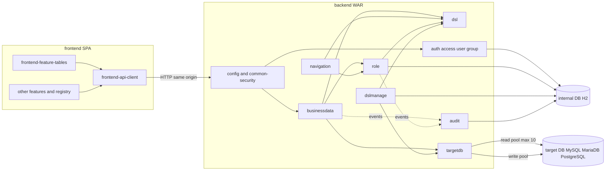
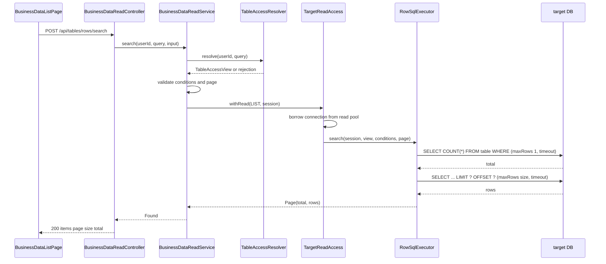
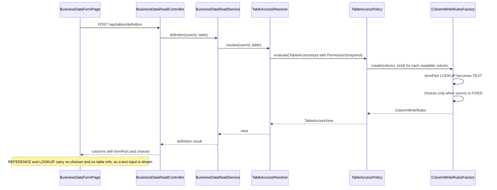
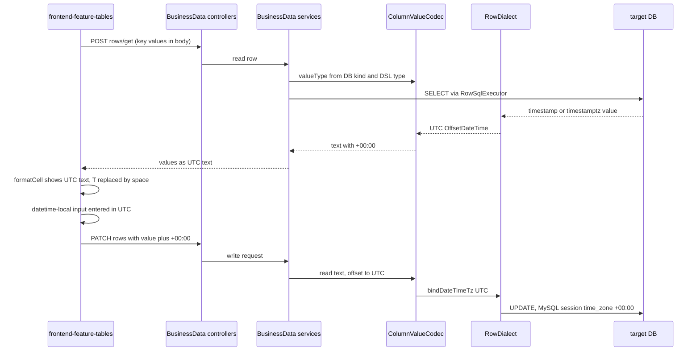
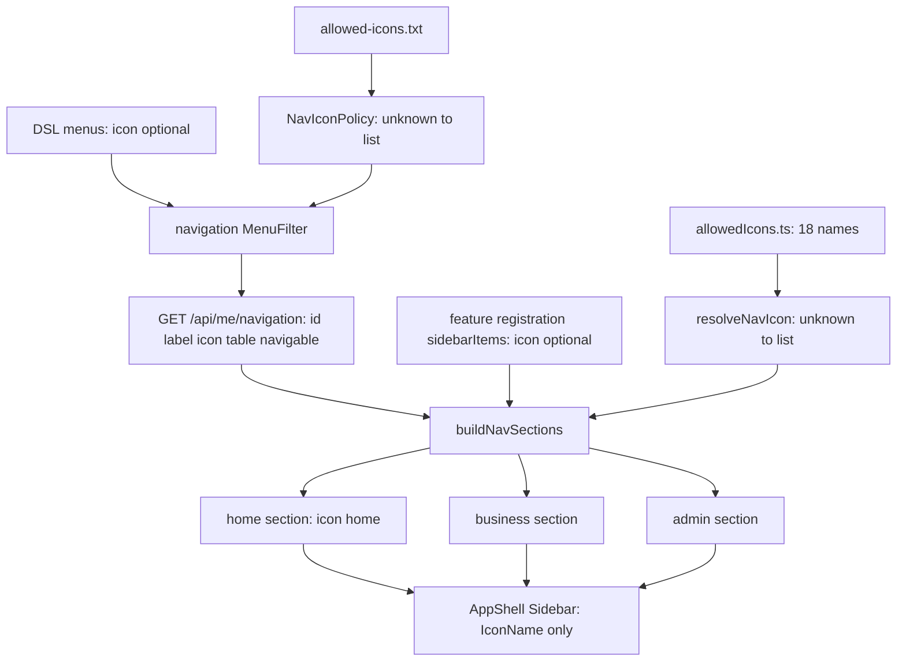

# アーキテクチャ（mastersmith2）

> 2026-11-03（記録のコミット `fa0b01e`）の Intent `261102-timezone-ui-polish` の Focused scan で更新した。業務データの日時の型の対応と接続の時差を読み、「日時の値の流れ」の節（K-94〜K-99）と Interaction Diagrams 5（日時の値の読み出しと保存）・6（サイドバーの区画とアイコンの決まり方。K-100・K-101）を足した。ほかの図と散文は前回以前の記録による。
>
> 前回の記録: 2026-11-01（記録のコミット `6079f13`）の Intent `261101-maintenance-update` の Focused scan で更新した。アーキテクチャそのものは今回読み直していない。`businessdata` の一覧の並べ替えの文（`RowSqlBuilder.page`・`orderBy`）と参照先の並び（`RowDialect.sortExpression`）を読み、所見 K-92（P1）を Improvement Opportunities に足した。図と散文は前回（2026-10-29）以前の記録による。
>
> 前回の記録: 2026-10-29（記録のコミット `15a25aa`）の Intent `261029-reference-lookup-cleanup` の Focused scan で更新した。今回深く読んだのは `businessdata`（選択肢・書き込みの規則・検索の演算子・定義の応答）・`dsl`（選択肢の型）・`targetdb`（署名レベル）・`role`（`PermissionSnapshot` の口）。Interaction Diagrams に 4（業務データの選択肢 REFERENCE・LOOKUP の現状）を足し、所見 K-74・K-75 を書いた。K-62・K-63 は前回（`261027-perf-targets-review`）の記述のまま（今回は再確認していない）。ほかは前回以前の記録による。

## System Overview

- 1つの実行可能 WAR（Spring Boot 4.1.2、Java 25）が、画面（React の SPA、`frontend/dist` を同梱）と API（`/api/**`）を同じオリジンで配る。CORS は置かない。
- 内部DB は組み込みの H2（利用者・認証・招待・DSL・ロール・グループ・監査）。スキーマは Flyway の V1〜V13。
- 対象DB（MySQL・MariaDB・PostgreSQL のどれか1つ）は設定（環境変数）だけから接続する。読み取り専用のプールと、設定が揃ったときだけ作る書き込み専用のプールの2つ。
- 配備先は開発者の PC 上のコンテナだけ（`Dockerfile`・`compose.yaml`）。

## Architectural Style

- モジュール化した一枚岩（modular monolith）。1つの Gradle のアプリ（`backend`）の中で、機能ごとのパッケージ（`auth`・`access`・`audit`・`user`・`useradmin`・`invitation`・`mail`・`appearance`・`targetdb`・`dsl`・`dslmanage`・`role`・`group`・`navigation`・`businessdata`・`common/*`・`config`）に分け、各機能の中を `web`・`service`・`domain`・`repository` に分ける。
- 機能の間の依存の向きは ArchUnit の境界テスト 19 ファイルで固定する（`ArchitectureTest`・`ApiAccessArchitectureTest`・機能ごと。内訳は `code-quality-assessment.md`）。逆向きの知らせは Spring の出来事（監査など）。
- 画面は `features/<featureId>/registration.ts` を置くと読み込まれる差し込みの形で、機能どうしの import は ESLint で止める。

## Component Relationships

文字の代わりの説明: 画面の機能（業務データの `frontend-feature-tables` を含む）は `frontend-api-client` を通して同じオリジンの API を呼ぶ。入口は Spring Security の連鎖（`config` と `common-security`）。`businessdata` は `role`（権限の解決の口）・`dsl`（適用中のモデル）・`targetdb`（接続の貸し出し）を使い、対象DB の行を読み書きする。`targetdb` だけが対象DB へつなぎ、読み取りのプール（既定の上限 10）と書き込みのプールを分ける。`navigation` は `role` と `dsl` でメニューを作る。内部DB の H2 には `user`・`role`・`dslmanage`・`audit` などが書く。点線は Spring の出来事で、`businessdata`・`role` などの出来事を `audit` が受けて監査の行にする。依存の向きの細部は `dependencies.md`。図の矢印のうち今回深く確かめたのは `businessdata`→`targetdb`・`role`・`dsl` と `targetdb` の2つのプール、それ以外は前回の記録による。

## Data Flow

- 要求ごとに: 画面 → アクセストークン → `auth` が署名と期限を確かめ主体を作る → 安全の決まり（`/api/**` の既定はログインだけ）→ controller → service → repository。
- 業務データの要求: `BusinessDataReadController` / `BusinessDataWriteController`（`@ApiAccess(AUTHENTICATED)`）→ `BusinessDataReadService` / `BusinessDataWriteService` が `TableAccessResolver` で権限の写しを作り → `targetdb` の `TargetReadAccess.withRead(目的, …)` で読み取りの接続を借り → `RowSqlExecutor` が SQL を組み立てて実行する。権限の判定は API ごとにサーバー側で行う。
- 監査は各機能の出来事を `audit` が確定の後に別のトランザクションで内部DB に追記する。

## 日時の値の流れ（K-94〜K-99、2026-11-03）

N6（日時のタイムゾーンの変換）の前提になる今の形。持ち主の文書はここで、ほかの文書からはこの節を指す。

### K-94 型の対応（1か所）

`businessdata/repository/ColumnValueCodec.valueType`（266〜330 行）が、DB の種類と DSL の型の名前（`RowDialect.baseName` で小文字にして `(` から後を落としたもの）から受け渡しの型 `ValueType` を決める。DB の種類が分からないときは3種類の結果がそろえばその型、違えば `OTHER`。

| 対象DB | DSL の型の名前 | 受け渡しの型 | 読み方 | 書き方 |
|---|---|---|---|---|
| MySQL・MariaDB | `timestamp` | `DATETIME_TZ` | 文字で受けて `LocalDateTime` に読み、UTC とみなす（`MysqlFamilyRowDialect.readDateTimeTz`、94〜98 行） | UTC の `LocalDateTime` を `setObject`（89〜91 行） |
| MySQL・MariaDB | `datetime` | `DATETIME` | 文字で受けて `LocalDateTime`（`readsTemporalAsText`） | `setObject(LocalDateTime)` |
| MySQL・MariaDB | `date`・`time` | `DATE`・`TIME` | 文字で受けて `LocalDate`・`LocalTime` | `setObject` |
| PostgreSQL | `timestamptz`・`timestamp with time zone` | `DATETIME_TZ` | `getObject(OffsetDateTime)` を UTC にそろえる | UTC の `OffsetDateTime` を `setObject` |
| PostgreSQL | `timestamp`・`timestamp without time zone` | `DATETIME` | `getObject(LocalDateTime)` | `setObject(LocalDateTime)` |
| PostgreSQL | `timetz`・`time with time zone` | `TIME_TZ` | `getObject(OffsetTime)` を UTC にそろえる。比べる左辺は `(列 AT TIME ZONE 'UTC')` | `setObject(OffsetTime)` |
| PostgreSQL | `time`・`time without time zone`・`date` | `TIME`・`DATE` | `getObject(LocalTime・LocalDate)` | `setObject` |

- 応答の文字の形（`ColumnValueCodec.format`・`readCell`）: `DATE` は `2026-03-08`、`DATETIME` は `2026-03-08T02:30:00`（端数は要る桁だけ）、`TIME` は `02:30:00`、`DATETIME_TZ` は `2026-03-08T02:30:00+00:00`、`TIME_TZ` は `02:30:00+00:00`。時差つきは必ず UTC。
- 要求の文字の読み方（`read` → `parse`）: 時差つきは `Z`・`z`・`±hh:mm` を受け付けて UTC にそろえ、オフセットが無ければ UTC とみなす（`parseDateTimeTz`・`parseTimeTz`、437 行から）。時差の無い型は ISO の形だけ（`LocalDateTime.parse` など）。
- 定義の応答（`web/ColumnDefinitionResponse`）は `valueType` と `listFormat` を返す。秒の端数の上限（`ColumnKind.fractionDigits`）は返さず、サーバーの検証（`WriteRequestValidator` の `TOO_MANY_DIGITS`）だけが使う。

### K-95 接続と実行環境の時差

- MySQL・MariaDB: 読み取りのプールは接続を作るときに1回 `SET time_zone = '+00:00'`（`targetdb/config/TargetDataSourceConfig.java` 61・150〜152 行）、書き込みのプールは同じく `SET time_zone = '+00:00', sql_mode = …STRICT_ALL_TABLES`（68 行、`TargetWriteDataSourceConfig.java` 113〜114 行）。`timestamp` の値はこの上で UTC の壁時計として読み書きされる。
- PostgreSQL: セッションの時差を設定しない（`hikariConfig` は MySQL・MariaDB だけに初期化の文を付ける）。PgJDBC は接続の始めに JVM の既定の時差を送る見込み（未検証）。JVM の既定は `Dockerfile` 52 行の `-Duser.timezone=Asia/Tokyo`、`compose.yaml` 37 行の `TZ: Asia/Tokyo`、テストの JVM は `backend/build.gradle.kts` 118 行で同じ `Asia/Tokyo`（いずれも grep で確かめた）。`timestamptz` は `OffsetDateTime` で UTC にそろえるため影響しないが、`timestamp` との比べ・`CURRENT_TIMESTAMP` を `timestamp` の列に入れる既定値には効く（未検証）。
- 時差の無い型（MySQL・MariaDB の `datetime`、PostgreSQL の `timestamp`）の値がどの時差の壁時計かは、アプリからは分からない。見本の対象DB（`docker/targetdb/{mysql,mariadb}/01-sample-schema.sql`）は `created_at DATETIME NOT NULL DEFAULT CURRENT_TIMESTAMP`、PostgreSQL は `created_at TIMESTAMP WITH TIME ZONE … DEFAULT CURRENT_TIMESTAMP`。MySQL・MariaDB の `CURRENT_TIMESTAMP` はセッションの時差で決まるため、アプリから既定値で作った行（`+00:00`）と別の接続から作った行で意味が変わりうる（未検証）。

### K-96 画面の見せ方と入れ方

- 業務データ（`features/tables`）: `valueFormat.ts` の `formatCell` が、`DATE`・`DATETIME`・`TIME` は `T` を空白に替えるだけ、`DATETIME_TZ`・`TIME_TZ` はさらに末尾の `Z` を `+00:00` に替えるだけ（`formatTemporal` 69〜75 行・120〜126 行）。時差を直さない。表のセル・詳細・行のラベルはすべてこの関数を通る。
- 入力: `BusinessDataFormPage.tsx` は `formPart` が `date` なら `type="date"`、`datetime` なら `type="datetime-local"`（`step=1`）、ほかは文字（945〜962 行）。`DATETIME_TZ` には案内「UTC で入れる」（`tables.form.utc`、894〜896 行）。`formDiff.ts` の `toWireValue`（115〜120 行）が秒を足し、`DATETIME_TZ` には `+00:00` を付けて送る。検索（`SearchPanel.tsx` の `inputAttributes`）は型で決め、`DATETIME`・`DATETIME_TZ` は `datetime-local`、`TIME`・`TIME_TZ` は `time`。`searchConditions.ts` は時差つきの範囲の向きを画面で判定しない（サーバーに任せる）。
- ほかの画面（DSL の管理・招待・利用者の管理）: `shared/format/formatDateTime.ts` が UTC の日時を端末（または渡した）時差に直し、略号を添える（日本語は `2026-09-24 10:15 JST`）。業務データの画面とは別の系統。
- 一覧の書式 `ListFormat` の `DATE`・`DATETIME`・`TIME` は DSL の値・定義の応答にあるが、画面は使わない（`valueFormat.ts` は真偽値と `NUMBER_GROUPED` だけを見る）。`dsl/domain/ListFormat.java` の頭は「書式の中身は画面の Intent で決める」のまま。
- 利用者ごとの時差の設定は無い（表示の設定は言語・テーマ・文字の大きさ。`app/display-settings` は流し読み）。

### K-97 値の往復で守るもの

- 主キーの値（行を指す本文）・参照の値・検索の値・作成の応答の主キー（`RowSqlExecutor` 288 行の `ColumnValueCodec.format`）・監査に残す値（`BusinessDataWriteService` 458・516・825 行）は、サーバーの UTC の文字のまま往復する。画面は詳細の値をそのまま行の鍵に使う。
- 表示だけを地方時に替えるなら、`formatCell` を替え、鍵・本文の値は替えない。入力も地方時にするなら、画面でオフセットを付けて送る（サーバーは `±hh:mm` を受け付けて UTC にそろえる）か、サーバーで直すかを設計で決める。`datetime-local` は時差を持たないため、端末の時差に従うなら夏時間の切り替えで無い時刻・二重の時刻が出うる（`Asia/Tokyo` には無い。未検証）。
- 時差の無い型を変換の対象にするかは、K-95 の「どの壁時計か分からない」と合わせて要件で決める。

### K-98 秒の端数と型の名前

- `ColumnValueCodec.fractionDigits`: 型の名前の `(n)` → DSL の精度 → DB の種類の既定（PostgreSQL 6、MySQL・MariaDB 0）の順。既定の DSL の生成（`dslmanage/generate`）は MySQL・MariaDB の `DATA_TYPE`（例 `datetime`）だけを型の名前に写し、`targetdb/repository/MysqlSchemaQueries` は `DATETIME_PRECISION` を読まない（grep）。そのため `datetime(6)`・`timestamp(3)` の列でも、生成した DSL では端数の上限が 0 になり、端数つきの値の書き込みは `TOO_MANY_DIGITS` になる見込み（未検証）。
- PostgreSQL の型の名前を手で `timestamp(3) with time zone` と書くと、`baseName` が `timestamp` を返し `DATETIME`（時差なし）になる。生成は `udt_name`（`timestamptz`）を書くため、手書きの DSL のときだけ。
- 画面の更新の初めの値は `formDiff.ts` の `toDateTimeInput`（57〜64 行）で秒までに切られ、端数を落とす（変えなければ送らないため値は失わない）。

### K-99 範囲の端

- MySQL の `time` は 24 時間を超える値・負の値を持てるが、文字で受けて `LocalTime.parse` で読むため `CellValue.Unreadable` になる（`readCell`）。
- MySQL の `year`・PostgreSQL の `interval` は `OTHER`（文字にして読むだけ。書けない）。MySQL・MariaDB の `timestamp` のゼロの日時は読めずに例外になる（`readDateTimeTz` の注記）。

## Interaction Diagrams

### 1. 業務データの一覧の取得（K-62・K-63）

文字の代わりの説明: 画面の一覧が POST で検索を頼むと、サービスが権限の写しを作り、条件とページの指定を確かめてから、`ReadPurpose.LIST` で読み取りのプールから接続を1本借りる。`RowSqlExecutor.search` はその同じ接続で、まず件数の文 `SELECT COUNT(*) FROM <表><WHERE>` を実行し（`setMaxRows(1)`・問い合わせの時間の上限）、`offset >= total` なら行を読まずに空のページを返す。そうでなければページの文（`LIMIT ? OFFSET ?`。主キーのある表は主キーだけを内側で並べて外側で JOIN する形）を実行して行を読む。応答は `items`・`page`・`size`・`total`。

**K-62 一覧は同じ接続で `COUNT(*)` とページの文を続けて実行する。`COUNT(*)` には上限が無い（`businessdata`）**

- 確かめた事実:
  - `RowSqlBuilder.count(Where)`（`backend/src/main/java/cherry/mastersmith/businessdata/repository/RowSqlBuilder.java` 142〜144 行）は `"SELECT COUNT(*) FROM " + table + where.sql()`。`LIMIT` も上限もない完全な数え方。
  - `RowSqlExecutor.search`（`RowSqlExecutor.java` 78〜122 行（今回再確認。前回から変更なし））の順は、(1) 件数の文（`setQueryTimeout(session.queryTimeoutSeconds())`・`setMaxRows(1)`）→ (2) `page.offset() >= total` なら空のページ → (3) ページの文（`setMaxRows(page.size())`、`LIMIT ? OFFSET ?` の2つの `setLong`）。2つは1つの `TargetReadSession` の同じ接続で続けて流れる。
  - ページの文 `RowSqlBuilder.page`（147〜175 行）は、主キーのある表で `SELECT ... FROM 表 o JOIN (SELECT 主キー FROM 表 WHERE … ORDER BY … LIMIT ? OFFSET ?) i ON …`、主キーの無い表でそのまま `LIMIT ? OFFSET ?`。ページの大きさは 20・50・100、ページの番号は 1〜1,000,000（`domain/PageRequest.java` 24〜31 行）。
  - 部分一致 `CONTAINS` は `LIKE ? ESCAPE '!'` で、値の前後に `%` を付ける（`domain/ContainsPattern.java` 21〜47 行）。前方の `%` のため通常の索引は使えない（見立て。実行計画は見ていない）。
- 見立て（未検証）: 前の Intent の記録（`aidlc/spaces/default/memory/project.md` の Interpretations）は、MySQL・MariaDB の一覧の Not Met 4件を「部分一致が索引を使えず、1要求で件数とページの2回表の全部を読み、読み取りのプール 5（当時の値。今は 10）に 10 VU が集まる」ためとする。今回は再測定していない。
- 今回の Intent への意味: 件数の取り方を変える（上限つきにする・数えない・近似にする）なら、この1か所（`RowSqlBuilder.count`・`RowSqlExecutor.search`）と応答の型（K-64）が中心になる。

**K-63 読み取りのプールは既定の上限 10（前回 5 から引き上げ済み）・借りる待ち 3 秒で、1要求が一覧の間ずっと1本を持つ（`targetdb`）**

- 確かめた事実:
  - `TargetDbProperties.Pool`（`targetdb/config/TargetDbProperties.java` 116〜127 行（今回 2026-10-28 に再確認））: `maximumSize` 既定 10（`TargetDbProperties.java` 117・121・126 行。Intent 261025-deps-perf-carryover の FR4.2 で 5 から引き上げ）、`idleTimeout` 既定 60 秒。書き込み側の `WritePool` は既定 5（158〜164 行）。環境変数は `MASTERSMITH_TARGET_DB_POOL_MAXIMUM_SIZE`・`MASTERSMITH_TARGET_DB_POOL_IDLE_TIMEOUT`（`.env.example` 66〜67 行）。書き込み側は別の `write.pool.maximumSize`（`.env.example` 74 行、`TargetWriteDataSourceConfig` 104 行）。
  - `TargetDataSourceConfig.hikariConfig`（`targetdb/config/TargetDataSourceConfig.java` 約 135〜148 行）: `setReadOnly(true)`・`setMinimumIdle(0)`・`setMaximumPoolSize(…maximumSize())`・`setConnectionTimeout(connectTimeout)`（既定 3 秒）・`setInitializationFailTimeout(-1)`。MySQL・MariaDB には接続を作るときに1回だけセッションのタイムゾーンを UTC にする。Bean は `defaultCandidate = false`。
  - `ReadPurpose` は `GENERATE`・`COMPARE`・`LIST`・`DETAIL` の4つ。問い合わせ1回の上限は `QueryTimeout`（既定 `generate` 20 秒、`compare`・`list`・`detail`・`write` は 5 秒）。一覧の件数とページは `LIST` の同じ上限を共有する（1文ごとに 5 秒）。
- 今回の Intent への意味: 読み取りのプールの値を変える口は環境変数だけ。負荷の試験で変えるには perf のアプリの環境ファイルに足す（K-67）。借りる待ちの 3 秒を超えると、業務データの API は 503 の `BUSINESS_TARGET_DB_UNAVAILABLE`（前回の記録）になる。

### 2. 業務データの書き込み（前回の記録による。今回は外部キー違反の写し先だけ再確認した）

作成・更新・削除は `BusinessDataWriteController`（`POST /api/tables/rows`・`PATCH /api/tables/rows`・`POST /api/tables/rows/delete`）→ `BusinessDataWriteService` → `TargetWriteAccess`（書き込みのプール）→ `RowSqlExecutor` / `RowWriteSqlBuilder`。対象DB の確定の後に、内部DB へ `BusinessDataChangedEvent` を出して `audit` が別のトランザクションで追記する。流れの細部は今回確かめていない。

### 3. 監査の書き込み

各機能の service が出来事を出すと、確定の後（トランザクションが無ければ出した時点）に `AuditEventListener` が受け、`AuditEventRecorder` が `REQUIRES_NEW` の別のトランザクションで `audit_events` に追記する（2本目の内部DB の接続を借りる）。`audit` は `businessdata` の `domain` の出来事の型を import する（5 行の import、アーキテクトが確かめた）。

### 4. 業務データの選択肢 REFERENCE・LOOKUP の現状と、参照先を読む経路の候補（K-74・K-75）

文字の代わりの説明: 画面が定義を頼むと、サービスが `TableAccessResolver` で権限の写し（適用中の DSL を含む）から `TableAccessPolicy` を通して表の見え方を作り、その中でカラムごとに `ColumnWriteRulesFactory.create` が書き込みの規則を作る（呼び出し元は `TableAccessPolicy` 64 行で確かめた）。ここで `formPart: lookup` は `text` に置き換わり、選択肢（`choices`）は `source: FIXED` の `select`・`radio` だけが持つ。REFERENCE・LOOKUP のカラムは選択肢も参照先の情報も持たない応答になり、画面は文字の入力として描く。

**K-74 REFERENCE・LOOKUP は DSL までは完成、業務データでは「文字の入力」扱い（`businessdata`・`dsl`）**

- 確かめた事実（開発担当の調査。アーキテクトは `ColumnWriteRulesFactory`・`ColumnWriteRules`・`OptionSource`・`OptionResponse` の該当行を読み直して一致を確かめた）:
  - DSL 側: JSON Schema（`backend/src/main/resources/dsl/dsl-schema-v2.json`）で `options.source` は FIXED・REFERENCE・LOOKUP。REFERENCE は `table`・`valueColumn`・`labelColumn` が必須、LOOKUP は `table`・`valueColumn`・`lookupSearch`（column と operator）・`lookupList`（column と order）が必須で、formPart に `lookup` がある。モデルは `dsl/domain/OptionSource`（種類ごとの必須をコンストラクターで検査。LOOKUP は `lookupSearch`・`lookupList` が1件以上）、`LookupSearchItem`・`LookupListItem`・`OptionSourceKind`・`FormPart.LOOKUP`。`DslModelMapper` が写す。
  - 意味の検証: `DslSemanticValidator`（BR3.3）。`select`・`radio` は FIXED か REFERENCE、`lookup` は LOOKUP のみ。参照先の table・valueColumn・labelColumn・lookup の column が DSL に実在するかを照合する。`tables` はスキーマ内の表のため、**参照先は同じスキーマの中**の表に限られる（開発担当の読み）。
  - 既定の DSL の生成: `dslmanage/generate/DslTreeBuilder.reference()` が1カラムの外部キーから `source: REFERENCE`（valueColumn と labelColumn は同じカラム）を出す。LOOKUP は生成せず、手書きの DSL でのみ使える。
  - 業務データ側（暫定）: `businessdata/domain/ColumnWriteRulesFactory`（48 行）は `column.formPart() == FormPart.LOOKUP ? FormPart.TEXT : …` で `lookup` を `text` に置き換える。`choices()`（106〜113 行）は `select`・`radio` かつ `source == FIXED` のときだけ `column.options().items()` を返し、REFERENCE・LOOKUP は空（Javadoc に「REFERENCE・LOOKUP は text として扱い、選択肢と照らさない。BR3.7」）。`ColumnWriteRules`（80 行）は `FormPart.LOOKUP` を渡されると例外を投げる（置き換え済みの前提）。`SearchOperatorPolicy` は REFERENCE・LOOKUP の CHOICE・IN を EQUALS に読み替える（冒頭の Javadoc）。
  - 定義の応答: `OptionResponse` は `value` と `label` だけ（`OptionResponse.from(OptionItem)`）。`ColumnDefinitionResponse` に参照先の table・labelColumn・lookupSearch・lookupList を載せる欄は無い（開発担当の読み）。画面は `choices` と `formPart` だけで部品を選ぶ。
  - 書き込みの外部キー違反: `RowWriteFailureReason.REFERENCE_NOT_FOUND` → `WriteRejection.REFERENCE_NOT_FOUND` → 409 `BUSINESS_REFERENCE_NOT_FOUND`（フィールドの誤り）は既に返る。
- 位置づけ: 上の置き換えは前の Intent `261016-business-data-views` で、他テーブル参照を範囲から外したことによる意図的な暫定（`aidlc/spaces/default/memory/project.md` の記録）。今回の Intent で本実装に置き換える対象。

**K-75 参照先の行を読む専用の経路は無い。流用の候補は次のとおり（未検証の仮説を含む）（`businessdata`・`role`・`targetdb`）**

- 確かめた事実（開発担当の調査）:
  - 業務データの検索 API の対象は1つのテーブルで、参照先の行を読む専用の API は無い。
  - 権限: `role/domain/PermissionSnapshot.main(schemaName, tableName, columnName)`（132 行）で、参照先のテーブル・カラムごとの実効の主権限を引ける（アーキテクトが署名を確かめた）。`TableAccessResolver`（94〜170 行）が1テーブルぶんの `TableAccessInput` から `TableAccessPolicy.evaluate` で `TableAccessView` を作る。
  - SQL: `RowSqlExecutor.search`・`detail` が `TableAccessView` に対して組む。JDBC の接続から文を作ってよいのは `RowSqlExecutor` と `targetdb.repository` の数クラスだけ（`BusinessDataBoundaryArchitectureTest` の `ALLOWED_STATEMENT_OWNERS`）。
  - 上限: ページは `PageRequest`（大きさ 20・50・100、既定 20、最大ページ 1,000,000）、検索値は 1,000 文字まで（`SearchRequestValidator.MAX_VALUE_LENGTH`）。時間の上限は `ReadPurpose`（`LIST`・`DETAIL` とも既定 5 秒、`TargetDbProperties.QueryTimeout`）。
- 未検証の仮説（コードからは決まらず、要件定義・設計の判断）:
  - 参照先の選択肢・ピッカーの一覧は、`TableAccessResolver` に参照先のテーブル名を渡して既存の `search` を再利用できる見込み（新しい API は1〜2本）。
  - 選択肢の読み取りに専用の `ReadPurpose` が要るか、参照先の主権限が NONE のときに選択肢を出さないか値だけ出すか、選択肢の件数の上限をどう置くかは未決。
  - 件数の取り方（K-62・K-64）を変えると、参照先の一覧の表示にも波及する。
- 守るべき決まり: `project.md` の Forbidden（業務データの行の値・主キーの値をログ・トレース・エラー応答に含めない、SQL に利用者の入力を文字列で組み込まない）と Mandated（主権限 NONE のカラムは応答に含めない）は参照先の選択肢・ピッカーにも当たる。検索値・参照先の値は本文で運ぶ現行の方針（`/api/tables` の道に値を載せない）を保つ必要がある。

### 5. 業務データの日時の値の読み出しと保存（K-94〜K-97、2026-11-03）

文字の代わりの説明: 画面は行を指す値を本文で送る。サービスは DB の種類と DSL の型から受け渡しの型を決め、`RowSqlExecutor` で読む。時差つきの値は方言が UTC の `OffsetDateTime` にそろえ、codec が `+00:00` 付きの文字にして返す。画面はその文字の `T` を空白にして見せるだけで、時差は直さない。入力は `datetime-local` に UTC で入れ、`+00:00` を付けて送る。サーバーは文字をオフセットごと読んで UTC にそろえ、方言がバインドする。MySQL・MariaDB は接続の時差 `+00:00` の上で時差の無い日時として書く。時差の無い型は、どの段でも変換しない。

### 6. サイドバーの区画とアイコンの決まり方（K-100・K-101、2026-11-03）

文字の代わりの説明: 業務のメニューは、DSL の `menus` の `icon`（任意）をサーバーの `NavIconPolicy` が `allowed-icons.txt` と照らし、無い・一致しない名前を `list` にして応答に入れる。応答にテーブルかビューかの印は無い。画面の `buildNavSections` は、ホームの区画（`home` のアイコン）、業務の区画（応答の木）、管理の区画（機能の登録の `sidebarItems` の `section: ADMIN`）を作り、アイコンは `allowedIcons.ts` の 18 種と照らして無ければ `list` にする。管理の登録はどれも `icon` を置かないため、管理の項目はすべて `list` になる。make-you-chic-ui の Sidebar は `IconName` だけを描く。

## Key Design Decisions

- 対象DB は読み取り専用の別のプールと、書き込み専用の別のプールに分ける。どちらも既定の候補にしない（Flyway・JPA が誤って使わない）。
- 権限は要求ごとに内部DB から解決し、キャッシュしない（割り当ての変更が次の要求で効く）。
- 業務データの SQL を組み立てて実行する部品は `RowSqlExecutor` に閉じる（`BusinessDataBoundaryArchitectureTest` が、`businessdata` で JDBC の接続から文を作ってよい場所をこの部品だけに絞る）。DB の種類ごとの差は `RowDialect`（`MysqlFamilyRowDialect`・`PostgresRowDialect`）に閉じる。
- 行の主キーの値を道（URL）にも問い合わせにも載せず、本文で運ぶ（前回の決定）。
- 他テーブル参照（REFERENCE・LOOKUP）の業務データでの扱いは暫定で、`formPart: lookup` を `text` に置き換え、選択肢は FIXED だけ返す（前回の決定。K-74）。

## Improvement Opportunities

- 一覧の `COUNT(*)` が表の全部を読みうる（K-62）。読み取りのプールの既定は 10 に上がっている（K-63。それでも MySQL・MariaDB の部分一致では借りる待ちが出る見込み）。どちらも MySQL・MariaDB の部分一致で効く見込み（前回の測定の記録による）。
- REFERENCE・LOOKUP の本実装（K-74・K-75）。参照先を読む経路を `businessdata` の内側に置くか、権限と上限の扱いをどう決めるかが設計の中心。
- 件数が確定した数だけを持つ型（K-64）。「多数」と出す案には API・画面・テスト・perf の判定への波及がある。
- **K-92 一覧の並べ替えと MySQL の 1038（P1、2026-11-01）**: 参照先の読み取りの並び（`RowSqlBuilder.referenceOrderBy` → `RowDialect.sortExpression`、145〜151 行）は、文字の型を先頭 `ColumnValueCodec.LIST_TEXT_LIMIT` 字の `SUBSTRING` にして並べ、MySQL の並べ替えの領域の不足（1038）を避ける。業務データの一覧のページの文（`RowSqlBuilder.page`、150〜173 行）は、主キーのあるテーブルでは主キーだけを内側の問い合わせで並べて `LIMIT ? OFFSET ?` で取り、外側でつなぐ。その並びの `orderBy`（337〜347 行）はカラムをそのまま `RowDialect.orderTerm` に渡す（切らない）。前の Intent の Build and Test（2,000 行・200 行が 10,000 字・1ページ 20 件）では 1038 は再現しなかった。見立て（未検証）: 並べ替えの列が長い文字で、深い `OFFSET` か大きいページのとき、内側の並べ替えが領域を超えうる。NFR 設計の捨ての試しで確かめ、直すか（一覧の並びも `sortExpression` に寄せるか）を要件で決める。

- **N6 の作りの論点（K-94〜K-98、2026-11-03）**: 変換を画面だけで行うか（`formatCell`・入力の部品・検索の入力）、サーバーで行うか（`ColumnValueCodec`）、時差の基準を端末の時差にするか利用者・インスタンスの設定にするか、PostgreSQL のセッションの時差を MySQL・MariaDB とそろえるか、時差の無い型を対象にするか、`ListFormat` の日時の書式を今回決めるか。画面の二系統（`formatDateTime` と `formatCell`）を寄せるかも論点。
- **画面の仕上げ（K-100〜K-104、2026-11-03）**: アイコンを足すには make-you-chic-ui の上流への依頼と固定先の更新が要り、写しの2か所（`allowedIcons.ts`・`allowed-icons.txt`）を直す。テーブルとビューでアイコンを変えるなら、応答に印を足す（`MenuFilter` で `DslTable.view` を引ける）か、DSL の `icon` に任せるかを決める。

## Sources

- 2026-11-03: `ColumnValueCodec.java`・`RowDialect.java`・`MysqlFamilyRowDialect.java`・`PostgresRowDialect.java`・`TargetDataSourceConfig.java`・`navigation/`（`MenuFilter`・`NavIconPolicy`・`NavigationService`・`NavNodeResponse`）・`frontend/src/features/tables/{valueFormat,formDiff}.ts`・`frontend/src/app/navigation/buildNavSections.ts`、開発担当の調査 `aidlc/spaces/default/intents/261102-timezone-ui-polish/inception/reverse-engineering/developer-scan.md`。
- 2026-11-01: `RowSqlBuilder.java`（140〜180・330〜348 行）・`RowDialect.java`（110〜160 行）、開発担当の調査 `aidlc/spaces/default/intents/261101-maintenance-update/inception/reverse-engineering/developer-scan.md`。
- 開発担当の調査（今回: `aidlc/spaces/default/intents/261029-reference-lookup-cleanup/inception/reverse-engineering/developer-scan.md` の K-74・K-75。前回: K-62・K-63 の事実と見立て）と、アーキテクトの確かめ直し（`reverse-engineering-timestamp.md`）。
