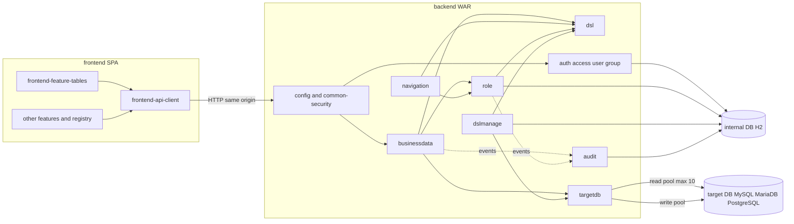
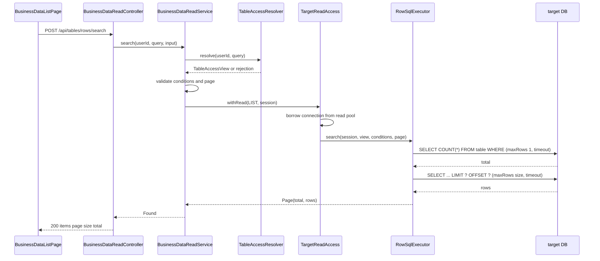
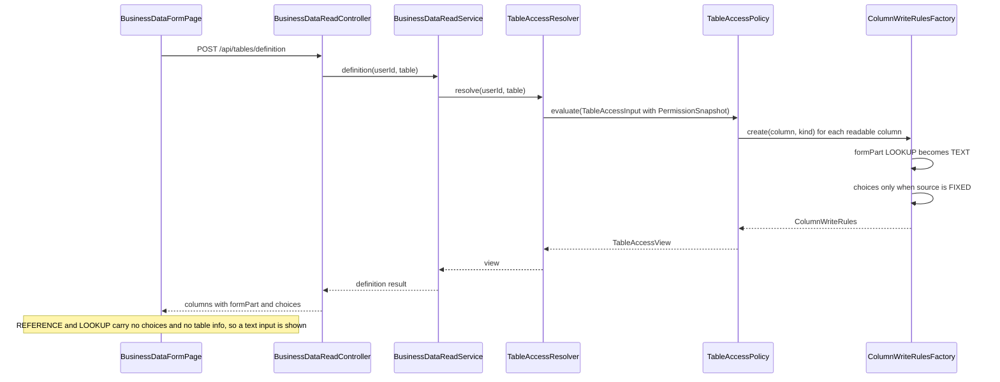

# アーキテクチャ（mastersmith2）

> 2026-10-29（記録のコミット `15a25aa`）の Intent `261029-reference-lookup-cleanup` の Focused scan で更新した。今回深く読んだのは `businessdata`（選択肢・書き込みの規則・検索の演算子・定義の応答）・`dsl`（選択肢の型）・`targetdb`（署名レベル）・`role`（`PermissionSnapshot` の口）。Interaction Diagrams に 4（業務データの選択肢 REFERENCE・LOOKUP の現状）を足し、所見 K-74・K-75 を書いた。K-62・K-63 は前回（`261027-perf-targets-review`）の記述のまま（今回は再確認していない）。ほかは前回以前の記録による。

## System Overview

- 1つの実行可能 WAR（Spring Boot 4.1.2、Java 25）が、画面（React の SPA、`frontend/dist` を同梱）と API（`/api/**`）を同じオリジンで配る。CORS は置かない。
- 内部DB は組み込みの H2（利用者・認証・招待・DSL・ロール・グループ・監査）。スキーマは Flyway の V1〜V13。
- 対象DB（MySQL・MariaDB・PostgreSQL のどれか1つ）は設定（環境変数）だけから接続する。読み取り専用のプールと、設定が揃ったときだけ作る書き込み専用のプールの2つ。
- 配備先は開発者の PC 上のコンテナだけ（`Dockerfile`・`compose.yaml`）。

## Architectural Style

- モジュール化した一枚岩（modular monolith）。1つの Gradle のアプリ（`backend`）の中で、機能ごとのパッケージ（`auth`・`access`・`audit`・`user`・`useradmin`・`invitation`・`mail`・`appearance`・`targetdb`・`dsl`・`dslmanage`・`role`・`group`・`navigation`・`businessdata`・`common/*`・`config`）に分け、各機能の中を `web`・`service`・`domain`・`repository` に分ける。
- 機能の間の依存の向きは ArchUnit の境界テスト 19 ファイルで固定する（`ArchitectureTest`・`ApiAccessArchitectureTest`・機能ごと。内訳は `code-quality-assessment.md`）。逆向きの知らせは Spring の出来事（監査など）。
- 画面は `features/<featureId>/registration.ts` を置くと読み込まれる差し込みの形で、機能どうしの import は ESLint で止める。

## Component Relationships

文字の代わりの説明: 画面の機能（業務データの `frontend-feature-tables` を含む）は `frontend-api-client` を通して同じオリジンの API を呼ぶ。入口は Spring Security の連鎖（`config` と `common-security`）。`businessdata` は `role`（権限の解決の口）・`dsl`（適用中のモデル）・`targetdb`（接続の貸し出し）を使い、対象DB の行を読み書きする。`targetdb` だけが対象DB へつなぎ、読み取りのプール（既定の上限 10）と書き込みのプールを分ける。`navigation` は `role` と `dsl` でメニューを作る。内部DB の H2 には `user`・`role`・`dslmanage`・`audit` などが書く。点線は Spring の出来事で、`businessdata`・`role` などの出来事を `audit` が受けて監査の行にする。依存の向きの細部は `dependencies.md`。図の矢印のうち今回深く確かめたのは `businessdata`→`targetdb`・`role`・`dsl` と `targetdb` の2つのプール、それ以外は前回の記録による。

## Data Flow

- 要求ごとに: 画面 → アクセストークン → `auth` が署名と期限を確かめ主体を作る → 安全の決まり（`/api/**` の既定はログインだけ）→ controller → service → repository。
- 業務データの要求: `BusinessDataReadController` / `BusinessDataWriteController`（`@ApiAccess(AUTHENTICATED)`）→ `BusinessDataReadService` / `BusinessDataWriteService` が `TableAccessResolver` で権限の写しを作り → `targetdb` の `TargetReadAccess.withRead(目的, …)` で読み取りの接続を借り → `RowSqlExecutor` が SQL を組み立てて実行する。権限の判定は API ごとにサーバー側で行う。
- 監査は各機能の出来事を `audit` が確定の後に別のトランザクションで内部DB に追記する。

## Interaction Diagrams

### 1. 業務データの一覧の取得（K-62・K-63）

文字の代わりの説明: 画面の一覧が POST で検索を頼むと、サービスが権限の写しを作り、条件とページの指定を確かめてから、`ReadPurpose.LIST` で読み取りのプールから接続を1本借りる。`RowSqlExecutor.search` はその同じ接続で、まず件数の文 `SELECT COUNT(*) FROM <表><WHERE>` を実行し（`setMaxRows(1)`・問い合わせの時間の上限）、`offset >= total` なら行を読まずに空のページを返す。そうでなければページの文（`LIMIT ? OFFSET ?`。主キーのある表は主キーだけを内側で並べて外側で JOIN する形）を実行して行を読む。応答は `items`・`page`・`size`・`total`。

**K-62 一覧は同じ接続で `COUNT(*)` とページの文を続けて実行する。`COUNT(*)` には上限が無い（`businessdata`）**

- 確かめた事実:
  - `RowSqlBuilder.count(Where)`（`backend/src/main/java/cherry/mastersmith/businessdata/repository/RowSqlBuilder.java` 142〜144 行）は `"SELECT COUNT(*) FROM " + table + where.sql()`。`LIMIT` も上限もない完全な数え方。
  - `RowSqlExecutor.search`（`RowSqlExecutor.java` 78〜122 行（今回再確認。前回から変更なし））の順は、(1) 件数の文（`setQueryTimeout(session.queryTimeoutSeconds())`・`setMaxRows(1)`）→ (2) `page.offset() >= total` なら空のページ → (3) ページの文（`setMaxRows(page.size())`、`LIMIT ? OFFSET ?` の2つの `setLong`）。2つは1つの `TargetReadSession` の同じ接続で続けて流れる。
  - ページの文 `RowSqlBuilder.page`（147〜175 行）は、主キーのある表で `SELECT ... FROM 表 o JOIN (SELECT 主キー FROM 表 WHERE … ORDER BY … LIMIT ? OFFSET ?) i ON …`、主キーの無い表でそのまま `LIMIT ? OFFSET ?`。ページの大きさは 20・50・100、ページの番号は 1〜1,000,000（`domain/PageRequest.java` 24〜31 行）。
  - 部分一致 `CONTAINS` は `LIKE ? ESCAPE '!'` で、値の前後に `%` を付ける（`domain/ContainsPattern.java` 21〜47 行）。前方の `%` のため通常の索引は使えない（見立て。実行計画は見ていない）。
- 見立て（未検証）: 前の Intent の記録（`aidlc/spaces/default/memory/project.md` の Interpretations）は、MySQL・MariaDB の一覧の Not Met 4件を「部分一致が索引を使えず、1要求で件数とページの2回表の全部を読み、読み取りのプール 5（当時の値。今は 10）に 10 VU が集まる」ためとする。今回は再測定していない。
- 今回の Intent への意味: 件数の取り方を変える（上限つきにする・数えない・近似にする）なら、この1か所（`RowSqlBuilder.count`・`RowSqlExecutor.search`）と応答の型（K-64）が中心になる。

**K-63 読み取りのプールは既定の上限 10（前回 5 から引き上げ済み）・借りる待ち 3 秒で、1要求が一覧の間ずっと1本を持つ（`targetdb`）**

- 確かめた事実:
  - `TargetDbProperties.Pool`（`targetdb/config/TargetDbProperties.java` 116〜127 行（今回 2026-10-28 に再確認））: `maximumSize` 既定 10（`TargetDbProperties.java` 117・121・126 行。Intent 261025-deps-perf-carryover の FR4.2 で 5 から引き上げ）、`idleTimeout` 既定 60 秒。書き込み側の `WritePool` は既定 5（158〜164 行）。環境変数は `MASTERSMITH_TARGET_DB_POOL_MAXIMUM_SIZE`・`MASTERSMITH_TARGET_DB_POOL_IDLE_TIMEOUT`（`.env.example` 66〜67 行）。書き込み側は別の `write.pool.maximumSize`（`.env.example` 74 行、`TargetWriteDataSourceConfig` 104 行）。
  - `TargetDataSourceConfig.hikariConfig`（`targetdb/config/TargetDataSourceConfig.java` 約 135〜148 行）: `setReadOnly(true)`・`setMinimumIdle(0)`・`setMaximumPoolSize(…maximumSize())`・`setConnectionTimeout(connectTimeout)`（既定 3 秒）・`setInitializationFailTimeout(-1)`。MySQL・MariaDB には接続を作るときに1回だけセッションのタイムゾーンを UTC にする。Bean は `defaultCandidate = false`。
  - `ReadPurpose` は `GENERATE`・`COMPARE`・`LIST`・`DETAIL` の4つ。問い合わせ1回の上限は `QueryTimeout`（既定 `generate` 20 秒、`compare`・`list`・`detail`・`write` は 5 秒）。一覧の件数とページは `LIST` の同じ上限を共有する（1文ごとに 5 秒）。
- 今回の Intent への意味: 読み取りのプールの値を変える口は環境変数だけ。負荷の試験で変えるには perf のアプリの環境ファイルに足す（K-67）。借りる待ちの 3 秒を超えると、業務データの API は 503 の `BUSINESS_TARGET_DB_UNAVAILABLE`（前回の記録）になる。

### 2. 業務データの書き込み（前回の記録による。今回は外部キー違反の写し先だけ再確認した）

作成・更新・削除は `BusinessDataWriteController`（`POST /api/tables/rows`・`PATCH /api/tables/rows`・`POST /api/tables/rows/delete`）→ `BusinessDataWriteService` → `TargetWriteAccess`（書き込みのプール）→ `RowSqlExecutor` / `RowWriteSqlBuilder`。対象DB の確定の後に、内部DB へ `BusinessDataChangedEvent` を出して `audit` が別のトランザクションで追記する。流れの細部は今回確かめていない。

### 3. 監査の書き込み

各機能の service が出来事を出すと、確定の後（トランザクションが無ければ出した時点）に `AuditEventListener` が受け、`AuditEventRecorder` が `REQUIRES_NEW` の別のトランザクションで `audit_events` に追記する（2本目の内部DB の接続を借りる）。`audit` は `businessdata` の `domain` の出来事の型を import する（5 行の import、アーキテクトが確かめた）。

### 4. 業務データの選択肢 REFERENCE・LOOKUP の現状と、参照先を読む経路の候補（K-74・K-75）

文字の代わりの説明: 画面が定義を頼むと、サービスが `TableAccessResolver` で権限の写し（適用中の DSL を含む）から `TableAccessPolicy` を通して表の見え方を作り、その中でカラムごとに `ColumnWriteRulesFactory.create` が書き込みの規則を作る（呼び出し元は `TableAccessPolicy` 64 行で確かめた）。ここで `formPart: lookup` は `text` に置き換わり、選択肢（`choices`）は `source: FIXED` の `select`・`radio` だけが持つ。REFERENCE・LOOKUP のカラムは選択肢も参照先の情報も持たない応答になり、画面は文字の入力として描く。

**K-74 REFERENCE・LOOKUP は DSL までは完成、業務データでは「文字の入力」扱い（`businessdata`・`dsl`）**

- 確かめた事実（開発担当の調査。アーキテクトは `ColumnWriteRulesFactory`・`ColumnWriteRules`・`OptionSource`・`OptionResponse` の該当行を読み直して一致を確かめた）:
  - DSL 側: JSON Schema（`backend/src/main/resources/dsl/dsl-schema-v2.json`）で `options.source` は FIXED・REFERENCE・LOOKUP。REFERENCE は `table`・`valueColumn`・`labelColumn` が必須、LOOKUP は `table`・`valueColumn`・`lookupSearch`（column と operator）・`lookupList`（column と order）が必須で、formPart に `lookup` がある。モデルは `dsl/domain/OptionSource`（種類ごとの必須をコンストラクターで検査。LOOKUP は `lookupSearch`・`lookupList` が1件以上）、`LookupSearchItem`・`LookupListItem`・`OptionSourceKind`・`FormPart.LOOKUP`。`DslModelMapper` が写す。
  - 意味の検証: `DslSemanticValidator`（BR3.3）。`select`・`radio` は FIXED か REFERENCE、`lookup` は LOOKUP のみ。参照先の table・valueColumn・labelColumn・lookup の column が DSL に実在するかを照合する。`tables` はスキーマ内の表のため、**参照先は同じスキーマの中**の表に限られる（開発担当の読み）。
  - 既定の DSL の生成: `dslmanage/generate/DslTreeBuilder.reference()` が1カラムの外部キーから `source: REFERENCE`（valueColumn と labelColumn は同じカラム）を出す。LOOKUP は生成せず、手書きの DSL でのみ使える。
  - 業務データ側（暫定）: `businessdata/domain/ColumnWriteRulesFactory`（48 行）は `column.formPart() == FormPart.LOOKUP ? FormPart.TEXT : …` で `lookup` を `text` に置き換える。`choices()`（106〜113 行）は `select`・`radio` かつ `source == FIXED` のときだけ `column.options().items()` を返し、REFERENCE・LOOKUP は空（Javadoc に「REFERENCE・LOOKUP は text として扱い、選択肢と照らさない。BR3.7」）。`ColumnWriteRules`（80 行）は `FormPart.LOOKUP` を渡されると例外を投げる（置き換え済みの前提）。`SearchOperatorPolicy` は REFERENCE・LOOKUP の CHOICE・IN を EQUALS に読み替える（冒頭の Javadoc）。
  - 定義の応答: `OptionResponse` は `value` と `label` だけ（`OptionResponse.from(OptionItem)`）。`ColumnDefinitionResponse` に参照先の table・labelColumn・lookupSearch・lookupList を載せる欄は無い（開発担当の読み）。画面は `choices` と `formPart` だけで部品を選ぶ。
  - 書き込みの外部キー違反: `RowWriteFailureReason.REFERENCE_NOT_FOUND` → `WriteRejection.REFERENCE_NOT_FOUND` → 409 `BUSINESS_REFERENCE_NOT_FOUND`（フィールドの誤り）は既に返る。
- 位置づけ: 上の置き換えは前の Intent `261016-business-data-views` で、他テーブル参照を範囲から外したことによる意図的な暫定（`aidlc/spaces/default/memory/project.md` の記録）。今回の Intent で本実装に置き換える対象。

**K-75 参照先の行を読む専用の経路は無い。流用の候補は次のとおり（未検証の仮説を含む）（`businessdata`・`role`・`targetdb`）**

- 確かめた事実（開発担当の調査）:
  - 業務データの検索 API の対象は1つのテーブルで、参照先の行を読む専用の API は無い。
  - 権限: `role/domain/PermissionSnapshot.main(schemaName, tableName, columnName)`（132 行）で、参照先のテーブル・カラムごとの実効の主権限を引ける（アーキテクトが署名を確かめた）。`TableAccessResolver`（94〜170 行）が1テーブルぶんの `TableAccessInput` から `TableAccessPolicy.evaluate` で `TableAccessView` を作る。
  - SQL: `RowSqlExecutor.search`・`detail` が `TableAccessView` に対して組む。JDBC の接続から文を作ってよいのは `RowSqlExecutor` と `targetdb.repository` の数クラスだけ（`BusinessDataBoundaryArchitectureTest` の `ALLOWED_STATEMENT_OWNERS`）。
  - 上限: ページは `PageRequest`（大きさ 20・50・100、既定 20、最大ページ 1,000,000）、検索値は 1,000 文字まで（`SearchRequestValidator.MAX_VALUE_LENGTH`）。時間の上限は `ReadPurpose`（`LIST`・`DETAIL` とも既定 5 秒、`TargetDbProperties.QueryTimeout`）。
- 未検証の仮説（コードからは決まらず、要件定義・設計の判断）:
  - 参照先の選択肢・ピッカーの一覧は、`TableAccessResolver` に参照先のテーブル名を渡して既存の `search` を再利用できる見込み（新しい API は1〜2本）。
  - 選択肢の読み取りに専用の `ReadPurpose` が要るか、参照先の主権限が NONE のときに選択肢を出さないか値だけ出すか、選択肢の件数の上限をどう置くかは未決。
  - 件数の取り方（K-62・K-64）を変えると、参照先の一覧の表示にも波及する。
- 守るべき決まり: `project.md` の Forbidden（業務データの行の値・主キーの値をログ・トレース・エラー応答に含めない、SQL に利用者の入力を文字列で組み込まない）と Mandated（主権限 NONE のカラムは応答に含めない）は参照先の選択肢・ピッカーにも当たる。検索値・参照先の値は本文で運ぶ現行の方針（`/api/tables` の道に値を載せない）を保つ必要がある。

## Key Design Decisions

- 対象DB は読み取り専用の別のプールと、書き込み専用の別のプールに分ける。どちらも既定の候補にしない（Flyway・JPA が誤って使わない）。
- 権限は要求ごとに内部DB から解決し、キャッシュしない（割り当ての変更が次の要求で効く）。
- 業務データの SQL を組み立てて実行する部品は `RowSqlExecutor` に閉じる（`BusinessDataBoundaryArchitectureTest` が、`businessdata` で JDBC の接続から文を作ってよい場所をこの部品だけに絞る）。DB の種類ごとの差は `RowDialect`（`MysqlFamilyRowDialect`・`PostgresRowDialect`）に閉じる。
- 行の主キーの値を道（URL）にも問い合わせにも載せず、本文で運ぶ（前回の決定）。
- 他テーブル参照（REFERENCE・LOOKUP）の業務データでの扱いは暫定で、`formPart: lookup` を `text` に置き換え、選択肢は FIXED だけ返す（前回の決定。K-74）。

## Improvement Opportunities

- 一覧の `COUNT(*)` が表の全部を読みうる（K-62）。読み取りのプールの既定は 10 に上がっている（K-63。それでも MySQL・MariaDB の部分一致では借りる待ちが出る見込み）。どちらも MySQL・MariaDB の部分一致で効く見込み（前回の測定の記録による）。
- REFERENCE・LOOKUP の本実装（K-74・K-75）。参照先を読む経路を `businessdata` の内側に置くか、権限と上限の扱いをどう決めるかが設計の中心。
- 件数が確定した数だけを持つ型（K-64）。「多数」と出す案には API・画面・テスト・perf の判定への波及がある。

## Sources

- 開発担当の調査（今回: `aidlc/spaces/default/intents/261029-reference-lookup-cleanup/inception/reverse-engineering/developer-scan.md` の K-74・K-75。前回: K-62・K-63 の事実と見立て）と、アーキテクトの確かめ直し（`reverse-engineering-timestamp.md`）。
