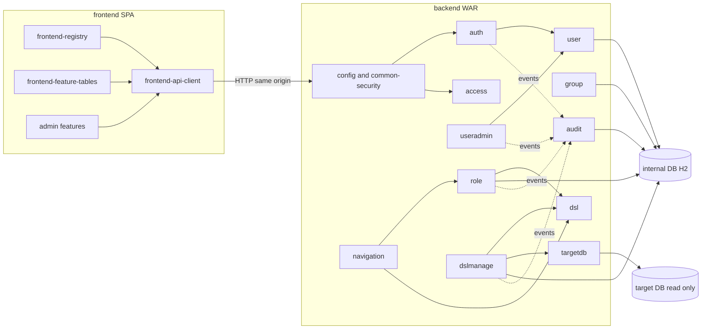
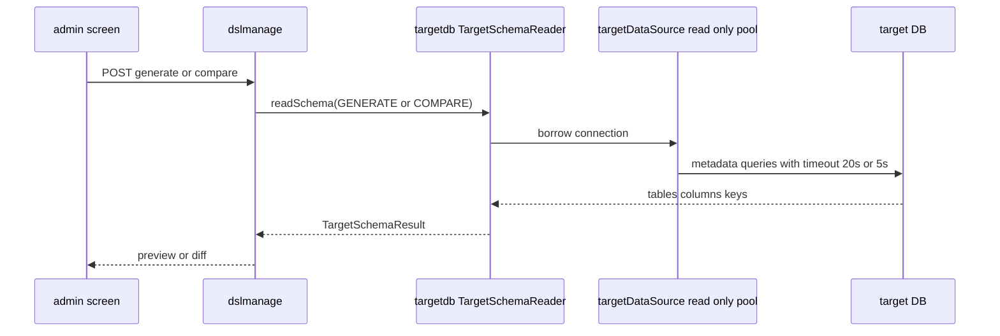
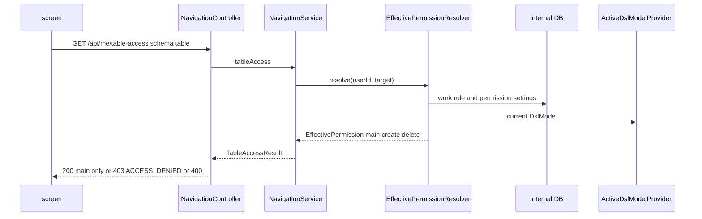
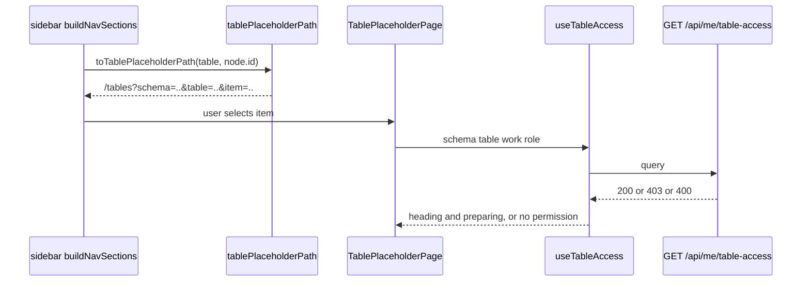
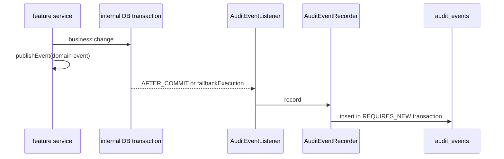
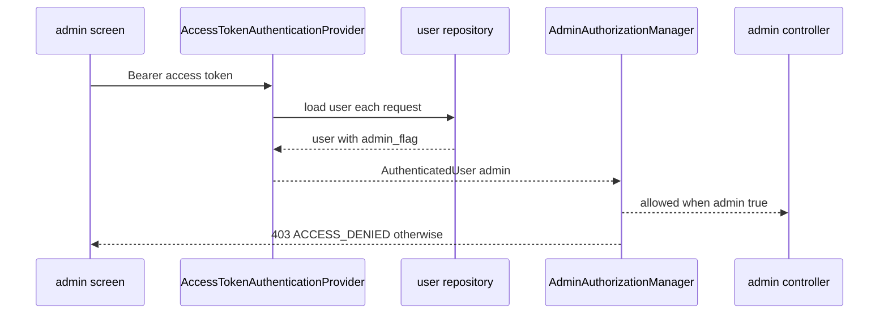

# アーキテクチャ（mastersmith2）

> 2026-10-16（記録のコミット `09b795d`）の Full rescan で作り直した。深く読んだのは今回の Intent に関わる範囲だけで、図の中の流し読みの部品は前の記録とディレクトリの一覧による（各節に書く）。所見の本文はこの文書に K-49・K-50・K-52・K-54 を書いた。

## System Overview

- 1つの実行可能 WAR（Spring Boot 4.1.1、Java 25）が、画面（React の SPA、`frontend/dist` を同梱）と API（`/api/**`）を同じオリジンで配る。CORS は置かない。
- 内部DB は組み込みの H2（利用者・認証・招待・DSL・ロール・グループ・監査）。スキーマは Flyway の V1〜V12。
- 対象DB（MySQL・MariaDB・PostgreSQL のどれか1つ）は設定（環境変数）だけから接続し、読み取り専用の接続でスキーマを読む。
- 配備先は開発者の PC 上のコンテナだけ（`Dockerfile`・`compose.yaml`）。監視・メールの受け手・見本の対象DB は compose の profile で必要なときだけ起動する。

## Architectural Style

- モジュール化した一枚岩（modular monolith）。根拠: 1つの Gradle のアプリ（`backend`）の中で、機能ごとのパッケージ（`auth`・`access`・`audit`・`user`・`useradmin`・`invitation`・`mail`・`appearance`・`targetdb`・`dsl`・`dslmanage`・`role`・`group`・`navigation`・`common/*`・`config`）に分け、各機能の中を `web`・`service`・`domain`・`repository` と用途名の下位パッケージに分ける。
- 機能の間の依存の向きは ArchUnit の境界テスト 18 個（全体の `ArchitectureTest`・`ApiAccessArchitectureTest` と機能ごとの 16 個）で固定し、逆向きの知らせは Spring の出来事で行う（監査など）。
- 画面は `frontend/src/features/<featureId>/registration.ts` を置くと読み込まれる差し込みの形で、機能どうしの import は ESLint の `no-restricted-imports` で止める。

## Component Relationships

文字の代わりの説明: 画面の機能（骨組みの `frontend-registry`、置き場の `frontend-feature-tables`、管理の画面）は `frontend-api-client` を通して同じオリジンの API を呼ぶ。API の入口は Spring Security の連鎖（`config` と `common-security` の差し込み口）で、`auth` がアクセストークンを確かめ、`access` が `/api/admin/**` を管理者だけにする。`auth` と `useradmin` は `user` を使う。`navigation` は `role` の解決の口と `dsl` の適用中のモデルを使ってメニューを作る。`role` は `dsl` を参照する。`dslmanage` は `dsl` と `targetdb` を使い、`targetdb` だけが対象DB に読み取り専用でつなぐ。内部DB の H2 には `user`・`role`・`group`・`dslmanage`・`audit` などが書く。点線は Spring の出来事で、`role`・`useradmin`・`dslmanage`・`auth` などの出来事を `audit` が受けて監査の行にする。依存の向きの細部は `dependencies.md`。図の矢印のうち深く確かめたのは `navigation`→`role`・`navigation`→`dsl`・`role` に依存してよい相手（K-50）、`targetdb` の境界（K-49）、`audit` の import（K-54）で、ほかは前の記録とディレクトリの一覧による。

## Data Flow

- 要求ごとに: 画面 → `Authorization` のアクセストークン → `auth` が署名と期限を確かめ、内部DB の利用者を読んで主体（`AuthenticatedUser`、管理者の印を含む）を作る → 安全の決まり（order 順の `SecurityRuleContributor`、`/api/**` の既定はログインだけ）→ controller → service（トランザクションの境界）→ repository（内部DB）。
- 対象DB へは `dslmanage` の生成・照合のときだけ、`targetdb` の `TargetSchemaReader.readSchema(ReadPurpose)` で読み取りの接続を借りる。
- 監査は各機能の出来事を `audit` が確定の後に受け、別のトランザクションで内部DB に追記する。
- メニュー: 適用中の DSL のメニューの木（`dsl`）→ 作業ロールの権限の写し（`role`）→ 枝を落とした木（`navigation`）→ 画面のサイドバー。

## Interaction Diagrams

### 1. 対象DB の読み取り（K-49）

文字の代わりの説明: 管理の画面が既定の DSL の生成か照合を頼むと、`dslmanage` が `targetdb` の `readSchema` を目的（`GENERATE` か `COMPARE`）つきで呼ぶ。`targetdb` は読み取り専用のプール `targetDataSource` から接続を借り、目的ごとの時間の上限（生成 20 秒・照合 5 秒）でスキーマの情報だけを読んで返す。行の値を読む段は無い。

**K-49 業務データを読む・書く仕組みが無く、今の対象DB の部品は「読み取り専用・スキーマだけ」に固定されている（`targetdb`）**

- 確かめた事実:
  - 接続は読み取り専用で作る（`backend/src/main/java/cherry/mastersmith/targetdb/config/TargetDataSourceConfig.java` 105 行の `config.setReadOnly(true)`）。接続は既定の候補にせず（79 行の `defaultCandidate = false`）、名前 `targetDataSource` で指定して使う。プールの上限は既定 5（`TargetDbProperties.Pool`）。
  - 問い合わせの目的は `ReadPurpose` の `GENERATE`（1回 20 秒）と `COMPARE`（1回 5 秒）の2つだけ（`targetdb/domain/ReadPurpose.java`、`TargetDbProperties.QueryTimeout`）。`targetdb/service/` は口の `TargetSchemaReader`（`readSchema(ReadPurpose)`、39 行）とその実装 `JdbcTargetSchemaReader` と `package-info.java` で、スキーマの情報を返す口しか無い。
  - 境界テスト `backend/src/test/java/cherry/mastersmith/targetdb/TargetDbBoundaryArchitectureTest.java` は、`targetdb` の外から `targetdb.config`・`targetdb.repository` に依存しない、`targetdb` は `dsl`・`dslmanage`・`web` を知らず `web` の層を持たない、JDBC・Spring JDBC の書き込み・DDL の呼び出し（`executeUpdate`・`update`・`batchUpdate` など）と `JdbcTemplate` を使わない、`@Transactional` を使わない、を固定する。
  - 見本の対象DB の読み取りのアカウント `mastersmith_reader` は `SELECT` だけ（`docker/targetdb/postgres/02-reader-account.sh` の `GRANT` の行）。`backend/src/main/resources/application.yaml` のコメントも読み取りの権限だけを勧める。
- 今回の Intent への意味: 主権限 `FULL`・補助権限 `CREATE`・`DELETE` を実際の作成・更新・削除に当てるなら、(1) 書ける接続（読み取り専用でない別の接続か、設定の切り替え）、(2) 書けるアカウント（見本の DB と README の手順を含む）、(3) 境界テストの変更か `targetdb` の外の新しいパッケージ、(4) 書き込みの待ちの上限（今の `QueryTimeout` に目的が無い）が要る。既存の境界テストを緩める・消すときは、コード生成の計画に明記して依頼者の承認が要る（`team.md` の Code Style）。読み取り（一覧・詳細）だけでも、行の値を読む新しい目的と時間の上限が要る。
- 見立て（未検証）: 一覧・詳細の表示だけを範囲にし、作成・更新・削除は操作の可否の表示（押せる・押せない）に留める形も取りうる。業務データの書き込みの有無が接続・アカウント・監査・トランザクションの設計を大きく変えるため、要件定義で最初に決める論点である。

### 2. 実効の権限の解決（K-50）

文字の代わりの説明: 置き場の画面がテーブルの可否を問うと、`NavigationController` から `NavigationService.tableAccess` が呼ばれ、`role` の `EffectivePermissionResolver.resolve` を1回呼ぶ。解決の口は要求ごとに内部DB から作業ロールと権限の設定を読み、適用中の DSL を参照して、主権限・CREATE・DELETE を求める。応答はテーブルの主権限だけで、見られなければ 403、引数が欠ければ 400。

**K-50 権限の解決の口は「主権限・CREATE・DELETE」を返せるが、置き場の API が返すのはテーブルの主権限だけ（`role`・`navigation`）**

- 確かめた事実:
  - 解決の口 `backend/src/main/java/cherry/mastersmith/role/service/EffectivePermissionResolver.java` は3つ: `effectiveWorkRole(userId)`、`snapshotFor(userId)`（作業ロールの設定の写し。2つ以上の対象を判定するときに使う）、`resolve(userId, target)`（対象1つ）。どれも要求ごとに内部DB から読み、キャッシュを持たない。作業ロールが無い・適用済みの DSL が無い・対象が今の DSL に無いときは `EffectivePermission.NONE`（主権限 NONE・CREATE 不可・DELETE 不可）。
  - 継承（`role/domain/PermissionInheritance.java`）: 主権限は `column ?? table ?? schema ?? NONE`、補助権限は `table ?? schema ?? false` を CREATE と DELETE で別々に求める。カラムの補助権限はそのテーブルの値。主権限と補助権限は互いに独立に求まり、`PermissionValues` と表 `permission_settings` の検査の制約（`V11__u4_role.sql`）にも組み合わせを縛るものは無い（例: 主権限 READ で CREATE が true もありうる）。
  - 写し `role/domain/PermissionSnapshot.java` は `effective(target)`・`main(schema, table, column)`・`create(schema, table)`・`delete(schema, table)` を持ち、カラムごとの主権限（列の出し分け）も求まる。
  - 置き場の API（`GET /api/me/table-access`、`navigation/service/NavigationService.java` の `tableAccess`）は `resolve` を1回呼び、応答 `navigation/web/TableAccessResponse.java`（28 行）は `schemaName`・`tableName`・`displayName`・`main` だけ。CREATE・DELETE・カラムの主権限・主キーの有無は返さない（`toString` は名前を伏せる、51 行）。
  - `backend/src/test/java/cherry/mastersmith/role/RoleBoundaryArchitectureTest.java`（129 行の `@DisplayName`）は「role の外で role に依存してよいのは `audit`（`role.domain`）と `navigation`（`role.service`・`role.domain`）だけ」。`navigation` の境界テストは「どの機能も navigation に依存しない」。
- 今回の Intent への意味: 業務データの機能を新しいパッケージに置くと、解決の口を使うために `RoleBoundaryArchitectureTest` の許す相手を足す変更（境界テストを緩める変更に当たり、計画での明記と承認が要る）が要る。`navigation` を広げる形なら `role` の境界テストは変えずに済むが、`navigation` の「repository を持たず DB の部品に依存しない（読み取りだけ）」という境界テストに当たる。
- 要件定義で決める論点: 主権限と補助権限の組み合わせの意味（READ＋CREATE、NONE の列を持つ表での作成・更新、FULL で DELETE 不可）、カラムの主権限が NONE の列を一覧・詳細・更新の要求でどう扱うか（応答から外す・要求の本文にあれば拒否する など）。

### 3. メニューから置き場の画面へ（K-52）

文字の代わりの説明: サイドバーの業務の項目は `buildNavSections` が `toTablePlaceholderPath` で道 `/tables?schema=&table=&item=` を作る。選ぶと置き場の画面 `TablePlaceholderPage` が開き、`useTableAccess` が置き場の API に問い合わせる。200 なら見出し（表示名）と「準備中」、403・400・引数なしなら同じ「権限なし」の表示を出す。

**K-52 テーブルを指すメニューの項目の移り先は「準備中」の置き場で、画面の道・今の項目・E2E がこの形に依っている（`frontend-feature-tables`・`frontend-registry`）**

- 確かめた事実:
  - 道は `/tables?schema=<スキーマ名>&table=<テーブル名>&item=<位置の道>`。作るのは `frontend/src/app/navigation/tablePlaceholderPath.ts` の `toTablePlaceholderPath` の1か所だけ（`URLSearchParams` でエンコードし、先頭は常に `/tables?`）。サイドバーの業務の項目は `frontend/src/app/navigation/buildNavSections.ts` 158 行でこの関数から `href` を作る（`node.navigable` のときだけ）。
  - `frontend/src/features/tables/TablePlaceholderPage.tsx` は、200 で見出しと「準備中」、403・400・引数なしで同じ「権限なし」（作業ロールが2つ以上なら切り替えのボタン）、それ以外で読み込みの失敗を出す。`useTableAccess.ts` は引数・作業ロール・切り替えの回数が変わるたびに問い合わせ、403 を受けると業務のメニューと作業ロールを読み直す。
  - 機能 `tables` の登録は `access: 'LOGGED_IN'`（`frontend/src/features/tables/registration.ts`）。`frontend/src/app/registry/types.ts` の `AccessLevel` の説明は「表示の制御であり、サーバー側の権限の確認の代わりにはならない」。
  - この画面に依る E2E と部品: `frontend/e2e/170-menu-navigation-flow.e2e.ts`（`/tables?` へ移ること、見られない表の名前が出ないこと、本物の応答）、`frontend/e2e/160-app-frame-accessibility.e2e.ts`、`frontend/e2e/support/u7Measure.ts`（`tables-page`・`tables-heading` などの `data-testid`。grep の行）。
- 今回の Intent への意味: 一覧・詳細の画面を置くと、道の形（`/tables?…` のまま中身を一覧にするか、詳細の道を足すか）、`buildNavSections` の今の項目の決め方（置き場の道の `pathname` と引数で決める）、上の E2E と画面のテストの書き換え（`team.md` により本数に数えない）が影響の範囲に入る。

### 4. 監査の書き込み（K-54）

文字の代わりの説明: 各機能の service が内部DB を変えて出来事を出すと、確定の後（トランザクションが無ければ出した時点、`fallbackExecution`）に `AuditEventListener` が受け、`AuditEventRecorder` が新しいトランザクション（`REQUIRES_NEW`）で `audit_events` に追記する。監査の書き込みは要求のスレッドで、2本目の接続を借りる。

**K-54 業務データの操作の監査の仕組みが無い。今の監査は内部DB のトランザクションの確定の後に書く形（`audit`）**

- 確かめた事実:
  - `backend/src/main/java/cherry/mastersmith/audit/domain/AuditEventType.java` の 34 個の種類（認証・`ACCESS_DENIED`・DSL・パスワード・招待と登録・利用者の管理・初期管理者・グループ・ロール・作業ロールの切り替え）に、業務データの操作の種類は無い。
  - `audit/service/AuditEventListener.java` は各機能の出来事の型を import して受け取る（`access.domain`・`auth.domain`・`dslmanage.domain`・`group.domain`・`invitation.domain`・`role.domain`・`user.domain`・`useradmin.domain`）。受け取りは `@TransactionalEventListener(phase = AFTER_COMMIT, fallbackExecution = true)` で、書き込みは `AuditEventRecorder` の `@Transactional(propagation = REQUIRES_NEW)`（どちらも一部だけ読んだ）。
  - `project.md` の Decided に「監査記録の共通の仕組みは…業務データの CRUD を扱う後続 Intent で共通化を検討する」がある。
- 今回の Intent への意味: 業務データを書き込むなら、対象DB の確定と監査の行（内部DB）は別の DB のため同じトランザクションにできない。今の形をそのまま使うと、内部DB のトランザクションが無い要求では `fallbackExecution` で出した時点に書かれる。どちらか一方だけが残る場合の扱い、監査に残す中身（業務データの値・主キーの値を含めるか。`detail` の列は UTF-16 の 16,384 単位まで、`V10__u3_group.sql`）、読み取り（一覧・詳細）を残すかは要件・設計で決める。
- 見立て（未検証）: 業務データの機能も同じ受け手に出来事の型を足すと、`audit` の import がさらに増える。Decided の宿題（共通化の検討）はこの Intent が持ち主になる。

### 5. 管理の API の判定（K-53 の背景）

文字の代わりの説明: 管理の API の要求では、`auth` の `AccessTokenAuthenticationProvider` が要求ごとに内部DB の利用者を読み、`admin_flag` から主体の `admin()` を作る。`access` の `AdminAuthorizationManager` はこの `admin()` だけを見て通すか 403 にする。ロールの権限はこの判定に入らない。本文は `code-quality-assessment.md` の K-53。

## Key Design Decisions

- 対象DB は読み取り専用の別のプールで、既定の候補にしない（Flyway・JPA が誤って使わない）。書き込み・`JdbcTemplate`・`@Transactional` を境界テストで止める（K-49）。
- 権限は要求ごとに内部DB から解決し、キャッシュしない（割り当ての変更が次の要求で効く。K-50）。
- 管理の可否と業務の権限を別の仕組みに持つ（`admin_flag` とロール。広げてから縮める二段の「広げる」側だけが終わった状態。K-53）。
- 監査は確定の後に別のトランザクションで書く（操作と監査の順と接続の2本使いを受け入れた形。K-54・K-57）。
- API の分類の印 `@ApiAccess` を口ごとに付け、テストで網羅を確かめる（K-61）。

## Improvement Opportunities

- 業務データの読み書きの置き場（新しい機能のパッケージか、`navigation`・`targetdb` を広げるか）と、それに伴う境界テストの変更を、要件定義と設計で先に決める（K-49・K-50）。
- 監査の受け手が各機能の出来事の型をすべて import する集まりの形を、業務データを足す前に共通化するかを決める（K-54）。
- 管理の可否をロールで表す形へ縮める手順（最後の管理者の保護・初期管理者・画面の `admin`）を一続きで設計する（K-53）。

## Sources

- 開発担当の調査（K-49・K-50・K-52・K-54 の事実と見立て）と、アーキテクトの確かめ直し（`reverse-engineering-timestamp.md`）。
