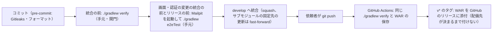

# CI の構成（ci-config）

Intent `261004-role-menu`（U1〜U7、Bolt B1〜B9）の CI の記録です。すでにリポジトリにある `.github/workflows/ci.yml` と、CI が呼ぶ `./gradlew verify` の中身を記録します（`project.md` の Deployment「CI の仕組みが既に実装されている段では、既にあるものの記録として書く」）。この段では CI の定義を変えていません（`ci-pipeline-questions.md` の Q1: A）。

- 作成日：2026-10-14
- 対象のファイル：`.github/workflows/ci.yml`（ワークフローの名前 `CI`）、`.github/dependabot.yml`、`build.gradle.kts`・`backend/build.gradle.kts`、`.gitleaks.toml`
- 段ごとの合否の基準と、Build and Test の検査との対応：`quality-gates.md`
- 依頼者の決定：`ci-pipeline-questions.md`（Q1: A・Q2: A、Consolidated Summary Confirmation は Looks correct）

## 1. この Intent での CI に関わる変更

比べた範囲は、この Intent の始め（Reverse Engineering の承認 `82c36b6`）から `develop` の先頭（`ae794e4`）までです（`git diff 82c36b6 develop`、読み取り）。

| ファイル | 変更 | コミット |
|---|---|---|
| `.github/workflows/ci.yml` | **変えていない** | — |
| `.github/dependabot.yml` | **変えていない** | — |
| `.gitleaks.toml` | **変えていない** | — |
| `backend/config/spotbugs-exclude.xml`・lockfile（`backend/gradle.lockfile`・`frontend/package-lock.json`）・`gradle/libs.versions.toml` | **変えていない** | — |
| `backend/build.gradle.kts`（`./gradlew verify` の中身） | 照合する DSL の JSON Schema を `dsl-schema-v1.json` から `dsl-schema-v2.json` に替えた（`processResources` の複写と `verifyDslSchemaInWar`） | `44677cc`（B1） |
| 同上 | 単体テスト（`tasks.test`）の JVM のヒープの上限を 1g から `1536m` に上げた（結合テストは 1g のまま。依頼者の決定 A）。テストの件数・カバレッジの下限は変えていない | `3a30982`（B7） |
| `frontend/eslint.config.js`（`verify` の 2 の段で読む設定） | 機能どうしの import を止める制限（`no-restricted-imports`）を足した。関門の形は同じ | `65a76c5`（B2） |
| `vendor/make-you-chic-ui`（サブモジュールの固定先） | `e82b651` から `5bf1ffe` へ上げた（専用のコミット、入れ子のサイドバー `navSections`）。CI は `submodules: true` で固定先を取得する | `e911e59`（B9 の前） |
| `Dockerfile` | JVM の既定の引数に `-XX:+ExitOnOutOfMemoryError` を足した。CI はイメージを作らないため、CI には効かない | `005730a`（Build and Test の直し） |

CI は同じ `./gradlew verify` を呼ぶため、`verify` の中身の変更はそのまま CI にも効きます。YAML を変える必要はありませんでした。

## 2. この Intent で `verify` に増えた中身

### 2.1 テストの件数・カバレッジ・時間

Build and Test の実測（`:backend:cleanTest :backend:cleanIntegrationTest` を付けた `verify`、`build-and-test/test-results.md`）です。

| 項目 | 前の Intent の記録（`260930-user-admin`） | この Intent（Build and Test の実測） |
|---|---|---|
| バックエンドの単体テスト | 1,508 件 | **2,102 件**（240 クラス） |
| バックエンドの結合テスト（対象DB の3種類を含む） | 689 件 | **1,165 件**（222 クラス） |
| 画面のテスト（Vitest） | 955 件 | **1,581 件**（185 ファイル） |
| カバレッジ（バックエンドの全体） | — | 行 97.9%（10,525/10,748）・分岐 92.5%（4,013/4,340） |
| カバレッジ（画面の全体） | — | 行 95.42%（6,044/6,334）・分岐 90.31%（4,064/4,500） |
| パッケージごとの下限 | `packagesJudgedByTotal` 7 | 7 のまま。一覧に無い 60 パッケージがすべて行 80%・分岐 70% 以上（余裕が最も小さいのは `config` 分岐 76.7%） |
| 手元の `verify` の時間 | — | 14 分 26 秒（clean 付き、colima CPU 4・6GiB） |
| CI の時間（ジョブの作成〜終わり） | 9〜15 分 | 15〜22 分（6.1。B8 の `ea55919` が最長の 22 分 30 秒）。ジョブの上限 60 分の内 |

- 一覧（`packagesJudgedByTotal`）を増やした変更と、計測の除外を増やした変更はありません。7 パッケージの `src/main` に Intent の間の差は 0 件です。
- 新しく作ったパッケージ（`group.*`・`role.*`・`navigation.*`、`common.security` の足した分など）は、一覧に入らないため自動でパッケージごとの下限の対象です。

### 2.2 E2E（CI の外）

E2E は `verify` と CI の外に置き、統合の前とリリースの前に手元で流します（`team.md` の Testing Posture）。この Intent で足したのは次の4つで、Build and Test の直しの後に 010〜170 の 18 ファイル・230 件がすべて通りました（10.4 分）。

| ファイル | 中身 | 流れの E2E の本数 |
|---|---|---|
| `140-role-admin-accessibility` | ロール・グループ・受け渡しの画面の axe、収まり、画面の時間の測り（記録だけ） | 数えない |
| `150-role-permission-flow` | 流れ F（ロールベースの権限） | 1本目 |
| `160-app-frame-accessibility` | 骨組みの画面の axe、5段のサイドバー、画面の時間の測り（記録だけ） | 数えない |
| `170-menu-navigation-flow` | 流れ I（N 階層のメニュー） | 2本目 |

k6 の場面（グループ・ロール・割り当て・作業ロール・受け渡し・メニュー）と `perf/dsl-timing.sh` も CI の外で、performance-validation が流します（`quality-gates.md` の 5節）。

## 3. CI の位置づけ

- CI は**統合の後の再確認**として動きます（`team.md` の Way of Working・Deployment）。統合を止める関門ではありません。
- 統合の前の関門は、手元で実行する `./gradlew verify` です。E2E（Mailpit を起動した `./gradlew e2eTest`）は、画面・認証に関わる変更の統合の前とリリースの前に手元で流します。
- プルリクエストは使いません。`origin` への `git push` は依頼者が行い、AI はプッシュしません。
- CI が失敗したら、次に進む前に `team.md` の Testing Posture の「不安定なテストと CI の失敗」の決まりで扱います（`quality-gates.md` の 6節）。

<!-- Text fallback: コミットの直前に pre-commit が動く。統合の前に手元で ./gradlew verify を流し、画面・認証の変更の統合の前とリリースの前には Mailpit を起動して ./gradlew e2eTest も流す。通ったら develop へ統合する（squash。サブモジュールの固定先の更新は fast-forward）。依頼者がプッシュすると GitHub Actions が同じ ./gradlew verify を実行して WAR を保存する。v* のタグでは WAR をリリースに添付するが、配備先が決まるまでタグは付けない。 -->

## 4. きっかけ・段の並び・権限・固定している版

`ci.yml` を変えていないため、前の Intent の記録から変わっていません。読み直した値を書きます。

| 項目 | 値 |
|---|---|
| きっかけ | `push`（ブランチ `develop`・タグ `v*`）、`workflow_dispatch` |
| 権限 | `contents: read`（ジョブ `release` だけ `contents: write`） |
| 重なりの制御 | `concurrency: ci-${{ github.ref }}`・`cancel-in-progress: false` |
| ランナー | `ubuntu-latest`。ジョブ `verify` は `timeout-minutes: 60`、`release` は 10 |
| 秘密情報 | 使わない（`release` の `GH_TOKEN` は Actions の `github.token`） |

ジョブ `verify`（名前 `./gradlew verify`）の段の並びは次のとおりです。

| 順 | 段 | 中身 |
|---|---|---|
| 1 | リポジトリとサブモジュールを取得する | `submodules: true`（2つのサブモジュールを固定先のコミットで取得）、`fetch-depth: 0`（Gitleaks が履歴全体を調べるため） |
| 2 | JDK 25（Temurin）を入れる | `distribution: temurin`・`java-version: "25"` |
| 3 | Node.js 24 を入れる | `cache: npm`（`frontend/package-lock.json`・`vendor/make-you-chic-ui/package-lock.json`） |
| 4 | Gradle を用意する | キャッシュを使う |
| 5 | Gitleaks と OSV-Scanner を入れる | 版と SHA-256 を照合し、合わなければ失敗 |
| 6 | 1コマンドの検査を実行する | `./gradlew verify`（0〜9 の段。`quality-gates.md` の 2節） |
| 7 | WAR を成果物として保存する | 5節 |

固定している版は次のとおりです。

| 対象 | 版 | 固定のしかた |
|---|---|---|
| `actions/checkout` | v7.0.1 | コミットのハッシュ `3d3c42e5aac5ba805825da76410c181273ba90b1` |
| `actions/setup-java` | v6.0.1 | `de7274f081f381c8f8158605e0321c36c376e2e6` |
| `actions/setup-node` | v7.0.0 | `820762786026740c76f36085b0efc47a31fe5020` |
| `gradle/actions/setup-gradle` | v6.3.0 | `9c971963bec38e04b3d30dcc455b5382be2fdbfb` |
| `actions/upload-artifact` | v7.0.1 | `043fb46d1a93c77aae656e7c1c64a875d1fc6a0a` |
| `actions/download-artifact` | v8.0.1 | `3e5f45b2cfb9172054b4087a40e8e0b5a5461e7c` |
| Gitleaks | 8.30.1（`linux_x64`） | SHA-256 `551f6fc83ea457d62a0d98237cbad105af8d557003051f41f3e7ca7b3f2470eb` |
| OSV-Scanner | 2.6.0（`linux_amd64`） | SHA-256 `ca69b3d3cd08f889a49dc0a383122f71cc528b83803671df5fd874d97485b108` |
| JDK | Temurin 25 | `setup-java` の `java-version` |
| Node.js | 24 | `setup-node` の `node-version` |
| npm・Gradle の依存 | lockfile どおり | `frontend/package-lock.json`・`backend/gradle.lockfile`（`project.md` の Mandated） |

## 5. 成果物とリリース

- ジョブ `verify` は、`backend/build/libs/mastersmith.war` を成果物 `mastersmith-<コミットのハッシュ>` として保存します（30 日、`if-no-files-found: error`）。
- `v*` のタグでは、ジョブ `release` が同じ WAR を GitHub のリリースに添付します。配備先が決まるまで `main` にタグは付けません（`team.md` の Deployment）。この Intent の CI ではどれも `skipped` でした。
- 成果物の版はコミットのハッシュで識別します。

## 6. CI の実行の結果（`gh run list`・`gh run view` で読んだもの）

### 6.1 この Intent の push の CI

依頼者は Bolt の統合と記録を一緒に push しているため、CI のきっかけになったのは各 push の先頭のコミットです。その CI が、同じ push に含まれる Bolt のコードのコミットを確かめています。

| push の先頭 | 中に含まれる主なコミット | run | 結果 | 作成〜終わり（UTC） | 時間 |
|---|---|---|---|---|---|
| `305bc21`（Domain Design の承認） | Inception の記録 | 37208809252 | success | 2026-10-04T14:19:04Z〜14:34:29Z | 15 分 25 秒 |
| `b9de04f`（Delivery Planning の承認） | Inception の記録 | 37241306632 | success | 2026-10-04T22:46:47Z〜22:58:25Z | 11 分 38 秒 |
| `f9d1134`（B3） | Construction の設計の段の承認の記録、`65a76c5`（B2 U1）・`44677cc`（B1 U2）・`757d5ed`・`f9d1134`（B3 U3） | 37783936124 | success | 2026-10-08T13:23:17Z〜13:41:45Z | 18 分 28 秒 |
| `3d4f344`（B4） | `c581cfa`・`3d4f344`（B4 U4 前半） | 37809706248 | success | 2026-10-08T16:33:20Z〜16:52:01Z | 18 分 41 秒 |
| `b1c2760`（B5） | `b1c2760`（B5 U4 中） | 37821157788 | success | 2026-10-08T18:02:04Z〜18:19:49Z | 17 分 45 秒 |
| `e64382e`（B7 の計画の承認） | `fcc25b5`（B6 U4 後半）・`e64382e` | 38178278264 | success | 2026-10-11T21:54:32Z〜22:14:48Z | 20 分 16 秒 |
| `3a30982`（B7） | `3a30982`（B7 U5） | 38180296570 | success | 2026-10-11T22:24:28Z〜22:39:23Z | 14 分 55 秒 |
| `ea55919`（B8） | `3977919`・`ea55919`（B8 U6） | 38261607753 | success | 2026-10-12T14:15:37Z〜14:38:07Z | 22 分 30 秒 |
| `f6bd7df`（B9 の固定先の更新） | `32e61e9`・`e911e59`（make-you-chic-ui の固定先 `5bf1ffe`）・`f6bd7df` | 38308985571 | success | 2026-10-12T21:10:46Z〜21:27:18Z | 16 分 32 秒 |
| `0415b94`（B9） | `0415b94`（B9 U7） | 38398376712 | **1回目 failure、2回目 success**（6.2） | 1回目 2026-10-13T12:35:11Z〜12:39:42Z、2回目 12:54:59Z〜13:11:59Z | 2回目 17 分 0 秒 |
| `005730a`（Build and Test の直し） | `005730a`（ShellLayout のテストの直しを含む） | 38432556919 | **success**（1回目。`TC-7b`） | 2026-10-13T16:41:22Z〜16:57:59Z | 16 分 37 秒 |

- `005730a` の CI（run 38432556919）は1回目で success でした。ジョブ `./gradlew verify` は success（16:41:25Z〜16:57:58Z）で、`0415b94` の1回目に落ちた `ShellLayout.test.tsx` も通っています。Build and Test から引き継いだ `TC-7b` はこれで満たしました。
- `0415b94` までの push の CI は、6.2 の1件を除き 1回目で success でした。ジョブ `リリースに WAR を添付する` はどれも skipped（タグでないため）です。
- B1・B2 の squash（`44677cc`・`65a76c5`）は B3 と同じ push で、B6（`fcc25b5`）は B7 の計画の承認と同じ push で確かめられています（`git log --first-parent`、読み取り）。
- 時間は 11〜23 分で、ジョブの上限（60 分）に余裕があります。前の Intent（9〜15 分）より長いのは、テストの件数が増えたためと見られます（2.1）。
- `ae794e4`（Build and Test の承認の記録、`aidlc/` の下だけ）とこの段の記録は、2026-10-14 の時点でまだ push されていません（`origin/develop` は `005730a`）。

### 6.2 `0415b94` の CI の1回目の失敗（解消済み）

| 項目 | 内容 |
|---|---|
| run・回 | 38398376712 の1回目（attempt 1） |
| 落ちた段 | ジョブ `./gradlew verify` の「1コマンドの検査を実行する」、`verify` の 5 の段 `:frontendTest` |
| 落ちたテスト | `src/app/layout/ShellLayout.test.tsx` の「moves the switcher to the top of the content area below 768px and keeps its name」（35 件のうち 1 failed。`gh run view 38398376712 --attempt 1 --log-failed` で確かめた） |
| 扱い | 依頼者が失敗したジョブを再実行し、2回目（12:54:59Z〜13:11:59Z）で success |
| 原因と直し | 同じテストが Build and Test の手元の verify の1回目・2回目でも落ち、「同じテストが二度目に落ちたら原因を直すまで次へ進まない」に当たったため、原因（非同期の作業ロールの読み込みの答えの後に出るボタンを同期の `getByRole` で探していた）を直した（`005730a`、`findByRole` で待つ形。時間の上限は延ばしていない。`build-and-test/test-results.md` の 3.1） |
| 直しの確かめ | `005730a` の CI（6.1 の run 38432556919） |

**記録の食い違い**：Build and Test の `test-results.md` の 6節と `build-and-test-summary.md` の `TC-7a` は、run 38398376712 を「success」とだけ書いており、1回目の失敗と再実行に触れていません（`gh run view --json conclusion` は最後の回の結果を返すため）。承認済みの記録は書き換えず、差と根拠をここに記録します（`project.md` の Change Control）。`TC-7a` の判定（統合の後の CI が通る）は2回目の success で満たしており、同じテストの失敗は Build and Test で原因を直したため、判定は変わらないと見ます。直すかどうかは依頼者に確かめます。

## 7. 依存関係の更新（`.github/dependabot.yml`）

この Intent では変えていません。

| 対象 | 置き場 | 間隔 | 見送る更新（`ignore`） |
|---|---|---|---|
| gradle | `/`（`exclude-paths: vendor/**`） | 週1 | opentelemetry-logback-appender・networknt json-schema-validator・Jackson の BOM（理由と外す時期はファイルのコメント） |
| npm | `/frontend` | 週1 | typescript の大きな版 |
| github-actions | `/` | 週1 | — |
| docker | `/` | 週1 | eclipse-temurin の大きな版 |
| docker-compose | `/` | 週1 | — |

- 開いたままの Dependabot のプルリクエストが **11 件**あります（`gh pr list`、2026-10-14）。#24〜#28（2026-10-04、vitest・@vitest/coverage-v8・@typescript-eslint/parser・oxlint・`gradle/actions/setup-gradle` 6.3.0→6.4.0）と #29〜#34（2026-10-06、mailpit・otel-lgtm・vite・eslint・@types/node・stylelint）で、どれも版の更新の知らせです（脆弱性の知らせではない。Dependabot alerts は使っていない）。この Intent では取り込んでいません。`team.md` の受け方（手元で版と lockfile をまとめて更新し、`./gradlew verify` を通してから統合し、プルリクエストは閉じる）で、後の Intent で取り込むかを依頼者に確かめ、**依頼者の答えは「次の Intent で取り込む」**（この段の承認の前、2026-10-14。README の手順の追加を統合する前に Gitleaks を流し、漏えいは無かった）。
- 脆弱性の関門は `osvScan` だけです。手元では `./gradlew osvScan --rerun` で流し直します（`quality-gates.md` の 3節）。

## Sources

- `.github/workflows/ci.yml`・`.github/dependabot.yml`・`.gitleaks.toml`・`build.gradle.kts`・`backend/build.gradle.kts`・`frontend/eslint.config.js`・`Dockerfile`（読み取り）
- `git diff 82c36b6 develop`（`.github`・`.gitleaks.toml`・`backend/config`・lockfile・`libs.versions.toml`・`build.gradle.kts`・`backend/build.gradle.kts`・`vendor/`）、`git show 44677cc`・`3a30982`・`65a76c5`、`git log --first-parent b9de04f..005730a`、`git rev-parse origin/develop`（読み取り）
- GitHub Actions の run（`gh run list --workflow CI --branch develop`、`gh run view` の status・conclusion・jobs、`gh api …/runs/38398376712/attempts/1`・`/attempts/1/jobs`・`/attempts/2`、`gh run view 38398376712 --attempt 1 --log-failed`）、`gh pr list`（読み取り）
- `construction/ci-pipeline/ci-pipeline-questions.md`（Q1: A・Q2: A、まとめの確認）
- `construction/build-and-test/test-results.md`（1〜6節）・`build-and-test-summary.md`（1節・`TC-7a`・`TC-7b`・`E2E-*`）・`build-instructions.md`・`integration-test-instructions.md`（5節）
- `aidlc/spaces/default/memory/team.md`（Way of Working・Testing Posture・Code Style・Deployment）・`project.md`（Deployment・Change Control・Tech Stack）
- `aidlc/spaces/default/intents/260930-user-admin/construction/ci-pipeline/ci-config.md`（前の Intent の記録、形の手本）

## Assumptions & Open Questions

- 6.1 の「作成〜終わり」は `gh run list` の `createdAt`・`updatedAt`（再実行のあった run は各回の `run_started_at`・`updated_at`）です。`concurrency` で前の run を待った時間があれば、それも含みます。
- 2.1 のテストの件数とカバレッジは Build and Test の手元の実測です（`005730a` と同じ中身の作業ツリー）。CI の run の中の件数は、この段では数えていません（結果だけを確かめた）。
- 6.2 の記録の食い違い（Build and Test の記録が run 38398376712 の1回目の失敗に触れていない）を直すかどうかを、依頼者に確かめます。
- 7節の開いたままの Dependabot のプルリクエスト 11 件は、依頼者の答えで次の Intent で取り込む。0415b94 の CI の1回目の失敗（6.2）は、依頼者の答えで Build and Test の承認済みの記録を書き換えず、この記録に差を残す。
