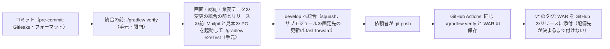

# CI の構成（ci-config）

Intent `261016-business-data-views`（U1〜U5、Bolt B1〜B7 と CI の不安定なテスト2件の直し）の CI の記録です。すでにリポジトリにある `.github/workflows/ci.yml` と、CI が呼ぶ `./gradlew verify` の中身を記録します（`project.md` の Deployment「CI の仕組みが既に実装されている段では、既にあるものの記録として書く」）。この段では CI の定義を変えていません。

- 作成日：2026-10-21
- 対象のファイル：`.github/workflows/ci.yml`（ワークフローの名前 `CI`）、`.github/dependabot.yml`、`build.gradle.kts`・`backend/build.gradle.kts`、`backend/config/spotbugs-exclude.xml`、`frontend/vitest.config.ts`・`frontend/eslint.config.js`・`frontend/playwright.config.ts`
- 段ごとの合否の基準と、Build and Test の検査との対応：`quality-gates.md`
- 依頼者の確認：`ci-pipeline-questions.md`（新しく決める論点が無いため質問は作らず、Consolidated Summary Confirmation は Looks correct）

## 1. この Intent での CI に関わる変更

比べた範囲は、この Intent の作成（`09b795d`）の直前の `da29216` から `develop` の先頭（`31d434c`）までです（`git diff da29216 develop`、読み取り）。

| ファイル | 変更 | コミット |
|---|---|---|
| `.github/workflows/ci.yml` | **変えていない**（`git log da29216..develop -- .github/workflows/ci.yml` は 0 件） | — |
| `.gitleaks.toml`・`.pre-commit-config.yaml`・`backend/build.gradle.kts`・`gradle/libs.versions.toml`・`backend/gradle.lockfile`・`settings.gradle.kts`・`Dockerfile` | **変えていない** | — |
| `build.gradle.kts`（`verifyStages` の 0〜9 の段） | **変えていない** | — |
| `build.gradle.kts`（E2E のタスク） | `e2eTest` の前に見本の PostgreSQL の前提の確かめ（`checkE2eTargetDb`、(a)〜(d)）と、この実行のスキーマ `e2e_biz_<印>`・一時のロール2つの準備を足し、`finalizedBy` で片付け（`e2eTargetDbCleanup`）を足した。誤りは段の名前・SQLSTATE・件数だけを出し、一時のパスワードは e2eTest のプロセスの環境変数だけで渡す。B7 で確かめの (d) の経路の説明を足した（コメントだけ）。`verify` と CI は呼ばない | `a031ba1`（B6）・`d220447`（B7） |
| `frontend/playwright.config.ts` | 対象DB の資格情報を `webServer.env` に置かずプロセスの環境変数で渡す形を足した（E2E だけ。CI の外） | `a031ba1`（B6） |
| `frontend/vitest.config.ts`（`verify` の 5・7 の段で読む設定） | E2E の補助の純粋な部品の単体テスト（`e2e/support/**/*.test.ts`）を対象に足した（カバレッジの対象 `src/` は変えない）。Build and Test の直しで、テストを2つの project に分け、ESLint の設定を読む `src/eslintImportRules.test.ts` を `eslint-config`（`groupOrder: 0`）として先に1つだけで流し、ほかを `unit`（`groupOrder: 1`）にした。時間の上限・カバレッジの対象・除外・下限は変えていない | `efa145d`（B3）・`22de65f`（Build and Test の直し） |
| `frontend/eslint.config.js`（`verify` の 2 の段で読む設定） | 業務データの画面とその共有の部品・手を入れた骨組みの口に `no-console` を `error` で当てる規則を足した（テストのファイルを除く）。規則を足すだけで緩めていない | `1152202`（B5）・`a031ba1`（B6）・`d220447`（B7） |
| `backend/config/spotbugs-exclude.xml`（`verify` の 8 の段） | `RowSqlExecutor` の `SQL_INJECTION_JDBC`・`SQL_PREPARED_STATEMENT_GENERATED_FROM_NONCONSTANT_STRING` を、読み取りの2メソッド（`search`・`detail`）と書き込みの5メソッド（`precheckUnique`・`insert`・`update`・`delete`・`inspectViolation`）だけで外した。クラス・メソッド・パターン名の3つで絞り、理由を書いた（コード生成の計画の A2・A3 で承認済み） | `ea23bf3`（B2）・`04b0589`（B4） |
| `frontend/package.json`・`frontend/package-lock.json` | `axe-core` を `^4.13.0` から `^4.14.0` に上げた | `d220447`（B7） |
| `.github/dependabot.yml` | npm の `ignore` から `axe-core`（`>= 4.14.0`）を外し、axe-core の更新は版と lockfile だけでも統合の前に E2E の全件と vitest-axe を流すという例外をコメントに書いた | `d220447`（B7） |
| `vendor/make-you-chic-ui`（サブモジュールの固定先） | `a9309c4` から `b0a1e79` へ上げた（専用のコミット、Dropdown の説明付きの項目の WCAG 2.5.3 の直し）。CI は `submodules: true` で固定先を取得する。依頼（5）は上流の `main` に無く、2回目の更新はしていない | `e34c260`（B3） |

CI は同じ `./gradlew verify` を呼ぶため、`verify` が読む設定の変更はそのまま CI にも効きます。YAML を変える必要はありませんでした。E2E のタスクの変更は `verify` の外で、CI には効きません。

## 2. この Intent で `verify` に増えた中身

### 2.1 テストの件数・カバレッジ・時間

Build and Test の実測（`:backend:cleanTest :backend:cleanIntegrationTest` を付けた `verify`、`build-and-test/test-results.md` の 2.1・8.4）です。

| 項目 | B2 の前（Intent の始め） | この Intent の最後（Build and Test の直しの後） |
|---|---|---|
| バックエンドの単体テスト | — | **2,589 件** |
| バックエンドの結合テスト（対象DB の3種類を含む） | — | **1,389 件**（SKIPPED 9。どれも DB の種類の `assumeTrue` で、コンテナの不足による飛ばしではない） |
| 画面のテスト（Vitest） | — | **226 ファイル・1,975 件** |
| カバレッジ（バックエンドの全体） | — | 行 97.64%・分岐 91.23% |
| カバレッジ（画面の全体） | — | 行 95.06%・分岐 89.80% |
| パッケージごとの下限 | `packagesJudgedByTotal` 7 | 7 のまま（7 パッケージの本体のソースにどの Bolt も触れていない）。新しいパッケージ（`businessdata.*` など）は自動でパッケージごとの下限の対象で、`jacocoTestCoverageVerification` が通過（分岐の最も低いのは `targetdb.service` 75.4%・`businessdata.web` 77.9%、B4） |
| 手元の `verify` の時間 | 14分1秒 | U1 の後（B2）18分32秒 → B7 のレビューの直しの後 23分24秒 → 最後 22分26秒（clean 付き） |
| CI の検査の job の時間 | 16分34秒〜23分3秒（Inception・設計の記録だけの push） | Bolt の統合を含む push の成功した試行で 22分47秒〜32分49秒（6.1。最長は `d220447` の 32分49秒） |

- 時間は、手元の `verify`・CI の検査の job のどちらも、CI の上限 60 分の7割（約 42 分）の内です。`team.md` の「約 42 分を超えたらテストの分け方を諮る」の線には当たりません。
- CI の時間は、run の作成から終わりではなく、検査の job（`./gradlew verify`）の始めから終わりで測りました（`project.md` の学び。`concurrency` で前の run を待った時間を含めないため）。
- 一覧（`packagesJudgedByTotal`）を増やした変更と、計測の除外を増やした変更はありません。

### 2.2 E2E（CI の外）

E2E は `verify` と CI の外に置き、統合の前（`frontend/src` の本体と、認証・権限・業務データの `src/main` に触れるブランチ）と、Build and Test・リリースの前に手元で流します（`team.md` の Way of Working・Testing Posture）。この Intent で足したのは次の2つで、B7 のレビューの直しの後に 256 件がすべて通りました（13分2秒、基準 約 10分35秒 の約 1.23 倍）。

| ファイル | 中身 | 流れの E2E の本数 |
|---|---|---|
| `180-business-data-flow` | 業務データの代表の流れ（一覧・詳細・作成・更新・削除） | 1本（`team.md` の上限どおり） |
| `185-business-data-accessibility` | 業務データの画面の axe（20 組と 200%）、収まり、画面の時間の測り | 数えない |

- E2E の前提として、Mailpit と見本の PostgreSQL（127.0.0.1:15432、上乗せの `docker/e2e/compose.targetdb-port.yaml`）を手元で起動しておきます。`./gradlew e2eTest` は起動・停止をせず、届かなければ手順を示して失敗します。
- axe-core 4.14.0 への引き上げ（B7）は、規則・要素を外さずに違反 0 件で行い、E2E 256 件の通過と vitest-axe の違反 0 件を件数で記録しました（`test-results.md` の 2.4）。
- k6 の業務データの場面と `dslMixed` の `memory.peak` も CI の外です（`quality-gates.md` の 5節）。

## 3. CI の位置づけ

- CI は**統合の後の再確認**として動きます（`team.md` の Way of Working・Deployment）。統合を止める関門ではありません。
- 統合の前の関門は、手元で実行する `./gradlew verify` です。E2E は上の条件のブランチで統合の前に手元で流します。
- プルリクエストは使いません。`origin` への `git push` は依頼者が行い、AI はプッシュしません。
- CI が失敗したら、次に進む前に `team.md` の Testing Posture の「不安定なテストと CI の失敗」の決まりで扱います（`quality-gates.md` の 6節）。

<!-- Text fallback: コミットの直前に pre-commit が動く。統合の前に手元で ./gradlew verify を流し、画面・認証・業務データの変更の統合の前とリリースの前には Mailpit と見本の PostgreSQL を起動して ./gradlew e2eTest も流す。通ったら develop へ統合する（squash。サブモジュールの固定先の更新は fast-forward）。依頼者がプッシュすると GitHub Actions が同じ ./gradlew verify を実行して WAR を保存する。v* のタグでは WAR をリリースに添付するが、配備先が決まるまでタグは付けない。 -->

## 4. きっかけ・段の並び・権限・固定している版

`ci.yml` はこの Intent で変えていません。読み直した今の値を書きます。

| 項目 | 値 |
|---|---|
| きっかけ | `push`（ブランチ `develop`・タグ `v*`）、`workflow_dispatch` |
| 権限 | `contents: read`（ジョブ `release` だけ `contents: write`） |
| 重なりの制御 | `concurrency: ci-${{ github.ref }}`・`cancel-in-progress: false` |
| ランナー | `ubuntu-latest`。ジョブ `verify` は `timeout-minutes: 60`、`release` は 10 |
| 秘密情報 | 使わない（`release` の `GH_TOKEN` は Actions の `github.token`） |

ジョブ `verify`（名前 `./gradlew verify`）の段の並びは次のとおりです。

| 順 | 段 | 中身 |
|---|---|---|
| 1 | リポジトリとサブモジュール（固定先のコミット）を取得する | `submodules: true`（2つのサブモジュールを固定先のコミットで取得）、`fetch-depth: 0`（Gitleaks が履歴全体を調べるため） |
| 2 | JDK 25（Temurin）を入れる | `distribution: temurin`・`java-version: "25"` |
| 3 | Node.js 24 を入れる | `cache: npm`（`frontend/package-lock.json`・`vendor/make-you-chic-ui/package-lock.json`） |
| 4 | Gradle を用意する（キャッシュを使う） | `gradle/actions/setup-gradle` |
| 5 | Gitleaks と OSV-Scanner を入れる（版と SHA-256 を固定） | 版と SHA-256 を照合し、合わなければ失敗 |
| 6 | 1コマンドの検査を実行する | `./gradlew verify`（0〜9 の段。`quality-gates.md` の 2節） |
| 7 | WAR を成果物として保存する（名前にコミットのハッシュを入れる） | 5節 |

固定している版は次のとおりです（前の Intent `261015-deps-ui-carryover` で上げたものを含む今の値）。

| 対象 | 版 | 固定のしかた |
|---|---|---|
| `actions/checkout` | v7.0.1 | コミットのハッシュ `3d3c42e5aac5ba805825da76410c181273ba90b1` |
| `actions/setup-java` | v6.0.1 | `de7274f081f381c8f8158605e0321c36c376e2e6` |
| `actions/setup-node` | v7.1.0 | `949feb2413d6458794dcd2491c4babbbce0c15c1` |
| `gradle/actions/setup-gradle` | v6.4.0 | `3f5f9adaf7d9fecd50b5935e54106014257a94e6` |
| `actions/upload-artifact` | v7.0.2 | `cf430e030ddbb5b0abf93d22962f4752f3646cd9` |
| `actions/download-artifact` | v8.0.2 | `9000827ccba6bdab643e8b6fd33ac0654aef8333` |
| Gitleaks | 8.30.1（`linux_x64`） | SHA-256 `551f6fc83ea457d62a0d98237cbad105af8d557003051f41f3e7ca7b3f2470eb` |
| OSV-Scanner | 2.6.0（`linux_amd64`） | SHA-256 `ca69b3d3cd08f889a49dc0a383122f71cc528b83803671df5fd874d97485b108` |
| JDK | Temurin 25 | `setup-java` の `java-version` |
| Node.js | 24 | `setup-node` の `node-version` |
| npm・Gradle の依存 | lockfile どおり | `frontend/package-lock.json`・`backend/gradle.lockfile`（`project.md` の Mandated） |

## 5. 成果物とリリース

- ジョブ `verify` は、`backend/build/libs/mastersmith.war`（画面の `dist` を同梱した実行可能 WAR）を成果物 `mastersmith-<コミットのハッシュ>` として保存します（30 日、`if-no-files-found: error`）。
- `v*` のタグでは、ジョブ `release` が同じ WAR を GitHub のリリースに添付します。配備先が決まるまで `main` にタグは付けません（`team.md` の Deployment）。この Intent の CI ではどれも `skipped` でした。
- 成果物の版はコミットのハッシュで識別します。レジストリと SBOM は、配備先が決まるまで置きません（`team.md` の Deployment）。

## 6. CI の実行の結果（`gh run list`・`gh run view`・`gh api …/attempts/<n>/jobs` で読んだもの）

### 6.1 この Intent の push の CI

依頼者は Bolt の統合と記録を一緒に push しているため、CI のきっかけになったのは各 push の先頭のコミットです。その CI が、同じ push に含まれるコミットを確かめています（`git log --first-parent`、読み取り）。時間は検査の job（`./gradlew verify`）の始めから終わりです。

| push の先頭 | 中に含まれる主なコミット | run | 試行ごとの結果 | 検査の job の時間 |
|---|---|---|---|---|
| `08dd459`（Reverse Engineering の承認） | Intent の作成の記録 | 38898944615 | 1回目 success | 18分42秒 |
| `6ba3ac8`（Contract Design の承認） | Inception の記録 | 39098435266 | 1回目 success | 16分34秒 |
| `a9f7471`（Delivery Planning の承認） | Inception の記録 | 39099277399 | 1回目 success | 22分46秒 |
| `e270fbc`（Functional Design の承認） | 設計の記録 | 39106947002 | 1回目 success | 22分42秒 |
| `8bee4a7`（NFR Requirements の承認） | 設計の記録 | 39118052035 | 1回目 success | 23分3秒 |
| `390cfa5`（NFR Design の承認） | 設計の記録 | 39140647553 | 1回目 success | 20分15秒 |
| `0427d45`（U1 の計画の承認） | `96686f2`（Infrastructure Design の承認）・`0427d45` | 39172328548 | **1回目 failure**（6.2）、2回目 success | 1回目 4分31秒（落ちた）、2回目 19分12秒 |
| `ea23bf3`（B2） | `ea23bf3`（B2 U1） | 39196260878 | **1回目 failure**（6.2）、2回目 success | 1回目 4分49秒（落ちた）、2回目 25分11秒 |
| `1913503`（U4 の計画の承認） | `1913503` | 39220512283 | 1回目 success | 25分28秒 |
| `05a9b37`（U5 の計画の承認） | `e34c260`（固定先 `b0a1e79`）・`e694d8f`・`bd42d70`・`0b29291`・`efa145d`・`1e78b51`（B3 U4 前半）・`05a9b37` | 39261104974 | **1回目 failure**（6.2）、2回目 success | 1回目 24分45秒（落ちた）、2回目 22分47秒 |
| `2360768`（B1） | `2360768`（B1 U5） | 39265778426 | 1回目 success | 25分20秒 |
| `c4f3d99`（U2 の計画の承認） | `c4f3d99` | 39275915924 | 1回目 success | 29分9秒 |
| `04b0589`（B4） | `04b0589`（B4 U2） | 39339950936 | 1回目 success | 28分50秒 |
| `1152202`（B5） | `6815308`（U3 の計画の承認）・`1152202`（B5 U3 前半） | 39375104956 | **1回目・2回目・3回目 failure**（6.2） | 31分5秒・26分43秒・26分1秒（どれも落ちた） |
| `b7291d3`（CI の直し） | `b7291d3`（不安定なテスト2件の直し） | 39410449247 | 1回目 success | 31分27秒 |
| `a031ba1`（B6） | `a031ba1`（B6 U3 中） | 39410572004 | 1回目 success | 28分37秒（前の run の終わりまで約 31 分待った） |
| `d220447`（B7） | `d220447`（B7 U3 後半・U4 後半、axe-core 4.14.0） | 39441119537 | 1回目 success | 32分49秒 |
| `31d434c`（Build and Test の承認） | `288736d`（Code Generation の承認）・`22de65f`（Build and Test の直し）・`31d434c` | 39465005577 | 1回目 success | 22分42秒 |

- ジョブ `リリースに WAR を添付する` はどれも skipped（タグでないため）です。
- B5 の統合の後の CI の直し（`b7291d3`）からあとは、`31d434c` まですべて1回目で success でした。

### 6.2 1回目で落ちた CI（すべて扱い済み）

| run・試行 | 落ちた段 | 落ちたテスト | 扱い |
|---|---|---|---|
| 39172328548（`0427d45`）の1回目 | `:frontendTest` | `src/features/preferences/PasswordChangePage.test.tsx`「drops the answer when the screen is left while sending」（1,589 件のうち 1 failed） | 手元で再現せず、依頼者の決定で「手元で再現しないもの」として記録し、再実行の2回目で success（`construction/code-generation/memory.md`・`generation-notes.md`） |
| 39196260878（`ea23bf3`）の1回目 | `:backend:test` | `PatternCheckerTest`「valid and invalid regular expressions are told apart by compiling only」 | 同上。この Intent の中で二度目は落ちていない |
| **39261104974（`05a9b37`）の1回目** | `:frontendCoverage` | `PasswordChangePage.test.tsx`「drops the answer when the screen is left while sending」（1,633 件のうち 1 failed。`gh run view 39261104974 --attempt 1 --log-failed` で確かめた） | 再実行の2回目で success。**この Intent の記録には無い**（下の「記録の食い違い」） |
| 39375104956（`1152202`）の1回目 | 画面のテスト | `PasswordChangePage.test.tsx` の同じテスト | `team.md` の「同じテストが二度目に落ちたら原因を直すまで次へ進まない」により B6 の統合を止め、直しのブランチ `fix/261016-business-data-views-ci-flaky`（`b7291d3`）で直した（前の画面の後片付けを待つ形。二段で確かめ、時間の上限は延ばしていない） |
| 39375104956（`1152202`）の2回目・3回目 | 結合テスト | `H2CompactionByPoolSuspensionIT`（`total=1, idle=1` が残り 30 秒で時間切れ。同じテストが2度） | 同じ直しのブランチで直した（一時停止の前に補充が済むのを待つ `awaitFillSettled()`。二段で確かめ、待ちの上限は延ばしていない） |

直しの確かめは、`b7291d3` の CI（run 39410449247）からあとの CI が1回目で success であることです（6.1）。直した2件はその後のどの試行でも落ちていません。

**記録の食い違い**：Build and Test の `test-results.md` の 5節・6節と、段の `construction/code-generation/memory.md`・`generation-notes.md` は、`PasswordChangePage.test.tsx` の CI の失敗を「`0427d45` の1回目」と「`1152202` の1回目（2度目）」の2回として書いており、`05a9b37` の CI（run 39261104974、B3 の統合を含む push）の1回目の失敗に触れていません。実際には同じテストが3回落ちており、`05a9b37` の1回目が2度目でした。`team.md` の決まりでは、この時点で原因を直すまで次へ進まないはずでしたが、再実行の2回目で通った後に B1（`2360768`）・B4（`04b0589`）・B5（`1152202`）が統合されています（決まりとの差）。承認済みの記録は書き換えず、差と根拠をここに記録します（`project.md` の Change Control）。同じテストは `b7291d3` で原因を直して二段で確かめ、その後の CI のどの試行でも落ちていないため、Construction の判定は変わらないと見ます。直すかどうかは依頼者に確かめます。

### 6.3 `31d434c` の CI（Build and Test の後の push）

| 項目 | 内容 |
|---|---|
| run・試行 | 39465005577 の1回目（attempt 1。再実行なし） |
| 確かめたコミット | `288736d`（Code Generation の承認の記録）・`22de65f`（Build and Test の直し: `frontend/vitest.config.ts` の project の分け、`AbstractBusinessDataReadIT#readsLeaveNoAudit`、`README.md`・`perf/README.md`）・`31d434c`（Build and Test の承認の記録） |
| 結果 | **success**。ジョブ `./gradlew verify` は success（2026-10-20T17:19:06Z〜17:41:48Z、**22分42秒**）、ジョブ `リリースに WAR を添付する` は skipped |
| run の全体 | 2026-10-20T17:19:03Z〜17:41:49Z（前の run を待っていない） |

- Build and Test の `test-results.md` の 6節で「push の後に確かめる」とした `288736d`・`22de65f` の CI は、これで1回目の試行で通りました。`eslintImportRules.test.ts` を先に1つだけで流す形（`22de65f`）も、CI の上で落ちずに通っています。
- CI の時間は約 42 分の線の内です。CI では `osvScan` が毎回走るため、この run が最新の OSV のデータベースでの脆弱性の確かめを兼ねます（`quality-gates.md` の 3節）。

## 7. 依存関係の更新（`.github/dependabot.yml`）

| 対象 | 置き場 | 間隔 | 見送る更新（`ignore`） |
|---|---|---|---|
| gradle | `/`（`exclude-paths: vendor/**`） | 週1 | opentelemetry-logback-appender・networknt json-schema-validator・Jackson の BOM（理由と外す時期はファイルのコメント） |
| npm | `/frontend` | 週1 | typescript の大きな版（**axe-core の見送りはこの Intent の B7 で外した**） |
| github-actions | `/` | 週1 | — |
| docker | `/` | 週1 | eclipse-temurin の大きな版 |
| docker-compose | `/` | 週1 | — |

- axe-core の更新は、版と lockfile だけの変更でも統合の前に `./gradlew e2eTest` の全件と vitest-axe を流し、違反 0 件を件数で記録します（`dependabot.yml` のコメント。`team.md` の Way of Working の「依存の版と lockfile だけの更新は verify だけで統合する」の例外で、根拠は `team.md` の Testing Posture の axe-core の決まり）。
- 開いたままの Dependabot のプルリクエストが **15 件**あります（`gh pr list`、2026-10-21。#54〜#68、どれも 2026-10-20 に作られた版の更新の知らせ。jsdom・vitest・oxlint・spotbugs の Gradle プラグイン・@playwright/test・i18next・eslint・`actions/setup-java` 6.0.1→6.1.0・@testing-library/user-event・react-i18next・@typescript-eslint/parser・grafana/otel-lgtm・mailpit・otel/opentelemetry-collector など）。脆弱性の知らせではありません（Dependabot alerts は使っていない）。この Intent では取り込んでいません。`team.md` の受け方（手元で版と lockfile をまとめて更新し、`./gradlew verify` を通してから統合し、プルリクエストは閉じる）で、いつ取り込むかを依頼者に確かめます。
- 脆弱性の関門は `osvScan` だけです。手元では `./gradlew osvScan --rerun` で流し直します（`quality-gates.md` の 3節）。

## Sources

- `.github/workflows/ci.yml`・`.github/dependabot.yml`・`build.gradle.kts`・`backend/config/spotbugs-exclude.xml`・`frontend/vitest.config.ts`・`frontend/eslint.config.js`・`frontend/package.json`（読み取り）
- `git diff da29216 develop`（`.github`・`.gitleaks.toml`・`backend/config`・lockfile・`libs.versions.toml`・`build.gradle.kts`・`backend/build.gradle.kts`・`frontend/` の設定・`vendor/`）、`git log --first-parent da29216..31d434c`、`git show d220447`（読み取り）
- GitHub Actions の run（`gh run list --workflow CI --branch develop`、`gh run view` の status・conclusion・attempt・jobs、`gh api repos/agwlvssainokuni/mastersmith2/actions/runs/<id>/attempts/<n>/jobs`、`gh run view <id> --attempt 1 --log-failed`）、`gh pr list`（読み取り）
- `construction/ci-pipeline/ci-pipeline-questions.md`（まとめの確認 Looks correct）
- `construction/build-and-test/test-results.md`（1〜6節・8節）・`build-and-test-summary.md`（1節・TC-06・TC-07・TC-12・TC-15）・`build-instructions.md`
- `construction/code-generation/memory.md`・`generation-notes.md`（CI の不安定なテスト2件の直し）
- `aidlc/spaces/default/memory/team.md`（Way of Working・Testing Posture・Code Style・Deployment）・`project.md`（Deployment・Change Control）
- `aidlc/spaces/default/intents/261004-role-menu/construction/ci-pipeline/ci-config.md`（前の同じ段の記録、形の手本）

## Assumptions & Open Questions

- 2.1 のテストの件数とカバレッジは Build and Test の手元の実測（`develop` の `22de65f` と同じ中身）です。CI の run の中の件数は、この段では数えていません（結果だけを確かめた）。
- 6.2 の記録の食い違い（`05a9b37` の CI の1回目の失敗が記録に無く、同じテストの2度目の失敗の後に統合が続いた）を、承認済みの記録に書き足すかどうかを依頼者に確かめます。
- 7節の開いたままの Dependabot のプルリクエスト 15 件をいつ取り込むかを、依頼者に確かめます。
