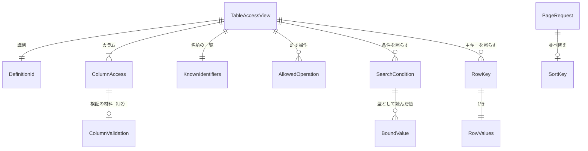

# 振る舞いの仕様 — U1 u1-businessdata-read

U1 は、新しい機能 `businessdata` の読み取りの側である。業務データの定義・一覧と検索・詳細の API と、出し分けの関数・行の SQL の部品・3種類の対象DB の方言を持つ。流れ（手順の順）はこの文書を正とする。データの形は `entities.md`、判定の中身は `rules.md` の YAML を正とし、この文書の ER の図と決まりの要約はそこから作った写しである。

出典: 単位 `aidlc/spaces/default/intents/261016-business-data-views/inception/units-generation/unit-of-work.md`、要件 `inception/requirements-analysis/requirements.md`、ストーリー `inception/user-stories/stories.md`、部品と ADR `inception/domain-design/components.md`・`decisions.md`、契約 `inception/contract-design/contract-summary.md`（C1・C2・C6・C7）、この段の答え `functional-design-questions.md`（Q1〜Q8: A、承認の場の Request Changes の Requested Changes Feedback、それを加えたまとめの確認 Looks correct）。

## 1. API（契約 C2 を、この段の Q1 の答えで直した形）

| API | 道 | 本文（要点） | 成功の応答 |
|---|---|---|---|
| 定義 | `POST /api/tables/definition` | `schema`・`table`・`definitionId`（任意） | 出すカラム（`listColumns`・`detailColumns`。契約 C2 の `ColumnDefinition` の形。BR2.8）・検索の項目・並べ替えできるカラム・既定の並び・操作の可否・`restrictionReason`・`writeConfigured`・`rowLabelColumns`・`definitionId`・`definitionChanged` |
| 一覧と検索 | `POST /api/tables/rows/search` | `schema`・`table`・`definitionId`・`conditions`・`sort`・`page`・`size` | `items`（`key`・`values`・`truncatedColumns`）・`page`・`size`・`total`・`definitionId`・`definitionChanged` |
| 詳細 | `POST /api/tables/rows/get` | `schema`・`table`・`definitionId`・`key` | `key`・`values`・`truncatedColumns`・`definitionId`・`definitionChanged` |

- 3本とも「ログインだけ」（`@ApiAccess(AUTHENTICATED)`）。権限はテーブルごとに業務処理の層で判定する（BR11.1）。
- 道は固定し、スキーマ名・テーブル名・行の値はすべて本文で運ぶ（BR10.4）。
- 値は文字か `null`（BR7.2）。誤りは Problem Details に `code` を足した形で返す（BR1.6・BR10.3）。400 には `definitionChanged` も付ける（BR9.2）。
- 定義のカラムの項目のうち、U1（B2）が返すのは読み取りの項目（`column`・`displayName`・`valueType`・`listFormat`・`width`・`editableOnCreate`・`editableOnUpdate`・`masked`）だけである。検証の材料（`formPart`・`required`・`nullable`・`minLength`・`maxLength`・`precision`・`scale`・`min`・`max`・`choices`・`hasPattern`）は、U2（B4）が同じ項目に足す（BR2.8、U2 R-02）。

要求の例（架空の値）:

```json
{ "schema": "sample", "table": "item", "definitionId": { "dslHash": "<64 桁>", "workRoleId": 7 },
  "conditions": [ { "column": "name", "value": "ペン" } ],
  "sort": { "column": "code", "direction": "ASC" }, "page": 1, "size": 20 }
```

## 2. 判定の順（BR1.1）

| 順 | 当たるもの | 状態コード・code | 監査 |
|---|---|---|---|
| ① | 未認証 | 401 `AUTHENTICATION_REQUIRED`（既存） | 残さない |
| ② | DSL が適用されていない | 404 `BUSINESS_DSL_NOT_APPLIED` | 残さない |
| ③ | DSL に無いスキーマかテーブル | 404 `BUSINESS_TABLE_NOT_FOUND` | 残さない |
| ④ | テーブルの主権限が NONE | 403 `ACCESS_DENIED`（共通） | 残さない |
| ⑤ | 主キーとビューの決まり（詳細だけ） | 409 `BUSINESS_ROW_OPERATION_NOT_ALLOWED` | 残さない |
| ⑥ | 入力の誤り（書けない・検索できない・並べ替えできないカラム、演算子と型の表に無い組、型、範囲、選択肢、主キーのそろえ方、ページ） | 400 `VALIDATION_FAILED`（共通。`definitionChanged` つき） | 残さない |
| ⑦ | 行が無い（詳細） | 404 `BUSINESS_ROW_NOT_FOUND` | 残さない |
| ⑧-1 | 対象DB に接続できない・読み取りの接続の設定が無い | 503 `BUSINESS_TARGET_DB_UNAVAILABLE` | 残さない |
| ⑧-2 | 時間切れ（件数の問い合わせを含む） | 503 `BUSINESS_TARGET_DB_TIMEOUT` | 残さない |
| ⑧-3 | DSL にあるテーブル・カラムが対象DB に無い | 409 `BUSINESS_TARGET_DB_MISMATCH` | 残さない |
| ⑧-4 | 詳細で2行以上が当たった | 409 `BUSINESS_ROW_NOT_UNIQUE` | 残さない |
| （⑧ の例外） | DB が値の型の誤りを返した（通常は起きない） | 400 `VALIDATION_FAILED`（fieldErrors なし、`definitionChanged` つき。BR8.6） | 残さない |

stories.md の判定の順の④（409・403）は、読み取りでは⑤の 409 だけになる（補助権限と FULL の不足の 403 は書き込みの U2）。⑦（業務の失敗）の中の順は、実行の順の⑧-1〜⑧-4 とした。

## 3. 流れ

### 3.1 定義（`POST /api/tables/definition`）

1. 要求の文脈から利用者 ID を読む（本文から利用者を受け取らない）。
2. 権限の解決の口で `snapshotFor(userId)` を1回呼び、写しを取る（BR3.1）。写しは解決の口の中の短い読み取りで取り終えている（BR8.3）。
3. 写しに DSL が無ければ、② `BUSINESS_DSL_NOT_APPLIED`。
4. `schema` をスキーマの一覧と、`table` をそのスキーマのテーブルの一覧と、文字どおり照らす。無ければ ③ `BUSINESS_TABLE_NOT_FOUND`（BR1.3）。
5. テーブルの実効の主権限が NONE なら ④ 403 `ACCESS_DENIED`（BR1.4）。
6. 出し分けの関数で `TableAccessView` を作る（BR2.1〜BR2.8）。
   - 名前の一覧を種類ごとに作る（`KnownIdentifiers`。BR3.3）。
   - 検索の演算子を読み替え（`IN` → `CHOICE`、REFERENCE・LOOKUP と選択肢の無い真偽値でない型の `CHOICE` → `EQUALS`。BR4.6）、その後に演算子と型の表（BR4.9）を当てる。表に無い組のカラムは検索の項目から外す（BR4.10）。
   - password・BINARY・OTHER のカラムを並べ替えから除く（BR5.2）。
7. 要求の `definitionId` が今と違えば、`definitionChanged: true` を付ける（BR9.1）。
8. 定義を返す。カラムの項目は `ColumnDefinition` の形で、読み取りの項目だけを入れる（BR2.8）。対象DB には接続しない（BR8.4）。

### 3.2 一覧と検索（`POST /api/tables/rows/search`）

1. 定義の手順 1〜6 と同じ判定をする（写しは1回だけ）。
2. 本文を確かめる（BR1.6）:
   - ページと件数（BR5.1）
   - 並べ替えのカラム（BR5.2）
   - 条件のカラムが検索に使えるか（BR4.1・BR4.10）
   - 値を `ColumnValueCodec` で型として読む（BR4.7）。範囲の向き（BR4.4）、選択肢（BR4.5）

   誤りはまとめて 400 で返し、`definitionChanged` を付ける（BR9.2）。
3. `targetdb.service` の読み取りの口に、件数とページを読む処理を渡す（BR8.1）。口は接続を1本借りて `TargetReadSession` として処理に貸し、処理が戻ったら閉じる。設定が無ければ処理を呼ばずに ⑧-1。
4. 処理の中で、RowSqlExecutor に、照らした名前（BR3.2）、条件、並び（BR5.3〜BR5.5）を渡す。RowSqlExecutor は、名前を種類ごとの一覧で `SqlIdentifiers.quoteKnown` に通して引用し（BR3.3）、型として読んだ値を型ごとのセッターでバインドする（BR3.4・BR7.8。OTHER は BR7.7）。
5. 同じ貸し出しの中で、まず条件に合う全体の件数を数える（一覧の目的の時間の上限の中。BR5.6・BR8.2・BR8.4）。時間切れなら ⑧-2 で要求全体を失敗にする。
6. 読み飛ばす行の数が件数以上なら、行を読まずに空のページと件数を返す（BR5.7）。
7. 同じ貸し出しの中で、ページの行を読む。読む行の数はページの件数を超えない（BR5.8）。選ぶのは、一覧の列（BR2.2）と、DETAIL が許されるときの主キーのカラムである。BINARY は選ばない（BR7.5）。
8. 値を受け渡しの形にする（BR7.1〜BR7.7）。password は値を入れず、長い文字は切って印を付ける。
9. 対象DB の失敗は、例外のメッセージを読まずに ⑧-1〜⑧-3 に分け、値の型の誤りは 400 に写す（BR8.5・BR8.6・BR10.2）。
10. 応答に `definitionId` と `definitionChanged` を入れて返す（BR9.1）。

### 3.3 詳細（`POST /api/tables/rows/get`）

1. 定義の手順 1〜6 と同じ判定をする。
2. 許す操作に DETAIL が無ければ ⑤ 409（BR1.5・BR6.1）。主キーの値は照らさない。
3. `key` を確かめる（主キーのカラムのそろえ方と、`ColumnValueCodec` での型。BR6.2）。誤りは ⑥（`definitionChanged` つき）。
4. 読み取りの口に読む処理を渡す（設定が無ければ ⑧-1。BR8.1）。
5. 貸し出しの中で、主キーの条件を型つきでバインドし（BR7.8。OTHER は BR7.7）、詳細の目的の時間の上限の中で最大2行まで読む（BR6.3）。
6. 0 行なら ⑦ 404、2 行なら ⑧-4 409。
7. `detail.visible` で READ 以上のカラムの値と `key` を返す（BR2.2・BR6.4）。更新の画面もこの応答で値を読む。

### 3.4 状態の移り変わり

U1 は保存する状態を持たない（読み取りだけ）。画面の状態の移り変わり（一覧の状態の保ち方など）は U3 の機能設計で決める。

## 4. 中の部品（Domain Design のレビュー R-06 への答え）

| 層 | 部品（名前は仮） | 受け持つこと |
|---|---|---|
| web | `BusinessDataReadController`・要求と応答の record・`BusinessDataFieldErrors` | 本文の受け取り、結果の型を `switch` で場合を尽くして `BusinessException` に変える（400 には `definitionChanged` を足す）、API の分類 |
| service | `BusinessDataReadService`・`TableAccessResolver`（契約 C1 の accessFor） | 写しを1回取る、判定の順、読み取りの口に処理を渡す。内部DB のトランザクションを開かない |
| service | `BusinessDataProblemTypeCatalog` | 起動時に code を集める |
| domain | `TableAccessPolicy`（出し分けと許す操作の純粋な関数） | BR2 |
| domain | `SearchOperatorPolicy`（演算子と型の表の純粋な関数） | BR4.6・BR4.9・BR4.10 |
| domain | `SearchRequestValidator`（純粋な関数） | BR4・BR5.1・BR5.2・BR6.2 |
| domain | 値の型（`entities.md`）・`BusinessDataProblemTypes` | 判定の材料と code |
| repository | `RowSqlExecutor` | SQL を組み立てて実行する唯一の部品（BR3.5）。引数は `TargetReadSession` |
| repository | `RowDialect`（MySQL・MariaDB 用と PostgreSQL 用） | NULL の並び・部分一致・時差つきの型・OTHER の渡し方の差 |
| repository | `ColumnValueCodec` | 型の対応、型として読む、型ごとのセッター（BR7.1・BR7.8）。U2 も使う |
| targetdb.service（既存の機能に足す） | 読み取りの接続の口 | 処理を受け取り、接続を貸して閉じる（BR8.1） |
| role.domain（既存の機能に足す） | `PermissionSnapshot` の DSL を渡す口 | 読み取りだけ（BR11.3） |

読み取りの接続の口の形（説明用の断片。名前は仮）:

```java
public interface TargetReadAccess {
    /** 接続を1本借りて処理に貸し、戻ったら閉じる。設定が無ければ処理を呼ばない。 */
    <T> TargetReadOutcome<T> withRead(ReadPurpose purpose, Function<TargetReadSession, T> work);
}

sealed interface TargetReadOutcome<T> {
    record Done<T>(T value) implements TargetReadOutcome<T> {}
    record NotConfigured<T>() implements TargetReadOutcome<T> {}
}
```

業務処理の層が想定内の失敗を返す結果の型の形（説明用の断片）:

```java
sealed interface RowReadResult {
    record Found(TableAccessView view, RowKey key, RowValues values) implements RowReadResult {}
    record Rejected(ProblemType type, List<FieldError> fieldErrors, boolean definitionChanged)
            implements RowReadResult {}
}
```

## 5. ER の図（`entities.md` から作った写し）



文字の代わりの説明:

- `TableAccessView` は、定義の識別（`DefinitionId`）を1つ、カラムの見せ方（`ColumnAccess`）を1つ以上、種類ごとの名前の一覧（`KnownIdentifiers`）を1つ、許す操作を0個以上持つ。
- `ColumnAccess` は、U2 が埋める検証の材料（`ColumnValidation`）を0個か1個持つ。U1 は持たせない。
- 検索の条件（`SearchCondition`）と主キー（`RowKey`）は、`TableAccessView` と照らして確かめる。条件の値は型として読んだ `BoundValue` で持つ。
- 1つの `RowKey` は1行の値（`RowValues`）に当たる。
- 一覧の指定（`PageRequest`）は、並べ替え（`SortKey`）を0個か1個持つ。
- 接続の貸し出しの間だけ使う `TargetReadSession` は、どの値の型とも結び付かない（図に出さない）。
- どれも保存しない。

## 6. 決まりの要約（`rules.md` から作った写し）

| 群 | 決まり | 要点 |
|---|---|---|
| 判定の順と code | BR1.1〜BR1.10 | 2節の表。1 code 1 状態コード。読み取りは監査に残さない |
| 出し分けと許す操作 | BR2.1〜BR2.8 | NONE は出さない。一覧は `list.visible`、詳細は `detail.visible`。FR9.1 の表を1つの純粋な関数で求める。行を見分ける値と理由も返す。カラムの項目は `ColumnDefinition` の形（検証の材料は U2） |
| 名前の照合と SQL | BR3.1〜BR3.5 | 写し1つの DSL で照らし、種類ごとの一覧で `quoteKnown` に通し、値は型つきでバインド。SQL は RowSqlExecutor だけ |
| 検索 | BR4.1〜BR4.10 | AND。`!` でエスケープした部分一致。範囲は両端を含む。`IN` は `CHOICE`。型として読めない値は 400。演算子と型の表に無い組は検索の項目から外し、要求にあれば 400 |
| ページと並べ替え | BR5.1〜BR5.8 | 20・50・100。主キーで安定させる。NULL は昇順で最後。件数は正確に数える。最後のページを超えたら空のページ |
| 詳細 | BR6.1〜BR6.4 | 主キーは本文で受ける。2行まで読む。更新の画面にも使う |
| 値の受け渡し | BR7.1〜BR7.9 | 文字か null で返す。時差つきの型は UTC。password とバイナリは値を返さない。長い文字は切って印を付ける。値は型ごとのセッターで渡す。OTHER は接続の設定を変えず、PostgreSQL で `Types.OTHER`。だめな DB の切り替え先 |
| 接続と時間の上限 | BR8.1〜BR8.6 | 貸す形の読み取りの口、目的ごとの上限、内部DB の接続を持たない、件数とページは同じ貸し出し、失敗の分け方、型の誤りは 400 |
| 定義の識別 | BR9.1・BR9.2 | `definitionChanged` を成功と 400 の両方に付ける |
| 漏えいの防止 | BR10.1〜BR10.4 | 伏せ字（接続を持つ型も）、JDBC のメッセージを出さない、誤りの応答に値を入れない、道に値を載せない |
| 分類と構造の検査 | BR11.1〜BR11.4 | API の分類、境界テスト、role の変更、SpotBugs の除外 |

## 7. 上流との差

承認済みの文書は書き換えず、差をここに書く（`project.md` の決まり）。

| # | 上流 | 差 | 決めた所 |
|---|---|---|---|
| X1 | 契約 C2・C3 の道 `/api/tables/{schema}/{table}/...` と、定義の `GET` | 道を `/api/tables/definition`・`/api/tables/rows/search`・`/api/tables/rows/get` に固定し、スキーマ名・テーブル名を本文で運ぶ。定義も `POST` にする。入口の検査（StrictHttpFirewall）を既定のまま使い、どんな DSL の名前でも同じに扱って、AC3.6.1 をそのまま満たすため。U2 の書き込みの道も同じ形にそろえる（`/api/tables/rows` の `POST`・`PATCH`、`/api/tables/rows/delete`）。画面の道（`/tables?schema=…&table=…`）は変わらない | Q1: A |
| X2 | 契約 C2 の `SearchField.operator`・`ColumnDefinition.listFormat` の列挙 | 契約 C2 の列挙が DSL v2 に追いついていない差である。DSL v2 の JSON Schema（`dsl-schema-v2.json`）は、検索の演算子 `IN` と一覧の書式 `BOOLEAN_ON_OFF` を既に受け付けている（要件 FR3.2・FR11.2 には無い値）。DSL は変えない。`IN` は応答では `CHOICE` として返す（`operator` の列挙は変えない）。`listFormat` の列挙に `BOOLEAN_ON_OFF` を足す（足すだけの変更。画面は「オン／オフ」、英語は `On`／`Off`） | Q3: A、承認の場の R-06 |
| X3 | 契約 C2 の `RowItem`・`RowDetail`・`ColumnDefinition`・`valueType` | 足すだけの変更: 応答の行に `truncatedColumns` を足す。定義に `rowLabelColumns` を足す。`valueType` の `BINARY` は値を返さない印として使う。`OTHER` は読み取りだけの文字 | Q5: A・Q6: A・Q8: A |
| X4 | 要件 FR13.1「今の置き場の API と同じ」 | 今の置き場の API（`GET /api/me/table-access`）は、DSL が無い・組が無い・NONE を区別せず、すべて 403 にしている。U1 は承認済みの判定の順（404 → 403）に従い、3つを分ける。置き場の API を残すか消すかは U3 の論点 | 承認済みの FR13.1・ADR-006 |
| X5 | 契約 C2・C3 の未決の点（code の名前と状態コード） | 2節の表のとおり確定した。409・503 の割り当ても確定し、1つの code に状態コードを1つだけにした | Q7: A |
| X6 | 契約 C7「既存の口の形を変えない」 | `PermissionSnapshot` に、DSL のモデルを読み取りだけで渡す口を1つ足す（判定と照合を同じ DSL で行うため） | Q2: A |
| X7 | 要件 FR3.2「EQUALS・CONTAINS・RANGE・CHOICE のすべてを扱う」 | 演算子と型の表（BR4.9）に無い組は、DSL がそう設定していても検索の項目に出さない（CONTAINS は文字の型だけ、RANGE は数・日付・日時・時刻だけ、CHOICE は固定の選択肢か真偽値だけ、password・BINARY はどれにも使わない）。要求に入っていれば 400 | SM3・Q5・Q6、承認の場の R-01 |
| X8 | この段の Q6 の答え A と最初のまとめの確認（「PostgreSQL の接続に `stringtype=unspecified` を足す」） | 承認の場の Request Changes で、接続の設定は変えないことにした。値は型として読み、型ごとのセッターでバインドし（BR7.8）、OTHER は PostgreSQL ではその値だけを `Types.OTHER` で渡す（BR7.7）。Q6 の答えの文は書き換えず、Requested Changes Feedback を正とする | 承認の場の R-02 |
| X9 | 要件・ストーリーの AC1.4.8（型の分類の外の型でも主キーで行を指せ、完全一致で検索できる） | NFR 設計の試しで OTHER の渡し方がだめな DB があれば、その DB では OTHER を主キーの指し方と EQUALS から外す（BR7.9）。そのときは AC1.4.8 を満たせない差になる。試しが通れば差は無い | 承認の場の R-02 |
| X10 | 契約 C2 の `ColumnDefinition` の必須の項目（`nullable`） | 検証の材料（`nullable` を含む）は U2（B4）が足す。U1（B2）だけが統合された間は、カラムの項目に `nullable` が無い。U3 の作成・更新の画面は B4 の後に作るため、画面は困らない | 承認の場の U2 R-02、U3 Q1: A |
| X11 | 契約 C2 の Problem の型（`definitionChanged` は「読み取りで」） | 読み取りでは 400 にだけ付け、403・404・409・503 には付けない（BR9.2） | 承認の場の R-04 |

## 8. 後の段に回すこと

- **NFR 要件（U1）**:
  - 一覧と詳細の目的の時間の上限の値
  - 長い文字の上限（一覧の N 字・詳細の M 字）
  - 応答時間の測り方（AC1.3.7）
  - 件数の多い表の行の数と、全体の件数の目標
  - 1要求の接続の数（AC3.6.6。一覧は件数とページで1回の貸し出し）
  - 要求の本文の大きさと、検索の値の長さの上限
- **NFR 設計（U1）**:
  - 時差つきの型を UTC にそろえるやり方（接続のタイムゾーンか JDBC の型か。MySQL・MariaDB の `timestamp` の渡し方を含む。ADR-007 の捨ての試し）
  - OTHER の値の渡し方の試し: PostgreSQL の `uuid`・`json`・列挙の型を `setObject(..., Types.OTHER)`、MySQL・MariaDB の分類の外の型を `setString` で渡し、主キーの指し方と完全一致の検索が3種類の DB で通るか。だめな DB は BR7.9 に切り替え、X9 の差を記録する
  - 値の型の誤りの SQLState の表（BR8.6）を、3種類の DB で実際に起こして確かめる
  - 深いページの OFFSET の重さ
  - 件数とページを同じ貸し出しで読むときの一貫性（別の時点になりうることは既知の制約）
- **コード生成の計画**:
  - `RoleBoundaryArchitectureTest` の変更と `PermissionSnapshot` の口（依頼者の承認）
  - SpotBugs の除外の絞り込み
  - `targetdb` の `ReadPurpose`・`QueryTimeout` と読み取りの口（貸す形）に手を入れることと、そのテストの洗い出し（接続の設定の URL は変えない）
  - `definitionChanged` を 400 の Problem Details に足す口（既存の GlobalExceptionHandler の拡張の項目）
  - 演算子と型の表の境界の値の結合テスト（3種類の DB）
- **U2 に伝えること**:
  - 書き込みの道も本文で運ぶ形にそろえる（X1）。
  - `BUSINESS_TARGET_DB_UNAVAILABLE`・`BUSINESS_TARGET_DB_TIMEOUT`・`BUSINESS_TARGET_DB_MISMATCH` を使い回す（X5）。
  - `TableAccessView` と許す操作の関数、RowSqlExecutor、`ColumnValueCodec`（型ごとのセッター。BR7.8）を使う（契約 C1）。
  - BINARY・OTHER は入力にしない（BR2.4）。
  - 書き込みの口も貸す形にする（BR8.1）。名前の一覧は種類ごと（BR3.3）。
  - `ColumnAccess.validation` を埋め、定義のカラムの項目に検証の材料を足す（BR2.8）。
- **U3 に伝えること**:
  - 道と本文の形（X1）
  - `rowLabelColumns` を行のリンクと「詳細: …」「操作: …」の名前と見出しに使う（Q8）
  - `truncatedColumns`、BINARY の出し方、`BOOLEAN_ON_OFF` の書式（X2・X3）
  - Q7 の3つの code の文の出し分け
  - 置き場の API の扱い（X4）
  - 400 にも `definitionChanged` が付く（BR9.2）。検索の項目は演算子と型の表で絞られて届く（BR4.10）
- **U4 に伝えること**: 行を見分ける値は、定義の `rowLabelColumns` から作る（Q8）。

## 9. 承認の場で受け入れた指摘への答え（前の段まで）

| 指摘 | 中身 | この段の答え |
|---|---|---|
| Contract Design R-10 | 道のエンコード済みの `/`・`%` が入口の検査に拒まれる | 名前を本文で運ぶ（Q1: A、X1、BR10.4） |
| Domain Design R-03 | 判定の DSL と照合の DSL がずれうる | 写し1つの DSL を両方に使う。`PermissionSnapshot` に口を足す（Q2: A、BR3.1、BR11.3） |
| Domain Design R-02 | `SqlIdentifiers`・`ReadPurpose`・`QueryTimeout` の持ち主 | 引用は既存の `SqlIdentifiers.quoteKnown` に種類ごとの DSL の名前の一覧を渡す（BR3.3）。目的と上限は `targetdb` に足し、ドライバーの通信の待ちの計算にも入れる（BR8.2） |
| Domain Design R-01 | 書き込みの DataSource と2つ目のトランザクションの管理者 | U1 は新しい Bean を作らず、既定の候補にしない今の `targetDataSource` を貸す口で使う（BR8.1）。書き込みの側は U2 で決める |
| Domain Design R-04 | 件数の重さ・一貫性・BLOB と大きな文字列・件数の意味・DDL の権限 | 件数は正確に数え、時間切れは要求全体の失敗（Q4: A、BR5.6）。バイナリは読まず、大きな文字列は切る（Q5: A、BR7.5・BR7.6）。更新の件数の意味と DDL の権限は U2 |
| Domain Design R-06 | BusinessData の中の分け方 | 4節の表 |
| Units Generation R-04 | 境界テストと SpotBugs の除外の持ち主 | U1 が境界テストを作り、除外を読み取りのメソッドに絞る。U2 が書き込みを足す（BR11.2・BR11.4） |
| User Stories R-03 | 判定の順の④と⑦の中の順 | 2節の表で確定した |
| Requirements Analysis R-09 | 更新の画面の値を読む API | 詳細の API で読む（BR6.4） |
| この段の答え | Q1〜Q8 はすべて A。まとめの確認は Looks correct | 本文と `rules.md` に反映した（Q6 の答えの一部は承認の場で変えた。X8） |

## 10. 承認の場の決定（2026-10-18 Request Changes）

この段の承認の場で、依頼者は Request Changes を選び、直す範囲を「Major と、単位の継ぎ目に関わる Minor」と決めた。直し方は `functional-design-questions.md` の Requested Changes Feedback に書き、それを加えたまとめを依頼者が Looks correct で確かめ直した。指摘の元はこの単位のレビュー（`.aidlc-reviews/functional-design/units/u1-businessdata-read/43883aac7901769a/` の1回目、判定 READY）である。

### 10.1 直した指摘

| 指摘 | 重さ | 直した中身 | 直した所 |
|---|---|---|---|
| R-01 演算子と型の組み合わせ | Major | 演算子と型の表を BR4 に置いた（CONTAINS は文字の型だけ、RANGE は数・日付・日時・時刻だけ、EQUALS は password・BINARY を除くすべて、CHOICE・IN は固定の選択肢か真偽値だけ）。表に無い組のカラムは定義の検索の項目から外し、要求に入っていれば 400 `VALIDATION_FAILED`（`NOT_ALLOWED`）。値は先に型として読むため型の誤りの SQLState は通常起きないが、起きたら値を出さずに 400 に写す | BR4.9・BR4.10・BR8.6 を足し、BR1.1・BR1.6・BR4.3・BR4.4・BR4.6・BR4.7・BR8.5 を直した。rules.md の「演算子と型の表」、X7 |
| R-02 `stringtype=unspecified` | Major | 接続の設定には足さない（共有の接続とスキーマの読み取りに効かせない）。値は `ColumnValueCodec` で型として読み、型ごとのセッターでバインドする（U2 Q3: A と同じ形）。OTHER は PostgreSQL ではその値だけを `Types.OTHER` で渡す。3種類の DB での確かめは NFR 設計の試しに回し、だめな DB では OTHER を主キーの指し方と完全一致の検索から外す（AC1.4.8 との差として記録） | BR7.8・BR7.9 を足し、BR3.4・BR3.5・BR4.7・BR6.2・BR7.1・BR7.7 を直した。entities.md の `BoundValue`、X8・X9、8節 |
| R-03 接続の口 | Minor（継ぎ目） | 読み取りの接続の口は、接続を返さずに貸す形（処理を受け取り、貸して、閉じる）にした。件数とページは同じ1回の貸し出しの中で読む。接続を持つ型（`TargetReadSession`）の文字列は DB の種類だけにし、RowSqlExecutor は `Connection` を直接受けない | BR8.1・BR8.4・BR5.6・BR10.1 を直した。entities.md の `TargetReadSession`、4節の断片 |
| R-04 `definitionChanged` | Minor（継ぎ目） | 400 の Problem Details にも、契約 C2 の誤りの型のとおり `definitionChanged` を付ける（U3 Q2: A の前提）。403・404・409・503 には付けない | BR9.2 を足し、BR9.1・BR1.6・BR10.3 を直した。X11 |
| R-05 名前の一覧 | Minor（継ぎ目） | `quoteKnown` に渡す名前の一覧を、スキーマ・テーブル・カラム（そのテーブルのカラムだけ）の種類ごとに分けた | BR3.3・BR1.3・BR11.4 を直した。entities.md の `KnownIdentifiers` |
| U2 R-02 定義の応答 | 継ぎ目 | 定義の API のカラムの項目は契約 C2 の `ColumnDefinition` の形にする。U1（B2）は読み取りの項目を返し、検証の材料（`formPart`・`required`・`nullable`・`minLength`・`maxLength`・`precision`・`scale`・`min`・`max`・`choices`・`hasPattern`）は U2（B4）が足す（U3 Q1: A）。U1 の型に余地（`ColumnAccess.validation`・`ColumnValidation`）を置いた | BR2.8 を足した。entities.md の `ColumnAccess`・`ColumnValidation`、1節、X10 |
| R-06 X2 の文言 | Minor | `BOOLEAN_ON_OFF` は DSL v2 の JSON Schema に既にあるため、差を「契約 C2 の列挙が DSL v2 に追いついていない」と直し、DSL は変えないと明記した | X2 |

### 10.2 直さずに後の段で拾う Minor

無し。この単位のレビューの指摘（R-01〜R-06）はすべて直した。レビューの R-02 の推奨のうち「URL を変える作業をコード生成の計画に回す」は、接続の設定を変えないことにしたため要らなくなった（8節のコード生成の計画に「接続の設定の URL は変えない」と書いた）。

### 10.3 ほかの単位への影響

- U2: `functional-spec.md` の「U1 の R-03・R-05 を直した後の形を前提にした」点（貸す形・種類ごとの名前の一覧）は、この直しと同じ形になった。値の渡し方（BR7.8）も U2 Q3: A と同じ形である。
- U3: `functional-spec.md` 8節「前提にした直し」の3つ（U1 R-01・U1 R-04・U2 R-02）は、この直しと同じ形になった。U3 をそろえ直す必要は無い。
