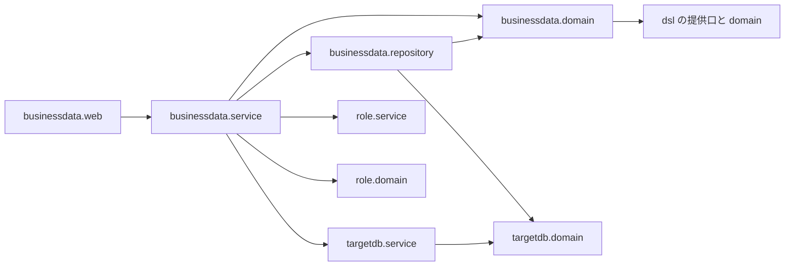

# 論理の部品 — U1 u1-businessdata-read

## 捨ての試しの結果（要点）

試しの全体は、reliability-design.md の 1節にある。部品の境目に効いたのは、次の5つ。

- **T3・T7・T8（借りる失敗）**: 借りる失敗の SQLState と原因は、DB ごとにばらばらだった（原因なし、08003、MariaDB の 42000 など）。
  - そのため、借りる口（targetdb）は失敗を分けずに UNAVAILABLE で返す（Q3: A）。文の失敗だけを、businessdata の分類の部品が分ける。
- **T3（例外の文の中の値）**: PG の例外の文に、入力の値が入る。
  - そのため、例外は JDBC を呼ぶ2つの部品（口と `RowSqlExecutor`）のメソッドの中で受け、外へ出さない。
- **T1（時差）**: MySQL・MariaDB は、貸すたびに `SET time_zone` が要る。
  - その文は `RowSqlExecutor` が流す（`createStatement` を呼んでよいのは、この部品だけ）。
- **T2（OTHER）**: OTHER で通る型が、DB と型ごとに違う。MySQL・MariaDB の `bit` と空間の型は、読んでも画面に出せない。
  - BR7.9 の型の一覧は RowDialect に閉じる。BINARY と同じ扱いにする型は、`ColumnValueCodec` の型の対応で決める（F3: A）。
- **F2（応答しない相手）**: 貸すたびに `setNetworkTimeout`（10 秒）を付けると、つないだ後に相手が止まっても、3種類とも 25 秒以内に失敗した。
  - 付けるのと戻すのは、貸す口（targetdb.service）が受け持つ。

## 対応表

| U1 の NFR 要件の ID | この文書の節 |
|---|---|
| NFR2.3 接続の数 | 1節 L8・L9、3節 |
| NFR4.1 SQL の組み立て | 1節 L10〜L13、2節 |
| NFR4.2 漏えい | 1節（すべての部品の toString と例外）、3節 |
| NFR4.3 読み取りの接続（部分） | 1節 L8・L9 |
| NFR4.4 時間の上限 | 1節 L9・L14 |
| NFR4.5 大きさの上限 | 1節 L1・L6 |
| NFR4.8 失敗の返し方と例外の通り道 | 1節 L3・L9・L10・L12、3節 |
| NFR8.2 ログの1か所 | 1節 L3 |

## 1. 部品の一覧

| # | 置き場 | 部品（名前は仮） | 受け持つこと | 効かせる NFR の型 |
|---|---|---|---|---|
| L1 | businessdata.web | `BusinessDataReadController`・要求と応答の record・`BusinessDataWebConfig` | 3本の API（`@ApiAccess(AUTHENTICATED)`）。結果の型を `switch` で `BusinessException` に変える（400 には `definitionChanged` を付ける）。64KB の道ごとの決まりを3つ置く | 本文の上限、値を伏せた toString |
| L2 | businessdata.service | `TableAccessResolver` | 写しを1回取り、`TableAccessView` を作る | 内部DB は、写しの短い読み取りだけ |
| L3 | businessdata.service | `BusinessDataReadService` | 判定の順。口に処理を渡す。結果の型を code に変える。**ログの1か所**。想定外の失敗は、メッセージの無い例外にして投げる | 内部DB のトランザクションを開かない |
| L4 | businessdata.service | `BusinessDataProblemTypeCatalog` | code を起動時に集める | — |
| L5 | businessdata.domain | `TableAccessPolicy`・`SearchOperatorPolicy` | 許す操作と演算子の純粋な関数 | 性質ベースのテスト |
| L6 | businessdata.domain | `SearchRequestValidator` | page（1〜1,000,000、long で計算）・size・値の長さ（1,000）・CHOICE の重複・型として読む | 入力の上限 |
| L7 | businessdata.domain | 値の型・`BusinessDataProblemTypes`・`RowQueryFailure` | 判定の材料と code。失敗は、理由・SQLState・業者の番号・例外のクラスの名前だけを持つ | 値を伏せた toString |
| L8 | targetdb.domain（足す） | `TargetReadSession`（record。接続と DB の種類）・`TargetReadOutcome`（`Done`・`NotConfigured`・`Unavailable`） | 貸している間だけ使える組 | toString は DB の種類だけ |
| L9 | targetdb.service（足す） | `TargetReadAccess`・`JdbcTargetReadAccess` | 次の2つを受け持つ。<br>・貸す: 読み取りの `targetDataSource` から1本借り、`setNetworkTimeout`（目的の上限 + 5 秒）を付けて貸す<br>・返す: `finally` で元の値に戻して閉じる（F2: A）<br>借りる失敗と、待ちを付ける処理の失敗はメソッドの中で受け、すべて `Unavailable` にする（Q3: A） | 例外を外へ出さない。通信の待ち |
| L10 | businessdata.repository | `RowSqlExecutor` | SQL を組み立てて実行する唯一の部品。最初の文の前に、方言の初期化の文（MySQL・MariaDB の `SET time_zone`）を流す。`SQLException` はメソッドの中で受け、`RowQueryFailure` にする | `prepareStatement`・`createStatement` を呼べるのはここだけ |
| L11 | businessdata.repository | `RowDialect`（PG 用と、MySQL・MariaDB 用） | NULL の並び・部分一致・選ぶ列の式（`SUBSTRING`・`CAST`）・主キーを先に読む形・時差つきの型・OTHER の渡し方・BR7.9 の型の一覧 | service は DB の種類で分岐しない |
| L12 | businessdata.repository | `RowSqlFailureClassifier` | SQLState・業者の番号・例外の型の連なりで理由を決める純粋な部品（reliability-design.md の 2節の表） | メッセージを読まない |
| L13 | businessdata.repository | `ColumnValueCodec` | 型の対応（BR7.1 の1か所）と、型ごとのセッター。MySQL・MariaDB の `bit`（長さ 2 以上）と空間の型は BINARY にする（F3: A）。U2 も使う | 型として読んでからバインドする |
| L14 | targetdb.config（直す） | `TargetDbProperties.QueryTimeout`・`TargetDbSettings` | `list`・`detail` の上限（5 秒）を足す。点検と、ドライバーの通信の待ちの計算（25 秒のまま）に入れる | 時間の上限 |
| L15 | role.domain（足す） | `PermissionSnapshot` の、DSL を読み取りで渡す口 | 判定と照合を、同じ DSL で行う | — |
| L16 | test（`businessdata/testsupport`） | 接続を数える包み・答えない ServerSocket・つないだ後に止まる中継（使うかは計画で決める） | `BusinessDataConnectionUsageIT`・時間切れの IT | — |

貸す口の形（説明用の断片。名前は仮）:

```java
public <T> TargetReadOutcome<T> withRead(ReadPurpose purpose, Function<TargetReadSession, T> work) {
    // 設定が無ければ NotConfigured を返す（省略）
    Connection c;
    try { c = dataSource.getConnection(); } catch (SQLException e) { return Unavailable.of(e); } // 分けない（Q3: A）
    try {
        int original = c.getNetworkTimeout();
        c.setNetworkTimeout(executor, millis(settings.queryTimeout(purpose).plusSeconds(5)));
        try { return new Done<>(work.apply(new TargetReadSession(product, c))); }
        finally { restore(c, original); } // 失敗はクラスの名前だけを WARN で出す
    } catch (SQLException e) { return Unavailable.of(e); }
    finally { closeQuietlyWithWarn(c); }
}
```

## 2. 依存の向き



図の文での説明:

- web は、service だけを呼ぶ。
- service は、domain・repository・targetdb.service・role.service・role.domain を使う。
- repository は、targetdb.domain（`TargetReadSession`・`SqlIdentifiers`）と businessdata.domain を使う。targetdb.service には依存しない。

境界テストは、次の3つで固める。

- `BusinessDataBoundaryArchitectureTest`（足す）
- `RoleBoundaryArchitectureTest`（依存してよい相手を足す。承認が要る）
- `TargetDbBoundaryArchitectureTest`（変えない）

`TargetDbBoundaryArchitectureTest` を変えなくてよい理由:

- 足す口（L8・L9）は、書き込みも `JdbcTemplate` も使わず、DSL にも web にも依存しない。
- `TargetReadSession` は接続を持つが、targetdb の中では文を作らない。
- `setNetworkTimeout` は文を作らない。

## 3. 失敗の範囲（failure domain）と共有の資源

| 失敗 | 及ぶ範囲 | 及ばない範囲 |
|---|---|---|
| 対象DB が止まる・答えない | 業務データの API（503）、DSL の生成・照合 | ログイン・権限・メニュー・内部DB の API。内部DB の接続を持ったまま待たないため |
| 対象DB のプールが借りきられる | 業務データの API と DSL の生成・照合（3 秒で UNAVAILABLE） | 内部DB のプール（30）を使う API |
| つないだ後に止まった接続 | その要求が、最大で MySQL 20 秒・PG 15 秒・MariaDB 10 秒待つ（F2: A）。その間、プールの1本を持ち続け、失敗の後はプールが捨てる | ほかの要求は、残りの本数と借りる待ち 3 秒で失敗する |
| 例外の文の中の値 | JDBC を呼ぶメソッドの中で捨てる | TraceAspect の TRACE・応答・アプリのログ |

- 共有の資源は、対象DB の読み取りのプール（5 本）だけ。DSL の生成・照合と分け合う（既知の制約）。
- 内部DB のプールは、権限の写しの短い読み取りで1本を使って返すだけ。

## 4. 上流との差

**機能設計の 4節の部品の表に足したもの**
- `RowSqlFailureClassifier`（L12）
- `TargetReadOutcome` の `Unavailable`（L8）。借りる失敗をすべて UNAVAILABLE にするため（Q3: A）
- 貸す口の `setNetworkTimeout` を付けて戻す処理（L9。F2: A）
- RowDialect の受け持ちに、主キーを先に読む形・BR7.9 の型の一覧・`SET time_zone` の初期化の文（L11）

**機能設計の 4節の断片との差**
- 断片の `TargetReadOutcome` は `Done`・`NotConfigured` の2つだった。借りる失敗を返す `Unavailable` を足した。BR8.1 の「設定が無い」に加えて、借りる失敗も口の中で受けるため。

**機能設計の BR7.1 との差（F3: A）**
- BR7.1 は「表に無い型は OTHER」としている。この設計では、MySQL・MariaDB の `bit`（長さ 2 以上）と空間の型を BINARY にする（L13）。
- その結果、次がこれらの型にも当たる。
  - BINARY の決まり（BR7.5 の読まない、BR2.4 の入力にしない）
  - 並べ替えの除外（BR5.2）
- 詳しくは reliability-design.md の 6節。

**BR8.5・BR11.2 に足す1行（R-07）**
- BR8.5: 「JDBC の例外は、`JdbcTargetReadAccess.withRead`（借りる・待ちを付ける）と `RowSqlExecutor` の各メソッド（文）の中で受け、メッセージと原因を捨てて結果の型で返す」
- BR11.2: 「`TargetReadSession` は `targetdb.domain`、貸す口は `targetdb.service` に置く」
- この2行は、コード生成の計画で差として扱う。

## 5. 後の段に回すこと

**コード生成の計画（B2）で依頼者の承認を得るもの**
- `RoleBoundaryArchitectureTest` の変更
- SpotBugs の除外

**コード生成の計画（B2）で決めるもの**
- `TargetDbSettings`・`ReadPurpose`・`QueryTimeout` を変えることと、それらを使っている既存のテストの洗い出し
- `targetdb` の新しい口が、既存の `TargetDbBoundaryArchitectureTest` を通ることの確かめ
- `setNetworkTimeout` の executor の持ち方
- L16 の中継を置くかどうか

**Infrastructure Design・Performance Validation**
- 対象DB のプールと時間の上限の設定の値は、既定のままにする（`.env` の項目は増えない）。
- 使い捨ての対象DB の、表が入る設定の値を決める（F1: A。performance-design.md の 7節）。

## 6. U2・U3 とそろえる点

**U2**
- 書き込みの口を、L8・L9 と同じ形で足す（`TargetWriteAccess`。書き込みの DataSource と、対象DB 用のトランザクションの管理者）。`setNetworkTimeout` を付けて戻す形も同じにする。
- `RowSqlExecutor`・`RowDialect`・`RowSqlFailureClassifier`・`ColumnValueCodec` を使い回す。書き込みのメソッドと、一意・外部キーの違反の表を足す。
- ログの1か所の形も、同じにする。

**U3**
- 503 の2つの code、409 の MISMATCH、413・400 を出し分ける。
- 検索の項目は、定義の API で絞られて届く（BR7.9 の型は出ない）。
- BINARY と同じ扱いの型は、読めない印で出す。

## Sources

- 機能設計: `aidlc/spaces/default/intents/261016-business-data-views/construction/u1-businessdata-read/functional-design/functional-spec.md`（4節）・`rules.md`（BR7.1・BR8・BR10・BR11）・`entities.md`（`TargetReadSession`）
- 承認済みの NFR 要件: `construction/u1-businessdata-read/nfr-requirements/` の全部。とくに `reliability-requirements.md` の NFR4.8 と、R-07 の受け方
- この段の答え
  - `construction/u1-businessdata-read/nfr-design/nfr-design-questions.md`（Q1〜Q6: A）
  - `construction/u1-businessdata-read/nfr-design/nfr-design-followup-questions.md`（F1〜F3: A）
- 契約・部品
  - 契約: `inception/contract-design/contract-summary.md`（C6・C7）
  - 部品: `inception/domain-design/components.md`
- コード
  - `backend/src/test/java/cherry/mastersmith/targetdb/TargetDbBoundaryArchitectureTest.java`
  - `backend/src/test/java/cherry/mastersmith/ArchitectureTest.java`（repository から service への禁止は無いが、repository は targetdb.service に依存させない）
  - `backend/src/main/java/cherry/mastersmith/common/observability/TraceAspect.java`
- 捨ての試し: リポジトリの外の試しのコードと結果（T1〜T3・T7・T8・F2）

## Assumptions & Open Questions

- 前提: `TargetReadSession` を record にすると、TraceAspect の対象から外れる（`!within(java.lang.Record+)`）。引数として文字列にされるときは、上書きした toString（DB の種類だけを出す）が使われる。
- 前提: 壊れていない接続を返すときに、HikariCP が通信の待ちを戻すかは確かめていない。そのため、口が自分で戻す（L9）。
- 依頼者の決定（F1〜F3: A）は、L9・L13・3節・4節に反映した。
- 諮る点は無い。
