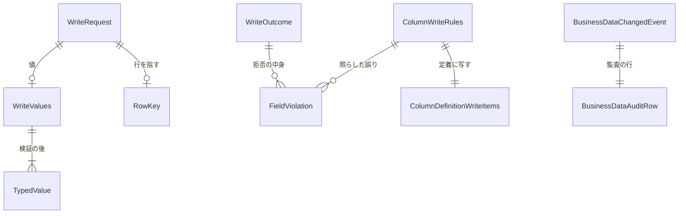

# 振る舞いの仕様 — U2 u2-businessdata-write

U2 は、新しい機能 `businessdata` の書き込みの側である。業務データの作成・更新・削除の API、値の検証、定義の API に足す検証の材料、書き込みの接続と対象DB のトランザクション、監査の出来事を持つ。流れ（手順の順）はこの文書を正とする。データの形は `entities.md`、判定の中身は `rules.md` の YAML を正とし、この文書の ER の図と決まりの要約はそこから作った写しである。

出典:
- 単位: `aidlc/spaces/default/intents/261016-business-data-views/inception/units-generation/unit-of-work.md`
- 要件: `inception/requirements-analysis/requirements.md`
- ストーリー: `inception/user-stories/stories.md`
- 部品と ADR: `inception/domain-design/components.md`・`decisions.md`
- 契約: `inception/contract-design/contract-summary.md`（C1・C2・C3・C5・C6・C7）
- U1 の機能設計: `construction/u1-businessdata-read/functional-design/`
- この段の答え: `functional-design-questions.md`（Q1〜Q8: A、承認の場の Requested Changes Feedback、まとめの確認 Looks correct）

承認の場（2026-10-18）の Request Changes で直した点は 11節にまとめた。

## 1. API（契約 C3 を U1 の X1 の形にそろえたもの）

| API | 道 | 本文（要点） | 成功の応答 |
|---|---|---|---|
| 作成 | `POST /api/tables/rows` | `schema`・`table`・`definitionId`・`values` | 201: `definitionId`・`key`（DETAIL が許されるときだけ） |
| 更新 | `PATCH /api/tables/rows` | `schema`・`table`・`definitionId`・`key`・`values`（変えたカラムだけ） | 200: `definitionId` |
| 削除 | `POST /api/tables/rows/delete` | `schema`・`table`・`definitionId`・`key` | 200: `definitionId` |

- 3本とも「ログインだけ」に分類する（BR13.1）。権限はテーブルごとに業務処理の層で判定する。
- 道は固定し、名前と行の値はすべて本文で運ぶ。値は文字か `null` で受け、サーバーが型として読む（BR3.2・BR3.8）。
- 誤りは Problem Details に `code` と `fieldErrors`（`field`・`reason`・pattern の `message`）を足した形で返す。値は入れない（BR12.3）。
- U2 は、U1 の定義の API（`POST /api/tables/definition`）のカラムの項目に検証の材料を足す（1.1、BR14.1）。道・判定・ほかの項目は U1 のまま変えない。

要求の例（架空の値）:

```json
{ "schema": "sample", "table": "item",
  "definitionId": { "dslHash": "<64 桁>", "workRoleId": 7 },
  "key": { "id": "101" }, "values": { "name": "見本の品", "remark": "" } }
```

### 1.1 定義の API に足す検証の材料（R-02）

定義の API の `listColumns`・`detailColumns` の各カラム（契約 C2 の `ColumnDefinition`）に、U2（B4）が次の項目を足す。U1（B2）は読み取りの項目を返し、型にこの項目の余地を置く。

| 項目 | 型 | 当てる型・部品 | 元（`ColumnWriteRules`） |
|---|---|---|---|
| `formPart` | 列挙 | すべて（`lookup` は `text` として返す） | DSL の form の部品 |
| `required` | 真偽値 | すべて | DSL の `required` |
| `nullable` | 真偽値 | すべて（U1 の読み取りの項目と同じ値。重ねて持たない） | DSL の `dbType.nullable` |
| `minLength`・`maxLength` | 整数か null | STRING だけ | DSL と DB の長さの小さい方（コードポイント） |
| `precision`・`scale` | 整数か null | DECIMAL だけ | DB の型 |
| `min`・`max` | 文字か null | 数・日付・時刻の型だけ | DSL の `min`・`max` |
| `choices` | Option の並び | `select`・`radio` だけ | FIXED の選択肢（value・label） |
| `hasPattern` | 真偽値 | STRING だけ | DSL の `pattern` の有無（式は返さない） |

- 値はサーバーの検証と同じ `ColumnWriteRules` から写すだけにする（BR14.2）。型に当たらない項目は `null`（BR3.6）。
- 作成でも更新でも書けないカラムは、`formPart` 以外を既定（`null`・偽・空）にする。
- `unique`・`requiredOrigin`・式そのものは返さない。

## 2. 判定の順（BR1.1）

| 順 | 当たるもの | 状態コード・code | 監査（理由の値） |
|---|---|---|---|
| ① | 未認証 | 401 `AUTHENTICATION_REQUIRED`（既存） | 残さない |
| ② | DSL が適用されていない | 404 `BUSINESS_DSL_NOT_APPLIED` | 残さない |
| ③ | DSL に無いスキーマかテーブル | 404 `BUSINESS_TABLE_NOT_FOUND` | 残さない |
| ④ | テーブルの主権限が NONE | 403 `ACCESS_DENIED` | 残さない |
| ⑤ | 画面の定義が古い | 409 `BUSINESS_DEFINITION_CHANGED` | 残さない |
| ⑥ | 主キーとビューの決まり | 409 `BUSINESS_ROW_OPERATION_NOT_ALLOWED` | 残す（`BUSINESS_ROW_OP_NOT_ALLOWED`） |
| ⑦ | CREATE・DELETE が不可、FULL のカラムが無い | 403 `ACCESS_DENIED` | 残さない |
| ⑧ | 書き込みの設定が無い | 409 `BUSINESS_WRITE_NOT_CONFIGURED` | 残さない |
| ⑨ | 入力の誤り（書けないカラム・型・必須・長さ・桁・範囲・選択肢・pattern・空の更新） | 400 `VALIDATION_FAILED` | 残さない |
| ⑩-1 | 接続を借りられない | 503 `BUSINESS_TARGET_DB_UNAVAILABLE` | 残す（同じ名前） |
| ⑩-2 | 表・カラムが対象DB に無い | 409 `BUSINESS_TARGET_DB_MISMATCH` | 残す（同じ名前） |
| ⑩-3 | 同じ値がある（事前の問い合わせ・制約の違反） | 409 `BUSINESS_DUPLICATE_VALUE` | 残す（同じ名前） |
| ⑩-4 | 参照先に無い値 | 409 `BUSINESS_REFERENCE_NOT_FOUND` | 残す（同じ名前） |
| ⑩-5 | DB が拒んだ保存（削除の外部キー・NOT NULL・長さ・桁）と、違反のカラムの確かめの失敗・時間切れ | 409 `BUSINESS_SAVE_REJECTED` | 残す（同じ名前） |
| ⑩-6 | 当たった行が 0 | 404 `BUSINESS_ROW_NOT_FOUND` | 残す（同じ名前） |
| ⑩-7 | 当たった行が 2 以上 | 409 `BUSINESS_ROW_NOT_UNIQUE` | 残す（同じ名前） |
| ⑩-8 | 書き込みの文を送った後の時間切れ・通信の断絶 | 503 `BUSINESS_TARGET_DB_TIMEOUT` | 残す（同じ名前） |

- ストーリーの判定の順の④（409 と 403）は、409 を先に置いた（構造の理由は権限によらず同じ答えにする。U1 の詳細の 409 と同じ）。
- ⑩ の中の順は、⑩-1〜⑩-8 の実際に起きた順とした。
- 監査の理由の値は応答の code とは別の列挙で、写しは BR11.6 の表の1か所で決める（R-01）。

## 3. 流れ

### 3.1 共通の前半（作成・更新・削除）

1. 要求の文脈から利用者 ID を読む。本文からは受け取らない。
2. 権限の解決の口で、写しを1回取る（U1 の BR3.1）。写しは内部DB の短い読み取りで取り終える（BR9.4）。
3. U1 の `accessFor` で ②〜④ を判定し、`TableAccessView` を得る（BR1.2・BR1.3）。名前は種類ごとの一覧と別々に照らす。
4. `definitionId` を今と比べる。違えば ⑤（BR1.5）。
5. 許す操作の集合（U1 の BR2.3）と要求の操作を照らす。構造の理由で無ければ ⑥（BR1.4）、権限で無ければ ⑦（BR1.6）。
6. 書き込みの設定が無ければ ⑧（BR1.7）。
7. 本文を確かめる（BR2.1〜BR2.4、BR3、BR4）。誤りはまとめて ⑨ で返す。値は型つきの値にする（BR3.8）。

⑤〜⑨ で拒んだときは、対象DB に触れない。⑥ だけは監査の出来事を出してから応答する（3.5）。

### 3.2 作成

1. 3.1 の手順を行う。必須のカラムを当てる。DB 由来の `required` を送らなかったときも誤りにする（BR3.3）。
2. targetdb の書き込みの口を1回呼び、処理を渡す（BR9.3）。口は書き込みの接続を1回だけ借りて処理に貸す。処理の中では次の順に行う。
   1. 送った `unique` のカラムを事前に問い合わせる。重なれば「巻き戻し」を答える（BR5.1）。
   2. 送ったカラムだけで INSERT する（BR2.2・BR7.1）。
   3. 生成された鍵を含めて、主キーの値を読み、「確定」を答える（BR7.2）。
   4. INSERT が制約の違反で拒まれたら、誤りの番号で種類を分ける（BR6.1）。一意・外部キーの違反なら「巻き戻した後に確かめる」を、そのほかの違反なら「巻き戻し」を答える。
3. 口は答えに従う（BR9.3）。
   - 「確定」: 確定して接続を返す。
   - 「巻き戻し」・例外: 巻き戻して接続を返す。
   - 「巻き戻した後に確かめる」: 巻き戻し、接続を返さずに同じ接続で確かめの問い合わせ（読み取りだけ）を行い、候補のカラムを決める（BR6.2）。確かめも巻き戻してから接続を返す。確かめが失敗・時間切れなら、カラムを示さず `BUSINESS_SAVE_REJECTED` にする（BR6.4）。
4. 口の外の失敗は種類を分ける（BR10.1）。
5. 口から戻った後に出来事を出す（BR11.1）。
6. 201 で `key`（DETAIL が許されるときだけ）と `definitionId` を返す。

### 3.3 更新

1. 3.1 の手順を行う。`key` のそろえ方を確かめる。`values` が空なら 400（BR2.4）。
2. 書き込みの口を1回呼ぶ。処理の中で次の順に行う。
   1. 送った `unique` のカラムを、自分の行を除いて事前に問い合わせる（BR5.1）。
   2. 送ったカラムだけを SET し、主キーで行を指して UPDATE する（BR2.3）。
   3. 件数が 1 でなければ「巻き戻し」を答える（BR8.1）。件数は一致した行で数える（BR8.2）。
   4. 制約の違反は作成の 2.4 と同じに答える。
3. 口は作成の 3 と同じに答えに従う。違反のカラムの確かめも同じ接続の中で行う（BR6.2・BR6.4）。
4. 出来事を出す。
5. 200 で返す。

### 3.4 削除

1. 3.1 の手順を行う（DELETE と主キーの決まり）。`key` を確かめる。
2. 書き込みの口を1回呼び、処理の中で主キーで行を指して DELETE する。件数が 1 でなければ「巻き戻し」を答える（BR8.1）。
3. 外部キーの違反は `BUSINESS_SAVE_REJECTED` にする（BR6.3）。カラムを決める確かめは行わない。`ON DELETE CASCADE` は DB に任せる。監査に残すのは削除した行だけ。
4. 出来事を出す。
5. 200 で返す。

### 3.5 監査の出来事（BR11）

1. 出来事を出すのは、書き込みの口から戻った後（対象DB の接続を返した後）か、⑥ で拒んだ直後。対象DB のトランザクションの中と、違反の後の確かめの間では出さない。
2. `AuditEventListener` は、確定の後の受け取り（トランザクションが無いときも受ける設定）で出来事を受ける。次の値を監査の行に写し、自分の短いトランザクションで内部DB に書く（BR11.2・BR11.4）。
   - 種類 `BUSINESS_ROW_CREATED`・`BUSINESS_ROW_UPDATED`・`BUSINESS_ROW_DELETED`
   - 結果と監査の理由の値（応答の code から BR11.6 の表で写す。どれも 32 字以内）
   - スキーマ・テーブル・作業ロールの列
   - `detail` の主キー
3. 書き込みに失敗しても応答は変えない。ERROR を1回出し、主キーの値と `detail` は出さない（BR11.5）。

### 3.6 状態の移り変わり

U2 はアプリの中に保存する状態を持たない。対象DB の行の有無は、作成で「無い → 有る」、削除で「有る → 無い」に変わる。更新は行の有無を変えない。監査の行は追記だけで、状態を持たない。

## 4. 中の部品

| 層 | 部品（名前は仮） | 受け持つこと |
|---|---|---|
| web | `BusinessDataWriteController`・要求と応答の record | 本文の受け取り、結果の型を場合を尽くして応答か `BusinessException` に変える、API の分類 |
| service | `BusinessDataWriteService` | 判定の順の⑤〜⑨、書き込みの口を1回呼ぶ、口から戻った後に出来事を出す。内部DB のトランザクションを開かない |
| service | `TableAccessResolver`（U1） | 判定の順の②〜④（使い回す） |
| service | 定義の API の組み立て（U1 の部品に足す） | `ColumnWriteRules` から `ColumnDefinitionWriteItems` を写して足す（BR14.1・BR14.2） |
| domain | `WriteRequestValidator`（純粋な関数） | BR2・BR3・BR4（時計を注入する） |
| domain | `ColumnWriteRulesFactory`（純粋な関数） | 写しの DSL と DB の型から `ColumnWriteRules` を作る。検証と定義の両方の元（BR14.2） |
| domain | `TableAccessPolicy`（U1） | 許す操作と書けるカラム（使い回す） |
| domain | 値の型・`BusinessDataChangedEvent`・`BusinessDataProblemTypes` に足す code・監査の理由の値への写し | `entities.md`・BR1.9・BR11.6 |
| repository | `RowSqlExecutor` の書き込みの側 | BR5〜BR8・BR10。違反の後の確かめの問い合わせ（BR6.2） |
| repository | `ColumnValueCodec`（U1） | 型つきの値への写し（BR3.8） |
| repository | `ConstraintViolationClassifier`（DB の種類ごと） | BR6.1 |
| targetdb.config（既存の機能に足す） | 書き込みの設定・接続・専用の管理者 | BR9.1・BR9.2 |
| targetdb.service（既存の機能に足す） | 書き込みの口 | BR9.3 |
| audit（既存の機能に足す） | 種類・理由の値・列・出来事の受け取り・失敗のログの直し | BR11 |

業務処理の層が返す結果の型と、書き込みの口に処理が返す答えの形（説明用の断片）:

```java
sealed interface WriteOutcome {
    record Created(Optional<RowKey> key) implements WriteOutcome {}
    record Updated() implements WriteOutcome {}
    record Deleted() implements WriteOutcome {}
    record Rejected(ProblemType type, List<FieldViolation> violations) implements WriteOutcome {}
}

sealed interface WriteStep<T> {
    record Commit<T>(T result) implements WriteStep<T> {}
    record Rollback<T>(T result) implements WriteStep<T> {}
    record RollbackThenInspect<T>(Function<Connection, T> inspect, T onInspectFailure)
            implements WriteStep<T> {}
}
```

`WriteStep` は口の答えの形を示す断片で、名前・型はコード生成で決める。`Connection` を処理に渡すのは口の中だけで、`RowSqlExecutor` だけが文を作る（BR13.2）。

## 5. ER の図（`entities.md` から作った写し）



文字の代わりの説明:

- 要求（`WriteRequest`）は、値（`WriteValues`）を0個か1個、行を指す主キー（`RowKey`）を0個か1個持つ。
- 値は、検証を通ると型つきの値（`TypedValue`）になる。
- カラムの検証の材料（`ColumnWriteRules`）と照らした結果は、カラムごとの誤り（`FieldViolation`）になる。
- 同じ検証の材料の、応答に出してよい項目だけが、定義の API の項目（`ColumnDefinitionWriteItems`）になる。
- 結果の型（`WriteOutcome`）の拒否は、誤りを0個以上持つ。
- 業務データの出来事（`BusinessDataChangedEvent`）1つが、内部DB の監査の行（`BusinessDataAuditRow`）1つになる。
- 保存されるのは監査の行だけ。

## 6. 決まりの要約（`rules.md` から作った写し）

| 群 | 決まり | 要点 |
|---|---|---|
| 判定の順と code | BR1.1〜BR1.9 | 2節の表。新しい code 5つは、どれも 409 |
| 書けるカラム | BR2.1〜BR2.4 | 書けないカラムは同じ 400。作成は送ったカラムだけ、更新は変えたカラムだけ。空の更新は 400 |
| 値の検証 | BR3.1〜BR3.8 | サーバーが正。DB 由来の必須は作成でも誤り。長さはコードポイント。丸めない。型つきで渡す |
| pattern | BR4.1〜BR4.2 | 全体一致。締め切りで打ち切る |
| 一意 | BR5.1〜BR5.3 | 事前の問い合わせと制約の違反を同じ code にする。同時の重なりは既知の制約 |
| 制約の違反 | BR6.1〜BR6.4 | 誤りの番号で種類を分ける。違反のカラムは口が貸す同じ接続で巻き戻した後に確かめる。確かめの失敗はフォーム全体の `BUSINESS_SAVE_REJECTED` |
| SQL | BR7.1〜BR7.2 | RowSqlExecutor だけ。作成した主キーを返す |
| 件数 | BR8.1〜BR8.2 | 1行でなければ巻き戻す。一致した行で数える |
| 接続とトランザクション | BR9.1〜BR9.5 | 接続先は読み取りと同じ、資格情報は別。口が1回借りて貸し、答えに従って閉じる。対象DB の接続は1本。時間の上限は文ごと |
| 失敗の分け方 | BR10.1 | 送る前は UNAVAILABLE、送った後は TIMEOUT |
| 監査 | BR11.1〜BR11.6 | 口から戻った後に出す。3つの列と `detail`。失敗のログに主キーを出さない。理由の値は 32 字以内の別の列挙 |
| 漏えい | BR12.1〜BR12.3 | 伏せ字。JDBC のメッセージを出さない。誤りの応答に値を入れない |
| 構造と設定 | BR13.1〜BR13.5 | API の分類、境界テスト、SpotBugs、見本の書き込みのアカウント、本文の上限 |
| 定義の API の検証の材料 | BR14.1〜BR14.2 | U2 が定義のカラムの項目に足す。サーバーの検証と同じ材料から写す |

## 7. 上流との差

承認済みの文書は書き換えず、差をここに書く（`project.md` の決まり）。

| # | 上流 | 差 | 決めた所 |
|---|---|---|---|
| X1 | 契約 C3 の道 `/api/tables/{schema}/{table}/rows`・`/rows/delete` | 道を `/api/tables/rows`（POST・PATCH）と `/api/tables/rows/delete`（POST）に固定し、スキーマ名・テーブル名を本文で運ぶ。U1 の X1 にそろえた | U1 Q1: A |
| X2 | 契約 C3 の 409 の「書き込みの設定が無い」「定義が変わった」と、Open questions | 専用の code `BUSINESS_WRITE_NOT_CONFIGURED` 409・`BUSINESS_DEFINITION_CHANGED` 409 に確定した。判定は権限の確かめの後に置き、監査に残さない | Q6: A |
| X3 | 契約 C3・C5 の未決の code と、監査の欄の置き方 | 業務の失敗の code（`BUSINESS_DUPLICATE_VALUE`・`BUSINESS_REFERENCE_NOT_FOUND`・`BUSINESS_SAVE_REJECTED`、いずれも 409）を確定した。監査の表に `target_schema`・`target_table`・`work_role_id` の3列を足し、主キーは `detail` の JSON に置く。種類は `BUSINESS_ROW_CREATED`・`BUSINESS_ROW_UPDATED`・`BUSINESS_ROW_DELETED` | Q4: A |
| X4 | U1 の `entities.md` の `ColumnAccess` と、U1 の定義の応答の項目 | 検証の材料が U1 に無い。U1 は承認の場（U2 R-02 の継ぎ目）で、定義の API のカラムの項目を契約 C2 の `ColumnDefinition` の形にし、検証の材料の余地を型に置くことにした。U2（B4）がその余地に1.1 の項目を入れる（BR14.1）。U1（B2）を先に作る Bolt の順は Delivery Planning のまま変えず、B4 で U1 の型を変える作業は「余地を埋める」ことに限る（U1 の読み取りの項目・道・判定は変えない） | R-02、U1 の承認の場の直し |
| X5 | ストーリーの X9（作成で空にした FULL のカラムは DB の既定値に任せる） | DSL の `required` のあるカラム（DB 由来を含む）は、作成で空にすると画面とサーバーの両方で「必須」の誤りにする。既定値に任せるのは `required` の無いカラムだけ。X9 を狭める読み方で、承認の場で改めて確かめる | まとめの確認 |
| X6 | 契約 C5「`AuditBoundaryArchitectureTest` に決まりを足す（緩めるなら承認）」 | 今の audit の境界テストは audit が依存してよい先を絞っていないため、緩める変更は要らない（Domain Design のレビューの確かめと同じ）。足す決まりは無い | コードの確かめ |
| X7 | 要件 FR12.3・ADR-003「今の監査の仕組みをそのまま使う」 | 今の監査の書き込みの失敗の ERROR は `detail` を含む全項目を出す。主キーを出さないよう、業務データの出来事では項目を外す変更を `AuditEventListener` に入れる | Q4: A、PM の Forbidden |
| X8 | ADR-003「対象DB の確定の後に出来事を出す」 | 出す時点を「書き込みの口から戻った後（接続を返した後）」と狭めた。確定の後の受け取りが対象DB のトランザクションにも結び付き、巻き戻した失敗の監査が消えるため | Q2: A |
| X9 | 要件 FR10.1「検証は画面とサーバーの両方」 | 型に合わない DSL の検証（文字の型への `min` など）は当てない（BR3.6）。pattern は全体一致（Q8: A）。pattern はサーバーだけで当てる（ストーリーの X1 のまま） | Q8: A、U1 の R-01 の考え方 |
| X10 | 契約 C2 の `ColumnDefinition` の項目 `numericRange`（`min`・`max`）・`options` | U2 が足す項目の名前を `min`・`max`（平らに置く）・`choices`（Option の value・label）とし、`minLength`・`precision`・`scale` を足した（1.1）。足すだけの変更で、C2 のほかの項目は変えない | R-02 |
| X11 | 契約 C5 の「失敗の理由の code を `failure_reason` に置く」と、Contract Design・Domain Design の code の名前 | 応答の code と監査の理由の値を別の列挙にした。`BUSINESS_ROW_OPERATION_NOT_ALLOWED`（34 字）は列（VARCHAR(32)）に入らないため、監査の値を `BUSINESS_ROW_OP_NOT_ALLOWED` にした。応答の code は U1 と同じまま | R-01 |
| X12 | 契約 C6 の書き込みの口「1つのトランザクションで確定か巻き戻しをして閉じる」 | 口の答えに「巻き戻した後に確かめる」を足し、巻き戻しの後に同じ接続で読み取りだけの確かめを行ってから閉じる形にした。接続は1回だけ借りる | R-03 |

## 8. 後の段に回すこと

- **NFR 要件（U2）**:
  - 書き込みの目的の時間の上限の値と、1要求の最悪の時間（事前の問い合わせ・書き込みの文・違反の後の確かめの数 × 上限。BR9.5）
  - pattern の照合の時間の上限と余裕（BR4.2、AC2.4.5）
  - 書き込みのプールの大きさ
  - 要求の本文の大きさの上限（BR13.5。100 カラムの長い文字で 1MB に収まるか）
  - 作成・更新・削除の応答時間の測り方（NFR1）
  - 1要求の接続の数（AC3.6.6。違反の後の確かめを含めて対象DB が1本であること）
  - 監査の `detail` の上限の中での主キーの切り詰めの形の確かめ
  - 承認の場の R-04: ⑥（主キー・ビューの決まりの 409）の監査が、主権限が READ だけの人の繰り返しで増える量の見積もりと、上限の考え方
- **NFR 設計（U2）の捨ての試し**:
  - MySQL・MariaDB のドライバーで、件数が「一致した行」になる設定と、今と同じ値の更新が1行と数えられること（BR8.2）
  - 3種類の DB で、誤りの番号（SQLState・業者の番号）が BR6.1 の表のとおりに出ること
  - 違反の後の確かめ: 専用の管理者で、巻き戻した後に同じ接続で2つ目のトランザクション（読み取りだけ）を続けられること。続けられなければ、書き込みの文の直前のセーブポイントへの巻き戻しに切り替える（BR6.2）。PostgreSQL の失敗したトランザクションの扱いも合わせて確かめる
  - PostgreSQL の書き込みのアカウントで、`serial` と `identity` の主キーの作成に要る権限（BR13.4）
  - 締め切りつきの文字列で、重い正規表現（例 `(a+)+$`）を打ち切れること（BR4.2）
  - 時差つきの型を UTC として型つきで渡す形（U1 の NFR 設計の試しと合わせる）
  - 名前つきの2つ目のトランザクションの管理者が、内部DB の型の注入（`EffectivePermissionResolverImpl` など）と衝突しないこと（Domain Design R-01）
  - 承認の場の R-05: 時間切れ（`BUSINESS_TARGET_DB_TIMEOUT`）の監査の結果の読み方（確定の有無が不明）を、BR11.3 か `detail` の注記に書くか、結果の値に区別を足すか
- **基盤の設計（U2）**:
  - 承認の場の R-06: MySQL・MariaDB の書き込みのアカウントの付与を DSL の対象のテーブルに絞れるか（初期化の台本の都合）と、絞れないときに残る広さを README とこの単位の文書に書くこと（BR13.4。PostgreSQL の「表の」権限との範囲のそろえ方）
- **コード生成の計画**:
  - SpotBugs の除外を書き込みのメソッドに広げる（BR13.3。承認が要る）
  - `audit` の本体（`AuditEventListener`・`AuditEventType`・`AuditFailureReason`・`AuditEvent`）に手を入れることと、`audit.repository` のカバレッジ
  - 監査の理由の値と種類の字数を確かめる単体テスト（BR11.6）の置き場（`audit` のテストか `businessdata` のテストか）
  - 表の移行の番号（V13 の見込み）と、既存の `AuditSecretLeakIT`・`AuditMigrationCompatibilityIT` の列の一覧への影響の洗い出し
  - `targetdb` の設定と、その既存のテストへの影響
  - 定義の API の組み立て（U1 の部品）に検証の材料を足す変更と、U1 の定義の API のテストへの影響（BR14.1）
  - 見本の対象DB の初期化の台本と README の手順

## 9. U3 に伝えること

- **道**: 書き込みの道は `POST /api/tables/rows`・`PATCH /api/tables/rows`・`POST /api/tables/rows/delete`。スキーマ・テーブル・`key`・`values`・`definitionId` はすべて本文で送る。
- **検証の材料の読み先（R-02）**: 定義の API（`POST /api/tables/definition`）の `listColumns`・`detailColumns` の各カラムの項目から読む。
  - 項目: `formPart`・`required`・`nullable`・`minLength`・`maxLength`・`precision`・`scale`・`min`・`max`・`choices`（value・label）・`hasPattern`
  - 書けるかは U1 の `editableOnCreate`・`editableOnUpdate`、伏せるかは U1 の `masked` で決める。
  - 型に当たらない項目は `null`。pattern の式は返らないため、画面では pattern を当てない（`hasPattern` は、サーバーが照らすことの目印）。
  - 作成・更新の部品の描画と画面の検証は、この項目だけから作る（U3 Q1: A）。
- **`fieldErrors.reason`**:
  - `NOT_ALLOWED`・`KEY_MISMATCH`・`INVALID_VALUE`・`REQUIRED`・`TOO_SHORT`・`TOO_LONG`・`OUT_OF_RANGE`・`TOO_MANY_DIGITS`・`NOT_A_CHOICE`
  - `PATTERN_MISMATCH`（DSL の `message` が付くことがある）・`PATTERN_TIMEOUT`
  - `DUPLICATE`・`REFERENCE_NOT_FOUND`・`NOT_NULL`・`NOT_EDITABLE_NOT_NULL`・`NO_CHANGE`

  値は返らない。画面は reason から日本語と英語の文を作る。
- **業務の失敗の code の出し分け**:
  - `BUSINESS_DUPLICATE_VALUE`: カラムを示すか、フォーム全体。
  - `BUSINESS_REFERENCE_NOT_FOUND`: カラムを示すか、フォーム全体。
  - `BUSINESS_SAVE_REJECTED`: `NOT_EDITABLE_NOT_NULL` のときは「利用者には直せない」旨を出す（AC2.4.7）。違反のカラムの確かめが失敗したときも、カラムを示さないこの code になる（保存はされていない）。
  - `BUSINESS_ROW_NOT_UNIQUE`・`BUSINESS_ROW_NOT_FOUND`
  - `BUSINESS_DEFINITION_CHANGED`: 定義を読み直し、入力は残す。
  - `BUSINESS_WRITE_NOT_CONFIGURED`
  - `BUSINESS_TARGET_DB_TIMEOUT`: 「保存されたか分からない」の入口を出す（AC3.3.5）。
  - `BUSINESS_TARGET_DB_UNAVAILABLE`: 書き込みでは「保存されていない」。
  - 応答の code は `BUSINESS_ROW_OPERATION_NOT_ALLOWED` のまま（監査の値の短い名前は画面に出ない）。
- **作成の画面**:
  - 空のカラムは送らない。
  - `required` のカラム（DB 由来を含む）を空のままにすると、画面とサーバーの両方で「必須」の誤り（X5。承認の場で確かめる）。
  - 応答の `key` が空なら一覧へ戻る（AC2.1.4）。
- **更新の画面**:
  - 変えたカラムが無ければ保存を押せない（Q7: A）。サーバーは空の更新を 400 `NO_CHANGE` で拒む。
  - 空にしたカラムは、文字の型なら `""`、ほかの型なら `null` で送る。
  - `password` は入れたときだけ送る。
- **値の形**: 文字で送る。`BIGINT`・`DECIMAL` は桁を保った文字、日時は ISO の形、時差つきの型は UTC。サーバーが型として読むため、画面で数に直さない（Q3: A）。
- **書き込みの設定が無いとき**: U1 の定義の `writeConfigured`・操作の可否で入口を出さない。

## 10. 前の段で受け入れた指摘への答え

| 指摘 | 中身 | この段の答え |
|---|---|---|
| Domain Design R-01 | 書き込みの接続と2つ目のトランザクションの管理者が、内部DB の型の注入と衝突しうる | どちらも既定の候補にしない名前つきの部品にし、`targetdb` の設定に置く。`targetdb` の境界テストは `@Transactional` だけを止めるため、緩めずに済む。口は `targetdb.service` に置く（Q2: A、BR9.2・BR9.3） |
| Domain Design R-02 | `SqlIdentifiers` と目的ごとの時間の上限の持ち主 | 引用は既存の `quoteKnown` を使う（BR7.1）。書き込みの時間の上限は `targetdb` の設定に足す（BR9.5） |
| Domain Design R-04 | 件数の意味・DDL の権限の与え方 | 件数は一致した行で数え、ドライバーの設定で固定する（BR8.2）。DB の種類ごとに DML だけを与える（BR13.4）。どちらも NFR 設計で試す |
| U1 の R-02 | 値を文字で渡すか型つきか、`stringtype=unspecified` の影響 | 書き込みは型つきで渡し、`stringtype=unspecified` に頼らない。OTHER・BINARY は書き込みに使わない（Q3: A、BR3.8） |
| U1 の R-03 | 接続を貸す形 | 書き込みの口も処理を受け取って接続を貸し、貸す側が確定・巻き戻し・巻き戻した後の確かめをして閉じる（Q2: A、承認の場で確定。BR9.3） |
| U1 の R-05 | 名前の一覧を種類ごとに分ける | スキーマ・テーブル・カラムの一覧と別々に照らす（承認の場で確定。BR1.2・BR7.1） |
| U1 の R-01 | 演算子と型の組み合わせ | 書き込みでは、検証と型の組み合わせの表を置き、表に無い組み合わせは当てない（BR3.6）。定義の項目も同じ表で null にする（BR14.2） |
| Requirements R-10 | 接続できない・時間切れの失敗を監査に残すか | 残し、理由の値を分ける（ストーリーの X6・SQ6 A のまま。BR10.1・BR11.3） |
| Contract Design R-05 | 書き込みの定義の識別 | 古い定義は 409 `BUSINESS_DEFINITION_CHANGED` で拒み、監査に残さない（Q6: A、BR1.5） |
| Contract Design R-08 | audit の境界テストとカバレッジ | 緩める変更は要らない（X6）。`audit.repository` のカバレッジはコード生成の計画で実測する（8節） |
| Units Generation R-04 | 書き込みの SQL の境界テストと SpotBugs の除外の持ち主 | U2 が書き込みの側を足す（BR13.2・BR13.3） |
| User Stories R-02 | 作成の空の入力の読み | DB 由来を含む `required` のカラムは必須の誤りにし、既定値に任せるのは `required` の無いカラムだけ（X5、BR3.3。承認の場で確かめる） |
| User Stories R-03 | 判定の順の④・⑦の中の順と、何も変えない更新 | 2節の表で確定した。空の更新は 400（Q7: A） |
| この段の答え | Q1〜Q8 はすべて A。まとめの確認は Looks correct | 本文・`rules.md`・`entities.md` に反映した |

## 11. 承認の場の決定（2026-10-18 Request Changes）

承認の場で、依頼者は Major の3件と、単位の継ぎ目に関わる Minor を直すことに決めた（`functional-design-questions.md` の Requested Changes Feedback。まとめの確認は Looks correct）。指摘の元はこの単位の機能設計のレビュー（1回目、NOT-READY）である。

### 11.1 直した指摘

| 指摘 | 重さ | 決定 | 直した所 |
|---|---|---|---|
| R-01 監査の `failure_reason` の 32 字 | Major | 監査の理由の値は 32 字以内に収める。`BUSINESS_ROW_OPERATION_NOT_ALLOWED`（34 字）は監査の値を `BUSINESS_ROW_OP_NOT_ALLOWED` にする。応答の code は U1 と同じままで、code と監査の理由の値は別の列挙にする。足す値がすべて 32 字以内であることを単体テストで確かめる。列は広げない | BR11.3・BR11.6（足した）・BR1.4・BR1.9、`entities.md` の `BusinessDataChangedEvent.failureReason`・`BusinessDataAuditRow.failure_reason` と字数の表、`rules.md` の字数の表、2節・3.5・7節 X11 |
| R-02 検証の材料の継ぎ目 | Major | 定義の API のカラムの項目に、検証の材料（`formPart`・`required`・`nullable`・`minLength`・`maxLength`・`precision`・`scale`・`min`・`max`・`choices`・`hasPattern`）を U2（B4）が足す。U1 の型に置いた余地を使い、画面（U3）はそれを読む | BR14.1・BR14.2（足した）・BR3.6・BR4.1、`entities.md` の `ColumnDefinitionWriteItems`（足した）、1.1・4節・7節 X4・X10・9節 |
| R-03 違反のカラムの確かめ | Major | 誤りのカラムを決める問い合わせは、書き込みの口が貸している同じ接続の中で、巻き戻した後に行う（口の外に出ない。対象DB の接続は1本のまま）。確かめが失敗・時間切れなら、カラムを示さず `BUSINESS_SAVE_REJECTED`（フォーム全体）にする | BR6.2・BR6.4（足した）・BR9.3・BR9.4・BR9.5・BR1.8・BR10.1・BR5.2、3.2〜3.4 の流れ、4節の断片、7節 X12、8節（NFR 設計の試し） |
| U1 R-03 接続を貸す形 | 継ぎ目 | 書き込みの口も、接続を返さずに貸す形にする（前提にしていた形を確定として書く） | BR9.3、10節 |
| U1 R-05 名前の一覧 | 継ぎ目 | 名前の一覧はスキーマ・テーブル・カラムの種類ごとに照らす（前提にしていた形を確定として書く） | BR1.2・BR7.1、`entities.md` の `WriteRequest`、3.1、10節 |

### 11.2 直さずに後の段で拾う Minor

| 指摘 | 中身 | 持ち主の段 |
|---|---|---|
| R-04 監査の行の増え方 | ⑥（主キー・ビューの決まりの 409）は ⑦ の 403 より先に判定して監査に残すため、主権限が READ だけの人でも繰り返し送ると、追記だけで消せない監査の行を作れる | NFR 要件（U2）: 量の見積もりと上限の考え方。⑥ の監査を操作の補助権限を持つ人に限るかも、ここで依頼者に諮る |
| R-05 時間切れの監査の結果 | 書き込みの文を送った後の時間切れ（`BUSINESS_TARGET_DB_TIMEOUT`）は確定したか分からないが、監査の結果は FAILURE になる | NFR 設計（U2）: 監査の結果の読み方を BR11.3 か `detail` の注記に書くか、結果の値に区別を足すか |
| R-06 MySQL・MariaDB のアカウントの範囲 | MySQL・MariaDB は対象のデータベース全体の DML を与えるため、DSL に載せていないテーブルも書ける。PostgreSQL の「表の」権限との範囲のそろえ方が無い | 基盤の設計（U2）: DSL の対象のテーブルに絞った付与にできるか（初期化の台本の都合）と、絞れないときに残る広さを README とこの単位の文書に書く |

この3件は 8節の各段の項目にも載せた。
