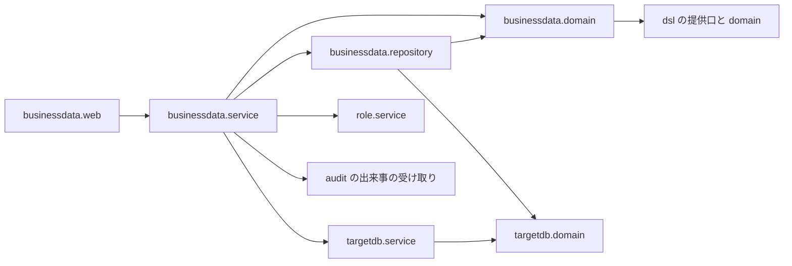

# 論理の部品 — U2 u2-businessdata-write

## 捨ての試しの結果（要点）

試しの全体（版・設定）は reliability-design.md の 1節にある。部品の境目に効いたのは次の6つ。

- **W2（違反の後の確かめ）**: セーブポイント + READ COMMITTED で、3種類とも違反のカラムが分かった（同時の重なりも含む）。
  - 確かめは、書き込みの口が持つ1つのトランザクションの中で済む。2つ目のトランザクション（1本の接続に縛る包み）は要らない（Q2: A）。
- **W6（時差）**: MySQL・MariaDB は、書き込みのプールの `connectionInitSql` の `SET time_zone` で正しく書ける。
  - 初期化は targetdb.config（プールの設定）が受け持つ。`RowSqlExecutor` は書き込みでは初期化の文を流さない（Q3: A）。
- **W3（番号）**: MySQL の SQLState は、種類の見分けに足りない（1264・1292 が 22001）。
  - 分類の部品（`RowSqlFailureClassifier`）を、DB の種類と段で引く。DB の種類は、口が貸す型（`TargetWriteSession`）から得る（機能設計のレビューの R-08 の答え）。
- **W7（止まったとき）**: 管理者の巻き戻しの失敗は `TransactionSystemException` に包まれて、`TransactionTemplate` の外へ出た。
  - 口は `TransactionTemplate` の外側ですべてを受ける。
- **W12（接続を捨てる）**: 開いているトランザクションの中で捨てると失敗した。
  - 捨てるのは、口が管理者の終わった後に行う。
- **W8（生成された鍵）**: PG は `RETURN_GENERATED_KEYS` で全部のカラムを返す。
  - 鍵の読み方は `RowDialect`・`RowSqlExecutor` に閉じ、主キーの名前を渡す。

## 対応表

| U2 の NFR 要件の ID | この文書の節 |
|---|---|
| NFR2.6 1要求で使う接続の数 | 1節 L9〜L11、3節 |
| NFR4.1 書き込みの SQL の組み立て | 1節 L5〜L7、2節 |
| NFR4.2 漏えいの防止 | 1節（すべての部品の toString と例外）、3節 |
| NFR4.3 書き込みの接続の分離 | 1節 L11 |
| NFR4.11 書き込みの設定の欠け | 1節 L11 |
| NFR4.12 失敗の分け方と例外の通り道 | 1節 L3・L7・L10、3節 |
| NFR4.13・NFR4.15 監査 | 1節 L12 |
| NFR8.4 ログの1か所 | 1節 L3 |

## 1. 部品の一覧

| # | 置き場 | 部品（名前は仮） | 受け持つこと | 効かせる NFR の型 |
|---|---|---|---|---|
| L1 | businessdata.web | `BusinessDataWriteController`・要求と応答の record、`BusinessDataWebConfig` に道の決まりを3つ足す | 3本の API（`@ApiAccess(AUTHENTICATED)`）。結果の型を `switch` で `BusinessException` に変える。4 MiB・4 MiB・64 KB の道ごとの上限 | 本文の上限、値を伏せた toString |
| L2 | businessdata.service | `TableAccessResolver`（U1） | 写しを1回取る | 内部DB は、写しの短い読み取りだけ |
| L3 | businessdata.service | `BusinessDataWriteService` | 判定の順の⑤〜⑨。書き込みの口を1回呼ぶ。結果の型を code に変える。**ログの1か所**。口から戻った後に出来事を出す | 内部DB のトランザクションを開かない |
| L4 | businessdata.domain | `WriteRequestValidator`・`ColumnWriteRulesFactory`・`DeadlinePatternMatcher` | 検証（秒の端数を含む。Q6: A）と pattern の打ち切り（256 文字ごと、時計を注入）の純粋な関数 | 性質ベースのテスト |
| L5 | businessdata.domain | `WriteOutcome`・`BusinessDataChangedEvent`・監査の理由の値への写し・`AuditDetailBuilder`（主キーを 16,384 字に切り詰めて `keyTruncated` を付ける。承認の場の U2 R-01） | 結果と出来事 | 値を伏せた toString |
| L6 | businessdata.repository | `RowSqlExecutor` の書き込みの側 | 事前の問い合わせ・INSERT・UPDATE・DELETE・確かめの組み立てと実行。`SQLException` と非検査例外をメソッドの中で受けて結果の型にする（U1 R-02 を先に避ける） | `prepareStatement` を呼べるのはここだけ |
| L7 | businessdata.repository | `RowSqlFailureClassifier`（DB の種類と段で引く）・`RowDialect`（事前の問い合わせ・確かめの形、生成された鍵の読み方）・`ColumnValueCodec`（U1） | 番号の表（reliability-design.md の 2節）。純粋な部品 | メッセージを読まない |
| L8 | targetdb.domain（足す） | `TargetWriteSession`（record。接続と DB の種類）・`WriteStep`（確定・巻き戻し・戻して確かめる）・`TargetWriteOutcome`（`Done`・`NotConfigured`・`Unavailable`・`Timeout`） | 貸している間だけ使える組と、口の答え | toString は DB の種類と答えの種類だけ |
| L9 | targetdb.service（足す） | `TargetWriteAccess`・`JdbcTargetWriteAccess` | 名前つきの管理者で `TransactionTemplate` を使い、1本を貸す。READ COMMITTED。セーブポイントを置く。すべての例外を外側で受けて結果の型にする。失敗した接続は、管理者の後に捨てる（U1 R-04 を先に避ける） | 例外を外へ出さない |
| L10 | businessdata.service | 段の記録 | 口の答えに「どの段で失敗したか」を載せ、L7 の分類に渡す（U1 R-01 を先に避ける） | 400 と読みの誤りを混ぜない |
| L11 | targetdb.config（足す） | `TargetDbProperties` に書き込みの資格情報・プール・`queryTimeout.write`（5 秒）を足す。`TargetDbSettings` に「書き込みが使えるか」を足す。`TargetWriteDataSourceConfig`（名前つきの `targetWriteDataSource` と `targetWriteTransactionManager`。どちらも既定の候補にしない） | プール `mastersmith-target-db-write`・5 本・socketTimeout 10 秒・`useAffectedRows=false`・MySQL と MariaDB は `connectionInitSql`（Q3: A） | 書き込みの接続の分離 |
| L12 | audit（足す） | 種類3つ・理由の値・3つの列（移行）・`AuditResult.UNKNOWN`（Q5: A）・業務データの出来事の受け取り・`logFailure` を出来事の種類で分ける | 監査 | 失敗の ERROR に値と例外を載せない |
| L13 | test（`businessdata/testsupport`） | 接続を数える包み（書き込みの列を足す）・答えない ServerSocket・つないだ後に止まる中継（確定の途中で止める形を足す）・クラスごとのスキーマと、別の接続で読み直す部品 | 結合テスト | — |

書き込みの口の形（説明用の断片。名前は仮）:

```java
public <T> TargetWriteOutcome<T> withWrite(Function<TargetWriteSession, WriteStep<T>> work) {
    if (!configured) return new NotConfigured<>();
    Connection[] held = new Connection[1];
    try {
        return template.execute(status -> {             // READ COMMITTED・名前つきの管理者
            held[0] = DataSourceUtils.getConnection(dataSource);
            return answer(work.apply(new TargetWriteSession(product, held[0], status)), status);
        });                                             // answer: 確定・巻き戻し・セーブポイントへ戻して確かめる
    } catch (RuntimeException e) {                      // TransactionSystemException を含む。メッセージは捨てる
        evictLater(held[0]);                            // 管理者が返した後に捨てる（W12）
        return TargetWriteOutcome.failed(e);            // 段・SQLState・業者の番号・クラスの名前だけ
    }
}
```

## 2. 依存の向き



図の文での説明:
- web は service だけを呼ぶ。
- service は domain・repository・targetdb.service・role.service を使い、出来事を Spring の出来事として出す（audit が受け取る）。
- repository は、targetdb.domain（`TargetWriteSession`・`SqlIdentifiers`）と businessdata.domain を使う。targetdb.service には依存しない。

**境界テスト**
- `BusinessDataBoundaryArchitectureTest`（U1 で足す。書き込みの側の決まりを足す）
- `RoleBoundaryArchitectureTest`（U1 の B2 の変更のまま）
- `TargetDbBoundaryArchitectureTest`（変えない）

`TargetDbBoundaryArchitectureTest` を変えなくてよい理由:
- 口（L9）は `Statement` の更新系の呼び出しをしない。セーブポイントと確定・巻き戻しは、管理者と `Connection` のメソッドで行う。
- `TransactionTemplate.execute` の持ち主は spring-tx で、Spring JDBC の更新の呼び出しに当たらない。`JdbcTemplate` も `@Transactional` も使わない。
- 文を組み立てて実行するのは、businessdata.repository の `RowSqlExecutor` だけ。

## 3. 失敗の範囲（failure domain）と共有の資源

| 失敗 | 及ぶ範囲 | 及ばない範囲 |
|---|---|---|
| 対象DB が止まる・答えない | 業務データの書き込み（503）と読み取り、DSL の生成・照合 | ログイン・権限・メニュー・内部DB の API |
| 書き込みのプールが借りきられる | 業務データの書き込み（3 秒で UNAVAILABLE） | 読み取りのプール（一覧・詳細・DSL の生成） |
| つないだ後に止まった接続 | その要求が 10〜20 秒待つ。その間、書き込みのプールの1本を持ち続け、失敗の後はプールが捨てる | ほかの書き込みは、残りの本数と借りる待ち 3 秒で失敗する |
| 大きな本文の同時の書き込み | 対象DB のメモリ（perf の MySQL は 10 本で止まる。F1: A） | 書き込みのプールの上限 5 で、同時の数を抑える |
| 確定の途中の時間切れ | その行は、保存されたか分からない（監査は `UNKNOWN`） | ほかの行 |
| 例外の文の中の値 | JDBC を呼ぶメソッドと口の中で捨てる | TraceAspect の TRACE・応答・アプリのログ・監査の失敗の ERROR |

- 共有の資源は、対象DB の側の接続の上限（読み取り 5 + 書き込み 5）と、対象DB のメモリ。
- 内部DB のプールは、権限の写しの読み取りと監査の書き込みで、それぞれ1本を短く使って返すだけ。

## 4. 上流との差

**機能設計の 4節の部品の表に足したもの**
- `RowSqlFailureClassifier` の段（L7・L10）
- `TargetWriteOutcome` の `Unavailable`・`Timeout`（L8）
- `AuditDetailBuilder`（L5。承認の場の U2 R-01）
- `AuditResult.UNKNOWN`（L12。Q5: A）

**機能設計の 4節の断片との差**
- `WriteStep` の `RollbackThenInspect` は、セーブポイントへ戻して確かめる答えにする（Q2: A。BR6.2 の切り替え先を先に使う）。
- 処理に渡す型は、裸の `Connection` ではなく `TargetWriteSession` にする（機能設計のレビューの R-08）。

**そのほかの差**
- **BR6.1 の表に足す**（Q6: A・F3: A）: L7 の表に足す。
- **BR3.5 に日時の秒の端数を足す**（Q6: A）: L4 に足す。
- **U1 の「貸すたびに付ける」との差**（Q3: A）: 通信の待ちと初期化は、L11 のプールの設定で付ける。U1 の L9 のように、口が付けて戻す処理を持たない。
- **NFR1.6・NFR4.7 の確かめの入力**（F4: A）。
- **「およそ 18 秒」の読み替え**（Q4: A）: reliability-design.md の 5節。
- **NFR8.4**: `logFailure` を出来事の種類で分け、業務データでは例外も載せない（L12）。

## 5. 後の段に回すこと

- **Infrastructure Design**
  - F1: A の perf の MySQL のメモリの上限
  - F2: A の `REVOKE TEMPORARY ON DATABASE … FROM PUBLIC` と、利用者の DB での手順の README
  - 機能設計のレビューの R-06 の表ごとの GRANT
  - `.env.example` の書き込みの項目（ユーザー名・パスワード・プールの大きさ・時間の上限）
- **コード生成の計画（B4）**
  - SpotBugs の `SQL_` の除外を書き込みのメソッドに広げることの承認
  - 名前つきの書き込みの管理者が、型で注入する内部DB の管理者（`@Transactional` の既定）とぶつからないことの結合テスト
  - NFR 要件のレビューの R-06: 監査の3列・種類・理由の値・`UNKNOWN` を足す移行の後方互換の結合テスト
  - `AuditMigrationCompatibilityIT`・`AuditSecretLeakIT`・`AuditEventTest`、`targetdb` の設定を使う既存のテストの洗い出し
  - `TargetDbBoundaryArchitectureTest` を変えずに通ることの確かめ
  - `audit` の本体に手を入れることに伴う、カバレッジの実測（`audit.repository` は一覧で判定している）
- **Observability Setup**
  - NFR 要件のレビューの R-03: 内部DB の大きさの基準の値
  - `ms-pool-pending` が書き込みのプールを拾うかの実測

## 6. U3 とそろえる点

- 書き込みの道は `POST /api/tables/rows`・`PATCH /api/tables/rows`・`POST /api/tables/rows/delete`。スキーマ・テーブル・`key`・`values`・`definitionId` はすべて本文で送る。
- 503 の2つの code、409 の `BUSINESS_SAVE_REJECTED`（カラムを示さない）・`BUSINESS_DUPLICATE_VALUE`・`BUSINESS_REFERENCE_NOT_FOUND`、413・400 を出し分ける。
- 定義の項目は平らに置き、`required`・`nullable` は必ず値を持つ。`formPart` に `lookup` は来ない。
- 日時の入力は秒まで（Q6: A）。

## Sources

- 機能設計: `aidlc/spaces/default/intents/261016-business-data-views/construction/u2-businessdata-write/functional-design/functional-spec.md`（4節・7節）・`rules.md`（BR6・BR9・BR11・BR13）・`entities.md`
- 承認済みの NFR 要件: `construction/u2-businessdata-write/nfr-requirements/` の全部（とくに `reliability-requirements.md` の NFR4.12 と、R-08 の受け方）
- この段の答え
  - `construction/u2-businessdata-write/nfr-design/nfr-design-questions.md`（Q1〜Q7: A）
  - `construction/u2-businessdata-write/nfr-design/nfr-design-followup-questions.md`（F1〜F4: A）
- U1 の NFR 設計: `construction/u1-businessdata-read/nfr-design/logical-components.md`（1節 L8〜L13・6節）
- レビュー
  - `.aidlc-reviews/nfr-design/units/u1-businessdata-read/df13e747868fc8fa/1.json`（R-01・R-02・R-04）
  - `.aidlc-reviews/functional-design/units/u2-businessdata-write/7dacbaa3e842d0af/1.json`（R-08）
- 契約・部品: `inception/contract-design/contract-summary.md`（C3・C5・C6）・`inception/domain-design/components.md`
- コード
  - `backend/src/test/java/cherry/mastersmith/targetdb/TargetDbBoundaryArchitectureTest.java`（更新系の呼び出しの名前・`JdbcTemplate`・`@Transactional` の禁止）
  - `backend/src/main/java/cherry/mastersmith/targetdb/config/TargetDataSourceConfig.java`
  - `backend/src/main/java/cherry/mastersmith/common/observability/TraceAspect.java`
  - `backend/src/main/java/cherry/mastersmith/audit/service/AuditEventListener.java`
- 捨ての試し: リポジトリの外の試しのコードと結果（W2・W3・W6・W7・W8・W12）

## Assumptions & Open Questions

- 前提: `TargetWriteSession` を record にすると、TraceAspect の対象から外れる（`!within(java.lang.Record+)`）。引数として文字列にされるときは、上書きした toString が使われる（U1 と同じ）。
- 前提: 名前つきの管理者を既定の候補にしなければ、Spring Boot の内部DB の管理者は退かない。既存の `targetDataSource` で同じ仕組みが効いていることを根拠にした。結合テストで確かめる。
- 前提: U1 の承認の場で R-01・R-02・R-04 の直し方が別の形になれば、U2 の L6・L7・L9・L10 をそろえ直す。
- この文書に固有の、諮る点は無い。
