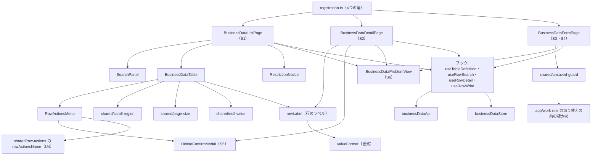

# 画面の部品 — U3 u3-businessdata-screens

振る舞いの決め（D1〜D31）・流れ（F1〜F8）・画面の状態の移り変わりは、`aidlc/spaces/default/intents/261016-business-data-views/construction/u3-businessdata-screens/functional-design/functional-spec.md` にある。承認の場（2026-10-18）の Request Changes で直した点（R-01・R-02・R-05）は、同じ文書の 12節にまとめた。

この文書に書くのは次のもの。名前は仮で、コード生成で変えるときは差を記録する。
- 部品の構成
- props・状態
- API の受け渡しの型
- 文言の鍵
- `src/shared/` と `app/` の変更
- 書き換えの対象のテストと E2E

## 1. 部品の構成



文の代わりの説明:

- **画面**: `registration.ts` が4つの道に3つの画面を登録する。
  - 一覧の画面（S1）
  - 詳細の画面（S2）
  - 作成と更新を兼ねるフォームの画面（S3・S4）
- **一覧の画面の中身**:
  - 検索の領域 `SearchPanel`
  - 表 `BusinessDataTable`
  - 理由の表示 `RestrictionNotice`
- **表が使う部品**:
  - 行の操作 `RowActionsMenu`（名前は U4 の `rowActionsName` で作る）
  - `src/shared/` の横のスクロールの枠・1ページの件数の選択・NULL の表示
  - 行のラベルの関数 `rowLabel`。書式の関数 `valueFormat` を通した後の文字で作り、表のリンク・行の操作・詳細の見出し・削除の見出しが同じ結果を使う（D9）
- **削除の確かめ**: 削除の確かめ `DeleteConfirmModal`（S5）は、詳細と行の操作から開く。
- **フォームの画面**: `src/shared/` の未保存の確かめを使う。保存の成功の後は `markClean()` を呼んでから移る（D24・D25）。未保存の確かめは、骨組みの作業ロールの確かめの口へ登録する。
- **開けないときの表示**: どの画面も、開けないときは `BusinessDataProblemView`（S6）を出す。
- **フックと API**:
  - 4つのフックが API の呼び出しの関数 `businessDataApi` と記憶 `businessDataStore` を使う。
  - フックは `useTableDefinition`・`useRowSearch`・`useRowDetail`・`useRowWrite`。

## 2. 置き場

| 置き場 | 中身 |
|---|---|
| `frontend/src/features/tables/` | `registration.ts`<br>画面 `BusinessDataListPage.tsx`・`BusinessDataDetailPage.tsx`・`BusinessDataFormPage.tsx`<br>部品 `SearchPanel.tsx`・`BusinessDataTable.tsx`・`RowActionsMenu.tsx`・`RestrictionNotice.tsx`・`DeleteConfirmModal.tsx`・`BusinessDataProblemView.tsx`<br>フック `useTableDefinition.ts`・`useRowSearch.ts`・`useRowDetail.ts`・`useRowWrite.ts`<br>記憶 `businessDataStore.ts`<br>API `businessDataApi.ts`<br>純粋な関数 `valueFormat.ts`・`rowLabel.ts`・`formDiff.ts`・`formValidation.ts`・`problemMessage.ts`<br>文言 `messages.ts`<br>各部品の CSS |
| `frontend/src/shared/` | 足すもの: `scroll-region/`・`page-size/`・`null-value/`<br>移して口を足すもの: `unsaved-guard/`（roleadmin から。`markClean()` を足す）<br>使うだけのもの: `row-actions/`（U4 が作る） |
| `frontend/src/app/` | `navigation/tablePlaceholderPath.ts`（4つの道）<br>`navigation/buildNavSections.ts`（今の項目の判定）<br>`work-role/`（切り替えの前の確かめの口） |

消すもの（D28）: `features/tables/TablePlaceholderPage.tsx`・`.css`・`.test.tsx`、`useTableAccess.ts`、`tableAccessApi.ts`・`.test.ts`。

## 3. API の受け渡しの型

応答の本文は `unknown` で受け、`parseXxx` の関数で型の項目だけを確かめて写す（D5）。

- 形が違えば、通信の失敗（`networkError()`）にする。
- 値の型は `string | null` で持ち、数に直さない。
- 知らない項目は無視する。列挙の値が知らない値なら、形の違いとして扱う。
- `ColumnDefinition` の検証の材料（U2 が B4 で足す項目）は、写しの関数では任意の項目として読む（B5 は B4 の前に作るため）。作成・更新の画面は、入力にするカラムに `formPart` が無ければ形の崩れとして扱う（D19、functional-spec.md の 8.2）。

```ts
/** 値は文字か null（桁を保つ。D15） */
export type CellValue = string | null
export interface DefinitionId { dslHash: string; workRoleId: number | null }
export interface LocalizedText { ja: string; en: string }
export type ValueType = 'STRING' | 'INTEGER' | 'BIG_INTEGER' | 'DECIMAL' | 'BOOLEAN' | 'DATE'
  | 'DATETIME' | 'DATETIME_TZ' | 'TIME' | 'TIME_TZ' | 'BINARY' | 'OTHER'
export type Operation = 'LIST' | 'DETAIL' | 'CREATE' | 'UPDATE' | 'DELETE'
export interface RowItem { key: Record<string, string> | null; values: Record<string, CellValue>;
  truncatedColumns: readonly string[] }
export interface RowPage { definitionId: DefinitionId; definitionChanged: boolean;
  items: readonly RowItem[]; page: number; size: 20 | 50 | 100; total: number }
export function parseRowPage(body: unknown): RowPage | undefined { /* 形を確かめて写す */ }
```

| 型 | 項目（要点） | 出典 |
|---|---|---|
| `TableDefinition` | `definitionId`・`definitionChanged`・`displayName`・`view`・`operations`・`restrictionReason`（`NO_PRIMARY_KEY`・`PRIMARY_KEY_HIDDEN`・`VIEW`・null）・`writeConfigured`・`rowLabelColumns`・`listColumns`・`detailColumns`・`searchFields`・`sortableColumns` | 契約 C2・U1 1節 |
| `ColumnDefinition`（読み取りの項目。U1 が B2 で返す） | `column`・`displayName`・`valueType`・`listFormat`（`BOOLEAN_ON_OFF` を含む）・`width`・`masked`・`editableOnCreate`・`editableOnUpdate` | 契約 C2・Q1: A、functional-spec.md の 8.1 |
| `ColumnDefinition`（検証の材料。U2 が B4 で足す。任意の項目として読む） | `formPart`・`required`・`nullable`・`minLength`・`maxLength`・`precision`・`scale`・`min`・`max`・`choices`（`{ value, label }`）・`hasPattern` | U2 の `ColumnWriteRules`・Q1: A、functional-spec.md の 8.2 |
| `SearchField` | `column`・`displayName`・`operator`（`EQUALS`・`CONTAINS`・`RANGE`・`CHOICE`）・`valueType`・`defaultValue`・`collapsed`・`options`（U1 が演算子と型の表で絞った項目だけが来る） | 契約 C2・U1 BR4.5・BR4.8・U1 の R-01 の直し |
| `SearchCondition`（送る） | `column`、`value` か `from`・`to` か `values` | 契約 C2 |
| `RowDetail` | `definitionId`・`definitionChanged`・`key`・`values`・`truncatedColumns` | U1 1節 |
| `WriteResult` | `definitionId`・`key`（作成で DETAIL が許されるときだけ） | U2 1節 |
| `BusinessProblem` | `status`・`code`・`fieldErrors`（`{ field, reason, message? }`）・`definitionChanged`（400 にも付く） | 契約 C2・U2 9節・Q2: A・U1 の R-04 の直し |

`businessDataApi.ts` の関数:

| 関数 | 呼ぶ API | 送る本文 | 返す型 |
|---|---|---|---|
| `getDefinition` | `POST /api/tables/definition` | `{ schema, table, definitionId? }` | `TableDefinition` |
| `searchRows` | `POST /api/tables/rows/search` | `{ schema, table, definitionId, conditions, sort?, page, size }` | `RowPage` |
| `getRow` | `POST /api/tables/rows/get` | `{ schema, table, definitionId, key }` | `RowDetail` |
| `createRow` | `POST /api/tables/rows` | `{ schema, table, definitionId, values }` | `WriteResult` |
| `updateRow` | `PATCH /api/tables/rows` | `{ schema, table, definitionId, key, values }` | `WriteResult` |
| `deleteRow` | `POST /api/tables/rows/delete` | `{ schema, table, definitionId, key }` | `WriteResult` |

- 失敗は、今の ApiError（`kind`・`status`・`code`・problem）のまま投げる。
- `problemMessage.ts` は code と reason から文言の鍵を選ぶ（functional-spec.md の 6.1 の表）。
- `readFieldErrors`（`shared/api-client/fieldErrors.ts`）を使う。`message` は `PATTERN_MISMATCH` のときだけ読む。
- 400 の扱いを決める純粋な関数 `needsDefinitionReload(problem, definition)` を `problemMessage.ts` に置く。`definitionChanged` が true か、`fieldErrors` の `field` が今の定義の検索の項目・カラムに無ければ true を返し、画面は F6 を行う（D4・R-05）。

## 4. 部品ごとの props・状態

| 部品 | props | 状態 | 備考 |
|---|---|---|---|
| `BusinessDataListPage` | なし（道から `schema`・`table`・`item` を読む） | `loading`・`populated`・`empty-filtered`・`empty-table`・`page-overflow`・`problem` | `restricted`・`no-write` は D13 の Alert で、表と同時に出る。`aria-busy` は読み直しの間（D14） |
| `SearchPanel` | `fields: readonly SearchField[]`・`values`・`errors`・`expanded`・`onSearch(values)`・`onClear()`・`onToggle()` | 入力の途中の値（送るまで記憶に置かない） | 開閉のボタンに `aria-expanded`・`aria-controls`。範囲と選択肢は `fieldset`・`legend`。誤りは `aria-invalid`・`aria-describedby` |
| `BusinessDataTable` | `definition`・`page: RowPage`・`sort`・`size`・`onSortChange`・`onPageChange`・`onSizeChange`・`onOpenRow(index)`・`onRowAction(index, op)` | なし | Table の `getRowId` はページの中の番号（D8）。`labels` は画面の言語で差し替える。`shared/scroll-region` で包む。行のリンクの見える文字と名前は `rowLabel` の結果から作る（D9） |
| `RowActionsMenu` | `rowLabel: string`（`rowLabel` の関数の結果）・`operations`・`busy`・`onSelect(op)` | なし | Dropdown を `placement="bottom-end"` で置く。名前は `rowActionsName(t('tables.actions.button'), rowLabel)` で作る。項目は B5 は「詳細」だけ、B6 で「更新」「削除」を足す |
| `RestrictionNotice` | `reason`・`writeConfigured` | なし | Alert（info） |
| `BusinessDataDetailPage` | なし（道と履歴の印から） | `loading`・`populated`・`problem` | 見出し（h1）は `rowLabel` の結果で作り、開いたらフォーカスを移す。値は `dl` で出す |
| `BusinessDataFormPage` | `mode: 'create' \| 'update'` | `loading`・`editing`・`dirty`・`saving`・`invalid`・`failed`・`timed-out`・`problem` | 初めの値・今の値・誤り。`formDiff` で変更を求める（D20）。保存の成功では `guard.markClean()` を呼んでから移る（D24） |
| `DeleteConfirmModal` | `open`・`title`（`rowLabel` の結果を含む）・`busy`・`error`・`onCancel`・`onConfirm` | なし | Modal を `role="alertdialog"`・`closeOnBackdropClick={false}`・`initialFocusRef`（やめる）で置く |
| `BusinessDataProblemView` | `kind`（`forbidden`・`table-not-found`・`row-not-found`・`dsl-not-applied`・`unavailable`・`mismatch`）・`onRetry?` | なし | 見出しを残し、次の行き先を出す（functional-spec.md の 6.1）。403 の時の作業ロールの切り替えは、今の置き場の画面と同じ形 |

行のラベルの関数（`rowLabel.ts`。D9・R-02。説明用の断片）:

```ts
/** 書式の後の、画面に見えている文字（valueFormat と同じ結果） */
export function rowLabelParts(def: TableDefinition, values: Record<string, CellValue>,
  lang: Lang): readonly string[] { /* rowLabelColumns の順に formatCell を通す */ }
/** 行のラベル。空白だけなら「（空）」 */
export function rowLabelText(parts: readonly string[], lang: Lang): string { /* 空白でつなぐ */ }
/** 行のリンクの見える文字（最初のカラム）。rowLabelText に必ず含まれる */
export function rowLinkText(parts: readonly string[], lang: Lang): string { /* parts[0] */ }
```

- 表のセルも `formatCell` を使い、リンクのセルの見える文字は `rowLinkText` と同じ文字にする。
- 性質ベースのテスト（D29）で、任意の値について `rowLinkText` が「詳細: <表示名> <rowLabelText>」と `rowActionsName(…, rowLabelText)` に含まれることを確かめる。

フックの返す値:

| フック | 返す値 |
|---|---|
| `useTableDefinition(ref)` | `{ status, definition, problem, reload }`（記憶にあれば使う。D4） |
| `useRowSearch(ref, definition)` | `{ status, page, problem, state, setState, retry }`。`state` は一覧の状態で、記憶に置く（D3）。世代で古い答えを捨てる（D14）。400 で `needsDefinitionReload` が true なら定義を読み直す（F2 の 4） |
| `useRowDetail(ref, token)` | `{ status, row, problem, retry }`。印が記憶に無ければ `missing` を返し、画面が一覧へ移る（D2） |
| `useRowWrite(ref)` | `{ create, update, remove, saving, slow }`（`useSlowNotice`。D23） |

`businessDataStore.ts`（画面の外のモジュールの変数。D2・D3）:

```ts
/** 主キーは印で引く。値は道・履歴の状態・ブラウザの保存に置かない */
export function putRowKey(key: Record<string, string>): string { /* 乱数の印を返す */ }
export function takeRowKey(token: string): Record<string, string> | undefined { /* 無ければ undefined */ }
export function listStateFor(ref: TableRef): ListState | undefined { /* テーブルごと */ }
export function saveListState(ref: TableRef, state: ListState): void { /* 上書き */ }
export function clearBusinessDataStore(): void { /* ログアウトのとき */ }
```

- 印は `crypto.getRandomValues` で作り、履歴の状態には `{ rowToken }` だけを置く。
- 主キー・行の値・検索の値は、ログ（`console`）に出さない。
- `takeRowKey` の寿命（読むだけか消すか）と名前は、NFR 設計で決める（R-07。functional-spec.md の 12.2）。

## 5. 文言の鍵

鍵は `tables.` で始め、日本語と英語を対で置く（`frontend/src/features/tables/messages.ts`）。文は `inception/refined-mockups/interaction-spec.md` の「文言」の表を正とする。

| 扱い | 鍵 |
|---|---|
| 消す | `tables.preparing`（置き場の準備中の文） |
| 残して使い回す | `tables.loading`・`tables.switchWorkRole`・`tables.goHome`・`tables.retry`・`tables.currentWorkRole`・`tables.noWorkRole` |
| 変える | `tables.forbidden`: 「このテーブルを見る権限がありません。作業ロールを確かめてください。」／`You do not have permission to view this table. Check your work role.` |
| 足す（値の表示） | `tables.value.null`（（値なし）／(none)）・`tables.value.empty`（（空）／(empty)。行のラベルだけ）・`tables.value.masked`・`tables.value.binary`・`tables.value.truncated`・`tables.value.yes`・`tables.value.no`・`tables.value.on`・`tables.value.off` |
| 足す（一覧） | `tables.list.empty.filtered`・`tables.list.empty.table`・`tables.list.pageOverflow`・`tables.list.count`・`tables.list.regionLabel`（{{name}} の一覧の表）・`tables.list.pageSize`・`tables.list.create`・`tables.table.prev`・`tables.table.next`・`tables.table.pageStatus` |
| 足す（検索） | `tables.search.heading`・`tables.search.conditionCount`・`tables.search.submit`・`tables.search.clear`・`tables.search.op.*`（完全一致・部分一致・範囲・選択肢） |
| 足す（行の操作） | `tables.actions.button`（操作／Actions）・`tables.actions.busySuffix`・`tables.actions.detail`・`tables.actions.update`・`tables.actions.delete`・`tables.detailLink`（詳細: {{label}}。label は `rowLabel` の結果） |
| 足す（理由と状態） | `tables.restriction.noPrimaryKey`・`tables.restriction.view`・`tables.writeNotConfigured`・`tables.definitionChanged` |
| 足す（開けないとき） | `tables.problem.tableNotFound`・`tables.problem.rowNotFound`・`tables.problem.dslNotApplied`・`tables.problem.unavailable`・`tables.problem.mismatch`・`tables.problem.notUnique` |
| 足す（フォーム） | `tables.form.createTitle`・`tables.form.updateTitle`・`tables.form.required`・`tables.form.maxLength`・`tables.form.utc`・`tables.form.passwordHint`・`tables.form.save`・`tables.form.cancel`・`tables.form.saving`・`tables.form.slow`・`tables.form.errorSummary`・`tables.form.timedOut`・`tables.form.reopen`・`tables.form.checkList` |
| 足す（誤り） | `tables.error.<reason>`（U2 の 9節の reason ごと。例 `tables.error.TOO_LONG`）・`tables.error.duplicate`・`tables.error.referenceNotFound`・`tables.error.saveRejected`・`tables.error.notEditableNotNull`・`tables.error.deleteReferenced` |
| 足す（削除と知らせ） | `tables.delete.title`・`tables.delete.body`・`tables.delete.confirm`・`tables.delete.cancel`・`tables.toast.created`・`tables.toast.updated`・`tables.toast.deleted` |

- 未保存の確かめの文言（「保存していない変更があります」など）は、`src/shared/unsaved-guard/` へ移すときに、共通の鍵として移す。roleadmin の今の鍵を使い回せるかは、コード生成の計画で確かめる。
- 書き込みの 403 の別の文（`tables.problem.writeForbidden`）を足すかは、コード生成の計画（B6）で決める（R-06）。

## 6. `src/shared/` と `app/` の変更

| 置き場 | 変更 | 決め |
|---|---|---|
| `src/shared/scroll-region/ScrollRegion.tsx`（足す） | props は `label: string`・`children`。`role="region"`・`aria-label`・`tabIndex={0}` の枠で、横にだけスクロールする | D27 |
| `src/shared/page-size/PageSizeSelect.tsx`（足す） | props は `value: 20 \| 50 \| 100`・`onChange`・`label`。make-you-chic-ui の Select を使う | D11・D27 |
| `src/shared/null-value/NullValue.tsx`（足す） | 淡い文字の「（値なし）」。読み上げは「値なし」。色だけで表さない | D15 |
| `src/shared/unsaved-guard/`（移して口を足す） | `features/roleadmin/useUnsavedGuard.ts` と `LeaveConfirmDialog.tsx` を移し、roleadmin の import を変える。移すときに、変更の有無を ref で持ち判定の関数が ref を読む形と、口 `markClean()` を足す（下の断片）。roleadmin は `markClean()` を呼ばないため、振る舞いは変わらない | D25・R-01 |
| `app/navigation/tablePlaceholderPath.ts`（変える） | 4つの道を作る関数と、`isTablePath(pathname)` を足す。今の `toTablePlaceholderPath`・`readTablePlaceholderParams` は形を保つ | D1 |
| `app/navigation/buildNavSections.ts`（変える） | 283行の `pathname === TABLE_PLACEHOLDER_PATH` を `isTablePath` にする | D1・AC1.1.6 |
| `app/work-role/WorkRoleProvider.tsx`・`WorkRoleSwitcher.tsx`（変える） | 下の断片の口を足す | D25a |

`src/shared/unsaved-guard/` の口の形（説明用の断片。D25・R-01）:

```ts
export interface UnsavedGuard {
  blocked: boolean // 移動を止めていて、確かめを出すときか（今のまま）
  stay: () => void // ［留まる］（今のまま）
  leave: () => void // ［移る］（今のまま）
  /** 「変更なし」にし、beforeunload を外し、次の移動1回だけ確かめを飛ばす */
  markClean: () => void
}
// 判定の関数は dirtyRef.current と skipOnceRef.current を読む（描き直しを待たない）。
// skipOnceRef が立っていれば、それを下ろして止めない。dirtyRef は描くたびに dirty で書き直す。
```

- 呼ぶ側の順: 保存の API の成功 → `markClean()` → `navigate(…)` を、同じ処理の中で続けて行う。
- 確かめるテスト（`src/shared/unsaved-guard/useUnsavedGuard.test.tsx` に足す）:
  - `markClean()` の後の道の移動で `blocked` が立たない。
  - `markClean()` の後に変更を作ると、次の移動はまた止まる（飛ばすのは1回だけ）。
  - `markClean()` を呼ばなければ、今どおり止まる（roleadmin の振る舞い）。
  - `markClean()` で `beforeunload` が外れる。

`app/work-role` に足す口の形（説明用の断片）:

```ts
/** 切り替えの前の確かめ。false を返せば切り替えない */
export type SwitchGuard = () => Promise<boolean>
export interface WorkRoleContextValue {
  // …今の項目のまま
  /** 確かめを登録する。戻り値は外す関数（登録は1つだけ。後の登録が前を置き換える） */
  registerSwitchGuard: (guard: SwitchGuard) => () => void
}
```

- `switchTo` の前に、登録された確かめを呼ぶ。
- 確かめが無ければ、今と同じに切り替える。
- 拒まれたときは `'ignored'` を返し、トリガーへフォーカスを戻す。
- フォームの画面は、`markClean()` の後に確かめの登録を外す（D25a）。

## 7. 書き換えの対象のテストと E2E

コード生成の計画で、名前の検索でもう一度洗い出す（`project.md` の学び）。

| 種類 | ファイル | 中身 |
|---|---|---|
| 消す | `frontend/src/features/tables/TablePlaceholderPage.test.tsx`・`tableAccessApi.test.ts` | 置き場の画面と API（D28） |
| 書き換える | `frontend/src/features/tables/registration.test.ts` | 4つの道の登録 |
| 書き換える | `frontend/src/app/navigation/tablePlaceholderPath.test.ts`・`buildNavSections.test.ts`・`buildNavSections.property.test.ts` | 4つの道と、今の項目（詳細・作成・更新でもテーブルの項目） |
| 移して書き換える | `frontend/src/features/roleadmin/useUnsavedGuard.test.tsx`・`LeaveConfirmDialog.test.tsx` を `src/shared/unsaved-guard/` へ移す。`PermissionPanel.test.tsx`・`testing/renderRoleAdmin.tsx` の import を変える | D25 |
| 足す | `src/shared/unsaved-guard/useUnsavedGuard.test.tsx` の `markClean()` の項目（6節の4つ） | D25・R-01 |
| 書き換える | `frontend/src/app/work-role/WorkRoleProvider.test.tsx`・`WorkRoleSwitcher.test.tsx` | 確かめの口（登録の有無・留まる・離れる） |
| 足す | `features/tables/` の各部品・フック・純粋な関数のテスト | 部品ごとに vitest-axe を1件入れる。描画の後に反映される値は `waitFor` で待つ。性質のテスト（D29。行のラベルの見える文字が名前に含まれることを含む） |
| 足す（B6 の必須の項目） | `BusinessDataFormPage.test.tsx` | 作成と更新の保存の成功から詳細への移動で、未保存の確かめの Modal が出ないこと（D25） |
| 足す | `features/tables/problemMessage.test.ts` | `needsDefinitionReload` が、`definitionChanged` のとき、`fieldErrors` が今の定義に無い項目を指すときに true、今の定義の項目だけなら false（D4・R-05） |
| 足す | `src/shared/scroll-region/`・`page-size/`・`null-value/` のテスト | 部品ごとに vitest-axe を1件入れる |
| E2E を書き換える | `frontend/e2e/170-menu-navigation-flow.e2e.ts`（259〜300行の置き場の画面と `/api/me/table-access`）・`frontend/e2e/support/frameApiRoute.ts`・`frontend/e2e/support/u7Measure.ts` | 置き場の画面から業務データの一覧へ（本数に数えない）。行の出どころはコード生成の計画（B5）で決める（R-03） |
| E2E を確かめる | `frontend/e2e/160-app-frame-accessibility.e2e.ts` | 置き場の道を参照している所 |
| E2E を足す | 業務データの代表の流れ1本（例 `180-business-data-flow.e2e.ts`） | 一覧 → 作成 → 詳細 → 更新 → 削除（D30）。保存の後に未保存の確かめが出ないことも流れの中で確かめる |
| E2E を足す | 業務データの画面の axe（例 `185-business-data-accessibility.e2e.ts`） | ブランドカラーとテーマのすべての組（`frontend/e2e/support/displayCombos.ts`）、375px・100 カラム・誤りの状態・開いたメニュー・NULL を含む行のラベル（D30）。本数に数えない |
| ほかの機能の文書 | `frontend/src/features/README.md` | 置き場の記述を業務データの画面に直す |

- E2E の見本の行・利用者・ロールは、その流れで自分で作る。値は架空のもの（例 商品コード `E2E-0001`・商品名「見本の品」、メールアドレスは `example.com`）だけにする。
- 対象DB の資格情報は、プロセスの環境変数で渡す（`frontend/playwright.config.ts` の 47〜55行と同じ形）。
