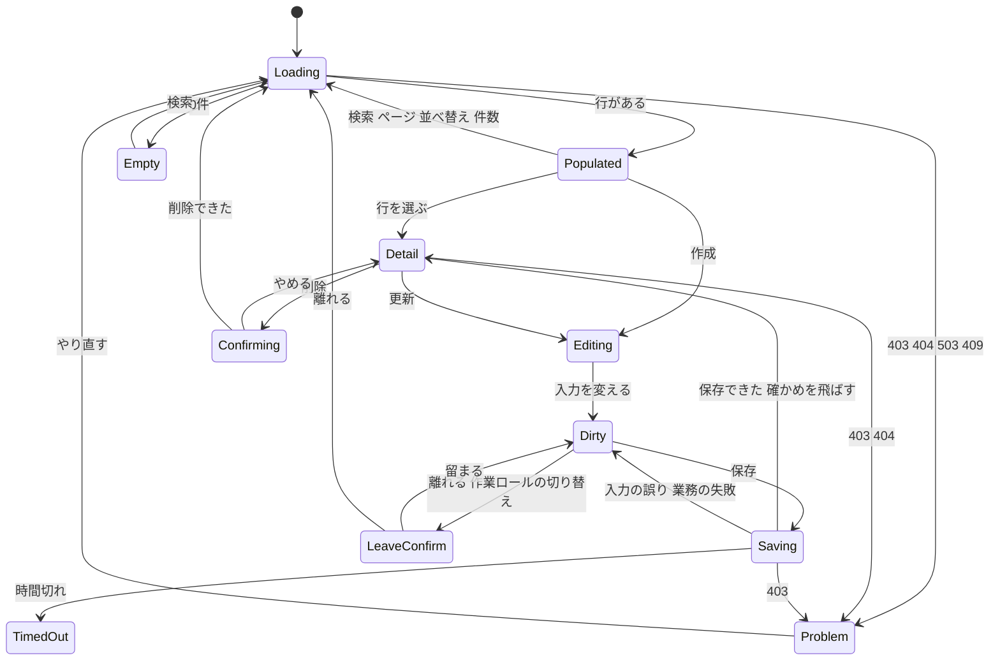

# 機能の仕様 — U3 u3-businessdata-screens（業務データの画面）

U3 は種類 `ui` の単位で、`entities.md`・`rules.md` を作らない。この文書だけで完結し、画面の振る舞いの決め（D1〜D31）・流れ（F1〜F8）・画面の状態の移り変わり・Bolt の区切り（B5・B6）を決める。部品の構成・props・状態・API の受け渡しの型は `frontend-components.md` に書く。

出典（パスは記録 `aidlc/spaces/default/intents/261016-business-data-views/` の下）:
- 質問と答え: `construction/u3-businessdata-screens/functional-design/functional-design-questions.md`（Q1〜Q8: すべて A、承認の場の Request Changes の直し（Requested Changes Feedback）、まとめの確認: Looks correct）
- 単位: `inception/units-generation/unit-of-work.md`・`unit-of-work-story-map.md`・`unit-of-work-dependency.md`
- 要件とストーリー: `inception/requirements-analysis/requirements.md`、`inception/user-stories/stories.md`
- 画面イメージ: `inception/refined-mockups/mockups.md`・`interaction-spec.md`・`design-system-mapping.md`・`accessibility-checklist.md`、`make-you-chic-ui-request-5.md`
- 部品と ADR: `inception/domain-design/components.md`・`decisions.md`（ADR-004）
- 契約: `inception/contract-design/contract-summary.md`（C2・C3・C4）、`contract-design-questions.md`（CQ2・CQ3）
- Bolt の計画: `inception/delivery-planning/bolt-plan.md`（B5・B6）
- 依存する単位の機能設計: `construction/u1-businessdata-read/functional-design/`、`construction/u2-businessdata-write/functional-design/`、`construction/u4-a11y-carryover/functional-design/`

## 1. 範囲

- 範囲に入るもの:
  - 業務データの画面
    - S1 一覧（検索の領域・表・ページ送り・1ページの件数の選択）
    - S2 詳細
    - S3 作成
    - S4 更新
    - S5 削除の確かめ
    - S6 開けない・つながらないときの表示
  - `src/shared/` の部品（横のスクロールの枠・1ページの件数の選択・NULL の表示・未保存の確かめ）
  - 業務データの API 6本の呼び出しと、応答の写し
  - 主キーと一覧の状態の記憶
  - 道の登録と、今の置き場（`features/tables` の準備中の画面）の置き換え
  - 作業ロールの切り替えの前の確かめの口
  - 業務データの代表の E2E 1本と、業務データの画面の axe の E2E
- 範囲の外のもの:
  - サーバーの判定（U1・U2）
  - 名前の関数 `rowActionsName` と、既存の管理の一覧の名前（U4）
  - axe-core の引き上げ（U4 の B7）
  - 今の置き場の API `GET /api/me/table-access` のサーバー側（Q7: A。9節）

## 2. 使う API（U1 X1・U2 X1 の形）

| API | 道 | 使う画面 |
|---|---|---|
| 定義 | `POST /api/tables/definition` | S1〜S4 |
| 一覧と検索 | `POST /api/tables/rows/search` | S1 |
| 詳細 | `POST /api/tables/rows/get` | S2・S4（更新の値の読み取り） |
| 作成 | `POST /api/tables/rows` | S3 |
| 更新 | `PATCH /api/tables/rows` | S4 |
| 削除 | `POST /api/tables/rows/delete` | S5 |

- スキーマ名・テーブル名・`definitionId`・主キー・検索の値・入力の値は、すべて本文で送る。
- 値は文字か `null` で送り、受け取った値は `unknown` として形を確かめてから写す（D5）。
- 呼び出しは今の ApiClient（`frontend/src/shared/api-client/apiClient.ts` の `apiRequest`）を通す。

## 3. 画面の振る舞いの決め

### 3.1 道と記憶

| D | 決め | 出典 |
|---|---|---|
| D1 | 道は次の4つとし、どれも問い合わせの部分に `schema`・`table`・`item` を置く。 ・`/tables`（一覧） ・`/tables/row`（詳細） ・`/tables/new`（作成） ・`/tables/edit`（更新） 道を作るのは `frontend/src/app/navigation/tablePlaceholderPath.ts` を広げた1か所の関数だけ。サイドバーの今の項目の判定（`buildNavSections.ts`）も、4つの道をすべてテーブルの道として扱う | AC1.1.1・AC1.1.6、team.md の Code Style、mockups.md の 1節 |
| D2 | 詳細・更新の主キーは、機能の中の記憶（画面の外のモジュールの変数）に持つ。履歴の状態に置くのは、意味の無い印（乱数）だけ。主キーの値は、道・履歴の状態・ブラウザの保存のどこにも置かない。印が記憶に無ければ（再読み込みの後など）、一覧へ置き換えて移る | CQ2: A、Q4: A |
| D3 | 一覧の状態（検索の条件・ページ・1ページの件数・並べ替え）は、テーブルごとに D2 と同じ記憶に持つ。詳細・作成・更新・削除から戻ったとき、ブラウザの戻る操作のときは保ち、再読み込みでは既定の状態に戻る | SM5、Q4: A、AC1.4.6・AC2.3.2 |

### 3.2 定義と応答の扱い

| D | 決め | 出典 |
|---|---|---|
| D4 | 定義はテーブルごとに読み、記憶に持つ。行の API には、毎回 `definitionId` を送る。次のどれかのときは、F6 を行う。 ・読み取りの応答（成功・400）で `definitionChanged: true` を受けた。 ・書き込みの 409 `BUSINESS_DEFINITION_CHANGED` を受けた。 ・400 `VALIDATION_FAILED` の `fieldErrors` の `field` が、今の定義の検索の項目・カラムに無い（`definitionChanged` が付かないときの逃げ道。8節） | Q2: A、CQ3、AC1.1.5、R-05 |
| D5 | 応答の本文は `unknown` で受け、型の項目だけを確かめて写す。形の崩れた応答は通信の失敗にする（`frontend/src/features/tables/tableAccessApi.ts` の `parseTableAccess` と同じ形）。値の型に `any` は使わない | team.md の Code Style |
| D6 | 誤りの応答は code ごとに、6.1 の表のとおりに出す。DB の文・制約の名前・入力した値・主キーの値は出さない | AC3.3.7・AC2.4.7、U1 2節、U2 2節・9節 |

### 3.3 一覧（S1）

| D | 決め | 出典 |
|---|---|---|
| D7 | 列は、定義の一覧のカラムを `list.order` の順に、`width` の幅で出す。主キーのカラムが `list.visible` でなければ列に出さず、詳細への入口は行の操作の「詳細」で出す | AC1.1.9・AC3.1.8 |
| D8 | Table の `getRowId` には、ページの中の番号（例 `r0`〜`r99`）を渡す。主キーの値は、DOM の `id`・`data-testid` に載せない | Table の 373〜427行 |
| D9 | 行を見分ける文字（行のラベル）は、定義の `rowLabelColumns` の各カラムの値を、D15 の書式の関数に通した後の、画面に見えている文字で作る。生の値は使わない。 ・作り方: 書式の後の文字（NULL は「（値なし）」、`masked` は `••••••`、BINARY は「（バイナリ）」）を半角の空白でつなぐ。つないだ結果が空白だけ（空の文字列だけのカラム）なら「（空）」にする。 ・使う所: 行のリンクの名前「詳細: <テーブルの表示名> <行のラベル>」、行の操作の名前 `rowActionsName(見える文字, 行のラベル)`、詳細の見出し、削除の確かめの見出し（D26）。 ・行のリンクの見える文字は、`rowLabelColumns` の最初のカラムのセルの書式の後の文字で、行のラベルと同じ関数の同じ結果を使う。そのため、見える文字は必ずリンクの名前に含まれる（WCAG 2.5.3。axe-core 4.14 の規則）。省略（D17）は CSS だけで行い、DOM の文字は切らない。 ・`rowLabelColumns` が空のとき（DETAIL が許されない）は、行のリンクと行の操作を出さない | U1 Q8・BR2.6、U4 D1・D4、AC1.4.7・AC4.1.1、R-02 |
| D10 | 並べ替えは、`sortable` のカラムの見出しだけをボタンにする。押すたびに、昇順 → 降順 → 既定の並びの順に変わる（Table の `nextSortState`）。並べ替えを変えたら、1ページ目へ戻る | AC1.3.3・AC1.3.12 |
| D11 | 1ページの件数は 20・50・100 から選び、既定は 20。変えたら1ページ目へ戻る。共通の `shared/paging`（`PAGE_SIZE = 20` に固定）は使い回さず、業務データ用のページの計算を機能の中に持つ | AC1.3.1・AC1.3.2、mockups.md の 10節 |
| D12 | 全体の件数と、表示の範囲（何件目から何件目まで）を `aria-live="polite"` で伝える。 ・ページを超えたら、「このページには行がありません」と、前のページへの入口を出す。 ・条件に合う行が無いときと、テーブルに行が無いときは、文を出し分ける。テーブルに行が無いときは、作成の入口を添える（作成できるときだけ） | AC1.2.10・AC1.2.11・AC1.3.1・AC1.3.14 |
| D13 | 定義の `restrictionReason` があれば、理由の Alert を一覧の上に出す（どのカラムが NONE かは出さない）。`writeConfigured` が false なら、書き込みの設定が無い旨の Alert を出し、作成・更新・削除の入口を出さない | AC3.2.5・AC3.3.9 |
| D14 | 読み直しの間は、前の表を残して `aria-busy` を立てる。要求ごとに世代を付け、古い答えは捨てる（Table のページ送りのボタンを、読み直しの間に押せなくする口が無いため） | Table の 468〜478行 |

### 3.4 値の書式

| D | 決め | 出典 |
|---|---|---|
| D15 | 書式は純粋な関数で求める。値は文字のまま扱い、数に直さない。表のセル・詳細・行のラベル（D9）は、すべてこの関数の結果を使う。 ・`NUMBER_GROUPED`: 文字のまま区切る（例 `-1,234.5`） ・`DATE`・`DATETIME`・`TIME`: 区切りだけを整え、日英で同じ形（例 `2026-10-18 09:30:00`） ・`BOOLEAN_YES_NO`: 「はい／いいえ」（英語 `Yes`／`No`） ・`BOOLEAN_ON_OFF`: 「オン／オフ」（英語 `On`／`Off`） ・時差つきの型: `+00:00` を付けて出す ・`masked`（password）: `••••••` ・BINARY: 「（バイナリ）」 ・NULL: 「（値なし）」（読み上げでは「値なし」） ・空の文字列: 空のまま出し、NULL と見分けられるようにする（行のラベルだけは D9 のとおり） | AC1.5.2・AC1.5.5・AC1.5.7・AC1.5.8・AC3.6.5、U1 BR7.2〜BR7.5・X2 |
| D16 | 値と表示名は文字として描き、HTML として描かない（`dangerouslySetInnerHTML` を使わない）。リンクの先は、D1 の関数で作った道だけにする（`javascript:` などの値を `href` にしない） | AC1.5.4、NFR6 |
| D17 | 一覧のセルの省略は、CSS の1行の省略で行い、読み上げの名前とポインターを重ねたときの Tooltip に値の全体（応答で受けた分）を持つ。`truncatedColumns` に入っているカラムのセルには、切ったことの印を付ける | AC1.5.6、RQ4、U1 BR7.6 |

### 3.5 詳細（S2）

| D | 決め | 出典 |
|---|---|---|
| D18 | 定義の詳細のカラムを、説明の一覧（`dl`）で出す。見出しは D9 の行のラベルで作り、開いたら見出しへフォーカスを移す。 ・「更新」は、許す操作に UPDATE があり、更新で入力できるカラムが1つ以上あるときだけ出す。 ・「削除」は、許す操作に DELETE があるときだけ出す。 ・`truncatedColumns` のカラムには「長いため先頭だけを表示しています」を添える | AC1.4.1・AC1.4.5・AC1.4.7・AC2.2.6・AC2.3.3、Q8: A |

### 3.6 作成・更新（S3・S4）

| D | 決め | 出典 |
|---|---|---|
| D19 | フォームは、定義の詳細のカラムから作る。 ・入力にするのは、作成では `editableOnCreate`、更新では `editableOnUpdate` のカラム。そのほかは読み取りで出す。 ・更新では、`truncatedColumns` のカラムも読み取りにする（D18）。 ・部品は `formPart` に従う。BIGINT・DECIMAL は文字の入力にする。入力にするカラムに `formPart` が無いとき（U2 の検証の材料が無い。8節）は、形の崩れとして通信の失敗の表示にし、黙って文字の入力にしない。 ・`DATETIME_TZ` は `datetime-local` に「UTC」と添え、送るときに `+00:00` を付ける。 ・更新の画面の値は、開いたときに詳細の API で読む | AC2.1.3・AC2.2.1・AC2.2.5・AC2.2.7、RQ7、U1 BR2.4・BR6.4、Q8: A、R-05 |
| D20 | 変更の有無は、初めに入力の部品へ入れた値と今の値を比べて決める（DB の生の値とは比べない）。本文には、変えたカラムだけを入れる。 ・作成では、空のままのカラムを送らない。 ・更新では、空にしたカラムを、文字の型なら `""`、ほかの型なら `null` で送る。 ・`masked` のカラムは、値を入れたときだけ送る。 ・変えたカラムが無ければ、保存を押せない | SM1・SM2・SM3、U2 Q7・9節、AC2.2.2・AC2.2.8〜AC2.2.11 |
| D21 | 画面の検証は、定義の検証の材料（Q1: A）で当てる。 ・当てるもの: 必須・長さ（コードポイントで数える）・桁・範囲・型・選択肢。 ・当てる時: 入力から離れたときと、保存のとき。 ・`pattern` は画面で当てず、保存のときのサーバーの誤りを該当の入力に出す。 ・サーバーの判定を正とする | FR10.1、SM4、AC2.4.1・AC2.4.2、U2 BR3・BR4.1 |
| D22 | 誤りがあるときは、誤りのまとめ（`role="alert"`）へフォーカスを移し、各入力に `aria-invalid`・`aria-describedby` で誤りの文を結ぶ。入力した値は消さない。必須と長さの上限は、入力の前に印と文で示す。FormField の `required` は見た目の印だけなので、入力の要素に `aria-required` を自分で付ける | AC2.4.6・AC2.4.8、FormField の 27〜28行 |
| D23 | 保存中は、保存・削除のボタンを押せなくし、「保存しています…」と出す。5 秒を超えたら「時間がかかっています」を出す（`frontend/src/shared/slow-notice/useSlowNotice.ts`） | AC2.1.10 |
| D24 | 保存の後の行き先と知らせ。 ・保存に成功したら、移る前に、未保存の確かめの `markClean()`（D25）を呼んで「変更なし」にする。この順にすることで、自分の保存の成功の移動を未保存の確かめが止めない。 ・作成: 応答の `key` があれば、その行の詳細へ移る（D2 の印を作る）。無ければ一覧へ戻る。 ・更新: 詳細へ戻る。 ・どちらも Toast で「作成しました」「更新しました」と知らせる | AC2.1.1・AC2.1.4・AC2.1.8・AC2.2.2、R-01 |
| D25 | 変更のある間は、未保存の確かめを当てる。 ・`frontend/src/features/roleadmin/useUnsavedGuard.ts` を `src/shared/unsaved-guard/` へ移して使い回し、道の移動・ブラウザの戻る操作を止める。読み込み直しとタブを閉じるときは `beforeunload` で止める。 ・移すときに、次の2つを足す（roleadmin の今の振る舞いは変えない）。 　1. 変更の有無を ref でも持ち、移動を止めるかの判定の関数は ref から最新の値を読む（React の状態を閉じ込めた古い値で判定しない）。 　2. 口 `markClean()` を足す。呼ぶと ref を「変更なし」にし、`beforeunload` を外し、次の移動1回だけ確かめを飛ばす。飛ばすのは1回だけで、その後に変更が生まれれば、また止める。 ・確かめの Modal（「留まる」をはじめのフォーカスにする）も `src/shared/` に置く。 ・作業ロールの切り替えは、D25a のとおり。 ・確かめるテスト: `src/shared/unsaved-guard/` の単体テストで、`markClean()` の後の移動が止まらないこと、その後に変更を作ると次の移動が止まること、`markClean()` を呼ばなければ今どおり止まること。B6 の画面のテストで、作成と更新の保存の成功から詳細への移動で確かめの Modal が出ないこと（必須の項目） | SM6、AC2.2.12、Q5: A、R-01 |
| D25a | 骨組みの作業ロール（`frontend/src/app/work-role/`）に、「切り替えの前の確かめ」を登録する口を足す。作成・更新の画面は、変更のある間だけ確かめを登録する（`markClean()` の後は外す）。作業ロールの切り替えの前に同じ Modal を出し、「留まる」なら切り替えない | Q5: A、AC2.2.12 |

### 3.7 削除（S5）

| D | 決め | 出典 |
|---|---|---|
| D26 | 削除の確かめは、Modal で出す。 ・Modal の形: `role="alertdialog"`・`closeOnBackdropClick={false}`、はじめのフォーカスは「やめる」。 ・見出しには、テーブルの表示名と行のラベル（D9）を出す。 ・成功: 一覧へ戻り（一覧の状態は保つ）、「削除しました」の Toast を出す。 ・外部キーで拒まれたとき（`BUSINESS_SAVE_REJECTED`）と、行が無いとき（404）: Modal の中に文を出す | AC2.3.1・AC2.3.2・AC2.3.4・AC2.3.5 |

### 3.8 共通の部品と機能の置き場

| D | 決め | 出典 |
|---|---|---|
| D27 | `src/shared/` に、次の部品を置く。 ・横のスクロールの枠（`role="region"`・`aria-label`・`tabIndex=0`） ・1ページの件数の選択（Table の外に置く Select） ・NULL の表示 ・未保存の確かめ（D25） 依頼（5）の口が取り込まれたら、枠と件数の選択は B7 で make-you-chic-ui の口に置き換える（U4 D11） | AC1.3.15、mockups.md の 10節、U4 D11 |
| D28 | 画面は、`features/tables` を置き換える1つの機能にする。`registration.ts` に D1 の4つの道を登録し、どれも「ログインだけ」で開ける。今の置き場の画面・`useTableAccess.ts`・`tableAccessApi.ts` は消す | team.md の Code Style、Q7: A |

### 3.9 確かめ（テストと E2E）

| D | 決め | 出典 |
|---|---|---|
| D29 | 性質ベースのテスト（fast-check）を、純粋な関数（書式・行のラベル・変更の比べ・本文の写し）に当てる。失敗のときの乱数の種を記録する。確かめる性質の例: ・BIGINT・DECIMAL の桁を失わない ・変えないカラムは本文に入らない ・`<`・`"`・`'` を含んでも文字のまま返る ・任意の値（NULL・空の文字列・`masked`・BINARY・真偽値・数を含む）で、行のリンクの見える文字は必ずリンクの名前と行の操作の名前に含まれる（D9） | team.md の Testing Posture、R-02 |
| D30 | E2E は次のとおり。 ・業務データの代表の流れを1本足す（一覧 → 作成 → 詳細 → 更新 → 削除）。 ・E2E 170 を新しい形に書き換える（本数に数えない）。 ・axe の E2E を一覧・詳細・作成・更新で流す。ブランドカラーとテーマのすべての組で、誤りの状態・長い表示名・100 カラムの表・NULL の行・開いた検索の項目・開いた行の操作のメニュー・375px の幅を含める（本数に数えない）。 ・開いたメニューが、画面の中に収まることを確かめる | AC4.1.6、team.md の Testing Posture、project.md の学び |
| D31 | B5・B6 のそれぞれの終わりに、作業フォルダの中だけで axe-core を 4.14 にし、U3 の E2E を流す。違反を「ファイル × 表示の組 × 規則 × 要素（`data-testid`）」で記録してから、4.13 に戻す（統合しない） | Q6: A、U4 R-02 |

## 4. 流れ

### F1 一覧を開く

1. 道の問い合わせの部分から `schema`・`table`・`item` を読む（D1）。どれかが無いか空なら、S6 の「テーブルが見つかりません」を出す。
2. 定義の API を呼ぶ。403・404・503 なら S6 を出す（D6）。
3. 記憶にこのテーブルの一覧の状態があれば使う（D3）。無ければ既定の状態で始める。
   - 検索の条件: `search.default`
   - 並べ替え: 送らない（サーバーの既定の並び）
   - ページ: 1
   - 1ページの件数: 20
4. 一覧と検索の API を呼び、表・件数・ページ送りを描く（D7〜D14）。
5. 件数と表示の範囲を `aria-live` で伝える。

### F2 検索・ページ・並べ替え・件数を変える

1. 画面で型と範囲の向きを確かめる（Q3: A）。誤りがあれば、その項目の近くに出し、前の表は残す。
2. 状態を変えて、記憶に置く。検索の条件・並べ替え・件数を変えたときは、1ページ目にする。
3. 一覧と検索の API を呼ぶ（世代を付けて、古い答えは捨てる。D14）。
4. 400 の扱い。
   - `definitionChanged` を受けたら F6 へ。
   - `fieldErrors` の `field` が今の定義の検索の項目に無ければ、`definitionChanged` が無くても F6 へ（D4）。
   - それ以外の `fieldErrors` は、検索の項目に結ぶ。

### F3 詳細を開く

1. 一覧の行で、印（乱数）を作る。主キーは、その印で記憶に置く（D2）。
2. 印を履歴の状態に置いて、`/tables/row` へ移る。
3. 印で記憶から主キーを引く。無ければ一覧へ置き換えて移る。
4. 定義（記憶にあれば使う）と詳細の API で、行を読む。404 なら「行が見つかりません」、409 なら理由を出す（D6）。
5. 描いたら、見出し（D9 の行のラベル）へフォーカスを移す（D18）。

### F4 作成・更新

1. 作成は一覧の「作成」から、更新は詳細の「更新」から開く。更新は、D2 の印で主キーを引く。
2. 定義を読む。更新では、詳細の API で今の値も読む（D19）。
3. 入力の部品に初めの値を入れ、変更の比べの起点にする（D20）。
4. 変更があれば、未保存の確かめを登録する（D25・D25a）。
5. 保存では、次の順に行う。
   1. 画面の検証を当てる（D21）。
   2. 本文を写す（D20）。
   3. 保存中の表示にする（D23）。
   4. 作成か更新の API を呼ぶ。
6. 成功なら、次の順に行う（D24・D25）。
   1. 未保存の確かめの `markClean()` を呼び、「変更なし」にする（ref を書き換えるので、描き直しを待たない）。
   2. D24 の行き先へ移る。この移動は確かめで止まらない。
   3. Toast で知らせる。
7. 失敗は D6 の表のとおりに出し、入力は残す。
   - 400 の `fieldErrors` の `field` が今の定義のカラムに無ければ、F6 を行う（D4）。
   - 時間切れ（503 TIMEOUT）は、「保存されたか分かりません」と、確かめる入口を出す。更新ではその行を開き直す入口、作成では一覧で同じ行を探す入口。

### F5 削除

1. 詳細か行の操作の「削除」で、確かめの Modal を開く（D26）。
2. 「削除する」で削除の API を呼ぶ。処理中は押せなくする（D23）。
3. 成功なら一覧へ戻り、一覧の状態を保ったまま読み直して、Toast で知らせる。
4. 失敗は、Modal の中に文を出す。

### F6 定義が変わった

1. 定義の API を呼び直し、記憶の定義を置き換える。
2. 一覧では、使えなくなった検索の条件と並べ替えを外し、1ページ目から読み直す。
3. 作成・更新では、今も入力できるカラムの入力だけを残す。入力できなくなったカラムの変更は捨て、確かめてもう一度保存するよう促す。
4. 「表示の設定が変わりました」を、読み上げにも伝える。

### F7 離れる

1. 変更があるまま道を移る・ブラウザの戻る操作をすると、確かめの Modal を出す（D25）。作業ロールを切り替えるときも同じ（D25a）。
2. 「留まる」では、移らずに入力を残す。
3. 「離れる」では、入力を捨てて移る。作業ロールの切り替えでは、切り替えを行う。
4. 変更が無ければ、確かめずに移る。保存の成功の直後の移動（`markClean()` の後の1回）も、確かめずに移る（F4 の 6）。

### F8 403 の後

1. どの画面でも、403 `ACCESS_DENIED` を受けたら S6 の 403 の表示にする。行・入力の部品・前に出ていた行は残さない。入力していた値は捨てる（RQ5: A）。
2. 業務のメニューと作業ロールを読み直す（今の `useTableAccess.ts` の 91〜95行と同じ形）。
3. 作業ロールが2つ以上なら、「作業ロールを切り替える」を出す。どの場合も、メニューから選び直す入口を出す。

## 5. 画面の状態の移り変わり

文の代わりの説明:

- **一覧（S1）**: 一覧は読み込み中（Loading）から始まる。行があれば表（Populated）、0 件なら空の表示（Empty）、拒否やつながらないときは S6 の表示（Problem）に移る。検索・ページ・並べ替え・件数を変えると、読み込み中に戻る。
- **詳細と削除（S2・S5）**:
  - 表で行を選ぶと詳細（Detail）に移る。
  - 一覧の「作成」と、詳細の「更新」で入力（Editing）に移る。
  - 詳細の「削除」で確かめ（Confirming）に移る。「やめる」なら詳細へ戻り、削除できたら一覧の読み込みへ戻る。
- **作成・更新（S3・S4）**:
  - 入力を変えると変更あり（Dirty）、保存で保存中（Saving）になる。
  - 保存できたら、「変更なし」にしてから詳細へ移る（未保存の確かめは出ない。作成で詳細へ移れない行は、一覧へ戻る）。
  - 入力の誤りと業務の失敗では、変更ありに戻る（入力は残す）。
  - 時間切れでは、「保存されたか分からない」の表示（TimedOut）になる。
- **離れる確かめ**: 変更ありのまま離れる・作業ロールを切り替えると、確かめ（LeaveConfirm）になる。「留まる」で変更ありへ戻り、「離れる」で移る。
- **403・404**: 詳細と保存中に 403・404 を受けると、S6 の表示になる。「やり直す」で読み込み中へ戻る。

## 6. 表示の対応

### 6.1 応答と表示（D6）

| 応答 | 表示 | 次の行き先 |
|---|---|---|
| 403 `ACCESS_DENIED` | 「このテーブルを見る権限がありません。作業ロールを確かめてください。」 | メニューから選び直す・作業ロールを切り替える（F8） |
| 404 `BUSINESS_TABLE_NOT_FOUND` | 「テーブルが見つかりません。」 | メニューから選び直す |
| 404 `BUSINESS_DSL_NOT_APPLIED` | 「いまは業務データを使える状態ではありません。管理者に確かめてください。」 | ホームへ |
| 404 `BUSINESS_ROW_NOT_FOUND` | 「行が見つかりません（ほかの人が削除した可能性があります）。」 | 一覧へ戻る |
| 503 `BUSINESS_TARGET_DB_UNAVAILABLE` | 読み取り: 「業務データのデータベースとつながりません。時間をおいてやり直してください。」 書き込み: 保存されていない旨 | やり直す |
| 503 `BUSINESS_TARGET_DB_TIMEOUT` | 読み取り: つながらない文と同じ 書き込み: 「保存されたか分かりません。」と、確かめる入口（F4 の 7） | やり直す・開き直す |
| 409 `BUSINESS_TARGET_DB_MISMATCH` | 「テーブルの定義とデータベースが食い違っています。管理者に確かめてください。」 | 一覧へ戻る |
| 409 `BUSINESS_ROW_OPERATION_NOT_ALLOWED`・`BUSINESS_ROW_NOT_UNIQUE` | 「行を1件に決められないため、この操作はできません。」の Alert | 一覧へ戻る |
| 409 `BUSINESS_DUPLICATE_VALUE` | 「同じ値がすでにあります。」 | `fieldErrors` があれば、そのカラムの入力に出す。無ければフォーム全体 |
| 409 `BUSINESS_REFERENCE_NOT_FOUND` | 「参照先に無い値です。」 | 同上 |
| 409 `BUSINESS_SAVE_REJECTED` | 削除: 「ほかのデータから使われているため削除できません。」 `NOT_EDITABLE_NOT_NULL`: 利用者には直せない旨 ほか: 業務の言葉の文 | 入力を残す |
| 409 `BUSINESS_WRITE_NOT_CONFIGURED` | 書き込みの設定が無い旨 | 詳細・一覧へ戻る |
| 409 `BUSINESS_DEFINITION_CHANGED` | F6 | 入力を残して、もう一度保存 |
| 400 `VALIDATION_FAILED` | `fieldErrors.reason` ごとの文を、該当の入力（検索の項目）に結ぶ。`definitionChanged` が付いているか、`field` が今の定義に無ければ F6（D4） | 入力を残す |

- 文言は日本語と英語を用意する（英語は `interaction-spec.md` の表）。
- `fieldErrors.reason` の値の一覧は U2 の 9節のとおり。`PATTERN_MISMATCH` で DSL の `message` が付いていれば、画面の言語の文を使う。

### 6.2 入力の部品（D19）

| `formPart` | 部品 | 補足 |
|---|---|---|
| `text`・`lookup` | TextInput | BIGINT・DECIMAL は文字の入力（`inputmode="decimal"`）。REFERENCE・LOOKUP の選択肢を持つカラムも文字の入力 |
| `textarea` | Textarea | — |
| `number` | TextInput `type="number"` | BIGINT・DECIMAL では、`type="number"` にせず文字の入力にする |
| `date`・`datetime` | TextInput `type="date"`・`type="datetime-local"`（秒まで） | `DATETIME_TZ` は「UTC」と添える |
| `checkbox`・`switch` | Checkbox・Switch | 真偽値。NULL の初めの値は外れた状態で描き、変えなければ送らない（D20） |
| `radio`・`select` | RadioGroup・Select | 選択肢は定義の `choices` だけ |
| `password` | TextInput `type="password"` | 空で始め、入れたときだけ送る |
| （無い） | — | 入力にするカラムに `formPart` が無いときは形の崩れ（D19） |

## 7. B5 と B6 の区切り（Q6: A）

| Bolt | 中身 | 決め・流れ | 統合の形 |
|---|---|---|---|
| B5（前半） | 一覧・詳細・開けないときの表示（S1・S2・S6） `src/shared/` の部品（枠・件数の選択・NULL の表示） 読み取りの API 3本の呼び出しと写し、記憶（D2・D3） 行のラベルの関数（D9） 道の登録と今の置き場の置き換え（D1・D28） 行の操作は「詳細」だけ E2E 170 の書き換え、一覧・詳細の axe の E2E 終わりに 4.14 の試し | D1〜D18・D27〜D31、F1〜F3・F6（読み取り）・F8 | squash |
| B6（後半） | 作成・更新・削除の確かめ（S3〜S5） 行の操作の「更新」「削除」 書き込みの API 3本 未保存の確かめの移し替えと `markClean()` の口、作業ロールの確かめの口（D25・D25a） 業務データの代表の E2E 1本、作成・更新の axe の E2E 終わりに 4.14 の試し | D19〜D26・D29〜D31、F4〜F7 | squash |

- B5 の終わりの条件:
  - US1.1〜US1.5 の画面の側の AC が、画面の部品のテスト（vitest-axe を含む）で通る。
  - 行のラベルの性質ベースのテスト（D29。見える文字が名前に含まれる）が通る。
  - 統合の前に E2E を流して通る。
  - 4.14 の試しの記録が残る。
- B6 の終わりの条件:
  - US2.1〜US2.4 の画面の側の AC が、画面の部品のテストで通る。
  - 保存の成功から詳細への移動で未保存の確かめが出ないことを、画面のテストで確かめる（D25）。
  - 業務データの代表の E2E が通る。
  - 4.14 の試しの記録が残る。
- B5 は U1（B2）の後、B6 は U2（B4）の書き込みの API と検証の材料（Q1: A）が統合された後に作る（8節）。

## 8. 前提にした直し（同じ承認の場で直した形）

承認の場（2026-10-18）の Request Changes で、U1・U2 も同じ回に直した。U3 は、その直した後の形に頼る。B5 に要る前提と B6 に要る前提を分けて書く（R-05）。直した形がコード生成で違ってきたら、U3 をそろえ直す（`project.md` の学び）。

### 8.1 B5 に要る前提（U1 の直し）

| 指摘 | U1 の直した後の形 | 頼っている決め | 崩れたときの画面の振る舞い |
|---|---|---|---|
| U1 の R-01（検索の演算子と型の組み合わせ） | U1 が演算子と型の表を持ち、表に無い組み合わせを定義の検索の項目から外す | D21 の検索の確かめ、F2 の 1、Q3: A | 画面は受け取った項目をそのまま描くため、表に無い組み合わせが来ても描く。送るとサーバーが 400 で拒み、F2 の 4 のとおり項目に誤りを結ぶ（画面で演算子と型の表は持たない） |
| U1 の R-04（`definitionChanged` が成功の応答にしか付かない） | 400 の Problem Details にも `definitionChanged` を付ける（契約 C2 の Problem の型と同じ） | D4、F2 の 4、F6、Q2: A | 400 に `definitionChanged` が付かなくても、`fieldErrors` の `field` が今の定義の検索の項目に無ければ、定義を読み直す（D4・F2 の 4）。今の定義にある項目の誤りは、項目に結んで出す |
| U1 の定義の応答の形 | 定義の応答のカラムの項目を、契約 C2 の `ColumnDefinition` の形にする。読み取りの項目（表示名・幅・書式・型・`masked`・`editableOn*`）を U1（B2）が返す | D7・D15・D18 | 読み取りの項目が欠けた応答は、D5 のとおり形の崩れとして通信の失敗の表示にする |

### 8.2 B6 に要る前提（U2 の直し）

| 指摘 | U2 の直した後の形 | 頼っている決め | 崩れたときの画面の振る舞い |
|---|---|---|---|
| U2 の R-02（検証の材料をどこから読むか） | 検証の材料（`formPart`・`required`・`nullable`・`minLength`・`maxLength`・`precision`・`scale`・`min`・`max`・`choices`・`hasPattern`）を、U2（B4）が定義の項目に足す | D19・D21、Q1: A | B5 の一覧・詳細は検証の材料を読まないため、無くても動く（写しの関数は検証の材料を任意の項目として読む）。作成・更新の画面は、入力にするカラムに `formPart` が無ければ形の崩れとして通信の失敗の表示にする（D19）。B6 は B4 の統合の後に作るため、通常は起きない |

## 9. 上流との差

承認済みの文書は書き換えず、差をここに書く（`project.md` の決まり）。U1・U2 の文書は同じ承認の場で直っているが、直した後の形の確認はコード生成の計画で行う。

| # | 上流 | 差 | 決めた所 |
|---|---|---|---|
| G1 | U1 の `entities.md` の `ColumnAccess`（表示名・幅・formPart・検証の材料を持たない） | 定義の応答のカラムの項目を、契約 C2 の `ColumnDefinition` の形で読む。検証の材料は U2 が B4 で足す（8節。同じ承認の場で U1・U2 も直した） | Q1: A |
| G2 | U1 の BR9.1（`definitionChanged` は成功の応答だけ） | 400 にも付く前提にする（8.1。同じ承認の場で U1 も直した） | Q2: A |
| G3 | U1 の BR4.7（演算子と型の組み合わせ） | 表に無い組み合わせは定義の検索の項目に来ない前提にし、画面は演算子と型の表を持たない（8.1。同じ承認の場で U1 も直した） | Q3: A |
| G4 | ストーリーの AC1.5.6（「詳細では値の全体を読める」） | 詳細の値は、U1 の上限の字数（NFR 要件の段で決める）までになる。切られた値には印を添え、更新の画面では読み取りにする（D18・D19） | Q8: A、U1 Q5 |
| G5 | 要件 FR13.1・U1 X4（今の置き場の API） | 画面からの呼び出しを B5 でやめる。サーバーの API とそのテストは変えず、消すことを後の Intent に回す（11節） | Q7: A |
| G6 | 画面イメージの道（今の `/tables?…` を引き継ぎ、詳細・作成・更新は同じテーブルの下） | 道を `/tables/row`・`/tables/new`・`/tables/edit` に決め、サイドバーの今の項目の判定を広げる（D1） | mockups.md の 1節を具体にした |
| G7 | Intent 261004-role-menu の `useUnsavedGuard`（`features/roleadmin`） | `src/shared/unsaved-guard/` へ移し、roleadmin の import を変える。移すときに、変更の有無を ref で読む形と口 `markClean()` を足す（roleadmin の振る舞いは変えない。D25） | team.md の Code Style（共有するものは `src/shared/` へ）、R-01 |
| G8 | 前の Intent の作業ロールの口（`WorkRoleContextValue`） | 切り替えの前の確かめを登録する口を足す（D25a） | Q5: A |
| G9 | 画面イメージの S1 の「主キーのリンク」 | 主キーが列に無いときは、`rowLabelColumns` の最初のカラムをリンクにする。リンクの見える文字と名前は、書式の後の文字で作る（D9） | U1 Q8、R-02 |

## 10. 承認の場で受け入れた指摘への答え

前の段までの指摘への答え。この段の承認の場の決定は 12節に書く。

| 指摘 | 中身 | この単位での答え |
|---|---|---|
| Refined Mockups（make-you-chic-ui の口の確かめ） | Table に、1ページの件数の選択と、横のスクロールの領域のフォーカス・ラベルが無い | `src/shared/` の件数の選択と枠で手当てし（D27）、依頼（5）の取り込みは B7 で置き換える（U4 D11） |
| Contract Design R-07 | 依頼（5）が間に合わないときの切り替え先 | 手当てのまま残し、置き換えは次の Intent に回す（U4 D11 と同じ） |
| Contract Design（CQ2） | 詳細・更新の道に主キーを載せない、再読み込みでは一覧へ戻る | 記憶と意味の無い印で行う（D2・Q4: A）。主キーの値は履歴の状態にも置かない |
| U1 の R-01・R-04、U2 の R-02 | 承認の場で直す予定の指摘 | 同じ承認の場で直した形を前提にした（8節） |
| U4 の R-02 | U3 の新しい画面を B7 まで 4.14 で流さない | B5・B6 の終わりに 4.14 の試しを行う（D31） |
| Units Generation R-01 | axe-core の引き上げの合格は U3 の画面を含めないと決まらない | U3 は axe の E2E を B5・B6 で足し（D30）、B7 の合否の材料にする |

## 11. 後の段に回すこと

- **NFR 要件（U3）**:
  - 一覧・詳細・保存の画面の応答時間の測り方（ブラウザの側の時間を含めるか）
  - 100 カラム・100 件の表の描画の時間
  - 長い値の省略の字数（U1 の上限 N・M に合わせる）
- **NFR 設計（U3）**:
  - 記憶（D2・D3）の大きさの上限（テーブルの数・印の数）と、ログアウトのときに消す形
  - 主キーの記憶の寿命（R-07）: 印から主キーを引く関数は読むだけで消さない形にするか、消すのはログアウトと大きさの上限の時だけにするか。更新で主キーのカラムが変わりうるか（U2 で書けるか）と、変わるときの保存の後の主キーの作り直し
  - 定義の記憶の持ち方
- **コード生成の計画（B5・B6）**:
  - 道の関数・今の項目の判定・作業ロールの口の変更と、それを使う既存のテスト・E2E の洗い出し（`frontend-components.md` の 7節。`project.md` の学び）
  - `useUnsavedGuard` の移し替えと `markClean()` の口に伴う roleadmin のテストの書き換え
  - B5 の E2E（E2E 170 の書き換え、一覧・詳細の axe）が使う行の出どころ（R-03）: 本物と同じ形の応答の差し替え（見本を1つにして本物の応答と形を比べる。`project.md` の学び）にするか、見本の PostgreSQL に入れるか（新しい依存ならライセンスの確認）。100 カラムの表・NULL の行・375px に要る行・DSL の適用・ロールの割り当ての用意
  - 作業ロールの確かめの後の画面（R-04）: 切り替えの後に作成・更新の画面が何をするか（フォームを空に戻すか一覧へ移るか）、作業ロールの `revision` の変化で定義と行を読み直すか、メニューから入り直したときに前の一覧の状態を引き継ぐか（D3）
  - 保存の 403 の文（R-06）: 書き込みの 403 に「権限が変わったため、保存できませんでした」と選び直す入口を出す別の文にするか。するなら文言の鍵 `tables.problem.writeForbidden` を足し、AC2.2.13 の確かめに入れる
  - 業務データの代表の E2E の前提: 見本の PostgreSQL の専用のスキーマ、流れが自分で作る利用者・ロール・行、DSL の適用、届くかの事前の確かめ、資格情報の渡し方
  - U1・U2 の直した後の形（8節）が、U1・U2 の文書と食い違わないかの確かめ
- **承認の場で確かめること**:
  - U2 の X5（作成で空にした `required` のカラムは「必須」の誤りにする）。画面の D21 も同じ判定にする
  - 依頼（5）（表の2点）を送ったか（U4 R-04）
- **後の Intent**: 今の置き場の API `GET /api/me/table-access`（`navigation` の `NavigationController`）とそのテストを消すこと（G5）。

## 12. 承認の場の決定（2026-10-18 Request Changes）

承認の場（2026-10-18）で依頼者は Request Changes を選び、次の直しを決めた（`functional-design-questions.md` の「Requested Changes Feedback」、まとめの確認: Looks correct）。指摘の元はこの単位の Functional Design のレビュー（判定 READY、Major 2件・Minor 6件）。

### 12.1 直した指摘

| 指摘 | 重さ | 直した中身 | 直した所 |
|---|---|---|---|
| R-01 保存の後の移動 | Major | 保存に成功した後の移動では、未保存の確かめを1回だけ飛ばす。変更の有無を ref で読み、成功の直後に `markClean()` で「変更なし」にしてから移る。この口を `src/shared/unsaved-guard/` へ移す部品に足し、単体テストと B6 の画面のテストで確かめる | D24・D25・D25a・F4 の 6・F7 の 4・5節・7節・G7、`frontend-components.md` の 4節・6節・7節 |
| R-02 行の名前 | Major | 行のリンク「詳細: …」・行の操作の名前・詳細の見出し・削除の見出しを、D15 の書式の関数を通した後の、画面に見えている文字で作る。リンクの見える文字と名前は同じ関数の同じ結果から作り、見える文字が名前に含まれることを性質ベースのテストで確かめる | D9・D15・D18・D26・D29・G9、`frontend-components.md` の 2節・4節・7節 |
| R-05 前提が崩れたとき | Minor（単位の継ぎ目） | 400 の `fieldErrors` が今の定義に無い項目を指したら、定義を読み直す。前提を B5 に要るもの（U1 の R-01・R-04 と定義の応答の形）と B6 に要るもの（U2 の R-02）に分け、崩れたときの画面の振る舞いを書いた。同じ承認の場で U1（演算子と型の表で検索の項目を絞る、400 にも `definitionChanged`、定義の応答は `ColumnDefinition` の形）と U2（検証の材料を定義の項目に足す）も直した | D4・D19・F2 の 4・F4 の 7・6.1・6.2・7節・8節・9節 |
| R-08 traceability | Minor | D5 を `traceability.json` の reverse に N/A（team.md の Code Style の `unknown` の決まり）として載せた | `traceability.json` |

### 12.2 直さずに後の段で拾う指摘

| 指摘 | 重さ | 中身 | 持ち主の段 |
|---|---|---|---|
| R-03 B5 の E2E の行の出どころ | Minor | B5 の E2E 170 の書き換えと一覧・詳細の axe が使う行を、応答の差し替えにするか見本の PostgreSQL に入れるか | コード生成の計画（B5） |
| R-04 作業ロールの確かめの後の画面 | Minor | 切り替えの後の作成・更新の画面の振る舞い、`revision` の変化での読み直し、メニューから入り直したときの一覧の状態 | コード生成の計画（B5・B6） |
| R-06 保存の 403 の文 | Minor | 書き込みの 403 に読み取りと同じ文を出すと事実と違いうる。別の文と鍵 `tables.problem.writeForbidden` を足すか | コード生成の計画（B6） |
| R-07 主キーの記憶 | Minor | 印から主キーを引く関数の寿命（読むだけか消すか）と、主キーのカラムが更新で変わるときの扱い | NFR 設計（U3）。U2 で主キーのカラムを書けるかの確かめはコード生成の計画（B6） |

これらは 11節にも書いた。拾った段で決めたことは、その段の成果物に差として書く。

## Sources

- 答え: `aidlc/spaces/default/intents/261016-business-data-views/construction/u3-businessdata-screens/functional-design/functional-design-questions.md`（Q1〜Q8、Requested Changes Feedback）
- レビュー: `aidlc/spaces/default/intents/261016-business-data-views/.aidlc-reviews/functional-design/units/u3-businessdata-screens/`（R-01〜R-08）
- 上流: 冒頭の出典の一覧
- コード:
  - `frontend/src/app/navigation/tablePlaceholderPath.ts`・`buildNavSections.ts`（192〜201行・283行）
  - `frontend/src/features/tables/`
  - `frontend/src/app/work-role/WorkRoleProvider.tsx`（60〜77行）
  - `frontend/src/features/roleadmin/useUnsavedGuard.ts`（50〜56行の `useBlocker` の判定の関数が `dirty` を閉じ込める形、58〜66行の `beforeunload`）
  - `frontend/src/shared/paging/paging.ts`（25行）・`shared/api-client/`・`shared/slow-notice/useSlowNotice.ts`・`shared/validation/codePoints.ts`
  - `vendor/make-you-chic-ui/packages/make-you-chic-ui/src/components/` の `Table/Table.tsx`・`Table/tableLogic.ts`・`Dropdown/Dropdown.tsx`・`Modal/Modal.tsx`・`FormField/FormField.tsx`
  - `frontend/playwright.config.ts`、`frontend/e2e/`
- 決まり: `aidlc/spaces/default/memory/team.md`（Code Style・Testing Posture）、`aidlc/spaces/default/memory/project.md`（学び・Forbidden）

## Assumptions & Open Questions

- 8節の前提は、同じ承認の場で U1・U2 を直した形に頼る。コード生成で形が違ってきたら U3 をそろえ直す。
- 記憶（D2・D3）は、同じタブの中でだけ働く。別のタブで同じテーブルを開いたときは、それぞれが既定の状態から始まる。
- 12.2 の Minor（R-03・R-04・R-06・R-07）は、持ち主の段で決めるまで未決のまま残る。
