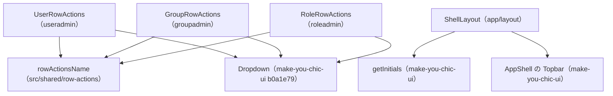

# 画面の部品 — U4 u4-a11y-carryover

振る舞いの決め（D1〜D12、D10a〜D10c）と流れ（F1〜F6）は `aidlc/spaces/default/intents/261016-business-data-views/construction/u4-a11y-carryover/functional-design/functional-spec.md` にある。この文書は、部品の構成・props・状態・文言の鍵の変更と、書き換えの対象のテストと、E2E の axe の補助の変更を書く。U4 は新しい画面を作らず、見た目も変えない。変えるのは読み上げの名前と、E2E の確かめだけ。

## 1. 部品の構成



文の代わりの説明: 3つの行の操作の部品（UserRowActions・GroupRowActions・RoleRowActions）は、`src/shared/row-actions` の名前の関数 rowActionsName を使い、make-you-chic-ui の Dropdown（固定先 `b0a1e79`）に名前を渡す。ShellLayout は make-you-chic-ui の getInitials で頭文字を求め、AppShell の Topbar に名前を渡す。U3 の業務データの一覧の行の操作も rowActionsName を使う（U3 の設計）。

## 2. 名前の関数 `rowActionsName`（D1・D8）

- 置き場: `frontend/src/shared/row-actions/rowActionsName.ts`（名前付きのエクスポートだけ。テストは同じ場所の `rowActionsName.test.ts` と `rowActionsName.property.test.ts`）。
- 機能のフォルダからは `src/shared/` を読むだけで、機能どうしの import にはならない（ESLint の `no-restricted-imports` の対象の外）。

```ts
/** 行の「操作」のトリガーの読み上げの名前（見える文字で始める。WCAG 2.5.3） */
export function rowActionsName(visibleLabel: string, rowLabel: string): string {
  const row = rowLabel.trim()
  return row === '' ? visibleLabel : `${visibleLabel}: ${row}`
}
```

| 入力 | 型 | 意味 |
|---|---|---|
| `visibleLabel` | `string` | ボタンに描く文言（「操作」・`Actions`）。D2 のとおり、ボタンと同じ鍵の値を渡す |
| `rowLabel` | `string` | 行を見分ける値（D4）。画面に出す値で、関数はログに出さない |

- 状態は持たない。処理中の文字（D3）は、呼ぶ側が戻り値の後ろに足す。
- 性質のテスト（fast-check）: 任意の空でない `visibleLabel` と任意の `rowLabel` で、結果が `visibleLabel` で始まる、空でない `rowLabel` なら `trim` した値を含む、空白だけの `rowLabel` なら `visibleLabel` と等しい。`<`・`"`・`'`・改行を含む値も文字のまま返る。

## 3. 部品ごとの props・状態・変更

props と状態は4つとも今のまま変えない。変えるのはトリガーの `aria-label` の作り方だけ。

| 部品 | props（今のまま） | 状態 | 名前の作り方（変更の後） |
|---|---|---|---|
| `frontend/src/features/useradmin/UserRowActions.tsx` | `user: AdminUser`・`busy: boolean`・`onSelect`・`containerRef?` | 持たない | `rowActionsName(t('useradmin.actions.button'), t('useradmin.actions.row', { name, email }))`。`busy` なら `t('useradmin.actions.busySuffix')` を足す |
| `frontend/src/features/groupadmin/GroupRowActions.tsx` | `group: GroupRow`・`busy`・`onSelect`・`containerRef?` | 持たない | `rowActionsName(t('groupadmin.actions.button'), group.name)`。`busy` なら `t('groupadmin.actions.busySuffix')` を足す |
| `frontend/src/features/roleadmin/RoleRowActions.tsx` | `role: RoleRow`・`busy`・`onSelect`・`containerRef?` | 持たない | `rowActionsName(t('roleadmin.actions.button'), role.name)`。`busy` なら `t('roleadmin.actions.busySuffix')` を足す |
| `frontend/src/app/layout/ShellLayout.tsx` | 今のまま | 今のまま | `topbarLabels.userMenu = (userName) => format('topbar.userMenu', { initials: getInitials(userName), name: userName })`（D6） |

- 3つの行の操作の部品の Dropdown（`placement="bottom-end"`）・Button（`variant="secondary"`・`size="sm"`・`loading={busy}`）・`data-testid`・見える文字は変えない（D5）。`data-testid`（`useradmin-row-actions-<id>`・`groupadmin-row-actions-<id>`・`roleadmin-row-actions-<id>`）は、E2E がトリガーを見分ける手がかりにも使う（7節）。
- グループとロールの「開く」のリンクの名前（「〇〇を開く」）は変えない（D12）。
- ShellLayout は `getInitials` を `make-you-chic-ui` から名前付きで import する（公開の口。`vendor/make-you-chic-ui/packages/make-you-chic-ui/src/index.ts` の 55行）。

## 4. 文言の鍵の変更

| 鍵 | 日本語（変更の後） | 英語（変更の後） | 扱い |
|---|---|---|---|
| `useradmin.actions.row` | `{{name}}（{{email}}）` | `{{name}} ({{email}})` | 足す（行を見分ける値。Q1: A） |
| `useradmin.actions.busySuffix` | `（処理中）` | ` (processing)` | 足す |
| `useradmin.actions.name`・`useradmin.actions.busyName` | — | — | 消す（「〇〇の操作」の形） |
| `groupadmin.actions.busySuffix`・`roleadmin.actions.busySuffix` | `（処理中）` | ` (processing)` | 足す |
| `groupadmin.actions.name`・`.busyName`、`roleadmin.actions.name`・`.busyName` | — | — | 消す |
| `*.actions.button`（3つ） | `操作` | `Actions` | 変えない（見える文字と名前の始まりの両方に使う） |
| `topbar.userMenu`（`frontend/src/app/i18n/messages/ja.ts`・`en.ts`） | `{{initials}}: {{name}}のメニュー` | `{{initials}}: Menu for {{name}}` | 変える |

- 名前の例: 「操作: 佐藤 一郎（sato@example.com）」「操作: 営業（処理中）」「検太: 検査 太郎のメニュー」「KT: Menu for Kensa Taro」。
- 英語の `busySuffix` の先頭の空白が文言の仕組みで保たれることと、氏名が空のときの扱いは、コード生成の計画で拾う（`functional-spec.md` の 9.2 の R-04）。

## 5. 書き換えの対象のテストと E2E

名前（「〇〇の操作」「〇〇のメニュー」）で部品を探しているものと、B7 で確かめを足すもの。コード生成の計画で、名前の検索でもう一度洗い出す（`project.md` の学び）。

| 種類 | ファイル | 中身 |
|---|---|---|
| 画面の部品のテスト | `frontend/src/features/useradmin/UserRowActions.test.tsx`・`UserAdminPage.test.tsx` | 行の操作の名前（処理中を含む） |
| 画面の部品のテスト | `frontend/src/features/groupadmin/GroupRowActions.test.tsx`・`GroupListPage.test.tsx`・`GroupAdminEnglish.test.tsx`・`GroupAdminForbidden.test.tsx` | 行の操作の名前（日英） |
| 画面の部品のテスト | `frontend/src/features/roleadmin/RoleRowActions.test.tsx`・`RoleListPage.test.tsx`・`RoleAdminEnglish.test.tsx`・`RoleAdminForbidden.test.tsx` | 行の操作の名前（日英） |
| 画面の部品のテスト | `frontend/src/app/layout/ShellLayout.test.tsx`（787行・797行の「管理者のメニュー」・`Menu for 管理者`） | トップバーの名前。2語の氏名の場合を足す |
| E2E | `frontend/e2e/110-user-admin-flow.e2e.ts`（121・137・208・253・302行の `/の操作$/`） | 行の操作の名前の照合 |
| E2E | `frontend/e2e/140-role-admin-accessibility.e2e.ts`（297・418行の `${LONG_ROLE_NAME}の操作`） | 行の操作の名前の照合 |
| E2E | `frontend/e2e/160-app-frame-accessibility.e2e.ts`（475行の `/^Menu for /`） | トップバーの名前の照合 |
| E2E の補助（B7） | `frontend/e2e/support/axe.ts`（30行の `REQUIRED_RULES`、`runAxe` の要約） | `label-content-name-mismatch` を足す（D10）。要約に、この規則の対象の要素を結果の区分ごとに足す（D10a、7節） |
| E2E（B7） | `frontend/e2e/120-user-admin-accessibility.e2e.ts` | 利用者の行の「操作」のトリガーが規則の passes に入り、incomplete・violations に入らないこと（D10b） |
| E2E（B7） | `frontend/e2e/140-role-admin-accessibility.e2e.ts` | グループとロールの行の「操作」のトリガーについて同じ（D10b） |
| E2E（B7） | `frontend/e2e/130-admin-forbidden-accessibility.e2e.ts`（`TWO_WORD_NAME` の形）か、2語の氏名の利用者で表示する別の E2E | トップバーのトリガーが規則の passes に入り、incomplete・violations に入らないこと（D10b・D10c）。どのファイルに置くかはコード生成の計画で決める |
| 足すテスト | `frontend/src/shared/row-actions/rowActionsName.test.ts`・`rowActionsName.property.test.ts` | D1・D8 |

- B7 で足す passes の確かめは操作の流れではなくアクセシビリティの検査のため、team.md の「E2E は Intent ごとに代表の流れを1本まで」の本数に数えない（`project.md` の学び）。既存の E2E の書き換えも本数に数えない（team.md）。

固定先 `b0a1e79` で、Dropdown の項目の説明の置き場が変わる。説明を `aria-describedby`（`toHaveAccessibleDescription`）で確かめている次のテストが、書き換えずに通ることを確かめる（D7）: `frontend/src/app/work-role/WorkRoleSwitcher.test.tsx`、`frontend/src/features/useradmin/UserRowActions.test.tsx`。ほかに `toHaveAccessibleDescription` を使う `UserSearchBox`・`EditProfileDialog`・`RegistrationForm`・`PasswordChangeForm`・`PasswordChangePage`・`PreferencesForm`・`groupadmin/CandidateDialog`・`roleadmin/PermissionPanel` のテストは Dropdown の項目を対象にしないが、verify で一緒に通ることを確かめる。

## 6. 画面との受け渡し

- API の呼び出しは足さない、変えない。名前に使う値（氏名・メールアドレス・グループとロールの名前）は、今の一覧の応答の値を使う。
- アクセシビリティの検査: 画面の部品ごとの vitest-axe の検査は今のまま。jsdom では `label-content-name-mismatch` を判定できないため、名前は 5節のテストで明示して確かめ、規則そのものは E2E の axe（B7 で `REQUIRED_RULES` に足し、対象のトリガーが passes に入ることを確かめる）で確かめる（D8・D10・D10b）。

## 7. E2E の axe の補助の変更（D10a・D10b、B7）

今の `runAxe` の要約の `ruleIds` は、規則が passes・violations・incomplete・inapplicable のどれに出ても同じに数える。そのため、規則 `label-content-name-mismatch` について、対象の要素がどの区分に入ったかを別に返す。

```ts
/** 名前と見える文字の規則で判定された要素（値は持たない） */
export interface AxeRuleNode {
  /** 結果の区分 */
  outcome: 'passes' | 'incomplete' | 'violations'
  /** 要素か近い祖先の data-testid（無ければ null） */
  testId: string | null
  /** トップバーの利用者のメニューのトリガー（mycui-topbar-user-trigger）か */
  topbarUserTrigger: boolean
}
```

- `AxeSummary` に `labelContentNameNodes: AxeRuleNode[]` を足す（名前はコード生成で確定する）。要素の選択子と、氏名・メールアドレスなどの値は返さない（注記・添付・標準出力に出さないため）。
- 確かめの補助（例: `expectLabelContentNamePasses(summary, matcher)`）は、`matcher` に当たる要素が passes に1つ以上あり、incomplete と violations に1つも無いことを確かめる。incomplete は合格に数えない。
- 行の「操作」のトリガーは、`data-testid` が `useradmin-row-actions-`・`groupadmin-row-actions-`・`roleadmin-row-actions-` で始まる祖先で見分ける。トップバーのトリガーは `topbarUserTrigger` で見分ける。
- 見分け方が働くこと（対象の要素が見つかること）は B3 の試し（F4 の 2）で先に確かめる。見つからない形（0 件）は、合格ではなく確かめの作りの誤りとして失敗にする。
- `REQUIRED_RULES`・`KNOWN_VIOLATIONS`（空のまま）・`splitKnownViolations` の扱いは変えない。規則・要素を外さない（`project.md` の Forbidden）。
