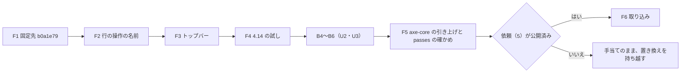

# 機能の仕様 — U4 u4-a11y-carryover（アクセシビリティの持ち越し）

U4 は種類 `ui` の単位で、`entities.md`・`rules.md` を作らない。この文書だけで、画面の振る舞いの決め（D1〜D12）・流れ（F1〜F6）・Bolt の区切りを決める。部品の構成と props は `frontend-components.md` に書く。

出典: 質問と答え `aidlc/spaces/default/intents/261016-business-data-views/construction/u4-a11y-carryover/functional-design/functional-design-questions.md`（Q1〜Q5: すべて A、Requested Changes Feedback、まとめの確認: Looks correct）、単位 `inception/units-generation/unit-of-work.md` の U4、要件 `inception/requirements-analysis/requirements.md` の FR14、ストーリー `inception/user-stories/stories.md` の US4.1、契約 `inception/contract-design/contract-summary.md` の C4、Bolt の計画 `inception/delivery-planning/bolt-plan.md` の B3・B7、依頼の文面 `make-you-chic-ui-request-5.md`（パスは記録 `aidlc/spaces/default/intents/261016-business-data-views/` の下）。

## 1. 範囲

- make-you-chic-ui の固定先を `a9309c4` から `b0a1e79` に上げる（FR14.1）。
- 行の「操作」のトリガーの名前を「操作: <行を見分ける値>」の形にする関数を `frontend/src/shared/` に置き、利用者・グループ・ロールの管理の一覧を直す（FR14.2）。
- トップバーの利用者のメニューのトリガーの名前を frontend の側で直す（FR14.4・FR14.5、Q2: A）。
- axe-core を 4.14 以降に上げ、`.github/dependabot.yml` の `ignore` を外す（FR14.3・FR14.3a・FR14.6）。
- 範囲の外: 業務データの一覧の行の名前と、業務データの画面の axe の E2E（U3）。行の「操作」以外の名前の付け直し（Q5: A）。

## 2. 確かめた事実（設計の前提）

- `b0a1e79` の親は `a9309c4` で、上流の `main` から辿れる。`package.json` と `package-lock.json` に差は無く、`hasInstallScript` も増えない。変わるのは `Dropdown.tsx`・`Dropdown.css`・`Dropdown.test.tsx` だけ（項目の説明を menuitem の外の兄弟の要素として描く）。
- `a9309c4` の Topbar には、名前を差し替える口 `labels.userMenu(name)` がある。トリガーの中身は Avatar の頭文字で、頭文字を求める `getInitials` は make-you-chic-ui から公開されている。トリガーのボタンはクラス `mycui-topbar-user-trigger` を持ち、`data-testid` は持たない。
- axe の規則 `label-content-name-mismatch`（WCAG 2.5.3）は、見えている文字が読み上げの名前に含まれるかだけを見る。1文字の文字は判定しない（incomplete）。jsdom ではこの規則がいつも incomplete になり、vitest-axe では確かめられない（`b0a1e79` のコミットの説明）。
- 今の `frontend/e2e/support/axe.ts` の `REQUIRED_RULES` の確かめは、規則の ID が passes・violations・incomplete・inapplicable のどれかに出れば満たされる（`ruleIds` が4つをまとめるため）。そのため、規則を足すだけでは、対象のトリガーが実際に判定されたか（passes に入ったか）は分からない（承認の場の R-01）。
- 前の Intent では E2E 080・100・120・130・160 が各 20 件（表示の組の数）、計 100 件落ちた。どの画面にもあるトップバーの頭文字（2語の氏名で「検太」）が主な原因と見ている。今の「〇〇の操作」は、理屈の上では規則を通る。この見立ては B3 の試し（D9）で確かめる。

## 3. 画面の振る舞いの決め

| D | 決め | 出典 |
|---|---|---|
| D1 | 名前の関数 `rowActionsName(visibleLabel, rowLabel)` を `frontend/src/shared/row-actions/` に置く。純粋な関数で、`"<見える文字>: <行を見分ける値>"` を返す。区切りは日英とも半角のコロンと空白。行を見分ける値が空（空白だけを含む）なら、見える文字だけを返す。文字列を作るだけで、HTML として解釈しない。値をログやトレースに出さない | FR14.2、AC4.1.1、C4、NFR4.2 |
| D2 | 見える文字の引数には、ボタンに描く文言と同じ鍵（`useradmin.actions.button`・`groupadmin.actions.button`・`roleadmin.actions.button`。日本語「操作」、英語 `Actions`）の値を渡す。見える文字と名前がずれないようにするため。今の `*.actions.name`（「〇〇の操作」の形）は使わない形に置き換える | AC4.1.1、WCAG 2.5.3 |
| D3 | 処理中（一覧の読み直し・送信中）は、D1 の結果の後ろに、機能ごとの鍵 `*.actions.busySuffix`（「（処理中）」・` (processing)`）を足す。名前は見える文字で始まるまま。Button の loading の印は `aria-hidden` で、見える文字は「操作」のまま | AC4.1.1 |
| D4 | 行を見分ける値: 利用者は「氏名（メールアドレス）」（英語は `Name (email)`）、グループとロールは名前。業務データの一覧の値（主キー・主キーが列に無いときの代表のカラム）は U3 の機能設計で決める | Q1: A、C4 |
| D5 | `UserRowActions`・`GroupRowActions`・`RoleRowActions` は、部品の形・Dropdown・`placement="bottom-end"`・`data-testid`・見える文字を変えず、トリガーの `aria-label` だけを D1〜D4 の名前に差し替える | AC4.1.1、mockups.md の S7 |
| D6 | トップバーは、ShellLayout の `topbarLabels.userMenu` を「`<頭文字>: <氏名>のメニュー`」（英語 `<initials>: Menu for <name>`）にする。頭文字は make-you-chic-ui の `getInitials` で求め、丸に出る文字とずらさない。鍵 `topbar.userMenu` に `{{initials}}` を足す。氏名が1語のとき（頭文字が1文字）も同じ形。アプリはアバターの画像を使わない（見える文字が無い形は規則を通る） | Q2: A、FR14.4、AC4.1.4 |
| D7 | 固定先 `b0a1e79` で Dropdown の項目の説明の置き場が変わる。説明を `aria-describedby` で確かめている既存のテスト（`frontend-components.md` の 5節）が、書き換えずに通ることを確かめる。アプリと E2E は Dropdown の中のクラス（`mycui-dropdown-*`）を参照しない | FR14.1、AC4.1.2 |
| D8 | jsdom でこの規則を判定できないため、画面の部品のテストでは名前を `getByRole(..., { name })` で明示して確かめる。D1 には fast-check の性質ベースのテストを当てる（見える文字で始まる、行を見分ける値を含む、空の値では見える文字だけ、区切りがちょうど1つ）。失敗のときの乱数の種を記録する | team.md の Testing Posture |
| D9 | B3 の試し: axe-core 4.14 を手元の作業フォルダでだけ当てて E2E の全件を流し、違反を「ファイル × 表示の組 × 規則 × 要素（`data-testid`）」で記録してから 4.13 に戻す（統合しない）。前の Intent の見立て（トップバーが主な原因、行のトリガーは通る）もここで確かめる。あわせて、D10 の確かめ（対象のトリガーが passes に入るか）を試しの版で一度流し、結果を記録する | Q3: A、FR14.4、AC4.1.4、承認の場の R-01 |
| D10 | B7: axe-core を 4.14 以降に上げ、`ignore` を外す。`frontend/e2e/support/axe.ts` の `REQUIRED_RULES`（必ず流れたことを確かめる規則）に `label-content-name-mismatch` を足す。それに加えて、この規則で対象のトリガーが実際に判定されたことを E2E で確かめる（D10a〜D10c）。E2E の全件の通過と違反 0 件、vitest-axe の件数を記録し、`npm ls axe-core` で版が1つかを確かめる。規則・要素を外さず、既知の違反の一覧（`splitKnownViolations`）は空のまま | Q3: A、FR14.3・FR14.3a、AC4.1.3、承認の場の R-01 |
| D10a | 検査の要約に、規則 `label-content-name-mismatch` の対象の要素を、結果の区分（passes・incomplete・violations）ごとに足す。要素は、近い祖先の `data-testid` と、トップバーの利用者のメニューのトリガーか（`mycui-topbar-user-trigger`）で見分ける。値（氏名・メールアドレス）は要約・注記・添付に出さない | 承認の場の R-01 |
| D10b | 行の「操作」のトリガー（利用者・グループ・ロールの管理の一覧の各1行以上）と、トップバーの利用者のメニューのトリガーが、この規則の passes に入ることを E2E で確かめる。同じ要素が incomplete（判定できない）や violations に入ったら失敗にする。incomplete は合格に数えない | 承認の場の R-01 |
| D10c | トップバーの確かめは、2語の氏名（頭文字が2文字）の利用者で表示した画面で行う（今の E2E 130 の `TWO_WORD_NAME` の形のように、その流れが自分で用意した氏名を使い、初期管理者の氏名は変えない）。1語の氏名（頭文字が1文字）では規則が incomplete になるため、その場合の結果は記録するが合格の根拠に使わない | 承認の場の R-01、2節 |
| D11 | 依頼（5）はトップバーの節を外し、表の部品の2点（横のスクロールの領域・1ページの件数の選択）だけを、機能設計の承認の前に送る。B7 で上流のソース（読み取りだけの `git show`）で口の形を確かめられたら、固定先をもう一度上げ（承認を得た専用のコミット）、U3 の手当てを make-you-chic-ui の口に置き換える。間に合わなくても axe-core の引き上げは止めず、手当てのまま残して、置き換えを次の Intent に回したことを記録する | Q2: A、Q4: A、FR14.5・FR14.6、C4 の `repin_rule`、AC4.1.5 |
| D12 | 名前の直しは、FR14.2 の行の「操作」と、D9・D10 で違反と出たものだけにする。違反の無い名前（例: 「営業を開く」）は変えない | Q5: A |

## 4. 流れ

### F1 固定先の更新（B3）

1. `vendor/make-you-chic-ui` で `b0a1e79` が上流の `main` から辿れることを、読み取りだけで確かめる。
2. `a9309c4..b0a1e79` の `package.json`・`package-lock.json` の差（増えた・変わったパッケージ、`hasInstallScript` の増減）を確かめる。増えていれば、取り込む前に依頼者に諮る。
3. 前後のハッシュと 1・2 の結果をコード生成の記録に書く。
4. 依頼者の承認を得て、固定先の更新だけの専用のコミットを積む。
5. `./gradlew verify` と E2E を流す（D7 を含む）。
6. fast-forward で `develop` に統合する（B3 の統合の単位は 9節の R-03 のとおりコード生成の計画で決める）。

### F2 行の「操作」の名前（B3）

1. D1 の関数と、その単体テスト・性質のテスト（D8）を書いて流す。
2. 3つの機能の文言の鍵を変える（`frontend-components.md` の 4節）。
3. 3つの行の操作の部品の `aria-label` を D1〜D4 の名前に差し替える（D5）。
4. 名前に頼る画面の部品のテストと E2E を新しい名前に書き換える（`frontend-components.md` の 5節）。
5. 今の axe-core（4.13）で `./gradlew verify` と E2E を流す。

### F3 トップバーの名前（B3）

1. ShellLayout の `topbarLabels.userMenu` を D6 の形にし、鍵 `topbar.userMenu` を日英で変える。
2. ShellLayout のテストの名前の確かめ（1語の氏名・2語の氏名・英語）を書き換え、E2E 160 の名前の照合を合わせる。
3. 今の axe-core（4.13）で `./gradlew verify` と E2E を流す。

### F4 axe-core 4.14 の試し（B3）

1. 作業フォルダの中だけで axe-core を 4.14 にして、E2E の全件を流す。
2. 違反を D9 の形で記録する。あわせて、対象のトリガー（D10b）が規則 `label-content-name-mismatch` の passes・incomplete・violations のどれに入ったかを記録する。
3. 違反の部品で分ける: frontend の名前の付け方なら D12 の範囲で B3 か B7 で直す。make-you-chic-ui の部品なら新しい依頼の文面を作り、依頼者に諮る（8節）。
4. `package.json`・`package-lock.json` を 4.13 に戻したことを差で確かめてから、B3 の統合に進む（試しの版は統合しない）。

### F5 axe-core の引き上げ（B7、B5・B6 の後）

1. axe-core を 4.14 以降に上げ、`.github/dependabot.yml` の `ignore` とそのコメントを外す。
2. `REQUIRED_RULES` に `label-content-name-mismatch` を足す（D10）。
3. 検査の要約に、この規則の対象の要素を結果の区分ごとに足す（D10a）。
4. 行の「操作」のトリガーとトップバーのトリガーがこの規則の passes に入り、incomplete・violations に入らないことを確かめる確かめを、E2E に足す（D10b）。トップバーは2語の氏名の利用者の画面で確かめる（D10c）。
5. E2E の全件と画面の部品のテスト（vitest-axe）を流す。違反が出たら直す（規則・要素は外さない）。対象のトリガーが incomplete に入ったときも、合格にせず原因を確かめて直す。
6. E2E の通過の件数と違反 0 件、対象のトリガーが passes に入った件数、vitest-axe の件数、`npm ls axe-core` の結果を記録する。

### F6 依頼（5）の取り込み（B7、上流が間に合ったとき）

1. 上流の `main` の新しいコミットで、表の横のスクロールの領域と1ページの件数の選択の口の形を、読み取りだけの `git show` で確かめる（報告ではなくソースで）。
2. F1 の 1〜6 と同じ手順で、固定先をもう一度上げる。
3. U3 の手当て（`src/shared/` の枠と件数の選択）を make-you-chic-ui の口に置き換え、F5 の 5・6 を流し直す。
4. 間に合わなければ 1〜3 を行わず、置き換えを次の Intent に回したことを記録する（D11）。

文の代わりの説明: B3 で F1（固定先）→ F2（行の操作の名前）→ F3（トップバー）→ F4（4.14 の試し）の順に行う。その後に B4〜B6（U2・U3）を挟み、B7 で F5（axe-core の引き上げと、対象のトリガーが規則の passes に入ることの確かめ）を行う。依頼（5）が公開済みなら F6 で取り込み、そうでなければ U3 の手当てのまま置き換えを次の Intent に回す。

## 5. B3 と B7 の区切り（Q3: A）

| Bolt | 中身 | 決め・流れ | 統合の形 |
|---|---|---|---|
| B3（前半） | 固定先 `b0a1e79` への更新、名前の関数と3つの管理の一覧、トップバーの名前、テストと E2E の書き換え、axe-core 4.14 の試しと違反・対象のトリガーの区分の記録（統合しない） | D1〜D9・D11（依頼（5）の送付は機能設計の承認の前）・D12、F1〜F4 | 固定先の更新の専用のコミットを残す fast-forward（F1 だけを先に統合するか、F1〜F4 を1つのブランチで fast-forward にするかはコード生成の計画で決める。9節の R-03） |
| B7（後半） | axe-core の引き上げと `ignore` の外し、`REQUIRED_RULES` の足し、対象のトリガーが規則の passes に入ることの E2E の確かめ、新しい画面を含めた違反 0 件と件数、依頼（5）の取り込み（間に合えば） | D10・D10a〜D10c・D11・D12、F5・F6 | 固定先を上げるときは fast-forward、上げないときは squash |

- B3 の終わりの条件: 3つの管理の一覧とトップバーの名前が見える文字で始まり、画面の部品のテストと E2E が今の axe-core（4.13）で通る。4.14 の違反の一覧と、対象のトリガーの区分の記録と、固定先の更新の記録が残る。
- B7 の終わりの条件: FR14.3a のとおり（E2E の全件の通過、E2E と vitest-axe の違反 0 件、件数の記録、版が1つ）。それに加えて、行の「操作」のトリガーとトップバーのトリガー（2語の氏名）が規則 `label-content-name-mismatch` の passes に入り、incomplete・violations に入らないこと（D10b・D10c）。

## 6. 上流との差

| # | 差 | 決めた所 |
|---|---|---|
| G1 | 画面イメージ（`inception/refined-mockups/mockups.md` の 7節）の例は「操作: 佐藤 一郎」（氏名だけ）だが、利用者の行は「操作: 佐藤 一郎（sato@example.com）」の形にする。同じ氏名の利用者でも行を見分けられ、今の名前が持つ情報を保つため。画面イメージの文書は書き換えない | Q1: A、D4 |
| G2 | 依頼（5）（`make-you-chic-ui-request-5.md`）の 1節（Topbar の利用者のメニューのトリガーの名前）は送らない。今の Topbar の口 `labels.userMenu` と公開の `getInitials` で frontend の側から直せるため。依頼の文面は承認済みの成果物のため書き換えず、送るときに 1節を除き、2節・3節だけを送る。1節の文面にあった条件（「違反の部品と確かめたとき」）は、D9 の試しでトップバーの違反が残ったときに新しい依頼として扱う | Q2: A、D6・D11、8節 |
| G3 | 契約 C4 の名前の関数の仮の名前 `rowActionsLabel` を `rowActionsName` に確定し、置き場を `frontend/src/shared/row-actions/` に決めた。入力（見える文字と行を見分ける値）と出力（`"操作: …"`・`"Actions: …"`）の形は C4 のまま | D1、C4 |
| G4 | Bolt の計画の B7 は「依頼（5）の取り込みと固定先の更新」を中身に含めるが、上流が間に合わなくても axe-core の引き上げは止めない。FR14.6 の「引き上げだけを持ち越すかを諮る」は、表の部品の2点では引き上げを妨げないため当たらない。D9 で make-you-chic-ui の部品の違反が新しく出て、上流の対応が要るときだけ FR14.6 で諮る | Q4: A、D11 |
| G5 | 要件 FR14.3a の合格の条件（違反 0 件と件数）に、対象のトリガーが規則の passes に入ることを足した（D10b）。違反 0 件は、規則が対象を判定しない（incomplete・inapplicable）場合にも満たされるため。要件の文書は書き換えない | 承認の場の R-01、D10 |

## 7. 前の段の承認の場で受け入れた指摘への答え

| 指摘 | 内容 | この単位での答え |
|---|---|---|
| Refined Mockups の R-04 | Topbar には `labels.userMenu(name)` の口があり、Avatar は `getInitials` を持つ。frontend の側で直せるなら、依頼の 1節を外すか手当てを書く | ソースで口を確かめ、frontend の側で直す形にした（D6）。依頼（5）の 1節は送らない（G2・D11） |
| Units Generation の R-01 | axe-core の引き上げの合格は、U3 の新しい画面を含めないと判定できない（隠れた循環） | U4 を B3 と B7 に分け、合格の判定（違反 0 件）を B5・B6 の後の B7 に置いた（5節・F5）。U3 が要る固定先と名前の関数は B3 で先に出す |
| Contract Design の R-07 | 依頼（5）が間に合わないときの切り替え先と、固定先を再び上げる専用のコミットの扱い | 間に合わなければ U3 の frontend の手当てのまま残して axe-core は上げる。間に合えば、上流のソースで口を確かめて専用のコミットで固定先を再び上げ、手当てを置き換える（D11・F6） |

## 8. 後の段に回すこと

- **B3 の試し（D9・F4）で違反が出た場合**: 違反の部品で扱いを分ける。
  - frontend の名前の付け方の違反は、D12 の範囲として B3 か B7 で直す。
  - make-you-chic-ui の部品の違反（`b0a1e79` で直らないもの、D6 の後も残るトップバーを含む）は、新しい依頼の文面を記録（`make-you-chic-ui-request-<n>.md`）に置いて依頼者に諮り、取り込んでから axe-core を上げる（FR14.5）。B7 までに間に合わなければ、axe-core の引き上げだけを持ち越すかを依頼者に諮る（FR14.6）。
  - どれもコード生成の計画（B3）と、その承認の場で扱う。
- **B3 の試しで対象のトリガーが passes に入らなかった場合**（incomplete や inapplicable）: 原因（見える文字の取り方・要素の見分け方）を確かめて記録し、B7 までに D10a の要素の見分け方か名前の付け方を直す。規則・要素は外さない。
- **依頼（5）の送付**: 機能設計の段の承認の前に、依頼者が make-you-chic-ui のリポジトリへ 2節・3節を送る（team.md）。送ったことと送った日を、機能設計の承認の場の記録に残す。取り込みは B7（F6）。
- **業務データの一覧の行を見分ける値と、業務データの画面の axe の E2E**: U3 の機能設計とコード生成（B5・B6）。U4 は B7 で、それらが axe-core 4.14 の下で通ることを確かめる。U3 の画面を B5・B6 の終わりに作業フォルダ限りで 4.14 の下で試すことは、U3 の Q6: A で決まっている（9節の R-02）。

## 9. 承認の場の決定（2026-10-18 Request Changes）

機能設計の段の承認の場（2026-10-18）で、依頼者は Request Changes を選び、次のとおり決めた（`functional-design-questions.md` の「Requested Changes Feedback」。そのうえでまとめを Looks correct で確かめ直した）。指摘の元は、この単位のレビューの記録（`aidlc/spaces/default/intents/261016-business-data-views/.aidlc-reviews/functional-design/units/u4-a11y-carryover/43883aac7901769a/`）の R-01〜R-04。

### 9.1 この書き直しで直した指摘

| 指摘 | 重さ | 直したこと | 直した場所 |
|---|---|---|---|
| R-01 規則の空振り | Major | `label-content-name-mismatch` を必ず流す規則に足すだけにせず、行の「操作」のトリガーとトップバーのトリガーがこの規則の passes に入ることを E2E で確かめる。判定できない incomplete は合格に数えない。トップバーは2語の氏名（頭文字が2文字）の利用者で確かめる | 2節（`REQUIRED_RULES` の確かめの事実）、D9・D10・D10a〜D10c、F4 の 2、F5 の 3〜6、5節の B7 の終わりの条件、6節 G5、`frontend-components.md` の 5節・7節 |

### 9.2 拾わない Minor（この単位の記録に残す）

| 指摘 | 重さ | 扱い |
|---|---|---|
| R-02 U3 の新しい画面が B7 まで 4.14 の下で流れない | Minor | U3 の機能設計の Q6: A で、B5・B6 の終わりに作業フォルダ限りで 4.14 を当てた U3 の E2E を流して記録することになった。この単位では直さない（8節） |
| R-03 B3 の統合の単位 | Minor | F1 だけを先に統合するか、F1〜F4 を1つのブランチで fast-forward にするかを、コード生成の計画（B3）で決める（5節・F1 の 6） |
| R-04 依頼（5）の送付・英語の先頭の空白・氏名が空のとき | Minor | コード生成の計画で拾う。依頼（5）の送付の有無を承認の場の記録で確かめること、`busySuffix` の英語の先頭の空白が文言の仕組みで保たれることの単体テスト、氏名が空のときに頭文字と区切りを省く扱い（D6）を、計画に入れる |

## Sources

- 質問と答え: `aidlc/spaces/default/intents/261016-business-data-views/construction/u4-a11y-carryover/functional-design/functional-design-questions.md`（Q1〜Q5、Requested Changes Feedback、まとめの確認）
- レビューの記録: `aidlc/spaces/default/intents/261016-business-data-views/.aidlc-reviews/functional-design/units/u4-a11y-carryover/43883aac7901769a/`（R-01〜R-04）
- 上流: `aidlc/spaces/default/intents/261016-business-data-views/inception/units-generation/unit-of-work.md`・`unit-of-work-story-map.md`、`inception/requirements-analysis/requirements.md`（FR14）、`inception/user-stories/stories.md`（US4.1）、`inception/contract-design/contract-summary.md`（C4）、`inception/delivery-planning/bolt-plan.md`（B3・B7）、`inception/refined-mockups/mockups.md`・`interaction-spec.md`、`make-you-chic-ui-request-5.md`
- 前の Intent: `aidlc/spaces/default/intents/261015-deps-ui-carryover/make-you-chic-ui-request-4.md`、`aidlc/spaces/default/intents/261015-deps-ui-carryover/construction/code-generation/generation-notes.md`（Step 10）
- コード: `vendor/make-you-chic-ui/packages/make-you-chic-ui/src/components/AppShell/Topbar.tsx`・`Avatar/Avatar.tsx`・`src/index.ts`、`frontend/src/app/layout/ShellLayout.tsx`、`frontend/src/features/useradmin/UserRowActions.tsx`・`groupadmin/GroupRowActions.tsx`・`roleadmin/RoleRowActions.tsx`、`frontend/e2e/support/axe.ts`（`REQUIRED_RULES`・`runAxe` の `ruleIds`）、`frontend/e2e/130-admin-forbidden-accessibility.e2e.ts`（`TWO_WORD_NAME`）、`frontend/node_modules/axe-core/axe.js`（4.13.0 の `labelContentNameMismatchEvaluate`）、`.github/dependabot.yml`
- 決まり: `aidlc/spaces/default/memory/team.md`（Way of Working・Testing Posture）、`aidlc/spaces/default/memory/project.md`（Forbidden の axe の規則、学び）

## Assumptions & Open Questions

- 前の Intent の 100 件の主な原因はトップバーの頭文字で、行のトリガーは規則を通る、という見立ては未確認。B3 の試し（D9）で確かめる。外れたときの扱いは 8節。
- 対象のトリガーを近い祖先の `data-testid` とトップバーのクラスで見分けられる、という前提は B3 の試し（F4 の 2）で確かめる。見分けられなければ、B7 までに見分け方を直す（8節）。
- 依頼（5）の上流の対応の時期は分からない（D11 のとおり、引き上げは妨げない）。
