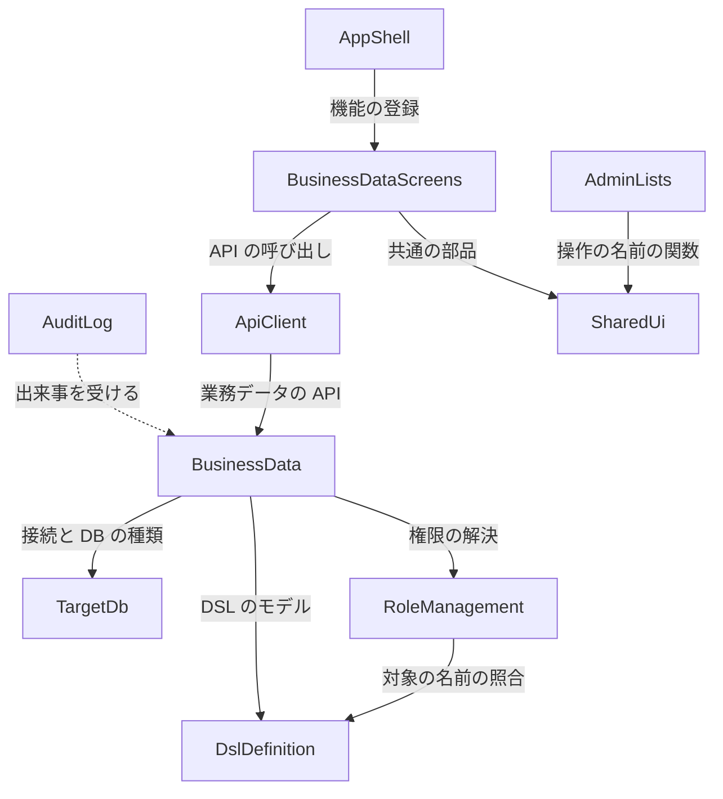

# 部品の一覧（Domain Design）— business-data-views

出典の表記: FR・NFR・A は `aidlc/spaces/default/intents/261016-business-data-views/inception/requirements-analysis/requirements.md`、US・AC・SM・SL は `aidlc/spaces/default/intents/261016-business-data-views/inception/user-stories/stories.md`、画面 S1〜S8・RQ は `aidlc/spaces/default/intents/261016-business-data-views/inception/refined-mockups/`、DQ1〜DQ4 は `domain-design-questions.md` の確定した答え、K-49〜K-61 は `aidlc/spaces/default/codekb/mastersmith2/` の所見、TP は `team.md`、PM は `project.md`。ADR は `decisions.md`。

部品はコードとして書く論理の部品で、内部DB（H2）・対象DB（MySQL・MariaDB・PostgreSQL）・make-you-chic-ui は部品の外の依存として書く。既存の部品は今のパッケージ名を併記し、この Intent で触れない部品は載せない。業務データの行は対象DB のデータで、アプリが独自に持つデータではないため、エンティティとしては書かない（PM の学び: エンティティにはアプリが独自に持つデータだけを書く）。

## Part A — 機械が読む一覧

```yaml
components:
  - name: BusinessData
    summary: "新規（`businessdata`）。業務データの一覧・検索・詳細・作成・更新・削除の API と、権限・主キー・ビュー・表示の設定による出し分け・操作の可否・行の SQL・監査の出来事"
    behaviour: >
      要求ごとに、利用者の今の作業ロールでのテーブル・カラムの実効の主権限と補助権限を RoleManagement の解決の口で求め、
      DslDefinition から適用中の DSL のテーブル・カラム・主キー・ビュー・表示の設定・検索の設定・検証・フォーム部品を読む。
      その2つから、出すカラム（NONE を除き、一覧は list.visible、詳細・作成・更新は detail.visible、行を指す主キーは一覧の応答に含める）、
      入力できるカラム（detail.visible の FULL、更新では主キーを除く）、許す操作（要件 FR9.1 の表とビューは読み取りだけ）を1つの純粋な関数で求め、
      応答に操作の可否として返す（画面はそれで入口を出す。ADR-005）。判定の順は 401 → 404（DSL・テーブル）→ 403（テーブルが NONE）→ 409・403 → 400 → 404（行）→ 業務の失敗（SL）。
      書けないカラム（NONE・READ・DSL に無い・隠す・更新の主キー）を本文や条件に入れたら、存在を推測させないよう同じ 400 で拒否する。
      SQL は1つの部品（RowSqlExecutor）だけが組み立てて実行する: 識別子は適用中の DSL の名前と照らしてから DB の種類ごとに引用し、値はバインド変数で渡す（PM の Forbidden）。
      DB の種類ごとの方言（NULL の並び・部分一致のエスケープ・時差つきの型・一意と外部キーの違反の見分け）はこの部品の中の方言の部品に閉じ、ほかの層は DB の種類で分岐しない（TP）。
      一覧は1ページの件数（20・50・100）と全体の件数、並べ替えは sortable の1カラムに主キーの順を足して安定させる。
      読む行の数に上限を置き、目的ごとの問い合わせの時間の上限を付ける。作成・更新・削除は TargetDb の書き込みの接続で、対象DB 用のトランザクションの中で行い、
      更新・削除で当たった行が1行でなければ巻き戻して拒否する（SM8）。更新は変えたカラムだけを書く（SM1）。一意は保存の前に問い合わせ、DB の制約の違反も同じ誤りに直す（F1）。
      対象DB を待つあいだ内部DB の接続を持たない。対象DB の確定（失敗なら巻き戻し）の後に監査の出来事を出す（ADR-003）。
      行の値（主キーを含む）・検索の値・接続情報はアプリのログ・トレースの属性・誤りの応答に出さない（行の値を持つ型は toString で伏せる。PM・TP）。
      API はすべて /api/ の下の「ログインだけ」に分類し、判定は作業ロールの権限で行う（K-61）。
    responsibilities:
      - "業務データの一覧・検索・詳細・作成・更新・削除の API"
      - "出すカラム・入力できるカラム・許す操作を求める純粋な関数（性質ベースのテストの対象）"
      - "判定の順と拒否の code（業務データの XxxProblemTypes）"
      - "行の SQL を組み立てて実行する唯一の部品（RowSqlExecutor）と DB の種類ごとの方言"
      - "入力の検証（DSL の検証・DB の型・一意の事前の問い合わせ・pattern の時間の上限）"
      - "対象DB の行の値と画面・API の値の受け渡しの型の対応（BIGINT・DECIMAL は文字、時差つきの型は UTC）"
      - "業務データの操作の監査の出来事の発行"
    depends_on:
      - component: TargetDb
        interaction: "対象DB の読み取りと書き込みの接続（DataSource）と DB の種類の受け取り"
        style: sync
      - component: RoleManagement
        interaction: "利用者の今の作業ロールでのテーブル・カラムの実効の主権限と補助権限の解決"
        style: sync
      - component: DslDefinition
        interaction: "適用中の DSL のテーブル・カラム・主キー・ビュー・表示の設定・検索・検証・フォーム部品の読み取り"
        style: sync
    dependents:
      - component: AuditLog
        interaction: "業務データの作成・更新・削除の成功と失敗の出来事を受ける"
      - component: ApiClient
        interaction: "業務データの一覧・詳細・作成・更新・削除の API"
    external_dependencies:
      - name: "対象DB（MySQL・MariaDB・PostgreSQL）"
        kind: database
        purpose: "業務データの行の読み書き（TargetDb が渡す接続を使う）"
    entities: []

  - name: TargetDb
    summary: "既存（`targetdb`）。対象DB の接続先の設定・DataSource・スキーマの読み取り。この Intent で書き込みの接続の設定と DataSource を足し、読み取り・書き込みの接続を渡す口を `targetdb.service` に置く"
    behaviour: >
      接続先と資格情報は環境変数（.env）だけから受け取り、読み取りと書き込みで別の接続・資格情報を持つ（PM の Mandated）。
      書き込みの接続の設定が無いときは起動を続け、書き込みの口は「設定が無い」と答える（AC3.3.9）。
      `targetdb` の中では今の決まりを保つ: 書き込み・DDL を発行しない、JdbcTemplate を使わない、DSL と web の層を知らない（境界テストを緩めない）。
      接続の口は DataSource（と DB の種類）を渡すだけで、行の SQL は BusinessData の RowSqlExecutor が発行する。
    responsibilities:
      - "対象DB の接続先の設定（読み取り・書き込み）と DataSource"
      - "読み取り・書き込みの接続と DB の種類を渡す口（targetdb.service）"
      - "スキーマの読み取り（既存。DSL の生成と照合が使う）"
    depends_on: []
    dependents:
      - component: BusinessData
        interaction: "読み取り・書き込みの接続と DB の種類を受け取る"
    external_dependencies:
      - name: "対象DB（MySQL・MariaDB・PostgreSQL）"
        kind: database
        purpose: "接続の提供とスキーマの読み取り"
    entities: []

  - name: RoleManagement
    summary: "既存（`role`）。実効の権限の解決の口を BusinessData にも開く（`RoleBoundaryArchitectureTest` に依存してよい相手を足す。ADR-002）。不安定なテスト RoleConcurrencyIT の #7 の直し（テストだけ、K-57）"
    behaviour: >
      利用者と対象（スキーマ・テーブル・カラム）を受け取り、その利用者の今の作業ロールでの実効の主権限と補助権限を、要求ごとに内部DB から求めて返す（前の Intent の FR8.1）。
      この Intent では口の形を変えず、テーブル・カラムの主権限とテーブルの CREATE・DELETE を BusinessData が読めるようにする。口が1要求で何回読むか（接続の数）は NFR 設計で決める。
    responsibilities:
      - "実効の権限の解決の口（Navigation と BusinessData 向け）"
    depends_on:
      - component: DslDefinition
        interaction: "権限の対象の名前の照合（既存）"
        style: sync
    dependents:
      - component: BusinessData
        interaction: "テーブル・カラムの実効の主権限と補助権限の解決"
    external_dependencies:
      - name: "H2（内部DB）"
        kind: database
        purpose: "ロール・設定・割り当て・作業ロールの読み取り（既存）"
    entities: []

  - name: DslDefinition
    summary: "既存（`dsl`）。適用中の DSL のモデルの提供口（ActiveDslModelProvider）。この Intent では提供口の形を変えない"
    behaviour: >
      適用中の DSL（書式の版 2）のスキーマ・テーブル・カラム・主キー・ビュー・表示の設定・検索の設定・検証・フォーム部品・選択肢を、変更できない値として渡す。
      DSL が適用されていないときは「無い」と答える（BusinessData はそれを 404 に写す。FR13.2）。
    responsibilities:
      - "適用中の DSL のモデルの提供（既存）"
    depends_on: []
    dependents:
      - component: BusinessData
        interaction: "テーブルの見せ方と主キー・ビュー・検証の読み取り"
      - component: RoleManagement
        interaction: "権限の対象の名前の照合（既存）"
    external_dependencies: []
    entities: []

  - name: AuditLog
    summary: "既存（`audit`）。業務データの作成・更新・削除の成功と失敗の監査の種類を足し、出来事を内部DB に書く"
    behaviour: >
      BusinessData の出来事を、今の AuditEventListener が fallbackExecution で自分の短いトランザクションで書く（ADR-003）。
      残す中身は操作した人・作業ロール・スキーマ・テーブル・操作の種類・結果・行の主キーの値・失敗の理由の code（FR12.1・FR12.4・SQ6）。
      主キー以外の値と前後の値は残さず、JDBC の例外のメッセージ・接続先は含めない。主キーの値が長いときは切り詰めたと分かる形にする（欄の置き方と上限は機能設計）。
      書き込みに失敗しても操作は成功のままとし、アプリのログに失敗を残す（そのログに主キーの値と行の値を含めない。FR12.3）。
    responsibilities:
      - "業務データの監査の種類と記録（既存の仕組みに足す）"
    depends_on:
      - component: BusinessData
        interaction: "業務データの出来事の型（businessdata.domain）を受ける"
        style: event
    dependents: []
    external_dependencies:
      - name: "H2（内部DB）"
        kind: database
        purpose: "監査の行の保存（既存）"
    entities: []

  - name: ApiClient
    summary: "既存（`frontend/src/shared/api` など）。業務データの API の呼び出しを足す"
    behaviour: >
      業務データの API を呼び、Problem Details の code を画面に渡す。BIGINT・DECIMAL は文字のまま受け渡し、JavaScript の数に直さない（AC3.6.5）。
      画面の型では any を使わず、unknown か union で受ける（TP）。道の組み立てではスキーマ名・テーブル名・主キーの値をエンコードする。
    responsibilities:
      - "業務データの API の呼び出しと応答の型"
    depends_on:
      - component: BusinessData
        interaction: "業務データの一覧・詳細・作成・更新・削除の API"
        style: sync
    dependents:
      - component: BusinessDataScreens
        interaction: "API の呼び出し"
    external_dependencies: []
    entities: []

  - name: BusinessDataScreens
    summary: "既存の置き場を広げる（`frontend/src/features/tables`）。業務データの一覧（検索・表・ページ送り）・詳細・作成・更新の画面と削除の確かめ（S1〜S6）"
    behaviour: >
      メニューのテーブルの項目からの道で一覧を開き、サイドバーの今の項目を保つ。出すカラム・入力・操作の入口は、サーバーが返す操作の可否とカラムの一覧で決める（ADR-005）。
      一覧の状態（検索の条件・ページ・件数・並び）は画面の中に持ち、詳細・作成・更新・削除から戻る・ブラウザの戻る操作で保つ。道に検索の値を載せない（SM5）。
      検索の領域は開閉でき、演算子ごとの入力を出す。値の書式・NULL・長い値・password・時差つきの型の出し方は画面の段の決定のとおり。
      作成・更新は detail.visible の FULL を入力、READ を読み取りで出し、変えたカラムだけを送る。pattern 以外の検証は画面でも当てる。
      保存せずに離れるときは確かめ、作業ロールの切り替えで 403 になったら入力を捨てる。値と表示名は文字として出す。
    responsibilities:
      - "業務データの一覧・詳細・作成・更新の画面と削除の確かめ"
      - "一覧の状態を画面の中で保つ仕組み"
      - "テーブルを指すメニューの項目からの道（今の置き場の置き換え）"
    depends_on:
      - component: ApiClient
        interaction: "業務データの API"
        style: sync
      - component: SharedUi
        interaction: "NULL の表示・横のスクロールの枠・1ページの件数の選択・離れるときの確かめ・「操作: …」の名前"
        style: sync
    dependents:
      - component: AppShell
        interaction: "機能の登録（registration.ts）と道の振り分け"
    external_dependencies:
      - name: "make-you-chic-ui"
        kind: other
        purpose: "Table・Dropdown・Modal・FormField・TextInput・Select・RadioGroup・Checkbox・Switch・Textarea・Alert・Toast・Tooltip・Button"
    entities: []

  - name: SharedUi
    summary: "既存の置き場（`frontend/src/shared/`）に、業務データの画面とほかの画面で使う小さな部品を足す"
    behaviour: >
      NULL の表示（「（値なし）」・読み上げ「値なし」）、Table の横のスクロールの枠（role="region"・ラベル・tabIndex。依頼（5）の取り込みまで）、
      1ページの件数の選択（依頼（5）の取り込みまで）、保存せずに離れるときの確かめ、行の「操作」のトリガーの名前「操作: <行を見分ける値>」を作る関数。
    responsibilities:
      - "業務データの画面と既存の管理の一覧が使う共通の小さな部品"
    depends_on: []
    dependents:
      - component: BusinessDataScreens
        interaction: "共通の部品を使う"
      - component: AdminLists
        interaction: "行の「操作」の名前の関数を使う"
    external_dependencies:
      - name: "make-you-chic-ui"
        kind: other
        purpose: "Select・Modal を包む"
    entities: []

  - name: AdminLists
    summary: "既存（`frontend/src/features/useradmin`・`groupadmin`・`roleadmin`）。行の「操作」のトリガーの名前を「操作: …」の形に直す（AC4.1.1）"
    behaviour: >
      見た目は変えず、トリガーの読み上げの名前を見えている文字で始まる形にする（WCAG 2.5.3）。
    responsibilities:
      - "既存の管理の一覧の行の「操作」の名前の直し"
    depends_on:
      - component: SharedUi
        interaction: "行の「操作」の名前の関数"
        style: sync
    dependents: []
    external_dependencies:
      - name: "make-you-chic-ui"
        kind: other
        purpose: "Dropdown（b0a1e79 の直しを取り込む）"
    entities: []

  - name: AppShell
    summary: "既存（`frontend/src/app`）。業務データの画面の道の登録と、トップバーの利用者のメニューのトリガーの名前（E2E 080 の違反の部品と確かめたとき。依頼（5）か frontend の側の直し）。不安定なテスト AdminForbiddenProvider.test.tsx の直し（テストだけ、K-58）"
    behaviour: >
      機能の登録の型（registration.ts）で業務データの画面の道を振り分ける。サイドバーの今の項目は前の Intent のまま。
      トップバーの利用者のメニューのトリガーの名前が WCAG 2.5.3 に当たるときは、まず今の Topbar の口（labels など）で frontend の側から直せるかを機能設計で確かめ、直せなければ依頼（5）で上流に直してもらう。
    responsibilities:
      - "業務データの画面の道の登録"
      - "トップバーの利用者のメニューのトリガーの名前（必要なとき）"
    depends_on:
      - component: BusinessDataScreens
        interaction: "機能の登録"
        style: sync
    dependents: []
    external_dependencies:
      - name: "make-you-chic-ui"
        kind: other
        purpose: "AppShell・Topbar・Sidebar"
    entities: []
```

## Part B — 人が読む形

### Component Diagram



文字の代わりの説明: BusinessData は TargetDb（接続）・RoleManagement（権限）・DslDefinition（DSL）を呼ぶ。RoleManagement は既存のとおり DslDefinition を呼ぶ。AuditLog は BusinessData の出来事を受ける（点線は出来事）。画面の側は、AppShell が BusinessDataScreens を登録し、BusinessDataScreens が ApiClient を通して BusinessData を呼び、SharedUi の部品を使う。AdminLists も SharedUi の名前の関数を使う。循環は無い。

### Component Summary

| Component | Purpose | Depends On | Dependents | Entities Owned |
|---|---|---|---|---|
| BusinessData（新規 `businessdata`） | 業務データの API・出し分け・操作の可否・行の SQL・監査の出来事 | TargetDb・RoleManagement・DslDefinition | AuditLog・ApiClient | なし |
| TargetDb（既存 `targetdb`） | 対象DB の接続の設定と DataSource（書き込みを足す）・スキーマの読み取り | なし | BusinessData | なし |
| RoleManagement（既存 `role`） | 実効の権限の解決の口 | DslDefinition | BusinessData（この Intent で足す。既存の Navigation・AuditLog は載せていない） | なし（既存のエンティティはこの Intent で変えない） |
| DslDefinition（既存 `dsl`） | 適用中の DSL のモデルの提供 | なし | BusinessData・RoleManagement | なし（既存） |
| AuditLog（既存 `audit`） | 業務データの監査の種類と記録 | BusinessData（出来事） | なし | なし（既存の監査の行） |
| ApiClient（既存） | 業務データの API の呼び出し | BusinessData | BusinessDataScreens | なし |
| BusinessDataScreens（既存の置き場 `features/tables` を広げる） | 一覧・詳細・作成・更新の画面 | ApiClient・SharedUi | AppShell | なし |
| SharedUi（既存の置き場 `src/shared/`） | 共通の小さな部品 | なし | BusinessDataScreens・AdminLists | なし |
| AdminLists（既存 `useradmin`・`groupadmin`・`roleadmin`） | 行の「操作」の名前の直し | SharedUi | なし | なし |
| AppShell（既存 `frontend/src/app`） | 道の登録とトップバーの直し | BusinessDataScreens | なし | なし |

### Entity Ownership

この Intent でアプリが新しく持つデータ（内部DB の表）は無い。業務データの行は対象DB のデータで、BusinessData はそれを読み書きするが持ち主ではない。監査の行は既存の AuditLog の表に、業務データの操作の種類と中身を足す（欄の置き方は機能設計）。

| Entity | Owning Component | Identifier | Attributes | References |
|---|---|---|---|---|
| （なし） | — | — | — | — |

### External Dependencies

| Component | Dependency | Kind | Purpose |
|---|---|---|---|
| BusinessData | 対象DB（MySQL・MariaDB・PostgreSQL） | database | 業務データの行の読み書き（TargetDb の接続） |
| TargetDb | 対象DB（MySQL・MariaDB・PostgreSQL） | database | 接続の提供とスキーマの読み取り |
| RoleManagement | H2（内部DB） | database | 権限の解決（既存） |
| AuditLog | H2（内部DB） | database | 監査の行（既存） |
| BusinessDataScreens・SharedUi・AdminLists・AppShell | make-you-chic-ui | other | 画面の部品（固定先を `b0a1e79` に上げる） |

### Rationale

| Component | 別の部品にした理由 |
|---|---|
| BusinessData | 業務データの読み書きは、DSL・権限・対象DB・監査を組み合わせる新しい責務で、変わる理由（DSL の画面の設定・権限の当て方）が既存のどの機能とも違う。SQL を組み立てて実行する部品を1つに閉じる決まり（TP）も、この機能の中の1つの部品で満たす（ADR-001） |
| TargetDb | 接続の設定と DataSource は既存の持ち主のまま、書き込みの接続を足す。行の SQL を入れないことで、今の「書き込みをしない」境界テストを緩めずに済む（ADR-001・ADR-008） |
| RoleManagement | 解決の口の持ち主は変わらない。依存してよい相手に BusinessData を足す（ADR-002） |
| AuditLog | 監査の仕組みは既存のまま、種類を足す（ADR-003） |
| BusinessDataScreens | 今の置き場（`features/tables`）を引き継ぎ、メニューからの道の組み立ての関数を1か所のままにする（ADR-004） |
| SharedUi | NULL の表示・枠・件数の選択・離れる確かめ・操作の名前は、業務データの画面と既存の管理の一覧の両方で使うため（TP: 機能どうしは直接 import しない） |
| AdminLists・AppShell | 持ち越しの直し（FR14.2・FR14.4）で触れるが、責務は変えない |

**Alternatives Rejected**（部品の分け方、詳しくは `decisions.md`）:

- DQ1 の B（`targetdb` に行の読み書きを足す）: `targetdb` の「書き込みをしない」境界テストを緩めることになり、スキーマの読み取りだけを持つ部品の性質が変わるため選ばなかった。
- DQ1 の C（行の SQL を持つ `rowstore` を別に作る）: DSL を知らない SQL の部品は識別子の照合（DSL の名前と照らす）を外から受け取る形になり、照合を通らない名前が届く口ができるため選ばなかった。
- DQ2 の B・C、DQ3 の B、DQ4 の B は `decisions.md` の ADR-002〜ADR-004。

### この Intent で触れるが部品を増やさないもの

- 不安定なテスト2件（FR15）: `RoleConcurrencyIT`（RoleManagement のテスト）と `AdminForbiddenProvider.test.tsx`（AppShell のテスト）。テストの直しだけで、部品の責務は変えない（K-57・K-58）。
- `dslMixed` の `memory.peak`（FR16）: 負荷の試験の台本と測り方（`perf/`）。部品ではない（K-59）。
- make-you-chic-ui の固定先の更新と axe-core の取り込み（FR14.1・FR14.3）: 依存の更新で、部品ではない（K-60）。
