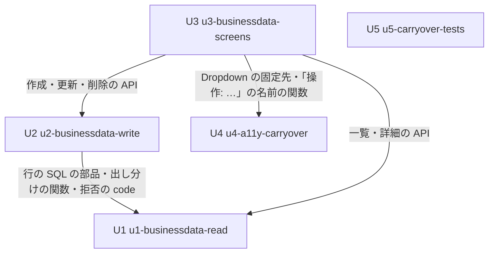

# 単位の依存（Unit of Work Dependency）— business-data-views

出典: `unit-of-work.md`、部品の一覧 `aidlc/spaces/default/intents/261016-business-data-views/inception/domain-design/components.md`。この文書は依存の形（どの単位がどの単位を要るか）だけを書き、作る順や重要な経路は書かない（Delivery Planning で決める）。

## 依存の図



文字の代わりの説明: U2 は U1 を要る（U1 が作る行の SQL の部品・出し分けの関数・拒否の code を使う）。U3 は U1（読み取りの API）・U2（書き込みの API）・U4（make-you-chic-ui の固定先 `b0a1e79` の Dropdown と `src/shared/` の名前の関数）を要る。U1・U4・U5 はどの単位も要らない。循環は無い。

## 機械が読む依存

```yaml
units:
  - name: u1-businessdata-read
    kind: service
    depends_on: []
  - name: u2-businessdata-write
    kind: service
    depends_on: [u1-businessdata-read]
  - name: u3-businessdata-screens
    kind: ui
    depends_on: [u1-businessdata-read, u2-businessdata-write, u4-a11y-carryover]
  - name: u4-a11y-carryover
    kind: ui
    depends_on: []
  - name: u5-carryover-tests
    kind: library
    depends_on: []
```

## つなぎ目（単位の間の受け渡し）

| 使う単位 | 使われる単位 | つなぎ目 | 形 |
|---|---|---|---|
| U2 | U1 | 行の SQL を組み立てて実行する部品（RowSqlExecutor）と方言、出すカラム・入力できるカラム・許す操作を求める関数、判定の順と拒否の code の一覧、行の値の型の対応 | 同じ機能 `businessdata` の中の型と口（アプリの中の呼び出し） |
| U3 | U1 | 一覧・検索・詳細の API（出すカラム・操作の可否・カラムごとの入力の可否・全体の件数を含む応答）と拒否の code | HTTP（JSON、Problem Details） |
| U3 | U2 | 作成・更新・削除の API と、カラムごとの誤り・業務の失敗の code | HTTP（JSON、Problem Details） |
| U3 | U4 | make-you-chic-ui の固定先 `b0a1e79`（Dropdown の DOM の形）と、`src/shared/` の「操作: <行を見分ける値>」の名前の関数 | 依存の固定先とフロントエンドの関数 |
| U2 | AuditLog（U2 の中） | 業務データの出来事 → `AuditEventListener` | Spring の出来事（U2 の中で閉じる） |

U1・U2 の API の形（道・要求・応答・code）は Contract Design で決める。

## 並べて作れる組

- U1・U4・U5 は互いに依存しないため、並べて作れる。
- U2 は U1 の後に、U4・U5 と並べて作れる。
- U3 は U1・U2・U4 の後。ただし、Contract Design で API の形を決めた後は、U3 の画面の部品（`src/shared/`）と API の呼び出しの型を、U1・U2 と並べて作り始める余地がある（どう並べるかは Delivery Planning で決める）。

複数の正しい並べ方がある（例: U1 → U2 → U4 → U3 → U5、U4 → U5 → U1 → U2 → U3、U1 と U4 と U5 を並べてから U2・U3）。どれを選ぶかは Delivery Planning の判断。
