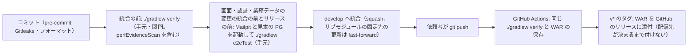

# CI の構成（ci-config）

Intent `261029-reference-lookup-cleanup`（U1〜U5、Bolt B1〜B7、不安定なテストの直し `a3099f80`、Build and Test の直し `df79634c`）の CI の記録です。すでにリポジトリにある `.github/workflows/ci.yml` と、CI が呼ぶ `./gradlew verify` の中身を記録します（`project.md` の Deployment「CI の仕組みが既に実装されている段では、既にあるものの記録として書く」）。この段では CI の定義を変えていません。

- 作成日: 2026-11-01
- 対象のファイル: `.github/workflows/ci.yml`（ワークフローの名前 `CI`）、`.github/dependabot.yml`、`build.gradle.kts`（`verifyStages` と perf の道具のタスク）、`frontend/scripts/check-license-header.mjs`
- 段ごとの合否の基準と、Build and Test の検査との対応: `quality-gates.md`
- 依頼者の確認: `ci-pipeline-questions.md`（新しく決める論点が無いため質問は作らず、要点の確認だけ）
- 前の同じ段の記録: Intent `261016-business-data-views` の `construction/ci-pipeline/ci-config.md`（その後の Intent `261025-deps-perf-carryover`・`261027-perf-targets-review` には CI Pipeline の段が無い）

## 1. この Intent での CI に関わる変更

比べた範囲は、前の `main` の取り込みの `d797ef74`（Intent `261027-perf-targets-review` の配備の記録）から `develop` の先頭（`e1e028d1`）までです（`git diff d797ef74..HEAD`・`git log`、読み取り）。

| ファイル | 変更 | コミット |
|---|---|---|
| `.github/workflows/ci.yml` | **変えていない**（`git diff --stat d797ef74..HEAD -- .github` は 0 件） | — |
| `.github/dependabot.yml` | **変えていない** | — |
| `.gitleaks.toml`・`.pre-commit-config.yaml`・`backend/build.gradle.kts`・`backend/gradle.lockfile`・`backend/config/spotbugs-exclude.xml`・`frontend/vitest.config.ts` | **変えていない**（`build-and-test/test-results.md` 5節と同じ確かめ） | — |
| `build.gradle.kts`（`verifyStages`） | `verify` に3つのタスクを足した: `perfToolFormatCheck`（1 の段。`perf/redact-k6-evidence.mjs` に画面と同じ設定の Prettier）・`perfToolLint`（2 の段。同じ道具に画面と同じ設定の oxlint）・`perfEvidenceScan`（8 の段。`node perf/redact-k6-evidence.mjs --scan aidlc` で `aidlc/` の下のすべての `evidence/` を調べ、JWT の形などが1件でもあれば失敗。入力・出力を宣言せず毎回流れる）。段の説明文も合わせて直した。段の並びと数（0〜9）は変えていない | `13883f6c`（B5、U4） |
| `frontend/scripts/check-license-header.mjs`（3 の段） | ライセンスヘッダーの検査の対象に `perf/` の `.mjs`・`.js` を加えた（`.sh`・`.md`・`.env` などは対象外） | `13883f6c`（B5、U4） |
| `frontend/package.json`・`frontend/package-lock.json` | 依存の入れ直し（Dependabot #81・#82 を含む。i18next 26.5.11・react-i18next 17.1.9・react 19.3.1 など）。`hasInstallScript` の付いた項目は fsevents の1つのまま | `41b8bf51` |
| `vendor/make-you-chic-ui`（サブモジュールの固定先） | `ecb07e9` から `4c63d11` へ上げた（専用のコミット、前後のハッシュと lockfile の差を記録済み）。CI は `submodules: true` で固定先を取得する | `476785a4` |
| `frontend/vitest.setup.ts`（`verify` の 5・7 の段で読む設定）【この段の直しで追記】 | jsdom の環境のときだけ `window.setTimeout`・`setInterval` を包み、各テストの `cleanup()` の後に未実行の予約を取り消す（6.4）。時間の上限・カバレッジの対象・除外・下限は変えていない | `cac6fa54`（この段の直し） |
| `vendor/make-you-chic-ui`（サブモジュールの固定先）【この段の直しで追記】 | `4c63d11bff10ac08af1269fdafa0eb115fc6b528` から `cab42074cf040e3c03127db8c92582cc329f934d` へ上げた（専用のコミット。Tooltip が外されたときに表示の予約を取り消す後片付け、依頼7。6.4） | `cb23466b`（この段の直し） |

CI は同じ `./gradlew verify` を呼ぶため、`verify` に足したタスクはそのまま CI でも流れます。YAML を変える必要はありませんでした。`13883f6c` の後の `df79634c` までのすべての CI の run で、3つのタスクを含む `verify` が成功しています（6節。`a75baec4` の1回目の失敗は結合テスト、`e1e028d1` の1回目の失敗は画面のテストの未処理の例外で、どちらもこれらのタスクではない）。

`perfEvidenceScan` は CI の上でも、この Intent の記録だけでなく、`aidlc/` の下のすべての Intent の `evidence/` を毎回調べます。前の Intent `261027-perf-targets-review` で、記録に JWT が入ったまま push され CI の `gitleaksScan` で初めて気づいた件（`project.md` の学び）を、コミットの前の `verify` で止めるための関門です。

## 2. この Intent で `verify` に増えた中身

### 2.1 テストの件数・カバレッジ・時間

Build and Test の実測（`:backend:cleanTest :backend:cleanIntegrationTest` を付けた `verify`、fix ブランチ `fe2abede..99f109c0`、`develop` の `df79634c` と同じアプリのソース。`build-and-test/test-results.md` 2・4・6節）です。

| 項目 | この Intent の最後（Build and Test の直しの後） |
|---|---|
| バックエンドの単体テスト | **2,807 件**、失敗 0 |
| バックエンドの結合テスト（対象DB の3種類を含む） | **1,654 件**、失敗 0、SKIPPED 10（どれも DB の種類ごとの前からの `assumeTrue` で、コンテナの不足による飛ばしは 0） |
| 画面のテスト（Vitest） | **238 ファイル・2,312 件**、失敗 0（U4 の道具のテスト3ファイル・115 件を含む。U4 は node の環境） |
| カバレッジ（バックエンドの全体） | 行 97.6%・分岐 91.3% |
| カバレッジ（画面の全体） | 行 95.21%・分岐 90.37% |
| パッケージごとの下限 | `packagesJudgedByTotal` は 7 のまま（7 パッケージの `src/main` の差 0）。下限を下回るのは一覧にある `common.health`（行 79.2%）だけ。計測の除外は増やしていない |
| 手元の `verify` の時間 | U1 B1 23分28秒 → U1 B2 23分34秒 → U2 B3 26分48秒 → U3 B4 27分48秒 → B7 26分25秒 → **最後 26分4秒**（clean 付き） |
| CI の検査の job の時間 | 前の main の取り込みの後の 34 の run で **23分17秒〜37分45秒**（最長は `c91d831d`、B6）。6.1 |

- 時間は、手元の `verify`・CI の検査の job のどちらも、CI の上限 60 分の7割（約 42 分）の内です。`team.md` の「約 42 分を超えたらテストの分け方を諮る」の線には当たりません。最長の 37分45秒は線まで約 4 分で、前の Intent（最長 32分49秒）より約 5 分長くなりました。次の Intent でテストを足すときは、この余裕を見ておく必要があります。
- CI の時間は、run の作成から終わりではなく、検査の job（`./gradlew verify`）の始めから終わりで測りました（`project.md` の学び）。

### 2.2 E2E（CI の外）

E2E は `verify` と CI の外に置き、統合の前（`frontend/src` の本体と、認証・権限・業務データの `src/main` に触れるブランチ）と、Build and Test・リリースの前に手元で流します（`team.md` の Way of Working・Testing Posture）。この Intent で足したのは次の2つで、Build and Test で 277 件がすべて通りました（14.0 分、実際の Chromium（Playwright））。

| ファイル | 中身 | 流れの E2E の本数 |
|---|---|---|
| `190-reference-picker-flow` | 参照ピッカー（LOOKUP）の代表の流れ | 1本（`team.md` の上限どおり） |
| `195-reference-picker-accessibility` | ピッカーの axe（20 件、各件 12 の状態、違反 0） | 数えない |

- `180-business-data-flow` は共有の DSL を `support/` へ移しただけで、`expect` の行の変更は 0 です。
- k6 の参照の場面（試し走りまで）も CI の外です（`quality-gates.md` 5節）。

## 3. CI の位置づけ

- CI は**統合の後の再確認**として動きます（`team.md` の Way of Working・Deployment）。統合を止める関門ではありません。
- 統合の前の関門は、手元で実行する `./gradlew verify` です（CI と同じタスク）。E2E は上の条件のブランチで統合の前に手元で流します。
- プルリクエストは使いません。`origin` への `git push` は依頼者が行い、AI はプッシュしません。
- CI が失敗したら、次に進む前に `team.md` の Testing Posture の「不安定なテストと CI の失敗」の決まりで扱います（`quality-gates.md` 6節）。
- 各単位の Testing Contract の「classic は CI の実行を統合の前に求める」（Build and Test の BT-CI-MERGE）との差は `quality-gates.md` 0節に記録しました。

<!-- Text fallback: コミットの直前に pre-commit が動く。統合の前に手元で ./gradlew verify（記録の JWT の検査 perfEvidenceScan を含む）を流し、画面・認証・業務データの変更の統合の前とリリースの前には Mailpit と見本の PostgreSQL を起動して ./gradlew e2eTest も流す。通ったら develop へ統合する（squash。サブモジュールの固定先の更新は fast-forward）。依頼者がプッシュすると GitHub Actions が同じ ./gradlew verify を実行して WAR を保存する。v* のタグでは WAR をリリースに添付するが、配備先が決まるまでタグは付けない。 -->

## 4. きっかけ・段の並び・権限・固定している版

`ci.yml` はこの Intent で変えていません。読み直した今の値を書きます。

| 項目 | 値 |
|---|---|
| きっかけ | `push`（ブランチ `develop`・タグ `v*`）、`workflow_dispatch` |
| 権限 | `contents: read`（ジョブ `release` だけ `contents: write`） |
| 重なりの制御 | `concurrency: ci-${{ github.ref }}`・`cancel-in-progress: false` |
| ランナー | `ubuntu-latest`。ジョブ `verify` は `timeout-minutes: 60`、`release` は 10 |
| 秘密情報 | 使わない（`release` の `GH_TOKEN` は Actions の `github.token`） |

ジョブ `verify`（名前 `./gradlew verify`）の段の並びは次のとおりです。

| 順 | 段 | 中身 |
|---|---|---|
| 1 | リポジトリとサブモジュール（固定先のコミット）を取得する | `submodules: true`、`fetch-depth: 0`（Gitleaks が履歴全体を調べるため） |
| 2 | JDK 25（Temurin）を入れる | `distribution: temurin`・`java-version: "25"` |
| 3 | Node.js 24 を入れる | `cache: npm`（`frontend/package-lock.json`・`vendor/make-you-chic-ui/package-lock.json`） |
| 4 | Gradle を用意する（キャッシュを使う） | `gradle/actions/setup-gradle` |
| 5 | Gitleaks と OSV-Scanner を入れる（版と SHA-256 を固定） | 版と SHA-256 を照合し、合わなければ失敗 |
| 6 | 1コマンドの検査を実行する | `./gradlew verify`（0〜9 の段。`quality-gates.md` 2節） |
| 7 | WAR を成果物として保存する（名前にコミットのハッシュを入れる） | 5節 |

固定している版（今の値）は次のとおりです。前の同じ段の記録（Intent `261016`）からの差は `actions/setup-java` だけで、間の Intent の Dependabot の取り込みで v6.0.1 から v6.1.0 に上がっています。この Intent では変えていません。

| 対象 | 版 | 固定のしかた |
|---|---|---|
| `actions/checkout` | v7.0.1 | コミットのハッシュ `3d3c42e5aac5ba805825da76410c181273ba90b1` |
| `actions/setup-java` | v6.1.0 | `b843ebf9b913146b38da2eaa7aeddf76074ae1ad` |
| `actions/setup-node` | v7.1.0 | `949feb2413d6458794dcd2491c4babbbce0c15c1` |
| `gradle/actions/setup-gradle` | v6.4.0 | `3f5f9adaf7d9fecd50b5935e54106014257a94e6` |
| `actions/upload-artifact` | v7.0.2 | `cf430e030ddbb5b0abf93d22962f4752f3646cd9` |
| `actions/download-artifact` | v8.0.2 | `9000827ccba6bdab643e8b6fd33ac0654aef8333` |
| Gitleaks | 8.30.1（`linux_x64`） | SHA-256 `551f6fc83ea457d62a0d98237cbad105af8d557003051f41f3e7ca7b3f2470eb` |
| OSV-Scanner | 2.6.0（`linux_amd64`） | SHA-256 `ca69b3d3cd08f889a49dc0a383122f71cc528b83803671df5fd874d97485b108` |
| JDK | Temurin 25 | `setup-java` の `java-version` |
| Node.js | 24 | `setup-node` の `node-version`（`perfEvidenceScan` もこの `node` で流れる） |
| npm・Gradle の依存 | lockfile どおり | `frontend/package-lock.json`・`backend/gradle.lockfile`（`project.md` の Mandated） |

## 5. 成果物とリリース

- ジョブ `verify` は、`backend/build/libs/mastersmith.war`（画面の `dist` を同梱した実行可能 WAR）を成果物 `mastersmith-<コミットのハッシュ>` として保存します（30 日、`if-no-files-found: error`）。
- `v*` のタグでは、ジョブ `release` が同じ WAR を GitHub のリリースに添付します。配備先が決まるまで `main` にタグは付けません（`team.md` の Deployment）。この Intent の CI ではどれも `skipped` でした。
- 成果物の版はコミットのハッシュで識別します。レジストリと SBOM は、配備先が決まるまで置きません（`team.md` の Deployment）。

## 6. CI の実行の結果（`gh run list`・`gh run view --attempt <n> --json attempt,conclusion,jobs` で読んだもの）

### 6.1 前の main の取り込みの後のすべての push の CI

Build and Test が `test-results.md` 7節に試行ごとに記録した 34 の run（`df79634c` まで）を正とし、この段で再実行のあった2つを gh で取り直して一致を確かめました。run を持たないコミット（24 個）は、後にまとめて push された先頭の run で確かめています（`test-results.md` 7節の一覧）。時間は検査の job（`./gradlew verify`）の始めから終わりです。

| 範囲 | run の数 | 結果 | 検査の job の時間 |
|---|---|---|---|
| Intent の作成（`2eadc0a9`）から B1 の前まで（Inception と設計の記録、依存の入れ直し `41b8bf51` を含む `1fa6715a` の push など。`cf887ad8` を除く） | 16 | すべて1回目で success | 23分17秒〜32分54秒 |
| `cf887ad8` | 1 | **1回目 cancelled**（job 0 件、テストは流れていない）、2回目 success | 2回目 31分24秒 |
| B1 `549d38b6`・B2 `b048ec15`（U1） | 2 | 1回目で success | 32分25秒・34分49秒 |
| B5 `13883f6c`（U4、`perfEvidenceScan` ほかを足した） | 1 | 1回目で success | 35分25秒 |
| B3 `f35b7b88`（U2） | 1 | 1回目で success | 35分32秒 |
| B6 `c91d831d`（U5） | 1 | 1回目で success | **37分45秒**（最長） |
| `a75baec4` | 1 | **1回目 failure**（6.2）、2回目 success | 1回目 32分01秒（落ちた）、2回目 36分32秒 |
| B4 `711ddd07`（U3） | 1 | 1回目で success | 27分49秒 |
| `a3099f80`（不安定なテストの直し） | 1 | 1回目で success | 31分30秒 |
| `aa6883cd`・B7 `6412122c`・`b398ed5f`（Code Generation の承認） | 3 | 1回目で success | 36分50秒・28分27秒・35分24秒 |
| `df79634c`（Build and Test の直し、run 41261683558） | 1 | 1回目で success | 28分11秒 |
| B1 の後の計画・記録の push（`9d1d2dd2`・`6e20da67`・`9f28abd6`・`67dc8a97`・`f1f3c2a0`） | 5 | 1回目で success | 27分59秒〜36分03秒 |
| 合計 | **34** | 1回目で落ちた・止まったのは2つ（6.2）。この後の `e1e028d1` は 6.3 | 23分17秒〜37分45秒 |

- ジョブ `リリースに WAR を添付する` はどれも skipped（タグでないため）です。
- 開いている Dependabot のプルリクエストは 0 件です（`gh pr list`、2026-11-01）。

### 6.2 1回目で落ちた・止まった CI（すべて扱い済み）

この段で `gh run view <id> --attempt <n>` と `--log-failed` で取り直しました。

| run・試行 | 落ちた段 | 落ちたテスト・理由 | 扱い |
|---|---|---|---|
| 41161783903（`a75baec4`）の1回目（2026-10-31T03:06:50Z〜03:38:51Z） | `:backend:integrationTest` | `ReferenceSameResponseIT > the order of the checks: format 400 before names 403, names 403 before the EQUALS type 400`。応答の本文に目印 "abc" が無いことを確かめる形で、乱数の16進のトレースID（末尾が `…abc`）に偶然に当たった（1回の実行で約 0.73%）。本番の応答は値を返していない | 2回目（03:40:13Z〜04:16:45Z）で success。`a3099f80` で直した（テストだけの変更。目印を16進に無い文字を含む値に替えた）。二段の確かめ: 直す前は CI と同じ本文の確かめが落ち、直した後は通る。乱数のトレースID 1,000,000 件で目印 "abc" の当たり 7,257 件・新しい目印 0 件。直した後の繰り返し 4 回が通過（`test-results.md` 8節） |
| 41025421073（`cf887ad8`）の1回目 | — | cancelled（job 0 件。テストは流れていない） | 2回目（2026-10-30T10:05:54Z〜10:37:18Z）で success。テストの失敗ではない |
| 41264314230（`e1e028d1`）の1回目 | `:frontendTest` | テストは全件 passed だが、未処理の例外 `ReferenceError: window is not defined`（make-you-chic-ui の `Tooltip` の遅らせた表示の時計、`BusinessDataListPage.write.test.tsx` の実行中）で失敗 | 6.3。2回目は確認中 → **追記: 2回目も同じ誤りで failure（`:frontendCoverage`）。同じ誤りの二度目のため直した（6.4）** |

- `ReferenceSameResponseIT` の二度目の失敗はありません。`a3099f80` の後の CI（`a3099f80`・`aa6883cd`・`6412122c`・`b398ed5f`・`df79634c`）はすべて1回目で success です（`e1e028d1` の1回目の失敗は別の画面のテストの未処理の例外で、6.3）。U1 のレビューで気にした `ReferenceTimeoutIT` の経過時間の上限も、どの試行でも落ちていません。
- Build and Test の記録の食い違い（指揮役の連絡では `a3099f8` が単独の run を持たないとされたが、実際は run 41177060211 がある）は、`test-results.md` 7節が gh の結果で書いており、この段で取り直した結果とも一致します。

### 6.3 `e1e028d1` の CI（Build and Test の承認の後の push）

| 項目 | 内容 |
|---|---|
| run | 41264314230 |
| 確かめたコミット | `a47766b8`（Build and Test の質問と答え・記録の初稿）・`e1e028d1`（Build and Test の段の承認）。`df79634c..e1e028d1` の変更は `aidlc/` の下だけで、アプリのソース・テスト・設定の差は 0 |
| 1回目 | **failure**（ジョブ `./gradlew verify` は 2026-11-01T02:13:59Z〜02:19:32Z の 5分33秒。`BUILD FAILED in 5m 6s`）。落ちたのは `:frontendTest`。**画面のテストは 238 ファイル・2,312 件がすべて passed** だが、Vitest が「Errors 1 error」として未処理の例外 `ReferenceError: window is not defined` を数え、タスクが失敗した。例外の元は make-you-chic-ui の `Tooltip`（`vendor/make-you-chic-ui/packages/make-you-chic-ui/dist/index.js` 1198 行、表示を 300 ms 遅らせる `window.setTimeout` の中の `setState`）で、Vitest は「`src/features/tables/BusinessDataListPage.write.test.tsx` の実行中に起きた」と示した。ジョブ `リリースに WAR を添付する` は skipped |
| 2回目 | **確認中**（2026-11-01T02:20:49Z に始まった再実行。この文書を書いた時点では in_progress） |
| 検査の job の時間 | 1回目 5分33秒（落ちた）、2回目は確認中 |
| 2回目（結果、追記） | **failure**（2026-11-01T02:20:49Z〜02:56:46Z、35分57秒）。落ちたのは `:frontendCoverage`（`test:coverage`。2回目では `:frontendTest` は通過）。238 files・2,312 件は passed、Unhandled Errors 1 で、1回目と同じ `ReferenceError: window is not defined`・同じ Tooltip の時計・同じテストのファイルへの帰属。ジョブ `リリースに WAR を添付する` は skipped |

- 見立て（未検証）: テストの終わりに `Tooltip` の 300 ms の表示の待ちが残り、テストのファイルの環境（jsdom）が片付いた後に時計が鳴って `window` が無い状態で `setState` が走った。`BusinessDataTable.tsx` が `Tooltip` を使い、テストのファイルは明示の hover をしていないが、user-event の操作で要素にポインターが入ると待ちが始まりうる。前の `df79634c` の CI（同じテストのコード）は1回目で success で、`e1e028d1` はアプリとテストに差が無いため、時機による不安定な失敗と見る。このテストのファイルのこの形の失敗は、この Intent と前の Intent の記録に無く、今回が1度目。
- 扱い: `team.md` の「不安定なテストと CI の失敗」の決まりの対象。手元での再現の試み（時間の上限・範囲）と、2回目の結果を踏まえた扱い（再実行で通れば「不安定と確かめられていない」扱いで進める、同じ形で二度目に落ちたら直すまで進まない）は、依頼者に確かめる。この段では再現を試みていない（読み取りだけ）。
- この失敗は統合の前の手元の verify（fix ブランチ、`df79634c` と同じソース）では起きていない（`test-results.md` 2.1）。
- **追記（扱いの結果）**: 2回目も同じ誤りで落ちたため、`team.md` の「同じテストが二度目に落ちたら原因を直すまで次へ進まない」に当たると判断した。直し方と確かめは 6.4。

### 6.4 Tooltip の時計の未処理の例外の直し（この段で追記）

| 項目 | 内容 |
|---|---|
| 再現の試み | 依頼者の決定（9594abae）で上限 30 分（2026-11-01T02:30:18Z〜02:59:05Z）。単独 20 回・`tables/` の 5 回・CPU の負荷の下の 6 本と全件 2 回で、手元では再現しなかった。仕組み（Tooltip の `scheduleShow` が外されたときに予約を取り消さない、`BusinessDataTable.tsx` が Tooltip で包む、テストのファイルの最後のテストがリンクを押して約 100 ms で終わる）はソースで確かめた（`flaky-repro-record.md`） |
| 直し方の決定 | 依頼者の決定（e4538e84）**B4＋A**: こちらのテストの共通の後片付け（B4）と、上流の Tooltip の直し（A）の両方 |
| B4: `cac6fa54`「画面のテストの後片付けで、残った時計の予約を取り消す」 | `frontend/vitest.setup.ts`。jsdom のときだけ `window.setTimeout`・`setInterval` を包み、各テストの `cleanup()` の後に未実行の予約を取り消す（テストだけの変更、時間を足さない） |
| B4 の二段の確かめ | 一時の確かめ D1（片付けの後に `window` を外して 400 ms 待つ。コミットしない）で、直す前は3回とも `ReferenceError`（4 errors、CI と同じスタック）、直した後は3回とも 0。D2（片付けの後に鳴った予約を数える）で、直す前 4・直した後 0 |
| A: 上流への依頼 | `make-you-chic-ui-request-7.md`。上流の回答で `cab4207`（Tooltip に `useEffect` の後片付け、単体テスト2件） |
| A の取り込みの確かめ（依頼者の決定 58fa4ef4） | 上流の `main` から辿れること、変更は `Tooltip.tsx`・`Tooltip.test.tsx` だけ、`package-lock.json` の差 0 行（増えたパッケージ・`hasInstallScript` の増加なし）を `git show` で確かめた（`team.md` の Way of Working） |
| A: `cb23466b` | 固定先 `4c63d11bff10ac08af1269fdafa0eb115fc6b528` → `cab42074cf040e3c03127db8c92582cc329f934d`（専用のコミット） |
| 統合の前の確かめ | 短命のブランチ `fix/261029-reference-lookup-cleanup-tooltip-timer` で `verify` 3分42秒 BUILD SUCCESSFUL（画面のテスト 238 files・2,312 passed、未処理の例外 0）、E2E 277 passed（14.1 分、Sleep・DarkWake 0） |
| 統合 | 固定先の更新を含むため、`team.md` の例外で `develop` へ fast-forward（依頼者の決定 86a3562b）。`cac6fa54` は単独の run を持たず、同じ push の先頭 `cb23466b` の run で確かめた |
| CI | `cb23466b`（run 41270200479）の1回目で **success**。検査の job は 28分49秒（2026-11-01T03:41:58Z〜04:10:47Z、42 分の線の内）。ジョブ `リリースに WAR を添付する` は skipped。これで直ったことを確かめた |

- `cac6fa54` の `vitest.setup.ts` の守りは、上流の直しを取り込んだ後も残す（上流の回答でも残してよいとされた。`make-you-chic-ui-request-7.md` の「回答」）。Tooltip に限らず、外された部品の予約が片付けの後に走る形をまとめて防ぐ。
- 最新の OSV のデータベースでの確かめも、`cb23466b` の CI が受け持つ（run 41264314230 は2回とも `osvScan` より前の段で止まったため）。

## 7. 依存関係の更新（`.github/dependabot.yml`）

この Intent では変えていません。gradle（`exclude-paths: vendor/**`）・npm（`/frontend`）・github-actions・docker・docker-compose を週1で見ます。見送る更新（`ignore`）とその理由・外す時期はファイルのコメントのとおりです。

- 脆弱性の関門は `osvScan` だけです（Dependabot alerts は使っていない）。手元では `./gradlew osvScan --rerun` で流し直します（`quality-gates.md` 3節）。
- この Intent の途中で来た知らせ（#81・#82 ほか）は、`team.md` の受け方（手元で版と lockfile をまとめて更新し、`./gradlew verify` を通してから統合し、プルリクエストは閉じる）で `41b8bf51` に取り込みました。今、開いているプルリクエストは 0 件です。

## Sources

- `.github/workflows/ci.yml`・`.github/dependabot.yml`・`build.gradle.kts`（`verifyStages`・`perfToolFormatCheck`・`perfToolLint`・`perfEvidenceScan`）・`frontend/scripts/check-license-header.mjs`（読み取り）
- `git diff --stat d797ef74..HEAD -- .github`、`git log d797ef74..HEAD -- .github build.gradle.kts backend/build.gradle.kts frontend/package.json settings.gradle.kts gradle`、`git show --stat 13883f6c`（読み取り）
- GitHub Actions の run（`gh run list`、`gh run view 41161783903 --attempt 1|2`・`gh run view 41025421073 --attempt 1|2` の attempt・conclusion・jobs、`gh run view 41161783903 --attempt 1 --log-failed`、`gh run view 41264314230 --json status,attempt,conclusion,jobs`）、`gh pr list --state open`（読み取り）
- `construction/ci-pipeline/ci-pipeline-questions.md`
- `construction/build-and-test/test-results.md`（1〜8節・11〜13節）・`build-and-test-summary.md`（1節・4節・5節・Target Verification Matrix の BT-CI-TIME・BT-CI-ATTEMPTS・BT-FLAKY-FIX・BT-CI-MERGE）・`build-instructions.md`（3〜5節）
- `construction/u4-perf-evidence-redactor/code-generation/code-summary.md`
- `aidlc/spaces/default/memory/team.md`（Way of Working・Testing Posture・Code Style・Deployment）・`project.md`（Way of Working・Deployment・Testing Posture）
- `aidlc/spaces/default/intents/261016-business-data-views/construction/ci-pipeline/ci-config.md`（前の同じ段の記録、形の手本）

## Assumptions & Open Questions

- 2.1 のテストの件数とカバレッジは Build and Test の手元の実測です。CI の run の中の件数は、この段では数えていません（結果だけを確かめた）。
- 6.3 の `e1e028d1` の CI（run 41264314230）の1回目は `:frontendTest` の未処理の例外で failure、2回目は確認中です。2回目の結果と、`team.md` の不安定なテストの決まりでの扱い（手元での再現の試みの上限と範囲）を依頼者に確かめます。
  - **追記（結果）**: 2回目も同じ誤りで failure。依頼者の決定で30 分の再現の試み（再現せず）の後、B4＋A で直し、`cb23466b` の CI（run 41270200479）の1回目で success（6.4）。この件は閉じた。
