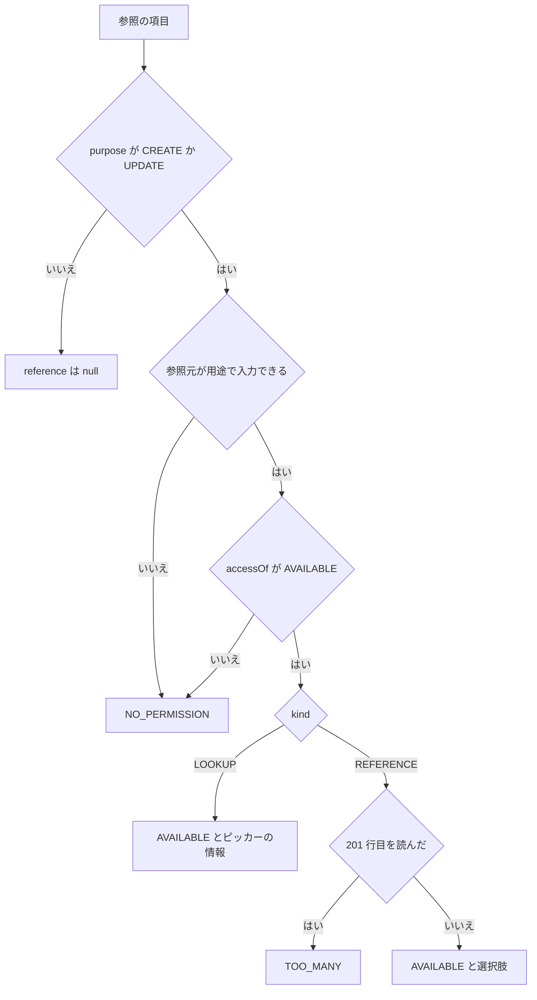
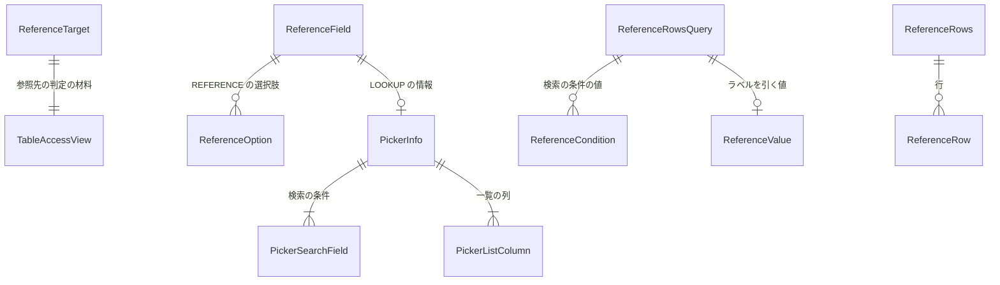

# 振る舞いの仕様 — U1 u1-reference-read

U1 は、業務データの他テーブル参照のうち、サーバー側の読み取りを持つ。(1) 作成・更新の画面の定義に載せる REFERENCE の選択肢、(2) LOOKUP のピッカーの検索とラベルの1件読み、(3) U2 が保存の前に呼ぶ確かめの口、と、それらの権限・上限・接続・漏えいの守りである。流れ（手順の順）はこの文書を正とする。データの形は `entities.md`、判定の中身は `rules.md` の YAML を正とし、この文書の ER の図と決まりの要約はそこから作った写しである。

出典: 単位 `aidlc/spaces/default/intents/261029-reference-lookup-cleanup/inception/units-generation/unit-of-work.md`・`unit-of-work-story-map.md`、要件 `inception/requirements-analysis/requirements.md`、ストーリー `inception/user-stories/stories.md`、部品と ADR `inception/domain-design/components.md`・`decisions.md`、契約 `inception/contract-design/contract-summary.md`（C1・C2・C5・C6）、この段の答え `functional-design-questions.md`（Q1〜Q4: A と「決まっていること」）。書く前に既存のコード（`businessdata` の web・domain・service・repository、`targetdb.domain.ReadPurpose`、`dsl.domain.OptionSource`・`LookupSearchItem`・`SearchOperator`）を読んで、名前と形を確かめた。

## 1. この単位が実装するストーリー

ストーリーは `stories.md` の次のものである（`unit-of-work-story-map.md` の U1 の行）。

| ストーリー（`stories.md`） | U1 が持つ部分 |
|---|---|
| US1.1 参照先の選択肢から値を選ぶ | 定義の応答の選択肢（並び・NULL・空・時間切れ・接続の数・3種類の DB）。画面の表示は U3 |
| US1.2 参照先が多すぎるとき、ピッカーへ案内される | 201 行目の判定と TOO_MANY の状態、読む行の上限。案内の文言は U3 |
| US1.3 参照先を読む権限が無いとき、入力不可で値だけ見える | NO_PERMISSION の判定と、選択肢・ピッカーの情報を返さないこと。入力不可の見せ方は U3 |
| US1.4 参照先の読み取りが守られ、値が漏れない | 名前の照合・漏えい・参照先の形・型・境界テスト（全部） |
| US2.1 参照先を検索し、値で1件引く API が権限で守られる | 全部 |
| US2.3 選んだ値のラベルが分かる | ラベルの1件読みの API と、一覧・詳細で読まないこと。表示は U3 |
| US3.4 一覧・詳細は今のとおり値を出し、参照先を読まない | 定義の足し方と一覧・詳細を変えないこと。見た目は U3 |
| US3.5 参照先の読み取りが接続と時間を使いすぎない（横断） | 主の持ち主。読み取りの接続の数・時間の上限。保存前の確かめの分は U2、画面のカバレッジは U3、性能の測定は後の段 |

## 2. API（契約 C2 を、この段の答えで確かめた形）

| API | 道 | 本文（要点） | 成功の応答 |
|---|---|---|---|
| 定義（既存に足す） | `POST /api/tables/definition` | 既存の `schema`・`table`・`definitionId` に、任意の `purpose`（`VIEW`・`CREATE`・`UPDATE`。無ければ `VIEW`）を足す | 既存の定義。`listColumns`・`detailColumns` の各カラムに `reference`（参照の項目で `purpose` が `CREATE`・`UPDATE` のときだけ。ほかは `null`）を足す |
| 参照先の検索とラベル（新規） | `POST /api/tables/reference/rows` | 参照元の `schema`・`table`・`column` と、`conditions`＋`page`（検索）か `value`（ラベルの1件読み）のどちらか一方 | `rows`（`value`・`label`・`cells`）・`page`・`hasNext` |

- 定義の `reference.picker`（LOOKUP で `AVAILABLE` のとき）は `searchFields`（`column`・`displayName`・`operator`・`valueType`）と `listColumns`（`column`・`displayName`・`valueType`）を持つ。`valueType` は既存の `ColumnDefinitionResponse.valueType` と同じ語彙で、画面が入力の種類を選ぶのに使う（BR5.1）。
- ラベルの1件読み（`value` を送ったとき）の成功の応答は、`rows` がちょうど1件（`value`・`label` と、空の `cells`）、`page` は `null`、`hasNext` は `false` である。U3 はこの形（`page: null`・`cells` が空）を前提に読む（BR6.3）。
- 新しい API は「ログインだけ」（`@ApiAccess(AUTHENTICATED)`）に分類し、権限は業務処理の層で判定する（BR11.1）。
- 道は固定で、名前・値・条件はすべて本文で運ぶ（BR10.3）。
- 誤りは既存の Problem Details と `code` の形で、新しい `code` は作らない（BR1.6）。

要求の例（架空の値）:

```json
{ "schema": "sales", "table": "orders", "column": "customer_id",
  "conditions": [ { "column": "name", "value": "山田" } ], "page": 1 }
```

```json
{ "schema": "sales", "table": "orders", "column": "customer_id", "value": "42" }
```

## 3. 判定の順

### 3.1 定義（BR1.1）

| 順 | 判定 | 応答 |
|---|---|---|
| ① | 未認証 | 401 |
| ② | `purpose` が列挙に無い（本文の形） | 400 `VALIDATION_FAILED` |
| ③ | 既存の判定（DSL が無い・DSL に無い名前・参照元のテーブルが NONE） | 既存の 404・404・403 |
| ④ | `purpose` が `VIEW` | 参照先を読まず、`reference` はすべて `null`（BR4.1・BR12.1） |
| ⑤ | 参照の項目ごとに、参照元が用途で入力できるか（BR3.3）→ `accessOf`（BR3.1）→ REFERENCE は読む（BR4）・LOOKUP はピッカーの情報（BR5.1） | 項目の状態（`AVAILABLE`・`NO_PERMISSION`・`TOO_MANY`）。要求は 200 |
| ⑥ | 選択肢の読み取りの失敗・全体の時間の上限の超過 | 定義の取得ごと 503 `TIMEOUT`・503 `UNAVAILABLE`・409 `MISMATCH`（BR1.5・BR8.4） |

### 3.2 参照先の検索とラベル（BR1.2）

| 順 | 判定 | 応答 |
|---|---|---|
| ① | 未認証（停止中を含む） | 401 |
| ② | 本文の形（`schema`・`table`・`column` が無い、`conditions` と `value` の両方・どちらも無い、条件のカラムが無い・重なる、空でない条件の値が無い、値が 1,000 文字を超える、検索で `page` が無いか 1〜1,000,000 の外） | 400 `VALIDATION_FAILED`（`fieldErrors` なし。BR1.4） |
| ③ | DSL が無い、参照元の名前が DSL に無い、参照のカラムでない、参照元が FULL でない、`NO_PERMISSION`、REFERENCE に検索、条件のカラムが `searchFields` に無い、ラベルの値を型として読めない | 403 `ACCESS_DENIED` の同じ応答（BR1.3） |
| ④ | 検索の `EQUALS` の値を型として読めない | 400 `VALIDATION_FAILED`（`fieldErrors` に `INVALID_VALUE`。BR5.6） |
| ⑤ | 対象DB の失敗 | 503 `TIMEOUT`・503 `UNAVAILABLE`・409 `MISMATCH`（BR1.5） |
| ⑥ | ラベルの1件読みで行が無い | 403 の同じ応答（BR6.4） |
| — | 上のどれでもない | 200 |

②を③より前に置くのは、本文の形の誤りが参照先の存在に依らず、名前を推測させないためである（契約 C2 の判定の順）。④は③の後なので、`searchFields` で利用者に見せたカラムの名前しか応答に出ない。

## 4. 流れ

### 4.1 定義の取得（`purpose` が `CREATE`・`UPDATE`）

1. 既存の `TableAccessResolver` が権限の写しを1回だけ取り、参照元の判定の材料（`TableAccessView`）を作る。写しも一緒に返し、取り直さない（BR2.2）。内部DB の接続はここで返す（BR8.3）。
2. 既存の判定（3.1 の ③）で拒否なら返す。
3. 参照元の出すカラムのうち、DSL の options が REFERENCE・LOOKUP のカラムごとに `ReferenceTarget` を作る（BR2.1・BR2.5）。
4. 用途で入力できないカラムは、参照先を読まず `NO_PERMISSION` にする（BR3.3）。
5. 参照先のテーブルの判定の材料を、同じ写しで既存の `TableAccessPolicy` から作り（BR2.2・BR2.3）、`accessOf` で `AVAILABLE`・`NO_PERMISSION` を決める（BR3.1）。
6. LOOKUP で `AVAILABLE` なら、ピッカーの情報（`searchFields`・`listColumns`）を作る。対象DB は読まない（BR5.1）。
7. REFERENCE で `AVAILABLE` の項目が1つ以上あれば、`REFERENCE` の目的で対象DB の読み取りの接続を1回だけ借りる（BR8.1・BR8.2）。注入した時計で全体の締め切りを決める（BR8.4）。
8. その接続の中で、REFERENCE の項目を順に読む（4.2）。同じ参照先は1回だけ読む（BR4.7）。各問い合わせの前に残りの時間を求めて秒に切り上げ、1 秒未満なら流さずに定義の取得ごと 503 `BUSINESS_TARGET_DB_TIMEOUT` にする。そうでなければ、借りた `TargetReadSession` と同じ接続・同じ壊れた印を持ち、`queryTimeoutSeconds` だけを min(`REFERENCE` の上限, 切り上げた残り) に絞った `TargetReadSession` を作って `search` に渡す（BR8.4）。
9. どれかの読み取りが失敗したら、残りを読まず、接続に壊れた印を立てて、定義の取得ごと BR1.5 の応答にする（BR8.5）。
10. 定義の応答のカラムに `reference` を載せ、`formPart` は DSL の値（`lookup` を含む）で返す（BR12.2）。

`purpose` が `VIEW`（本文に無いときを含む）なら 3〜10 を行わず、今と同じ定義に `reference: null` を足しただけで返す（BR12.1）。一覧・詳細の画面はこの形を使う。

### 4.2 REFERENCE の選択肢の読み取り

1. 既存の行の SQL の部品の `search` に、`ReferenceReadSpec`（切らない値のカラム = valueColumn、切る表示の列 = ラベルのカラム、値が NULL の行を除く、固定の並び、件数を数えない、読む行 201、読み飛ばす数 0）を渡す（BR11.2・BR11.4）。
2. 並びはラベルの昇順（NULL は最後）→ 値の昇順 → 参照先の主キーの昇順（BR4.2）。`ReferenceLookup` が純粋な関数でこの並びを作って `ReferenceReadSpec.order` に入れ、`RowSqlBuilder` は既存の `view.orderKeys`（利用者の `sortKey` から作る）の代わりにこれを使う（BR11.4）。
3. 値は主キーと同じ選び方で切らずに読み、ラベルは一覧の上限（100 文字）で切って読む（BR7.3）。既存の型の対応で文字にし、バイナリ・password・NULL のラベルは `null` にする（BR7.2〜BR7.5）。
4. 読んだ行が 201 なら `TOO_MANY`（選択肢なし）。そうでなければ、型つきの値として厳密に同じ値（BR7.6）の 2 行目以降を落として `AVAILABLE` の選択肢にする（BR4.3・BR4.4）。0 行は空の選択肢の `AVAILABLE`（BR4.5）。

### 4.3 LOOKUP のピッカーの検索

1. 本文の形を確かめる（3.2 の ②）。
2. 写しを1回取り、参照元の名前を DSL と照らし、参照元のカラムが LOOKUP で FULL か、`accessOf` が `AVAILABLE` かを確かめる（BR1.3・BR3.1・BR3.3・BR5.2）。
3. 条件のカラムを、その写しで作った `searchFields` と照らす（BR5.3）。値が空の条件は使わない（BR5.4）。
4. `EQUALS` の値を型として読む（BR5.6）。`CONTAINS` は既存の部分一致の書き方で渡す（BR5.5）。
5. `REFERENCE` の目的で読み取りの接続を1回借り、`search` に `ReferenceReadSpec`（切らない値のカラム = valueColumn、切る表示の列 = ラベル・一覧の列、値が NULL の行を除く、固定の並び、件数を数えない、読む行 21、読み飛ばす数 (page-1)×20）を渡す（BR5.7・BR8.6・BR11.4）。
6. 最初の 20 行を `rows`（`value`・`label`・`cells`）にし、21 行目があれば `hasNext` を真にする（BR5.7・BR5.9）。最後のページより後は 0 行・`hasNext` 偽。

### 4.4 ラベルの1件読み

1. 4.3 の 1・2 と同じ（REFERENCE・LOOKUP の両方を受け付ける。BR6.1）。
2. 値を valueColumn の DSL の型に変える。変えられなければ問い合わせずに 403 の同じ応答（BR6.2・BR7.1）。
3. 読み取りの接続を1回借り、`search` に `ReferenceReadSpec`（値の一致の条件、切らない値のカラム = valueColumn、切る表示の列 = ラベル、固定の並び、読む行 1）を渡し、BR5.8 の並びの最初の行を読む（BR6.3）。一致は DB の比べ方に従う（大文字と小文字を区別しない照合では、違う大文字・小文字の行のラベルが返りうる。保存の可否は 4.5 の厳密な一致が決める）。
4. 1行なら `rows` = その1行（`cells` は空）、`page` = `null`、`hasNext` = 偽。0 行なら 403 の同じ応答（BR6.4）。

### 4.5 保存前の確かめの口（契約 C1 の `check` と、足した `countState`。U2 が呼ぶ）

U2 が保存の流れの中で、自分で `REFERENCE` の目的の読み取りの接続を借り、確かめる参照ごとに順に呼ぶ（ADR-003）。U1 はこの2つの口の振る舞いだけを持ち、どの参照を確かめるか・候補が多い必須の項目の拒否・409 と監査への写しは U2 が持つ。

`check`:

1. 参照でないカラム、または `accessOf` が `NO_PERMISSION` なら、問い合わせずに `NOT_FOUND_OR_DENIED`（BR9.2）。
2. 値を valueColumn の型に変えられなければ、問い合わせずに `NOT_FOUND_OR_DENIED`（BR9.3）。
3. 渡された接続で、DB の比べ方で値の一致する行を 200 行まで読む（出すのは切らない valueColumn だけ、固定の並び。まだ行があるかを知るためだけに 201 行目まで読む）。各行の値を型つきの値に変え、要求の値と厳密に比べる（文字は大文字と小文字・末尾の空白を区別し、小数は数として比べ 1.0 は 1 と一致）。1行でも厳密に一致すれば `FOUND`、無ければ `NOT_FOUND_OR_DENIED`（BR9.4・BR7.6）。これで MySQL・MariaDB・PostgreSQL のどれでも同じ結果になる。
4. 対象DB の失敗は `FAILED`（理由 `TIMEOUT`・`UNAVAILABLE`・`MISMATCH`）。時間切れ・断絶では接続に壊れた印を立てる（BR9.5）。
5. 候補の多さ（`TOO_MANY`）は見ない（201 行目は件数の判定に使わない）。値をログ・監査に出さない（BR9.6）。

`countState`:

1. 参照でないカラム、または `accessOf` が `NO_PERMISSION` なら、問い合わせずに `NO_PERMISSION`（BR9.7）。
2. LOOKUP なら問い合わせずに `AVAILABLE`（LOOKUP は件数を数えない）。
3. REFERENCE なら、渡された接続で REFERENCE の選択肢と同じ読み方（値が NULL の行を除く・件数の文を流さない・固定の並び）で 201 行まで読み、201 行目があれば `TOO_MANY`、無ければ `AVAILABLE`。
4. 対象DB の失敗は `FAILED`（理由 `TIMEOUT`・`UNAVAILABLE`・`MISMATCH`）。時間切れ・断絶では接続に壊れた印を立てる。値・ラベルを返さず、ログ・監査に出さない。

```text
check(source: 参照元の判定の材料と写し, column, value: ReferenceValue, session: 読み取りの接続)
  -> FOUND | NOT_FOUND_OR_DENIED | FAILED(TIMEOUT | UNAVAILABLE | MISMATCH)
countState(target: {参照元の判定の材料と写し, column})   ※ 呼び出し側が借りた読み取りの接続を check と同じく一緒に渡す
  -> AVAILABLE | TOO_MANY | NO_PERMISSION | FAILED(TIMEOUT | UNAVAILABLE | MISMATCH)
```

### 4.6 項目の状態の決まり方

参照の項目は保存される状態の移り変わりを持たない。1要求の中で次のように決まる（BR3.3・BR3.1・BR4.3）。



文字による代わり: `purpose` が `VIEW` なら `null`。用途で入力できない、または `accessOf` が `NO_PERMISSION` なら `NO_PERMISSION`。LOOKUP は `AVAILABLE`（ピッカーの情報つき）。REFERENCE は 201 行目があれば `TOO_MANY`、無ければ `AVAILABLE`（選択肢つき）。対象DB の失敗は項目の状態にせず、定義の取得ごと失敗にする。

## 5. 中の部品

| 部品 | 層 | この単位で持つこと |
|---|---|---|
| `ReferenceLookup`（新規。ADR-001） | service | 参照先の特定（BR2）、`accessOf` の呼び出し、選択肢・検索・ラベル・`check`・`countState` の流れ、全体の締め切りと文ごとに絞った `TargetReadSession` の作り直し（BR8.4）、固定の並びの組み立て（BR11.4）。トランザクションを開かない |
| `accessOf`・同じ値を落とす関数・使える条件を選ぶ関数・固定の並びを作る関数・`sameReferenceValue` | domain | 純粋な関数（BR3.1・BR3.2・BR4.4・BR11.4・BR7.6）。jqwik の性質ベースのテストの対象（権限を足しても `AVAILABLE` が `NO_PERMISSION` に変わらない、出力の値に重なりが無い、大文字と小文字・末尾の空白の違いは一致しない など） |
| `TableAccessResolver`（既存） | service | 取った写しを判定の材料と一緒に返す（取り直さない。BR2.2） |
| `RowSqlExecutor`・`RowSqlBuilder`・`RowDialect`（既存。RowSqlGateway） | repository | `search` に `ReferenceReadSpec` を受ける口を足す（切らない値のカラム・切る表示の列・値が NULL の行を除く条件・固定の並び・件数を数えない・読む行・読み飛ばす数。BR11.4）。新しいメソッドは作らない（BR11.2）。文ごとの上限は今までどおり `session.queryTimeoutSeconds()` を読む（変えない） |
| `TargetReadSession`（既存、`targetdb.domain`） | — | 変えない。既存の公開の4引数のコンストラクターで、同じ接続・同じ `brokenMark` のまま上限だけを絞った値を `ReferenceLookup` が作る（BR8.4） |
| `ReadPurpose`（既存、`targetdb.domain`） | — | `REFERENCE` を足す（BR8.1） |
| 定義のコントローラー（既存）と参照先の検索のコントローラー（新規か既存に足すかはコード生成の計画） | web | 本文の形の確かめ（BR1.4）、結果の型から `BusinessException` への写し、値を伏せる型での受け取り |

新しいクラスを作ることは、コード生成の計画に明記して承認を得る（BR11.3）。どの機能に依存してよいかは今のまま（`businessdata` は `role`・`dsl`・`targetdb` に依存してよい）。

## 6. ER の図（`entities.md` から作った写し）



文字による代わり: `ReferenceTarget` は参照先のテーブルの `TableAccessView`（既存）を1つ持つ。`ReferenceField` は REFERENCE の選択肢（0〜200）か LOOKUP のピッカーの情報（0〜1）を持つ。`PickerInfo` は検索の条件と一覧の列を1つ以上ずつ持つ。`ReferenceRowsQuery` は条件の値か、ラベルを引く値を持つ。`ReferenceRows` は行を0〜20持つ。どれも保存しない。

## 7. 決まりの要約（`rules.md` から作った写し）

| 群 | ID | 要点 |
|---|---|---|
| 判定の順と応答 | BR1.1〜BR1.7 | 定義は参照先の権限で 403 にしない。検索 API は 401 → 400（形）→ 403（同じ応答）→ 400（値の型）→ 対象DB → 403（行が無い）。新しい code は作らない。読み取りは監査に残さない |
| 参照先の特定 | BR2.1〜BR2.5 | DSL から引く、写しは1回、名前は DSL で照らす、形で拒否しない、ラベルのカラム |
| 権限 | BR3.1〜BR3.6 | `accessOf`、使える条件、参照元の条件（入力できないカラムは U3 が入力不可の表示を先に出す）、要求ごと、NONE を出さない、名前を載せない |
| 選択肢 | BR4.1〜BR4.8 | CREATE・UPDATE だけ、201 行まで（固定の並び）、TOO_MANY、同じ値は最初だけ（型つきの厳密な一致）、空、項目ごと、同じ参照先は1回、`options` |
| ピッカー | BR5.1〜BR5.9 | 情報（各項目に `valueType`）、LOOKUP だけ、条件の照合、空の条件、エスケープ、値の型、20 件と 21 行目、固定の並び、行の形 |
| ラベル | BR6.1〜BR6.4 | 両方の種類、型で読めなければ 403、最初の1行（DB の比べ方）、行が無ければ 403 |
| 値 | BR7.1〜BR7.6 | 型に先に変える、既存の対応、表示だけを上限で切り値は切らない、バイナリは null、NULL は null、型つきの厳密な一致 |
| 接続と時間 | BR8.1〜BR8.7 | `REFERENCE`、借りるのは1回、内部DB を持たない、全体の上限（秒に切り上げ・1 秒未満は 503・絞った session）、失敗の後は読まない、行の上限、WARN |
| 確かめの口 | BR9.1〜BR9.7 | U2 が呼ぶ `check`（厳密な一致）と `countState`（件数の状態） |
| 漏えい | BR10.1〜BR10.4 | 伏せ字、JDBC のメッセージ、道、誤りの応答 |
| 構造 | BR11.1〜BR11.4 | API の分類、新しい SQL のメソッドを作らない、境界テスト、`ReferenceReadSpec` の中身 |
| 互換 | BR12.1〜BR12.4 | VIEW は今のまま、formPart、足すだけ、一覧・詳細を変えない |

## 8. 契約との差

契約（`contract-summary.md`）は書き換えず、この段で決めた差をここに書く。

| ID | 契約 | この段の決定 | 理由 |
|---|---|---|---|
| D1 | C2 の `ReferenceRowsRequest.page` は `minimum: 0` | ページは 1 から数え、1〜1,000,000 の外は 400 `VALIDATION_FAILED`。最後のページより後は 200 の 0 件（`hasNext` は偽）。読む行はページの先頭＋21 件まで | 既存の一覧（`PageRequest`: 1〜`MAX_PAGE` 1,000,000）の数え方にそろえる（決まっていること、AC2.1.3） |
| D2 | C2 の `formPart` は、`lookup` を `text` に置き換えるのをやめ DSL の値を返す（用途によらない） | `purpose` が `CREATE`・`UPDATE` のときだけ DSL の値（`lookup`）を返し、`VIEW`（既定）では今のまま `text` を返す | 今の画面は `purpose` を送らないため、U3 が入るまでの間に既存の作成・更新の画面へ知らない `formPart` が届かない（NFR7、AC3.4.3、BR12.1・BR12.2） |
| D3 | C1 の `ReferenceCheckResult` は `Found`・`NotFoundOrDenied`・`Unavailable` | `Unavailable` を、理由（`TIMEOUT`・`UNAVAILABLE`・`MISMATCH`）を持つ `FAILED` にした | 対象DB の型の食い違い（409 `BUSINESS_TARGET_DB_MISMATCH`）を、既存の読み取りと同じく U2 が写せるようにする（BR9.5） |
| D4 | C1 の `check` の注記は「RowSqlGateway の `detail` に出すカラムの指定を渡す」 | ラベルの1件読みと `check` は、`detail` ではなく `search`（値の一致の条件・読む行 1）を使う | 既存の `detail` は主キーで引き、2行で「1つに決まらない」を返すが、参照先は主キーでない値で引き、同じ値が2行以上ありうる（Q1: A）。並びの最初の行を読むには並べ替えのある `search` が要る |
| D5 | C2 の定義の 503 だけを挙げる | 選択肢の読み取りで DSL と対象DB の型が食い違ったときは、既存の読み取りと同じ 409 `BUSINESS_TARGET_DB_MISMATCH` で定義の取得ごと失敗にする | 既存の一覧・詳細の写し方にそろえる（BR1.5）。新しい code は作らない |
| D6 | C2 の `searchFields[].operator` は「DSL の SearchOperator の値」 | 使える演算子は `EQUALS` と `CONTAINS`（文字の型だけ）に限り、`RANGE`・`CHOICE`・`IN` の条件はピッカーに出さない | 契約の条件の形（`column` と `value` の1組）で範囲・複数の値を表せない（BR3.2）。承認の場で確かめる |
| D7 | C1 の口は `check` だけ | U2 に向けた2つ目の口 `countState(target)` を足した。呼び出し側が借りた読み取りの接続で、REFERENCE の選択肢と同じ読み方で 201 行まで読み、`AVAILABLE`・`TOO_MANY`・`NO_PERMISSION`・`FAILED(理由)` を返す | U2 が候補の多い必須の項目を拒否するのに、定義と同じ判定を保存の時点で得るため。`check` に件数を混ぜず口を分けた（BR9.6・BR9.7） |
| D8 | C1 の `check` は「値の一致する行があれば Found」 | DB の比べ方で一致する行を 200 行まで（＋あるかを知るだけの1行）読み、型つきの値として厳密に一致する行があるときだけ `FOUND` | MySQL・MariaDB の大文字と小文字を区別しない照合や PAD SPACE で、3種類の DB の結果が割れないようにする（BR9.4・BR7.6） |
| D9 | C2 の `PickerInfo` の `searchFields`・`listColumns` は `column`・`displayName`（・`operator`） | 各項目に `valueType`（既存の `ColumnDefinitionResponse.valueType` と同じ語彙）を足した | 画面が条件の入力の種類と一覧の列の見せ方を選べるようにする（BR5.1） |

## 9. 上流との差

| 上流 | 差 | 扱い |
|---|---|---|
| ADR-006（参照先の形の見立て「値のカラムが単一のカラムのときだけ許す見込み」と切り替え先「DSL の検証で拒否」） | Q1: A で、形では拒否せずそのまま読む形に決めた | 切り替え先は使わない。決めた動作（BR2.4・BR4.4・BR6.3・BR9.4）を明示したテストにする（AC1.4.4） |
| AC3.5.1（「検索（件数とページの 2 文）でも 1」） | 契約 C2 のとおり件数を数えず、文は1つ | 借りる回数が1であることは同じ。文の数は1として確かめる（BR8.2） |
| AC2.1.5（ラベルのカラムは Contract Design で決める） | 契約が機能設計に回し、Q4: A で決めた | BR2.5 |
| AC1.5.2（NOT NULL の空の値の誤り） | U2 の機能設計で決める | U1 は `check` で件数を見ない（BR9.6）。U2 に引き継ぐ |

### 9.1 初版からの変更

この設計の初版から、次の点を変えた（設計の中身の変更。契約との差は 8節の D7〜D9）。

| 点 | 初版 | 今の形 |
|---|---|---|
| 値のカラムの選び方 | 「値は切らない」とだけ書き、既存の一覧の選び方（主キー以外を 100 文字で切る）との対応が無かった | `ReferenceReadSpec` が valueColumn を主キーと同じ選び方で切らずに選び、ラベルと一覧の列だけを `LIST_TEXT_LIMIT` で切る。値が 100 文字を超える参照先の境界のテストを置く（BR7.3・BR11.4） |
| 定義の全体の時間の上限の効かせ方 | 「各問い合わせの上限は min(REFERENCE の上限, 残りの時間)」とだけ書き、置き場と丸めが無かった | `ReferenceLookup` が文ごとに上限だけを絞った `TargetReadSession`（同じ接続・同じ壊れた印）を作って `search` に渡す。残りは秒に切り上げ、1 秒未満なら流さず定義の取得ごと 503 `BUSINESS_TARGET_DB_TIMEOUT`。全体の上限の値は NFR 設計（BR8.4） |
| 並び | 並びの指定を作る場所が無く、既存の `search` は利用者の `sortKey` から並びを作っていた | 固定の並び（ラベル → 値 → 主キー、NULL は最後）を `ReferenceLookup` が作って `ReferenceReadSpec.order` に入れる（BR11.4） |
| `check` の一致 | 値の一致する行を1行読めば `FOUND`（DB の照合順序しだい） | 200 行まで読み、型つきの値の厳密な一致で `FOUND`。3種類の DB で同じ結果（BR9.4・BR7.6） |
| 選択肢の重複の除去 | 文字にした値の文字どおりの一致 | `check` と同じ型つきの値の厳密な一致（BR4.4・BR7.6） |
| U2 への口 | `check` だけ（件数は見ない） | `countState(target)` を足した（BR9.7） |
| ピッカーの情報 | `searchFields`・`listColumns` に型が無かった | 各項目に `valueType` を足した（BR5.1） |
| ラベルの1件読みの応答 | 4.4 にだけ書いていた | API の節（2節）にも `page: null`・`cells` が空を明記した |

## 10. NFR 設計に回すこと

| 論点 | 決める段 | この段で決めたこと |
|---|---|---|
| `REFERENCE` の問い合わせ1回の時間の上限の値 | NFR 設計 | 目的の名前（`REFERENCE`）と、4つの読み取りで共通にすること（BR8.1）。既存の `LIST`・`DETAIL` の既定 5 秒が目安 |
| 定義の取得で参照先を読む全体の時間の上限の値 | NFR 設計 | 全体の上限を置き、超えたら定義の取得ごと 503 `TIMEOUT`。REFERENCE の数には上限を置かない（Q3: A、BR8.4）。仕組みの置き場（`ReferenceLookup` が文ごとに上限を絞った `TargetReadSession` を作る）と丸め（秒に切り上げ、1 秒未満は流さず 503）はこの段で決めた。切り上げのため1文が締め切りを 1 秒未満超えうる幅を、値を決めるときに見込む |
| 性能の測り方（場面・参照先の行数・上限を下げた場面を置くか） | NFR 要件・NFR 設計（測定は Performance Validation） | 読む行の上限（201・21・1）と、件数の文を流さないこと（BR8.6・BR5.7） |
| ラベルの文字数の上限 | NFR 設計で見直してよい | 既存の一覧の上限（`LIST_TEXT_LIMIT`）で切る（BR7.3）。200 件×上限の大きさの見積もりを NFR 設計で確かめる |
| 値（valueColumn）の大きさ | NFR 設計 | 値は切らない（BR7.3）。大きな文字の型を値のカラムにしたときのメモリの見積もりを確かめる |

## 11. ほかの単位への引き継ぎ

- **U2**: `check` と `countState` の入出力（4.5、BR9）。U2 は `REFERENCE` の目的で読み取りの接続を自分で借りて、確かめる参照ごとに同じ接続で順に呼ぶ。`check` は DB の比べ方で一致する行を 200 行まで（＋あるかを知るだけの1行）読み、型つきの値として厳密に一致する行があるときだけ `FOUND` を返す（文字は大文字と小文字・末尾の空白を区別、小数は数として比べ 1.0 は 1 と一致）。それ以外は `NOT_FOUND_OR_DENIED`、`FAILED` は理由（`TIMEOUT`・`UNAVAILABLE`・`MISMATCH`）を保つ。`countState(target)` は選択肢と同じ読み方で 201 行まで読み、`AVAILABLE`・`TOO_MANY`・`NO_PERMISSION`・`FAILED(理由)` を返す。`NOT_FOUND_OR_DENIED` は `REFERENCE_NOT_FOUND`、`FAILED` は理由ごとに既存の code に写す。書き込みの検証の材料は `lookup` を `text` のまま扱う（BR12.2）。
- **U3**: 作成・更新の画面は定義の要求に `purpose`（`CREATE`・`UPDATE`）を付ける。一覧・詳細は付けない。`editableOnCreate`・`editableOnUpdate` が偽のカラムは `reference.status` が `NO_PERMISSION` になる。画面は `reference.status` を見る前にそのカラムの既存の `editableOnCreate`・`editableOnUpdate` を先に確かめ、入力できないカラムには既存の「入力できない」表示を出し、権限の文言を決して出さない（BR3.3）。U3 の設計で、入力できないカラムに権限の文言が出ないことを確かめる項目を置く。`TOO_MANY` は code ではなく状態で届く。ラベルは一覧の上限で切られて届き、切ったことの印は無い。値は切られずに届く（BR7.3）。検索の条件は `EQUALS`・`CONTAINS` だけが届く（D6）。`picker.searchFields`・`picker.listColumns` の各項目には `valueType`（既存の `ColumnDefinitionResponse.valueType` と同じ語彙）が届くので、入力の種類はそれで選ぶ（D9）。ラベルの1件読みの応答は `rows` が1件・`page` が `null`・`cells` が空（2節）。

## 12. 承認の場で確かめたい点

1. D6: ピッカーの条件を `EQUALS`・`CONTAINS` に限り、DSL の `RANGE`・`CHOICE`・`IN` の条件を出さないこと。
2. BR3.1: 値のカラム（valueColumn）がバイナリか password のときは、参照を提供しない（`NO_PERMISSION`）こと。値を文字で渡せないため。
3. BR3.3: 用途で入力できない参照元のカラムは、参照先を読まず `NO_PERMISSION` にすること（U3 は `editableOnCreate`・`editableOnUpdate` を先に確かめ、既存の入力できない表示を出し、権限の文言を出さない）。
4. BR7.3: ラベルを既存の一覧の上限で切り、切ったことの印を返さないこと。

## Sources

- 単位とストーリーの対応: `aidlc/spaces/default/intents/261029-reference-lookup-cleanup/inception/units-generation/unit-of-work.md`・`unit-of-work-story-map.md`
- ストーリー: `aidlc/spaces/default/intents/261029-reference-lookup-cleanup/inception/user-stories/stories.md`（US1.1〜US1.4・US2.1・US2.3・US3.4・US3.5、X1〜X13）
- 要件: `aidlc/spaces/default/intents/261029-reference-lookup-cleanup/inception/requirements-analysis/requirements.md`（FR1〜FR4・NFR1・NFR3・NFR6・NFR7・A1・A2・A7）
- 部品と決定: `aidlc/spaces/default/intents/261029-reference-lookup-cleanup/inception/domain-design/components.md`・`decisions.md`（ADR-001〜ADR-006）
- 契約: `aidlc/spaces/default/intents/261029-reference-lookup-cleanup/inception/contract-design/contract-summary.md`（C1・C2・C5・C6）
- この段の答え: `aidlc/spaces/default/intents/261029-reference-lookup-cleanup/construction/u1-reference-read/functional-design/functional-design-questions.md`（Q1〜Q4: A、決まっていること）
- 既存のコード: `backend/src/main/java/cherry/mastersmith/businessdata/`（`web/BusinessDataReadController`・`ColumnDefinitionResponse`・`DefinitionRequest`・`BusinessDataPaths`、`domain/BusinessDataProblemTypes`・`PageRequest`・`SearchRequestValidator`・`TableAccessView`・`ColumnAccess`、`service/BusinessDataReadService`・`TableAccessResolver`、`repository/RowSqlExecutor`・`RowSqlBuilder`・`RowDialect`・`ColumnValueCodec`）、`targetdb/domain/ReadPurpose`、`dsl/domain/OptionSource`・`LookupSearchItem`・`SearchOperator`
- 書き方の手本: 前の Intent の `aidlc/spaces/default/intents/261016-business-data-views/construction/u1-businessdata-read/functional-design/`

## Assumptions & Open Questions

- [assumption] 参照先の検索 API の道は契約 C2 の仮の名前 `/api/tables/reference/rows` のままとする。
- [assumption] 本文の知らない項目を無視する扱いは、既存の業務データの API の本文の読み方と同じとする（BR1.4、AC2.1.1）。
- 承認の場で確かめたい点は 12節の4つ。NFR 設計に回す値は 10節のとおり。
