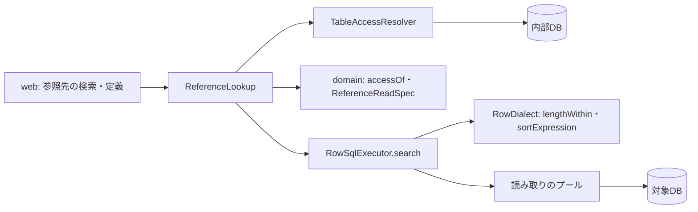

# 論理の部品 — U1 u1-reference-read

この単位の NFR の作りが、どの部品のどこに置かれるかと、失敗の範囲・共有する資源をまとめる。基盤の設計（Infrastructure Design）への橋渡し。

## 出典

- ドメイン設計 `aidlc/spaces/default/intents/261029-reference-lookup-cleanup/inception/domain-design/components.md`（`ReferenceLookup`・RowSqlGateway・BusinessData）
- 契約 `aidlc/spaces/default/intents/261029-reference-lookup-cleanup/inception/contract-design/contract-summary.md`（C1・C2・C5・C6）
- この単位の機能設計 `aidlc/spaces/default/intents/261029-reference-lookup-cleanup/construction/u1-reference-read/functional-design/functional-spec.md`（5節）
- この段の設計 `performance-design.md`・`security-design.md`・`scalability-design.md`・`reliability-design.md`・`observability-design.md` と `trial-results.md`

## 1. 部品と置く NFR の作り

| 部品 | 層・パッケージ | 新規か | 置く作り |
|---|---|---|---|
| 参照先の検索のコントローラー（新規か既存の定義のコントローラーに足すかはコード生成の計画） | `businessdata.web` | 新規の口 | `@ApiAccess(AUTHENTICATED)`、本文の形の確かめ（400 を 403 より前）、伏せる型での受け取り、結果の型から `BusinessException` への写し |
| `RequestBodyLimitRoute` | `businessdata.web` | 既存に道を1つ | 本文 65,536 バイト |
| `ReferenceLookup` | `businessdata.service` | 新規 | 参照先の特定、`accessOf` の呼び出し、全体の締め切り（注入した `Clock`、`referenceReadTotal`）、文ごとに絞った `TargetReadSession` の作り直し、失敗の後に読まない、WARN の1行。トランザクションを開かない |
| `accessOf`・同じ値を落とす関数・使える条件を選ぶ関数・固定の並びを作る関数・`sameReferenceValue`・`ReferenceReadSpec` | `businessdata.domain` | 新規 | 純粋な関数（jqwik の対象）。`ReferenceReadSpec` に値の長さの条件と、並びの項の作り方を足す |
| `TableAccessResolver` | `businessdata.service` | 既存 | 写しを判定の材料と一緒に返す（取り直さない） |
| `RowSqlExecutor`・`RowSqlBuilder` | `businessdata.repository` | 既存に足す | `search` が `ReferenceReadSpec` を受ける。`LIMIT`・`setMaxRows`、`SUBSTRING(…,1,10001)`、長さの条件、並びの項。`prepareStatement` を呼ぶ場所は増やさない |
| `RowDialect`・`MysqlFamilyRowDialect`・`PostgresRowDialect` | `businessdata.repository` | 既存に口を2つ | `lengthWithin`・`sortExpression`（先頭 100 字。F1: A） |
| `RowSqlFailureClassifier` | `businessdata.repository` | 既存のまま | 時間切れ3つの形をすべて `TIMEOUT` に分ける（試しで確かめた） |
| `ReadPurpose` | `targetdb.domain` | 既存に値を1つ | `REFERENCE` |
| `TargetDbProperties` | `targetdb.config` | 既存に値を2つ | `QueryTimeout.reference`（既定 5 秒、`longest()` に入れる）、`referenceReadTotal`（既定 10 秒、1 秒以上） |
| `TargetReadSession` | `targetdb.domain` | 既存のまま | 4引数のコンストラクターで上限だけを絞って作る |

新しい依存（Gradle の依存・npm のパッケージ・コンテナのイメージ）は足さない（NFR9.1）。上の部品はすべて採用済みの部品（HikariCP・3つの JDBC ドライバー・Testcontainers・jqwik・ArchUnit）の上に作る。試しも lockfile と同じ版のドライバーで行った。

新しいクラスと方言の口を足すことは、コード生成の計画に明記して依頼者の承認を得る（BR11.3、`team.md`）。機能の間の依存は今のまま（`businessdata` は `role`・`dsl`・`targetdb` に依存してよい）で、境界テストを緩めない。

## 2. 失敗の範囲

| 失敗 | 範囲 | 他への影響 |
|---|---|---|
| 1つの参照先の読み取りの失敗 | その定義の取得ごと（項目ごとの 503 にしない） | 同じ要求の残りの項目は読まない。ほかの要求には及ばない |
| 対象DB の不調 | 作成・更新の画面の定義の取得とピッカー（契約 C2 の受け入れた制約） | 一覧・詳細は参照先を読まないため、参照の読み取りの失敗では影響を受けない（ただし同じ対象DB の不調は一覧・詳細にも及ぶ） |
| 読み取りのプールの枯渇 | 一覧・詳細・参照の読み取りが同じプールを共有するため、まとめて 503 `UNAVAILABLE` | 1要求1本のため、枯渇は同時の要求の数がプールの上限を超えたときだけ |
| MySQL の並べ替えの領域の不足（1038） | 先頭 100 字で並べる形にして起こさない | 既存の業務データの一覧の並べ替えには残りうる（F2: A。後の段へ） |
| 長い値（2,000,000 字など） | SQL で除くため、アプリのヒープに入らない | — |

## 3. 共有する資源

| 資源 | 共有する相手 | 守り |
|---|---|---|
| 対象DB の読み取りのプール（上限 既定 10） | 業務データの一覧・詳細、DSL の生成・照合 | 1要求1本、借りる待ち 3 秒、内部DB の接続を持ったまま待たない |
| 内部DB の接続のプール | アプリ全体 | 写しの読み取りの後すぐ返す |
| ヒープ | アプリ全体 | 1要求で残る量 約 4〜16 MB（試し 3.9 MB ＋ 写し） |
| 監視（ダッシュボード・警報） | 業務データの API | 既存の式に入る。系列は道1つ分だけ増える |

## 4. 図

文字による代わり: web は `ReferenceLookup` を呼ぶ。`ReferenceLookup` は `TableAccessResolver` で内部DB から写しを1回取り、domain の純粋な関数で判定し、`RowSqlExecutor.search` に `ReferenceReadSpec` を渡す。`RowSqlExecutor` は方言の口で長さの条件と並びの項を作り、読み取りのプールから借りた接続で対象DB を読む。

## 上流との差

| 上流 | 差 | 扱い |
|---|---|---|
| 機能設計 5節（`RowDialect` は変えない書き方） | `RowDialect` に口を2つ足す（`lengthWithin`・`sortExpression`） | NFR2.8（Q1: A）と F1: A のため。新しい SQL のメソッドではなく式を作る口で、BR11.2 に反しない |
| 機能設計 5節（`TargetDbProperties` は `QueryTimeout` に値を足すだけ） | `referenceReadTotal` を足す | Q2: A |

## 後の段に回すこと

- **Infrastructure Design**: 新しい2つの設定の `.env.example`・README の書き方、手元の監視の区画（`observability-design.md`）。
- **Code Generation**: 1節の部品の実装と承認。
- **Feedback & Optimization**（F2: A）: 既存の業務データの一覧で `sortable` にした長い文字のカラムを MySQL で並べると、1038 で 500 になりうる（見立て。一覧そのものでは確かめていない）。
