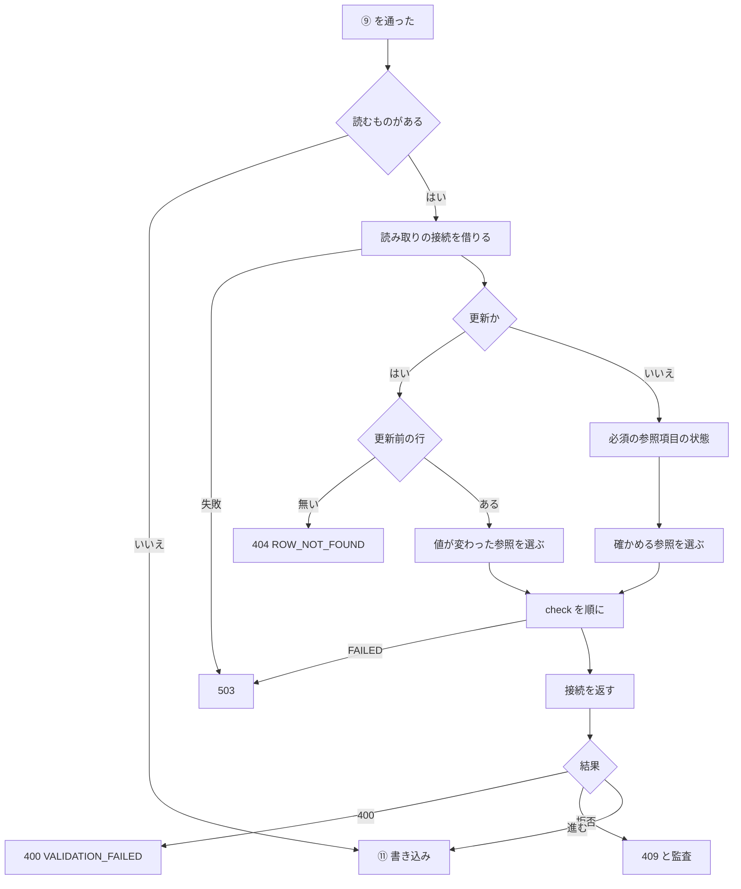
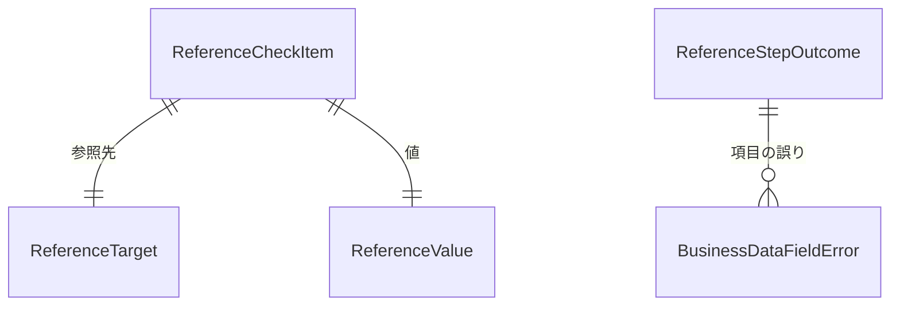

# 振る舞いの仕様 — U2 u2-reference-write-check

出典: 単位 `aidlc/spaces/default/intents/261029-reference-lookup-cleanup/inception/units-generation/unit-of-work.md`、要件 `aidlc/spaces/default/intents/261029-reference-lookup-cleanup/inception/requirements-analysis/requirements.md`（FR3・NFR1・NFR3）、部品 `aidlc/spaces/default/intents/261029-reference-lookup-cleanup/inception/domain-design/components.md`・`decisions.md`、契約 `aidlc/spaces/default/intents/261029-reference-lookup-cleanup/inception/contract-design/contract-summary.md`（C1・C3・C4）、U1 の口 `aidlc/spaces/default/intents/261029-reference-lookup-cleanup/construction/u1-reference-read/functional-design/functional-spec.md`（U2 が使う `check`・`countState`。この文書の 10.1 節に U2 が頼る形を書く）、この段の答え `functional-design-questions.md`（Q1: A・Q2: A）。データの形は `entities.md`、判断の決まりは `rules.md` が正で、この文書は流れ（手順の並び）の正である。

## 1. この単位が実装するストーリー

`aidlc/spaces/default/intents/261029-reference-lookup-cleanup/inception/user-stories/stories.md` の次のストーリーを実装する。

| ストーリー | 範囲 |
|---|---|
| US3.1 作成・更新の保存前に、参照先の存在と権限を確かめる | サーバー側のすべて（AC3.1.7 の画面の表示は U3） |
| US3.2 値が変わった参照だけを確かめる | すべて |
| US3.3 拒否が監査に残り、確かめの読み取りは残らない | すべて |
| US1.5 必須の参照項目に値を入れられないとき、理由が分かる | サーバー側（AC1.5.2〜AC1.5.4）。AC1.5.1 の画面の文言は U3 |
| US3.5（横断） | 保存前の確かめの接続の数と時間の上限を「部分」で持つ（主の持ち主は U1） |

## 2. API

道と本文の形は変えない（契約 C3）。既存の `POST /api/tables/rows`（作成）・`PATCH /api/tables/rows`（更新）の応答に、次の拒否が加わる。削除は変わらない。

| 状態 | code | 項目の誤りの reason | いつ |
|---|---|---|---|
| 409 | `BUSINESS_REFERENCE_NOT_FOUND` | `REFERENCE_NOT_FOUND` | 参照先に無い・読めない（区別しない）。必須の参照項目が読めない・多すぎるのに値を送った |
| 409 | `BUSINESS_REFERENCE_NOT_FOUND` | `NOT_EDITABLE_NOT_NULL` | 作成で、必須の参照項目が読めない・多すぎて、値が空 |
| 400 | `VALIDATION_FAILED` | 既存（`REQUIRED` など） | 必須の参照項目が使えるのに空（保留した既存の誤り） |
| 404 | `BUSINESS_ROW_NOT_FOUND` | — | 更新前の行が無い（参照の拒否より先） |
| 503 | `BUSINESS_TARGET_DB_TIMEOUT`・`BUSINESS_TARGET_DB_UNAVAILABLE` | — | 保存前の読み取りの時間切れ・接続の失敗（保存しない） |
| 409 | `BUSINESS_TARGET_DB_MISMATCH` | — | 保存前の読み取りで型が食い違った |

## 3. 判定の順（BR1.1・BR1.3）

既存の ① 401 → ②③ 404 → ④ 403 → ⑤ 409 定義が古い → ⑥ 409 主キー・ビュー → ⑦ 403 補助権限・FULL → ⑧ 409 書き込みの設定 → ⑨ 400 入力の誤り（必須の参照項目の空の誤りは保留）→ **⑩ 保存前の参照の段** → ⑪ 書き込み（既存）。

⑩ の中: 対象DB の失敗 → 行が無い → 400（保留した誤り）→ 409（参照の拒否をすべて）→ 進む。

## 4. 流れ

### 4.1 作成の保存（BR2.2・BR3・BR4）

1. ①〜⑧ は今のとおり。⑨ で、必須の参照項目（参照のカラム・作成で入力できる・NOT NULL。BR3.1）のうち本文が空（無い・null、または `""` で既存の検証が誤りにしたもの）の誤りを保留する（BR3.6）。`""` が空か値かは既存の検証の結果だけで決まる（BR2.3）。
2. ⑨ にほかの誤りがあれば、対象DB を読まずに 400 を返す。保留した誤りは、`accessOf` が `AVAILABLE` のカラムのものだけ並べる。
3. ⑩ で読むものが無ければ（参照のカラムが本文に無く、必須の参照項目も無い）、接続を借りずに ⑪ へ（BR1.2）。
4. `REFERENCE` の目的で読み取りの接続を1回借りる。借りられなければ 503 UNAVAILABLE（BR4.5）。
5. 必須の参照項目ごとに状態を決める（BR3.2）。REFERENCE は U1 の `countState(target)` に借りた接続を渡す（`NO_PERMISSION` は問い合わせない。使えるときは 201 行目まで読んで `AVAILABLE`・`TOO_MANY`）。同じ参照先は1回だけ呼んで使い回す（BR4.7）。LOOKUP は `accessOf` だけで決める。`FAILED` はその場で止める（BR4.5）。
6. 状態と本文で振り分ける: 読めない・多すぎて値あり → `REFERENCE_NOT_FOUND`、空 → `NOT_EDITABLE_NOT_NULL`、使えて空 → 保留した誤りを戻す、使えて値あり → 確かめに回す（BR3.3〜BR3.5）。
7. 確かめる参照（必須でない参照で NULL でない値のもの＋6. で回したもの）を DSL の並びで、U1 の `check` に順に渡す（BR2.7・BR4.6）。`FOUND` は型つきの値で完全に一致する行があるときだけで、U2 は結果をそのまま使う（BR4.3）。
8. 読み取りの接続を返す。結果を 3 節の順でまとめる。拒否なら監査の出来事を出して応答（BR5.1）。
9. 進むなら書き込みの接続を借り、⑪ を今のとおり行う（BR4.1・BR6.2）。

### 4.2 更新の保存と「値が変わった参照」（BR2.4〜BR2.6）

1. ①〜⑨ は今のとおり（更新には保留が無い）。
2. 本文に NULL でない値の参照のカラムが無ければ、接続を借りずに ⑪ へ（今と同じ）。
3. 読み取りの接続を1回借り、既存の `detail` で主キーの1行を読む。0 行 → 404 `ROW_NOT_FOUND`、2行以上 → `ROW_NOT_UNIQUE`（参照の拒否より先。AC3.2.6）。
4. 本文に入っている参照のカラムごとに、更新前の値と本文の値を型つきの値で比べる（BR2.5）。同じなら確かめない（読めない参照先・宙に浮いた参照でも成功）。違って NULL なら確かめない（BR2.3）。違って値があれば確かめる。
5. 4.1 の 7〜9 と同じ。必須の参照項目の行き止まりは当てない（BR3.7）。

### 4.3 必須の参照項目に値を入れられないとき（Q1: A）

| 状態 | 本文が値（VALUE） | 本文が空（EMPTY） |
|---|---|---|
| NO_PERMISSION | 409 / `REFERENCE_NOT_FOUND`（問い合わせない） | 409 / `NOT_EDITABLE_NOT_NULL` |
| TOO_MANY（REFERENCE だけ） | 409 / `REFERENCE_NOT_FOUND`（値があっても拒否） | 409 / `NOT_EDITABLE_NOT_NULL` |
| AVAILABLE | 通常の確かめ | 保留した既存の誤り（400）。保留した誤りが無いのは本文に無く DSL に REQUIRED も無いときだけで、既存の流れのまま保存へ |

更新で値が変わらなければ成功する（AC1.5.4）。

#### 空文字列 `""` と NULL の期待結果（作成。BR2.3・BR3.1・BR3.5）

`""` の扱いは1つに決める: **既存の書き込みの検証（⑨、`WriteRequestValidator`）の結果にそのまま従う。** ⑨ が誤りにする `""` は「空」、⑨ が通す `""` は「値」で、参照の状態によって変えない。既存の検証では、DSL に REQUIRED があるカラム（NOT NULL から作った DB 由来の必須を含む）の `""` は `REQUIRED`、文字でない型の `""` は `INVALID_VALUE`、文字の型で REQUIRED の無いカラムの `""` は文字の値 `""` になる。

NOT NULL のカラム（必須の参照項目）:

| 本文 | 空か値か | NO_PERMISSION | TOO_MANY | AVAILABLE |
|---|---|---|---|---|
| `""`（REQUIRED あり。DSL の生成の既定） | 空 | 409 / `NOT_EDITABLE_NOT_NULL` | 409 / `NOT_EDITABLE_NOT_NULL` | 400 / `REQUIRED` |
| `""`（文字でない型・REQUIRED なし） | 空 | 409 / `NOT_EDITABLE_NOT_NULL` | 409 / `NOT_EDITABLE_NOT_NULL` | 400 / `INVALID_VALUE` |
| `""`（文字の型・REQUIRED なし） | 値 | 409 / `REFERENCE_NOT_FOUND` | 409 / `REFERENCE_NOT_FOUND` | `check`: 参照先に `""` と完全一致する行があれば保存、無ければ 409 / `REFERENCE_NOT_FOUND` |
| NULL | 空 | 409 / `NOT_EDITABLE_NOT_NULL` | 409 / `NOT_EDITABLE_NOT_NULL` | 400 / `REQUIRED`（REQUIRED あり）・`NOT_NULL`（なし） |
| 本文に無い | 空 | 409 / `NOT_EDITABLE_NOT_NULL` | 409 / `NOT_EDITABLE_NOT_NULL` | 400 / `REQUIRED`（REQUIRED あり）。REQUIRED なしは既存の流れのまま保存へ（DB の NOT NULL 違反の既存の変換） |

NULL を許すカラム（必須の参照項目ではない。U2 は `countState` を呼ばず、件数を読まない。分かれ目は参照先を読めるかだけで、それは `check` の結果にだけ効く）:

| 本文 | 空か値か | 参照先を読めない（NO_PERMISSION） | 参照先を読める（件数は読まない。件数がいくつでも同じ） |
|---|---|---|---|
| `""`（REQUIRED あり） | 空 | 400 / `REQUIRED`（⑨。対象DB を読まない） | 同左 |
| `""`（文字でない型・REQUIRED なし） | 空 | 400 / `INVALID_VALUE`（⑨） | 同左 |
| `""`（文字の型・REQUIRED なし） | 値 | 409 / `REFERENCE_NOT_FOUND`（`check` は問い合わせない） | `check`: 完全一致の行があれば保存、無ければ 409 / `REFERENCE_NOT_FOUND`（件数では拒否しない。D5） |
| NULL | — | 確かめずに保存（REQUIRED ありは 400 / `REQUIRED`） | 同左 |

更新は必須の参照項目の行き止まりを当てず（BR3.7）、`""` は上の NULL を許すカラムの表と同じく ⑨ の結果に従う。値が更新前と同じなら確かめない（BR2.4）。

409 / `NOT_EDITABLE_NOT_NULL` と 409 / `REFERENCE_NOT_FOUND` はどれも code `BUSINESS_REFERENCE_NOT_FOUND` で、field にカラムの名前が入る。

### 4.4 失敗の写し（BR1.4・BR4.4・BR4.5）

| ⑩ の結果 | 拒否 | 応答 | 監査 |
|---|---|---|---|
| `NOT_FOUND_OR_DENIED`・行き止まり | `REFERENCE_NOT_FOUND` | 409 `BUSINESS_REFERENCE_NOT_FOUND`＋項目の誤り | `BUSINESS_REFERENCE_NOT_FOUND` |
| 保留した誤りを戻した | `VALIDATION_FAILED` | 400 | 残さない |
| 更新前の行が無い・2行以上 | `ROW_NOT_FOUND`・`ROW_NOT_UNIQUE` | 404・既存 | 既存の理由 |
| `FAILED(TIMEOUT)` | `TARGET_DB_TIMEOUT` | 503 | 既存の理由 |
| `FAILED(UNAVAILABLE)`・接続を借りられない | `TARGET_DB_UNAVAILABLE` | 503 | 既存の理由 |
| `FAILED(MISMATCH)` | `TARGET_DB_MISMATCH` | 409 | 既存の理由 |

### 4.5 監査（BR5）

拒否の出来事は、読み取りの接続を返した後に既存の `BusinessDataChangedEvent` で出し、既存の聞き手が別の短いトランザクションで追記する。`detail` は作成は空、更新は参照元の主キーだけで、参照先の値・ラベル・本文の参照の値を入れない。確かめの読み取りそのものは残さない。

### 4.6 流れの図（派生の図）

文字による代わり: ⑨ の後、読むものが無ければそのまま書き込む。あれば読み取りの接続を1本借りる（失敗は 503）。更新は更新前の行を読み（無ければ 404）、値が変わった参照を選ぶ。作成は必須の参照項目の状態を決め、確かめる参照を選ぶ。`check` を順に呼び（失敗は 503 か 409 MISMATCH）、接続を返す。保留した誤りがあれば 400、拒否があれば 409 と監査、無ければ書き込みの接続を借りて書き込む。

## 5. 中の部品

| 部品 | 層 | この単位で持つこと |
|---|---|---|
| `BusinessDataWriteService`（既存） | service | ⑩ の段を ⑨ と ⑪ の間に入れる。読み取りの接続の借り方、結果の写し、監査の出し方。トランザクションを開かない |
| `WriteRequestValidator`（既存） | domain | 必須の参照項目の空の誤りの保留（BR3.6）。純粋な関数のまま |
| 値の比べ方（BR2.5） | domain | 純粋な関数。jqwik の性質ベースのテスト（反射・対称、`"007"`/`"7"`、`1.0`/`1`、大文字と小文字） |
| `ReferenceLookup`（U1） | service | `check`（型つきの完全一致の確かめ）と `countState`（必須の参照項目の状態）。U2 は呼ぶだけ（10.1 節） |
| `RowSqlExecutor`（既存） | repository | 更新前の行は既存の `detail`。新しい SQL のメソッドは作らない |

## 6. ER の図（`entities.md` から作った写し）

文字による代わり: 確かめる参照1つは、参照先（U1 の型）と値（U1 の型）を1つずつ持つ。⑩ の結果は項目の誤りを0個以上持つ。`RequiredReferenceState`・`PreviousReferenceValues` は単独の値。どれも保存しない。

## 7. 決まりの要約（`rules.md` から作った写し）

| 群 | ID | 要点 |
|---|---|---|
| 判定の順と応答 | BR1.1〜BR1.4 | ⑩ の位置、借りない場合、⑩ の中の順、既存の code への写し |
| 確かめる参照 | BR2.1〜BR2.7 | DSL から引く、作成はすべて、NULL と空文字列、更新は変わったものだけ、比べ方、更新前の行、すべて並べる |
| 必須の参照項目 | BR3.1〜BR3.7 | 定義、状態、値ありの 409、空の 409、使えるとき、⑨ の保留、更新には当てない |
| 確かめの口と接続 | BR4.1〜BR4.7 | 接続1本で順に、写しは1つ、check の FOUND（型つきの完全一致）、写し、失敗で止める、渡す値、同じ参照先の countState は1回 |
| 監査 | BR5.1〜BR5.3 | 既存の理由、値を入れない、読み取りは残さない |
| 最後の守り | BR6.1〜BR6.2 | 外部キー違反の変換、既存を変えない |
| 漏えい | BR7.1〜BR7.2 | 値を出さない、同じ応答 |

## 8. 契約・上流との差

| ID | 上流 | この段の決定 | 理由 |
|---|---|---|---|
| D1 | C1 の `ReferenceCheckResult`（`Unavailable`） | U1 の D3 の `FAILED`（理由つき）を使い、MISMATCH を 409 に写す | U1 の決定に合わせる |
| D2 | C3 の 400「入力不可の参照の項目の値を変えようとした」 | 400 は参照元のカラムが書けないとき（既存の `NOT_ALLOWED`）だけと読む。参照元は書けて参照先を読めない・多すぎる参照の値は 409 | AC3.1.3・AC1.5.2 と食い違わないため |
| D3 | C3 の判定の順（400 は業務の失敗より前） | 作成の必須の参照項目が使えて空のとき、400 が ⑩（対象DB を読んだ後）で返ることがある | `TOO_MANY` かを読まないと 400 と 409 を分けられないため（BR3.5・BR3.6） |
| D4 | ⑨ の 400 | ⑨ でほかに誤りがあるとき、`TOO_MANY` の必須の参照項目が `REQUIRED` として並ぶことがある | ⑨ の 400 で対象DB に触れない今の決まりを保つため（BR3.6） |
| D5 | X1（入力不可は画面の扱い） | サーバーが件数（`TOO_MANY`）で拒否するのは作成の必須の参照項目だけ。NULL を許す項目の作成と更新では存在と権限だけを確かめる | Q1: A の範囲に限り、保存のたびの件数の読み取りを避ける |
| D6 | 更新の行が無い（今は書き込みの件数 0 で判定） | 参照の値がある更新は、⑩ の更新前の行の読み取りで先に 404 | AC3.2.6 |
| D7 | 契約 C1 の `check`（存在と権限だけ） | U1 の `check` が 200 行まで読んで型つきの完全一致で FOUND を返し、U1 の `countState` が必須の参照項目の状態を返す。U2 はこの2つの口をそのまま使う（BR3.2・BR4.3） | Q2: A と Q1: A。U1 の機能設計も同じ形に直す（10.1 節） |
| D8 | 既存の `NOT_EDITABLE_NOT_NULL`（作成の DB の NOT NULL 違反の写しで field は `""`） | 必須の参照項目の行き止まりでは field にカラムの名前を入れる。同じ reason で field が空とカラム名の2通りになる | 項目の近くに出すため（AC1.5.1）。影響の範囲は 10.3 節 |

## 9. NFR 設計に回すこと

| 論点 | この段で決めたこと |
|---|---|
| ⑩ の時間の上限 | 更新前の行・件数・確かめのすべてに `REFERENCE` の問い合わせ1回の上限を当てる。参照が多いときの ⑩ の全体の上限を置くかは NFR 設計 |
| 必須の参照項目の件数の読み取りの重さ | 作成のたびに REFERENCE の必須の項目の参照先ごとに `countState` で 201 行まで読む。見積もりと k6 の場面（(3) 保存前の確かめつきの作成）で確かめる |
| 同じ参照先の読み取りを束ねるか | `countState` は要求1件の中で参照先ごとに1回にまとめる（BR4.7。U1 の「要求の中で同じ参照先は1回」と同じ考え方を勧める）。値の違う `check` を1つの問い合わせ（IN の条件など）に束ねるか、参照ごとに順に呼ぶかは、問い合わせの回数と読む行の数の実測によるため NFR 設計で決める |
| `check` の読む行の数 | U1 の `check` は照合で当たる行を 200 行まで（＋1 行）読む。一意でない valueColumn での重さは U1 と合わせて NFR 設計で見積もる |
| 接続の数 | 読み取り 0〜1・書き込み 0〜1、待つ間の内部DB 0 を `*ConnectionUsageIT` の形で確かめる（AC3.5.1・AC3.5.2 の部分） |
| すき間の確かめ（AC3.1.6） | 確かめの後・書き込みの前で待ち合わせる差し込み口の置き場（本番のコードを変えない形） |
| ログの目的の値 | ⑩ の WARN の目的の値の名前（`REFERENCE` 系）はコード生成で決める |

## 10. ほかの単位との継ぎ目と引き継ぎ

### 10.1 U2 が使う U1 の口（U1 の機能設計と同じ形）

U2 は U1 の `ReferenceLookup` の次の2つの口を、⑩ で借りた読み取りの接続を渡して呼ぶ。どちらも自分で接続を借りず、値をログ・監査に出さない。U2 は結果を比べ直さず、そのまま写す。

| 口 | 入力 | 読み方 | 出力 |
|---|---|---|---|
| `check` | 権限の写し・参照元のカラム・`ReferenceValue`・読み取りの接続 | 参照先の読む権限が無ければ問い合わせない。値を valueColumn の型に変換できなければ問い合わせない。変換した値に DB の比べ方で当たる行を 200 行まで読む（ほかにもあるかを知るためだけに 1 行多く読む）。各行の valueColumn の値を型つきの値にして、本文の値と完全に一致するかを比べる（文字は大文字と小文字・末尾の空白を区別する。小数は数で比べ、1.0 と 1 は同じ） | 一致する行が1行以上 → `FOUND`。それ以外 → `NOT_FOUND_OR_DENIED`。対象DB の失敗 → `FAILED(TIMEOUT・UNAVAILABLE・MISMATCH)`。MySQL・MariaDB・PostgreSQL で同じ結果 |
| `countState(target)` | 参照先・読み取りの接続（U2 が借りたもの） | REFERENCE の選択肢と同じ読み方（読む権限を先に判定し、valueColumn が NULL でない行を 201 行目まで読む） | `AVAILABLE`・`TOO_MANY`・`NO_PERMISSION`・`FAILED(理由)`。U2 は作成の必須の参照項目の判定（BR3.2）にだけ使う |

照合順序で重なる行（`ABC` と `abc`）があっても、200 行の中に完全一致の行があれば `FOUND` になる。照合で当たる行が 200 行を超え、読んだ中に完全一致が無いときは `NOT_FOUND_OR_DENIED` になる（U1 の読み方に従う既知の限り）。

- **U1（権限の写し）**: 解決の口が返す権限の写しを書き込みの経路でも使う（C6）。

### 10.2 U3 への引き継ぎ

- **U3**: 409 の項目の誤りの reason で文言を出し分ける（`REFERENCE_NOT_FOUND` は存在と権限を区別しない、`NOT_EDITABLE_NOT_NULL` は US1.5 の文言。field はそのカラムの名前で、既存の DB の NOT NULL 違反の `""` と見分けられる）。必須の参照項目の判定は NOT NULL（`nullable` が偽）でそろえる。400 に `TOO_MANY` の項目の `REQUIRED` が並ぶことがある（D4）。503 は「保存されていない」。入力不可の項目は本文に入れない（入れても値が同じなら成功）。

### 10.3 コード生成の計画への引き継ぎ（影響の範囲）

`NOT_EDITABLE_NOT_NULL` は、既存の作成の DB の NOT NULL 違反の写しでは field が `""`、この単位の必須の参照項目の行き止まりでは field がカラムの名前になる（D8）。既存の field が `""` の形は変えず、両方が並んで動くことを、コード生成の計画の影響の範囲に入れる。今の使いどころ（読み取りの検索で洗い出したもの）:

| 場所 | 今の扱い | 計画で確かめること |
|---|---|---|
| `backend/src/main/java/cherry/mastersmith/businessdata/service/BusinessDataWriteService.java`（`notNullError`） | 作成の NOT NULL 違反を field `""` で返す | 変えない。⑩ の行き止まりは別の経路でカラム名を入れる |
| `backend/src/main/java/cherry/mastersmith/businessdata/domain/BusinessDataFieldErrorReason.java` | reason の定義 | 値を足さない |
| `backend/src/test/java/cherry/mastersmith/businessdata/service/BusinessDataWriteServiceTest.java`・`backend/src/test/java/cherry/mastersmith/businessdata/web/AbstractBusinessDataWriteIT.java` | field `""` を確かめる | そのまま通ること。カラム名の場合のテストを足す |
| `frontend/src/features/tables/problemMessage.ts`・`messages.ts`（とそのテスト `problemMessage.test.ts`） | reason の一覧と文言 | field が空なら今の画面全体の文言、カラム名なら項目の近くに US1.5 の文言（U3） |
| `frontend/src/features/tables/BusinessDataFormPage.test.tsx` | field `""` の表示を確かめる | そのまま通ること。カラム名の場合の表示のテストを U3 で足す |

計画の段で、ほかに `NOT_EDITABLE_NOT_NULL` を使うテスト・E2E が無いかを検索で確かめ直す（`project.md` の学び）。

## 11. 承認の場で確かめたい点

1. D3・D4: 必須の参照項目が使えて空のときの 400 が ⑩ で返ること、⑨ の 400 に `TOO_MANY` の項目が `REQUIRED` で並ぶこと。
2. D5: 件数（`TOO_MANY`）による拒否を作成の必須の参照項目だけに当てること。
3. BR2.5: 小数の `1.0` と `1` を同じとし、文字は大文字と小文字・末尾の空白を区別すること。
4. BR2.3: `""` を既存の検証の結果に従わせること（4.3 節の表。文字の型で REQUIRED の無い NOT NULL のカラムでは `""` が値として確かめに回る）。

## Sources

- 単位とストーリーの対応: `aidlc/spaces/default/intents/261029-reference-lookup-cleanup/inception/units-generation/unit-of-work.md`・`unit-of-work-story-map.md`
- 要件: `aidlc/spaces/default/intents/261029-reference-lookup-cleanup/inception/requirements-analysis/requirements.md`（FR3.1〜FR3.4・NFR1・NFR3）
- ストーリー: `aidlc/spaces/default/intents/261029-reference-lookup-cleanup/inception/user-stories/stories.md`（US1.5・US3.1〜US3.3、X1・X9）
- 部品と決定: `aidlc/spaces/default/intents/261029-reference-lookup-cleanup/inception/domain-design/components.md`・`decisions.md`（ADR-003・ADR-005・ADR-006）
- 契約: `aidlc/spaces/default/intents/261029-reference-lookup-cleanup/inception/contract-design/contract-summary.md`（C1・C3〜C6）
- U1 の確かめの口: `aidlc/spaces/default/intents/261029-reference-lookup-cleanup/construction/u1-reference-read/functional-design/functional-spec.md`・`rules.md`
- 既存のコード: `backend/src/main/java/cherry/mastersmith/businessdata/`（`BusinessDataWriteService`・`WriteRequestValidator`・`ColumnWriteRulesFactory`・`WriteRejection`・`BusinessDataAuditReason`・`RowSqlExecutor`・`TypedValue`）、`dslmanage/generate/DslTreeBuilder`（NOT NULL から DB 由来の REQUIRED を作る）

## Assumptions & Open Questions

None.
