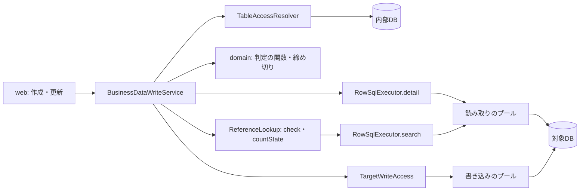

# 論理の部品 — U2 u2-reference-write-check

この単位の NFR の作りが、どの部品のどこに置かれるかと、失敗の範囲・共有する資源をまとめる。基盤の設計（Infrastructure Design）への橋渡し。

## 出典

- ドメイン設計 `aidlc/spaces/default/intents/261029-reference-lookup-cleanup/inception/domain-design/components.md`（BusinessData・`ReferenceLookup`・RowSqlGateway）
- 契約 `aidlc/spaces/default/intents/261029-reference-lookup-cleanup/inception/contract-design/contract-summary.md`（C1・C3・C4・C5・C6）
- この単位の機能設計 `aidlc/spaces/default/intents/261029-reference-lookup-cleanup/construction/u2-reference-write-check/functional-design/functional-spec.md`（5節）
- U1 の NFR 設計 `aidlc/spaces/default/intents/261029-reference-lookup-cleanup/construction/u1-reference-read/nfr-design/logical-components.md`
- この段の設計 `performance-design.md`・`security-design.md`・`scalability-design.md`・`reliability-design.md`・`observability-design.md` と `trial-results.md`

## 1. 部品と置く NFR の作り

| 部品 | 層・パッケージ | 新規か | 置く作り |
|---|---|---|---|
| `BusinessDataWriteService` | `businessdata.service` | 既存に段を足す | ⑨ と書き込みの口の間に ⑩。`TargetReadAccess.withRead(REFERENCE, …)` で読み取りの接続を1回借り、締め切りを決め、文ごとに絞った session で `detail`・`countState`（参照先ごと1回）・`check`（参照ごとに順に）を流し、返してから `withWrite` を呼ぶ。⑩ の失敗の写しと診断の WARN の1行、拒否の監査の出来事。トランザクションを開かない |
| `WriteRequestValidator` | `businessdata.domain` | 既存 | 必須の参照項目の空の誤りの保留（BR3.6）。純粋な関数のまま |
| 判定の純粋な関数（値の比べ方・必須の参照項目の結果・確かめの結果の写し） | `businessdata.domain` | 新規 | jqwik の対象（`security-design.md` 6節） |
| 値を持つ型（`ReferenceCheckItem`・`PreviousReferenceValues`・`ReferenceStepOutcome`） | `businessdata.domain` | 新規 | `toString` で値を伏せる |
| `ReferenceReadDeadline` | `businessdata.domain` | U1 が作る | U1 の定義の取得と ⑩ で共有する。`start(Clock, Duration)`・`narrow(TargetReadSession)`。全体の上限は `TargetReadAccess.referenceReadTotal()` から受ける（設定の扱いは U1 に従う）。更新前の行の `detail` も同じ締め切りで絞る（`reliability-design.md` 1.2） |
| `ReferenceReadFailure`・`ReferenceFailureReason` | `businessdata.domain` | U1 が作る | ⑩ の失敗の写し（3つの理由 → 503・409）と診断の WARN のキーに使う。`detail` の `RowQueryFailure` も `of` で写す（`reliability-design.md` 2節、`observability-design.md` 2.1） |
| `ReferenceLookup`（`check`・`countState`） | `businessdata.service` | U1 | U2 は呼ぶだけ。失敗は `ReferenceCheckResult.Failed(ReferenceReadFailure)`・`ReferenceCountState.Failed(ReferenceReadFailure)` で受ける |
| `RowSqlExecutor` | `businessdata.repository` | 既存 | 更新前の行は既存の `detail`。新しい SQL のメソッドは作らない |
| `TargetReadAccess`・`TargetWriteAccess`・`TargetReadSession` | `targetdb.service`・`targetdb.domain` | 既存（`ReadPurpose.REFERENCE` と `TargetReadAccess.referenceReadTotal()` は U1） | U2 は変えない。`businessdata` は `targetdb.config` に依存できないため、全体の上限は `referenceReadTotal()` だけから受ける |
| `GlobalExceptionHandler` | `common.error.web` | 既存 | 変えない（変換の WARN は既存のまま） |
| テストだけの差し込み口 `PausingTargetWriteAccess`・`PausingWriteAccessConfig` | `src/test` の `businessdata/testsupport` | 新規（テストだけ） | `jdbcTargetWriteAccess` の Bean を包み、`withWrite` の入口で待ち合わせる（`reliability-design.md` 4節） |

- 新しい依存（Gradle の依存・npm のパッケージ・コンテナのイメージ）は足さない（NFR9.21）。試しも lockfile と同じ版のドライバーで行った。
- 機能の間の依存は今のまま（`businessdata` は `role`・`dsl`・`targetdb` に依存してよい）。境界テストと SpotBugs の除外を緩めない。新しいクラスを足すことは、コード生成の計画に明記して依頼者の承認を得る（`team.md`）。

## 2. 失敗の範囲

| 失敗 | 範囲 | 他への影響 |
|---|---|---|
| ⑩ の1つの読み取りの失敗 | その要求の保存ごと（残りを読まず、何も保存しない） | ほかの要求には及ばない |
| 対象DB の不調 | 参照の値を入れる作成・更新が 503 で保存できない | 参照の値を入れない作成・更新・削除は書き込みの接続だけで動く（同じ対象DB の不調そのものは書き込みにも及ぶ） |
| 読み取りのプールの枯渇 | 一覧・詳細・U1 の読み取り・⑩ がまとめて 503 `UNAVAILABLE` | 1要求1本のため、同時の要求の数がプールの上限を超えたときだけ |
| 確かめと保存の間に参照先が消える | 外部キーのある参照先では既存の変換で 409。外部キーの無い参照先では宙に浮いた値が残りうる（既知の制約） | — |

## 3. 共有する資源

| 資源 | 共有する相手 | 守り |
|---|---|---|
| 対象DB の読み取りのプール（既定 10） | 業務データの一覧・詳細、U1、DSL の生成・照合 | 1要求1本、借りる待ち 3 秒、内部DB の接続を持ったまま待たない |
| 対象DB の書き込みのプール（5） | 作成・更新・削除 | 読み取りを返してから借りる。⑩ は持つ時間を増やさない |
| 内部DB の接続のプール | アプリ全体 | 権限の写しの読み取りの後すぐ返す。監査は対象DB の接続を返した後 |
| 設定 `MASTERSMITH_TARGET_DB_REFERENCE_READ_TOTAL` | U1 の定義の取得 | 1つの値で両方の上限を決める（別々には変えられない。Q2: A） |
| 監視（ダッシュボード・警報） | 業務データの API | 既存の式に入る |

## 4. 図

文字による代わり: web は `BusinessDataWriteService` を呼ぶ。業務処理は `TableAccessResolver` で内部DB から写しを1回取り、⑨ の後に読み取りのプールから1本を借りて、締め切りで絞った session で `RowSqlExecutor.detail`（更新）と U1 の `ReferenceLookup` の `countState`・`check`（中で `RowSqlExecutor.search`）を順に流し、返してから `TargetWriteAccess` で書き込みのプールから1本を借りて書く。テストでは `TargetWriteAccess` の Bean を包んで、その入口で待ち合わせる。

## 上流との差

| 上流 | 差 | 扱い |
|---|---|---|
| U1 の機能設計 5節（締め切りは `ReferenceLookup` が持つ） | `businessdata.domain` の `ReferenceReadDeadline` を ⑩ から使う | U1 が同じ段の直しで受け入れた継ぎ目（U1 の `logical-components.md` 5節・`reliability-design.md` 5.1、レビュー R-01）。`reliability-design.md` 1.2 |
| U1 の機能設計 BR9.5（`FAILED` は理由を保つ） | `FAILED` は `ReferenceReadFailure`（理由と `sqlState`・`vendorCode`・`exceptionClass`・`budgetExceeded`）を持つ | 同上（U1 の `reliability-design.md` 5.2）。`observability-design.md` 2.1 |
| 機能設計 `functional-spec.md` 5節（中の部品の表） | テストだけの差し込み口の部品を足した | 本番の部品は変わらない |

## 後の段に回すこと

- **Infrastructure Design**: 新しい設定は無い（U1 の設定を使う）。手元の監視の区画も足さない。
- **Code Generation**: 1節の部品の実装と承認。U1 の `ReferenceReadDeadline`・`ReferenceReadFailure`・`ReferenceFailureReason` と `Failed(ReferenceReadFailure)` の形を、U1 の文書（5節）の名前のまま使う。
