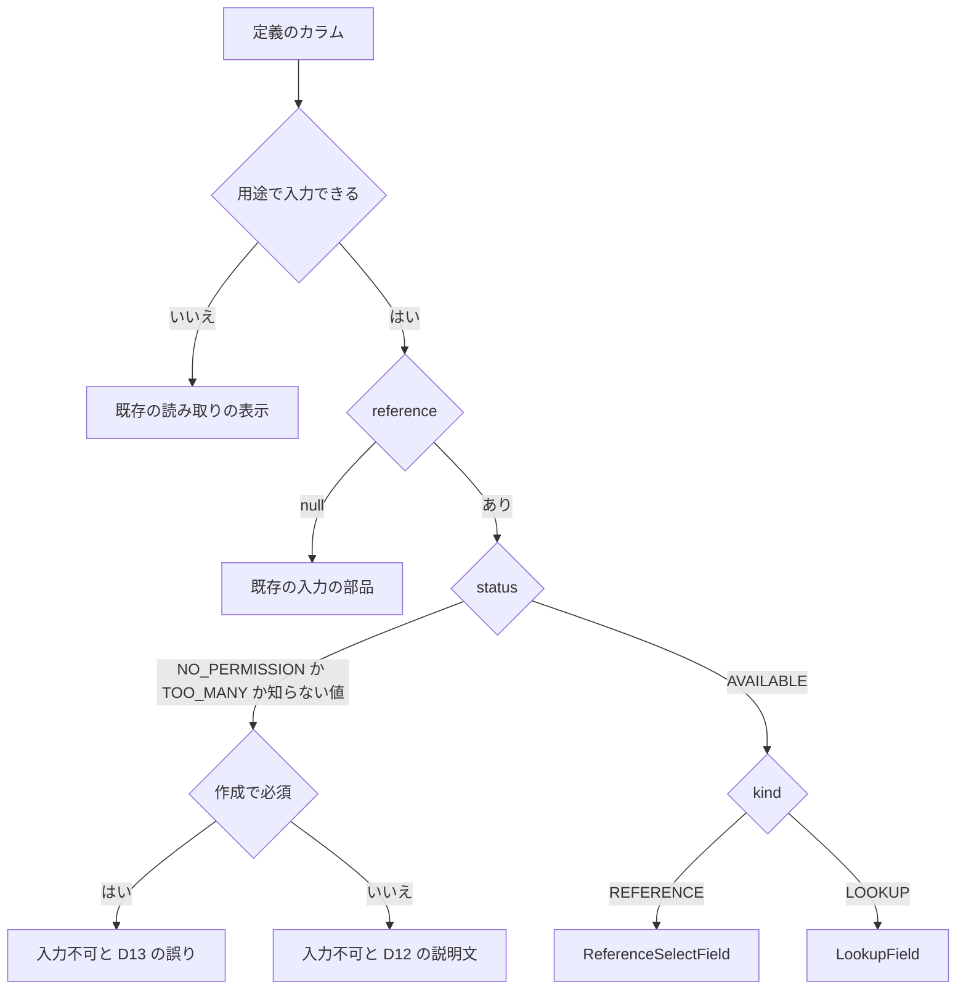
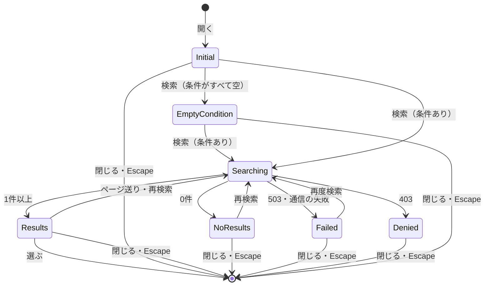

# 機能の仕様 — U3 u3-reference-screens（作成・更新の画面の参照の部品とピッカー）

出典: 単位 `aidlc/spaces/default/intents/261029-reference-lookup-cleanup/inception/units-generation/unit-of-work.md`、要件 `aidlc/spaces/default/intents/261029-reference-lookup-cleanup/inception/requirements-analysis/requirements.md`、部品 `aidlc/spaces/default/intents/261029-reference-lookup-cleanup/inception/domain-design/components.md`（BusinessDataScreens・ApiClient）。

U3 は種類 `ui` の単位で、`entities.md`・`rules.md` を作らない。この文書だけで完結し、画面の振る舞いの決め（D1〜D39）・流れ（F1〜F8）・部品と画面の状態の移り変わりを決める。部品の構成・props・状態・API の受け渡しの型・文言の鍵・テストの計画は `frontend-components.md` に書く。

そのほかの出典（パスは記録 `aidlc/spaces/default/intents/261029-reference-lookup-cleanup/` の下）:
- 質問と答え: `construction/u3-reference-screens/functional-design/functional-design-questions.md`（Q1: A・Q2: A と「決まっていること」）
- 単位とストーリーの対応: `inception/units-generation/unit-of-work-story-map.md`
- ストーリー: `inception/user-stories/stories.md`
- 画面イメージ: `inception/refined-mockups/mockups.md`（M1〜M9）・`interaction-spec.md`・`accessibility-checklist.md`・`design-system-mapping.md`・`refined-mockups-questions.md`
- 契約: `inception/contract-design/contract-summary.md`（C2・C3）
- 依存する単位の機能設計: `construction/u1-reference-read/functional-design/functional-spec.md`（2〜4節・8節の D1〜D6・11節の引き継ぎ）、`construction/u2-reference-write-check/functional-design/functional-spec.md`（2節・4.4節・10節の引き継ぎ）
- 既存のコード（読み取りだけで確かめた）: `frontend/src/features/tables/`（`BusinessDataFormPage.tsx`・`businessDataApi.ts`・`businessDataTypes.ts`・`useTableDefinition.ts`・`problemMessage.ts`・`writeOutcome.ts`・`BusinessDataProblemView.tsx`・`messages.ts`）、`frontend/src/shared/`（`scroll-region`・`null-value`・`validation/codePoints.ts`）、make-you-chic-ui の固定先 `4c63d11` の `Modal`・`Table`・`FormField`・`TextInput`・`Select`・`Alert`・`Button`（`vendor/make-you-chic-ui/packages/make-you-chic-ui/src/components/`）

## 1. 範囲とストーリー

### 1.1 この単位が実装するストーリー

ストーリーは `stories.md` の次のものである（`unit-of-work-story-map.md` の U3 の行）。

| ストーリー（`stories.md`） | U3 が持つ部分 |
|---|---|
| US1.1 参照先の選択肢から値を選ぶ | 選択肢の表示（`select`・`radio`）、保存済みの値、0 件、読み込み中、長い名前・同名、XSS。並び・件数・3種類の DB・接続は U1 |
| US1.2 参照先が多すぎるとき、ピッカーへ案内される | `TOO_MANY` の項目の入力不可と案内の文言。201 件目の判定と読む行の上限は U1 |
| US1.3 参照先を読む権限が無いとき、入力不可で値だけ見える | `NO_PERMISSION` の項目の入力不可の見せ方・説明文・キーボードと読み上げ。判定と漏えいの確かめは U1 |
| US1.5 必須の参照項目に値を入れられないとき、理由が分かる | 作成の画面の項目の誤りの文言と、送らずに止めること。409 の拒否は U2 |
| US2.2 検索ダイアログで参照先を探して選ぶ | 全部（画面だけの基準） |
| US2.3 選んだ値のラベルが分かる | 更新の画面のラベルの表示と、引けないときに値だけを出すこと。ラベルの1件読みの API は U1 |
| US2.4 ピッカーをキーボード・読み上げで使える | 全部 |
| US2.5 参照ピッカーの代表の流れを画面から通せる | 全部（E2E 1本） |

画面側の横断の受け入れ基準（`stories.md` の US3.1 の AC3.1.7、US3.4 の AC3.4.5、US3.5 の画面のテストのカバレッジ）も、この単位の作りで満たす（D31・D34・D37）。それらのストーリーの持ち主は U1・U2 のため、この単位の `traceability.json` には載らない。

### 1.2 範囲に入るもの・入らないもの

- 入るもの:
  - 既存の作成・更新の画面（`BusinessDataFormPage`、S3・S4）に足す参照の部品 4つ（`ReferenceSelectField`・`ReadonlyReferenceField`・`LookupField`・`LookupPickerDialog`）
  - 定義の取得に `purpose` を付けること、参照の項目の写し（`reference`）
  - 参照先の検索とラベルの1件読みの呼び出し（ApiClient の足し）
  - 保存の誤り（409・400・503）の参照の項目への写しと文言
  - 文言（日本語・英語）、画面の部品のテスト、代表の E2E 1本と、axe の E2E
- 入らないもの:
  - サーバーの判定・読み取り・保存前の確かめ（U1・U2）
  - 一覧・詳細の画面（変えない。US3.4。D1）
  - make-you-chic-ui への新しい依頼（出さない。11節）

## 2. 使う API

| API | 道 | 使う画面・部品 | 持ち主 |
|---|---|---|---|
| 定義（既存に `purpose` を足す） | `POST /api/tables/definition` | 作成の画面は `purpose: CREATE`、更新の画面は `purpose: UPDATE`。一覧・詳細は付けない | U1（契約 C2、U1 の D2） |
| 参照先の検索 | `POST /api/tables/reference/rows`（本文に `conditions`＋`page`） | `LookupPickerDialog` | U1 |
| ラベルの1件読み | `POST /api/tables/reference/rows`（本文に `value`） | 更新の画面の `LookupField` | U1 |
| 作成・更新（既存） | `POST /api/tables/rows`・`PATCH /api/tables/rows` | 作成・更新の画面 | U2（契約 C3） |

- 参照元のスキーマ・テーブル・カラム、検索の値、ラベルを引く値は、すべて本文で送る。道（URL）にも問い合わせにも載せない（U1 の BR10.3）。
- 呼び出しは今の ApiClient（`frontend/src/shared/api-client/apiClient.ts` の `apiRequest`）を、既存の `businessDataApi.ts` の `postWithinLimit` を通して使う。応答は `unknown` で受け、形を確かめてから写す（前の Intent の D5 と同じ）。
- U1 の検索 API の応答は `rows`（`value`・`label`・`cells`）・`page`・`hasNext` で、件数を返さない（U1 の BR5.7）。ページは 1 から数え、1 ページ 20 件（U1 の D1）。検索の条件の演算子は `EQUALS`・`CONTAINS` だけが届く（U1 の D6）。

## 3. 画面の振る舞いの決め

### 3.1 定義の取得

| D | 決め | 出典 |
|---|---|---|
| D1 | 作成の画面は定義の要求に `purpose: CREATE`、更新の画面は `purpose: UPDATE` を付ける。一覧・詳細の画面は付けない（今のまま。サーバーは `VIEW` として参照先を読まず、`reference` は `null`、`formPart` は今どおり `text` で返る） | 決まっていること、契約 C2、U1 の D2・BR12.1、AC3.4.2・AC2.3.4 |
| D2 | 作成・更新の画面の定義（`purpose` つき）は、画面を開くたびに読み、機能の中の記憶（一覧・詳細が使う定義の置き場、`businessDataStore`）には書かず、そこからも読まない。選択肢・ラベル（参照先の行の値）は画面の状態にだけ持ち、画面を離れたら捨てる。理由: (1) 一覧・詳細の定義（`VIEW`）と形が違う、(2) 選択肢は参照先の行の値で、画面の外に持ち続けない、(3) 作業ロール・割り当ての変更の後に古い選択肢を出さない（AC1.3.8） | AC1.3.8、`project.md` の Forbidden（行の値）、契約 C2 |
| D3 | 定義の応答のカラムの `reference` を `unknown` から写す。`kind`（`REFERENCE`・`LOOKUP`）・`status`（`AVAILABLE`・`NO_PERMISSION`・`TOO_MANY`）・`options`・`picker` の形を確かめる。`picker.searchFields` と `picker.listColumns` の各項目の `valueType` は、既存のカラムの `valueType` と同じ語彙（`VALUE_TYPES`）として確かめ、語彙に無い値・欠けは既存のカラムの写しと同じく形の崩れにする。`formPart` の型に `lookup` を足す（今は `lookup` を受けない）。形の崩れ（必須の項目が無い・型が違う）は今の定義の写しと同じく通信の失敗にする。ただし、知らない `status` の値は安全側に倒して `NO_PERMISSION` と同じ入力不可（説明文は権限不足）にし、知らない `kind` は参照でない入力として扱わず同じく入力不可にする（足す変更を読み落としても、値を入れさせない。NFR7） | 契約 C2、NFR7、前の Intent の D5 |
| D4 | 作成・更新の画面で定義の取得が失敗したとき（503 `BUSINESS_TARGET_DB_TIMEOUT`・`BUSINESS_TARGET_DB_UNAVAILABLE`、409 `BUSINESS_TARGET_DB_MISMATCH` など）は、既存の「開けない・つながらない」の表示（`BusinessDataProblemView`。誤りの文・「もう一度」・一覧へ戻る道）を出し、フォームは出さない。参照の読み取りが原因かどうかは画面で見分けず、文言も分けない。新しい部品・文言は足さない | Q1: A、AC1.1.4、契約 C2 の Open question |

### 3.2 部品の選び方

| D | 決め | 出典 |
|---|---|---|
| D5 | カラムごとに、次の順で表示を決める（上から最初に当たるもの）。 1. その画面の用途（作成・更新）で入力できないカラム（`editableOnCreate`・`editableOnUpdate` が偽、更新で `truncatedColumns` に入るもの）: 既存の読み取りの表示（作成では出さない）。`reference.status` が `NO_PERMISSION` でも権限の文言を出さない 2. `reference` が `null`: 既存の入力の部品（`formPart` に従う） 3. `status` が `NO_PERMISSION`・`TOO_MANY`（と D3 の知らない値）: `ReadonlyReferenceField` 4. `kind` が `REFERENCE` で `AVAILABLE`: `ReferenceSelectField`（`formPart` の `select`・`radio`） 5. `kind` が `LOOKUP` で `AVAILABLE`: `LookupField` 部品は定義の応答だけで選び、画面で権限を判定しない。`formPart` が `lookup` で `reference` が `null` の組（届かない形）は D3 の形の崩れとする。 **1 を必ず先に見る（U1 の R-05 の引き継ぎ）**: U1 は、その用途で参照元のカラムを入力できないとき、参照先の権限によらず `reference.status` に `NO_PERMISSION` を返す（U1 の BR3.3）。画面は `status` を見る前に、そのカラムの今の `editableOnCreate`・`editableOnUpdate`（更新では `truncatedColumns` も）を見て、入力できないカラムには既存の「入力できない」の表示（更新は名前と値の `span`、作成は出さない）を出す。こうしたカラムには `ReadonlyReferenceField`・権限の文言（D12 の `NO_PERMISSION`）・D13 の固定の誤りのどれも出さない。保存の誤りの写し（D32）でも同じく、入力できないカラムは既存の文のままにする | 決まっていること、U1 の 11節の引き継ぎ（BR3.3）と R-05 の引き継ぎ、`interaction-spec.md` の共通の決まり、AC1.2.3 |

### 3.3 REFERENCE の選択（M1）

| D | 決め | 出典 |
|---|---|---|
| D6 | 選択肢は `reference.options` から作る（DSL の固定の選択肢 `choices` は使わない）。表示は「ラベル (値)」、ラベルが `null` のときは値だけ。並びはサーバーの並びのまま（画面で並べ直さない）。同じラベルの行も値で見分けられる。ラベル・値は文字として出す | `mockups.md` の 2節、AC1.1.1・AC1.1.2・AC1.1.8・AC1.1.10 |
| D7 | `select` の先頭の「（選ばない）」の扱いは既存の `select` と同じ（必須で値が入っていれば置かない）。`radio` は既存どおり「選ばない」を置かない。長いラベルは `select` ではブラウザの選択肢の一覧で全文が出、`radio` では折り返す | 既存の `FieldInput`、AC1.1.8 |
| D8 | 更新の画面で、保存済みの値が `options` に無いとき（参照先の行が消えた・照合順序の違いなど）は、その値そのものを表示する選択肢を先頭に1つ足し、選ばれた状態で出す（ラベルは付けない）。利用者が変えなければ本文に入らず、ほかの項目の更新を妨げない | AC1.1.3、AC3.2.1（U2） |
| D9 | `AVAILABLE` で `options` が 0 件のときは、「（選ばない）」だけの `select` を出し、説明文「選べる候補がありません」を添える。必須の項目では「この項目は必須のため、候補が入るまで保存できません」を続けて出す。保存を押すと既存の必須の誤り（`REQUIRED`）になる | AC1.1.6 |
| D10 | 選択肢は定義の応答と一緒に届くため、項目ごとの読み込み中は無い。読み込みの間は、既存のとおり画面全体が `aria-busy` で「読み込み中」を出し、フォームの入力を出さない | AC1.1.7、既存の `BusinessDataFormPage` |

### 3.4 入力不可の項目（M2・M3・M7）

| D | 決め | 出典 |
|---|---|---|
| D11 | `ReadonlyReferenceField` は、読み取り専用の `TextInput`（`readOnly`・`aria-readonly`）を `FormField` で包み、説明文を `helperText` に置く（`FormField` が `aria-describedby` で結ぶ）。値は保存されている値そのもの（参照先のラベルは出さない）。作成の画面では空。`disabled` にしないので Tab で止まり、値を読み上げで確かめられる。LOOKUP でも同じ見せ方で、「選ぶ…」「クリア」を出さない。参照先の表の名前は出さない。既存の編集不可の列（名前と値の `span`）は変えず、この形は参照の入力不可の項目だけに使う | Q4: A（画面イメージ）、AC1.3.3・AC1.3.4・AC1.3.6・AC1.3.7、`mockups.md` の 3・4・12節 |
| D12 | 説明文は理由で分ける。 ・`NO_PERMISSION`: 「参照先を読む権限がないため変更できません」 ・`TOO_MANY`: 「候補が多いため選べません。管理者に、検索（ピッカー）への切り替えを依頼してください」（LOOKUP が定義されていないカラムでも行き場のない案内にならない） 色やアイコンだけで示さず、文字で出す | AC1.2.2・AC1.2.4・AC1.3.1・AC1.3.6、Q5: A（画面イメージ） |
| D13 | **作成の画面**で、`ReadonlyReferenceField` の項目が必須（`nullable` が偽。U2 の引き継ぎ）のときは、開いた直後から、その項目の誤り（`FormField` の `error`）として、理由ごとの文を出す。 ・権限: 「必須の参照項目に値を入れられません。参照先を読む権限がないためです。管理者に権限を依頼してください」 ・候補が多い: 「必須の参照項目に値を入れられません。候補が多いためです。管理者に、検索（ピッカー）への切り替えを依頼してください」 この誤りは定義から作る固定の誤りで、開いた直後は誤りのまとめを出さない。保存を押したときは、画面の検証で同じ文の誤りとして誤りのまとめに並べ、まとめへフォーカスを移し、要求を送らない（送信の前に示す）。`FormField` は `error` があると説明文を出さないため、D12 の説明文は併記しない | M1: A、AC1.5.1・AC1.5.3、`mockups.md` の 8節 |
| D14 | **更新の画面**では、必須の項目でも D13 の誤りを出さない。D12 の説明文だけを出す（値は変わらないため更新は成功する） | AC1.5.4、AC3.2.1 |
| D15 | 入力不可の項目の値は、作成・更新の本文に入れない。`ReadonlyReferenceField` は値を変える口を持たず、送る本文を作る関数（既存の `formDiff`）では、入力不可の参照の項目を入力できないカラムと同じに扱う | `interaction-spec.md` の共通の決まり、契約 C3、U2 の引き継ぎ |

### 3.5 LOOKUP の項目（M4）

| D | 決め | 出典 |
|---|---|---|
| D16 | `LookupField` は、読み取り専用の `TextInput`（`readOnly`）に「ラベル (値)」（ラベルが無ければ値、値が空なら空）を出し、右（狭い幅では下）に「選ぶ…」と、NULL を許す項目（`nullable` が偽でなく、必須でない）だけ「クリア」を置く。値が空のときは説明文「検索して選びます」を出す | Q3: A（画面イメージ）、AC2.2.7・AC2.3.1、`mockups.md` の 5節 |
| D17 | ボタンの読み上げの名前は、見える文字で始める（WCAG 2.5.3。axe の `label-content-name-mismatch`）。 ・「選ぶ…」: 「選ぶ…（{項目名}）」／「Select… ({field})」 ・「クリア」: 「クリア（{項目名}）」／「Clear ({field})」 `interaction-spec.md` の「{項目名}を選ぶ」から変えた（9節の差） | WCAG 2.5.3、`project.md` の Forbidden（規則を外さない） |
| D18 | 更新の画面を開いたら、保存済みの値が空でない `LookupField` ごとに、ラベルの1件読み（`value`）を1回呼ぶ。待つ間はその項目に `aria-busy` を立て、欄には値だけを出す。 ・200: ラベルを「ラベル (値)」で出す。この応答は U1 の 4.4 のとおり `rows` が1件（`cells` は空）・`page` が `null`・`hasNext` が偽で届く。検索の写し（`parseReferenceRowPage`。`page` は数）とは別の写し `parseReferenceLabel` で受け、`page`・`hasNext`・`cells` は見ない。`rows` がちょうど1件で、その `value`（文字）・`label`（文字か `null`）の形が正しいことだけを確かめる。`rows` が0件・2件以上・形の崩れは通信の失敗と同じく値だけにする ・403（行が無い・読めない、同じ応答）とそのほかの失敗（503・通信の失敗・写しの失敗）: 値だけを出し、誤りの文は出さない。行が無いことと読めないことを区別しない ラベルの読み取りはフォームの表示・入力・保存を止めない。項目ごとの要求は互いに待たず、画面を離れた後の答えは捨てる。REFERENCE の項目（選択肢にラベルがある）と一覧・詳細ではラベルを読まない | FR2.5、AC2.3.1・AC2.3.2・AC2.3.4、U1 の 4.4 |
| D19 | ダイアログで行を選んだら、値（`row.value`）を入力の値にし、ラベル（`row.label`）を画面の状態に持って表示する（D16）。「クリア」は値を空にしてラベルを消し、フォーカスを欄へ移す。どちらも変更として扱う（未保存の確かめの対象） | AC2.2.3・AC2.2.7 |
| D20 | 保存中は「選ぶ…」「クリア」を押せなくする（ピッカーを開けない） | `interaction-spec.md` の「離れるときの確かめ・保存中」 |

### 3.6 ピッカーのダイアログ（M5）

| D | 決め | 出典 |
|---|---|---|
| D21 | ダイアログは make-you-chic-ui の `Modal`（`size="lg"`・`closeOnBackdropClick={false}`・`closeLabel`「閉じる」／「Close」）。見出しは「{項目名}を選ぶ」／「Select {field}」。開いたら最初の検索条件の入力へ（`initialFocusRef`）、閉じたら「選ぶ…」へ（`finalFocusRef`）フォーカスを移す。Escape と「閉じる」で閉じ、背景のクリックでは閉じない。フォーカスは中に閉じ込められる（`Modal` の標準の動作）。開くたびに、条件・結果・ページを空の初期の状態から始める（前に開いたときの参照先の行の値を持ち越さない） | Q1: A・Q2: A（画面イメージ）、AC2.2.8・AC2.4.1・AC2.4.2・AC2.4.3 |
| D22 | 検索の条件は、`picker.searchFields` の1件ごとに `TextInput` を1つ置く。ラベルは「{表示名}（一致）」「{表示名}（部分一致）」（英語は「{name} (equals)」「{name} (contains)」）。演算子を選ぶ部品は置かない。入力の部品は、各 `searchFields` の `valueType`（U1 が足す。既存のカラムの `valueType` と同じ語彙）から、既存の作成・更新の画面（`FieldInput`）が同じ `valueType` のカラムに選ぶ入力にそろえて決める。 ・`INTEGER`: `type="number"`（既存の `number` の部品） ・`BIG_INTEGER`・`DECIMAL`: `type="text"`・`inputMode="decimal"` と既存の数の説明文（`tables.form.numberHint`。既存の桁の多い数の扱い） ・`DATE`: `type="date"` と既存の日付の説明文（`tables.form.dateHint`） ・`DATETIME`・`DATETIME_TZ`: `type="datetime-local"`・`step=1`。`DATETIME_TZ` は既存の UTC の説明文（`tables.form.utc`）を添える ・`BOOLEAN`: 既存の作成・更新の画面はチェックボックス・スイッチで「条件なし」を表せないため、既存の一覧の検索（`SearchPanel`）と同じく「（指定しない）」・真・偽の `Select` にする ・`STRING`・`TIME`・`TIME_TZ`・`BINARY`・`OTHER`: `type="text"`（既存の作成・更新の画面と同じ） ・演算子が `CONTAINS` の条件は、`valueType` によらず `type="text"`（部分一致は文字で探す） 送る値の書き方は、既存の一覧の検索の条件の組み立て（`searchConditions.ts`）と同じにする（サーバーで同じ型の読み方に渡るため）。条件と「検索」は1つの `<form>` に入れ、Enter で検索する | 決まっていること（入力の型は `valueType` から）、U1 の D6 と R-04 の引き継ぎ（`searchFields`・`listColumns` の `valueType`）、AC2.2.1・AC2.4.1 |
| D23 | 「検索」を押したときの画面の確かめ: ・値が空の文字の条件は送らない（サーバーの BR5.4 と同じ読み。空白だけは空とみなさない） ・すべて空: 要求を送らず、「条件を入れてください」（`role="status"`）を条件の近くに出す。0 件の文言と混ぜない ・値が 1,000 文字（コードポイント）を超える: 要求を送らず、その条件の誤り「1,000 文字以内で入れてください」を出す ・`EQUALS` の値が `valueType` として読めない（既存の一覧の検索と同じ `isReadableAs` で確かめる）: 要求を送らず、その条件の誤り「この条件には、この形の値を入れられません」を出す（D27 の 400 と同じ文） サーバーの判定を正とし、画面の確かめは要求を減らすためのもの | AC2.2.5、AC2.1.4・AC2.1.6（U1）、FR2.6 |
| D24 | 検索中は「検索中」（`role="status"`）を出し、「検索」を押せなくする（`Button` の `loading`）。要求ごとに世代を付け、古い答え・閉じた後の答えは捨てる。`Table` のページ送りにはボタンを押せなくする口が無いため、検索中の押下は捨てる（前の Intent の D14 と同じ手当て） | AC2.2.6 |
| D25 | 結果は `Table` に出し、`frontend/src/shared/scroll-region` の枠（`role="region"`・名前「{項目名}の検索結果」・`tabIndex=0`）で包む。`Table` の `aria-label` も同じ名前にする。 ・列: 1列目に「選ぶ」（Q2: A。幅によらず固定）、続けて `picker.listColumns` の順（見出しは表示名）。セルは文字で、`null` は既存の `NullValue`（「（値なし）」） ・列の鍵は `select`・`c0`〜、`getRowId` はページの中の番号 `r0`〜`r19`（行の値を `data-testid` に載せない） ・列の `valueType`（U1 が `listColumns` の各項目に足す）は D3 の形の確かめに使い、セルの表示は文字のまま（書式を付けない）にする ・ページ送り: `Table` は件数（`totalCount`）を要るが U1 は件数を返さないため、行が1件以上のページでは `totalCount` に「(page−1)×20＋行の数（`hasNext` なら＋1）」を渡して「次へ」の可否を合わせ（`Table` の総ページ `max(1, ceil(totalCount/20))` が、続きがあれば page＋1、無ければ page になる）、`labels.pageStatus` を件数を言わない文「{page} ページ目（続きがあります）」／「{page} ページ目（ここまで）」に差し替える。前へ・次への文言も日英で渡す ・件数の変化の知らせ（`aria-live="polite"`）: 「{from}〜{to} 件目を表示しています。続きがあります」／「{from}〜{to} 件目を表示しています。これで最後です」 ・長い名前は CSS で折り返し、全文を DOM に残す | Q2: A、AC2.2.2・AC2.2.10・AC2.4.3、U1 の BR5.7、`design-system-mapping.md` |
| D26 | 1ページ目で 0 件: 「該当する行がありません」（`role="status"`）。初期の案内（「条件を入れて『検索』を押してください」、`role="status"`）・空の条件の文と別の文。2ページ目以降で 0 件（ページの間に行が減った）: `Table` を描かず（ページ送りも出さない）、「このページには行がありません」（`role="status"`）と、`Button`「前のページへ」だけを出す。押すと同じ条件で page−1 を読む（D24 の検索中・世代の扱いは同じ）。1ページ目の 0 件でも `Table` は描かない。 理由: `Table`（固定先 `4c63d11` の `Table.tsx`・`tableLogic.ts`）は総ページを `max(1, ceil(totalCount/pageSize))` で求め、件数の文を `totalCount` が 0 のとき `emptyStatus`、そうでなければ `pageStatus(page, totalPages, totalCount)` で出し、「次へ」を `page >= totalPages` で押せなくする。0 件の後ろのページで D25 の式を使うと `totalCount` が (page−1)×20 となり、総ページが今のページより小さい組（例: 3 ページ目に総ページ 2）を渡すことになる。`Table` はこの組を想定した口を持たず、件数の文と前後の可否が今のページと食い違いうるため、この場合は `Table` を使わない | AC2.2.1・AC2.2.4、R-02 の決め |
| D27 | 検索の失敗は、入れた条件を保ったまま、ダイアログの中に出す（フォームの誤りのまとめには入れない）。 ・503（`BUSINESS_TARGET_DB_TIMEOUT`・`UNAVAILABLE`）・通信の失敗・知らない失敗: 「検索できませんでした。もう一度検索してください」（`role="alert"`）と「再度検索」 ・400 `VALIDATION_FAILED` で `fieldErrors` に条件のカラムがある（`EQUALS` の値を型として読めない、U1 の BR5.6）: その条件の誤り「この条件には、この形の値を入れられません」 ・403（同じ応答。開いた後に権限・割り当て・DSL が変わった）: 「この項目の候補を検索できません。画面を開き直してください」（`role="alert"`）。「再度検索」は出さない ・409 `BUSINESS_TARGET_DB_MISMATCH`: 既存の文（`tables.problem.mismatch`） DB の文・内部の語・参照先の名前は出さない | AC2.2.6・AC2.2.11、U1 の 3.2 |
| D28 | 「選ぶ」は行ごとの `Button`（見える文字「選ぶ」／「Select」）。読み上げの名前は「{行のラベル}を選ぶ」／「Select {label}」で、行のラベルは `row.label`（U1 の Q4: A。DSL の `labelColumn`、無ければ `lookupList` の最初のカラム）、`null` なら `row.value`。押すとダイアログを閉じ、D19 の値とラベルを入れる。選べるのは1行だけ（`Table` の行の選択の口は使わない） | Q2: A、決まっていること、AC2.2.3・AC2.4.3 |
| D29 | 選ばずに閉じたとき（「閉じる」・Escape）は、入力の値とラベルを変えない。検索中なら答えを捨てる | AC2.2.8 |
| D30 | 375px の幅では、ダイアログを画面の幅に収め（`Modal` の `lg` は `width: 100%`・`max-width: 720px`）、条件を縦に並べ、表は D25 の枠の中だけで横にスクロールする。画面全体は横にスクロールしない。「選ぶ」は1列目のため、横にスクロールしなくても見える | Q2: A、Q6: A（画面イメージ）、AC2.4.5、`project.md` の学び（固定の部品のはみ出し） |

### 3.7 保存の誤り（M6・M7）

| D | 決め | 出典 |
|---|---|---|
| D31 | 409 `BUSINESS_REFERENCE_NOT_FOUND` の項目の誤りで `reason` が `REFERENCE_NOT_FOUND` のときは、その参照の項目（`ReferenceSelectField`・`LookupField`）に「選べない値です。選び直してください」を出す。参照先に無い値と読めない値を区別しない。既存の誤りのまとめ（`role="alert"`）へフォーカスを移し、項目は `aria-invalid`・`aria-describedby` で結ぶ（既存の D22）。入力した値は消さない。この文は既存の鍵 `tables.error.REFERENCE_NOT_FOUND` の文を差し替えて作る（外部キー違反の変換の誤りも同じ文になる） | 決まっていること、AC3.1.7（U2 のストーリー）、`mockups.md` の 7・12節 |
| D32 | 項目の誤りの `reason` が `NOT_EDITABLE_NOT_NULL` か `REQUIRED` で、その項目が `ReadonlyReferenceField`（その用途で入力できるカラムで、定義の状態が `NO_PERMISSION`・`TOO_MANY`。D5 の 1 に当たるカラムは含めない）のときは、D13 の理由ごとの文を出す。U2 の 400 に、`TOO_MANY` の必須の項目が `REQUIRED` として並ぶとき（U2 の D4）も同じ。そのほかのカラムの `NOT_EDITABLE_NOT_NULL`・`REQUIRED` は既存の文のまま。入力不可の項目も誤りを結べる項目に含める（誤りのまとめのボタンでその欄へ移れる） | 決まっていること、U2 の 10節の引き継ぎ、AC1.5.1 |
| D33 | 保存の 503 は既存の分け方のまま扱う。 ・`BUSINESS_TARGET_DB_UNAVAILABLE`: 「保存されていません。時間をおいてやり直してください」（既存） ・`BUSINESS_TARGET_DB_TIMEOUT`: 既存の「保存されたか分からない」の表示のまま。同じ code が確定（COMMIT）の時間切れ（保存されたかもしれない）にも使われ、画面では保存前の確かめの時間切れと見分けられないため、安全側に倒す（9節の差。12節で確かめる） ・409 `BUSINESS_TARGET_DB_MISMATCH`: 既存のまま | 決まっていること（503 は保存されていない）、U2 の 4.4、既存の `writeOutcome.ts` |

### 3.8 値の扱いと切り替え

| D | 決め | 出典 |
|---|---|---|
| D34 | 参照先の行の値（選択肢の値・ラベル、検索の値、検索の結果のセル、選んだ行のラベル）は、`data-testid`・DOM の `id`・`document.title`・`console`・ブラウザの保存（`localStorage` など）・道（URL）・履歴の状態に入れない。描くときは文字として描き、`dangerouslySetInnerHTML` を使わず、`href` にしない。テストの印は位置の番号（`c<n>`・`r<n>`）だけで作る。入力不可の見た目（D11）は作成・更新の画面の部品だけに置き、一覧・詳細の部品は変えない | 決まっていること、AC1.1.10・AC2.2.9・AC2.3.3・AC3.4.5、`project.md` の Forbidden |
| D35 | 作業ロールを切り替えたときは既存のとおり一覧へ移る（前の Intent の D2）。割り当て・DSL の変更の後は、次に作成・更新の画面を開いたときの定義の取得（D2: 毎回読む）で、選択肢・ピッカーの出し分けが切り替わる。保存の 409 `BUSINESS_DEFINITION_CHANGED` などで定義を読み直すとき（既存の F6）も `purpose` を付け、選択肢・ピッカーの情報を取り直す。読み直しの後も入力できる参照の項目の値は残し、入力不可に変わった項目の入力は捨てる（既存の F6 の扱い） | AC1.3.8、既存の F6 |
| D36 | 文言は日本語と英語の両方を `features/tables` の文言（`messages.ts`）に足し、既定は日本語。前提の6つの文言（権限なし・件数が多い・0 件・検索中・検索の失敗・選択済みを消す）を必ず両方に置く。鍵の一覧は `frontend-components.md` の 5節 | AC2.4.6、FR2.7、`stories.md` の前提 |

### 3.9 置き場と確かめ

| D | 決め | 出典 |
|---|---|---|
| D37 | 4つの部品と、純粋な関数（部品の選び方 D5・選択肢の表示の文 D6・検索の条件の組み立て D23・ページの表示の文 D25・誤りの文の選び方 D32）は `features/tables` に置く。ほかの機能が使うまで `src/shared/` へ移さない（`design-system-mapping.md`）。画面の部品ごとに vitest-axe の検査を1件入れ、描画の後の効果で出る値は `waitFor` で待つ。純粋な関数に fast-check の性質ベースのテストを当てる（例: 部品の選び方は `AVAILABLE` 以外で入力の部品を返さない、その用途で入力できないカラムでは `status` によらず既存の読み取りの表示を返し権限の文言の部品を返さない、ページの表示は 2ページ目以降の 0 件で `Table` を使わず「前のページへ」だけを返す、組み立てた条件に空の値が入らない、`<`・`"`・`'` を含む値も文字のまま返る）。XSS の fixture（`<script>`・``・`"`・`'`・`javascript:`）を選択肢・ダイアログ・ラベルの3つのテストで共有する | `team.md` の Testing Posture、AC1.1.10・AC2.2.9・AC2.3.3・AC2.4.1・AC2.5.4 |
| D38 | E2E は次のとおり。 ・参照ピッカーの代表の流れを1本足す（`frontend/e2e/190-reference-picker-flow.e2e.ts`。F8） ・axe の E2E（流れではないため本数に数えない）: ピッカーを開いた状態・結果の一覧・0 件・検索の失敗・入力不可（権限不足・候補が多い）・誤りの状態・長い名前（100 文字以上、`<` を含む）・2語以上の現実に近いデータを、ブランドカラーとテーマのすべての組で、375px の幅を含めて流す。検索の失敗・入力不可・権限不足の状態は API の答えを差し替えて作り、差し替えの見本の形を本物の応答と比べる（`project.md` の学び）。開いたダイアログが画面の中に収まり、画面全体が横にスクロールしないことを確かめる ・権限を欠く利用者の確かめは E2E でなく、結合テスト（U1・U2）と画面の部品のテスト（入力不可・値だけの表示・理由の表示を1件）で行う | `team.md` の Testing Posture、AC2.4.4・AC2.4.5・AC2.5.1〜AC2.5.4 |
| D39 | E2E の前提の対象DB の表（参照先の顧客・商品と、参照元の注文。架空の値）は、既存の業務データの E2E の専用のスキーマの作り方（`./gradlew e2eTest` が作るスキーマと `frontend/e2e/support/businessDataSchema.sql`）に足す。DSL は E2E 180 と 190 で共有する見本（`frontend/e2e/support/` に置く1つの DSL）に参照の表を足し、190 は流れ（画面の操作）の前の API の準備で、その DSL が適用されていなければ投入・適用する。画面の流れの中では DSL を適用し直さない。初期管理者・見本の行・見本の DSL は変えない | AC2.5.2、既存の E2E 180 の作り方 |

## 4. 流れ

### F1 作成の画面を開く

1. 定義を `purpose: CREATE` で読む（D1・D2）。読む間は画面全体が「読み込み中」（D10）。
2. 失敗したら「開けない・つながらない」の表示にし、フォームを出さない（D4）。
3. 成功したら、カラムごとに D5 で部品を選んでフォームを作る。
4. 必須の入力不可の参照の項目には、開いた直後から D13 の誤りを項目の近くに出す（誤りのまとめは出さない）。
5. フォーカスは既存どおり見出しへ移す。

### F2 更新の画面を開く

1. 定義を `purpose: UPDATE` で読み、既存どおり詳細の API で今の値を読む。
2. どちらかが失敗したら、既存の「開けない・つながらない」の表示（D4）。
3. REFERENCE の項目は保存済みの値を選ばれた状態で出す。`options` に無ければ値だけの選択肢を足す（D8）。
4. 入力不可の項目は保存済みの値と説明文を出す（D11・D12・D14）。
5. 値が空でない LOOKUP の項目ごとに、ラベルの1件読みを呼ぶ（D18）。答えが来るまで値だけを出し、来たら「ラベル (値)」にする。失敗は値だけのまま。

### F3 REFERENCE の値を選ぶ

1. 利用者が `select`・`radio` で選ぶ（ネイティブのキーボード操作）。
2. 値が変わり、変更として扱う（既存の未保存の確かめ）。
3. 離れたときに既存の画面の検証（必須など）を当てる。

### F4 LOOKUP のピッカーで選ぶ

1. 「選ぶ…」を押す（Enter・Space）。ダイアログが初期の状態で開き、最初の条件へフォーカスが移る（D21）。
2. 条件を入れて Enter か「検索」。D23 の確かめに通らなければ送らない。
3. 検索中の表示（D24）。答えが来たら、結果（D25）・0 件（D26）・失敗（D27）のどれかにする。
4. 「次へ」「前へ」で同じ条件のまま別のページを読む（3 と同じ）。
5. 行の「選ぶ」を押すと、ダイアログが閉じ、値とラベルが入り、フォーカスが「選ぶ…」へ戻る（D19・D28）。
6. 「閉じる」・Escape では値を変えずに閉じる（D29）。

### F5 LOOKUP の値を消す

1. NULL を許す項目で「クリア」を押す。
2. 値を空にし、ラベルを消し、フォーカスを欄へ移す（D19）。

### F6 保存する

1. 既存の保存の流れ（変えたカラムだけを本文に入れる。入力不可の参照の項目は入れない。D15）。
2. 画面の検証で誤りがあれば送らない。作成で必須の入力不可の参照の項目があるときは、D13 の文で誤りのまとめに並べ、まとめへフォーカスを移す。
3. 送る。成功は既存どおり（詳細へ移り、Toast）。
4. 409 の参照の誤りは D31・D32、400 は既存の項目の誤り（入力不可の参照の項目は D32）、503・409 MISMATCH は D33。誤りは誤りのまとめへフォーカスを移し、入力した値を消さない。

### F7 定義の取得の失敗・定義が変わった

1. 開くときの失敗は F1・F2 の 2（D4）。「もう一度」で定義をもう一度 `purpose` つきで読む。
2. 保存で定義が変わったと分かったときは、既存の F6 のとおり読み直す（`purpose` つき。D35）。

### F8 代表の E2E の流れ（`190-reference-picker-flow.e2e.ts`）

1. 準備（API）: 自作の利用者と、自作のロール（参照元の注文の表は FULL、参照先の顧客・商品の表は READ）を作って割り当てる。D39 の DSL が適用されていなければ投入・適用する。資格情報はプロセスの環境変数で受ける。
2. 自作の利用者でログインし、メニューから注文の表の作成の画面を開く。
3. 顧客（REFERENCE）の選択肢が出ることを1手確かめ、1つ選ぶ。
4. 商品（LOOKUP）の「選ぶ…」をキーボードで開き、条件を入れて Enter で検索し、キーボードで行の「選ぶ」を押す。
5. 欄に「ラベル (値)」が出ることを確かめ、保存する（Enter）。
6. 作った行の更新の画面を開き、商品の欄に同じラベルが出ることを確かめる。
7. 報告の json を文字列で検索し、資格情報・接続先・トークンの値が入っていないことを確かめる。

## 5. 部品と画面の状態の移り変わり

### 5.1 参照の項目の表示の決まり方（派生の図）

文字による代わり: その用途で入力できないカラムは既存の読み取りの表示。`reference` が無ければ既存の入力の部品。`status` が `NO_PERMISSION`・`TOO_MANY`（知らない値を含む）なら入力不可で、作成の画面の必須の項目は D13 の誤り、そのほかは D12 の説明文。`AVAILABLE` なら REFERENCE は選択、LOOKUP はピッカーの欄。

### 5.2 ピッカーのダイアログの状態

文字による代わり: 開くと初期の状態。条件がすべて空のまま検索すると要求を送らず「条件を入れてください」。条件があれば検索中になり、1件以上なら結果、0件なら「該当する行がありません」（2ページ目以降の 0 件は表を描かず「このページには行がありません」と「前のページへ」。押すと前のページの検索中に戻る。D26）、503 や通信の失敗なら「検索できませんでした」（再度検索できる）、403 なら「検索できません。画面を開き直してください」になる。結果からはページ送りと再検索で検索中に戻る。行を選ぶと値を入れて閉じ、「閉じる」・Escape ではどの状態からも値を変えずに閉じる。条件の値の型の誤り（400）は検索中から初期の状態の見た目に戻し、その条件に誤りを出す（図では省いた）。

### 5.3 LookupField の状態

| 状態 | 見せ方 | 移るきっかけ |
|---|---|---|
| empty | 欄は空、「検索して選びます」 | 値が空（作成の初め・クリアの後） |
| label-loading | 欄は値だけ、`aria-busy` | 更新の画面を開いた直後（D18） |
| selected | 「ラベル (値)」、ラベルが無ければ値 | 選んだ後・ラベルを読めた・読めなかった |
| error | D31 の誤り、まとめへフォーカス | 保存の 409 |

## 6. 表示の対応

### 6.1 定義の参照の項目と表示

| `kind` | `status` | 作成の画面 | 更新の画面 |
|---|---|---|---|
| REFERENCE | AVAILABLE | 選択（D6・D7・D9） | 選択、保存済みの値を選ぶ（D8） |
| REFERENCE | TOO_MANY | 入力不可・空、必須なら D13 の誤り | 入力不可・値、D12 の説明文 |
| REFERENCE・LOOKUP | NO_PERMISSION | 入力不可・空、必須なら D13 の誤り | 入力不可・値、D12 の説明文 |
| LOOKUP | AVAILABLE | ピッカーの欄（D16） | ピッカーの欄、ラベルを1件読む（D18） |

### 6.2 応答と表示

| 場面 | 応答 | 表示 |
|---|---|---|
| 定義の取得 | 503 TIMEOUT・UNAVAILABLE | 「開けない・つながらない」（D4） |
| 定義の取得 | 409 MISMATCH・403・404 | 既存の表示（D4） |
| 検索 | 200 | 結果・0 件（D25・D26） |
| 検索 | 400（条件の値の型） | 条件の誤り（D27） |
| 検索 | 403 | 「検索できません。画面を開き直してください」（D27） |
| 検索 | 503・通信の失敗 | 「検索できませんでした」と「再度検索」（D27） |
| ラベル | 200 | 「ラベル (値)」（D18） |
| ラベル | 403・503・通信の失敗 | 値だけ（D18） |
| 保存 | 409 REFERENCE_NOT_FOUND / `REFERENCE_NOT_FOUND` | 項目に「選べない値です。選び直してください」（D31） |
| 保存 | 409 REFERENCE_NOT_FOUND / `NOT_EDITABLE_NOT_NULL` | 入力不可の参照の項目なら D13 の文、ほかは既存の文（D32） |
| 保存 | 400 / `REQUIRED`（入力不可の参照の項目） | D13 の文（D32） |
| 保存 | 503 UNAVAILABLE | 「保存されていません」（D33） |
| 保存 | 503 TIMEOUT | 「保存されたか分からない」（D33） |

## 7. 一覧・詳細を変えないこと

一覧・詳細の画面と部品（`BusinessDataListPage`・`BusinessDataDetailPage`・`BusinessDataTable`）は変えない。定義の要求に `purpose` を付けず、`reference` を読まず、ラベルの1件読みを呼ばない（D1）。足した欄（`reference`）を含む定義の見本を既存の一覧・詳細・作成・更新の画面のテストに流しても通ることは、U1 の AC3.4.3 の確かめに画面のテストの見本を合わせて行う（`frontend-components.md` の 7節）。

## 8. 上流との差

上流の文書は書き換えず、差をここに書く。

| ID | 上流 | この段の決定 | 理由 |
|---|---|---|---|
| X1 | 決まっていること「入力の型はカラムの受け渡しの型（`valueType`）から決める」 | **解消済み（差なし）**。初稿では `searchFields` に `valueType` が無かったため文字の入力にしていた。承認の場の決定（R-04）で、U1 が `picker.searchFields` と `picker.listColumns` の各項目に `valueType`（既存の `ColumnDefinitionResponse.valueType` と同じ語彙）を載せることになり、画面は `valueType` から既存の作成・更新の画面と同じ入力を選ぶ（D22）。`EQUALS` の値は送る前に型として確かめ（D23）、それでも届く U1 の 400（`INVALID_VALUE`）はその条件に出す（D27） | 上流の決まりどおりになったため、差としては残さない。U1 の文書（`entities.md` の `PickerSearchField`・契約 C2）は U1 の側で直る |
| X2 | AC2.2.2「現在のページと総ページの状態が読み上げられ」、`mockups.md` の「3 件見つかりました（1〜3 件）」 | 総ページと件数は出さず、今のページと続きの有無を出す（D25） | U1 の検索は件数を数えず `hasNext` だけを返す（U1 の BR5.7、契約 C2）。`Table` の件数の口は、件数を言わない文に差し替えて使う |
| X3 | `interaction-spec.md` のボタンの名前「{項目名}を選ぶ」「{項目名}をクリア」 | 見える文字で始める名前「選ぶ…（{項目名}）」「クリア（{項目名}）」にした（D17） | 見える文字「選ぶ…」が名前に含まれないと WCAG 2.5.3 に反し、axe の規則を外さない決まり（`project.md` の Forbidden）と食い違う |
| X4 | U2 の引き継ぎ「503 は『保存されていない』」 | `BUSINESS_TARGET_DB_UNAVAILABLE` は「保存されていない」、`BUSINESS_TARGET_DB_TIMEOUT` は今の「保存されたか分からない」のまま（D33） | 同じ code が確定の時間切れにも使われ、画面では見分けられない。U2 が保存前の確かめの時間切れを `UNAVAILABLE` に写すなら、画面も「保存されていない」になる（13節） |
| X5 | `mockups.md` の 9節「『選ぶ』ボタンの列は右端」 | 「選ぶ」は幅によらず1列目（D25・D28） | Q2: A |
| X6 | AC1.1.7「選択肢の取得の途中は項目が読み込み中（`aria-busy`）」 | 項目ごとではなく、画面全体の読み込み中で満たす（D10） | 選択肢は定義の応答に入って届き、項目だけが読み込み中になる時が無い |
| X7 | AC3.1.7「フォーカスがその項目に移る」 | 既存の D22 のとおり誤りのまとめへ移し、Tab と まとめのボタンで項目へ届く（D31） | `mockups.md` の 12節で決めた差のとおり |
| X8 | `mockups.md` の 2節「NULL を許す項目だけ先頭に『選んでください』」 | 既存の `select` の決まり（必須で値があるときだけ「（選ばない）」を置かない）に合わせた（D7） | 既存の作成・更新の画面の入力と同じ動きにそろえる |
| X9 | AC2.5.2「DSL の適用し直しは流れに入れない（DSL への足し方は設計で決める）」 | 180 と共有する E2E の DSL に参照の表を足し、190 は画面の流れの前の API の準備で、適用されていなければ投入・適用する（D39） | 適用中の DSL は全 E2E で共有され、180 が自分の DSL を適用するため、190 は前のファイルの状態に頼れない（`team.md` の「前のテストが作った状態に頼らない」） |

## 9. NFR 設計に回すこと

| 論点 | この段で決めたこと |
|---|---|
| 更新の画面で LOOKUP の項目が多いときのラベルの1件読みの数（同時の要求の数、接続の数への影響） | 項目ごとに1回、互いに待たない（D18）。同時に送る数の上限を置くかは NFR 設計 |
| 選択肢 200 件×長いラベルの描画の重さ（`select`・`radio`） | 並べ直さず、そのまま描く（D6）。`radio` で 200 件を描くときの見た目と時間は NFR 設計で確かめる |
| 開いた直後に出す D13 の誤り（**NFR 設計で必ず決める**。R-03） | `FormField` の誤りの文は `role="alert"` を持つため、必須の入力不可の参照項目がある作成の画面を開いた直後に読み上げられる。この読み上げを許すか、開いた直後は `role` の無い文（`FormField` の外の説明文など）で出し保存を押したときだけ `role="alert"` のまとめで知らせるかは、この段では決めず、NFR 設計の決め（とその確かめ: 画面の部品のテストと axe の E2E）として必ず決める（`FormField` の口では `role` を外せない）。 あわせて、必須の入力不可の参照項目がある作成の画面は、保存が常に止まりその行を画面から作れない行き止まりになる。これは M1: A（`project.md` の学び「必須の参照項目で読めないときの作成は、行き止まりを許容して 409 で拒否」）で受け入れた決定で、画面は D13 の文（理由と「管理者に権限を依頼してください」・「管理者に、検索（ピッカー）への切り替えを依頼してください」）で管理者への依頼を促すことで足りるとする。NFR 設計では読み上げの扱いだけを決め、行き止まりそのものは変えない |
| 検索の応答の時間の目安（「検索中」の後に「時間がかかっています」を出すか） | 出さない（D24）。既存の保存の 5 秒の知らせ（`useSlowNotice`）を使うかは NFR 設計 |
| E2E の前提の参照先の行の数 | ページ送りを確かめる行の数（21 件以上）と、長い名前の行を置く。数は NFR 設計 |

## 10. 承認の場で確かめたい点

1. X1（D22）: 承認の場の決定（R-04）で解消した。U1 が `searchFields`・`listColumns` に `valueType` を載せ、画面は既存の作成・更新の画面と同じ入力を選ぶ。
2. X4（D33）: 保存の 503 `TIMEOUT` を「保存されたか分からない」のままにすること。U2 で保存前の確かめの時間切れを `UNAVAILABLE` に写すか。
3. X2（D25）: ピッカーのページ送りで、総ページと件数を出さず、今のページと続きの有無を読み上げること。
4. X9（D39）: E2E 190 の DSL を 180 と共有し、準備の API で適用すること。
5. D13・9節: 作成の画面を開いた直後の必須の参照項目の誤りが、`FormField` の `role="alert"` で読み上げられること。承認の場の決定（R-03）で、読み上げの扱いは NFR 設計で必ず決め、行き止まり（M1: A）は管理者への依頼を促す文言で受け入れる（9節）。

## 11. make-you-chic-ui の口の確かめ（固定先 `4c63d11`）

| 部品 | 頼る口 | ソースで確かめたこと | 足りない点と手当て |
|---|---|---|---|
| `Modal` | `size`・`initialFocusRef`・`finalFocusRef`・`closeLabel`・`closeOnBackdropClick`・`title`、Escape で `onClose`、重ねて開く | `ModalProps` にすべてある。Escape は `onClose` を呼ぶ。`lg` は `max-width: 720px`・`width: 100%` | なし |
| `Table` | `columns[].render`・`getRowId`・`page`・`pageSize`・`onPageChange`・`labels`・`aria-label` | すべてある。ページ送りは常に出し、`totalCount` から総ページを求める。ページ送りを押せなくする口と、件数を出さない口は無い。枠（`overflow-x: auto`）にフォーカスと名前が無い | 件数は D25 の合わせた値と差し替えた文で使う。押下は D24 で捨てる。枠は `ScrollRegion` で包む |
| `FormField` | `label`・`error`・`helperText` と、入力への `id`・`aria-describedby`・`aria-invalid` の結び付け | `useFieldProps` で結ぶ。`error` があると `helperText` を出さない。誤りの文は `role="alert"` | `role` を外す口が無い（9節） |
| `TextInput` | `readOnly`・`aria-readonly`・`aria-busy` など `<input>` の属性 | `<input>` の属性を受け、`FormField` の結び付けの後に渡す | なし |
| `Select` | `options`・`value`・`onChange`・`disabled` | ネイティブの `<select>` の属性を受ける | なし |
| `Button` | `loading`・`disabled`・`aria-label` | `<button>` の属性を受ける | なし |
| `Alert` | `variant` | 既存（D4 の表示の中で使われる） | なし |

新しい依頼（依頼（7））は出さない（`design-system-mapping.md` の結論のとおり。手当ては frontend の側で済む）。

## 12. 前提にした U1・U2 の形

- U1: 定義の `reference`（`kind`・`status`・`options`・`picker`）、`purpose` が無ければ `reference` は `null` で `formPart` は `text`（U1 の D2）、検索のページは 1 から・`hasNext`（U1 の D1・BR5.7）、条件の演算子は `EQUALS`・`CONTAINS`（U1 の D6）、`picker.searchFields`・`picker.listColumns` の各項目に `valueType`（既存の `ColumnDefinitionResponse.valueType` と同じ語彙。R-04 の決定で U1 が足す）、ラベルのカラム（U1 の Q4: A）、用途で入力できないカラムは参照先の権限によらず `NO_PERMISSION`（U1 の BR3.3。R-05 の引き継ぎで U1 はこの形のまま。画面は D5 の 1 で先に見分ける）、ラベルの1件読みの応答は `rows` 1件（`cells` は空）・`page` が `null`・`hasNext` が偽（U1 の 4.4。D18 の別の写しで受ける）、ラベルは一覧の上限で切られて印なしで届く（U1 の BR7.3）。
- U2: 409 の `reason`（`REFERENCE_NOT_FOUND`・`NOT_EDITABLE_NOT_NULL`）、`field` は参照のカラムの名前、400 に `TOO_MANY` の必須の項目の `REQUIRED` が並ぶことがある（U2 の D4）、必須の判定は `nullable` が偽（U2 の 10節）。

U1・U2 の承認の場でこれらが別の形に決まったら、この文書をそろえ直す。

## 13. ほかの単位への引き継ぎ

- **U1**: `picker.searchFields`・`picker.listColumns` の各項目に `valueType` を載せる（R-04 の決定。画面は D22 で入力を選ぶ）。用途で入力できないカラムの `NO_PERMISSION` はそのままでよい（R-05。画面が D5 の 1 で先に見分ける）。ラベルの1件読みの応答の `page: null` もそのままでよい（R-01。画面が D18 の別の写しで受ける）。
- **NFR Design**: 作成の画面を開いた直後の D13 の誤りの `role="alert"` の読み上げの扱いを必ず決める（9節。R-03）。行き止まり（M1: A）は変えない。
- **U2**: 保存前の確かめの時間切れを `BUSINESS_TARGET_DB_UNAVAILABLE` に写すなら、画面は「保存されていない」と言える（X4）。今の形（`TIMEOUT`）なら、画面は「保存されたか分からない」のまま。
- **Code Generation**: `useTableDefinition` に `purpose` を足し、`purpose` つきでは機能の記憶を読み書きしない（D2）。`FORM_PARTS` に `lookup` を足す（D3）。`writeOutcome.ts` の分け方は変えない（D33）。

## Sources

- 単位: `aidlc/spaces/default/intents/261029-reference-lookup-cleanup/inception/units-generation/unit-of-work.md`・`unit-of-work-story-map.md`
- 要件: `aidlc/spaces/default/intents/261029-reference-lookup-cleanup/inception/requirements-analysis/requirements.md`（FR1.1〜FR1.3・FR2.1〜FR2.7・FR3.1・FR4.1・NFR4・NFR5・NFR6・NFR7）
- 部品: `aidlc/spaces/default/intents/261029-reference-lookup-cleanup/inception/domain-design/components.md`（BusinessDataScreens・ApiClient）
- ストーリー: `aidlc/spaces/default/intents/261029-reference-lookup-cleanup/inception/user-stories/stories.md`（US1.1〜US1.3・US1.5・US2.2〜US2.5、AC3.1.7・AC3.4.5、X1・X12）
- 契約: `aidlc/spaces/default/intents/261029-reference-lookup-cleanup/inception/contract-design/contract-summary.md`（C2・C3）
- 画面イメージ: `aidlc/spaces/default/intents/261029-reference-lookup-cleanup/inception/refined-mockups/`（`mockups.md`・`interaction-spec.md`・`accessibility-checklist.md`・`design-system-mapping.md`）
- U1・U2 の機能設計: `aidlc/spaces/default/intents/261029-reference-lookup-cleanup/construction/u1-reference-read/functional-design/functional-spec.md`・`entities.md`、`construction/u2-reference-write-check/functional-design/functional-spec.md`
- この段の答え: `aidlc/spaces/default/intents/261029-reference-lookup-cleanup/construction/u3-reference-screens/functional-design/functional-design-questions.md`（Q1: A・Q2: A）
- 書き方の手本: 前の Intent の `aidlc/spaces/default/intents/261016-business-data-views/construction/u3-businessdata-screens/functional-design/`

## Assumptions & Open Questions

- [assumption] 参照先の検索 API の道は契約 C2・U1 の仮の名前 `/api/tables/reference/rows` のままとする。
- [assumption] 必須の参照項目の判定は U2 の引き継ぎどおり `nullable` が偽で行い、`required` の印と食い違うカラムは無いとみなす（食い違えば Code Generation で `nullable` を正にする）。
- 承認の場で確かめたい点は 10節の5つ。NFR 設計に回すことは 9節。
