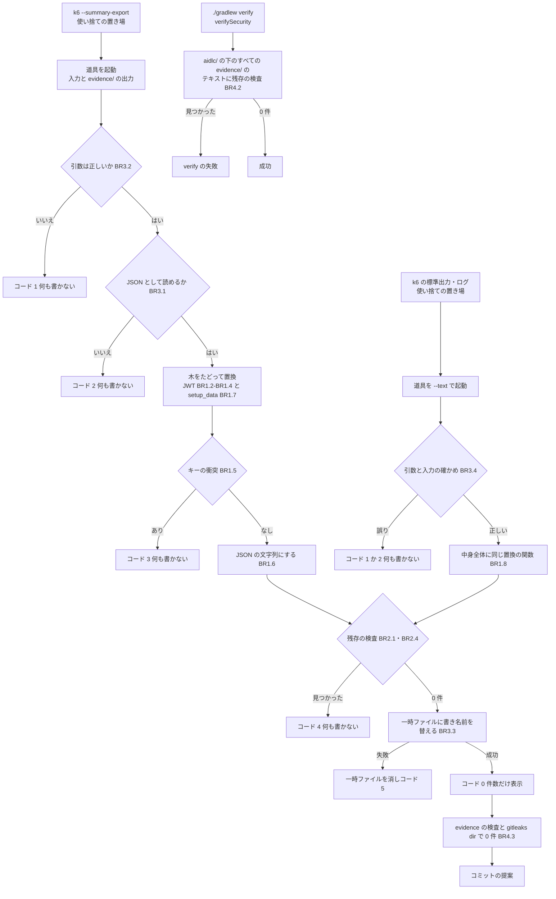

# 機能の仕様 — U4 u4-perf-evidence-redactor

- 単位: U4 u4-perf-evidence-redactor（library・S）。部品 PerfEvidenceRedactor（新規、ほかの部品に依存しない。ADR-004）
- 受け持つストーリー: `aidlc/spaces/default/intents/261029-reference-lookup-cleanup/inception/user-stories/stories.md` の **US4.1 k6 の結果の JWT が自動で伏せられる**（AC4.1.1〜AC4.1.9）
- 要件: FR5（FR5.1〜FR5.5）・NFR8。契約: C7（U4 → U5、伏せ字の道具の呼び方）
- この文書は流れの正。データの形は `entities.md`、判断の決まりは `rules.md`（YAML）が正で、下の 8節・9節はそこから導いた見やすい形。

## 1. 部品の構成（論理）

PerfEvidenceRedactor は、`perf/` に置く Node の 1 ファイル（依存なし。名前はコード生成で決める）に、次の 3 つの口を持つ。

| 口 | 役目 | 決まり |
|---|---|---|
| 置換の関数 | 文字列を受けて JWT の形を `[REDACTED-JWT]` に替えた文字列を返す 1 つの関数（BR1.2）。JSON の口はこれを木の文字列（値・配列の要素・キー名）に当て、上の階層の `setup_data` の下の文字列の値はすべて `[REDACTED-SETUP]` に替え（キーと型は保つ）、キーの衝突を見つける。テキストの置換の口は同じ関数を中身全体に 1 回当てる | BR1.1〜BR1.8 |
| 残存の検査の関数 | 置換を呼ばず、文字列を端から BR1.1 の形で調べ、見つけた位置と件数を返す（値は返さない）。JSON の口では、あわせて読み直した木の `setup_data` の下に伏せていない文字列が無いかを確かめる | BR2.1・BR2.3・BR2.4 |
| コマンドの口 | (a) summary json を記録に置く（JSON の口）: `<入力の summary json> <evidence/ の中の出力のパス>`（契約 C7）。(b) 標準出力・ログを記録に置く（テキストの置換の口）: `--text <入力のテキスト> <evidence/ の中の出力のパス>`（C7 に足す口）。(c) 既存の記録を調べる: verify のタスクと作業する人が単独で呼ぶ evidence の検査の口（呼び方はコード生成で決める） | BR3.1〜BR3.4・BR4.1〜BR4.3 |

すべての口は JWT の形の定義（BR1.1）と置換の関数（BR1.2）を共有し（テキストの置換の口のために別の正規表現を持たない）、たどり方（木か文字列か）を分ける。テストは `frontend/` の Vitest と fast-check から、置換・残存の検査の関数とコマンドの口を呼ぶ（ADR-004、BR5.x）。

## 2. 流れ W1: k6 の結果を記録（evidence/）に置く

前提: k6 は `--summary-export` で、git の対象外の使い捨ての置き場（例: `build/perf-results/`）に summary json を書いている（今の `perf/README.md` の手順どおり）。標準出力・ログを記録に置くときも、同じ置き場のファイルに受けておく（W1-T）。

### W1-J: summary json（JSON の口）

1. 作業する人が、契約 C7 の呼び方で道具を起動する（入力のパスと、`evidence/` の中の出力のパス）。
2. 引数を確かめる。2 つでない・出力の親のディレクトリが無い・出力のパスに `evidence` のディレクトリが無い・入力と出力が同じ → 何も書かずコード 1（BR3.2）。
3. 入力を読む。無い・読めない・空・JSON でない → 何も書かずコード 2（BR3.1）。表示は位置だけで、入力の断片を出さない（BR2.3）。
4. 木をたどって置換する。JWT の形は全体で `[REDACTED-JWT]` に（BR1.2〜BR1.4）、上の階層の `setup_data` の下の文字列の値はすべて `[REDACTED-SETUP]` に替える（BR1.7。数・真偽・null とキー名・構造は残す）。オブジェクトごとに、置き換えた後のキー名の重なりを確かめる。重なれば中止し、何も書かずコード 3（BR1.5）。
5. 置換の後の木を、字下げのある JSON の文字列にする（BR1.6）。
6. 5 の文字列に残存の検査を当てる。JWT の形を端から調べ（BR2.1）、文字列を読み直した木の `setup_data` の下に `[REDACTED-SETUP]` でない文字列が無いかを確かめる（BR2.4）。1 件でも見つかれば、何も書かずコード 4（BR2.2）。
7. 出力と同じディレクトリに一時ファイルを書き、書き終えたら出力のパスへ名前を替えて置く。どこかで失敗すれば一時ファイルを消し、コード 5（BR3.3）。
8. 置き換えた件数と出力のパスを表示し、コード 0 で終わる（値は出さない。BR2.3）。
9. 作業する人が、置いた `evidence/` に evidence の検査（W2 と同じ口を単独で呼ぶ）を流して 0 件を確かめる（BR4.3）。
10. 続けて `gitleaks dir` を流して 0 件を確かめ、コミットを提案する（BR4.3、`project.md` の Change Control）。9・10 のどちらかで見つかれば、コミットせず原因を確かめて置き直す。

### W1-T: 標準出力・ログ（テキストの置換の口。レビュー R-01 を受けた依頼者の決定）

1. 作業する人が、`node perf/<伏せ字の道具> --text <使い捨ての置き場のファイル> <evidence/ の中の出力のパス>` で道具を起動する。
2. 引数を確かめる。`--text` の後が 2 つでない・出力の親のディレクトリが無い・出力のパスに `evidence` のディレクトリが無い・入力と出力が同じ・出力の拡張子が `.json` → 何も書かずコード 1（BR3.2・BR3.4）。
3. 入力を読む。無い・読めない・空（空白だけを含む）・UTF-8 として読めない・NUL の文字を含む → 何も書かずコード 2。上の階層に `setup_data` を持つ JSON（k6 の summary json）→ 何も書かずコード 1（W1-J で置く。BR1.7 を通さない抜け道を作らない）（BR3.4）。
4. 中身全体を 1 つの文字列として、W1-J と同じ置換の関数で JWT の形を `[REDACTED-JWT]` に替える。改行（LF・CRLF）・空白・BOM・JWT の形でない部分は変えない。`setup_data` の伏せ字は当てない（BR1.8）。
5. 置き換えた出力の文字列に残存の検査を当てる。1 件でも見つかれば何も書かずコード 4（BR2.1・BR2.2）。
6. W1-J の 7 と同じく一時ファイルに書いてから名前を替えて置く。失敗すれば一時ファイルを消しコード 5（BR3.3）。
7. 置き換えた件数と出力のパスを表示し、コード 0 で終わる（BR2.3）。
8. W1-J の 9・10 と同じく、evidence の検査と `gitleaks dir` で 0 件を確かめてからコミットを提案する（BR4.3）。

どちらの口で置いたときも、置いた後に evidence の検査（W2）と `gitleaks dir` を流す。

### 状態の移り（1 回の起動）

テキストの置換の口は「置換済み」でキーの衝突を確かめない（コード 3 は起きない）ほかは同じ移りで、入力の確かめ（コード 1・2）は下の「起動」「入力済み」に含める。

| 状態 | 次へ移る条件 | 失敗のときの行き先 |
|---|---|---|
| 起動 | 引数が正しい | 終了（コード 1、何も書かない） |
| 入力済み | JSON として読めた | 終了（コード 2） |
| 置換済み | キーの衝突が無い | 終了（コード 3） |
| 検査済み | 残存の検査が 0 件 | 終了（コード 4） |
| 書き出し中（一時ファイル） | 名前の替えが済んだ | 一時ファイルを消して終了（コード 5） |
| 完了 | — | — |

どの失敗の行き先でも、出力のパスは起動の前と同じ（無ければ無いまま、あれば変わらない）で、一時ファイルは残らない。

## 3. 流れ W2: verify の中の evidence の検査（Q1: A）

導入の前の確かめ（レビュー R-02 を受けた依頼者の決定）: verify に組み込む前に、コード生成で evidence の検査の口を `aidlc/` の下の既存のすべての `evidence/`（過去の Intent を含む）に一度単独で流し、0 件であることを確かめて件数（調べたファイルの数・飛ばしたバイナリの数・検出 0 件）を記録する。1 件でも見つかったら、そこで止めて依頼者に諮る（過去の記録を自分の判断で置き直さない）。10節の「コード生成に回すこと」にも置く。

1. `./gradlew verify` の安全の検査の段（`verifySecurity`）で、Gradle のタスクが道具の evidence の検査の口を呼ぶ（タスクの名前と、段の中の並びはコード生成で決める）。CI も同じ `verify` を呼ぶため、同じ検査が CI でも動く。
2. 検査は `aidlc/` の下の `evidence` という名前のディレクトリをすべて探し、その下（入れ子を含む）のすべての通常のファイルを集める（BR4.2）。
3. 各ファイルの先頭に NUL の文字があればバイナリとして飛ばし、件数を数える。それ以外は拡張子にかかわらずテキストとして読む。
4. 各テキストに残存の検査の関数を当てる（BR2.1）。
5. 1 件でも見つかれば、ファイルのパス・件数・位置（行と桁）を表示して非 0 で終わり、verify を失敗させる。値は表示しない（BR2.3）。
6. 見つからなければ、調べたファイルの数と飛ばしたバイナリの数を表示して成功する。

この検査は、W1 を通さずに手で置いたファイル、`.md`・`.txt`・`.log` に貼った値、まだコミットしていないファイルも拾う（JWT の形だけ。拾えない値は 10節）。既存の `gitleaksScan`（`gitleaks git`）はコミット済みの履歴だけを見るため、コミットの前の守りはこの検査と W1-J の 9・10（W1-T の 8）になる（前の Intent 261027-perf-targets-review では、記録に入った JWT をコミットの前の verify が拾えず、プッシュの後の CI で落ちた）。

## 4. 失敗の扱いの一覧

| 口 | 場合 | 決まり | 終わりのコード | 出力 | 一時ファイル | 表示 |
|---|---|---|---|---|---|---|
| JSON | 引数の誤り（2 つでない）・出力が evidence/ の外・入力と出力が同じ | BR3.2 | 1 | 書かない | 作らない | 誤りの種類 |
| JSON | 入力が無い・空・JSON でない | BR3.1 | 2 | 書かない | 作らない | 位置だけ |
| JSON | キーの衝突 | BR1.5 | 3 | 書かない | 残さない | 置換の後の名前の道 |
| JSON | 残存の検出（JWT の形、または setup_data の伏せていない文字列） | BR2.1・BR2.2・BR2.4 | 4 | 書かない | 残さない | 件数と位置 |
| JSON | 書き出しの失敗 | BR3.3 | 5 | 前のまま | 消す | 誤りの種類 |
| テキスト | 引数の誤り（--text の後が 2 つでない）・出力が evidence/ の外・入力と出力が同じ・出力の拡張子が .json | BR3.2・BR3.4 | 1 | 書かない | 作らない | 誤りの種類 |
| テキスト | 入力が上の階層に setup_data を持つ JSON（summary json） | BR3.4 | 1 | 書かない | 作らない | 誤りの種類（JSON の口を使う旨） |
| テキスト | 入力が無い・読めない・空・UTF-8 として読めない・NUL を含む | BR3.4 | 2 | 書かない | 作らない | 誤りの種類と位置だけ |
| テキスト | 残存の検出（JWT の形） | BR2.1・BR2.2・BR3.4 | 4 | 書かない | 残さない | 件数と位置 |
| テキスト | 書き出しの失敗 | BR3.3・BR3.4 | 5 | 前のまま | 消す | 誤りの種類 |
| evidence の検査 | 検出 | BR4.2 | 非 0（verify の失敗） | — | — | パス・件数・位置 |

テキストの置換の口の入力はテキストのファイル（例: k6 の標準出力を受けた `.log`）、出力は `evidence/` の下の同じ中身のテキスト（JWT の形だけが `[REDACTED-JWT]` に替わる）。成功はコード 0 で、置き換えた件数と出力のパスだけを表示する。

## 5. 性質ベースのテストの性質（AC4.1.5、BR5.1）

`frontend/` の Vitest と fast-check から道具の関数を呼ぶ。失敗したときは fast-check の種と道を表示する。

| # | 性質 | 確かめ方 |
|---|---|---|
| (1) | 置換の後に JWT の形が無い | 任意の入力 x について、置換の後の木を JSON の文字列にしたものに残存の検査を当てて 0 件 |
| (2) | 冪等 | 置換(置換(x)) と 置換(x) が JSON として同じ値（`setup_data` の内と外の両方で）。`[REDACTED-JWT]`・`[REDACTED-SETUP]` が BR1.1 に一致しないこと自体も確かめる |
| (3) | `setup_data` の外では、JWT を含まない値は変わらない | 上の階層の `setup_data` の外にある、JWT の形を含まない値（数・場面名・真偽・null・入れ子・長い文字列・JWT に近い文字列）について、置換の前と後で JSON として同じ値 |
| (4) | 出力は JSON として読め、構造が同じ | キーの衝突を起こさない入力について、出力を読み直した木が、キーの集合と並び・値の型で入力と同じ（`setup_data` の内と外の両方で） |
| (5) | `setup_data` の下の文字列はすべて伏せる | 上の階層の `setup_data` の下の文字列の値は、JWT の形かにかかわらずすべて `[REDACTED-SETUP]` で、数・真偽・null は入力と同じ値（BR1.7） |

入力の作り方:

- 入力の半分程度は、上の階層をオブジェクトにして `setup_data`（入れ子・配列・数・真偽・null・文字列・JWT の形の文字列・JWT の形でない秘密に似た文字列を混ぜる）を持たせる。`setup_data` の値そのものが文字列・配列の場合と、深い所に `setup_data` という名前のキーがある場合（特別に扱わない）も混ぜる。

- 任意の JSON（オブジェクト・配列・入れ子、数・真偽・null、長い文字列を含む）に、文字列の値・配列の要素・キー名の位置へ JWT の形の文字列を混ぜる。
- JWT の形の文字列は、テストの中で `eyJ` と base64url の区間をつないで組み立てる（テストのソースに完成した JWT の形の値を書かない。BR5.2）。
- JWT に近い文字列を混ぜる: 2 区間、`eyJ` の前に英数字、末尾の `=`、`Bearer ` の前置き、`.` が 4 つ以上続くもの。
- 長い文字列は数 MB の場合を例のテストで別に確かめ（性質ベースのテストの回ごとには大きくしない）、時間の上限（Vitest の既定）を延ばさない。

### テキストの置換の口の性質（BR5.4）

| # | 性質 | 確かめ方 |
|---|---|---|
| (t1) | 置換の後に JWT の形が無い | 任意のテキスト t について、テキストの置換の口の置換の後の文字列に残存の検査を当てて 0 件 |
| (t2) | 冪等 | 置換(置換(t)) と 置換(t) が文字単位で同じ |
| (t3) | JWT の形を含まないテキストは変わらない | JWT の形を含まない t（改行 LF・CRLF、空白、長い行、JSON に似た断片、JWT に近い文字列を含む）について、置換の前と後で文字単位で同じ |

入力のテキストは、任意の Unicode の文字・改行・空白に、実行の中で組み立てた JWT の形の文字列と JWT に近い文字列を混ぜて作る。テキストの置換の口が JSON の口と同じ置換の関数を呼ぶことは、同じ文字列に当てた結果が一致する例のテストで確かめる（BR5.4）。

## 6. perf/README.md に置く節の中身（AC4.1.8、BR6.1）

U4 は次の中身の節を書き、U5 が整理した README に収める（契約 C7、unit-of-work の U5）。

1. **伏せる対象**: k6 の summary json（`--summary-export` の出力）。JWT の形は全体で `[REDACTED-JWT]` に替える。台本の値が入る道は `setup()` の返す値（`setup_data`）で、アクセストークン（JWT）と、招待の登録の場面では招待のトークンが入るため、`setup_data` の下の文字列は JWT の形かにかかわらずすべて `[REDACTED-SETUP]` に替える（数は残り、合否の数値は `setup_data` に入らないため失われない）。
2. **記録に置く唯一の入口**: 道具の呼び方（契約 C7 の JSON の口と、足したテキストの置換の口）と終わりのコードの意味（4節の表）。`cp` や手での貼り付けで `evidence/` に置かないこと、手で置いても verify の evidence の検査で落ちること（JWT の形のとき）。
3. **summary json の対象外と、その伏せ方**: k6 の標準出力とログ（`--quiet` で減らしているが、`console.log` の行と誤りの文が出る）。記録に置くときは、使い捨ての置き場のファイルに受けてから、テキストの置換の口で置く。README に書くコマンドの形は次のとおり（道具のファイルの名前と evidence の検査の口の呼び方だけコード生成で決めて埋める）:
   - `k6 run … > build/perf-results/<場面>.log 2>&1`（使い捨ての置き場に受ける。git の対象外）
   - `node perf/<伏せ字の道具> --text build/perf-results/<場面>.log <evidence/ の中のパス>.log`（JSON の口と同じ置換で JWT の形を `[REDACTED-JWT]` に替える。`setup_data` の伏せ字は当たらない。出力の拡張子 `.json` と summary json の入力は受け付けない）
   - 置いた後に evidence の検査（W2 と同じ口）と `gitleaks dir` を流す（4 項）。
   - 台本の決まり: 秘密の値（トークン・Cookie・Authorization ヘッダー・招待のトークン・パスワード）を、標準出力・ログ（`console.log` の行・誤りの文）に出さない（BR6.2）。テキストの置換の口が伏せるのは JWT の形だけで、JWT の形でない秘密（招待のトークンなど）は伏せられず、evidence の検査でも拾えないため。
4. **置いた後の確かめ**: どちらの口で置いたときも、evidence の検査と `gitleaks dir` を `evidence/` に流し、0 件を確かめてからコミットを提案する（BR4.3）。
5. **リフレッシュトークンと Authorization ヘッダー**: 7節の確かめの結果と、台本の決まり（BR6.2）。

## 7. AC4.1.9 の確かめの結果（設計の時点）

`perf/k6/scenarios.js` と、既存の記録（`aidlc/spaces/default/intents/261027-perf-targets-review/construction/build-and-test/evidence/` の json の鍵の名前だけ。値は開いていない）を読み取りで確かめた。

- summary json（`--summary-export`）の上の階層は `metrics`・`root_group`・`setup_data` の 3 つ。台本の値が入るのは `setup_data`（`setup()` の返す値）だけで、`metrics` と `root_group` には指標の名前・タグ（`name`・`op`・`scenario`・`listCase` などの固定の名前）・check の名前（固定の文字列）だけが入る。
- `setup()` は `tokens` の木を返し、そこにアクセストークン（`tokenOf(login(...))` の戻り値。`dslAdmin`・`admin`・`user`・`groupToken`・`roleToken`・`roleMemberTokens`・`bizToken`・`bizTokens`・`navTokens` など）が入る。前の Intent で記録に入った 120 件は、すべて `setup_data.bizTokens` の下だった（置き換えた後の印の位置で数えた）。
- **リフレッシュトークン**: 台本は Cookie `mastersmith_refresh` の値を VU ごとの状態（`vuState.cookie`、`setup()` の外）にだけ持ち、`setup()` の返す値に入れていない。summary json には入らない。
- **Authorization ヘッダー**: ヘッダーの組は要求のたびに関数（`roleHeaders`・`grHeaders` など）で組み立て、`setup()` の返す値には入れていない（入るのはトークンの文字列だけで、それは JWT の形として置換の対象になる）。k6 の summary json は要求の頭を書き出さない。summary json には入らない。
- 結論: リフレッシュトークンと Authorization ヘッダーの値は、今の台本では summary json に入らない。秘密の値を `setup_data` の外（タグ・check・指標・group の名前）に出さない決まりを BR6.2 に置いた。
- **別に見つかったこと**: 招待の登録の場面（`registrationVerify`・`registrationComplete`）では、`setup()` が Mailpit のメールから取り出した**招待のトークン**を `setup_data.registrationTokens` に入れる。招待のトークンは JWT の形でないため、JWT の形の置換だけでは残る。追加の質問 F1 の依頼者の決定（A）で、`setup_data` の下の文字列の値をすべて `[REDACTED-SETUP]` に替えることにした（BR1.7、確かめは BR2.4）。JWT の形の置換は全体にそのまま当てる。合否の数値は `setup_data` に入らないため失われず、今後の場面で `setup_data` に入りうる秘密も漏れない。この 2 場面の summary json も、道具を通せば記録に置ける。

## 8. 流れの図（導いた見方）

文字による代わり: 道具は、引数 → 入力の読み取り → 置換（JWT の形は全体、setup_data の下の文字列はすべて） → キーの衝突の確かめ → 文字列にする → 残存の検査 → 一時ファイルへの書き込みと名前の替え、の順に進み、どこで失敗しても出力を残さず、それぞれの終わりのコードで止まる。標準出力・ログは --text で起動し、引数と入力の確かめ（コード 1・2）の後、中身全体に同じ置換の関数を当て、そこから先は残存の検査・書き出しを同じ道で進む（キーの衝突と setup_data の扱いは無い）。どちらの口でも、成功の後は evidence の検査と gitleaks dir で確かめてからコミットを提案する。これとは別に、verify の安全の検査の段が、すべての evidence/ のテキストに同じ残存の検査を当て、見つかれば verify を失敗させる。

エンティティの関係の図: 保存するエンティティが無いため置かない（`entities.md`）。

## 9. 決まりの要約（rules.md から導いた見方）

| グループ | 決まり | 一言で |
|---|---|---|
| JWT の形と置換 | BR1.1〜BR1.8 | eyJ の 3 区間を、値・配列・キー・長い文字列のどこでも全部替え、setup_data の下の文字列はすべて伏せ、構造を保つ。キーの衝突は失敗。テキストの置換の口は同じ関数を中身全体に当てる |
| 残存の検査 | BR2.1〜BR2.4 | 置換と独立に書き出す直前の文字列と読み直した setup_data を調べ、見つかれば何も残さず失敗。値は表示しない |
| 入力・出力・失敗 | BR3.1〜BR3.4 | 引数と入力を確かめ、一時ファイルに書いてから置く。終わりのコード 0〜5。テキストの置換の口の確かめ |
| 手順と既存の記録 | BR4.1〜BR4.3 | 唯一の入口（JSON の口とテキストの置換の口）、verify の evidence の検査（Q1: A）、置いた後の evidence の検査と gitleaks dir |
| テスト | BR5.1〜BR5.4 | JSON の口の 5 つの性質・テキストの置換の口の 3 つの性質・境界の例・verify と CI で毎回 |
| 文書と台本 | BR6.1〜BR6.2 | README の節、秘密の値を setup_data の外（タグ・check・指標・group の名前）に出さない |

## 10. 上流との差と、コード生成に回すこと

- **ストーリーの M2: B との差（追加の質問 F1: A）**: US4.1 の AC4.1.9 は「形による置換は JWT だけで、キー名による伏せ字は今回行わない」（M2: B）とする。設計で、招待の登録の 2 場面が招待のトークン（JWT の形でない）を `setup_data` に入れると分かり、依頼者の決定 F1: A で、上の階層の `setup_data` の下の文字列の値をすべて `[REDACTED-SETUP]` に替えることにした（BR1.7・BR2.4）。キーの名前で値を選ぶ伏せ字であり、M2: B と違う。JWT の形の置換は全体にそのまま当てる。あわせて、AC4.1.5 の (3)「JWT を含まない入力は変わらない」は「`setup_data` の外の値について」と読み替え、性質 (5)（`setup_data` の下の文字列はすべて伏せる）を足した（5節、BR5.1）。ストーリーの文書は書き換えない。

- **契約 C7 への足し**: C7 は記録に置く呼び方（入力と出力）だけを決めている。Q1: A の verify の evidence の検査は、同じ道具の残存の検査の関数を使うため、道具に「evidence の検査の口」を足す（足す変更で、C7 の既存の呼び方は変えない。持ち主は U4）。呼び方の形（引数の名前など）はコード生成で決める。
- **契約 C7 への足し（テキストの置換の口。レビュー R-01 を受けた依頼者の決定）**: AC4.1.8 の「対象外（k6 の標準出力とログ）をどのコマンドで伏せるか」を道具の中で満たすため、`--text <入力> <evidence/ の中の出力のパス>` の口を足した（BR1.8・BR3.4）。置換の関数と JWT の形の定義は JSON の口と共有し、別の正規表現を持たない。終わりのコードは 1・2・4・5 を JSON の口と同じ意味で使う。C7 の既存の呼び方（引数 2 つ）は変えない足す変更で、持ち主は U4。
- **終わりのコードの細分**: C7 は「非 0」とだけ書く。テストで場合を見分けるため、1〜5 に分けた（BR3.3）。C7 の「非 0」の範囲の中の細分で、壊す変更ではない。
- **残る穴（レビュー R-03 を受けた依頼者の決定）**: evidence の検査（BR4.2・W2）が拾うのは JWT の形だけで、`setup_data` の下の確かめ（BR2.4）は道具の書き出しの時にしか行わない。そのため、道具を通さずに手で置いた json の `setup_data` の下に JWT の形でない秘密（招待のトークンなど）が残っても、verify と CI は拾わない。この穴の守りは、唯一の入口（BR4.1）と、置いた後の `gitleaks dir`（BR4.3）に頼る。evidence の検査を `setup_data` に広げることはしない（過去の記録の `setup_data` の下には `[REDACTED-JWT]` が置かれており、「`[REDACTED-SETUP]` でない文字列が残っていれば失敗」とする確かめを当てると、過去の記録で verify が落ちるため）。
  - 同じく、k6 の標準出力・ログに JWT の形でない秘密（招待のトークンなど）が出たときは、テキストの置換の口（BR1.8 は JWT の形だけを替え、`setup_data` の伏せ字を当てない）でも evidence の検査（BR4.2）でも拾えない。この穴の守りは、秘密の値を標準出力・ログに出さない台本の決まり（BR6.2）と、置いた後の `gitleaks dir`（BR4.3）に頼る。
- **コード生成で決めること**: 道具のファイルの名前、出力の字下げの幅、evidence の検査の口の呼び方と Gradle のタスクの名前、`frontend/` の検査の対象への入れ方（ADR-006 の切り替え先を含む）。README に書く標準出力・ログのコマンドの形は 6節 3 項で決めた（道具のファイルの名前だけを埋める）。
- **コード生成の計画に置く手順（レビュー R-02 を受けた依頼者の決定）**: evidence の検査を verify に組み込む前に、`aidlc/` の下の既存のすべての `evidence/`（過去の Intent を含む）へ検査を一度単独で流し、検出 0 件を確かめて件数を記録する。1 件でも見つかったら止めて依頼者に諮り、過去の記録を自分の判断で置き直さない（3節の冒頭）。
- **Build and Test で確かめること**: 実際の k6 の summary json を道具で置き、`gitleaks dir` で 0 件（AC4.1.6）。verify と CI でテストが飛ばされずに通ること。
