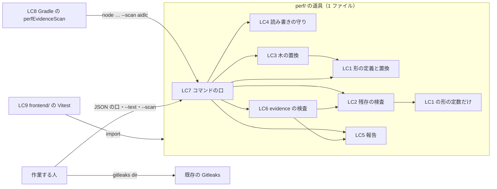

# 論理の部品 — U4 u4-perf-evidence-redactor

- 単位: U4 u4-perf-evidence-redactor（種類 `library`）。部品 PerfEvidenceRedactor（ADR-004）
- この文書は、`security-design.md` の守りが「どの部品の、どの口で」働くかと、verify・テスト・手順への組み込み方を示す。アプリ（WAR）には含まれず、配備されない。名前に「仮」と付けたものはコード生成で決める。

## 1. 置き場と部品の一覧

| # | 論理の部品 | 置き場 | 役目 | 守り（security-design.md） | 要件 |
|---|---|---|---|---|---|
| LC1 | JWT の形の定義と置換の関数 `redactJwt` | 道具のファイルの中（仮: `perf/redact-k6-evidence.mjs`） | 1 つの正規表現の定数と、文字列を受けて置き換えた文字列と件数を返す関数。3 つの口が共有する | 2.1節 | NFR8.62 |
| LC2 | 残存の検査 `findResidual`・`findUnredactedSetup` | 同じファイル | 置換を呼ばずに文字列を端から調べる関数と、読み直した木の `setup_data` の下を調べる関数。件数と位置・道だけを返す | 3節 | NFR8.63 |
| LC3 | JSON の木の置換 `redactTree` | 同じファイル | 明示の積み上げでたどり、キー名と文字列に LC1 を当て、上の階層の `setup_data` の下を `[REDACTED-SETUP]` にし、キーの衝突を見つける | 2.2節 | NFR8.62 |
| LC4 | 読み書きの守り | 同じファイル | 大きさの上限（`MAX_INPUT_BYTES`）、UTF-8 の読み方（口ごとの BOM の扱い）、NUL の判定、出力のパスの `evidence` の確かめ、一時ファイルと名前の替え、中断のときの片付け | 2.3節・2.4節・5節・6節 | NFR8.65〜NFR8.67 |
| LC5 | 報告の部品 | 同じファイル | 決めた文言の番号・件数・位置・パス・道だけを受けて表示する。パスと道は LC1 を通してから出す | 4節 | NFR8.64 |
| LC6 | evidence の検査 | 同じファイル | 根の下の `evidence` の下のファイルを集め、上限・NUL・バイナリの一覧（定数）で振り分け、LC2 を当てる（一覧の拡張子で NUL を含むファイルも latin1 で読んで JWT の形だけを当てる） | 8節 | NFR8.68・NFR8.66 |
| LC7 | コマンドの口 `main(argv, io)` と起動の部分 | 同じファイル | 引数で 3 つの口に分け、終わりのコード 0〜5 を返す。`io` は表示と読み書きの差し替えの口（テスト用）。ファイルが直接起動されたときだけ `process.exitCode` に結果を置く | 5.1節・5.4節 | NFR7.61・NFR6.61 |
| LC8 | Gradle のタスク（仮: `perfEvidenceScan`） | `build.gradle.kts`（ルート） | `verifySecurity` の一員として LC7 の検査の口を呼ぶ | 8.4節 | NFR8.68 |
| LC9 | 仕組みのテスト | `frontend/` の Vitest の単体テスト（置き場はコード生成の計画。4節） | 性質のテストと例のテスト | 7節・8.5節 | NFR5.61〜NFR5.63・NFR8.71 |
| LC10 | README の節 | `perf/README.md`（U4 が書き、U5 が収める） | 唯一の入口・2 つの呼び方・終わりのコード・置いた後の検査と `gitleaks dir`・台本の決まり・一時ファイルの名前の形 | 9節 | NFR8.61・NFR8.69・NFR8.70 |

- LC1〜LC7 は 1 つのファイルで、読み込むのは `node:fs`・`node:path`・`node:url`・`node:process` などの組み込みだけ（NFR9.61）。純粋な関数（LC1〜LC3・引数の判定）と、読み書きのある部分（LC4〜LC7）を、同じファイルの中で口を分けて公開する。
- 先頭に Apache License 2.0 のヘッダー（`/* ... */`、年 `2026`、著作権者 `agwlvssainokuni`）を置く（NFR9.65）。
- 既存の `perf/*.mjs`（`make-biz-dsl.mjs` など）と同じ形の ES モジュールで、Node 24 で動く口だけを使う（NFR9.64）。



文字による代わり: 道具は 1 つのファイルで、コマンドの口（LC7）が 3 つの口（JSON・テキスト・検査）に分ける。置換は LC1 の関数を LC3（JSON の木）とテキストの口が使い、残存の検査（LC2）は LC1 の形の定数だけを使って置換の関数を呼ばない。表示はすべて報告の部品（LC5）を通る。外からは、Gradle のタスク（LC8）が検査の口を、Vitest のテスト（LC9）が関数とコマンドの口を、作業する人が 3 つの口と `gitleaks dir` を呼ぶ。

## 2. 口の一覧（入口）

| 口 | 呼び方 | 呼ぶ人 | 終わりのコード |
|---|---|---|---|
| JSON の口（契約 C7、変えない） | `node perf/<道具>.mjs <入力の summary json> <evidence/ の中の出力>` | 作業する人（perf の手順） | 0・1・2・3・4・5 |
| テキストの口（C7 に足す口） | `node perf/<道具>.mjs --text <入力のテキスト> <evidence/ の中の出力>` | 作業する人 | 0・1・2・4・5 |
| evidence の検査の口（C7 に足す口。旗の名前は仮） | `node perf/<道具>.mjs --scan <根のディレクトリ>` | LC8（verify・CI）、作業する人（置いた後） | 0・1・2・4 |
| 関数の口（テスト用） | `redactJwt`・`findResidual`・`redactTree`・`findUnredactedSetup`・`main`・`MAX_INPUT_BYTES`・バイナリの一覧の定数を名前付きで公開 | LC9 | — |

- 3 つの口の引数の決まりと、コードの意味は `security-design.md` 5.1節・5.4節のとおり。契約 C7 の既存の呼び方（引数 2 つ）は変えない（NFR7.61）。

## 3. verify からの呼び方（LC8）

- ルートの `build.gradle.kts` の安全の検査の段に、`Exec` のタスク（仮: `perfEvidenceScan`）を足し、`verifySecurity` の一員（`spotbugsGate`・`osvScan`・`gitleaksScan` と並ぶ）にする。

```text
// 考え方（Gradle の Kotlin DSL。実装はコード生成）
val perfEvidenceScan = tasks.register<Exec>("perfEvidenceScan") {
    description = "aidlc/ の下の evidence/ に JWT の形が残っていないかを調べる（見つかれば失敗）。"
    group = LifecycleBasePlugin.VERIFICATION_GROUP
    dependsOn(checkToolchain)
    commandLine("node", "perf/<道具>.mjs", "--scan", "aidlc")
    outputs.upToDateWhen { false }
}
// verifySecurity の一覧に perfEvidenceScan を足す
```

- 作業フォルダの上のファイル（git の対象外・まだコミットしていないものを含む）を毎回調べるため、出力を宣言せず毎回流す（`UP-TO-DATE` で飛ばさない）。
- `frontendInstall` には依存しない（道具は組み込みだけを読む）。Node の版の確かめは既存の `checkToolchain` に任せる。
- 段の並び: 既存の仕組み（`verifyStages` の `mustRunAfter`）で、前の段（単体テストなど）の後に流れる。段の中の並びは問わない。
- CI は同じ `./gradlew verify` を呼ぶため、同じ検査が CI でも流れる（`.github/workflows/ci.yml` は `./gradlew verify` を呼び、Node 24 を入れている）。
- 組み込む前に、検査の口を一度単独で流して件数を記録する（`security-design.md` 8.6節）。

## 4. テストの置き場・`vitest.config.ts`・検査の対象（コード生成の計画の義務）

この段では置き場を決めず、コード生成の計画に次をすべて明記することを義務とする（NFR5.62・NFR5.63・ADR-006）。

| # | 計画に書くこと | 確かめる事実（今の形） | 合否 |
|---|---|---|---|
| P1 | テストのファイルのパス | `frontend/vitest.config.ts` の `unit` の `include` は `src/**/*.test.{ts,tsx}` と `e2e/support/**/*.test.ts` だけで、`perf/` は入っていない | 選んだパスが `include` に当たり、`exclude` に当たらないこと |
| P2 | `vitest.config.ts` の `include` の変更の有無（変えないならその理由） | `perf/` の下にテストを置くと、`fast-check` などの読み込みが `frontend/node_modules` から解決できない見込み（`perf/` の上に `node_modules` が無い） | テストが読み込みの誤りでなく実際に流れること（Build and Test で passed 1 件以上・skipped と todo 0 件） |
| P3 | テストから道具のファイルを読む方法 | Vitest の根は `frontend/`。`frontend/` の外のファイルの読み込みが通るか（Vite のファイルの読み込みの許可を含む）は未確かめ | 読み込めないときは ADR-006 の切り替え先へ（下の注） |
| P4 | テストの実行の環境 | `unit` の既定は `jsdom` | 道具のテストは `node` の環境で流す（ファイルの先頭の環境の指定など） |
| P5 | `coverage.include` の扱いとその理由 | 今は `src/**/*.{ts,tsx}` だけで、`perf/` の `.mjs` は計測されない | 下限（行 80%・分岐 70%）と除外を変えないこと。計測に入れるなら道具にも同じ下限が当たる |
| P6 | 道具のファイルをリンタ（oxlint・ESLint）・型の検査・ライセンスヘッダー・フォーマット（Prettier）の検査に入れる方法 | `frontend/` の検査は `frontend/` の下だけを見る（ESLint の `files`、`tsconfig.json` の `include`、`scripts/check-license-header.mjs` の歩く根、`format:check` の作業フォルダ） | 道具のファイルが各検査に入っていること。既存の `perf/*.mjs` まで広げるかも書く（広げると既存のファイルが落ちうる） |
| P7 | 型の検査の手当て（テストが `.mjs` を読むときの型の宣言、または JSDoc と `checkJs`） | `tsconfig.json` は `strict` で `any` を禁じる | テストのファイルが `any` なしで型の検査を通ること |

- 注（ADR-006 の切り替え先と契約 C7）: 道具を `frontend/` の下に置く切り替え先を選ぶと、C7 の呼び方 `node perf/<道具>.mjs` が変わる。そのときは、`perf/` に呼び方を保つ薄い入口を置くか、C7 の変更（持ち主 U4、使う側 U5 の README）を依頼者に諮るかを計画に書く。
- テストのソースに完成した JWT の形を書かないこと（NFR8.71）は、既存の `gitleaksScan` とコード生成のレビューの検索で確かめる。

## 5. 失敗の範囲と影響の広がり

| 部品 | 失敗の形 | 影響の範囲 | 戻り方 |
|---|---|---|---|
| LC1〜LC5（道具の JSON・テキストの口） | 終わりのコード 1〜5 | その 1 回の記録の置き場だけ。出力のパスは前のまま | 原因を直して置き直す（記録はコミットしない） |
| LC6・LC8（evidence の検査） | 検出（4）・NUL 混じり・上限超え・読めない（2） | verify（統合の前の関門）と CI が、すべてのブランチで止まる | 記録を置き直す。過去の記録で起きたら依頼者に諮る（8.6節） |
| LC6 の誤検知 | JWT の形に似た、秘密でない文字列（3 区間の `eyJ…`）が記録にある | 同上 | 伏せ字の道具で置き直す（除外の口は設けない。除外を足すと穴になるため） |
| LC6 のバイナリの一覧 | 一覧に無いバイナリ（例: `.webm`）を記録に置いた | verify が止まる | 一覧に足すかを依頼者に諮る（`security-design.md` 8.3節） |
| LC9（テスト） | 性質・例のテストの失敗 | `verifyUnitTest` と CI | 種と道で再現して直す |

- 共有する資源: Node 24（`checkToolchain`）、`frontend/node_modules`（テストだけが使う。道具は使わない）、作業フォルダの `aidlc/` の木（LC6 は読むだけ）。
- 道具はアプリの実行時に含まれず、アプリの失敗の範囲とは分かれる。

## 6. 上流との差

- NFR8.68 の閉じた失敗の一覧（5 つの拡張子）を、失敗にしないバイナリの一覧（9 つ）に替えた（Q1: A。LC6 の定数）。詳しくは `security-design.md` 11節。
- 契約 C7 に、evidence の検査の口（`--scan`、名前は仮）を足す（機能設計 10節で決めた足す変更の口の形をこの段で決めた。既存の呼び方は変えない）。
- 道具の読み書きの部分を `main(argv, io)` に寄せ、表示と読み書きをテストで差し替えられる形にした（機能設計に無い作りの決め。書き出しの失敗を権限に頼らず確かめるため）。

## 7. 後の段に回すこと

| 段 | 回すこと |
|---|---|
| コード生成（計画） | 4節 P1〜P7、道具の名前、検査の口の旗の名前、Gradle のタスクの名前、ADR-006 の切り替え先を選ぶときの C7 の扱い |
| コード生成 | 3節のタスクの組み込みの前の一度の実行と件数の記録、LC10 の README の節 |
| Build and Test | U4 のテストのファイルごとの passed の件数（skipped・todo 0、passed 1 以上）、`perfEvidenceScan` が verify と CI で流れた記録、実際の k6 の summary json を道具で置き検査と `gitleaks dir` で 0 件 |

## Sources

- `aidlc/spaces/default/intents/261029-reference-lookup-cleanup/construction/u4-perf-evidence-redactor/nfr-design/security-design.md`
- `aidlc/spaces/default/intents/261029-reference-lookup-cleanup/construction/u4-perf-evidence-redactor/nfr-requirements/security-requirements.md`・`tech-stack-decisions.md`
- `aidlc/spaces/default/intents/261029-reference-lookup-cleanup/construction/u4-perf-evidence-redactor/functional-design/functional-spec.md`・`rules.md`
- `aidlc/spaces/default/intents/261029-reference-lookup-cleanup/inception/contract-design/contract-summary.md`（C7）・`aidlc/spaces/default/intents/261029-reference-lookup-cleanup/inception/domain-design/decisions.md`（ADR-004・ADR-006）
- 読み取りで確かめたもの: `build.gradle.kts`（`verifyStages`・`verifySecurity`・`checkToolchain`・`gitleaksScan`）、`frontend/vitest.config.ts`、`frontend/tsconfig.json`、`frontend/eslint.config.js`、`frontend/.prettierignore`、`frontend/scripts/check-license-header.mjs`、`.github/workflows/ci.yml`、`perf/` のファイルの一覧
