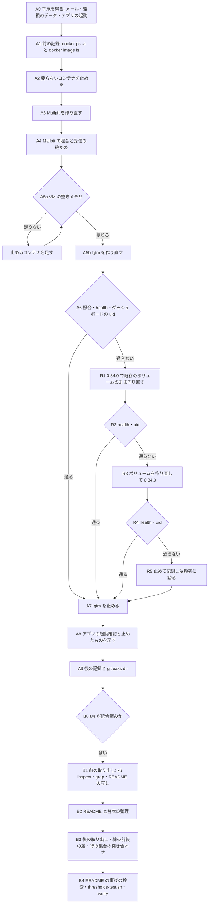

# セキュリティの設計 — U5 u5-container-perf-docs

- 単位: U5 `u5-container-perf-docs`（種類 `packaging`）。Bolt B6。
- この段の成果物は、この文書と `traceability.json` だけ（`packaging` の単位のため、性能・規模・信頼性・観測・論理の部品の文書は作らない）。
- この文書は、NFR 要件（同じ単位の `nfr-requirements/security-requirements.md` の NFR8.81〜NFR8.90・NFR9.81・NFR9.82・NFR5.81）を、作業の順序・記録の形・確かめの形の設計に直したもの。実際のコマンドの列と記録のファイルの置き場の名前はコード生成の計画で決める。名前に「仮」と付けたものはコード生成で決める。
- 新しく決める論点は無い（同じ単位の `nfr-design-questions.md` のとおり）。この文書は決まっていることを手順の形にそろえる。

## 1. 守るものと設計の全体

U5 はアプリのコード・API・画面・DB を持たない。守るものは次の 3 つで、それぞれを手順の「関門」（通らなければ次へ進まない点）で守る。

| # | 守るもの | 守り方（この文書の節） | 要件 |
|---|---|---|---|
| P1 | `.env` の資格情報と環境変数の値が、画面・会話・記録・リポジトリに出ないこと | 取り出す項目を名前で限る形（3節）、外の置き場（5.3節）、置いた後の `gitleaks dir`（3.3節） | NFR8.86・NFR8.87・NFR8.90 |
| P2 | 手元の確かめの道具（Mailpit・otel-lgtm）が `compose.yaml` の版とダイジェストにそろい、戻し先を失わないこと。失いうるもの（メール・監視のデータ・アプリの起動で残る行）を依頼者が先に了承していること | 了承（2.1節 A0）、入れ替えの順序（2節）、VM の空きメモリ（2.8節）、ダイジェストの照合（2.4節）、戻し（4節） | NFR8.81〜NFR8.85・NFR9.81 |
| P3 | perf の合否の線と、U4 の伏せ字の手順と、今の手順の文が、整理で弱まらず欠けないこと | 分け方（5.2.1節）、前後の比べ（5.3節・5.4節）、行の集合の突き合わせ（5.7節）、README の事後の検索（5.6節） | NFR8.87〜NFR8.90・NFR9.82・NFR5.81 |

B6 の作業は、A（コンテナの入れ替え）と B（perf の文書の整理）の 2 つに分かれ、互いに頼らない。A を先に行う（了承の取得が B6 の最初の手順のため。NFR8.81）。B は U4（B5）が `develop` に統合された後でなければ始めない（5.1節）。



文字による代わり: A0 で 3 つの了承（Mailpit のメールが消える・監視のデータが消えうる・止まっていたアプリを起動する）を得てから、A1 で前の状態を `docker ps -a` で記録し、A2 で要らないコンテナを止め、A3〜A4 で Mailpit を作り直して確かめる。A5a で VM の空きメモリを確かめ（足りなければ止めるコンテナを足す）、A5b〜A6 で lgtm を作り直して確かめる。lgtm が通らなければ、R1 で 0.34.0 に既存のボリュームのまま戻し、それも通らなければ R3 でボリュームを作り直して 0.34.0 で起動し、それも通らなければ R5 で lgtm を止めて記録し依頼者に諮る。A7 で lgtm を止め、A8 でアプリの起動確認と止めたコンテナの戻しを行い、A9 で後の状態を記録して秘密の検査を流す。その後、U4 の統合を確かめてから（B0）、B1 で整理の前の線と README の写しを取り出し、B2 で整理し、B3 で後の線と比べて行の集合を突き合わせ、B4 で README の検索・`thresholds-test.sh`・`./gradlew verify` を流す。

## 2. コンテナの入れ替えの設計（A）

### 2.1 順序と関門

| 手順 | すること | 関門（通らなければ止まる条件） | 要件 |
|---|---|---|---|
| A0 | 次の 3 つを依頼者に伝え、項目ごとに了承を得る。了承の日時（UTC）と項目ごとの答えを記録する。(i) Mailpit を作り直すと溜まったメールが消える（Mailpit はボリュームを持たない。`compose.yaml` のコメントのとおり）。(ii) lgtm の名前付きボリューム `mastersmith-monitoring` に溜まった過去の指標・ログ・トレース（と Grafana の中の状態）は、0.38.0 が開いた時点で新しい版の形に変わりうるため、戻しでボリュームを作り直すときは失われる。ダッシュボードと警報の決まりは、リポジトリのファイル（`docker/monitoring/dashboards/`・`docker/monitoring/provisioning/`）から作り直される（2.6節・4.1節）。(iii) A1 でアプリ（`app`）が止まっていれば、確かめのために起動する（2.7節）。起動のたびに初期管理者の救済が働きうる（初期管理者のパスワードが `.env` の値に戻る・止めていた初期管理者が戻る）こと、起動のログと、救済が働いたときは監査の行が内部DB に残ること | (i) の了承が無ければ A1 以降に進まない。(ii) の了承が無ければ A5 以降に進まず、ボリュームを退避する手を足すかを依頼者に諮る。(iii) の了承が無ければ、2.7節の起動を省く側で進め、省いた理由を「依頼者が起動を了承しなかった」と記録する。B は A と独立のため、依頼者が望めば B を先に進めてよいが、A を省いて B6 を終えない | NFR8.81・NFR8.82・NFR8.84 |
| A1 | 前の記録: `docker ps -a`（止まっているコンテナを含む。`-a` は必須）でコンテナの名前と状態、`grafana/otel-lgtm` と `axllent/mailpit` のイメージの一覧（3.1節の形）を記録する | `-a` を付けた一覧が記録にあること（A8 で「止まっていたものは起こさない」の判定と、2.7節のアプリの状態の判定に使う）。0.34.0 の lgtm のイメージが無ければ、その事実を記録し、戻し先が無いまま進めるかを依頼者に諮る（4.2節） | NFR8.82・NFR8.83 |
| A2 | lgtm（上限 1536m）を作り直す前に、確かめに要らないコンテナ（対象DB・使い捨ての環境など）を `docker compose stop` で止め、止めた名前を記録する。アプリ（`app`）は止めない | 止めたコンテナの名前の一覧が記録にあること（A8 で戻すため） | NFR8.82（`project.md` の VM のメモリの余裕） |
| A3 | Mailpit を `docker compose --profile mail up -d --force-recreate --no-deps mailpit` で作り直す | 終了コード 0 | NFR8.82 |
| A4 | Mailpit の照合（2.4節）と、受信の確かめ（2.5節）。A1 で Mailpit が止まっていた（または無かった）ときは、確かめの後に `docker compose stop mailpit` で止める（A5a の空きを増やすため。元の状態へ戻すことにもなる） | 照合が一致し、受信の件数が 1 以上 | NFR8.82・NFR8.84 |
| A5a | lgtm を作り直す前に、VM の空きメモリを読み取りだけで確かめる（2.8節） | 空きが基準（仮: lgtm の上限 1536 MiB に余裕 256 MiB を足した 1792 MiB）以上。足りなければ 2.8節の手で止めるコンテナを足して確かめ直す。アプリ以外に止めるものが無くなっても足りなければ、A5b に進まず依頼者に諮る | NFR8.82（`project.md` の VM のメモリの余裕） |
| A5b | lgtm を `docker compose --profile monitoring up -d --force-recreate --no-deps lgtm` で作り直す（止まっているコンテナでも作り直す） | 終了コード 0 | NFR8.82 |
| A6 | lgtm の照合（2.4節）と、ボリュームの引き継ぎの確かめ（2.6節） | どちらかが通らなければ 4.1節の戻しへ | NFR8.82 |
| A7 | lgtm を `docker compose stop lgtm` で止め、動いているコンテナの一覧に lgtm が無いことを確かめ、止めた時刻を記録する | 一覧に lgtm が無いこと | NFR8.85 |
| A8 | アプリの起動確認（2.7節）。A2・A5a で止めたコンテナを `docker compose start` で元の状態に戻す（A1 の `docker ps -a` で止まっていたものは起こさない） | ヘルスチェックの結果（または省いた理由）が記録にあること | NFR8.84・NFR8.82 |
| A9 | 後の記録（3.1節の形、A1 と同じ項目）、前後の比べ（4.2節）、記録のファイルへの `gitleaks dir`（3.3節） | 比べで 0.34.0 が消えていないこと、`gitleaks dir` が 0 件 | NFR8.83・NFR8.86 |

- `--no-deps` で、アプリ・対象DB に触れない。`docker compose pull` の後の `up -d` だけでは、構成が同じとき作り直されず古い版が残ることがある（`project.md` の学び）ため、必ず `--force-recreate` を付ける。
- Mailpit を先に、lgtm を後にする。Mailpit は小さく（上限 256m）、作り直しが失敗しても戻す必要が少ない（受けたメールは了承済みで消える）。lgtm はボリュームを引き継ぐため、先に Mailpit で手順の形を確かめてから行う。
- lgtm は見たいときだけ起動する決まり（`project.md` の Deployment）のため、確かめ終えたら必ず止める（A7）。止めるのは確かめの後で、確かめの途中で止めない。

### 2.2 プロファイルの扱い

Mailpit は profile `mail`、lgtm は profile `monitoring` にある。`docker compose` の作り直しと止める操作には、それぞれの profile を付けるか、サービスの名前を明示する。ほかの profile のサービスを巻き込まないよう、サービスの名前を必ず 1 つだけ渡す。

### 2.3 秘密に触れない操作の決まり

- `.env`・`.env.*` を開かない。`docker compose config` の全体を表示しない（`.env` の値が展開されて出るため）。
- `docker compose up` の出力（コンテナの名前と状態の行）は表示してよい。値を含む警告が出たときは、記録に写さない。
- `docker inspect` は 3.1節の `--format` の形だけで流し、全体の JSON を表示しない。

### 2.4 ダイジェストの照合

照らす正は `compose.yaml` の `image:` の行（タグと複数アーキテクチャの index のダイジェスト）。コンテナが使っているイメージの `RepoDigests` に、その index のダイジェストが含まれるかで判定する（引いた 1 つのプラットフォームのダイジェストとは照らさない）。

```text
# 考え方（実際のコマンドはコード生成の計画）
want = compose.yaml の <サービス>.image の "@sha256:" の後ろ          # index のダイジェスト
tag  = docker inspect --format '{{.Config.Image}}' <コンテナ>         # タグ@ダイジェストの文字列
img  = docker inspect --format '{{.Image}}' <コンテナ>                # イメージの ID
digs = docker image inspect --format '{{json .RepoDigests}}'    # 名前@sha256:… の配列
判定 = tag が compose.yaml の image と同じ 且つ digs のどれかが "@" + want で終わる
```

- 判定が一致しないときは、原因（例: 古いコンテナが残った・別のタグを引いた）を記録し、`--force-recreate --no-deps` でもう一度作り直して確かめ直す。確かめ直すまで A を完了にしない。
- 記録にはダイジェストを先頭 12 文字で書いてもよいが、判定は全体の文字列で行う。

### 2.5 Mailpit の受信の確かめ

- 送り先は `127.0.0.1:1025`（`compose.yaml` で PC の localhost にだけ結び付けた口）に限る。宛先と差出人は予約のドメイン（`example.com`）だけにする。件名に目印の語（仮: 実行ごとに一意の値を含む）を入れ、本文に個人に関する値を入れない。
- Mailpit の HTTP API（`127.0.0.1:8025`）の検索で、目印の語の件数を数える。記録には宛先のドメイン・件数・判定だけを書き、件名と本文の値を書かない。
- 送る道具は PC に既にあるもの（新しく入れない）からコード生成の計画で決める（`tech-stack-decisions.md` 3節）。実在の宛先と外部の SMTP には送らない（`project.md` の Forbidden）。
- 確かめに送ったメールは Mailpit に残る（次の作り直しで消える）。ほかに個人に関する値を含まないため、消す操作はしない。

### 2.6 lgtm のボリュームの引き継ぎの確かめ

lgtm は名前付きボリューム `mastersmith-monitoring`（compose の名前 `mastersmith` を前に付けた実際の名前は `mastersmith_mastersmith-monitoring`。実行のときに `docker volume ls` の名前の完全一致で確かめる）を 0.34.0 から 0.38.0 へ引き継ぐ。`compose.yaml` の lgtm に healthcheck は無いため、次の 2 つで確かめる。この 2 つは 4.1節の戻しの後の確かめ（R2・R4）にも同じ形で使う。

| 確かめ | 形 | 合格 |
|---|---|---|
| 起動 | Grafana の `127.0.0.1:3000/api/health` を、時間の上限（仮: 120 秒）まで待って読む | 応答の状態コードが 200 で、`database` の項目が `ok` |
| ダッシュボードの読み込み | `docker/monitoring/dashboards/` のファイルごとに、ファイルの `uid` を読み（今は `mastersmith-overview` の 1 つ）、Grafana の検索の API でその `uid` を指定して検索する（形は仮: `/api/search?dashboardUIDs=<uid>`）。匿名の Viewer で読める | ファイルごとに、その `uid` のダッシュボードがちょうど 1 件見つかる。イメージが自前で持つダッシュボードがあっても合否に入れない（ダッシュボードの全体の件数は参考として記録するだけで、判定に使わない） |

- `uid` は実行のときにファイルから読み、この文書の値を写して使わない（ファイルが増えても同じ形で確かめるため）。記録には `uid`・件数・判定だけを書き、応答の本文を書かない。
- どちらかが通らないときは、4.1節の戻しを行い、通らなかった確かめと応答の状態コード（本文の値は書かない）を記録する。
- 警報の決まりの読み込みは、Observability Setup の確かめ（`perf/README.md` の手順）の範囲で、この単位の合否に入れない。

### 2.7 アプリの起動確認

- 既定は「止まっていたアプリを起動して確かめる」側とする。NFR 要件の NFR8.84 が「既定として `docker compose up -d app` で起動して確かめ、確かめの後に元の止まった状態へ戻す」と決めているため、起動を省く側を既定にはしない。代わりに、起動で内部DB と記録に起こりうること（初期管理者の救済・監査の行・起動のログ）を A0 の (iii) の了承の対象に入れる。
- A1 の `docker ps -a` の記録でアプリ（`app`）が動いていれば、`/actuator/health` の応答（状態コードと `status`）を記録する。
- 止まっていて A0 の (iii) の了承があれば、`docker compose up -d app` で起動して（作り直しはしない。`--force-recreate` を付けない）ヘルスチェックを確かめる。あわせて、起動のログを JSON として読み、初期管理者の救済の WARN の件数をロガーとキーの名前だけで数えて記録する（値は表示しない。`project.md` の学びの形）。確かめの後に `docker compose stop app` で元の止まった状態へ戻す。
- 起動を省くのは、(iii) の了承が無いとき、または VM のメモリなどの事情で起動できないときに限り、省いた理由を記録する（NFR8.84 の「省いた理由を記録する」に当たる。依頼者が了承しなかったことも省く事情として扱う）。

### 2.8 VM の空きメモリの確かめ（A5a）

- 読み取りだけで確かめる。形は仮: colima の VM の `free -m` の `available`（`colima ssh -- free -m`）と、動いているコンテナの使用量（`docker stats --no-stream --format '{{.Name}}\t{{.MemUsage}}'`）を並べて記録する。値を変える操作（VM の大きさの変更・キャッシュの破棄）は行わない。
- 基準（仮）: `available` が、lgtm の上限 1536 MiB に余裕 256 MiB を足した 1792 MiB 以上。値はコード生成の計画で、`project.md` の VM の余裕の記録（約 100 MiB・300 MiB の前例）と照らして決める。
- 足りないときの手: アプリ以外の動いているコンテナを、確かめに要らない順（使い捨ての環境 → 対象DB の見本 → Mailpit（A4 の確かめの後））に `docker compose stop` で 1 つずつ止め、止めた名前を A2 の一覧に足して記録し、確かめ直す。アプリは止めない（NFR8.82）。
- アプリ以外に止めるものが無くなっても足りなければ、A5b に進まず、空きの値と動いているコンテナの一覧を記録して依頼者に諮る（アプリを一時に止めるかは NFR8.82 との差になるため、依頼者の決定として扱う）。
- 記録には、`available` の値・基準・判定・止めたコンテナの名前だけを書く。

## 3. 記録の設計

### 3.1 記録する項目（だけ）

入れ替えの記録は Intent の記録（`aidlc/` の下。置き場の名前はコード生成の計画）に置き、公開のリポジトリにコミットされる前提で書く。記録してよい項目は次に限る。

| 項目 | 取り出し方 | 例の形 |
|---|---|---|
| コンテナの一覧 | `docker ps -a --format '{{.Names}}\t{{.Status}}'`（`-a` は必須。止まっているものも含める） | 名前・状態 |
| VM の空きメモリ | 2.8節 | `available` の値・基準・判定・止めたコンテナ |
| ボリューム | `docker volume ls --format '{{.Name}}'` の `mastersmith-monitoring` を含む名前（4.1節の R3 のときだけ） | 名前・作り直したか |
| イメージの一覧 | `docker image ls --format '{{.Repository}}:{{.Tag}}\t{{.ID}}' grafana/otel-lgtm`（`axllent/mailpit` も） | タグ・ID |
| コンテナのイメージ | `docker inspect --format '{{.Config.Image}} {{.Image}} {{.State.Status}}'` | タグ@ダイジェスト・ID・状態 |
| イメージのダイジェスト | `docker image inspect --format '{{json .RepoDigests}}'` | 名前@sha256 の配列 |
| 照合の判定 | 2.4節の判定 | 一致・不一致と理由 |
| lgtm の起動とダッシュボード | 2.6節（4.1節の R2・R4 も同じ） | 状態コード・`uid` ごとの件数と判定 |
| Mailpit の受信 | 2.5節 | 宛先のドメイン・件数 |
| アプリの起動確認 | 2.7節 | 状態コード・`status`・起動したか（省いたなら理由）・救済の WARN の件数 |
| 了承・止めた・戻した | A0（項目ごと）・A2・A5a・A7・A8・4.1節 | 日時（UTC）・名前・理由 |
| 戻しで止めたとき | 4.1節の R5 | 時刻・段ごとの状態コード・コンテナの終了コードと `OOMKilled`・ログの行数とレベルごとの件数 |

### 3.2 記録しないもの

- `Config.Env`・`Config.Labels` の値・`HostConfig` の全体・`docker inspect` の全体の JSON。
- `.env` の値、`docker compose config` の出力、環境変数の値（名前だけを書くことは許す）。
- Mailpit のメールの件名・本文、Grafana の応答の本文。
- k6 inspect の出力の本文（5.3節）。

### 3.3 置いた後の検査

- 記録のファイルを置いた後に、そのファイル（またはその置き場のディレクトリ）に `gitleaks dir` を流し、0 件を確かめて件数を記録する。
- あわせて、記録のファイルを `Config.Env` の語と `eyJ` の形で検索し、0 件を記録する。
- 0 件でないときは、記録を直してからやり直し、コミットしない。

## 4. 戻しの設計

### 4.1 lgtm の戻し

- 戻す条件: 2.4節の照合が確かめ直しても一致しない、または 2.6節の起動・ダッシュボードの確かめが通らない。
- 前提: 監視のデータ（ボリューム `mastersmith-monitoring` の中身）は捨ててよく、ダッシュボードと警報の決まりはリポジトリのファイルから作り直せる（A0 の (ii) の了承）。そのため、ボリュームの退避は行わない。0.38.0 が一度開いたボリュームは新しい版の形に変わりうるため、0.34.0 が同じボリュームで起動する保証は無い前提で、次の段を順に踏む。
- 0.34.0 を指す形: 手元の 0.34.0 のイメージ（A1 で ID を記録したもの）を使う。`compose.yaml` を書き換えず（NFR9.81）、作り直しのときだけ版を指定する形をコード生成の計画で決める（仮: `compose.yaml` を上書きする一時のファイルをリポジトリの外に置き `-f` で重ねる。一時のファイルは戻しの後に消し、消したことを記録する）。

| 段 | すること | 次へ |
|---|---|---|
| R1 | 0.34.0 で lgtm を `--force-recreate --no-deps` で作り直す（既存のボリュームのまま） | R2 |
| R2 | 2.6節の 2 つの確かめ（`/api/health` とダッシュボードの `uid`）と、2.4節の照合（照らす正は 0.34.0 のタグと A1 で記録した ID） | 通れば A7。通らなければ R3 |
| R3 | lgtm のコンテナを止めて消し（`docker compose --profile monitoring rm -sf lgtm`）、ボリューム `mastersmith-monitoring` を名前の完全一致で確かめてから消し（`docker volume rm <確かめた名前>`。`mastersmith-data` などほかのボリュームには触れない）、0.34.0 で R1 と同じ形で作り直す（空のボリュームが作られ、ダッシュボードと警報の決まりはファイルから読み込まれる） | R4 |
| R4 | R2 と同じ確かめ | 通れば A7。通らなければ R5 |
| R5 | これ以上の作り直しをせず、`docker compose stop lgtm` で止めて、止まっていることを `docker ps -a` で確かめる。記録に、時刻（UTC）・R1〜R4 の段ごとの状態コードと判定・コンテナの終了コードと `OOMKilled`・lgtm のログの行数とレベルごとの件数（本文は写さない）を書く。依頼者に諮る（その場で決めず、A8・A9 と B は進めてよい） | A7（止まっていることの記録で A7 を満たす） |

- R1〜R5 のどこで止まっても、戻した理由と段ごとの結果を記録し、承認の場で依頼者に伝え、版そろえ（FR6.2）が果たせていないことを `code-summary.md` に書く。R3 を行ったときは、監視のデータを捨てたこと（A0 の (ii) の了承の範囲）も書く。R5 のときは、手元の監視が使えない状態が残ることと、次に確かめる機会（Observability Setup など）も書く。
- R5 の後に、ほかの版や設定を試す作り直しはこの単位の中では行わない（試すかは依頼者の決定として、後の段か次の Intent に回す）。
- Mailpit は戻しの対象にしない（ボリュームを持たず、作り直しで失うものは了承済みのメールだけのため）。照合が一致しないときは、原因を記録して作り直しをやり直す。

### 4.2 戻し先を残す

- この単位では `docker image rm`・`docker image prune`・`docker system prune` を行わない。
- A1 と A9 の `docker image ls` の結果を並べ、A1 にあった `grafana/otel-lgtm:0.34.0`（と Mailpit の前のイメージ）が A9 にもあることを判定して記録する。
- A1 で 0.34.0 が無かったときは、その事実を記録し、戻し先が無いまま進めるかを依頼者に諮る（推奨: 進める前に 0.34.0 を引いておく。ただし版の固定はダイジェストで行い、引いたことを記録する）。

## 5. perf の文書と台本の整理の設計（B）

### 5.1 始める前の関門（B0）

- U4（B5）が `develop` に統合済みで、`perf/README.md` に U4 の伏せ字の節（`logical-components.md` の LC10）があることを確かめる。今の `perf/README.md` には `evidence` を含む行が無い（2026-10-30 の読み取り）ため、この関門は B5 の後でなければ通らない。
- U4 の節の見出しの文字列（H2・H3）をそのまま記録する（5.6節の比べの元）。

### 5.2 整理の形

| 対象 | 整理の形 | 変えないもの | 要件 |
|---|---|---|---|
| `perf/README.md` の先頭 | 「今の基準の一覧」を置く。線の名前・値・線を定義する場所（`thresholdsFor`・`perf/dsl-mixed-memory.sh`）の表にする | 線の値と名前の組 | FR7.1・NFR8.88 |
| `perf/README.md` の過去の値 | 前の Intent の結果の文と値を「履歴」の章にまとめる。移すのは今の README にある文と値だけで、`evidence/` など前の記録から新しく値を写さない。分け方と見出しの書き換え方は 5.2.1節 | 文の中身（移すだけ） | FR7.2・NFR8.90 |
| `perf/README.md` の U4 の節 | 見出しと中身を、意味を変えずに整理した README に収める | 伏せ字の手順（唯一の入口・置いた後の検査と `gitleaks dir`） | NFR8.89 |
| `perf/k6/scenarios.js` | 合否の線の定義を 5.2.2節の「1 か所」（`thresholdsFor` と、その直前に隣り合わせて置く線の値の定数）に集め、コメントで整理する | `scenarios` の形・場面の名前・線の値 | FR7.3・NFR5.81 |
| `perf/k6/thresholds-test.sh`・`perf/dsl-mixed-memory.sh` | 線の値が `thresholdsFor` と README の一覧と食い違わないよう、必要ならコメントだけを直す | 期待の表と判定の値 | NFR8.88 |
| Dependabot が見ない固定先 | README の整理で行が動いても、版とダイジェストの文字列を変えない | 版とダイジェスト | NFR9.82 |

- 履歴の章の外（今の基準と手順の本文）に、Intent の名前（`26` で始まる 6 桁）と日付を残さない。手順の中で「前例がある」と書く理由は、履歴の章への参照で示す。

#### 5.2.1 本文（今の基準と手順）と履歴の分け方

2026-10-30 の読み取りで、`perf/README.md` は 1,359 行、`Intent 26` の出現は 43 件、Intent の名前か日付を含む行は 59 行あり、見出しの多く（「業務データの場面（Intent 261016-business-data-views の U1）」など）と冒頭の段落・「手順」の冒頭にも Intent の名前がある。次の決まりで行ごと（1 行に両方があるときは文ごと）に分ける。

| 区分 | 当たるもの | 置き場 |
|---|---|---|
| 現役 | コードブロックの中のコマンドの行（コメントの行を含む）。場面の表の「すること」と今の線の「判定」。前提・用意・流す順・設定の値の表・データの作り方・確かめ方（秘密の件数の確かめ・眠りの守り）・片付け。U4 の伏せ字の節。Dependabot が見ない固定先の行。今も手順として前の線を並べて記録する指示（`judge_090` など。`team.md` の「前の物差しを並べて記録する」） | 本文 |
| 履歴 | (e) 結果の文と測った値（「試し走りの結果」「修正の前の結果・後の結果」、実測の表の大きさ・割合・p95・`memory.peak` の値、「前回の最大は…」）。(f) 線の変遷（前の線の値、緩めた経緯、「以前の値は古い値で使わない」の類）。(g) 記録の置き場・出典の道（`aidlc/spaces/default/intents/<Intent>/…` と、出典の要件の ID を Intent の名前と組で書いたもの）。(h) 前例・反省の経緯（「〜で止まった例がある（Intent …）」「その反省で…にした」） | 履歴の章 |

- 1 行（1 段落）に現役と履歴の両方があるときは、文を切り分け、現役の文を本文に残し、(e)〜(h) の文を履歴の章へ移す。本文の側の切った所には、履歴の章の項目への参照（形は仮: 「（履歴 H<番号>）」）を置く。文の語は変えず、切り分けで要る接続の語（「。」で文を閉じる・参照の語）だけを足す。
- 見出しの書き換え: 「（Intent <名前> の U<n>）」「（Intent <名前> の FR…）」「（Intent <名前>）」の括弧を外し、機能の名前だけの見出しにする。同じ機能の名前が重なるときは、機能の語で区別する（例: 「業務データの場面（Intent 261016-business-data-views の U1）」→「業務データの読み取りの場面」、「業務データの書き込みの場面（… の U2）」→「業務データの書き込みの場面」）。元の見出しと今の見出しの対応表を履歴の章の先頭に置く（外した Intent の名前はそこにだけ残る）。
- コードブロックの中のコメントに Intent の名前や前の線の値がある行（例: 935 行の `memory.peak` の線の注記）は、コメントの中の (e)〜(h) の部分だけを切って履歴へ移し、コマンドの部分は 1 文字も変えない。コメントの中の今の線の値は、5.4節の組の比べの対象にする。
- 「性能・資源の目標の見直し」の節: (a) の表の「今の線」の列と変えない線は「今の基準の一覧」へ、「前の線」の列と「理由」の列は履歴へ、(b)・(c) は現役の手順として本文に「線の測り方と判定の試し」の名前で残す。
- 冒頭の段落の「計画と結果は `aidlc/spaces/.../260922-auth-audit-base/...` にある」は (g) として履歴へ移し、冒頭には「過去の結果は履歴の章を見る」だけを置く。
- 履歴の章: README の末尾に `## 履歴` を 1 つ置き、その下に元の節ごとの H3 を元の順で並べる。5.6節の Q5 の「履歴の章を除いた本文」は、`## 履歴` の行の前までを指す。
- 迷う行（現役か履歴かが決まらない行）は、本文に残し、その行の番号を記録してコード生成のレビューで決める（手順を落とす側の誤りを避けるため）。

#### 5.2.2 合否の線の「1 か所」の範囲（`scenarios.js`）

- 「1 か所」は、`thresholdsFor` の関数と、`thresholdsFor` だけが参照する線の値の定数（今は `USER_THRESHOLDS`（233 行）と `BIZ_P95_LIMIT_MS`（416 行））を、`thresholdsFor` の直前に隣り合わせて置いた 1 つの区画とする。定数は関数の中へ移さず、隣に置いて参照する（関数の中へ移すと、1 つの関数の中の分岐と値の表が混ざり、5.5節の値の表の取り出しも読みにくくなるため。移すのは宣言の場所だけで、名前と値と参照の形は変えない）。
- 区画の先頭のコメントに、線の値を持つ場所はこの区画だけであることと、変えたときに合わせる場所（`perf/k6/thresholds-test.sh` の期待の表・README の「今の基準の一覧」）を書く。
- 場面の名前の一覧の定数（`BIZ_SCENARIOS`・`BIZ_WRITE_JUDGED`・`GROUP_JUDGED_SCENARIOS`・`ROLE_OPS` など）は `scenariosFor` と共用、または場面の構造を表すため動かさない（NFR5.81 の「場面の構造を変えない」）。`POOL_LIMIT_COUNTS` は線ではなく件数の数え分けのため対象外。
- 宣言を移しても、`options` の評価（`thresholdsFor(SCENARIO)` の呼び出し）より前に定数が宣言される並びを保つ。移した後の `thresholds` の前後の差が空であることは 5.3節で確かめる。

### 5.3 k6 inspect の前後の比べ（B1・B3）

- 流し方: `perf/versions.env` の `K6_IMAGE` を `docker run --rm` で流す。ホストに入れた k6 は使わない。`--env-file` を付けない。`-e` は `-e SCENARIO=<名前>` のように値を書いた形だけを使い、値を書かない `-e 名前` の形（ホストの値を渡す）を使わない。台本は読み取りだけで結び付ける。
- 比べる部分: 出力のうち `thresholds` と `scenarios` だけを `jq` で取り出し、キーを並べ替えて保存する。コンテナの中の環境変数（`HOSTNAME` など実行ごとに変わる値）は比べの対象に入れない。
- 場面の一覧: `scenarios.js` の `scenariosFor`・`thresholdsFor` の分岐と、場面の名前の一覧の定数から、場面の名前の集合を取り出す（取り出し方はコード生成の計画）。前と後で同じ集合を使い、前後の集合の差が空であることも確かめる（整理で場面が増減していないこと）。
- 置き場: リポジトリの外のホームの下の、権限 700 のディレクトリ（仮: `~/.mastersmith-perf-inspect/`）。macOS の一時ディレクトリは使わない（colima の VM から見えないため。`project.md` の学び）。ファイルの権限は 600。
- 記録: 流し方（`K6_IMAGE` の `docker run`・`--env-file` なし）、場面の数、場面ごとの差の有無（すべて空）だけを書き、出力の本文を書かない。確かめの後に置き場の出力を消し、消したことを記録する。

```text
# 考え方（場面ごとに前と後で同じ形で流す。実際のコマンドはコード生成の計画）
source perf/versions.env
docker run --rm -e SCENARIO="$name" -v "$PWD/perf/k6:/scripts:ro" "$K6_IMAGE" \
  inspect --include-system-env-vars /scripts/scenarios.js \
  | jq -S '{thresholds, scenarios}' > "$OUT/$phase/$name.json"     # phase は before か after
diff -r "$OUT/before" "$OUT/after"                                  # 差が空であること
```

### 5.4 k6 inspect に出ない線の前後の比べ（B1・B3）

- 対象: `perf/dsl-mixed-memory.sh` の `memory.peak / memory.max` の線と前の線（`judge`・`judge_090`）、`anon_max_ratio` の線、README の線の表。
- 取り出し: 整理の前と後に、線の値を含む行を `grep` で取り出し、5.3節と同じ外の置き場に保存する。README は、前は今の線の表（`## 性能・資源の目標の見直し` の節）、後は「今の基準の一覧」を対象にする。
- 比べ: 書き方（置き場・表の形）は変わるため、行の文字列ではなく「線の名前と値の組」に直して比べる（直し方はコード生成の計画）。組の集合に差が無いことを判定して記録する。

### 5.5 1 か所との一致（B3）

- `thresholdsFor` から取り出した値の表（5.3節の `thresholds`）と、README の「今の基準の一覧」・`perf/k6/thresholds-test.sh` の期待の表・`perf/dsl-mixed-memory.sh` の値を並べ、一致を判定して記録する。
- 一致の対象は次の 2 つの両方とする。(1) k6 inspect で取り出したすべての場面（5.3節の場面の名前の集合の全部）の `thresholds` と、README の「今の基準の一覧」の行が、場面ごとに過不足なく一致すること（一覧に無い場面・一覧にだけある場面が 0 件）。(2) `perf/k6/thresholds-test.sh` の期待の表の 7 場面（業務データの読み取り）の値が、同じ場面の `thresholds` の `iteration_duration` の値と一致すること。期待の表は 7 場面だけのため、(2) で全場面の一致を代えない。
- 記録には、(1) の場面の数・一致した数・食い違いの件数と、(2) の 7 場面の一致の判定だけを書く。
- 整理の後に `bash perf/k6/thresholds-test.sh` と `bash perf/dsl-mixed-memory-test.sh` を手で流し、終了コード 0 を記録する（どちらも `./gradlew verify` に入っていない）。

### 5.6 README の事後の検索（B4）

| # | 検索 | 合格 | 要件 |
|---|---|---|---|
| Q1 | 5.1節で記録した U4 の節の見出しの文字列 | 見出しごとに 1 件以上 | NFR8.89 |
| Q2 | `evidence/` を含む行のうち、`cp`・`mv`・`>`・`>>`・`tee`・手での編集・貼り付けで直接置く手順 | 0 件（`evidence/` を含む行は U4 の道具を通る行だけ） | NFR8.89 |
| Q3 | README の全体の `eyJ` で始まる 3 区間の形 | 0 件 | NFR8.90 |
| Q4 | `example.com` 以外のメールアドレスの形 | 0 件 | NFR8.90 |
| Q5 | 履歴の章を除いた本文の、Intent の名前（`26` で始まる 6 桁）と日付 | 0 件 | NFR8.90 |
| Q6 | `perf/README.md`・`README.md`・`docker/perf/compose.yaml` の `grafana/otel-lgtm`・`axllent/mailpit` の版とダイジェスト | `compose.yaml` と同じ | NFR9.82 |
| Q7 | `perf/README.md` を対象に `gitleaks dir` を流す（語の検索ではない。README の中の「`gitleaks dir`」の語は U4 の節の手順として残ってよい） | 流した結果の指摘が 0 件 | NFR8.90 |

- 記録には、検索の語（正規表現）と件数だけを書き、当たった行の本文を写さない（Q3・Q4 で 0 件でないときも、位置だけを書く）。Q7 は流したコマンドの形と指摘の件数を書く。
- Q2 の判定は、`evidence/` を含む行を一覧にして 1 行ずつ U4 の道具の呼び方（契約 C7）に当たるかで見る。検索の語だけで決めない（コード生成のレビューでも確かめる）。
- 5.6節の検索は欠けを見つけられない（手順の行が整理で落ちても通る）ため、欠けは 5.7節の行の集合の突き合わせで確かめる。

### 5.7 README の行の集合の突き合わせ（B1・B3）

整理で手順・コマンド・文が欠けたり変わったりしていないことを、行の集合の差で確かめる。

- B1（前）: 整理の前の `perf/README.md` を、5.3節と同じ外の置き場へ写す（権限 600）。
- B2（整理の間）: 文を切り分けた行・見出しを書き換えた行ごとに、「元の行 → 本文の新しい行・履歴へ移した行」の対応表を外の置き場に作る（5.2.1節の書き換えの一覧）。対応表はリポジトリに置かない。
- B3（後）: 整理の後の README を、`## 履歴` の行の前（本文）と後（履歴）に分ける。前・本文・履歴のそれぞれを、行の前後の空白を落とし空行を除いて、重なる行も回数ごと（多重集合）に並べる。

| # | 判定 | 合格 |
|---|---|---|
| L1 | 欠けない: 前の行の多重集合 −（本文の行 ＋ 履歴の行 ＋ 対応表の元の行）| 空 |
| L2 | 書き換えの裏付け: 対応表の新しい行がすべて本文に、移した行がすべて履歴にある。あわせて、対応表の行ごとに、元の行・新しい行・移した行を並べて、外したのが 5.2.1節の Intent の名前・日付・括弧・(e)〜(h) の文だけで、ほかの語が欠けていないことを 1 行ずつ見る | 対応表のすべての行で成り立つ |
| L3 | 現役が履歴へ落ちない: 前のコードブロックの中の行（コメントの行を除く）と、5.1節で記録した U4 の節の行が、すべて本文にあり、履歴に無い | 当たる行がすべて本文にある |
| L4 | 増えた行: （本文の行 ＋ 履歴の行）− 前の行 − 対応表の新しい行・移した行 を一覧にし、種類（見出し・「今の基準の一覧」の行・履歴の章の見出しと対応表・参照の語）に分ける | 種類に当たらない行が 0 件。数の値を含む増えた行は「今の基準の一覧」の行だけで、その値は 5.4節の組の比べで前と同じ |

- 記録には、前・本文・履歴の行の数、対応表の行の数、L1〜L4 の判定と件数だけを書き、行の本文を写さない（食い違いがあるときも、前の README の行の番号だけを書く）。
- L1〜L4 のどれかが通らないときは、整理を直して B3 からやり直す。確かめの後に外の置き場の写しと対応表を消し、消したことを記録する。
- L2 の 1 行ずつの見は、コード生成のレビューでも同じ対応表の件数と照らして確かめる（対応表そのものは渡さず、整理の前後の README の差で見る）。

## 6. 供給網（NFR9.81・NFR9.82）

- この単位では、npm・Gradle の依存も、イメージの版とダイジェストも変えない。作業ブランチの差に、lockfile・`compose.yaml` の `image:` の行・`perf/versions.env`・`docker/perf/compose.yaml` の `image:` の行の変更が無いことを、統合の前に `git diff --stat` とファイルの名前で確かめる。
- 作り直しに使うのは `compose.yaml` の今の値（Mailpit `axllent/mailpit:v1.32.0@sha256:0790692b…`、lgtm `grafana/otel-lgtm:0.38.0@sha256:75cdf892…`）だけ。k6 は `perf/versions.env` の `K6_IMAGE`（`grafana/k6:2.3.0@sha256:9c2dee7f…`）だけ。
- 4.1節の戻しで 0.34.0 を使うのは、手元に残したイメージを一時に指すだけで、`compose.yaml` の固定先を変えない。

## 7. 統合の前の関門（NFR5.81）

- `DOCKER_HOST` と `TESTCONTAINERS_DOCKER_SOCKET_OVERRIDE` を付けた `./gradlew verify` が通ること（カバレッジの下限と除外は変えない）。U4 の `perfEvidenceScan`（`logical-components.md` の LC8）がこの中で流れ、`aidlc/` の下の記録に JWT の形が無いことも確かめる。
- この Bolt は文書・台本のコメント・`aidlc/` だけを変えるため、統合の前に E2E は流さない（`team.md` の Way of Working）。
- 統合は squash（`bolt-plan.md` の B6）。サブモジュールの固定先は変えないため、fast-forward の例外は使わない。

## 8. 要件との対応

| 要件 | 設計（節） | 確かめの記録 |
|---|---|---|
| NFR8.81 | 2.1節 A0 (i) | 了承の日時と答え |
| NFR8.82 | 2.1節 A0 (ii)・A1〜A6・A8、2.2節、2.4節、2.6節、2.8節、4.1節 | 監視のデータの了承・前のコンテナの一覧（`-a`）・空きメモリの判定・止めたコンテナ・照合の判定・health とダッシュボードの `uid` の判定・戻しの段ごとの結果 |
| NFR8.83 | 2.1節 A1・A9、4.2節 | 前と後の `docker image ls` と比べの判定 |
| NFR8.84 | 2.1節 A0 (iii)、2.5節、2.7節 | 宛先のドメイン・受信の件数・アプリの起動の了承・ヘルスチェック（省いたなら理由）・救済の WARN の件数 |
| NFR8.85 | 2.1節 A7 | 止めた時刻と一覧に lgtm が無いこと |
| NFR8.86 | 2.3節、3節 | `Config.Env` が無いこと・`gitleaks dir` 0 件 |
| NFR8.87 | 5.3節 | 流し方・場面の数・場面ごとの差の有無 |
| NFR8.88 | 5.2.2節、5.4節、5.5節 | 組の差の判定・全場面と 7 場面の一致の判定・`thresholds-test.sh` の終了コード |
| NFR8.89 | 5.1節、5.2節、5.6節 Q1・Q2、5.7節 L3 | 見出しの件数・直接置く手順 0 件・U4 の節の行がすべて本文にあること |
| NFR8.90 | 5.2節、5.2.1節、5.6節 Q3〜Q5・Q7、5.7節 | 検索の件数・`gitleaks dir` の指摘 0 件・行の集合の判定 |
| NFR9.81 | 6節 | 差にイメージの行と lockfile が無いこと |
| NFR9.82 | 5.2節、5.6節 Q6 | 固定先の一致 |
| NFR5.81 | 7節、5.2節・5.2.2節（`scenarios` の形を変えない） | verify の成功・`scenarios` の差が空 |

## 9. 上流との差

- 依頼の文は NFR8.81〜NFR8.89 への対応を求めていたが、NFR 要件には NFR8.90・NFR9.81・NFR9.82・NFR5.81 もあるため、それらも対応の表（8節）と `traceability.json` に入れた。
- NFR8.88 の「整理の後に `bash perf/k6/thresholds-test.sh` が通ること」に、同じく `./gradlew verify` の外にある `perf/dsl-mixed-memory-test.sh` の手での実行を足した（5.5節）。`dsl-mixed-memory.sh` の線を比べの対象にするため、その判定の台本も同じ扱いにした。
- NFR8.87 の「場面ごと」を、`scenarios.js` から取り出した場面の名前の集合とし、前後の集合の差が空であることも確かめる形にした（5.3節）。整理で場面が増減していないことを、閾値の比べと別に見るため。
- NFR8.82 の lgtm の healthy は、`compose.yaml` の lgtm に healthcheck が無いため、Grafana の `/api/health` の応答で確かめる形に決めた（要件は「`State.Health.Status`、無ければ `/api/health`」の両方を許していた）。ダッシュボードの合格は、承認の場の Request Changes で、ファイルのダッシュボードの `uid` ごとにちょうど 1 件見つかることにした（初稿の「件数がファイルの数と同じ」から替えた。11節）。
- 4.1節の戻しで、`compose.yaml` を書き換えずに 0.34.0 を指す形（一時の上書きのファイル）を仮に置いた。要件は「0.34.0 のイメージで lgtm を作り直して戻す」だけを決めていた。
- 5.6節 Q2 に `>>` を足し、判定を検索の語だけでなく行ごとの当てはめで行う形にした。
- 承認の場の Request Changes（11節）で足したもの: A0 の了承に監視のデータ（NFR8.82 の範囲）とアプリの起動（NFR8.84 の範囲）を加えた。要件は Mailpit のメールの了承だけを求めていた。NFR8.84 の「起動できない事情で省く」に、依頼者が起動を了承しなかったことを含めて読んだ。A5a の VM の空きメモリの関門と、4.1節の R3（ボリュームの作り直し）・R5（止めて諮る）は要件に無い段で、NFR8.82 の「0.34.0 のイメージで作り直して戻す」を具体にしたもの。ダッシュボードの合格を件数から `uid` ごとの 1 件に替えた（要件は「件数を数える」としていたが、合否はファイルのダッシュボードがあることで見る）。README の行の集合の突き合わせ（5.7節）は要件に無い確かめで、NFR8.90 の「移す中身は今の README にある文と値だけ」を欠けの側からも確かめるために足した。

## 10. 後の段に回すこと

| 段 | 回すこと |
|---|---|
| コード生成（計画） | A0〜A9・B0〜B4 の実際のコマンドの列、記録のファイルの置き場と名前、Mailpit に送る道具（既にあるもの）、VM の空きメモリの読み方と基準の値（2.8節）、ダッシュボードの `uid` の検索の形、場面の名前の集合の取り出し方、線の名前と値の組への直し方、外の置き場の名前、4.1節の戻しの一時のファイルの形とボリュームの名前の確かめ方、`docker image inspect` で照らす形、5.7節の多重集合の作り方と対応表の形、履歴の参照の形（「履歴 H<番号>」） |
| コード生成 | A の実行と記録（依頼者の了承の後）、B の整理と前後の比べ、5.7節の行の集合の突き合わせ、5.6節の検索、`thresholds-test.sh`・`dsl-mixed-memory-test.sh`・`./gradlew verify` の実行。lgtm を戻したとき（R1〜R5）は `code-summary.md` に書く |
| コード生成のレビュー | 5.6節 Q2 の行ごとの当てはめ（`evidence/` へ置く手順が U4 の道具だけであること）、README の履歴の章に新しい値が写されていないこと、5.2.1節の分け方（迷う行の扱い）と 5.7節 L2 の書き換えの見 |
| Build and Test | k6 の新しい場面（選択肢・ピッカーの検索）を、整理した `thresholdsFor` に足して流す（`bolt-plan.md` の引き継ぎ）。そのときも線を足すだけで、今の線の値を変えない |

## 11. 承認の場の決定（Request Changes）

NFR 設計の段の承認の場で、依頼者はこの単位のレビュー（1 回目、READY、Major 2・Minor 4）のすべての指摘を、示された直し方で直すことを選んだ。R-01 では、監視のデータは捨ててよい形（A）を選んだ。

| 指摘 | 直したこと |
|---|---|
| R-01（Major） | A0 に (ii) 監視のデータが失われうることとファイルから作り直せることの了承を足した。4.1節を R1〜R5 の段にし、0.34.0 が既存のボリュームで起動しないときはボリュームを作り直し（R3）、それでも確かめが通らないときは止めて記録し諮る（R5）形と記録の項目を決めた |
| R-02（Major） | 5.2.1節に本文と履歴の分け方・見出しの書き換え方・履歴の章の形を足し、5.7節に整理の前後の行の集合の突き合わせ（L1〜L4）を B1〜B3 に足した |
| R-03（Minor） | 5.6節 Q7 を「README に `gitleaks dir` を流した結果の指摘が 0 件」に書き直した（語の検索ではない） |
| R-04（Minor） | 2.6節のダッシュボードの合格を、ファイルの `uid`（今は `mastersmith-overview`）でちょうど 1 件見つかることにした（全体の件数は判定に使わない） |
| R-05（Minor） | A1 を `docker ps -a` の必須にした。A5a と 2.8節に VM の空きメモリの読み取りの確かめと、足りないときに止めるコンテナを足す手を足した。アプリの起動は、NFR8.84 が起動を既定と決めているため起動する側を既定のままにし、救済と監査の行を A0 の (iii) の了承に入れた（了承が無ければ省き、理由を記録する） |
| R-06（Minor） | 5.2.2節に「1 か所」の範囲（`thresholdsFor` と、その直前に隣り合わせて置く `USER_THRESHOLDS`・`BIZ_P95_LIMIT_MS`。関数の中へは移さない）を決め、5.5節に一致の対象（k6 inspect の全場面と、期待の表の 7 場面の両方）を明記した |

## Sources

- `aidlc/spaces/default/intents/261029-reference-lookup-cleanup/construction/u5-container-perf-docs/nfr-requirements/security-requirements.md`・`tech-stack-decisions.md`
- `aidlc/spaces/default/intents/261029-reference-lookup-cleanup/construction/u5-container-perf-docs/nfr-design/nfr-design-questions.md`
- functional-spec: U5 は種類が `packaging` のため機能設計（functional-spec.md）を作っていない。性能・規模・可用性・観測の要件（performance-requirements・scalability-requirements・reliability-requirements・observability-requirements）も種類の対象外で作っていない。振る舞いの根拠は上の要件・Bolt の計画と、読み取りで確かめた設定・文書とした
- `aidlc/spaces/default/intents/261029-reference-lookup-cleanup/inception/requirements-analysis/requirements.md`（FR6・FR7）
- `aidlc/spaces/default/intents/261029-reference-lookup-cleanup/inception/delivery-planning/bolt-plan.md`（B6）
- `aidlc/spaces/default/intents/261029-reference-lookup-cleanup/construction/u4-perf-evidence-redactor/nfr-design/logical-components.md`（LC8・LC10、口の一覧）
- 読み取りで確かめたもの: `compose.yaml`（mailpit・lgtm の `image:`・profile・ボリューム・healthcheck の有無）、`perf/versions.env`（`K6_IMAGE`）、`perf/README.md`（節の並び・`## 性能・資源の目標の見直し` の (c) の `k6 inspect` の形・`evidence` の行が無いこと・固定先の行）、`perf/k6/scenarios.js`（`thresholdsFor`・`options`、線の値の定数 `USER_THRESHOLDS`・`BIZ_P95_LIMIT_MS` の置き場と参照の箇所）、`perf/k6/thresholds-test.sh`（期待の表の 7 場面）、`docker/perf/compose.yaml`・`README.md`（Mailpit の固定先）、`.github/dependabot.yml`（固定先の一覧）、`docker/monitoring/dashboards/`（ファイルの数と `uid`）、`docker/monitoring/provisioning/`（ダッシュボードと警報の決まりのファイル）、`compose.yaml` の `volumes:` と compose の名前 `mastersmith`、`perf/README.md` の行の数・見出しの並び・Intent の名前と日付を含む行の数（2026-10-30）
- 承認の場の決定: この単位のレビューの記録（`reviews/review-01.md`、R-01〜R-06）と、依頼者の Request Changes の決定（すべての指摘を直す。R-01 は監視のデータを捨ててよい形）
