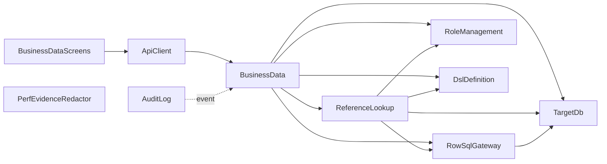

# 部品の一覧（Domain Design）— reference-lookup-cleanup

出典の表記: FR・NFR・A は `aidlc/spaces/default/intents/261029-reference-lookup-cleanup/inception/requirements-analysis/requirements.md`、US・AC・M は `aidlc/spaces/default/intents/261029-reference-lookup-cleanup/inception/user-stories/stories.md` と `aidlc/spaces/default/intents/261029-reference-lookup-cleanup/inception/refined-mockups/` の成果物、K は `aidlc/spaces/default/codekb/mastersmith2/` の所見、Q は `domain-design-questions.md`。

部品はコードとして書く論理の部品で、内部DB（H2）・対象DB（MySQL・MariaDB・PostgreSQL）・make-you-chic-ui・Node の実行環境は部品の外の依存として書く。この Intent で触れる部品だけを載せる。コンテナの版そろえ（FR6）・perf の文書と台本の整理（FR7）・Dependabot の取り込み（FR8）は設定・文書・取り込みで、コードとして書く部品ではないため部品にしない。参照先の行は対象DB のデータで、アプリが独自に持つデータではないため、エンティティとしては書かない。この Intent では内部DB のスキーマを変えず、新しく持つエンティティは無い。

## Part A — 機械が読む一覧

```yaml
components:
  - name: ReferenceLookup
    summary: "新規（`businessdata` の内側）。参照先の行を、利用者の今の作業ロールの権限で読む3つの仕事（REFERENCE の選択肢・LOOKUP のピッカーの検索とラベルの1件読み・作成/更新の保存前の確かめ）の持ち主"
    behaviour: >
      3つの仕事は同じ決まりで動く。(1) 参照先のスキーマ・テーブル・値のカラム・表示のカラム・検索の列は、読み出しのたびに適用中の DSL の名前と照らし、
      DSL に無い名前は拒否する（状態は変わらない）。(2) 利用者の今の作業ロールの権限の写し（PermissionSnapshot）で、参照先のテーブルを読めるかと、
      カラムごとの主権限を判定する。参照元の権限だけを持ち参照先の権限を欠く利用者には選択肢を返さず、主権限が NONE のカラムは応答に含めない（US1.3・US2.1）。
      権限を欠く場合と存在しない場合は、応答から区別できない同じ応答にする（X13）。
      (3) REFERENCE の選択肢は作成・更新の定義の取得のときだけ読み、一覧・詳細の定義では読まない（US3.4）。件数の上限は 200 件で、
      201 件目を読んだ（上限+1件読み）ときは「候補が多い」として選択肢を返さずピッカーへの切り替えを案内する（US1.2）。1回の定義の取得で REFERENCE が複数あっても
      対象DB の読み取りの接続の借りる回数は1回のままにする（AC1.1.5）。
      (4) LOOKUP の検索は検索条件が空なら要求を送らず、1ページ20件で、検索の値の `%`・`_`・エスケープの文字を一致の条件として働かせない。
      ラベルの1件読みは値で1行を引く（更新の画面で保存済みの値のラベルを出す）。
      (5) 保存前の確かめは、作成では参照の項目すべて、更新では更新前の行と比べて値が変わった参照だけについて、参照先の行の存在と読む権限を確かめ、
      無い・読めないときは区別できない同じ応答（409 BUSINESS_REFERENCE_NOT_FOUND）で拒否する。確かめは対象DB の読み取りの接続で先に行い、
      その後で保存する（ADR-003）。確かめと保存の間に参照先が消えるすき間は、対象DB の外部キー違反を同じ誤りに変換する既存の守りに任せる。
      (6) 必須（NOT NULL）の参照項目で読めない、または201件以上あるときの作成は、行き止まりを許容して拒否する（M1）。
      (7) 参照先の行の値・ラベル・主キーの値と対象DB の接続情報は、アプリのログ・トレースの属性・誤りの応答に出さず、行の値を持つ型は `toString` で伏せる。
      参照の値を道（URL）に載せない。SQL は自分では組み立てず、RowSqlGateway に頼む。
    responsibilities:
      - "REFERENCE の選択肢の取得（作成・更新の定義のときだけ、200件の上限、201件目の判定）"
      - "LOOKUP のピッカーの検索（検索条件・1ページ20件・並び順）とラベルの1件読み"
      - "作成・更新の保存前の確かめ（参照先の存在と読む権限、更新は変わった参照だけ）"
      - "参照先の権限の当て方（読めないときは選択肢を返さず、NONE のカラムを含めない）"
      - "参照先の名前を適用中の DSL と照らす（読み出しのたび）"
      - "参照先の読み取りの上限（件数・時間・接続の借りる回数）"
    depends_on:
      - component: RowSqlGateway
        interaction: "参照先の行の読み取り（出すカラムの指定・上限+1件読み・値で1件引く）を頼む"
        style: sync
      - component: RoleManagement
        interaction: "参照先のテーブル・カラムの実効の主権限と補助権限の解決（PermissionSnapshot）"
        style: sync
      - component: DslDefinition
        interaction: "適用中の DSL の参照先の名前・値のカラム・表示のカラム・検索の設定の読み取りと照合"
        style: sync
      - component: TargetDb
        interaction: "対象DB の読み取りの接続（1要求あたり借りる回数1）と DB の種類を受け取る"
        style: sync
    dependents:
      - component: BusinessData
        interaction: "定義の取得・ピッカーの検索・ラベル・作成/更新の保存前の確かめで呼ぶ"
    external_dependencies:
      - name: "対象DB（MySQL・MariaDB・PostgreSQL）"
        kind: database
        purpose: "参照先の行の読み取り（読み取りだけのアカウント。TargetDb が渡す接続を使う）"
    entities: []

  - name: RowSqlGateway
    summary: "既存（`businessdata.repository` の `RowSqlExecutor`・`RowDialect`）。業務データの行の SQL を組み立てて実行する唯一の部品。この Intent で、BusinessData の外にも使われるため独立した部品として扱う"
    behaviour: >
      識別子（スキーマ名・テーブル名・カラム名・並べ替えの列）は適用中の DSL にある名前と照らしてから DB の種類ごとに引用し、値はバインド変数で渡す（PM の Forbidden）。
      DB の種類ごとの差（ページ送り・引用符・NULL の並び・部分一致のエスケープ・時差つきの型）は DB の種類ごとの方言のクラスに閉じ、上の層は DB の種類で分岐しない。
      この Intent では新しいメソッドを足さず、既存の `search`・`detail` に「出すカラムの指定」と「上限+1件読み」を渡せるようにして参照先の読み取りに使い回す（ADR-002）。
      既存の一覧・詳細の振る舞いは変えない。SpotBugs の `SQL_` の除外はメソッド単位のまま増やさない。
      `java.sql.Connection` の `prepareStatement`・`createStatement` を呼んでよい場所はこの部品だけで、`BusinessDataBoundaryArchitectureTest` の許可の一覧は緩めない。
      行の値の型の対応（BIGINT・DECIMAL は文字列、日時はそのまま）は1か所で決める。
    responsibilities:
      - "行の SQL の組み立てと実行（一覧・検索・詳細・一意の事前の問い合わせ・作成・更新・削除）"
      - "識別子の照合と引用、値のバインド"
      - "DB の種類ごとの方言（ページ送り・NULL の並び・エスケープ）"
      - "出すカラムの指定と上限+1件読みの受け口（今回の変更）"
    depends_on:
      - component: TargetDb
        interaction: "対象DB の読み取り・書き込みの接続（DataSource）と DB の種類"
        style: sync
    dependents:
      - component: BusinessData
        interaction: "一覧・詳細・作成・更新・削除の行の SQL を頼む"
      - component: ReferenceLookup
        interaction: "参照先の行の読み取りを頼む"
    external_dependencies:
      - name: "対象DB（MySQL・MariaDB・PostgreSQL）"
        kind: database
        purpose: "行の読み書き"
    entities: []

  - name: BusinessData
    summary: "既存（`businessdata`）。業務データの一覧・詳細・作成・更新・削除の API。この Intent で、作成・更新の定義に参照の項目の情報を載せ、保存前に ReferenceLookup で確かめる"
    behaviour: >
      要求ごとに利用者の今の作業ロールの実効の権限と適用中の DSL から、出すカラム・入力できるカラム・許す操作を求める既存の決まりは変えない。
      この Intent で足すこと: (1) 作成・更新の定義の応答に、参照の項目ごとの情報（REFERENCE は選択肢と、読めない/候補が多いときの入力不可の理由の印、
      LOOKUP は検索条件・一覧のカラム・並び順のピッカーの情報）を載せる。一覧・詳細の定義には載せず、参照先を読まない。
      (2) 作成・更新の保存の前に、ReferenceLookup に参照先の存在と権限の確かめを頼み、拒否なら保存せず 409 BUSINESS_REFERENCE_NOT_FOUND で返す。
      (3) 参照の項目の本文の値も、書けるカラムの決まり（書けないカラムは同じ 400 で拒否）と、一括代入の防止を今までどおり受ける。
      (4) 参照先の確かめの拒否を、既存の監査の出来事の仕組み（対象DB の確定の後に別の短いトランザクションで書く）で理由つきで残す。確かめの読み取りそのものは残さない（US3.3）。
      (5) 一覧・詳細は今のとおり値を出し、参照先を読まない（US3.4）。
      判定の順は 401 → 404 → 403 → 409・403 → 400 → 404（行）→ 業務の失敗（既存）に、参照先の確かめの拒否を保存の直前の業務の失敗として加える。
    responsibilities:
      - "業務データの一覧・詳細・作成・更新・削除の API（既存）"
      - "作成・更新の定義の応答に参照の項目の情報を載せる（今回の変更）"
      - "保存前の参照先の確かめの呼び出しと、拒否の 409 への写し（今回の変更）"
      - "参照先の確かめの拒否の監査の出来事の発行（今回の変更）"
    depends_on:
      - component: ReferenceLookup
        interaction: "選択肢・ピッカーの情報・ラベル・保存前の確かめを頼む"
        style: sync
      - component: RowSqlGateway
        interaction: "一覧・詳細・作成・更新・削除の行の SQL を頼む"
        style: sync
      - component: RoleManagement
        interaction: "作業ロールでのテーブル・カラムの実効の権限の解決"
        style: sync
      - component: DslDefinition
        interaction: "適用中の DSL のテーブル・カラム・主キー・表示・検証・フォーム部品の読み取り"
        style: sync
      - component: TargetDb
        interaction: "読み取り・書き込みの接続の受け取り（対象DB 用のトランザクションは書き込みのときだけ）"
        style: sync
    dependents:
      - component: AuditLog
        interaction: "業務データの出来事の型を使い、確定の後に記録する"
      - component: ApiClient
        interaction: "業務データの API（定義・一覧・詳細・作成・更新・削除・ピッカーの検索・ラベル）"
    external_dependencies: []
    entities: []

  - name: TargetDb
    summary: "既存（`targetdb`）。対象DB の接続先の設定と DataSource、スキーマの読み取り。この Intent で、参照先の読み取りの目的を時間の上限の区分に足す"
    behaviour: >
      接続先と資格情報は環境変数（.env）だけから受け取り、読み取りと書き込みで別の接続・資格情報を持つ。今の境界（書き込み・DDL を発行しない、JdbcTemplate を使わない、
      DSL と web の層を知らない）は保つ。対象DB への問い合わせには目的ごとの時間の上限を付ける決まりに従い、この Intent で、参照先の選択肢・ピッカーの検索・
      ラベルの1件読み・保存前の確かめの読み取りの目的（ReadPurpose）と、その時間の上限の設定（TargetDbProperties.QueryTimeout）を足す。値は NFR 設計で決める。
    responsibilities:
      - "対象DB の接続先の設定（読み取り・書き込み）と DataSource"
      - "目的ごとの問い合わせの時間の上限（参照先の読み取りの目的を足す）"
      - "スキーマの読み取り（既存）"
    depends_on: []
    dependents:
      - component: RowSqlGateway
        interaction: "接続と DB の種類を受け取る"
      - component: ReferenceLookup
        interaction: "読み取りの接続と目的ごとの時間の上限を受け取る"
      - component: BusinessData
        interaction: "接続を受け取る"
    external_dependencies:
      - name: "対象DB（MySQL・MariaDB・PostgreSQL）"
        kind: database
        purpose: "業務データの行・スキーマの読み書き"
    entities: []

  - name: RoleManagement
    summary: "既存（`role`）。ロールと権限の設定、割り当て、作業ロール、実効の権限の解決。この Intent では変えず、参照先のテーブルの権限の判定にも同じ解決の口を使う"
    behaviour: >
      利用者の今の作業ロールで、DSL のテーブル・カラムごとの実効の主権限と補助権限を PermissionSnapshot として返す。参照先のテーブルにも同じ写しを当てる。
      この Intent で変えない。`RoleBoundaryArchitectureTest` の「依存してよい相手」は足さない（businessdata は既に許されている）。
    responsibilities:
      - "実効の権限の解決（EffectivePermissionResolver）と権限の写し（PermissionSnapshot）"
    depends_on: []
    dependents:
      - component: ReferenceLookup
        interaction: "参照先の権限の判定"
      - component: BusinessData
        interaction: "作業ロールでの権限の解決"
    external_dependencies: []
    entities: []

  - name: DslDefinition
    summary: "既存（`dsl`）。適用中の DSL のモデルの提供口。参照（REFERENCE・LOOKUP）の定義は既存で、この Intent では読むだけ"
    behaviour: >
      適用中の DSL のテーブル・カラム・主キー・表示の設定・検索の設定・検証・フォーム部品（REFERENCE の参照先と値/表示のカラム、LOOKUP の検索条件と一覧のカラム）を返す。
      この Intent で DSL の書式は変えない。読み出しのたびに、その時点で適用中の DSL を使う（適用し直しの後に古い名前を使わない）。
    responsibilities:
      - "適用中の DSL のモデルの提供（既存）"
    depends_on: []
    dependents:
      - component: ReferenceLookup
        interaction: "参照先の名前の照合と設定の読み取り"
      - component: BusinessData
        interaction: "テーブル・カラム・主キー・表示・検証・フォーム部品の読み取り"
    external_dependencies: []
    entities: []

  - name: AuditLog
    summary: "既存（`audit`）。各機能の出来事を受け、確定の後に監査の行を追記する。この Intent では、参照先の確かめの拒否の理由を既存の出来事の中で残すだけ"
    behaviour: >
      確定の後に別の短いトランザクションで追記する既存の仕組みは変えない。業務データの出来事に、参照先の確かめの拒否（参照先に無い・読めない）を理由として載せる。
      新しい種類の出来事が要るかは機能設計で決める。確かめの読み取りそのもの（選択肢の取得・ピッカーの検索・ラベル）は記録しない。
      行の値・参照先の値・接続情報は記録に含めない。
    responsibilities:
      - "業務データの出来事の追記（既存）"
    depends_on:
      - component: BusinessData
        interaction: "業務データの出来事の型を使って受ける"
        style: event
    dependents: []
    external_dependencies:
      - name: "内部DB（H2）"
        kind: database
        purpose: "監査の行の追記"
    entities: []

  - name: ApiClient
    summary: "既存（`frontend` の API 呼び出しの部品）。業務データの API を呼ぶ。この Intent で、ピッカーの検索とラベルの API の呼び出しを足す"
    behaviour: >
      要求・応答の型は `unknown` か union で受け、`any` を使わない。業務データの API の呼び出しの形（本文で値を運ぶ、道に主キーを載せない）は変えず、
      ピッカーの検索とラベルの1件読みも同じ形で呼ぶ。
    responsibilities:
      - "業務データの API の呼び出し（既存）とピッカーの検索・ラベルの呼び出し（今回の足し）"
    depends_on:
      - component: BusinessData
        interaction: "HTTP で業務データの API を呼ぶ"
        style: sync
    dependents:
      - component: BusinessDataScreens
        interaction: "画面から API を呼ぶ"
    external_dependencies: []
    entities: []

  - name: BusinessDataScreens
    summary: "既存（`frontend/src/features/tables`）。業務データの一覧・詳細・作成・更新の画面。この Intent で、作成・更新の画面に参照の項目の部品（選択肢・入力不可・ピッカー）を足す"
    behaviour: >
      参照の項目の部品の種類は、定義の応答（サーバー）が決める。画面は `formPart` と選択肢・ピッカーの情報・入力不可の理由の印だけで部品を選び、画面で権限を判定しない（サーバー側が正）。
      足す部品: ReferenceSelectField（REFERENCE の select/radio）、ReadonlyReferenceField（入力不可の項目。保存済みの値を読み取り専用の欄に出し理由を添える）、
      LookupField（読み取り専用の欄にラベルと値を並べ「選ぶ…」「クリア」）、LookupPickerDialog（検索条件＋結果の表＋1行を選ぶダイアログ）。
      make-you-chic-ui の Modal・Table・TextInput・Select・FormField・Button・Alert の組み合わせで作り、新しい上流への依頼は出さない。
      表の横スクロールの領域は既存の `src/shared/scroll-region` で包む。ピッカーのダイアログは `features/tables` に置き、複数の機能で使うことになったら `src/shared/` へ移す。
      参照先の行の値（選択肢・ラベル・検索の値）を `data-testid`・`id`・`document.title`・ログに入れず、ラベルは文字として出す（HTML として描かない）。
      保存の本文には値が変わった項目だけを入れ、入力不可の項目は含めない。必須の参照が入れられない作成では、保存を押したら画面の検証で誤りの文を保ち、サーバーへ送らない（R-10）。
    responsibilities:
      - "作成・更新の画面の参照の項目の部品（ReferenceSelectField・ReadonlyReferenceField・LookupField・LookupPickerDialog）"
      - "入力不可の理由と必須の参照が入れられないときの文言（日英）"
      - "キーボード・読み上げ・狭い画面（375px）での操作"
    depends_on:
      - component: ApiClient
        interaction: "定義・ピッカーの検索・ラベル・保存の API を呼ぶ"
        style: sync
    dependents: []
    external_dependencies:
      - name: "make-you-chic-ui（vendor/make-you-chic-ui の固定先 ecb07e9）"
        kind: other
        purpose: "Modal・Table・TextInput・Select・FormField・Button・Alert"
    entities: []

  - name: PerfEvidenceRedactor
    summary: "新規（`perf/` に置く Node の1ファイル、依存なし）。k6 の結果（summary json）の認証の値（JWT の形）を、記録（`evidence/`）に置く前に自動で伏せる後処理の部品"
    behaviour: >
      入力の JSON を再帰的に読み（入れ子のオブジェクト・配列・長い文字列の中も含む）、JWT の形（`eyJ` で始まるドット区切りの3つの部分）の文字列を `[REDACTED-JWT]` に置き換える。
      JWT 以外の値（数値・場面名・タグ・ほかの文字列）は壊さない。すでに伏せた入力に流しても結果が変わらない（冪等）。
      置換の後に、置換とは独立の検査の関数で JWT の形が残っていないかを確かめ、残っていれば失敗として終わる（要件 FR5 の「残れば失敗」）。
      対象は summary json で、k6 の標準出力・ログは手順で扱う（部品の対象外）。記録を置く手順は必ずこの部品を通す。
      JWT 以外の認証の値（リフレッシュトークン・Authorization ヘッダーの値）は、JWT の形の置換の対象にしない（M2: B）。それらは Gitleaks の検査と手順で扱う。
      確かめは `frontend/` の Vitest と fast-check から呼び（ADR-004）、`./gradlew verify` と CI に入れる。
    responsibilities:
      - "JWT の形の文字列の置換（入れ子・配列・長い文字列の中を含む）"
      - "置換の後の検査（JWT の形が残っていないことの確かめ）"
      - "冪等性と JWT 以外の値を壊さないこと"
    depends_on: []
    dependents: []
    external_dependencies:
      - name: "Node の実行環境（frontend のビルドが既に使うもの）"
        kind: other
        purpose: "後処理の実行と、Vitest からの呼び出し"
      - name: "k6 の summary json"
        kind: other
        purpose: "入力（JWT の形の認証の値が入りうる）"
    entities: []
```

## Part B — 人が読む形

### 部品の図



文字による代わり: 画面（BusinessDataScreens）→ ApiClient → BusinessData。BusinessData は ReferenceLookup・RowSqlGateway・RoleManagement・DslDefinition・TargetDb を呼ぶ。ReferenceLookup は RowSqlGateway・RoleManagement・DslDefinition・TargetDb を呼び、RowSqlGateway は TargetDb を呼ぶ。AuditLog は BusinessData の出来事を受ける。PerfEvidenceRedactor はほかの部品に依存せず、独立している。

### 部品の要約

| 部品 | 目的 | 呼ぶ部品 | 呼ばれる部品 | 持つエンティティ |
|---|---|---|---|---|
| ReferenceLookup（新規） | 参照先を権限で読む3つの仕事 | RowSqlGateway・RoleManagement・DslDefinition・TargetDb | BusinessData | なし |
| RowSqlGateway（既存・独立） | 行の SQL を組み立てて実行する唯一の部品 | TargetDb | BusinessData・ReferenceLookup | なし |
| BusinessData（既存） | 業務データの API と保存前の確かめの呼び出し | ReferenceLookup・RowSqlGateway・RoleManagement・DslDefinition・TargetDb | AuditLog・ApiClient | なし |
| TargetDb（既存） | 対象DB の接続と目的ごとの時間の上限 | — | RowSqlGateway・ReferenceLookup・BusinessData | なし |
| RoleManagement（既存） | 実効の権限の解決 | — | ReferenceLookup・BusinessData | なし |
| DslDefinition（既存） | 適用中の DSL の提供口 | — | ReferenceLookup・BusinessData | なし |
| AuditLog（既存） | 出来事の追記 | BusinessData | — | なし |
| ApiClient（既存） | 業務データの API の呼び出し | BusinessData | BusinessDataScreens | なし |
| BusinessDataScreens（既存） | 作成・更新の画面の参照の部品 | ApiClient | — | なし |
| PerfEvidenceRedactor（新規） | k6 の結果の JWT の自動の伏せ字 | — | — | なし |

### エンティティの持ち主

この Intent で、アプリが独自に持つ新しいエンティティは無い。内部DB のスキーマ（Flyway の移行）は変えない。参照先の行は対象DB のデータで、持ち主はアプリの外（対象DB）にある。

| エンティティ | 持ち主の部品 | 識別子 | 属性 | 参照 |
|---|---|---|---|---|
| （なし） | — | — | — | — |

### 外部の依存

| 部品 | 依存 | 種類 | 目的 |
|---|---|---|---|
| ReferenceLookup・RowSqlGateway・TargetDb | 対象DB（MySQL・MariaDB・PostgreSQL） | database | 参照先の行の読み取り（読み取りだけのアカウント） |
| AuditLog | 内部DB（H2） | database | 監査の行の追記 |
| BusinessDataScreens | make-you-chic-ui（固定先 ecb07e9） | other | Modal・Table・TextInput・Select など |
| PerfEvidenceRedactor | Node の実行環境・k6 の summary json | other | 後処理の実行と入力 |

### 要件の対応と、部品にしないもの

| 要件 | 受け持つ部品 |
|---|---|
| FR1 REFERENCE の選択肢 | ReferenceLookup・BusinessData・BusinessDataScreens |
| FR2 LOOKUP の参照ピッカー | ReferenceLookup・BusinessData・ApiClient・BusinessDataScreens |
| FR3 作成・更新での参照先の確かめ | ReferenceLookup・BusinessData・AuditLog |
| FR4 一覧・詳細（変えない） | BusinessData（確かめるだけ） |
| FR5 k6 の結果の JWT の自動の伏せ字 | PerfEvidenceRedactor |
| FR6 コンテナの版そろえ | 部品なし（compose.yaml と手順。`docker inspect` で確かめる） |
| FR7 perf の文書と台本の整理 | 部品なし（文書） |
| FR8 Dependabot の取り込み | 部品なし（依存の更新） |

### 根拠（Rationale）

| 部品 | 別の部品である理由 |
|---|---|
| ReferenceLookup | 参照先の権限の判定・上限・存在の確かめという、BusinessData とは別の変わる理由を持つ。BusinessData の責務がすでに大きい（Q1: A、ADR-001） |
| RowSqlGateway | BusinessData と ReferenceLookup の両方が行の SQL を頼むため、どちらの内側にも置くと呼び合いの循環ができる。独立した部品にすると循環が無くなる（ADR-002） |
| PerfEvidenceRedactor | アプリの実行時の部品と変わる理由・動く場所が異なる（記録を置く手順の後処理）。ほかの部品に依存しない（ADR-004） |
| BusinessData・TargetDb・AuditLog・ApiClient・BusinessDataScreens | 既存の部品。この Intent の変更の範囲が部品ごとに分かれるため、それぞれを載せる |

**Alternatives Rejected**（部品の分け方の候補）: 参照先の仕事を BusinessData に足す案（Q1: B）は、BusinessData が一覧・詳細・作成・更新・削除に加えて参照先の権限と上限まで持つことになり、責務が広がりすぎるため採らなかった。伏せ字を k6 の台本の `handleSummary` に置く案（Q4: B）は、既存の結果や別の出力の経路に効かないため採らなかった。詳しくは `decisions.md`。
