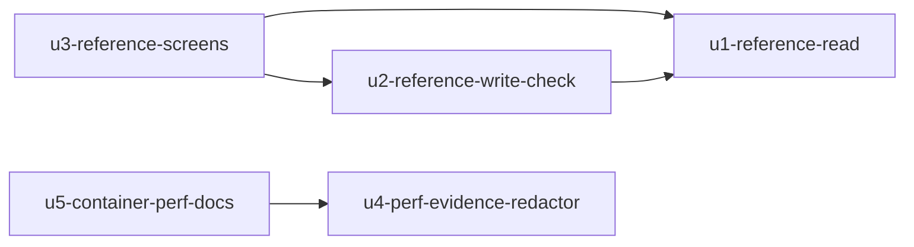

# 単位の依存（Units Generation）— reference-lookup-cleanup

出典: 単位の定義は `aidlc/spaces/default/intents/261029-reference-lookup-cleanup/inception/units-generation/unit-of-work.md`、部品は `aidlc/spaces/default/intents/261029-reference-lookup-cleanup/inception/domain-design/components.md`、決定は `aidlc/spaces/default/intents/261029-reference-lookup-cleanup/inception/domain-design/decisions.md`、要件は `aidlc/spaces/default/intents/261029-reference-lookup-cleanup/inception/requirements-analysis/requirements.md`、ストーリーは `aidlc/spaces/default/intents/261029-reference-lookup-cleanup/inception/user-stories/stories.md`。依存の張り方は Q5: A（コードやテストが実際に要る向きだけ）。

この文書は、何が何に依存できるか（形）だけを書く。作る順や、どれを先に出すかは Delivery Planning が決める。

## 依存の図



文字による代わり: U2 は U1 に依存する。U3 は U1 と U2 に依存する。U5 は U4 に依存する。U1 と U4 はどこにも依存しない。

## 依存の理由

| 依存 | 理由 |
|---|---|
| U2 → U1 | 保存前の確かめは、U1 が作る参照先を読む部品（`ReferenceLookup`）と、行の読み取りの口（`RowSqlGateway` の出すカラムの指定・上限+1 件読み）、参照先の権限の当て方を使う（ADR-001・ADR-002・ADR-003） |
| U3 → U1 | 画面は、U1 が定義の応答に載せる参照の項目の情報と、ピッカーの検索・ラベルの API を呼ぶ。画面のテストと E2E は、本物の API を要る |
| U3 → U2 | 代表の E2E と、保存の確かめを通す画面のテスト（必須の参照の拒否・値が変わった参照だけの確かめ）は、U2 の保存前の確かめを通る（Q5: A） |
| U5 → U4 | 同じ `perf/README.md` を触る。U4 が書く伏せ字の手順の節を、U5 が整理した README に収めるため、U5 は U4 の後で整理する（Q4: A）。これはコードやテストが要る向きではなく、文書の衝突を避けるための順の依存で、Q5 の方針（コードやテストが要る向きだけ）の例外として Q4 の答えで張った |

### Delivery Planning への引き継ぎ（順の論点）

- US3.5 の性能の確かめに使う k6 の新しい場面（選択肢・ピッカーの検索）は Build and Test で `perf/k6/scenarios.js` に足す。U5 は同じファイルの合否の線を `thresholdsFor` の 1 か所に集める。どちらを先にするか（U5 の整理の後に場面を足すか、場面を足した後に U5 で整理するか）は、依存の形では決めず、Delivery Planning で決める（ストーリーの「ストーリーの依存」の節の群4 の注記）。
- U5 のコンテナの入れ替え（Mailpit のメールが消える作業）をどの Bolt の前後で行うかも、Delivery Planning で決める。

## 単位の間の連携点（契約の候補）

| 連携点 | 提供する単位 | 使う単位 | 内容 |
|---|---|---|---|
| 参照先を読む部品（`ReferenceLookup`） | U1 | U2 | 参照先の行の存在と読む権限の確かめの口。U2 は同じ決まり（DSL の名前の照合・権限の写し・上限）で呼ぶ |
| 行の読み取りの口（`RowSqlGateway`） | U1 | U2 | 出すカラムの指定と上限+1 件読み。既存の一覧・詳細は既定の値で今のまま |
| 定義の応答の参照の項目の情報 | U1 | U3 | REFERENCE の選択肢と入力不可の理由の印、LOOKUP のピッカーの情報（形は Contract Design で決める） |
| ピッカーの検索・ラベルの API | U1 | U3 | 検索の条件・ページ・値で 1 件引く形（形・同じ応答の状態コードと `code` は Contract Design で決める） |
| 保存前の確かめの拒否（409 `BUSINESS_REFERENCE_NOT_FOUND`、項目の誤り） | U2 | U3 | 画面が項目の近くに誤りを出す。必須の参照が入れられないときは画面の検証でも保つ |
| 監査の出来事（理由 `REFERENCE_NOT_FOUND`） | U2 | 既存の AuditLog | 確定の後に別の短いトランザクションで追記する既存の仕組み |
| JWT の伏せ字の手順 | U4 | U5 | `perf/README.md` の伏せ字の節。U5 が整理した README に収める |

外部への公開の契約は無い（アプリの外に出す API は足さない）。連携点の形は Contract Design で決める。

## 並行して進められる単位

依存の無い組は、並行して作れる（複数の順序が成り立つ）。

- U1 と U4（どちらも依存なし）
- U2 と U4、U3 と U4（U4 はほかの参照の単位と依存が無い）
- U1 の後で U2 を、その後で U3 を作る流れと、U4 の後で U5 を作る流れは、互いに独立している

U5 は U4 の後でなければ作れない。U2・U3 は U1 の後でなければ作れない。

## 機械が読む一覧

```yaml
units:
  - name: u1-reference-read
    kind: service
    depends_on: []
  - name: u2-reference-write-check
    kind: service
    depends_on: [u1-reference-read]
  - name: u3-reference-screens
    kind: ui
    depends_on: [u1-reference-read, u2-reference-write-check]
  - name: u4-perf-evidence-redactor
    kind: library
    depends_on: []
  - name: u5-container-perf-docs
    kind: packaging
    depends_on: [u4-perf-evidence-redactor]
```

## Sources

- 部品: `aidlc/spaces/default/intents/261029-reference-lookup-cleanup/inception/domain-design/components.md`
- 決定: `aidlc/spaces/default/intents/261029-reference-lookup-cleanup/inception/domain-design/decisions.md`
- 要件: `aidlc/spaces/default/intents/261029-reference-lookup-cleanup/inception/requirements-analysis/requirements.md`
- ストーリー: `aidlc/spaces/default/intents/261029-reference-lookup-cleanup/inception/user-stories/stories.md`（「ストーリーの依存」の節）
- 質問と答え: `aidlc/spaces/default/intents/261029-reference-lookup-cleanup/inception/units-generation/units-generation-questions.md`（Q4・Q5）

## Assumptions & Open Questions

None.
