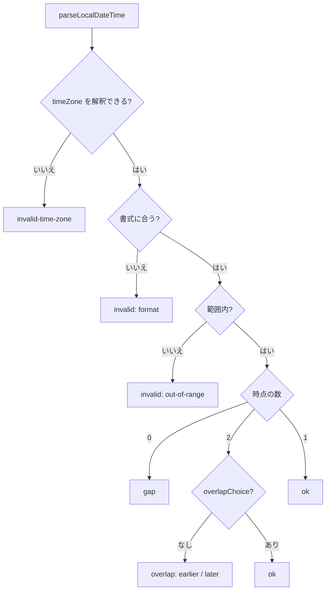
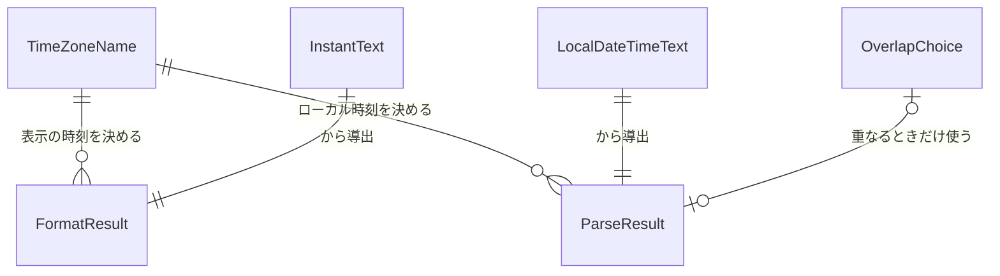

# 機能仕様 — u1-time-zone-conversion

出典: 単位 U1（`inception/units-generation/unit-of-work.md`）、契約 C1（`inception/contract-design/contract-summary.md`）、`entities.md`・`rules.md`、質問と答え（`functional-design-questions.md`: Q1: A・Q2: A）。

U1 は、画面の側の純粋な変換の関数群（置き場は `frontend/src/shared/format/`）。この文書は、各関数の流れ（手順の並び）と結果の種別の遷移の正とする。実装の型・関数名は Code Generation で決める。

**この単位が実装するストーリー（`stories.md`）**: US2.5（往復の部分）、US2.1・US2.3・US2.4 の変換の部分、US1.2 の名前の解釈の部分（`unit-of-work-story-map.md` の「関わる単位」）。主の単位は U2・U4。

## 1. 関数ごとの流れ

### 1.1 formatInstant（時点 → 表示の文字。BR1.1〜BR1.5・BR1.12）

1. 入力: 時点の文字（`raw`）、`timeZone`、（任意）`fractionDigits`。
2. `timeZone` を解釈できなければ `{kind: "invalid-time-zone"}` を返して終わる（BR1.12）。
3. `raw` が `YYYY-MM-DDTHH:mm:ss[.fraction](Z|z|±hh:mm)` の形で、日付・時刻が範囲内か確かめる。読めなければ `{kind: "unreadable", raw}` を返して終わる（BR1.5）。
4. 時点を `timeZone` の壁時計（年月日時分秒）と、その時点の時差に直す（夏時間は時点ごと。BR1.3・BR1.4）。
5. 端数を、元の `raw` の桁のまま並べる。`fractionDigits` が渡され、元の桁が短いときだけ 0 を足す（BR1.1）。
6. 時差を `±HH:mm`（秒が 0 でないときだけ `±HH:mm:ss`）にする（BR1.2）。
7. `{kind: "ok", text: "YYYY-MM-DD HH:mm:ss[.fraction] ±HH:mm"}` を返す。

### 1.2 parseLocalDateTime（ローカル時刻 → 時点。BR1.6〜BR1.9・BR1.12）

1. 入力: ローカル時刻の文字、`timeZone`、（任意）`overlapChoice`。
2. `timeZone` を解釈できなければ `{kind: "invalid-time-zone"}` を返す（BR1.12）。
3. 文字を `YYYY-MM-DD HH:mm:ss[.1〜6桁]` の正規の形と照らす。合わなければ `{kind: "invalid", reason: "format"}`（BR1.6）。
4. 日付が暦に存在するか（月ごとの日数・うるう日）、時 00〜23・分と秒 00〜59、年 0001〜9999 を確かめる。外れたら `{kind: "invalid", reason: "out-of-range"}`（BR1.6）。
5. その壁時計を持つ時点が `timeZone` で何通りあるかを求める。
   - **0通り**（夏時間で飛ばされる）: `{kind: "gap"}`（BR1.7）。
   - **2通り**（夏時間の切り戻しで重なる）: `overlapChoice` が `earlier` なら先、`later` なら後の時点で ok。無いときは `{kind: "overlap", earlier, later}`（BR1.8）。
   - **1通り**: その時点で ok。
6. ok の時点は UTC の `YYYY-MM-DDTHH:mm:ss[.fraction]+00:00`（端数は入力の桁のまま）で返す（BR1.9）。

### 1.3 canInterpretTimeZone（BR1.10）

1. 名前が空・固定のオフセット表記（`+09:00`・`Z` など）なら偽。
2. `Intl.DateTimeFormat` に `timeZone` として渡して例外が出なければ真、出れば偽。

### 1.4 preserveInstant（BR1.11）

1. `raw` をそのまま返す（正規化・丸め・タイムゾーンの変換をしない）。

### 1.5 compareInstants（BR1.15）

1. 2つの時点の文字を、それぞれ時点に読む。どちらかが読めなければ「読めない」を返す。
2. 時点の前後を比べ、負・0・正を返す（端は含む。始まり＝終わりは誤りにしない）。

## 2. 結果の種別の遷移

関数は例外を投げず、結果の種別で返す。状態を持たないため、種別は入力から決まる（遷移ではなく分岐）。

## 3. エンティティの関係（導出。`entities.md` の YAML が正）

## 4. 決まりの要約（導出。`rules.md` の YAML が正）

BR1.1〜BR1.15 のとおり（`rules.md` の一覧）。ここでは、ストーリーとの対応だけ示す。

| ストーリー | 決まり |
|---|---|
| US2.1（表示。AC2.1.1・AC2.1.4・AC2.1.5・AC2.1.6の画面の側） | BR1.1〜BR1.5 |
| US2.3（入力。AC2.3.1・AC2.3.3・AC2.3.4・AC2.3.5） | BR1.6〜BR1.9 |
| US2.4（検索。AC2.4.1・AC2.4.2・AC2.4.4） | BR1.7・BR1.9・BR1.15 |
| US2.5（往復。AC2.5.1・AC2.5.3・AC2.5.4・AC2.5.5） | BR1.8・BR1.11・BR1.13 |
| US1.2（名前の解釈・1か所。AC1.2.4・AC1.2.6） | BR1.10・BR1.12・BR1.14 |

## 5. 契約 C1 との差（承認済みの契約は書き換えず、ここに記録する）

- 契約 C1 に無い関数 `compareInstants` を足した（BR1.15。範囲の検索の前後の確かめに要る。AC2.4.2）。契約の「持ち主の決まり」では、足すだけの変更は安全（呼ぶ側が知らない関数を使わないだけ）。
- 契約 C1 の `parseLocalDateTime` の結果の種別に、`invalid-time-zone` を足した（BR1.12。解釈できない名前を渡された呼ぶ側の誤りを、既定への黙った置き換えにせず返すため）。`invalid` に `reason`（`format`・`out-of-range`）を足した（誤りの文を出し分けるため）。
- 契約 C1 の `formatInstant` に、読めないときの結果 `unreadable`（`raw` に元の文字）を足した（BR1.5・質問 Q2: A）。
- 入力の書式は、画面イメージの案内（`YYYY-MM-DD HH:mm:ss`、端数は任意）どおり、厳密に1つにした（質問 Q1: A。`T` の区切り・秒の省略・端数 7 桁以上は誤り）。

## 6. 後の段（NFR Requirements 以降）へ回す点

- 実装の型・関数名・`Intl` を使った壁時計と時差の求め方の細部（`formatToParts`・`timeZoneName: 'longOffset'` の使い方、年 0001〜0999 の扱い）は、NFR Design の捨ての試し（ブラウザの `Intl` の IANA の版による違い。ADR-009）と Code Generation で決める。
- `Intl.supportedValuesOf('timeZone')` が使えるブラウザの範囲は、U2（選択の一覧）の NFR Requirements で決める（U1 は選択の一覧を作らない）。

## Sources

- Initial description: N6（業務データの日時のタイムゾーンの変換）と画面の仕上げの Intent [desc]
- Workflow-selected scope: classic [scope]
- 単位: `aidlc/spaces/default/intents/261102-timezone-ui-polish/inception/units-generation/unit-of-work.md`・`unit-of-work-story-map.md`
- 契約: `aidlc/spaces/default/intents/261102-timezone-ui-polish/inception/contract-design/contract-summary.md`（C1・C4）
- 要件: `aidlc/spaces/default/intents/261102-timezone-ui-polish/inception/requirements-analysis/requirements.md`
- 質問と答え: `aidlc/spaces/default/intents/261102-timezone-ui-polish/construction/u1-time-zone-conversion/functional-design/functional-design-questions.md`（Q1: A・Q2: A）

## Assumptions & Open Questions

- [assumption] 時差の秒が 0 でない場合（歴史的な時差。例: 古い年の `Asia/Tokyo`）は `±HH:mm:ss` で出す（BR1.2）。要件にない細部のため、NFR Design の捨ての試しで、ブラウザの `Intl` が秒の時差を返すかを確かめる。
- 「後の段へ回す点」の表のとおり。
