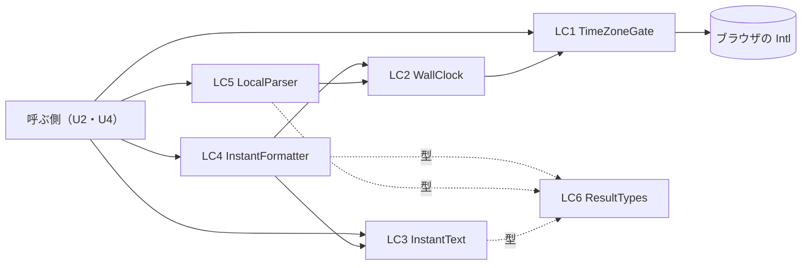

# 論理の部品 — u1-time-zone-conversion

出典: 機能設計（`construction/u1-time-zone-conversion/functional-design/functional-spec.md`・`rules.md`・`entities.md`）、NFR Requirements（`nfr-requirements/security-requirements.md`・`tech-stack-decisions.md`）、`security-design.md`（同じ段）、質問と答え（`nfr-design-questions.md` の Q1: A・Q2: A・Q3: A）、契約 C1・C4（`inception/contract-design/contract-summary.md`）。

U1 は、画面の側の純粋な変換の関数群（種類 library）。サーバー・対象DB・内部DB・ネットワークを使わず、状態を持たない。この文書は、論理の部品の一覧・部品どうしの依存・失敗の及ぶ範囲・共有する資源と、性能の設計（種類 library は独立した性能の設計の文書を作らないため LC7 に置く）を決める。実装のファイル名・関数名は Code Generation で決める（ここの部品の名前は論理の名前）。

設計の決定の番号は `LC<n>`（この文書の中で定義する番号）。

## LC1〜LC6. 部品の一覧

| ID | 論理の部品 | 責務 | 持つ状態 |
|---|---|---|---|
| LC1 | TimeZoneGate | 名前の検査（`security-design.md` の SD4.1）と、`Intl.DateTimeFormat` の取り出し。名前をキーにした整形器のキャッシュ（上限 128 件）を持つ。`canInterpretTimeZone` を公開する | 整形器のキャッシュ（閉じた `Map`。SD5.1） |
| LC2 | WallClock | 時点（UTC の秒）→ タイムゾーンの壁時計（年月日時分秒）と時差の秒。壁時計 → 候補の時点の一覧（0・1・2 通り）。`formatToParts` の数字を読むだけで、`longOffset` は使わない（Q1: A）。年が 0001〜9999 を外れる結果は「範囲外」として返す（Q2: A） | なし（LC1 の整形器を呼ぶだけ） |
| LC3 | InstantText | 時点の文字の厳密な読み取り（`security-design.md` の SD1 の検査の順序）と、UTC の時点の文字（`YYYY-MM-DDTHH:mm:ss[.fraction]+00:00`）の組み立て。端数は元の文字のまま保つ。`preserveInstant`（恒等）・`compareInstants`（時点の大小）を公開する | なし |
| LC4 | InstantFormatter | `formatInstant`: LC3（読む）→ LC2（壁時計と時差）→ 表示の文字 `YYYY-MM-DD HH:mm:ss[.fraction] ±HH:mm[:ss]` | なし |
| LC5 | LocalParser | `parseLocalDateTime`: ローカル時刻の厳密な読み取りと範囲の確かめ（SD1）→ LC2（候補の時点）→ 0 通りは `gap`・2 通りは `overlap`（または選んだ側の `ok`）・1 通りは `ok` | なし |
| LC6 | ResultTypes | 結果の判別可能な union（`FormatResult`・`ParseResult`・`CompareResult`）と、その `kind` の値。例外を投げない型の置き場。公開の入口（名前付きのエクスポートだけ）を1つにまとめる | なし |

文字による代わりの図: 呼ぶ側 → LC4・LC5・LC3・LC1。LC4 → LC3・LC2。LC5 → LC2。LC2 → LC1。LC1 → ブラウザの `Intl`。LC3〜LC5 は型を LC6 から借りる。`Intl` に触れるのは LC1・LC2 だけで、`try`（SD1.5）もこの2つの内側に閉じる。

**依存の向き（コード生成の境界の検査）**: LC4・LC5 → LC2・LC3 → LC1 の一方向にし、逆向きの import を作らない。`frontend/src/shared/format/` の中に置く既存の `formatDateTime.ts`（DSL・招待の管理が使う別の関数）には、U1 から依存しない（ふるまいを変えない）。この向きの確かめは、コード生成の単体テストの範囲（import の検査を足すかは計画で決める。ESLint の `no-restricted-imports` の上書きでも守れる）。

## LC7. 性能の設計（NFR2.1.1〜NFR2.1.3）

| ID | パターン | 設計 | 根拠 |
|---|---|---|---|
| LC7.1 | 整形器の使い回し | タイムゾーンの名前ごとに `Intl.DateTimeFormat` を1つ作り、LC1 のキャッシュに入れる。1つの値の変換は、`formatToParts` を1回呼ぶだけ（壁時計と時差を同じ呼び出しの結果から求める。時差は壁時計と元の時点の差） | 捨ての試し: 使い回すと1万の値で約 58〜67 ミリ秒（1つあたり約 0.006 ミリ秒）。使い回さないと1つあたり約 0.04 ミリ秒（1万で約 400 ミリ秒）で目標（500 ミリ秒・0.05 ミリ秒）に近い |
| LC7.2 | 入力の検査を軽く保つ | 検査は、長さの確かめ（O(1)）→ 固定の正規表現（長さに比例）→ 範囲の比較だけ。変換のたびに新しい正規表現を作らず、モジュールの定数にする | 正規表現の生成は一度だけにできる |
| LC7.3 | 書き込みの側は重くしてよい | `parseLocalDateTime` は、入力の1つにつき壁時計の計算を最大 4 回（前後 24 時間の時差の2回と、候補の確かめ最大2回）行う。一覧の表示と違い、利用者の入力 1 件につき 1 回だけ呼ばれる（1万の値を一度に変換しない）ため、目標の対象に含めない | 捨ての試し: 夏時間の存在しない・重なる時刻・30 分の夏時間（`Australia/Lord_Howe`）で、4 回以内で正しく数えられた |

**測りの再現（Code Generation と Build and Test）**: NFR2.1.1・NFR2.1.2 は、実装の単体テスト（jsdom）で、固定の時点 1 万個（夏時間の地域・端数の桁 0・3・6 を混ぜる）を `formatInstant` に通して `performance.now()` の差で測り、測った環境（Node の版・CPU）を成果物に書く。捨ての試しの値（約 60 ミリ秒）は、整形器を使い回した最小の実装の値で、本番の実装（入力の検査と文字の組み立てを足す）では増える。目標（500 ミリ秒・0.05 ミリ秒）に対する余裕は約 8 倍あり、足す処理が数倍にならない限り目標内に収まる見込み。外れたときは、目標を緩めず、原因を確かめて依頼者に諮る（`team.md`）。NFR2.1.3（整形器の生成回数）は、単体テストで、同じ名前で 1 万回呼んでも生成が 1 回であることを数えて確かめる。

## LC8. 失敗の領域と、及ぶ範囲（爆発半径）

| ID | 失敗 | 及ぶ範囲 | 守り |
|---|---|---|---|
| LC8.1 | 変換の誤り（夏時間の判定・端数・時差のずれ） | 業務データの時点を表示・入力する画面すべて（U2 の設定の画面・U4 の一覧・詳細・作成・更新）。誤った時点は、保存すると業務データを壊す | BR1.13 の往復の性質ベースのテスト、日付の変わり目・夏時間・端数の単体テスト（SD7.7）。保存する値は `preserveInstant` で元の文字のまま送り、表示用の文字から作り直さない（BR1.11） |
| LC8.2 | `Intl` が使えない・名前が解釈できない | その名前を選んだ利用者の画面だけ | `canInterpretTimeZone` が偽を返し、呼ぶ側がブラウザのタイムゾーンで見せる（BR1.10・U2）。`invalid-time-zone` を返し、既定へ黙って代えない（SD4.3） |
| LC8.3 | 異常な入力・実行時に型が崩れた応答 | 呼んだ画面の1つの値の表示だけ | 結果の種別で返し、例外にしない（SD1）。呼ぶ側は元の文字をそのまま出す（BR1.5） |
| LC8.4 | キャッシュの不整合 | なし（結果はキャッシュの有無で変わらない。SD5.1） | 上限を超えたら全体を捨てて作り直す |

U1 は、状態・外部の依存・ネットワークを持たないため、可用性・拡張・復旧の設計は要らない（失敗は呼び出しの中で完結し、ほかの利用者・要求に伝わらない）。

## LC9. 共有する資源

- 共有する資源は、LC1 の整形器のキャッシュだけ（モジュールの中の閉じた `Map`）。外へ公開せず、結果に影響しない（SD5.1）。ブラウザの画面は1つの JavaScript の実行環境で動くため、複数の要求が競り合う状況は無い（`Intl` の呼び出しは同期）。
- ブラウザの `Intl` の IANA のデータは、ブラウザごとに版が異なる（ADR-009）。U1 はこれに頼る。Chromium 156 と Node 26 で結果が一致することを確かめ（Q3: A）、Firefox・Safari は未確認として記録する。

## NFR のパターンの当てはめ

| NFR | パターン | 当てはめる部品 |
|---|---|---|
| NFR1.4.1 | 型・長さ・書式・範囲の順の検査、結果の種別で返す | LC3・LC5・LC1（SD1） |
| NFR1.4.2 | 出力は文字、DOM に触れない | 全部品（SD2） |
| NFR1.4.3 | 値を外へ出さない | 全部品（SD3） |
| NFR5.2.1 | タイムゾーンの明示・固定のロケール・`invalid-time-zone` | LC1・LC2（SD4） |
| NFR5.2.2 | 純粋な関数・閉じたキャッシュ | LC1（SD5） |
| NFR2.1.x | 整形器の使い回し・軽い検査 | LC1・LC2・LC4（LC7） |
| NFR5.1.1 | 日時の必須のテスト | 全部品（SD7.7） |
| NFR1.5.x | 依存を足さない・ソースの決まり | 全部品（SD6） |

## 承認済みの記録との差（承認済みの文書は書き換えず、ここに記録する）

| ID | 差 | 理由 | 決定 |
|---|---|---|---|
| D1 | `tech-stack-decisions.md` の表は、時差を `timeZoneName: 'longOffset'` で求めるとしていたが、壁時計の数字と元の時点の差から求める（`longOffset` は使わない）。「`formatToParts` で数字を取る」は同じ | 捨ての試しで、秒まで同じ時差が求まった（`America/New_York` の切り替えの 1 秒前 -18000 秒・切り替えの瞬間 -14400 秒、`Asia/Tokyo` の 1800 年 +33539 秒 = +09:18:59）。夏時間の判定に壁時計の差の部品が要るため、時差の求め方を1つにでき、古い Safari（`longOffset` が使えない版）でも動く | Q1: A |
| D2 | 機能設計 BR1.5 は「日付・時刻が範囲外」の読めない時点を `unreadable` とする。この段で、**入力の時点は読めるが、表示のタイムゾーンへ直した結果の年が 0001〜9999 を外れる**場合も `unreadable`（`raw` に元の文字）とする | 捨ての試しで、`9999-12-31T23:59:59Z` を `Asia/Kolkata` に直すと 10000 年になった。表示の形 `YYYY-MM-DD …` に収まらず、時点に読み戻せない。新しい結果の種別を足さずに済む | Q2: A。BR1.13（往復）の性質ベースのテストは、表示の年が 0001〜9999 に収まる時点に絞る |
| D3 | `tech-stack-decisions.md` の 3 節は、ブラウザごとの違いを「実際のブラウザの E2E」で確かめるとしていたが、Chromium（E2E が使う）だけを確かめ、Firefox・Safari は未確認（Unverified）とする | この PC の Playwright に Chromium だけが入っている。Q1: A で、使う機能が標準の古くからある部分（`timeZone`・`formatToParts`）だけになり、違いは IANA のデータの版に限られる | Q3: A。持ち主の段は Deployment Execution のスモークテスト（依頼者が実際の画面で見る） |
| D4 | `security-requirements.md` の前提 [assumption]（日時の文字の長さの上限は NFR Design で決める）を、時点 40・ローカル時刻 26・名前 64 に決める。名前の検査に、使える文字（英数字・`_`・`-`・`+`・`/`）と固定のオフセット表記の除外を足す（BR1.10 の具体化） | 捨ての試しで、`+09:00`・小文字の `asia/tokyo`・`EST` が `Intl` に受け付けられることが分かった。固定のオフセット表記は BR1.10 が解釈できないとするため、`Intl` に渡す前に弾く必要がある | 質問にせず決定（上限は「決まっていること」に書いた） |

## 捨ての試しの結果（要点。詳細は `nfr-design-questions.md`）

- Node 26.13.0（ICU 78.3、tzdata 2026e）と Chromium 156（`ja-JP`・`ar-EG`・`en-US` のロケールと別々の既定のタイムゾーン）で、時差の秒・夏時間・年の端・名前の解釈が一致した。
- 時差の秒つき（`GMT+09:18:59`）は、実際に返る。
- 試しのコードはリポジトリの外に置き、コミットしていない。Firefox・Safari は未確認。

## Sources

- Initial description: N6（業務データの日時のタイムゾーンの変換）と画面の仕上げの Intent [desc]
- Workflow-selected scope: classic [scope]
- 機能設計: `aidlc/spaces/default/intents/261102-timezone-ui-polish/construction/u1-time-zone-conversion/functional-design/functional-spec.md`・`rules.md`・`entities.md`
- NFR Requirements: `aidlc/spaces/default/intents/261102-timezone-ui-polish/construction/u1-time-zone-conversion/nfr-requirements/security-requirements.md`・`tech-stack-decisions.md`
- セキュリティの設計: `aidlc/spaces/default/intents/261102-timezone-ui-polish/construction/u1-time-zone-conversion/nfr-design/security-design.md`
- 契約: `aidlc/spaces/default/intents/261102-timezone-ui-polish/inception/contract-design/contract-summary.md`（C1・C4）
- 質問と答え: `aidlc/spaces/default/intents/261102-timezone-ui-polish/construction/u1-time-zone-conversion/nfr-design/nfr-design-questions.md`（Q1: A・Q2: A・Q3: A）

## Assumptions & Open Questions

- [assumption] 本番の実装の性能は、捨ての試しの値（約 60 ミリ秒 / 1 万の値）の数倍までで目標内に収まる見立て。実際の値は、Code Generation の単体テストと Build and Test で測って確かめる（LC7）。
- [assumption] 夏時間の判定は、壁時計の前後 24 時間の時差から候補を作る。24 時間以内に切り替えが2回ある地域は無い見立て。捨ての試しで、1 日が丸ごと飛ぶ切り替え（`Pacific/Apia` の 2011-12-30 12:00、`Pacific/Kwajalein` の 1993-08-21 12:00）は、前後 24 時間の時差が違うため 0 通り（`gap`）になることと、`Intl.supportedValuesOf('timeZone')` の 418 地域 × 切り替えの前後の 40 点（計 16,720 点）で、30 分刻みの総当たりが 1 通り以上と数える時刻を、0 通り（`gap`）と誤って数えた例が無いことを確かめた（0 通りの取りこぼしだけを見た確かめで、2 通りを 1 通りと数える取りこぼしは見ていない）。実装後の確かめは、Code Generation の単体テストで行う。
- 未確認（Unverified）: Firefox・Safari での値（持ち主の段は Deployment Execution のスモークテスト）。
- 未解決の点は、上のほか無い。
