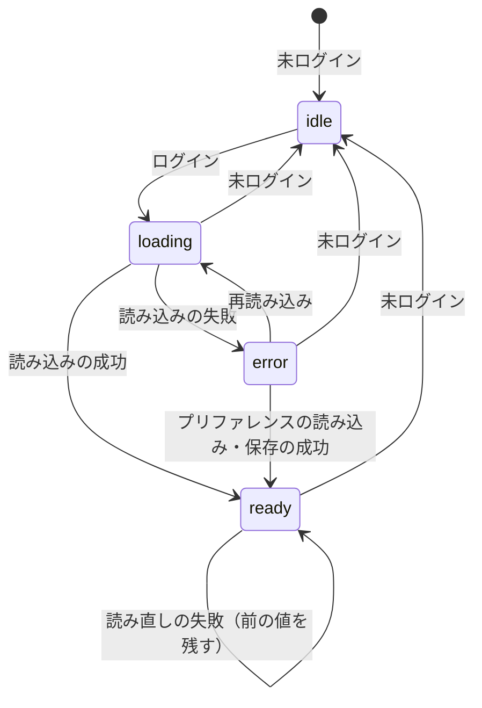
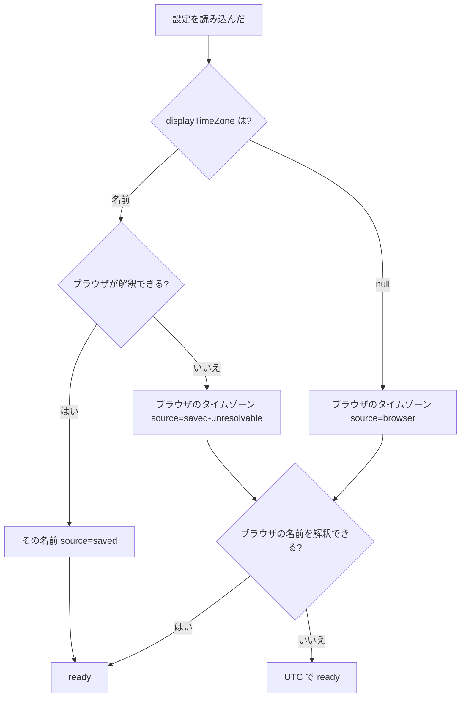
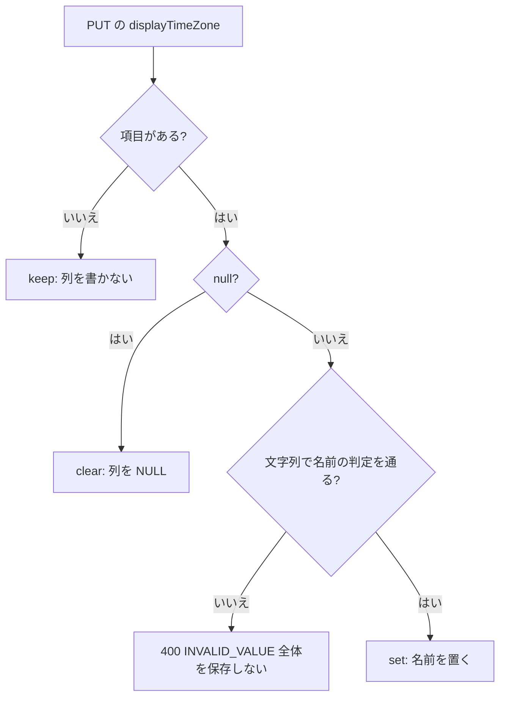
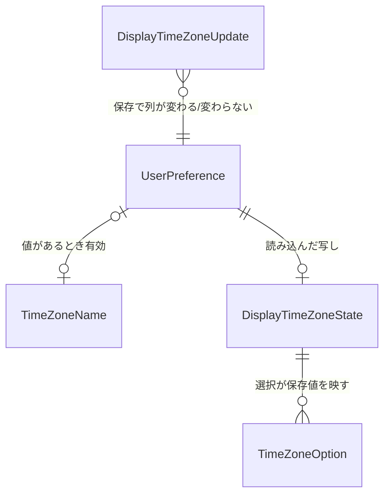

# 機能仕様 — u2-display-time-zone

出典: 単位 U2（`inception/units-generation/unit-of-work.md`）、契約 C2・C3（`inception/contract-design/contract-summary.md`）、`entities.md`・`rules.md`、画面イメージ S1（`inception/refined-mockups/mockups.md`）、質問と答え（`functional-design-questions.md`: Q1: B・Q2: C・Q3: A）。

U2 は、表示のタイムゾーンの設定の API（バックエンド）・プリファレンスの選択・配布・管理の画面の時刻の単位（service、アプリと画面の両方に入る）。この文書は、各流れの手順の並びと状態の遷移の正とする。型名・クラス名・部品の置き方は Code Generation で決める。画面の部品の構成は `frontend-components.md`。

**この単位が実装するストーリー（`stories.md`）**: US1.1（主）、US1.2（主）、US5.3 の一部（列を足すだけの互換。AC5.3.1）。US5.2 のうちプリファレンスの画面の axe（AC5.2.1〜AC5.2.3）。

## 1. 流れ

### 1.1 自分の設定を読む（BR2.6・BR2.7・BR2.11）

1. 認証の主体から本人の行を決める（未認証は 401）。
2. 氏名・言語・テーマ・文字の大きさ・表示のタイムゾーン（無ければ `null`）の5つを返す。表示のタイムゾーンの名前は再検証しない。
3. 本人の行が消えていれば、今の `AUTHENTICATION_REQUIRED`（401）。

### 1.2 自分の設定を保存する（BR2.2〜BR2.5・BR2.7〜BR2.10）

1. 本文を読む。`displayTimeZone` は、項目が無い（keep）・`null`（clear）・文字列（set）・文字列でない型（名前として通らない値で set）に分ける。本文の知らない項目・他人を指す項目は読み捨てる。
2. 既存の4項目を今のとおり検証する。
3. set のとき名前を `TimeZoneName` の判定（集合への完全一致、1〜64 文字）に通す。通らなければ `displayTimeZone` の `INVALID_VALUE` を誤りに加える。
4. 誤りが1件でもあれば、誤りを項目の順（氏名・言語・テーマ・文字の大きさ・`displayTimeZone`）に並べて 400 `VALIDATION_FAILED` で終える。内部DB は変えない。
5. 1つのトランザクションで、4項目を置き換え、`displayTimeZone` は keep なら書かず、clear なら `NULL`、set なら名前を置く。
6. 本人の行が無ければ 401。あれば、保存後の5つを返す（keep のときは保存済みの値を返す）。監査は出さない。

### 1.3 表示のタイムゾーンを決めて配布する（BR2.12〜BR2.16・BR2.21）

1. ログインした後、1回 `GET /api/me/preferences` を読む。読む間は `loading`（`timeZone` は `null`）。時刻の欄は出さない。
2. 成功したら、`displayTimeZone` から効く値を決める。
   - 名前があり、U1 の `canInterpretTimeZone` が真 → `ready`・`saved`・その名前。
   - 名前が無い（`null`） → `ready`・`browser`・ブラウザのタイムゾーン（`browserTimeZone()` の結果。解釈できなければ `UTC`）。
   - 名前があり解釈できない → `ready`・`saved-unresolvable`・ブラウザのタイムゾーン（同じ後始末）。`savedName` に名前を残す。
3. 失敗（接続の失敗・5xx・応答の形の誤り）したら `error`。時刻の欄は出さず、短い文を出す。画面の上の1か所の「再読み込み」で 1. からやり直す。すでに `ready` のときの読み直しの失敗は前の値を残す。
4. 要求の世代で比べ、古い答えは捨てる。未ログインになったら値と世代を捨てる（初期状態に戻す）。
5. プリファレンスの画面の読み込みの成功・保存の成功は、その応答の `displayTimeZone` で 2. をやり直し、`ready` にする（`error` からも回復する）。画面を読み込み直さない。

`idle` は未ログインの内部の状態で、画面には出ない（`useDisplayTimeZone` はログイン後の画面だけで使う）。

### 1.4 プリファレンスで選んで保存する（BR2.16〜BR2.18・BR2.23）

1. 画面を開くと、`GET /api/me/preferences` を読む（今の読み込み・失敗の表示・再読み込みのまま）。成功したら 1.3 の 5. のとおり配布も更新する。
2. 選択肢を組み立てる（BR2.17）。選択は保存値を映す。保存済みの名前を解釈できないときは `Select` の上に `Alert`（warning）を出す。
3. 利用者が選ぶ（見せ方の変更は無い。保存するまで時刻は変わらない）。「元に戻す」は5項目を読み込んだ値に戻す。
4. 「保存する」→ 5項目をまとめて `PUT`（ブラウザに合わせるは `null`）。送信中は選択を変えられない（今の言語と同じ）。
5. 成功 → 応答で画面の値を置き換え、1.3 の 5. の差し替えで開いている画面の時刻が切り替わる。今の保存の知らせを出す。
6. 400 の `displayTimeZone` の誤り → 選択を残し、`Select` の下に誤りの文を出す。ほかの項目の誤りも同時に出る。保存済みの値は変わらない。それ以外の失敗は今のとおり。

### 1.5 管理の画面の時刻を出す（BR2.19〜BR2.22）

1. 画面は `useDisplayTimeZone` を読み、時刻の欄を共通の部品に渡す。
2. `loading`・`error` なら BR2.21 の表示。`ready` なら `timeZone` を明示に渡して整形する。
3. 整形: U1 の `formatInstant` の ok の文字から秒以下を落とし、`YYYY-MM-DD HH:mm ±HH:mm` にする。読めない時点（unreadable）は元の文字。
4. 利用者の一覧のロックの解除の予定: 解除の予定と今の時刻（引数）を、それぞれ `formatInstant` で表示のタイムゾーンに整形し、日付の部分が同じなら `HH:mm ±HH:mm`、違えば 3. の書式。`locked` の判定は応答のまま。
5. 管理の画面に表示のタイムゾーンの案内の行は足さない。

## 2. 状態の分岐

## 3. エンティティの関係（導出。`entities.md` の YAML が正）

## 4. 決まりの要約（導出。`rules.md` の YAML が正）

| ストーリー | 決まり |
|---|---|
| US1.1（AC1.1.1〜AC1.1.8） | BR2.1〜BR2.7・BR2.10・BR2.17・BR2.18・BR2.23 |
| US1.2（AC1.2.1〜AC1.2.6） | BR2.12〜BR2.16・BR2.19〜BR2.22 |
| US5.2（プリファレンスの axe。AC5.2.1〜AC5.2.3） | BR2.23 |
| US5.3（列を足すだけ・応答の追加。AC5.3.1・AC5.3.3） | BR2.1・BR2.10・BR2.14 |

## 5. 上流との差（承認済みの契約・要件・ADR は書き換えず、ここに記録する）

- **契約 C2 に `error` 状態を足す（Q1: B）**: C2 の `status` は `loading`・`ready` の2つだけだが、設定の読み込みの失敗の扱いが無いため、`error` を足す。`error` のとき `timeZone` は `null` で、呼ぶ側は時刻の欄を出さず、短い文と再読み込みを出す。ブラウザのタイムゾーンへは落とさない（AC1.2.5 の趣旨を失敗のときにも守る）。C2 は画面の側の契約で、前の版の画面・サーバーに影響しない。呼ぶ側（U4）も `error` を扱う。
- **契約 C2 に、保存の後の差し替えの口を足す**: C2 の rules は「保存の後は読み込み直さずに値が差し替わる」と定めるが口の形は決めていない。差し替えの口（保存した名前または `null` を渡す関数）と、読み込みを再実行する口（再読み込み）を、同じ提供元に足す（足すだけ）。
- **管理の画面の既存の `formatDateTime`・`formatLockedUntil` を使わなくする（Q2: C）**: 管理の画面の時刻は、日本語 `10:15 JST`・英語 `GMT+9` の言語別の書式から、U1 の整形の文字を分までにした言語に依らない書式（`2026-11-02 09:00 +09:00`）に変わる。時差は略号でなく数字。管理の画面が使っていた `formatDateTime`・`formatLockedUntil` は使われなくなる（ファイルを消すか残すかは Code Generation の計画で決め、残すなら使われないことを確かめる）。管理の画面の既存のテスト・E2E の期待の書き換えが要る（E2E の書き換えは本数に数えない）。AC1.2.6・ADR-003 との食い違いは解消する。
- **管理の画面の props の `timeZone` を外す**: 今は利用者・招待・DSL の画面が省略できる `timeZone` を受け、省略するとブラウザの既定を使う。配布から読む形に変え、省略したときの暗黙の既定をなくす（BR2.13・BR2.22）。既存のテストが `timeZone` を渡していた箇所は、配布の提供元で固定する形に直す。
- **契約 C3 の項目の有無の区別（C3 の仕組み）**: 契約が決めていなかった型の名前・置き場は Code Generation で決める。今の `Preferences`（4つ）は変えない（`new User(..., Preferences)` と約 17 のテストの生成が4つの引数を前提にするため）。
- **ストーリー・要件との差**: 無い。AC1.2.3 の「それらの時刻も `Asia/Tokyo` で出る」は、書式が変わっても満たす。

## 6. 後の段（NFR Requirements 以降）へ回す点

- 読み込みの回数・応答時間の目標（ログインの後の1回の読み取り）は、NFR 要件で既存の目標を変えないことを確かめる（AC5.3.3）。
- 名前の集合の照合のテスト（jqwik の性質ベース: 有効な集合の要素は常に有効、集合の外・固定のオフセットは常に無効）、3状態の読み取りの結合テスト、本人だけ・未認証・本文の改ざんの結合テストは Code Generation の計画で組む。
- 前の版のアプリを新しい内部DB で起動する互換の確かめ（AC5.3.1）の持ち方、移行の最後の版を前提にしている既存のテストの洗い出しは Code Generation の計画で行う。
- 選択肢（約 400 個）の組み立ての時間は NFR 設計で確かめる（U1 の整形はキャッシュを持つ）。

## Sources

- Initial description: N6（業務データの日時のタイムゾーンの変換）と画面の仕上げの Intent [desc]
- Workflow-selected scope: classic [scope]
- 単位: `aidlc/spaces/default/intents/261102-timezone-ui-polish/inception/units-generation/unit-of-work.md`・`unit-of-work-story-map.md`
- 契約: `aidlc/spaces/default/intents/261102-timezone-ui-polish/inception/contract-design/contract-summary.md`（C1・C2・C3）
- ストーリー: `aidlc/spaces/default/intents/261102-timezone-ui-polish/inception/user-stories/stories.md`（US1.1・US1.2・US5.2・US5.3）
- 画面イメージ: `aidlc/spaces/default/intents/261102-timezone-ui-polish/inception/refined-mockups/mockups.md`（S1）
- 質問と答え: `aidlc/spaces/default/intents/261102-timezone-ui-polish/construction/u2-display-time-zone/functional-design/functional-design-questions.md`（Q1: B・Q2: C・Q3: A）

## Assumptions & Open Questions

- [assumption] ログインの応答に表示のタイムゾーンを足さず、ログイン後に1回読む形（契約 C3 は `/api/me/preferences` の項目を足すだけと決めている）。初回の時刻の表示は、その1回の往復の分だけ遅れる。
- [assumption] 複数のタブで一方が設定を変えても、もう一方は読み直すまで古い値のまま（言語の変更と同じ扱い。ブラウザ間の同期は作らない）。
- [assumption] `timeZone` を省略できなくする変更で、管理の画面のテストの書き換えが要る。件数は Code Generation の計画で洗い出す。
- 「後の段へ回す点」の表のとおり。
