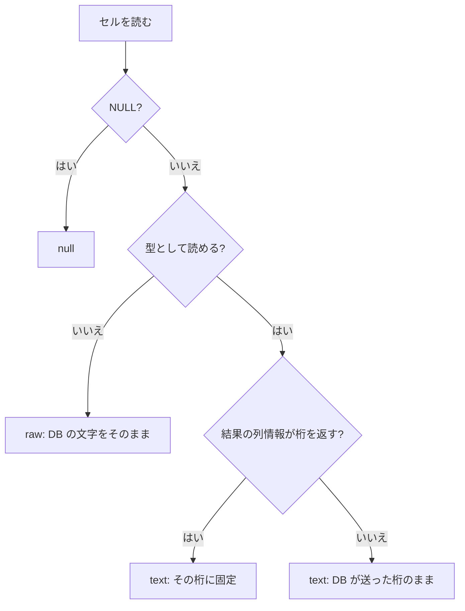
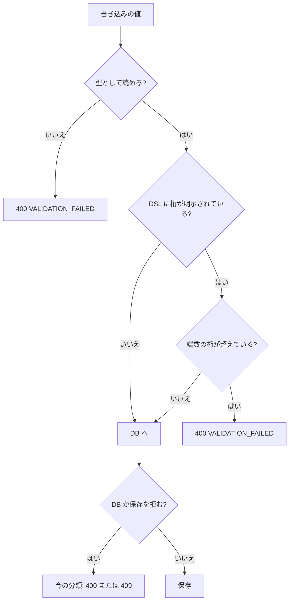
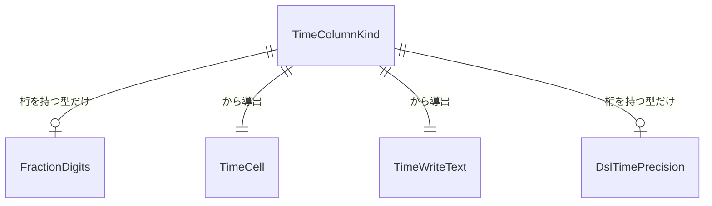

# 機能仕様 — u3-target-db-time

出典: 単位 U3（`inception/units-generation/unit-of-work.md`）、契約 C4（`inception/contract-design/contract-summary.md`）、`entities.md`・`rules.md`、質問と答え（`functional-design-questions.md`: Q1: B・Q2: B・Q3: B・Q4: B）。

U3 は、対象DB の日時の値の読み書き・接続のタイムゾーン・既定の DSL の生成の直しの単位（library、アプリに入る）。この文書は、各流れの手順の並びと、結果の種別の分岐の正とする。実装の型・クラス名・接続の設定のやり方は NFR 設計と Code Generation で決める。

**この単位が実装するストーリー（`stories.md`）**: US5.1（主）、US2.2 の接続の時差（AC2.2.4）、US2.1 の読めない値・端数（AC2.1.4・AC2.1.6）、US2.5 のサーバー側の往復、US5.3 の一部（問い合わせの数・タイムゾーンの設定）。主の単位は U4（US2.x）・U2（US5.3）。

## 1. 流れ

### 1.1 対象DB の接続を作る（BR3.1・BR3.2・BR3.17・BR3.19）

1. 対象DB の接続を作る（読み取りのプールと書き込みのプールのどちらでも）。
2. DB が PostgreSQL なら、セッションのタイムゾーンを UTC にする。MySQL・MariaDB は今のとおり UTC にする。
3. 設定に失敗したときは、その接続は借りられない（既存の借りる失敗）。
4. JVM の既定のタイムゾーンは読まない。実行時のタイムゾーンの設定は変えない。

### 1.2 日時・時刻のセルを読む（BR3.3・BR3.4・BR3.6・BR3.10・BR3.15・BR3.16）

1. 入力: 結果の1つのセル、カラムの分類（TimeColumnKind）。
2. NULL なら `null` を返す。
3. 型として読む（時点を表す型は UTC の時点、時差を持たない型は DB の値のまま、timetz は DB の時差のまま）。
4. 読めたとき: 結果の列情報から端数の桁を決める。得られなければ DB が送った桁のまま。決めた桁の数字で端数を並べて `text` を返す（桁が 0 なら端数なし）。
5. 読めないとき: DB が送った文字をそのまま `raw` として返す。値は例外・ログ・トレースの属性に出さない。要求全体は失敗させない。
6. 新しい問い合わせは足さない（結果の列情報を使う）。

### 1.3 書き込み・検索の日時・時刻の値を読む（BR3.5・BR3.6・BR3.9・BR3.11・BR3.13・BR3.14）

1. 入力: 要求の文字、カラムの分類、DSL の桁の明示の有無と値。
2. 文字を型として読む。時点を表す型は時差つきなら UTC の時点に、時差が無ければ UTC とみなす。timetz は時差を保つ。時差を持たない型は ISO の形だけを受ける。読めなければ（読めない文字の形・ゼロの日時・24 時間を超える time を含む）、400 `VALIDATION_FAILED`（どの項目か）で終わる。
3. 書き込み（作成・更新）で、DSL に桁が明示されていて、端数の桁がそれを超えるなら 400 `VALIDATION_FAILED`（どの項目か）で終わる。桁が明示されていなければ確かめない。検索では端数の桁を確かめない。
4. バインド変数で渡して文を実行する（識別子は DSL の名前と照合済み。今までの SQL の決まりのまま）。
5. DB が日時の範囲外・形の誤りで拒んだときは、今の分類のとおり（形の誤りは 400、保存の拒否は 409 `BUSINESS_SAVE_REJECTED`）。上限は決め打ちしない。

### 1.4 主キーの値が読めない行を操作する（BR3.12）

1. 入力: 詳細・更新・削除の要求の主キーの値。
2. 主キーの値が型として読めない（読めない文字を送り返した）なら、行を特定せず、行を1件に決められない操作の既存の拒否を返す。
3. 一覧には、その行を（読めない文字のまま）含める。

### 1.5 型の名前を分類する（BR3.7）

1. 型の名前から括弧の部分 `(n)` だけを取り除く（括弧の後ろの `with time zone` を残す）。符号なしの印の扱いは今のまま。
2. PostgreSQL の `timestamp with time zone`（桁つきも）を時点を表す型、`time with time zone` を timetz、`timestamp [without time zone]` を時差を持たない日時とする。MySQL・MariaDB の `timestamp(n)` を時点を表す型、`datetime(n)` を時差を持たない日時とする。
3. 確かめて不具合でなければ直さず、結果を記録する（BR3.18）。

### 1.6 既定の DSL の生成で日時の桁を書く（BR3.8）

1. 入力: 対象DB のカラムの定義（日時・時刻の型）。
2. DB の定義から秒の端数の桁を読む。読めなければ書かず、生成は失敗させない。
3. 桁がその製品の既定（PostgreSQL 6・MySQL/MariaDB 0）と違うときだけ、DSL の `dbType.precision` に書く。同じなら書かない。
4. 生成した DSL を保存・往復しても端数が落ちない。既存の DSL との差分は、端数のある列だけに出る。

## 2. 結果の種別の分岐

## 3. エンティティの関係（導出。`entities.md` の YAML が正）

## 4. 決まりの要約（導出。`rules.md` の YAML が正）

BR3.1〜BR3.19 のとおり（`rules.md` の一覧）。ストーリーとの対応:

| ストーリー | 決まり |
|---|---|
| US5.1（接続・端数・桁つきの時差つきの型・記録。AC5.1.1〜AC5.1.5） | BR3.1・BR3.2・BR3.3・BR3.7・BR3.8・BR3.18 |
| US2.2（接続の時差・時差なしと timetz。AC2.2.1〜AC2.2.4） | BR3.1・BR3.2・BR3.5・BR3.6 |
| US2.1（端数・読めない値・問い合わせの数。AC2.1.2・AC2.1.4・AC2.1.6・AC2.1.7） | BR3.1〜BR3.4・BR3.10・BR3.14・BR3.16 |
| US2.5（サーバー側の往復。AC2.5.2・AC2.5.3・AC2.5.5） | BR3.3・BR3.5〜BR3.7・BR3.13 |
| US5.3（問い合わせの数・タイムゾーンの設定。AC5.3.3・AC5.3.4） | BR3.16・BR3.19 |

## 5. 上流との差（承認済みの契約・要件・ADR は書き換えず、ここに記録する）

- **契約 C4 の応答の形の例外（Q4: B）**: C4 は、応答の値を型ごとの形（`time_point` は UTC の時差つきの文字など）と定めている。型として読めなかったセルは、DB が送った文字をそのまま返す（BR3.10）。項目名・状態コード・code は変えないが、「応答の値は型ごとの形」の例外が増える。前の版の画面は、日時の形でない文字を元の文字として出す（U1 の、読めない時点を元の文字で返す決まりと同じ扱いで、壊れない）見込み。
- **サーバー側の新しい拒否（Q3: B。ADR-002・C4 の rules・単位の対応表との差）**: ADR-002 とストーリーの単位の対応表は、サーバーの拒否を「時差の無い値・読めない値」に限り、新しい拒否を足さないとしている。DSL に明示した桁を超える端数の拒否（BR3.9）は、この範囲を超える。理由は、入れた値と保存した値が黙って食い違うのを避けるため。拒否は既存の `VALIDATION_FAILED` で、新しい code は足さない。
- **応答の桁の出どころ（Q1: B）**: C4 は「DB の定義の桁に固定」と書き、出どころを決めていない。この単位は、結果の列情報を正とし、DSL の精度に頼らない（BR3.3）。差ではなく、契約が決めていなかった点の決定。
- **`timetz` の応答・秒の端数の桁（C4 の `changed_values_by_u3`）**: 契約が予告した変更。前の版の画面は時差つきの文字として読めるため壊れない（C4 のとおり）。

## 6. 後の段（NFR Requirements 以降）へ回す点

- PostgreSQL の接続のタイムゾーンの設定のやり方（接続の初期化の文か接続の属性か。pgjdbc が接続の開始時に JVM の既定のタイムゾーンを送る点を含む）は、NFR 設計の捨ての試しで確かめて決める（BR3.1・BR3.18）。
- K-95・K-98 の確かめ（桁の読み取り・桁つきの時差つきの型・生成が日時の精度を読むか・結果の列情報の桁が3種類の対象DB で得られるか）は、NFR 設計の捨ての試し（BR3.18）。
- `time` の負の値・24 時間を超える値の読み書きの版による違い（MySQL・MariaDB）、MariaDB の timestamp の上限は、捨ての試しと結合テストで確かめる（BR3.10・BR3.14）。
- 読めない値の結合テスト（ゼロの日時・24 時間を超える time・infinity）は、3種類の対象DB で、一覧が失敗せず読めないセルだけ元の文字になることと、主キーが読めない行の操作が拒否されることを確かめる。
- 個別の型の対応表（型の名前 → 分類）と、既存の `RowDialect` の実装への足し方は Code Generation で決める。

## Sources

- Initial description: N6（業務データの日時のタイムゾーンの変換）と画面の仕上げの Intent [desc]
- Workflow-selected scope: classic [scope]
- 単位: `aidlc/spaces/default/intents/261102-timezone-ui-polish/inception/units-generation/unit-of-work.md`・`unit-of-work-story-map.md`
- 契約: `aidlc/spaces/default/intents/261102-timezone-ui-polish/inception/contract-design/contract-summary.md`（C4）
- ストーリー: `aidlc/spaces/default/intents/261102-timezone-ui-polish/inception/user-stories/stories.md`（US2.1・US2.2・US2.5・US5.1・US5.3）
- 質問と答え: `aidlc/spaces/default/intents/261102-timezone-ui-polish/construction/u3-target-db-time/functional-design/functional-design-questions.md`（Q1: B・Q2: B・Q3: B・Q4: B）

## Assumptions & Open Questions

- [assumption] 前の版の画面が、日時の形でない文字を元の文字として出すかは未確認（U1 の、読めない時点を元の文字で返す決まりは新しい版の画面）。前の版の画面への影響は、NFR 設計か Code Generation で確かめる。
- [assumption] 結果の列情報から桁を取れる想定（Q1: B）。取れない DB・型があれば、BR3.4 の動きになり、設計に戻す。
- 「後の段へ回す点」の表のとおり。
