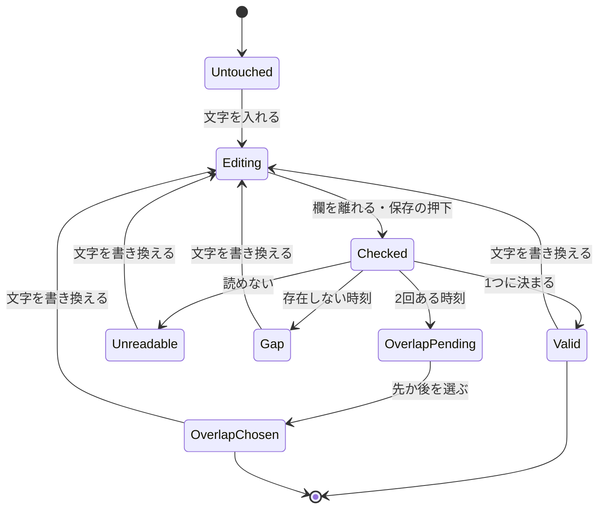

# 機能設計（Functional Spec）— U4 u4-business-data-time

対象の単位: U4 `u4-business-data-time`（種類 ui。業務データの一覧・詳細・参照の選択肢の時刻の表示、作成・更新・検索の入力、夏時間の誤りと2択、往復）。

出典: 単位の定義 `inception/units-generation/unit-of-work.md`・ストーリーの対応 `unit-of-work-story-map.md`・要件 `inception/requirements-analysis/requirements.md`（FR2・FR3・FR4.2・NFR2.1・NFR3・NFR5・NFR6.1）・ストーリー `inception/user-stories/stories.md`（US2.1〜US2.5・US5.2）・部品の一覧 `inception/domain-design/components.md`（BusinessDataTimeView）・契約 `inception/contract-design/contract-summary.md`（C1・C2・C4）・設計の決定 `inception/domain-design/decisions.md`（ADR-002・ADR-003）・画面イメージ `inception/refined-mockups/mockups.md`（S2〜S4）と `interaction-spec.md`（2〜4 節）・先の単位の機能設計（U1 `construction/u1-time-zone-conversion/functional-design/functional-spec.md`、U2 `construction/u2-display-time-zone/functional-design/frontend-components.md`、U3 `construction/u3-target-db-time/functional-design/functional-spec.md`。U1〜U3 は統合済み）・質問と答え `functional-design-questions.md`（Q1: A・Q2: A・Q3: A・Q4: A）。

**この単位が実装するストーリー（`stories.md`）**: US2.1・US2.2・US2.3・US2.4・US2.5・US5.2（業務データの画面の部分）。関わる単位は U1（変換）・U2（表示のタイムゾーンの配布）・U3（サーバー側の日時の値の読み書き）。

## 読み方

- この単位は ui（画面）で、サーバーの小さな変更（参照の項目の応答にラベルの列の型を足す。Q1: A）を含む。entities.md・rules.md は作らず（ui の単位は produces の対象外）、決まりは **D 番号**（D1〜D44）で書く。追跡 `traceability.json` の target は、この D 番号と流れの番号（W1〜W5）を指す。
- 画面の部品の構成・状態・文言の鍵は `frontend-components.md` に分ける。ここは、決まりと流れと、上流との差を書く。
- 「時点を表す型」は受け渡しの型 `DATETIME_TZ`（PostgreSQL の `timestamptz`、MySQL・MariaDB の `timestamp`）。「時差を持たない日時」は `DATETIME`、時刻だけの型は `TIME`（時差なし）と `TIME_TZ`（`timetz`）、日付だけの型は `DATE`。
- 変換は U1 の関数（`formatInstant`・`parseLocalDateTime`・`compareInstants`・`preserveInstant`）と、`frontend/src/shared/format/` に足す薄い関数だけで行う（FR4.2・ADR-003）。表示のタイムゾーンは U2 の `useDisplayTimeZone` だけから読み、ブラウザの既定のタイムゾーンを暗に使わない。

## 1. 範囲と他の単位との境界

| 範囲に入る | 範囲の外 |
|---|---|
| 一覧・詳細・行のラベル・参照の選択肢・ピッカーの結果の、時点を表す型の表示（時差つき・端数を保つ） | 変換の関数そのもの（U1。ここは使うだけ） |
| 一覧・詳細の見出しの下の、表示のタイムゾーンの案内の1行 | 表示のタイムゾーンの決定・保存・配布（U2。ここは読むだけ） |
| 作成・更新の時点を表す型の入力（表示のタイムゾーンで入れ、時点に直して送る）と、時差を持たない日時の入力（Q2: A） | サーバー側の日時の値の読み書き・端数の桁・接続のタイムゾーン（U3） |
| 夏時間の存在しない時刻の誤りと、重なる時刻の2択 | 管理の画面（利用者・招待・DSL）の時刻（U2） |
| 検索の画面・ピッカーの検索の、時点を表す型と時差を持たない日時の条件 | 業務データの API の値の形（契約 C4 のまま。変えない） |
| 参照の項目の応答への、ラベルの列の型の追加（サーバー。Q1: A） | 対象DB への問い合わせ・SQL の組み立て（変えない） |
| 往復（変えていない欄を送らない、主キーと参照の値は元の文字のまま送り返す） | 内部DB・環境変数・実行時のタイムゾーンの設定（変えない） |

## 2. 決まり（D1〜D44）

### 2.1 表示（一覧・詳細・行のラベル）

| D | 決まり | 出どころ |
|---|---|---|
| D1 | 時点を表す型の値は、U1 の `formatInstant(値, 表示のタイムゾーン)` で `YYYY-MM-DD HH:mm:ss[.端数] ±HH:mm` に直して出す。端数はサーバーが返した桁のまま（U3 が DB の定義の桁に固定済み）。丸めない・ゼロを足さない（`fractionDigits` は渡さない）。時差が秒を含む歴史的なタイムゾーンの時点では、U1 の書式どおり時差は `±HH:mm:ss` になる | FR2.1・FR2.2・FR2.5・AC2.1.1・AC2.1.4 |
| D2 | 時差は時点ごとに決まる（夏時間の地域は `-04:00`・`-05:00` が切り替わる。分の端数の時差 `+05:45`・`+09:30`・`-03:30` は端数のまま）。U1 の決まり（BR1.2〜BR1.4）をそのまま使う | AC2.1.5 |
| D3 | 時差を持たない日時（`DATETIME`）・日付（`DATE`）・時刻（`TIME`）は、DB の値のまま出す（日付と時刻の区切りの `T` を空白にするだけ。今の `formatTemporal`）。時差を添えない。表示のタイムゾーンを変えても値は変わらない | FR2.3・AC2.2.1 |
| D4 | `timetz`（`TIME_TZ`）は、変換せず DB の値と時差のまま出す（U3 が UTC への正規化をやめ、DB の時差のまま返す）。末尾の `Z` だけは `+00:00` に書き換える（今のまま） | FR2.4・AC2.2.2・C4 |
| D5 | 型として読めない値（U3 が DB の文字のまま返したセル。例: MySQL のゼロの日時、範囲の外の `time`）は、`formatInstant` の `unreadable` の結果のとおり元の文字のまま出す。時差を添えない・誤りの表示にしない（一覧全体を失敗させない） | AC2.1.6・U3 の BR3.10・U1 の BR1.5 |
| D6 | 値の書式の1か所（今の `formatCell`）に表示のタイムゾーンを引数で渡し、表・詳細・行のラベル（行のリンク・画面の題・削除の確かめの文）・ピッカーの結果の列が同じ結果を使う。表示のタイムゾーンを変えると、開いている一覧・詳細の時刻も読み込み直さずに切り替わる（描くたびに書式にする。U2 の差し替え） | FR1.4・AC1.2.1・FR4.2 |
| D7 | NULL・伏せた値・バイナリ・空の文字列の扱いは今のまま（時点を表す型でも NULL は「（値なし）」） | 今の `formatCell` |
| D8 | 3種類の対象DB で同じ時点は、サーバーが同じ UTC の文字（C4）で返すため、画面は同じ表示になる。画面は DB の種類で分岐しない | AC2.1.2 |

### 2.2 案内の1行と、表示のタイムゾーンの読み込みの状態

| D | 決まり | 出どころ |
|---|---|---|
| D9 | 一覧・詳細の見出しの下に、表示のタイムゾーンの案内の1行を出す。出すのは、その画面の定義（一覧の列・詳細の項目）に時点を表す型のカラムが1つ以上あるときだけ（時刻が出ない画面には出さない）。文は U2 の `source` で3つに分ける: `saved`「表示のタイムゾーン: {名前}（プリファレンスで変更）」、`browser`「表示のタイムゾーン: ブラウザのタイムゾーン（{名前}）（プリファレンスで変更）」、`saved-unresolvable`「保存したタイムゾーンを使えないため、ブラウザのタイムゾーン（{名前}）で表示しています（プリファレンスで変更）」。「プリファレンスで変更」はプリファレンスの画面へのリンク。名前は文字として出す | mockups.md の S2・interaction-spec.md の 2 節・AC1.2.4 |
| D10 | 読み込み中（U2 の `loading`）: 時点を表す型のカラムを持つ画面（一覧・詳細・作成・更新）は、案内の1行も時刻の欄も出さず、画面の今の読み込み中の表示のままにする。ブラウザのタイムゾーンの時刻を一瞬出すことはしない。時点を表す型のカラムを持たない画面は待たない | AC1.2.5・C2 の rules |
| D11 | 読み込みの失敗（U2 の `error`。契約 C2 に U2 が足した状態）: 画面の上に U2 の「再読み込み」の帯（`DisplayTimeZoneErrorBar`）を置く（管理の画面と同じ）。時点を表す型のセルは U2 と同じ短い文（「表示のタイムゾーンを読み込めません」）を出し、案内の1行は出さない。作成・更新の画面は、定義に時点を表す型のカラムが1つ以上あるとき、フォームを開かず（欄も初めの値も作らない）、読み込み中の表示の位置に帯だけを出す。再読み込みが成功して `ready` になった時点で、そのときの表示のタイムゾーンを固定してフォームを開き、初めの値を作る（D12・D16。NFR 設計の Q1: A）。時点を表す型のカラムを持たないフォームは待たずに開く。検索の画面とピッカーの時点を表す型の欄は使えない状態（`disabled`）にし、欄の下に同じ短い文を出す。ほかの欄は使える。再読み込みが成功すると、一覧・詳細・検索は画面を読み込み直さずに時刻が出る | U2 の BR2.15・BR2.16・BR2.21・NFR 設計の Q1: A |
| D12 | 表示のタイムゾーンはタブごとの状態で、プリファレンスの保存はプリファレンスの画面（未保存の確かめが付く）から行う。作成・更新のフォームは、開いたとき（初めの値を作るとき。表示のタイムゾーンが `ready` になった時点で、`error` から再読み込みで `ready` になった場合を含む。D11）の表示のタイムゾーンで初めの値・案内・変換を決め、開いている間は同じものを使う（開いている間に表示のタイムゾーンが変わっても、入れた文字の意味を黙って変えない） | 契約 C2・D13 |

### 2.3 入力（作成・更新）

| D | 決まり | 出どころ |
|---|---|---|
| D13 | 時点を表す型の欄（部品 `datetime` か `text` のカラム）は、文字の入力（`TextInput`）にする。ブラウザの `datetime-local` は使わない。書式は U1 と同じ1つ: `YYYY-MM-DD HH:mm:ss`、秒の端数 1〜6 桁は任意（`.123`・`.123456`）。全角の数字・`T` の区切り・秒の省略は誤り。部品が `select`・`radio`・`lookup` のカラムは今のまま（選択肢の値を変換しない） | FR3.1・mockups.md の S3・U1 の BR1.6・Q2: A |
| D14 | 時差を持たない日時（`DATETIME`）の欄も、同じ文字の入力・同じ書式・同じ書式と範囲の確かめにする。変換はせず、送るときに区切りの空白を `T` にするだけ。案内は書式の例だけで、タイムゾーンを出さない。`DATE` は今の日付の入力、`TIME`・`TIME_TZ` は今の文字の入力のまま | Q2: A・FR3.5・AC2.2.3 |
| D15 | 時点を表す型の欄の案内（欄の下の文、`aria-describedby` で結ぶ）: 「{名前} ({今の時差}) で入力。例: 2026-11-02 09:30:15（秒の端数は .123 のように付けられます）」。今の時差は、表示のタイムゾーンの今の時刻の時差（`formatInstant` に今の時点を渡した結果の末尾）。今は今の時計（注入できる時計）から取る。「UTC で入れる」の案内は出さない | FR3.6・AC2.3.2・mockups.md の S3 |
| D16 | 更新の画面の初めの値: 時点を表す型は `formatInstant` の結果から時差を除いた `YYYY-MM-DD HH:mm:ss[.端数]`（表示のタイムゾーンの壁時計、端数は桁のまま）。読めない値（D5）は元の文字のまま。時差を持たない日時は DB の値の `T` を空白にした文字（端数を落とさない）。この直しは `frontend/src/shared/format/` に足す薄い関数で行う | AC2.5.1・FR4.2 |
| D17 | 送る値: 時点を表す型は `parseLocalDateTime(文字, フォームの表示のタイムゾーン, 重なる時刻の選択)` が返した時点（UTC の `YYYY-MM-DDTHH:mm:ss[.端数]+00:00`。端数は入れた桁のまま）だけを送る（ADR-002）。時差を持たない日時は `YYYY-MM-DDTHH:mm:ss[.端数]`。空にした欄の扱い（NULL か空の文字か）は今の決まりのまま | FR3.1・AC2.3.1・C4 |
| D18 | 確かめのとき: 欄を離れたとき（blur）と保存の押下（今のフォームと同じ）。入力の最中には誤りを出さない。誤りの欄には `aria-invalid` と欄の下の文を付け、保存の押下では最初の誤りの欄（重なる時刻の選択が残るときは2択の legend）へフォーカスを移す | interaction-spec.md の 3 節・AC2.3.5 |
| D19 | 読めない値（書式に合わない・暦に無い日付・範囲の外）は、欄の誤り「日時を YYYY-MM-DD HH:mm:ss の形で入れてください」とし、保存させない。画面を通さずに API を呼んだときの読めない値は、サーバー（U3）が `VALIDATION_FAILED` で拒否し、画面は今の項目ごとの誤りの写しで出す | AC2.3.5・U3 の BR3.5 |
| D20 | 夏時間で存在しない時刻（U1 の `gap`）は、欄の誤り「{名前} では、この時刻はありません（夏時間の切り替えで飛ばされる時刻です）」とし、保存させない。何時から何時に進むかは出さない（U1 の結果が切り替わりの時刻を持たないため）。拒否は画面の側だけ（ADR-002）。サーバーは時点として存在する値を受ける | FR3.4・AC2.3.3・ADR-002 |
| D21 | 夏時間で2回ある時刻（U1 の `overlap`）は、欄の下に2択（`RadioGroup`、legend「{名前} では、この時刻は2回あります。どちらですか」）を出す。選択肢は「先（{先の時差}）」「後（{後の時差}）」で、時差は U1 の結果の2つの時点を `formatInstant` に通した末尾。「夏時間」「標準時」の語は付けない（どちらが夏時間かは U1 の結果から決まらないため）。選ぶまで保存の押下を誤りにする。選んだ側の時点を送る（D17 の重なる時刻の選択）。欄の文字を書き換えたら、選択は未選択に戻る | AC2.3.4・R-03・interaction-spec.md の 4 節 |
| D22 | 2択が出るのは、作成の欄と、更新で値を変えた欄だけ。更新の画面で、初めの値の文字のままの欄（重なる時刻の値を含む）は送らないため、2択も出さない（元の時点がそのまま保たれる。D33） | AC2.5.4・interaction-spec.md の 4 節 |

### 2.4 検索（検索の画面・ピッカーの検索）

| D | 決まり | 出どころ |
|---|---|---|
| D23 | 検索の画面の時点を表す型の条件（範囲・一致）は、D13 と同じ文字の入力・書式で、表示のタイムゾーンで入れる。送るのは `parseLocalDateTime` が返した時点（UTC の時差つき）だけ。時差を持たない日時の条件も文字の入力にし、変換せず `T` の区切りで送る（Q2: A）。日付だけの型（`DATE`）は今の日付の入力のまま（日付だけを入れる口を時点を表す型に置かない）。ほかの演算子: 部分一致（`CONTAINS`）は文字の型だけに付き、日時の型には付かない（サーバーの `SearchOperatorPolicy.allowed`）。選択（`CHOICE`）は DSL に固定の選択肢があるときだけ付き、選択肢の値を変換せずそのまま送る（D13・D33 と同じ）。固定の選択肢が無いときは一致として扱われ、この決まりの一致になる | FR3.2・AC2.4.1・AC2.4.3・Q2: A |
| D24 | 範囲の検索は両端を含む（サーバーの `>=`・`<=` のまま）。入れたとおりに送る: 終わりの欄に端数が無ければ、その秒ちょうど（`.000000`）まで（Q3: A）。案内「{名前} ({今の時差}) で入力。始まりも終わりも含みます。端数を含めるときは 23:59:59.999999 のように入れます」 | AC2.4.2・Q3: A |
| D25 | 範囲の向き: 始まりと終わりが両方とも時点に直せたら、U1 の `compareInstants` で比べ、始まりが終わりより後なら、その条件の誤り（今の `RANGE_REVERSED`）とし検索させない。同じ時点は誤りにしない。サーバーも 400 を返す（今のまま） | AC2.4.2・U1 の BR1.15 |
| D26 | 夏時間の存在しない時刻は、検索でも D20 と同じ誤り（条件の誤り）とし、検索させない | AC2.4.4 |
| D27 | 夏時間で2回ある時刻は、範囲の検索では2択を出さず、始まりの欄は先の時点、終わりの欄は後の時点で送る（2回ある時刻の行を取りこぼさない）。一致の検索（検索の画面・ピッカーの一致の条件）は、作成・更新と同じ2択（D21）を出し、選ぶまで検索させない（Q4: A）。一致の検索は入れた桁のまま比べるため、秒の端数を持つ行には端数まで入れないと当たらない。一致の検索の案内に「秒の端数を持つ値は、端数まで入れてください（例: .123）」を添える | Q4: A・R-03 |
| D28 | 検索の既定の値（DSL の `search.default`）が時点を表す型の条件にあるときは、時点として読み（時差が無ければ UTC とみなす。C4 の要求の読み方と同じ）、表示のタイムゾーンの壁時計の文字にして欄の初めの値にする。読めなければ元の文字のまま入れる（検索の押下で D19 の誤りになる）。既定の値を入れるのは表示のタイムゾーンが `ready` になった時点の1回だけで、それまで（`loading`・`error`）時点を表す型の既定の値は空にし、ブラウザのタイムゾーンで入れない。利用者が入れた文字は上書きしない。ブラウザに保存済みの一覧の状態に前の版の形（`T` の区切り。前は UTC として読んだ値）の条件が残っているときは、欄に値を残したまま誤りの文を出し、その条件は送らない（コード生成の段の依頼者の決定） | C4・今の `defaultSearchInputs` |
| D29 | 検索の値に `'`・`"`・`;`・`--`・改行を含めても、画面は書式の確かめで読めない値として止め、サーバーへ送らない。画面を通さずに送られた値は、今の SQL の組み立て（識別子は DSL の名前と照合、値はバインド変数）のままサーバーが扱う。U4 は SQL の組み立てを変えない | AC2.4.5・`team.md` の業務データの必須のテスト |

### 2.5 参照（選択肢・ラベル・ピッカー）とサーバーの変更

| D | 決まり | 出どころ |
|---|---|---|
| D30 | 参照の項目の応答（定義の応答のカラムの `reference`）に、ラベルの列の受け渡しの型 `labelValueType`（`ValueType` の語彙）を足す。足すだけで、既存の項目は変えない。載せるのは状態が `AVAILABLE` のときだけ（選択肢・ピッカーの情報と同じ。ほかは載せない）。型は、参照先の表の DSL のカラムの型（`ReferencePolicy` がピッカーの列の型を決めるのと同じ材料）から決め、対象DB・内部DB への問い合わせを足さない。文字列にするとき（`toString`）は型だけを出し、値・ラベルを出さない（今のまま） | Q1: A・AC2.1.3・AC2.1.7・NFR2.1 |
| D31 | 画面は `labelValueType` が無い・知らない値のとき「型が分からない」とみなし、ラベルを今のまま文字で出す（応答を拒否しない。前の版のサーバーの応答を読んでも壊れない）。前の版の画面は知らない項目として読み捨てる | NFR4.2 と同じ読み方 |
| D32 | 選択肢の文（「ラベル (値)」）・入力不可の参照の項目のラベル・ピッカーの行のラベルは、ラベルを `labelValueType`、値を参照元のカラムの型で、D1〜D5 の書式にする。ピッカーの結果の列は、列ごとの `valueType`（今ある）で書式にする | AC2.1.3 |
| D33 | 送る値は、書式にした文字ではなく、サーバーが返した値の文字のまま（選択肢の `value`・ピッカーの行の `value`）。参照の値が時点を表す型でも、元の文字を送り返す（`preserveInstant` と同じ扱い） | AC2.5.3・C4 の rules |
| D34 | ピッカーの検索の時点を表す型の一致の条件は、D23・D26・D27 と同じ（文字の入力・表示のタイムゾーン・夏時間の誤りと2択）。案内の「UTC で入れる」は出さない | FR3.2・FR3.6 |

### 2.6 往復

| D | 決まり | 出どころ |
|---|---|---|
| D35 | 更新の画面は、初めの値の文字（D16）と今の文字が同じ欄を送らない（今の差分の決まり）。時点を表す型の欄を変えずに別の欄だけ直したとき、時点を表す型は送られず、対象DB の値は変わらない。一度書き換えて元の文字に戻した欄も送らない | FR3.3・AC2.5.1・AC2.5.4 |
| D36 | 主キーの値は、表示用の文字とは別に、サーバーが返した文字のまま行の印（今の `RowKey`）として持ち、詳細・更新・削除の要求に送り返す。表示のタイムゾーンへの変換の前後で、行の特定は変わらない | AC2.5.3・R-01 |
| D37 | 業務データの API には同時更新の判定の値（版の列・期待する値）が無いため、往復の対象は主キー・参照の値・変えていない欄の3つとする（AC2.5.3 の「同時更新の判定の値」は、この API では該当しない） | AC2.5.3・今の `businessdata` の作り |
| D38 | 読んだ値をそのまま更新に送る（API を直接呼ぶ）往復と、3種類の対象DB・すべての日時の型の往復は、サーバー側（U3）の決まりと結合テストで保つ。画面の側は、送る値の形が C4 のとおりであること（時点は UTC の時差つき、端数は入れた桁のまま、時差を持たない値は時差なし）を、性質ベースのテストで確かめる（D43） | AC2.5.2・AC2.5.5・U3 の BR3.13 |

### 2.7 アクセシビリティ・言語

| D | 決まり | 出どころ |
|---|---|---|
| D39 | 入力欄はラベル・必須・案内（`aria-describedby`）・誤り（`aria-invalid` と文）を持つ。2択は fieldset と legend で読まれ、矢印キーで移り Space で選べる（`RadioGroup` の標準）。案内の1行のリンクの名前は「プリファレンスで変更」。時刻の値と時差は1つの文字列として読まれる | AC5.2.1・accessibility-checklist.md の A4〜A7 |
| D40 | 足す文言（案内の1行・入力の案内・誤り・2択）は日本語と英語の両方を持ち、既定は日本語。タイムゾーンの名前・時差・利用者の値は文字として出す（HTML として描かない） | NFR6.1 |

### 2.8 テストの義務（`team.md` の日時の必須の項目との対応）

| D | 決まり | 出どころ |
|---|---|---|
| D41 | 画面の部品のテスト（Vitest）: 表示（日付の変わり目 `2026-11-01T15:00:00Z` → `Asia/Tokyo` で `2026-11-02 00:00:00 +09:00`、端数 0・3・6 桁、`America/New_York` の切り替わりの前後、`+05:45`・`+09:30`・`-03:30`、読めない値）、案内の1行の3つの文と読み込み中・失敗、入力（読めない値・存在しない時刻・重なる時刻の2択・選択の解除・変えていない欄を送らない）、検索（範囲の向き・両端・重なる時刻の範囲と一致）、参照（`labelValueType` の有無）。タイムゾーンはテストごとに明示に渡し、機械の既定に預けない。`waitFor` で待って確かめる | `team.md` の日時の必須の項目・NFR5.2 |
| D42 | サーバーのテスト: `labelValueType` が `AVAILABLE` のときだけ載ること（`NO_PERMISSION`・`TOO_MANY` では載らない）、型が DSL の列の型と一致すること、`toString` に値・ラベルが出ないこと、1要求の対象DB・内部DB の接続の数が変わらないこと（既存の `*ConnectionUsageIT` の形）。権限ごとの認可・漏えいの既存のテストは緩めない | AC2.1.7・`team.md` の他テーブル参照の必須のテスト |
| D43 | 性質ベースのテスト（fast-check）: 送る値を作る関数（D16・D17 の初めの値と送る値）について、「変えていない欄は送られない」「時点を表す型の初めの値を時点に直すと元の時点に戻る（重なる時刻を除き、重なる時刻は送らない）」「時差を持たない日時は表示のタイムゾーンを変えても初めの値と送る値が変わらない」「範囲の重なる時刻は始まり ≤ 終わり」を確かめる | AC2.5.5・`team.md` の性質ベースのテスト |
| D44 | 実際のブラウザの axe（E2E）: 業務データの一覧・詳細・作成・更新・検索の画面を、誤りの状態（読めない値・存在しない時刻）・2択を出した状態・長い名前で、ブランドカラーとテーマのすべての組について流し、違反 0 件。規則を外さない。N6 の代表の流れの E2E を1本足す（W5）。axe と表示の確かめは本数に数えない | AC5.2.1〜AC5.2.4・NFR5.3・`project.md` |

## 3. 流れ

### W1 一覧・詳細を見る

1. 画面が定義を読む。定義に時点を表す型のカラムがあり、表示のタイムゾーンが `loading` なら、今の読み込み中の表示のまま待つ（D10）。
2. `ready` になったら、見出しの下に案内の1行（D9）を出し、行の値を D1〜D7 で書式にして表・詳細に出す。行の主キーは返された文字のまま行の印に持つ（D36）。
3. `error` なら、画面の上に「再読み込み」の帯、時点を表す型のセルに短い文を出す（D11）。
4. プリファレンスで表示のタイムゾーンを変えて戻ると、時刻は新しいタイムゾーンで出る（D6）。

### W2 作成・更新する

1. フォームを開くとき、定義（と更新なら行）を読み、表示のタイムゾーンが `ready` になるのを待つ（D10）。`error` なら、時点を表す型のカラムを持つフォームは開かず帯だけを出し、再読み込みで `ready` になるまで待つ（D11）。`ready` になったときのタイムゾーンをフォームのタイムゾーンとして固定する（D12）。
2. 初めの値を作る（D16）。案内を出す（D15）。
3. 利用者が欄に文字を入れ、欄を離れると確かめる（D18）: 読めない → D19、存在しない → D20、2回ある → D21 の2択（作成と、更新で変えた欄だけ。D22）、1つに決まる → 誤りなし。
4. 保存を押すと、すべての欄を確かめ、誤りや未選択の2択があれば最初の欄へフォーカスを移して止める。
5. 誤りが無ければ、変えた欄だけ（作成は空でない欄）を D17 の形で送る（D35）。サーバーの拒否（`VALIDATION_FAILED` など）は今の項目ごとの誤りの写しで出す。

### W3 検索する

1. 検索の画面を開き、表示のタイムゾーンが `ready` になった時点で、既定の値を D28 で欄に入れる（1回だけ）。
2. 検索を押すと、時点を表す型の条件を時点に直す: 読めない → D19、存在しない → D26、2回ある → 範囲は始まり＝先・終わり＝後（D27）、一致は2択（D27）。範囲の向きを D25 で確かめる。
3. 誤りが無ければ、時点（UTC の時差つき）を条件として送る（D23）。

### W4 参照の選択肢・ピッカーを使う

1. 作成・更新の定義の応答に `labelValueType` があれば、ラベルをその型で、値を参照元のカラムの型で書式にして、選択肢の文に出す（D30〜D32）。
2. ピッカーの結果の列は列の `valueType` で書式にし、時点を表す型の一致の条件は D34 で入れる。
3. 選んだ値は、返された文字のまま送る（D33）。

### W5 N6 の代表の E2E（1本）

見本の対象DB（PostgreSQL）の、流れの専用のスキーマの時点を表す型のカラムを持つ表を使い、流れが自分で作った利用者で、(1) プリファレンスで表示のタイムゾーンを選ぶ、(2) 作成の画面で表示のタイムゾーンの日時を入れて保存する、(3) 一覧で時差つきで見える、(4) 更新で別の欄だけ直しても日時が変わらない、を確かめる。夏時間の地域・2択を通すかなどの細部は NFR Requirements とコード生成の計画で決める。

## 4. 欄の状態（時点を表す型の入力欄）



<!-- Text fallback: 欄は「まだ触っていない」から、文字を入れると「入力中」になる。欄を離れるか保存を押すと確かめ、「1つに決まる」「読めない」「存在しない時刻」「2回ある時刻（未選択）」のどれかになる。2回ある時刻は先か後を選ぶと「選択済み」になる。どの状態でも文字を書き換えると「入力中」に戻り、2択の選択は未選択に戻る。送れるのは「1つに決まる」と「選択済み」だけ。更新の画面で初めの値の文字のままの欄は「まだ触っていない」として送らない。 -->

## 5. API の変更（定義の応答。足すだけ）

```text
GET /api/tables/{schema}/{table}/definition?purpose=CREATE|UPDATE  200
  columns[].reference: kind, status, options, picker            <- 変えない
                       + labelValueType: ValueType               <- 足す（AVAILABLE のときだけ。D30）
```

- 認証あり・権限で絞った後の定義（今のまま）。値・ラベルの中身は増えない（型の名前だけ）。
- 前の版との互換: 項目を足すだけ。前の版の画面は読み捨てる。業務データの値の形（`/api/tables` の行の値・要求の本文・検索の値。C4）は変えない。内部DB・環境変数の変更は無い。
- 道の細部（`purpose` の付け方など）は今の作りのまま。上の道は説明のための形で、正は今のコード。

## 6. ストーリー・要件・上流との差

承認済みの文書は書き換えず、ここに記録する（`project.md` の決まり）。

| # | 差 | 扱い |
|---|---|---|
| 1 | 要件 FR3.4・ストーリー AC2.3.3・AC2.4.4 は「画面とサーバーの両方で拒否」。ADR-002 のとおり、夏時間で存在しない時刻の拒否は画面の側だけで、サーバーの拒否は「読めない値」に限る（D20・D26） | ADR-002 の読み替え。追跡の target に明記する |
| 2 | 契約 C4 は「業務データの API の項目名は変えない」とし、U4 を ui の単位としたが、Q1: A により U4 が定義の応答に `labelValueType` を足す（サーバーの `businessdata` の変更。D30） | 足すだけの変更（契約の持ち主の決まりで安全）。値の形（C4 の対象）は変えない |
| 3 | 画面イメージ S3 は時差を持たない型の欄を「今のまま」としたが、Q2: A により時差を持たない日時（`DATETIME`）の欄も文字の入力にする（D14・D23）。案内にタイムゾーンを出さない点は画面イメージのとおり | 端数を落とさないため（`team.md` の秒の端数） |
| 4 | 画面イメージ S3 の2択の文「先（夏時間、-04:00）」「後（標準時、-05:00）」から「夏時間」「標準時」の語を外し、時差だけにした（D21）。存在しない時刻の文から「02:00 から 03:00 に進みます」を外した（D20） | U1 の結果が、どちらが夏時間か・切り替わりの時刻を持たないため。誤った語を出さない |
| 5 | ストーリー AC2.5.3 の「同時更新の判定の値」は、業務データの API に該当する値が無い（D37） | 主キー・参照の値・変えていない欄の往復で満たす |
| 6 | 契約 C2 の `useDisplayTimeZone` は `loading`・`ready` の2つだが、U2 が `error` を足した。U4 は `error` の扱いを決めた（D11） | U2 の設計に合わせる |
| 7 | 画面イメージ S2 は案内の1行を出す条件を書いていない。時点を表す型のカラムがある画面だけに出す（D9） | 画面イメージの補足 |
| 8 | 画面イメージ S4 は検索の重なる時刻を書いていない。Q4: A で、範囲は自動（始まり＝先・終わり＝後）、一致は2択にした（D27） | 画面イメージの補足 |

## 7. 後の段へ渡すこと

| 点 | 段 |
|---|---|
| 一覧の描画の時間（行ごとの `formatInstant` の回数と、1ページ 100 行・時点の列が複数のときの時間）。U1 の性能の測り（`conversionPerformance.test.ts`）との関係 | NFR Requirements |
| W5 の E2E の細部（夏時間の地域を通すか、2択を通すか、使う表と専用のスキーマ）と、axe を流す画面の状態の組 | NFR Requirements・コード生成の計画 |
| 今の時差を取る時計の注入の仕方（D15）、`formatCell` の引数の足し方と、呼ぶ側（表・詳細・行のラベル・ピッカー）の直しの範囲 | コード生成の計画 |
| 使わなくなる文言（「UTC で入れる」）と、`datetime-local` の部品の消し方。既存のテスト（`formDiff`・`searchConditions`・`pickerSearch`・`valueFormat` の単体と性質ベースのテスト、E2E の業務データの流れ）の書き換えの洗い出し | コード生成の計画 |
| `labelValueType` を足すサーバーの部品（`ReferenceField`・`ReferenceFieldResponse`・`ReferencePolicy`）と、`businessdata` の境界テスト・カバレッジの扱い | コード生成の計画 |

## 8. 承認の場の決定

U4 の確かめの場（2026-11-04）で、依頼者が Request Changes を選び、設計の段から持ち越したレビューの指摘（`reviews/review-01.md`）をまとめて直すことにした。コードは変えず、文書を作った実装（NFR 設計の Q1: A）に合わせる。

| 指摘 | 直したところ |
|---|---|
| R-01（Major）D11 と D12 の食い違い | D11 を「作成・更新は `error` の間フォームを開かず帯だけ。`ready` になった時点のタイムゾーンを固定して開く」に、D12 に `error` から `ready` になった場合を足し、W2 の手順1と `frontend-components.md` の4節をそろえた |
| R-02 D28 の既定の値の時期 | D28 に「`ready` になった時点で1回だけ入れ、利用者の文字は上書きしない」と、前の版の保存の値の扱い（コード生成の段の依頼者の決定）を足した。W3 の手順1と4節もそろえた |
| R-03 ほかの演算子 | D23 に、部分一致は日時の型に付かないこと、選択は固定の選択肢のときだけで値を変換しないことを足した（`SearchOperatorPolicy.allowed` で確かめた） |
| R-04 一致の検索の端数 | D27 に、一致は入れた桁で比べることと案内の文を足した |
| R-05 追跡の「部分」 | `traceability.json` の AC2.1.2・AC2.3.6・AC2.5.2 の target に「部分」と、本体を持つ単位を書いた |
| R-06 時差の書式 | D1 に、時差が秒を含むときは `±HH:mm:ss` になることを足した |

## Sources

- Initial description: N6（業務データの日時のタイムゾーンの変換）と画面の仕上げの Intent [desc]
- Workflow-selected scope: classic [scope]
- 単位: `aidlc/spaces/default/intents/261102-timezone-ui-polish/inception/units-generation/unit-of-work.md`・`unit-of-work-story-map.md`
- 要件・ストーリー: `aidlc/spaces/default/intents/261102-timezone-ui-polish/inception/requirements-analysis/requirements.md`・`inception/user-stories/stories.md`
- 部品・契約・決定: `aidlc/spaces/default/intents/261102-timezone-ui-polish/inception/domain-design/components.md`・`decisions.md`・`inception/contract-design/contract-summary.md`
- 画面イメージ: `aidlc/spaces/default/intents/261102-timezone-ui-polish/inception/refined-mockups/mockups.md`・`interaction-spec.md`・`accessibility-checklist.md`
- 先の単位の設計: `aidlc/spaces/default/intents/261102-timezone-ui-polish/construction/u1-time-zone-conversion/functional-design/functional-spec.md`・`u2-display-time-zone/functional-design/frontend-components.md`・`u3-target-db-time/functional-design/functional-spec.md`
- 質問と答え: `aidlc/spaces/default/intents/261102-timezone-ui-polish/construction/u4-business-data-time/functional-design/functional-design-questions.md`（[Q1] A・[Q2] A・[Q3] A・[Q4] A）
- 今のコード（読み取りだけ）: `frontend/src/features/tables/`・`frontend/src/shared/format/`・`frontend/src/app/display-settings/`・`backend/src/main/java/cherry/mastersmith/businessdata/`（`ReferenceField`・`ReferenceFieldResponse`・`ReferencePolicy`・`ColumnValueCodec`・`RowSqlBuilder`）
- 進め方: `aidlc/spaces/default/memory/team.md`・`project.md`

## Assumptions & Open Questions

- [assumption] 案内の今の時差（D15・D24）は、表示のタイムゾーンの今の時刻の時差。夏時間の地域で、入れる日時の時差と違うことがある（保存の後の表示は、その時点の時差で出る）。
- [assumption] DSL で時点を表す型のカラムに部品 `textarea` を指定した場合は、`text` と同じ扱い（文字の入力で変換する）にする。細部はコード生成の計画で確かめる。
- 「後の段へ渡すこと」の表のとおり。
