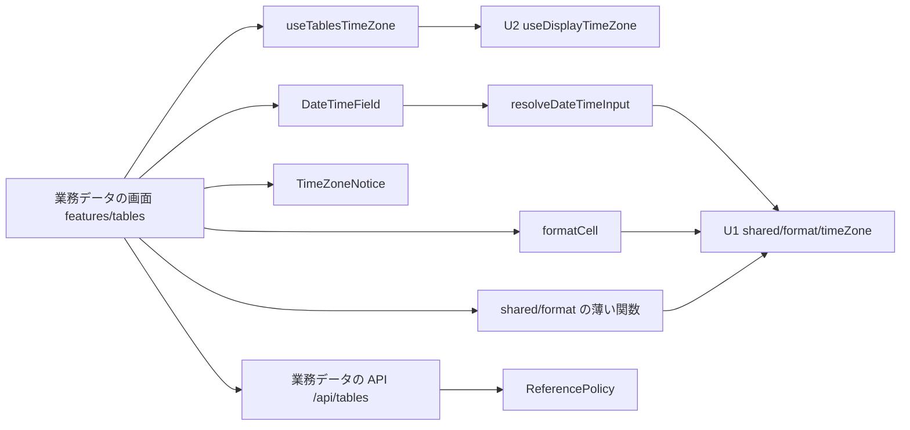

# 論理部品 — u4-business-data-time

出典: 機能設計（`construction/u4-business-data-time/functional-design/functional-spec.md`・`frontend-components.md`）、NFR 要件（`construction/u4-business-data-time/nfr-requirements/`）、この段の `performance-design.md`・`security-design.md`、部品の一覧（`inception/domain-design/components.md` の BusinessDataTimeView）、契約（`inception/contract-design/contract-summary.md` の C1・C2・C4）、質問と答え（`nfr-design-questions.md`: Q1: A・Q2: Looks correct）。

U4 は同じ実行可能 WAR に入る（画面はフロントエンドのビルド、サーバーの変更は `businessdata` の応答の1項目）。新しい配備の部品・プロセス・資源は無い。

## 1. 部品の一覧

| 部品 | 置き場 | 種類 | 役割 | 使う NFR |
|---|---|---|---|---|
| 入力の初めの値・送る形の薄い関数（`formatInstantForInput`・`formatLocalDateTimeForInput`・`toLocalDateTimeWire`） | `frontend/src/shared/format/` | 純粋な関数 | U1 の結果から入力の文字を作る・時差を持たない日時の区切りを直す | NFR2.1.4・NFR5.1.1・NFR5.1.2 |
| `resolveDateTimeInput` | `frontend/src/features/tables/` | 純粋な関数 | 文字・タイムゾーン・型・用途・2択の選択から送る値か誤りを決める（範囲は始まり＝先・終わり＝後） | NFR5.1.1・NFR5.1.2 |
| `formatCell`（直し） | `features/tables/valueFormat.ts` | 純粋な関数 | 時点を表す型を表示のタイムゾーンで書式にする | NFR2.1.3・NFR5.1.5 |
| `useTablesTimeZone` | `features/tables/` | フック | 定義に時点の型があるときだけ待つ。`ready`・`loading`・`error` を画面に渡す | NFR2.1.3・NFR3.1.1 |
| `TimeZoneNotice` | `features/tables/` | 画面の部品 | 案内の1行とプリファレンスへのリンク | NFR3.1.1・NFR5.1.5・NFR6.1.1 |
| `DateTimeField` | `features/tables/` | 画面の部品 | 時刻の欄（`FormField`＋`TextInput`）と、別の `FormField` の2択（見えない legend の `RadioGroup`） | NFR3.1.2・NFR6.1.1 |
| 一覧・詳細・フォーム・検索・ピッカー・参照の項目（直し） | `features/tables/`・`features/tables/references/` | 画面 | 上の部品を使う。フォームは失敗の間は開かない（Q1: A） | NFR2.1.3〜NFR2.1.5・NFR3.1.1 |
| 定義の応答の写し（直し） | `features/tables/businessDataParse.ts`・`businessDataTypes.ts` | 純粋な関数・型 | `labelValueType` を読む（無い・知らない値は `null`） | NFR4.2.1 |
| `ReferenceField`・`ReferencePolicy`・`ReferenceFieldResponse`（直し） | `backend/.../businessdata/domain/`・`web/` | サーバー | `AVAILABLE` のときだけラベルの列の型を持たせて出す | NFR2.1.1・NFR4.2.1・NFR5.1.3 |
| E2E の流れ 200 と専用の DSL・表 | `frontend/e2e/200-business-data-time-flow.e2e.ts`・`support/`（専用の DSL）・`support/businessDataSchema.sql`（`e2e_event`） | テスト | N6 の代表の流れ | NFR5.3.1・NFR5.1.4 |
| 185 の axe の状態の追加 | `frontend/e2e/185-business-data-accessibility.e2e.ts`・`support/businessDataFixtures.ts` | テスト | 時刻の状態の axe | NFR3.1.1・NFR3.1.3 |

使う既存の部品（変えない）: U1 の `formatInstant`・`parseLocalDateTime`・`compareInstants`・`preserveInstant`、U2 の `useDisplayTimeZone`・`DisplayTimeZoneErrorBar`、make-you-chic-ui の `FormField`・`TextInput`・`RadioGroup`。

## 2. 依存の向き

<!-- Text fallback: 業務データの画面（features/tables）は、useTablesTimeZone を通して U2 の useDisplayTimeZone を読み、DateTimeField・TimeZoneNotice・formatCell・shared/format の薄い関数を使う。DateTimeField は resolveDateTimeInput を使い、resolveDateTimeInput・formatCell・薄い関数は U1 の変換の関数だけを使う。画面は業務データの API を呼び、サーバーの ReferencePolicy が定義の応答のラベルの列の型を決める。向きは一方向で、U1・U2 は U4 を知らない。 -->

- 機能どうしの直接の import はしない（`features/tables` は `app/display-settings` と `shared/` だけを使う。今の ESLint の `no-restricted-imports` の決まりのまま）。
- サーバーの依存の向きは変えない（`businessdata` の中の domain → web。境界テストは変えない）。

## 3. 障害の範囲と影響（blast radius）

| 障害 | 影響の範囲 | 振る舞い |
|---|---|---|
| 表示のタイムゾーンの読み込みの失敗 | 時点を表す型を持つ業務データの画面 | 一覧・詳細は帯と短い文。時点の欄を持つフォームは開かず帯（Q1: A）。時点を持たない画面は影響なし |
| 保存済みのタイムゾーンを今のブラウザが解釈できない | 表示だけ | ブラウザのタイムゾーンで表示し、案内の1行で知らせる（U2 の決まり） |
| 型として読めない値（U3 が元の文字で返す） | そのセルだけ | 元の文字で出す。一覧全体は失敗しない |
| `labelValueType` が無い（前の版のサーバー） | 参照のラベルの書式だけ | 今のまま文字で出す |
| ブラウザの `Intl` の IANA の版の違い | 夏時間の判定・時差 | U1 の決まりのまま（ADR-009 で受け入れた） |

## 4. 共有する資源

- 対象DB・内部DB の接続のプール: 使い方を変えない（問い合わせ・接続の数は同じ）。
- E2E の実行のスキーマ（見本の PostgreSQL）: `e2e_event` を足す。180・190・195 の表・行は変えない。DSL は流れの専用で、共有の DSL は変えない。
- 文言の鍵（`features/tables/messages.ts`）: 業務データの機能の中だけで足す。

## 5. Infrastructure Design へ渡すこと

- 新しい配備の資源・環境変数・設定・内部DB の変更は無い。
- E2E の実行のスキーマの初期化（`./gradlew e2eTest` が流す `businessDataSchema.sql`）に表を足す点と、見本の PostgreSQL の版・接続の扱いは今のまま。
- 実行時のタイムゾーンの設定（Dockerfile・compose・テストの JVM・E2E の起動の4か所）は変えない。

## 6. 上流との差・補足（承認済みの文書は書き換えず、ここに記録する）

- Q1: A により、機能設計の D11 のフォームの扱いを「失敗の間は開かない」に変える（`security-design.md` 4節の差 1）。
- 2択を時刻の欄と別の `FormField` に置く（`security-design.md` 4節の差 3）。
- 部品の名前・置き場は論理の案で、コード生成で今の並びに合わせて確定する。

## Sources

- Initial description: N6（業務データの日時のタイムゾーンの変換）と画面の仕上げの Intent [desc]
- Workflow-selected scope: classic [scope]
- 機能設計: `aidlc/spaces/default/intents/261102-timezone-ui-polish/construction/u4-business-data-time/functional-design/functional-spec.md`・`frontend-components.md`
- NFR 要件: `aidlc/spaces/default/intents/261102-timezone-ui-polish/construction/u4-business-data-time/nfr-requirements/`
- 部品・契約: `aidlc/spaces/default/intents/261102-timezone-ui-polish/inception/domain-design/components.md`・`inception/contract-design/contract-summary.md`
- 質問と答え: `aidlc/spaces/default/intents/261102-timezone-ui-polish/construction/u4-business-data-time/nfr-design/nfr-design-questions.md`（[Q1] A・[Q2] Looks correct）

## Assumptions & Open Questions

- [assumption] `businessDataSchema.sql` に表を足しても、180・185・190・195 の確かめ（表の一覧・件数）に影響しない。コード生成の計画で、既存の E2E が表の一覧を数えていないかを確かめる。
