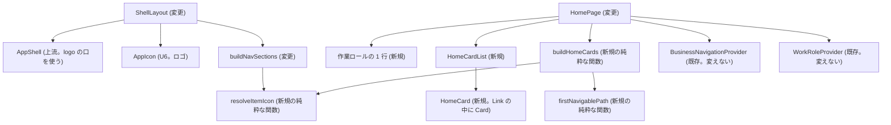

# 画面の部品の設計（Frontend Components）— U5 u5-menu-icons-home

対象の単位: U5 `u5-menu-icons-home`（種類 ui）。決まり（D1〜D32）と流れ（W1〜W5）は `functional-spec.md`。ここは、画面の部品の構成・状態・文言・API との結びつき・テストを書く。置き場の名前は案で、コード生成の計画で確定する。

出典: `functional-spec.md`・単位の定義 `inception/units-generation/unit-of-work.md`・ストーリーの対応 `unit-of-work-story-map.md`・要件 `inception/requirements-analysis/requirements.md`・ストーリー `inception/user-stories/stories.md`・部品の一覧 `inception/domain-design/components.md`・契約 `inception/contract-design/contract-summary.md`・画面イメージ `inception/refined-mockups/mockups.md`（S5・S6・S8）・今のコード（読み取りだけ）。

## 1. 部品の構成

<!-- Text fallback: ShellLayout が AppShell に U6 の AppIcon をロゴとして渡し、buildNavSections が resolveItemIcon でアイコンを決める。HomePage は作業ロールの 1 行と HomeCardList を持ち、HomeCardList は buildHomeCards（resolveItemIcon と firstNavigablePath を使う純粋な関数）で作ったカードを HomeCard（Link の中に Card）で描く。HomePage は既存の BusinessNavigationProvider と WorkRoleProvider を読むだけで変えない。 -->

依存の向きは、画面 → 純粋な関数 → 型で、閉路は無い。機能（`features/`）どうしの import は足さない（骨組み `src/app/` の中で完結する。管理のカードは登録の戻り `selectAdminSidebarItems` から作る）。

## 2. 部品・関数ごとの設計

### 2.1 `resolveItemIcon`（新規。純粋な関数。置き場の案 `frontend/src/app/navigation/navIcon.ts`）

| 項目 | 内容 |
|---|---|
| 目的 | 業務の項目のアイコンを決める（D10・D13）。サイドバーとホームのカードの 1 か所 |
| 入力 | `{ icon: string, tableKind: 'TABLE' \| 'VIEW' \| null, navigable: boolean }` |
| 出力 | `IconName`（許す一覧の名前だけ） |
| 手順 | 1) `icon` が許す一覧にあり `list` でなければその名前。2) `tableKind` が `TABLE` なら `table`、`VIEW` なら `view`。3) 移れない項目なら `folder`。4) それ以外は `list` |
| 失敗 | 例外を投げない。知らない値・型の違う値は「指定なし」とみなす |
| 今の `resolveNavIcon` との関係 | 管理の登録のアイコン（`resolveNavIcon(registration.icon)`）は、一覧に無い・空を `list` に落とす今の扱いのまま使える。業務の項目だけが `resolveItemIcon` を使う。許す一覧の判定（`isAllowedIcon`）は両方で共有する |

### 2.2 `firstNavigablePath`（新規。純粋な関数。置き場の案 `frontend/src/app/navigation/navDestination.ts`）

| 項目 | 内容 |
|---|---|
| 目的 | 業務の項目のカードの移り先の道を返す（D17） |
| 入力 | 応答の項目（`NavNode`） |
| 出力 | 道の文字列（`toTablePlaceholderPath(table, node.id)` の戻り）、見つからなければ `null` |
| 手順 | 移れる項目（`navigable` かつ `table` あり）は自分の道。移れない項目は、子を順に深さ優先でたどり、最初の移れる項目の道。見つからなければ `null` |

### 2.3 `buildHomeCards`（新規。純粋な関数。置き場の案 `frontend/src/app/pages/homeCards.ts`）

| 項目 | 内容 |
|---|---|
| 目的 | ホームのカードの一覧を作る（D16・D18） |
| 入力 | 業務のメニューの状態と応答、ログイン状態、画面の登録、表示の言語、文言を引く関数 |
| 出力 | `{ business: HomeCardModel[], admin: HomeCardModel[] }`。`HomeCardModel` は `{ id, label, icon, path }` |
| 業務のカード | 状態が `loaded`・`reloading` のときだけ、最上位の項目ごとに作る。名前は `resolveNavLabel`（サイドバーと同じ）、アイコンは `resolveItemIcon`、道は `firstNavigablePath`。道が `null` の項目は落とす |
| 管理のカード | `selectAdminSidebarItems(registrations, loginState)` の戻り（管理者だけ・`order` の順）から作る。名前は文言の鍵、アイコンは登録の `icon`（無ければ `list`）、道は登録の `path` |
| 性質 | 応答に無い項目のカードは出ない。管理者でなければ管理のカードは空。カードの順は応答の順・`order` の順。同じ入力には同じ結果 |
| 失敗 | 例外を投げない |

### 2.4 `HomePage`（変更。置き場 `frontend/src/app/pages/HomePage.tsx`）

| 項目 | 内容 |
|---|---|
| 責務 | D14〜D21。見出し・説明・作業ロールの 1 行・業務のカード・管理のカード・今の案内（`homeNoticeKey` は今のまま） |
| 状態 | 自前の状態は持たない。`useBusinessNavigation()`・`useWorkRole()`・`useLoginState()`・`useFeatureRegistry()`・`useDisplayLanguage()`・`useMessages()` を読む |
| 描画 | `section[data-testid="home-page"]`（`aria-labelledby` は見出し）。見出し h1。説明の段落。作業ロールの 1 行（`data-testid="home-work-role"`）。業務のカードがあれば `section[data-testid="home-business-section"]` に h2 とカードの並び。案内は今の `Alert`。管理のカードがあれば `section[data-testid="home-admin-section"]` に h2 とカードの並び |
| 作業ロールの 1 行 | `status` が `ready`・`reloading`・`switching` のときだけ。`current` があれば `home.workRole`（名前を差し込む）、無ければ `home.workRoleNone`。名前は文字として描く |
| 読み込み中 | 業務のメニューが `idle`・`loading` のときは、業務の見出し・カード・案内を出さない（今のまま） |
| 「もう一度」 | 失敗のとき、今のとおり `business.reload()` と `workRole.reload()` を呼ぶ |

### 2.5 `HomeCardList`・`HomeCard`（新規。置き場の案 `frontend/src/app/pages/HomeCardList.tsx`・`HomeCard.tsx`）

| 項目 | 内容 |
|---|---|
| `HomeCardList` の props | `{ headingId: string, cards: readonly HomeCardModel[], testIdPrefix: string }`。番号なしのリスト（`ul`）で、`li` ごとに `HomeCard` |
| `HomeCard` の props | `{ card: HomeCardModel, testId: string }` |
| `HomeCard` の描画 | `react-router` の `Link`（`to={card.path}`、`className="home-card-link"`）の中に、上流の `Card` を置く。`Card` の中は、`Icon`（`name={card.icon}`、`aria-hidden`、飾り）と名前の文字（`span`）。`Card` は `
` の入れ物でリンクにできないため、押せる範囲は `Link`。修飾キー・主ボタン以外のクリックは、ブラウザの既定に任せる（`Link` の既定の動き） |
| スタイル | 幅に合わせて折り返す格子（`grid-template-columns: repeat(auto-fill, minmax(11rem, 1fr))`）。長い名前は `overflow-wrap: anywhere` で折り返す。フォーカスの輪とホバーは make-you-chic-ui のトークン（色・余白）を使い、独自の色を足さない。横のスクロールを出さない（375 px を含む） |
| 置き場のスタイル | 部品と同じ場所の素の CSS（`HomeCards.css`）。文字の大きさはテーマに追従する |

### 2.6 `buildNavSections`（変更。置き場 `frontend/src/app/navigation/buildNavSections.ts`）

- 業務の項目の `icon` を `resolveItemIcon({ icon: node.icon, tableKind: node.tableKind, navigable: node.navigable })` で決める（D10）。今の `resolveNavIcon(node.icon)` の呼び出しを置き換える。
- 管理の項目は、登録の `icon` を `resolveNavIcon` のまま使う。登録に D11 のアイコンが入るため、項目ごとに違うアイコンが出る。
- 業務のカードと同じ名前の決め方（`resolveNavLabel`）を使い、ほかの規則（開閉・今の項目・道）は変えない。

### 2.7 `navigationApi`（変更。置き場 `frontend/src/app/navigation/navigationApi.ts`）

- 項目の型 `NavNode` に `tableKind: 'TABLE' | 'VIEW' | null` を足す。
- `parseNode` は、`tableKind` が `TABLE`・`VIEW` ならその値、項目が無い・`null`・それ以外は `null`（D9）。ほかの項目の検査は変えない。

### 2.8 `ShellLayout`（変更。置き場 `frontend/src/app/layout/ShellLayout.tsx`）

- `AppShell` に `logo={<AppIcon size={24} />}` を渡す（D27）。ほかの props・開閉・作業ロールの切り替えは変えない。
- ロゴは飾りで、`AppIcon` が `aria-hidden` を持つ。上流の `Topbar` は `logo` があるときだけ囲みを描く。

### 2.9 管理の機能の登録（変更・削除）

| ファイル | 変更 |
|---|---|
| `frontend/src/features/useradmin/registration.ts` | `sidebarItems[0].icon = 'user'` |
| `frontend/src/features/invitation/registration.ts` | `icon = 'mail'` |
| `frontend/src/features/groupadmin/registration.ts` | `icon = 'users'` |
| `frontend/src/features/roleadmin/registration.ts` | `icon = 'shield'` |
| `frontend/src/features/roletransfer/registration.ts` | `icon = 'download'` |
| `frontend/src/features/dsl/registration.ts` | `icon = 'edit'` |
| `frontend/src/features/admin/` | 全部削除（D23） |
| `frontend/src/app/registry/registrationModules.ts` | `admin` の読み込みを外す |

登録のテスト（各 `registration.test.tsx`）は、アイコンが付くことを確かめる行を足す。

## 3. 文言の鍵（日本語と英語）

骨組みの文言（`frontend/src/app/i18n/messages/ja.ts`・`en.ts`）に足す。管理の機能の文言（`admin.*`）は削除する。

| 鍵 | ja | en |
|---|---|---|
| `home.description`（直す） | MasterSmith へようこそ。下の入口か、左のメニューから機能を選んでください。 | Welcome to MasterSmith. Choose a feature below or from the menu on the left. |
| `home.workRole` | 作業ロール: {{name}} | Work role: {{name}} |
| `home.workRoleNone` | 作業ロール: なし | Work role: none |
| `home.section.business` | 業務 | Business |
| `home.section.admin` | 管理 | Administration |

- 名前の差し込みは、`react-i18next` の補間（`format('home.workRole', { name })`）で、名前は文字のまま渡す（HTML として描かない。補間のエスケープは既存の設定に従う）。
- 既存の鍵（`home.heading`・`home.notConfigured`・`home.noRole`・`home.nothingVisible`・`home.loadError`・`home.retry`・`home.myPermissions`）は変えない。

## 4. API との結びつき

| API | 使い方 |
|---|---|
| `GET /api/me/navigation` | 既存のプロバイダーが読む。応答の `tableKind` を読むだけ。ホームもサイドバーも、新しい呼び出しを足さない |
| `GET /api/me/work-role` | 既存のプロバイダーが読む。ホームは `current` と `status` を読むだけ |
| `GET /api/admin/check` | 画面はもう呼ばない（D25）。サーバー側は残す |

## 5. 操作の流れ

| 流れ | 画面の動き |
|---|---|
| ホームを開く | ログイン後の最初の画面。業務のメニューと作業ロールがすでに読まれているので、そのまま描く。読み込み中は業務の部分を出さない |
| 業務のカードを押す | 移り先（D17）の業務データの画面へ読み込み直しなしで移る。サイドバーの今の項目がその項目に変わる |
| フォルダのカードを押す | 最初の移れる子孫の画面へ移る。サイドバーでは、その子孫の祖先が開く（今の開閉の規則どおり） |
| 管理のカードを押す | 登録の管理の画面の道へ移る（権限の判定はサーバー） |
| 業務のメニューの読み込みに失敗 | 案内と「もう一度」。押すと業務のメニューと作業ロールを読み直す。管理のカードは出たまま |
| 作業ロールを切り替える | 切り替えの成功・拒否で業務のメニューが読み直され（既存の読み直しのきっかけ）、ホームの作業ロールの 1 行とカードが新しい応答で描き直される |

## 6. 入力の検証

この単位には利用者が入力する欄が無い。表示名・`icon`・`tableKind` は、サーバーの応答に含まれる信頼できない入力として扱う（D29）: 表示名は文字として描き、`icon` は許す一覧と照らし、`tableKind` は `TABLE`・`VIEW` 以外を `null` にする。カードの道は、業務は `toTablePlaceholderPath`、管理は登録の道だけで作る。

## 7. アクセシビリティ（D21・D31）

- ホームは見出しの階層（h1 → h2）を保ち、カードの並びは `ul`・`li` のリスト。各カードは 1 つのリンクで、名前が読み上げられる。
- アイコンは飾り（`aria-hidden`）。名前が文字で伝わるため、アイコンの見分けだけで情報を伝えない（NFR3.2）。
- キーボードだけで Tab で届き、Enter で押せる。フォーカスの輪が見える。
- 長い名前は折り返し、画面全体の横のスクロールを出さない（375 px を含む）。
- ブランドカラーとテーマのすべての組・展開したサイドバー・長い名前・2 語の氏名で、実際のブラウザの axe を流す。規則は外さない。

## 8. テストの方針

| 対象 | 種類 | 内容 |
|---|---|---|
| `resolveItemIcon` | 単体 + 性質ベース（fast-check） | D10 の 4 手順。種類を先にする（`TABLE`/`VIEW` かつ子を持つ移れる項目が `table`/`view`）。許す一覧に無い・`list`・空・知らない値の扱い。任意の入力で許す一覧の名前だけが返る |
| `firstNavigablePath` | 単体 + 性質ベース | 移れる項目は自分の道。フォルダは最初の移れる子孫。移れる項目が子を持つときは自分の道。見つからないとき `null`。任意の形の木で、返る道は木の中の移れる項目の道のどれか |
| `buildHomeCards` | 単体 + 性質ベース | 応答に無い項目のカードが出ない。管理者でなければ管理のカードが空。順が応答の順・`order` の順。道が `null` の項目が落ちる |
| `parseNode` / `navigationApi` | 単体 | `tableKind` の `TABLE`・`VIEW`・`null`・項目なし・知らない値。応答を拒否しない |
| `buildNavSections` | 単体 + 既存の性質ベース | 業務の項目のアイコンが D10 の順で決まる。管理の項目に D11 のアイコンが付く。既存の性質（見えない項目が出ない等）が通る |
| `HomePage`・`HomeCardList`・`HomeCard` | 部品（Testing Library + `vitest-axe`） | D14〜D21 の各状態（読み込み中・案内・失敗と「もう一度」・業務のカード・管理のカード・管理者でない・作業ロールの有無）。表示名の `<script>` などが文字として出る。`vitest-axe` は部品ごとに 1 件 |
| `ShellLayout` | 部品 | ロゴ（`AppIcon`）が上のバーに出る。管理の区画に仮の項目が無い |
| 各 `registration.test.tsx` | 単体 | 管理の 6 項目に D11 のアイコンが付く |
| 許すアイコンの一覧 | 既存 | `allowedNavIcons.test.ts`（サーバーと画面の一致）と `ALL_ICONS_COVERED` の型の検査が通る |
| サーバー | 単体・結合 | `MenuFilter`・`NavigationApiIT`・既存の接続の数のテスト（`functional-spec.md` D30） |
| E2E | 実際のブラウザ | 030（ホームの管理のカードから開く）の書き換え、130 の DSL の管理の画面への移し、090 の `/admin` の確かめの直し、160（画面の枠の axe）にホームとサイドバーのアイコンを足す。新しい流れは足さない |

テストの説明文は英語、テストデータは日本語でよい（`team.md`）。時刻に依存する処理は無い。

## 9. 影響を受ける既存のファイル（コード生成の計画で洗い出して確かめる）

- 画面: `frontend/src/app/pages/HomePage.tsx`（とテスト）、`frontend/src/app/navigation/{buildNavSections,navigationApi}.ts`（とテスト、`buildNavSections.property.test.ts`）、`frontend/src/app/layout/ShellLayout.tsx`（とテスト）、`frontend/src/app/registry/registrationModules.ts`、`frontend/src/app/i18n/messages/{ja,en}.ts`、`frontend/src/app/routing/AppRouter.test.tsx`・`frontend/src/app/registry/validateRegistrations.test.ts`・`frontend/src/app/admin-forbidden/*.test.ts*`（`/admin`・`admin.nav.label` を実在の道の例にしているテストの直し）、`frontend/src/features/*/registration.ts`（アイコン）、`frontend/src/features/admin/`（削除）。
- E2E: `frontend/e2e/030-admin-access.e2e.ts`・`090-invitation-registration-flow.e2e.ts`・`130-admin-forbidden-accessibility.e2e.ts`・`160-app-frame-accessibility.e2e.ts`・`support/userAdminDiagnostics.ts`。
- サーバー: `navigation/domain/{NavNode,MenuFilter,MenuFilterInput}.java`、`navigation/web/NavNodeResponse.java`、`navigation/service/NavigationService.java`、それぞれのテスト（`testsupport` の `NavigationModels` など）。
- 触れない: `perf/k6/scenarios.js` の `/api/admin/check`、`backend` の管理の確認 API と `AdminPaths`。

## Sources

- Initial description: N6（業務データの日時のタイムゾーンの変換）と画面の仕上げの Intent [desc]
- Workflow-selected scope: classic [scope]
- 決まり: `aidlc/spaces/default/intents/261102-timezone-ui-polish/construction/u5-menu-icons-home/functional-design/functional-spec.md`（D1〜D32）
- 単位: `aidlc/spaces/default/intents/261102-timezone-ui-polish/inception/units-generation/unit-of-work.md`・`unit-of-work-story-map.md`
- 要件・ストーリー・部品・契約: `aidlc/spaces/default/intents/261102-timezone-ui-polish/inception/requirements-analysis/requirements.md`・`inception/user-stories/stories.md`・`inception/domain-design/components.md`・`inception/contract-design/contract-summary.md`
- 画面イメージ: `aidlc/spaces/default/intents/261102-timezone-ui-polish/inception/refined-mockups/mockups.md`（S5・S6・S8）
- 質問と答え: `aidlc/spaces/default/intents/261102-timezone-ui-polish/construction/u5-menu-icons-home/functional-design/functional-design-questions.md`（[Q1] A・[Q2] A）
- 上流の部品（読み取りだけ）: `vendor/make-you-chic-ui` の `Card`・`Icon`・`AppShell`/`Topbar`（`logo` の口）、固定先 `d112795`
- 今のコード（読み取りだけ）: `frontend/src/app/`・`frontend/src/features/`・`frontend/src/shared/app-icon/AppIcon.tsx`
- 進め方: `aidlc/spaces/default/memory/team.md`・`project.md`

## Assumptions & Open Questions

- [assumption] ファイルの名前（`navIcon.ts`・`navDestination.ts`・`homeCards.ts`・`HomeCardList.tsx`・`HomeCard.tsx`・`HomeCards.css`）は案で、コード生成の計画で確定する。
- [assumption] カードの格子の幅（`minmax(11rem, 1fr)`）は見た目の細部で、承認の場やコード生成で直してよい。
- [assumption] ロゴの `AppIcon` の大きさ（24 px）は、上のバーの高さに収まる値。実際のブラウザの確かめで直してよい。
- 未解決の点: E2E 130 の差し替える API の道（DSL の管理の画面の読み込みの GET）は、コード生成の計画で確かめる。
