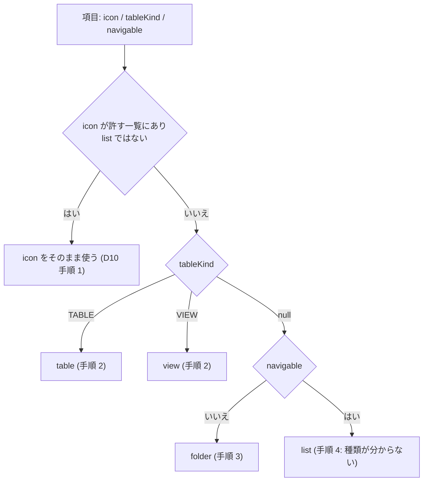
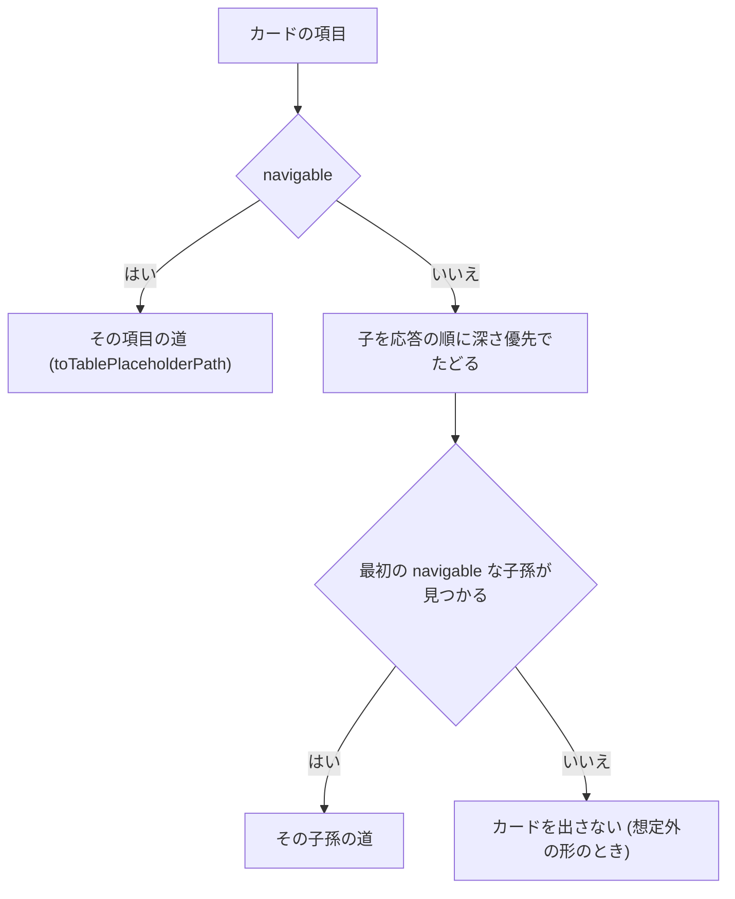

# 機能設計（Functional Spec）— U5 u5-menu-icons-home

対象の単位: U5 `u5-menu-icons-home`（種類 ui。メニューの応答の印・アイコンの決め方・ホーム・管理の仮の画面の廃止・上のバーのロゴ）。

出典: 単位の定義 `inception/units-generation/unit-of-work.md`・ストーリーの対応 `unit-of-work-story-map.md`・要件 `inception/requirements-analysis/requirements.md`（FR7〜FR11・NFR1.3・NFR2.2・NFR3.2・NFR4.2・NFR6.1）・ストーリー `inception/user-stories/stories.md`（US3.1〜US3.3・US4.2〜US4.4・US5.2・US5.3 の一部）・部品の一覧 `inception/domain-design/components.md`（NavigationMenu・AppIconPolicy・WorkRoleSelection・HomeEntrance・ShellFrame）・契約 `inception/contract-design/contract-summary.md`（C5・C7）・設計の決定 `inception/domain-design/decisions.md`（ADR-005〜ADR-007）・画面イメージ `inception/refined-mockups/mockups.md`（S5・S6・S8）・質問と答え `functional-design-questions.md`（Q1: A・Q2: A）。

## 読み方

- この単位は ui（画面）で、サーバーの小さな変更（メニューの応答に印を足す）を含む。entities.md・rules.md は作らず（ui の単位は produces の対象外）、決まりは **D 番号**（D1〜D32）で書く。追跡 `traceability.json` の target は、この D 番号と流れの番号（W1〜W5）を指す。
- 画面の部品の構成・状態・文言の鍵は `frontend-components.md` に分ける。ここは、決まりと流れと、上流との差を書く。
- 変更は **足すだけ**（応答の項目・画面の部品）と、**外すだけ**（管理の仮の画面）で、内部DB の変更・対象DB への問い合わせの追加・新しい API は無い。

## 1. 範囲と他の単位との境界

| 範囲に入る | 範囲の外 |
|---|---|
| メニューの応答 `GET /api/me/navigation` への `tableKind` の追加（サーバー）と、画面の読み方 | 表示のタイムゾーン・時刻の表示（U1〜U4） |
| 許すアイコンの名前の一覧（サーバーと画面）のそろえの維持 | アプリのアイコンの素材そのもの（U6 の `AppIcon`・`favicon`。ここは使うだけ） |
| アイコンの決め方（サイドバーとホームのカードで同じ規則） | 作業ロールの切り替え（`WorkRoleSelection` は読むだけ・変えない） |
| 管理の区画の 6 項目のアイコン | 業務データの画面（`features/tables`。メニューの道 `toTablePlaceholderPath` を使うだけ） |
| ホーム（作業ロール・業務のカード・管理のカード・今の案内） | 管理の入口を並べる専用のページ（要件の範囲の外。ホームが持つ） |
| 管理の仮の画面（`/admin`、`features/admin`）の廃止と、その検査の移し | サーバー側の管理の権限の確認 API `GET /api/admin/check` と 403 の判定（残す） |
| 上のバーのロゴ（U6 の `AppIcon` を `AppShell` の `logo` に渡す） | `vendor/make-you-chic-ui` の変更（直接変えない） |

## 2. 決まり（D1〜D32）

### 2.1 メニューの応答（サーバー）

| D | 決まり | 出どころ |
|---|---|---|
| D1 | 応答 `GET /api/me/navigation` の各項目に `tableKind`（文字列 `TABLE`・`VIEW`、または `null`）を足す。足すだけで、`id`・`label`・`icon`・`table`・`navigable`・`items` は変えない。項目は常に出し、値が無いときは `null`（`table` が移れない項目で `null` なのと同じ）。受け取る側が知らない項目として読み捨てても壊れない | C5・ADR-005・AC4.4.3・NFR4.2 |
| D2 | `tableKind` は、移れる項目（`navigable` が真、つまり `table` を持つ項目）にだけ付く。テーブルなら `TABLE`、ビューなら `VIEW`。移れない項目（まとまり・フォルダ）は `null`。移れる項目が子を持っていても `tableKind` は付く | C5・AC4.4.3 |
| D3 | 決める場所は `MenuFilter`（純粋な関数）の中。`MenuFilterInput` に「テーブルの組（スキーマ・テーブル）から種類を返す操作」（種類が分からないときは `null` を返してよい）を足し、`MenuFilter` が移れる項目を作るときに呼ぶ。本番の操作は、`NavigationService` が 1 回読んだ適用中の DSL の `findTable` で `DslTable.view` を引く（`true` なら `VIEW`、`false` なら `TABLE`）。`NavNode`・`NavNodeResponse` に `tableKind` を足し、`tableKind` を持つのは `table` を持つ項目だけ、という形の決まりを `NavNode` の構成子で守る。既存の呼び出し（`tableKind` を知らない作り方）は壊さず、`null` で作れる | C5 の未解決の点の決定・components.md の NavigationMenu |
| D4 | 見られない項目に印は付かない。`MenuFilter` が落とした項目は応答に出ない（今のまま）ため、印の有無で見られない項目の存在を明かすことはない。印は、その項目のテーブルの主権限が `READ`・`FULL` で移れる項目になったときだけ付く | NFR1.3・AC4.4.4 |
| D5 | 適用中の DSL にテーブルが見つからないとき（DSL を差し替えた直後で、権限の写しだけが前の DSL のテーブルを見られるとき）は、`tableKind` を `null` にする。応答は拒否せず、ログも出さない。画面は種類が分からない移れる項目として既定のアイコンに落とす（D10 の手順 4）。今の絞りの動き（DSL に無い組は主権限 `NONE`）は変えない | components.md の NavigationMenu・`NavigationService` の写し |
| D6 | 問い合わせを増やさない。種類は、要求の最初に 1 回読む適用中の DSL から決め、対象DB のメタデータ・内部DB を新しく読まない。1 要求の対象DB・内部DB の接続の数は今のまま（既存の `NavigationConnectionUsageIT`・`NavigationCallCountTest` の形で確かめる） | NFR2.1・AC5.3.3 |
| D7 | 許すアイコンの名前の一覧は、サーバーの `allowed-icons.txt` と画面の `allowedIcons.ts` の 2 か所とも、make-you-chic-ui の固定先 `d112795` の `Icon` の登録 24 個とすでにそろっている（上流の依頼 8 の取り込みの固定先の更新 `2aafe750` と、U1 の統合の時点の一覧の直し）。U5 は一覧を足さない。一致を確かめる既存のテスト（`allowedNavIcons.test.ts`）と、IconName の増減で落ちる型の検査（`ALL_ICONS_COVERED`）を保つ。固定先を上げるたびに 2 か所を同じ名前にそろえる手順は、コード生成の記録に写す | C7・FR11.4・AC4.4.5 |
| D8 | 許す一覧に無い `icon`（空・`null`・打ち間違い・上流に無い名前）は、サーバーが既定の `list` に置き換えて返す（今のまま。ログは出さない）。画面も、応答の `icon` が許す一覧に無ければ `list` とみなす。DSL の投入の検証は変えず、`icon` を拒否しない。[Q2: A] | AC4.4.1・`NavIconPolicy.iconOf`・Q2: A |

### 2.2 アイコンの決め方（画面。サイドバーとホームのカードで同じ規則）

| D | 決まり | 出どころ |
|---|---|---|
| D9 | 画面の業務のメニューの項目の型に `tableKind`（`TABLE`・`VIEW`・`null`）を足す。応答に項目が無い・`null`・知らない値のときは `null` とみなし、応答を拒否しない（足すだけの変更を前の版が読んでも、新しい画面が古い応答を読んでも壊れない）。知らない `emptyReason` だけが通信の失敗になる今の扱いは変えない | NFR4.2・`parseNode` |
| D10 | 業務の項目のアイコンは、1 つの関数（`resolveItemIcon`）で次の順に決める。**手順 1**: 応答の `icon` が許す一覧にあり、かつ `list` でなければ、その名前（DSL が指定したアイコン）。**手順 2**: `tableKind` が `TABLE` なら `table`、`VIEW` なら `view`（子を持っていても種類を先にする。[Q1: A]）。**手順 3**: 移れない項目（`navigable` が偽。子を持つまとまり）は `folder`。**手順 4**: 移れる項目で `tableKind` が `null`（種類が分からない。D5）は `list`。サイドバーの業務の項目とホームの業務のカードは、同じ関数を使う | FR11.1・FR11.2・AC4.4.1・AC4.4.2・Q1: A |
| D11 | 管理の区画の 6 項目の登録（`sidebarItems` の `icon`）に、次のアイコンを付ける: 利用者の管理＝`user`、利用者の招待＝`mail`、グループ＝`users`、ロール＝`shield`、ロールの受け渡し＝`download`、DSL＝`edit`。いずれも make-you-chic-ui の固定先 `d112795` の `Icon` の登録にある名前だけで、登録の検査（`ALLOWED_ICONS`）を通る。項目ごとに違うアイコンになる。上流の取り込みが済んだため、画面イメージの段の「近いものが無い 3 項目は付けない」は不要になった | FR10.1・AC4.3.1〜AC4.3.3 |
| D12 | ホームのカードのアイコンは、業務のカードは D10、管理のカードは D11 の登録のアイコン。サイドバーと同じ規則・同じ値になる | FR7.2・AC3.1.2 |
| D13 | 「DSL が `icon: list` を明示した」と「DSL が指定しなかった・一覧に無かった」は、応答の `icon` がどちらも `list` で区別できない。そのため、`icon` が `list` の項目は「指定なし」として扱い、D10 の手順 2 以降（種類の既定）を当てる。DSL の作者が `list` を明示して種類の既定を避けることはできない（応答の `icon` の形を変えないための既知の制約）。`list` は、手順 4 の最後の既定にも使う | 契約 C5・D8 |

### 2.3 ホーム（画面）

| D | 決まり | 出どころ |
|---|---|---|
| D14 | ホームの構成（上から）: 見出し（h1「ホーム」）、短い説明、作業ロールの 1 行、「業務」の見出し（h2）とカードの並び、管理の権限を持つ人にだけ「管理」の見出し（h2）とカードの並び。業務のカードが 0 件のときは「業務」の見出しを出さず（今の案内を出す）、管理のカードが 0 件のときは「管理」の見出しを出さない。説明の文言は、カードの入口を案内する文に直す | S5・FR7.1〜FR7.3 |
| D15 | 作業ロールの 1 行: 作業ロールの読み込みが済んでいる状態（`ready`・`reloading`・`switching`）で、有効な作業ロールがあれば「作業ロール: <名前>」、無ければ「作業ロール: なし」。名前は文字として出す（HTML として描かない）。読み込み中・未ログインの状態・読み込みの失敗のときは 1 行を出さない（失敗は業務のメニューの失敗の案内が伝える）。この 1 行から新しい API を呼ばない | FR7.1・AC3.1.1・S5 |
| D16 | 業務のカードは、業務のメニューの最上位の項目から作る（応答の順のまま）。業務のメニューが読み込み済み（`loaded`・`reloading`）で項目が 1 件以上あるときだけ出す。名前はサイドバーと同じ決め方（表示の言語の値 → もう片方の言語 → テーブル名 → 「（名前なし）」）。応答に出ていない項目（権限で見えない項目）のカードは作れず、サイドバーに無い項目のカードも出ない | FR7.2・AC3.1.2・AC3.1.5・NFR1.3 |
| D17 | カードの移り先: 移れる項目（`table` を持つ）は、その項目の画面の道（サイドバーと同じ `toTablePlaceholderPath(table, 項目の id)` の 1 か所）。移れない項目（フォルダ）は、子を応答の順に深さ優先でたどって最初に見つかる移れる項目の道。移れる項目が子を持つときは、自分の道（子へは移らない）。応答の形の決まり（移れない項目は子を 1 つ以上持ち、子の無い移れない項目は応答に出ない）により、応答のどの項目も、自分か子孫に移れる項目を必ず 1 つ持つ。万一見つからないとき（応答の形が想定外のとき）はそのカードを出さない | AC3.1.3・AC3.1.4・R-07 |
| D18 | 管理のカードは、サイドバーの管理の区画と同じ項目から作る（`selectAdminSidebarItems` の戻り。ログイン中の管理者だけに、登録の区画が `ADMIN` の項目を `order` の順に）。名前は登録の文言の鍵、アイコンは D11、移り先は登録の道。判定はサーバーの応答（ログイン状態の `admin`）に従い、画面で権限を足さない。管理者でない人には「管理」の見出しごと出さない。管理のカードは、業務のメニューの状態（案内・読み込みの失敗）に関わらず出る | FR7.3・AC3.2.1・AC3.2.2 |
| D19 | ホームの状態: 業務のメニューが `idle`・`loading` のとき、「業務」の見出しもカードも案内も出さない（今のまま）。`loaded`・`reloading` で項目が 1 件以上なら業務のカード。`loaded` で項目が 0 件なら、今の案内（`home.notConfigured`・`home.noRole`・`home.nothingVisible`）を `Alert` で出す。`load-error` のときは `home.loadError` に「もう一度」を添え、押すと業務のメニューと作業ロールを読み直す。「自分の権限を見る」のリンクは、画面が登録されているときだけ案内に添える（今のまま） | FR7.4・AC3.1.6 |
| D20 | 新しい API・問い合わせを足さない。ホームは、すでにシェルが読む業務のメニューの状態・作業ロールの状態・ログイン状態・画面の登録だけを使う。対象DB への問い合わせ（行の数など）をしない | FR7.5・NFR2.2・AC3.1.7 |
| D21 | 読み上げ・キーボード: カードの並びは番号なしのリスト（`ul`・`li`）で、各カードは 1 つのリンク（名前が読み上げられ、キーボードの Tab で届き、Enter で押せる）。アイコンは飾りで読み上げから外す（`aria-hidden`）。「業務」「管理」の見出しは h2 でカードの並びを `aria-labelledby` で結ぶ。名前は文字で、アイコンの見分けだけで情報を伝えない。フォーカスの輪が見える | AC3.1.8・AC4.3.4・AC5.2.4・NFR3.2 |

### 2.4 管理の仮の画面の廃止とロゴ

| D | 決まり | 出どころ |
|---|---|---|
| D22 | サイドバーの「管理」の仮の項目（登録 `admin-area`、`order` 200）を外す。管理の区画は、実際の 6 項目（DSL＝210、招待＝220、利用者＝230、ロール＝240、グループ＝250、ロールの受け渡し＝260）だけになる。管理の区画の見出しは、項目が 1 つ以上あるときだけ出す（今のまま） | FR8.1・AC3.3.1 |
| D23 | 廃止の範囲: `frontend/src/features/admin/` の全ファイル（`AdminAreaPage`・`AdminPlaceholder`・`adminApi`・`adminAreaStatus`・登録・それぞれのテストとスタイル）、`registrationModules.ts` の読み込み、画面の文言 `admin.*`。`ADMIN_AREA_PATH`（`/admin`）の参照は残さない。ほかの機能は直接 import しない決まりのため、参照の洗い出しはコード生成の計画で行う | FR8.1 |
| D24 | 廃止した道 `/admin` は、どの利用者でも、ほかの存在しない道と同じ「見つからない」画面（`NOT_FOUND`）になる。特別な移し先は作らない。管理者でない利用者が `/admin` を開いたときの「権限が無い」の表示（`ADMIN_FORBIDDEN`）は、登録された `ADMIN` の道に限る今の決まりのため、`/admin` では出なくなる（要件 A3 の帰結。差として記録）。登録された管理の道（`/admin/users` など）を管理者でない人が開いたときの「権限が無い」の表示は今のまま残る | FR8.2・A3・AC3.2.3 |
| D25 | サーバー側の管理の権限の確認 API `GET /api/admin/check` と 403 の判定は残す（k6 と E2E の API の直接の確かめが使う）。画面はこの API を呼ばなくなる。`AdminForbiddenProvider` は、任意の `/api/admin/` への 403 `ACCESS_DENIED` を拾う作りのままで、確認の API に限らない | FR8.3・K-104・AC3.3.3 |
| D26 | 検査の移し（件数は Build and Test で移す前と後を記録する。本数に数えない）: E2E 030（ログイン → 管理の入口 → ログアウト）は、ホームの管理のカード（利用者の管理）から画面を開く流れに書き換える。E2E 130（管理の画面の「権限が無い」の表示・axe の 20 組）は、DSL の管理の画面を開き、その読み込みの API の GET を 403 に差し替える形に移し、組ごとの axe を残す。E2E 090 の `/admin` の確かめは、実在する管理の道 1 つだけにする。単体テスト（`AdminAreaPage.test.tsx`・`adminApi.test.ts` など）が確かめていた内容のうち、ホーム・サイドバー・「見つからない」に関わるものは、それぞれのテストへ移す。 | FR8.4・AC3.3.4 |
| D27 | 上のバーのロゴ: `ShellLayout` が `AppShell` の `logo` に U6 の `AppIcon`（`shared/app-icon/`）を渡し、シェルの中の全画面の上のバーの左端に小さなアイコンを出す。ロゴは飾り（`aria-hidden`、押せない）で、新しい操作を足さない。ログインなどシェルの外の画面は変えない。狭い幅（375 px）でも横のスクロールを出さず、畳むボタンとユーザーメニューを押せたままにする。上流の口は取り込み済みのため、口が無い版への切り替えは持たない | US4.2・AC4.2.1・AC4.2.2 |

### 2.5 共通

| D | 決まり | 出どころ |
|---|---|---|
| D28 | 文言は日本語と英語の両方（既定は日本語）。ホームの新しい文言（作業ロールの 1 行・「業務」「管理」の見出し・説明）は骨組みの文言（`home.*`）に足し、管理の区画の項目の名前は各機能の登録の文言のまま。文言の鍵は `frontend-components.md` に一覧する | NFR6.1・S5 |
| D29 | 信頼できない入力: 項目の表示名・`icon`・`tableKind` を信頼できない入力として扱う。表示名は文字として出す（`<`・`>`・`&`・`"`・`'` を含んでも HTML として描かない）。`icon` は許す一覧と照らし、一覧に無い名前から外部の URL や `javascript:` の道を作らない。`tableKind` は `TABLE`・`VIEW` 以外を `null` にする。カードの道は、業務は `toTablePlaceholderPath` の 1 か所、管理は登録済みの道だけで作り、ほかの場所で文字列から道を作らない | AC4.4.6・team.md の N 階層のメニューの必須のテスト |
| D30 | テストの方針: サーバーは、`MenuFilter` の単体テストと既存の `MenuFilterPropertyTest` の性質（`tableKind` は移れる項目にだけ付く、見られない項目に付かない、移れない項目は `null`）、`NavigationApiIT` の応答（`TABLE`・`VIEW`・フォルダの `null`・見られない項目に付かない・DSL 差し替え後の `null`）、既存の接続の数のテストが変わらず通ること。画面は、`resolveItemIcon`（D10 の順）とホームのカードを作る純粋な関数に `fast-check` の性質ベースのテスト（見られない項目のカードが出ない、フォルダの移り先は最初の移れる子孫、種類を先にする）、ホーム・サイドバーの部品のテスト（`vitest-axe` を含む）。E2E は、既存の書き換え・移し（D26）で確かめ、新しい流れは足さない（本数に数えない） | team.md・NFR5.3 |
| D31 | アクセシビリティの確かめ（実際のブラウザの axe）: ホームとサイドバーを、ブランドカラーとテーマのすべての組で、展開した状態・長い名前（カードの折り返し・サイドバーの長い項目名）・現実に近いデータ（2 語の氏名）で流し、違反 0 件にする（規則を外さない）。管理のカードを持つ管理者と、持たない人の両方、業務のカードが 0 件の案内の状態も確かめる。画面全体の横のスクロールが出ないこと（375 px を含む）を確かめる | AC5.2.1〜AC5.2.4 |
| D32 | 互換: 応答の変更は項目を足すだけで、前の版の画面が読んでも壊れない（`tableKind` を読み捨てる）。新しい画面が古い応答を読んでも壊れない（D9）。戻しはイメージだけ。この単位は内部DB・設定・環境変数を変えず、実行時のタイムゾーンの設定も変えない | NFR4.2・AC5.3.2 |

## 3. 流れ

### W1 メニューの応答に印を足す（サーバー）

1. 利用者が `GET /api/me/navigation` を呼ぶ（認証あり。今のまま）。
2. `NavigationService` が適用中の DSL を 1 回読み、DSL が無い・メニューが空なら `NOT_CONFIGURED` を返す（今のまま）。
3. 利用者の権限の写しを 1 回解決する（今のまま）。
4. `MenuFilter` に、テーブルの主権限を返す操作・アイコンを照らす操作・**テーブルの種類を返す操作**（D3）を渡して絞る。
5. 移れる項目（主権限が `READ`・`FULL`）を作るとき、その項目のテーブルの種類を問い、`TABLE`・`VIEW`・`null`（DSL に見つからない）を `NavNode` に持たせる（D2・D5）。移れない項目は `null`。
6. 応答に写す（`tableKind` は文字列か `null`）。ログに項目の値を出さない（今の `toString` の伏せ方のまま）。

### W2 アイコンの決め方（画面）



<!-- Text fallback: アイコンの決め方。(1) icon が許す一覧にあり list でなければその icon。(2) そうでなければ tableKind が TABLE なら table、VIEW なら view。(3) tableKind が無く、移れない項目（子を持つまとまり）なら folder。(4) tableKind が無く、移れる項目（種類が分からない）なら list。 -->

### W3 ホームを組み立てる（画面）

1. 業務のメニュー・作業ロール・ログイン状態・画面の登録を読む（新しい API は呼ばない。D20）。
2. 作業ロールの読み込みが済んでいれば、作業ロールの 1 行を出す（D15）。
3. 業務のメニューの状態で、業務のカード・案内・読み込み中（何も出さない）を決める（D19）。業務のカードは、最上位の項目ごとに、名前（D16）・アイコン（D10）・移り先（D17）を決めて作る。
4. 管理者なら、管理のカードを登録から作る（D18）。
5. 見出しは、カードが 1 件以上あるものだけ出す（D14）。

移り先の決め方（D17）:



<!-- Text fallback: 移れる項目はその項目の道。移れない項目（フォルダ）は、子を応答の順に深さ優先でたどって最初に見つかる移れる項目の道。見つからないとき（応答の形が想定外のとき）はカードを出さない。 -->

### W4 管理の仮の画面を外す

1. 管理の機能の登録（`admin`）を読み込みの一覧から外し、画面とサイドバーの項目を消す（D22・D23）。
2. `/admin` は登録の道に無くなり、「見つからない」画面になる（D24）。
3. サーバーの確認 API と 403 の判定は残す（D25）。
4. 仮の画面に頼っていた単体テスト・E2E を書き換え・移す（D26）。移す前と後の件数を Build and Test で記録する。

### W5 上のバーのロゴ

1. `ShellLayout` が `AppShell` に `logo`（U6 の `AppIcon`）を渡す（D27）。
2. 上のバーの左端に飾りのアイコンが出る。口を渡さない画面（ログインなど）は今のまま。

## 4. 状態

ホームの状態（D19）。

| 業務のメニュー | 作業ロール | 画面に出るもの |
|---|---|---|
| `idle`・`loading` | 問わない | 見出しと説明、作業ロールの 1 行（読み込み済みなら）、管理のカード（管理者なら）。「業務」の見出し・カード・案内は出さない |
| `loaded`・`reloading`、項目あり | 問わない | 上に加えて「業務」の見出しとカード |
| `loaded`、項目なし（`NOT_CONFIGURED`） | 問わない | `home.notConfigured` の案内。管理のカードは出る |
| `loaded`、項目なし（`NOTHING_VISIBLE`） | あり／なし | あり: `home.nothingVisible`、なし: `home.noRole` の案内。管理のカードは出る |
| `load-error` | 問わない | `home.loadError` と「もう一度」。作業ロールの 1 行は出さない。管理のカードは出る |

## 5. API の変更（C5）

```text
GET /api/me/navigation  200
  NavNode: id, label, icon, table, navigable, items          ← 変えない
           + tableKind: "TABLE" | "VIEW" | null              ← 足す（D1〜D5）
```

- 認証あり。作業ロールの権限で絞った後の項目だけ（今のまま）。
- 漏えい: `tableKind` はテーブルの種類だけで、DSL の識別・ロールの ID・権限の値を載せない（今のまま）。
- 前の版との互換: 項目を足すだけ。内部DB・環境変数・設定の変更は無い。

## 6. ストーリー・要件・上流との差

| # | 差 | 扱い |
|---|---|---|
| 1 | 画面イメージ（Q7 A・Q8 A）は、上流の取り込み前を想定して「管理の区画は意味が近い 3 項目だけ。業務の既定は取り込むまで今のまま」と書いたが、上流の依頼 8 は取り込み済み（固定先 `d112795`、`2aafe750`）。U5 は 6 項目すべてに付け（D11）、業務の既定を 3 種類で見分ける（D10）。ストーリーの AC4.3.1・AC4.3.3・AC4.4.2 は取り込み前の待ちを想定した書きぶりだが、満たす側で実現する | 承認済みの画面イメージ・ストーリーは書き換えず、この差を記録する。Delivery Planning の「取り込めない場合の扱い」は不要になった |
| 2 | Bolt の計画の B6 は「固定先の更新の専用のコミット（fast-forward）」を含むが、固定先の更新はすでに済んでいる。B6 は squash の統合だけになる | コード生成の計画で Bolt の統合の形を直す |
| 3 | 上のバーのロゴは Should だが、上流の口が取り込み済みのため、今回入れる（D27） | Should の部分を実現する |
| 4 | 管理者でない利用者が `/admin` を開くと、今は「権限が無い」の表示だが、廃止後は「見つからない」（D24）。登録された管理の道では今のまま「権限が無い」の表示 | 要件 A3 の帰結。AC3.2.3 は登録された管理の道で満たす |
| 5 | 契約 C5 は、`tableKind` を「`table` を持たない項目は `null`」とだけ書く。D5 の「DSL にテーブルが見つからないときも `null`」は、契約への足し（`null` の意味が「フォルダ」と「種類不明」の 2 つになる）。画面は `null` を「種類の既定に落とす」で同じに扱うため、区別は要らない | 契約の読みの補足。契約は書き換えない |
| 6 | 応答の `icon` が `list` の項目は「指定なし」として扱う（D13）。DSL の作者は `list` を明示して種類の既定を避けられない | 応答の `icon` の形を変えない（NFR4.2）ための既知の制約 |
| 7 | 画面イメージの S5 は「作業ロール: なし」を細部の [assumption] としていたが、読み込みが済んで作業ロールが無いときだけ出し、読み込み中・失敗のときは出さない（D15） | 画面イメージの補足 |

## 7. 後の段へ渡すこと

| 点 | 段 |
|---|---|
| メニューの応答の性能の目標（読み取りの p95 など）が変わらないこと（問い合わせの数は増えない。D6） | NFR Requirements・Build and Test |
| ホームのカードの折り返し・長い名前・狭い幅の見た目の確かめ（D31） | Code Generation・Build and Test（axe・375 px） |
| 検査の移しの件数（030・090・130 と単体テスト。D26） | Build and Test |
| 固定先を上げるときの許す一覧のそろえの手順（D7） | Code Generation の記録 |
| E2E 030・090・130 の書き換えの細部 | Code Generation の計画（影響の洗い出し） |

## Sources

- Initial description: N6（業務データの日時のタイムゾーンの変換）と画面の仕上げの Intent [desc]
- Workflow-selected scope: classic [scope]
- 単位: `aidlc/spaces/default/intents/261102-timezone-ui-polish/inception/units-generation/unit-of-work.md`・`unit-of-work-story-map.md`
- 要件・ストーリー: `aidlc/spaces/default/intents/261102-timezone-ui-polish/inception/requirements-analysis/requirements.md`・`inception/user-stories/stories.md`
- 部品・契約・決定: `aidlc/spaces/default/intents/261102-timezone-ui-polish/inception/domain-design/components.md`・`decisions.md`・`inception/contract-design/contract-summary.md`
- 画面イメージ: `aidlc/spaces/default/intents/261102-timezone-ui-polish/inception/refined-mockups/mockups.md`
- 質問と答え: `aidlc/spaces/default/intents/261102-timezone-ui-polish/construction/u5-menu-icons-home/functional-design/functional-design-questions.md`（[Q1] A・[Q2] A）
- 上流への依頼と取り込み: `aidlc/spaces/default/intents/261102-timezone-ui-polish/make-you-chic-ui-request-8.md`、固定先の更新 `2aafe750`（`d112795`）
- 今のコード（読み取りだけ）: `backend/src/main/java/cherry/mastersmith/navigation/`・`frontend/src/app/navigation/`・`frontend/src/app/pages/HomePage.tsx`・`frontend/src/app/layout/ShellLayout.tsx`・`frontend/src/features/admin/`・`frontend/src/shared/app-icon/AppIcon.tsx`
- 進め方: `aidlc/spaces/default/memory/team.md`・`project.md`

## Assumptions & Open Questions

- [assumption] 管理の区画の 6 項目のアイコンの割り当て（D11）は、画面イメージの Q7 A の割り当て（利用者＝`user`、ロールの受け渡し＝`download`、DSL＝`edit`）に、依頼 8 の取り込み済みの名前（招待＝`mail`、グループ＝`users`、ロール＝`shield`）を足した形。ほかの割り当てがよければ承認の場で直す。
- [assumption] ホームの説明の文言と「業務」「管理」の見出しの語は、承認の場で直してよい細部。
- [assumption] E2E の移し先（030 の書き換え・130 の DSL の管理の画面への移し。D26）の細部は、コード生成の計画で決める。
- 未解決の点: E2E 130 の差し替える API の道（DSL の管理の画面の読み込みの GET）は、コード生成の計画で DSL の画面の呼び出しを確かめて決める。
