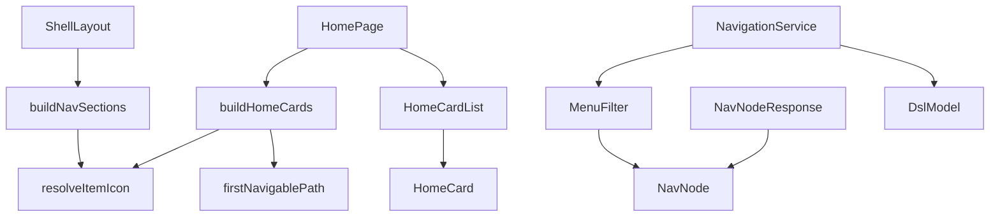

# 論理部品 — u5-menu-icons-home

出典: NFR 設計（`construction/u5-menu-icons-home/nfr-design/performance-design.md`・`security-design.md`）、NFR 要件（`construction/u5-menu-icons-home/nfr-requirements/` の各文書）、機能設計（`construction/u5-menu-icons-home/functional-design/functional-spec.md` の D1〜D32、`frontend-components.md`）、部品の一覧（`inception/domain-design/components.md`）、契約（`inception/contract-design/contract-summary.md` の C5・C7）。

U5 は、既存のアプリの中に部品を足す・直す・外す単位で、新しいインフラ（サービス・キュー・キャッシュ・プール）は足さない。この文書は、NFR のパターンがどの部品に効くか、障害や変更の影響の範囲、共有する資源を一覧にし、Infrastructure Design へ渡す。

## 1. 部品の一覧

| 部品 | 層 | 種類 | 変更 | NFR の効き |
|---|---|---|---|---|
| `NavTableKind` | サーバー domain | 列挙型 | 新規 | 値を `TABLE`・`VIEW` に限る（NFR1.3.1） |
| `NavNode` | サーバー domain | record | 項目 `tableKind` を足す | 形の決まりで、種類を持てるのは移れる項目だけ（NFR1.3.1） |
| `MenuFilterInput` | サーバー domain | record | 種類を返す操作を足す | 呼び出しは移れる項目 1 つにつき 1 回（NFR2.1.1） |
| `MenuFilter` | サーバー domain | 純粋な関数 | 移れる項目を作るときに種類を決める | 見られない項目に付かない（NFR1.3.1） |
| `NavigationService` | サーバー service | サービス | 種類の操作を 1 回読んだ DSL から作る | 読み出しの数が変わらない（NFR2.1.1） |
| `NavNodeResponse` | サーバー web | DTO | 項目 `tableKind` を足す | 足すだけの応答（NFR4.2.1）、`toString` は変えない（NFR1.3.2） |
| `navigationApi.parseNode` | 画面 app/navigation | 関数 | `tableKind` を読む | 知らない値は `null`（NFR4.2.1・NFR1.3.3） |
| `resolveItemIcon` | 画面 app/navigation | 純粋な関数 | 新規 | 許す一覧と照らす・種類を先にする（NFR1.3.3・NFR3.2.1） |
| `firstNavigablePath` | 画面 app/navigation | 純粋な関数 | 新規 | 打ち切る深さ優先・訪問数 ≦ 項目数（NFR2.2.2） |
| `buildHomeCards` | 画面 app/pages | 純粋な関数 | 新規 | 応答に無い項目のカードを作らない・道の形を確かめる（NFR1.3.3・NFR1.3.4） |
| `HomePage`・`HomeCardList`・`HomeCard` | 画面 app/pages | 部品 | 直す・新規 | 新しい HTTP 要求なし（NFR2.2.1）、リンクとして読み上げる（NFR3.2.1） |
| `buildNavSections` | 画面 app/navigation | 関数 | アイコンの決め方を差し替える | 走査に定数の分岐 1 つ（NFR2.2.2） |
| `ShellLayout` | 画面 app/layout | 部品 | `logo` を渡す | 追加の要求なし（NFR2.2.3） |
| 管理の機能の登録（6 つ） | 画面 features | 登録 | `icon` を付ける | 登録の検査が許す一覧と照らす（NFR1.3.3） |
| `features/admin/` | 画面 features | 機能 | 削除 | 検査を先に移してから外す（NFR1.3.5） |
| 許すアイコンの一覧（`allowed-icons.txt`・`allowedIcons.ts`） | サーバー resources・画面 | 設定の写し | 変えない（24 個でそろっている） | 一致のテストを保つ（NFR1.3.3） |

## 2. 依存の向き

<!-- Text fallback: 画面では ShellLayout が buildNavSections を、HomePage が buildHomeCards と HomeCardList を呼び、両方の組み立てが resolveItemIcon を使う。buildHomeCards は firstNavigablePath も使う。HomeCardList は HomeCard を描く。サーバーでは NavigationService が MenuFilter と DslModel を使い、MenuFilter は NavNode を作り、NavNodeResponse は NavNode を写す。 -->

向きは画面 → 純粋な関数 → 型、サーバー service → domain で、閉路は無い。新しい機能間の依存は足さない（`navigation` は `dsl` への今の依存のまま。`NavigationBoundaryArchitectureTest` は変えない）。

## 3. 障害の範囲と影響（blast radius）

| 障害・変更 | 影響する範囲 | 影響しない範囲 |
|---|---|---|
| 種類の操作が `null` を返す（防御の経路） | その項目の種類だけ `null`、画面で既定のアイコン | メニューの項目の有無・ほかの項目・API の状態コード |
| `tableKind` の値が知らない文字列（将来の版） | 画面は `null` として読み、既定のアイコン | 応答の受け取り・ほかの項目 |
| ホームのカードを作る関数が道を作れない項目 | その項目のカードだけ出ない | サイドバー・ほかのカード・案内 |
| 管理のカードの登録が空（管理者でない人） | 「管理」の見出しとカードが出ない | 業務のカード・案内 |
| 業務のメニューの読み込みの失敗 | 案内と「もう一度」。業務のカードは出ない | 管理のカード・作業ロールの 1 行（読み込み済みなら）・サイドバーの管理の区画 |
| 上のバーのロゴの描画の失敗 | ロゴだけ（飾り） | ほかの上のバーの部品・画面 |
| 管理の仮の画面の削除 | `/admin` が「見つからない」 | 管理の API・登録された管理の道・サーバーの 403 の判定 |
| 前の版へ戻す（イメージだけ） | 応答から `tableKind`、ホームのカード、ロゴ、管理のアイコンが消える。仮の画面が戻る | 内部DB・設定・環境変数（変えていない） |

## 4. 共有する資源

- 適用中の DSL（`ActiveDslModelProvider`）と権限の写し（`EffectivePermissionResolver`）: 1 要求につき各 1 回の読み出しのまま。U5 は新しい読み手を足さない。
- 許すアイコンの名前の一覧: サーバーと画面の 2 か所が同じ 24 個。固定先を上げるたびにそろえる。
- 業務のメニューの状態・作業ロールの状態: シェルが 1 回読み、サイドバーとホームが共有する。ホームは読み直しを増やさない（「もう一度」の押下を除く）。
- 画面の道の組み立て: 業務は `toTablePlaceholderPath` の 1 か所、管理は登録の道。

## 5. Infrastructure Design へ渡すこと

- 内部DB・環境変数・compose・Dockerfile・CI の変更は無い。実行時のタイムゾーンの設定（4 か所）も変えない。
- 監視・警報の追加は無い（新しい API・指標を足さない）。既存の `navMenu` の負荷の試験の場面を台本を変えずに使う。
- 配備の確かめ（スモークテスト）に、ホームのカード・サイドバーのアイコン・ロゴ・`/admin` が「見つからない」になることを入れるかは、Deployment Pipeline の段で決める。

## 6. 上流との差・補足（承認済みの文書は書き換えず、ここに記録する）

- **機能設計 D5 の補足**: 「DSL にテーブルが見つからないときは `null`」は、サービスの経路では起こらない防御の決まり（メニューの木と種類の操作が同じモデルから作られるため。`performance-design.md` 1.2）。機能設計の文面は書き換えない。確かめは `MenuFilterTest`（`null` を返す操作）と `NavigationDslSwapIT`（木と種類がずれない）に置く。
- **NFR 要件 NFR2.1.2 の数字**: 約 22・18 バイトは、実際の 20・19・17 バイト（`performance-design.md` 1.3）が正。「最大でも 22 バイト以下」と読めば、要件の文面と矛盾しない。
- **NFR 要件 NFR2.1.1 の確かめ方**: `NavigationCallCountTest` は読み出しの回数までを確かめ、`findTable` の呼び出しは数えない。種類の操作が移れる項目 1 つにつき 1 回であることは `MenuFilterTest` が数える（`performance-design.md` 1.2）。
- **追加した要件の印**: NFR1.3.3〜NFR1.3.5・NFR2.2.3 は、この単位が足した要件（上流の NFR1.3・NFR2.2 の枝番に寄せた）。追跡の表（`traceability.json`）の target にその旨を書く（NFR 要件のレビューの R-04 への答え）。
- **機能設計のレビュー役の指摘 D24**: `/admin` は、未ログインならログインの画面、ログイン済みなら「見つからない」（`security-design.md` 2.5）。機能設計の文面の直しは承認の場の扱い。

## Sources

- Initial description: N6（業務データの日時のタイムゾーンの変換）と画面の仕上げの Intent [desc]
- Workflow-selected scope: classic [scope]
- NFR 設計・NFR 要件: `aidlc/spaces/default/intents/261102-timezone-ui-polish/construction/u5-menu-icons-home/nfr-design/performance-design.md`・`security-design.md`、`nfr-requirements/performance-requirements.md`・`security-requirements.md`・`tech-stack-decisions.md`
- 機能設計: `aidlc/spaces/default/intents/261102-timezone-ui-polish/construction/u5-menu-icons-home/functional-design/functional-spec.md`・`frontend-components.md`
- 部品・契約: `aidlc/spaces/default/intents/261102-timezone-ui-polish/inception/domain-design/components.md`・`inception/contract-design/contract-summary.md`
- 今のコード（読み取りだけ）: `backend/src/main/java/cherry/mastersmith/navigation/`・`frontend/src/app/`
- 進め方: `aidlc/spaces/default/memory/team.md`・`project.md`

## Assumptions & Open Questions

- [assumption] スモークテストに入れる確かめ（上の 5 節の最後）は、Deployment Pipeline の段で決める。
- 未解決の点: 無い。
