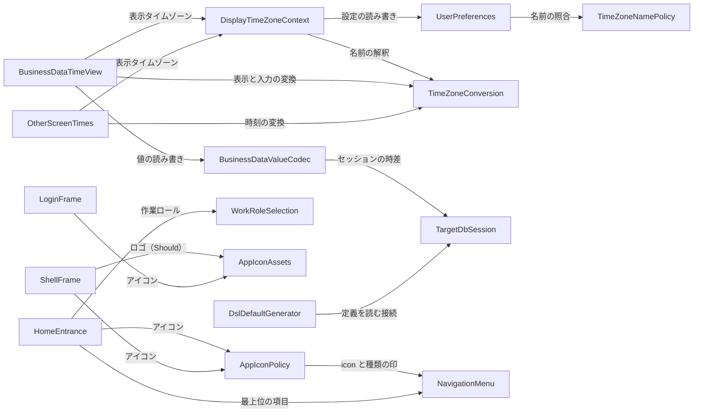

# 部品の一覧（Intent 261102-timezone-ui-polish）

出典: 要件（`inception/requirements-analysis/requirements.md`）、ストーリー（`inception/user-stories/stories.md`）、画面イメージ（`inception/refined-mockups/`）、質問と答え（`inception/domain-design/domain-design-questions.md` の Q1: A）、コード知識ベース（`aidlc/spaces/default/codekb/mastersmith2/` の `architecture.md`・`component-inventory.md`。所見 K-94〜K-105）。

既存のアプリへの変更のため、ここに載せる部品は、**今回手を入れる、または今回足す**論理的な部品だけに絞る。前の Intent までに作った部品（`auth`・`access`・`audit`・`role` など）で今回変えないものは載せない。名前は、今のコードの部品（コード知識ベースの部品の ID）との対応を「備考」の列で示す。

## 部品の一覧（機械が読む形）

```yaml
components:
  - name: UserPreferences
    summary: 利用者の表示の設定（言語など）に、表示のタイムゾーンを足して保存する（既存の拡張）
    behaviour: >
      表示のタイムゾーンは、言語と同じく、利用者の設定の行（内部DB の利用者の表）に列を1つ足して保存する。値が無い状態が
      「ブラウザに合わせる」。保存の要求の名前は TimeZoneNamePolicy で照らし、IANA の名前でなければ入力の誤り
      （VALIDATION_FAILED）で拒否して保存済みの値を変えない。本人だけが自分の分を読み書きでき、要求の本文で他人の設定を変えられない
      （一括代入の防止）。前の版のアプリは足した列を読まずに動く（足すだけの変更）。
    responsibilities:
      - 表示のタイムゾーンの保存と読み出し（既存の自分の設定の API に項目を足す）
      - 保存の要求の名前の照合（拒否のときは保存済みの値を変えない）
      - 前の版のアプリとの互換（列を足すだけ。消す移行は無い）
    depends_on:
      - component: TimeZoneNamePolicy
        interaction: 保存の要求のタイムゾーンの名前を IANA の名前として照らす
        style: sync
    dependents:
      - component: DisplayTimeZoneContext
        interaction: 画面が表示のタイムゾーンを読み、プリファレンスで保存する
    external_dependencies:
      - name: 内部DB（組み込みの H2）
        kind: database
        purpose: 利用者の設定の行に表示のタイムゾーンの列を足して保存する
    entities:
      - name: UserPreference
        identifier: userId
        attributes: [language, displayTimeZone]

  - name: TimeZoneNamePolicy
    summary: タイムゾーンの名前が IANA の名前かを照らす、サーバー側の純粋な判定（新規）
    behaviour: >
      名前を `ZoneId` の知っている IANA の名前として照らす純粋な関数。固定のオフセット表記（`+09:00`）や別名の扱いは
      機能設計で決める。知らない名前は拒否する。ブラウザが知っていてサーバーが知らない名前（IANA の版・別名の違い）も
      拒否になり、画面は選択を残して誤りを出す（ストーリー Q5 A）。
    responsibilities:
      - IANA の名前の照合（サーバーの知っている名前の集合に対して）
    depends_on: []
    dependents:
      - component: UserPreferences
        interaction: 保存の要求の名前を照らす
    entities: []

  - name: DisplayTimeZoneContext
    summary: 表示のタイムゾーンを決め、画面全体へ渡す画面の側の部品（新規）
    behaviour: >
      利用者の設定を読み込み、表示のタイムゾーンを決める（設定があればその値、無ければブラウザのタイムゾーン。保存済みの名前を
      今のブラウザが解釈できないときは保存の値を変えずブラウザのタイムゾーンで見せ、そのことを知らせる）。設定を読み込むまで
      「読み込み中」の状態を渡し、時刻の欄を出させない（ブラウザのタイムゾーンの時刻を一瞬出して切り替えることはしない）。
      プリファレンスでの保存の後は、読み込み直さずに値を差し替える。
    responsibilities:
      - 表示のタイムゾーンの決定と、読み込み中・解釈できない名前の状態の提供
      - 保存の後の差し替え（画面を読み込み直さない）
    depends_on:
      - component: UserPreferences
        interaction: 自分の設定を読み、プリファレンスの保存を送る
        style: sync
      - component: TimeZoneConversion
        interaction: 名前を今のブラウザが解釈できるかを確かめる
        style: sync
    dependents:
      - component: BusinessDataTimeView
        interaction: 業務データの画面が表示のタイムゾーンと状態を読む
      - component: OtherScreenTimes
        interaction: 利用者・招待・DSL の画面が表示のタイムゾーンと状態を読む
    entities: []

  - name: TimeZoneConversion
    summary: 時点・ローカル時刻・時差の変換と、夏時間の判定をする画面の側の純粋な関数群（新規。`src/shared/format/`）
    behaviour: >
      変換を画面の側の1か所に閉じる。ブラウザの既定のタイムゾーンを暗に使わず、タイムゾーンを明示に受ける。
      (1) 時点を、表示のタイムゾーンの時刻と時差（`+09:00`）の文字に直す（秒の端数は桁のまま、丸めない）。
      (2) 表示のタイムゾーンのローカル時刻の文字を、時点（時差つき）に直す。夏時間で存在しない時刻と重なる時刻を判定して返す
      （存在しない・重なる・ひとつに決まる）。(3) 名前を今のブラウザが解釈できるかを返す。(4) 時差を持たない型と
      `timetz` は変換せず文字のまま扱う。主キー・同時更新の判定・参照の値は、表示用の文字とは別に元の時点を保って往復させる
      （変換の前後で行の特定が変わらない）。
    responsibilities:
      - 時点 → 表示（時差つき・端数を保つ）
      - ローカル時刻の入力 → 時点（存在しない時刻・重なる時刻の判定）
      - 名前の解釈の可否
      - 元の時点を保った往復（主キー・同時更新の判定・参照の値）
    depends_on: []
    dependents:
      - component: DisplayTimeZoneContext
        interaction: 名前を解釈できるかを確かめる
      - component: BusinessDataTimeView
        interaction: 時点の表示と入力の変換
      - component: OtherScreenTimes
        interaction: 時刻の表示の変換
    entities: []

  - name: BusinessDataTimeView
    summary: 業務データの一覧・詳細・作成・更新・検索の画面で、時点を表す型の値を表示のタイムゾーンで見せ・入れる（既存の画面 `features/tables` の拡張）
    behaviour: >
      時点を表す型（PostgreSQL の timestamptz、MySQL・MariaDB の timestamp）の値は、一覧・詳細・参照の選択肢で表示のタイムゾーンと
      時差で見せる。時差を持たない型と timetz は DB の値のまま、時差を添えない。見出しの近くに表示のタイムゾーンの案内の1行を出す。
      入力と検索は文字の入力で、表示のタイムゾーンで入れ、時点（時差つき）に直して送る（Q1: A。サーバーへ送るのは時点だけ）。
      夏時間で存在しない時刻は画面で拒否し、重なる時刻は先・後の2択で選ばせる。読んだ値のまま送り返しても対象DB の値は変わらない。
      設定の読み込みの前は時刻の欄を出さない。
    responsibilities:
      - 一覧・詳細・選択肢の時刻の表示（時差つき・端数を保つ）と案内の1行
      - 入力と検索の欄（書式の案内・夏時間の誤りと2択）
      - 読んだ値の往復（変えていない欄を変えたと扱わない）
    depends_on:
      - component: DisplayTimeZoneContext
        interaction: 表示のタイムゾーンと読み込みの状態を読む
        style: sync
      - component: TimeZoneConversion
        interaction: 表示・入力の変換と夏時間の判定
        style: sync
      - component: BusinessDataValueCodec
        interaction: 業務データの API で時点を表す型の値を読み書きする（`/api/tables`）
        style: sync
    dependents: []
    entities: []

  - name: OtherScreenTimes
    summary: 利用者の一覧・招待の一覧・DSL の状態と履歴の時刻を、表示のタイムゾーンで見せる（既存の画面の直し）
    behaviour: >
      今、端末のタイムゾーンで時刻を見せている画面が、表示のタイムゾーンで見せる。各画面は変換の部品 TimeZoneConversion だけを
      使い、ブラウザの既定のタイムゾーンを暗に使わない。設定の読み込みの前は時刻の欄を出さない。
    responsibilities:
      - 管理の画面の時刻を表示のタイムゾーンで見せる
    depends_on:
      - component: DisplayTimeZoneContext
        interaction: 表示のタイムゾーンと読み込みの状態を読む
        style: sync
      - component: TimeZoneConversion
        interaction: 時刻の表示の変換
        style: sync
    dependents: []
    entities: []

  - name: BusinessDataValueCodec
    summary: 業務データの値の受け渡しの型の対応と、日時の秒の端数・型の名前の直し（既存の `businessdata` の `ColumnValueCodec` と周辺）
    behaviour: >
      DB の型ごとの対応を1か所で決める既存の部品。今回は、時点を表す型の読み書きは今の形（時差つきの値を UTC の時点として受け、
      UTC の時点を時差つきの文字で返す）を保ち、サーバーに新しい入力の形を足さない（Q1: A）。K-98 の確かめの結果に応じて、
      秒の端数の桁（`datetime(6)` など）を DB の定義に合わせ、桁つきの時差つきの型（`timestamp(n) with time zone`）を時点を表す型
      として扱う。読んだ値をそのまま送り返しても値が変わらない（往復）。サーバー側の拒否は、時差の無い値・読めない値に限る。
    responsibilities:
      - 日時の型の対応（時点を表す型・時差を持たない型・timetz）と文字の形
      - 秒の端数の桁の保持（読み・書き・往復）
      - 桁つきの時差つきの型の扱い（FR6.2）
    depends_on:
      - component: TargetDbSession
        interaction: 対象DB の接続のセッションのタイムゾーンが UTC であることを前提に値を読み書きする
        style: sync
    dependents:
      - component: BusinessDataTimeView
        interaction: 画面が業務データの API で値を読み書きする
    external_dependencies:
      - name: 対象DB（MySQL・MariaDB・PostgreSQL）
        kind: database
        purpose: 業務データの行の読み書き
    entities: []

  - name: TargetDbSession
    summary: 対象DB の接続を作るときのセッションのタイムゾーンを、3種類の対象DB で UTC に明示する（既存の `targetdb` の直し）
    behaviour: >
      MySQL・MariaDB は今も接続を作るときに `SET time_zone = '+00:00'` を行う。PostgreSQL にも同じく、読み取りと書き込みの両方の接続で
      セッションのタイムゾーンを UTC に明示する。JVM の既定のタイムゾーンに頼らない。この直しの前後で、時差を持たない型の
      読み書きの値は変わらない（3種類の結合テストで確かめる）。
    responsibilities:
      - 接続を作るときのセッションのタイムゾーンの設定（読み取り・書き込み）
    depends_on: []
    dependents:
      - component: BusinessDataValueCodec
        interaction: 値の読み書きの前提
      - component: DslDefaultGenerator
        interaction: 対象DB の定義を読む接続
    external_dependencies:
      - name: 対象DB（MySQL・MariaDB・PostgreSQL）
        kind: database
        purpose: 接続のセッションのタイムゾーン
    entities: []

  - name: DslDefaultGenerator
    summary: 対象DB の定義から既定の DSL を生成する（既存の `dslmanage` の生成の直し）
    behaviour: >
      MySQL・MariaDB の日時の型の秒の端数の桁を読み、DSL の端数の上限に反映する（今は上限 0 になる見込み。K-98）。確かめた結果が
      不具合でなければ直さず、確かめた結果を記録する。
    responsibilities:
      - 日時の型の秒の端数の桁の生成
    depends_on:
      - component: TargetDbSession
        interaction: 対象DB の定義を読む接続を借りる
        style: sync
    dependents: []
    entities: []

  - name: NavigationMenu
    summary: 適用中の DSL のメニューを作業ロールの権限で絞って渡し、項目にテーブルかビューかの印を足す（既存の `navigation` の拡張）
    behaviour: >
      項目に、テーブルかビューかの印（種類）を足す。足すだけで、既存の項目の形は変えず、前の版の画面が読んでも壊れない。印は
      利用者が見られる項目にだけ付き、見られない項目の存在を明かさない。子を持つ項目（フォルダ）は、子の有無で決まるため印を
      足さない。許すアイコンの名前の一覧（サーバー側）は、make-you-chic-ui の固定先のアイコンとそろえる。
    responsibilities:
      - メニューの応答の項目に、テーブルかビューかの印を足す
      - 許すアイコンの名前の一覧のそろえ（サーバー側）
    depends_on: []
    dependents:
      - component: AppIconPolicy
        interaction: 項目の種類の印と icon を読み、既定のアイコンを決める
      - component: HomeEntrance
        interaction: 最上位の項目を入口のカードにする
    external_dependencies:
      - name: 適用中の DSL
        kind: other
        purpose: メニューの定義とテーブルかビューかの区別
    entities:
      - name: MenuItem
        identifier: menuItemId
        attributes: [label, icon, kind, children]

  - name: AppIconPolicy
    summary: サイドバーとホームのカードのアイコンの決め方（既存の画面の骨組み `app/registry`・`app/navigation` の拡張）
    behaviour: >
      項目のアイコンを、DSL の `icon`（許す一覧と照らす）があればそれ、無ければ種類（テーブル・ビュー・フォルダ）で決まる既定とする。
      管理の区画は、今の登録で意味が近い項目（利用者・ロールの受け渡し・DSL）にだけ付け、近いものが無い項目（招待・グループ・ロール）は
      上流（make-you-chic-ui）に新しいアイコンを依頼し、取り込むまで付けない。業務の既定の3種類も取り込むまで今の既定のまま。
      許す名前の一覧（画面の側）はサーバー側と同じ名前にそろえる。表示名・icon は信頼できない入力として扱い、一覧に無い名前から外部の
      URL や `javascript:` の道を作らない。
    responsibilities:
      - アイコンの決め方（DSL の icon → 種類の既定 → 取り込むまでの扱い）
      - 許すアイコンの名前の一覧（画面の側）の維持
    depends_on:
      - component: NavigationMenu
        interaction: メニューの応答の icon と種類の印を読む
        style: sync
    dependents:
      - component: HomeEntrance
        interaction: カードのアイコンをサイドバーと同じ規則で決める
      - component: ShellFrame
        interaction: サイドバーの項目のアイコンを決める
    external_dependencies:
      - name: make-you-chic-ui の Icon の登録（18 個。固定先 cae5fed）
        kind: other
        purpose: 使えるアイコンの名前。足りないものは上流へ依頼（make-you-chic-ui-request-8）
    entities:
      - name: IconAssignment
        identifier: itemKey
        attributes: [iconName, source]

  - name: WorkRoleSelection
    summary: 今の作業ロールを持つ画面の側の既存の部品（今回は変えない。ホームが読む）
    behaviour: >
      利用者の今の作業ロールと、切り替えを持つ既存の部品（`app/work-role`）。今回は読むだけで、変えない。
    responsibilities:
      - 今の作業ロールの提供
    depends_on: []
    dependents:
      - component: HomeEntrance
        interaction: ホームに今の作業ロールの名前を出す
    entities: []

  - name: HomeEntrance
    summary: ホームの画面に、今の作業ロールと業務・管理の入口のカードを並べる（既存の `HomePage` の拡張）
    behaviour: >
      見出しの下に作業ロールを1行、その下に「業務」の見出しとカードの並び、管理の権限を持つ人にだけ「管理」の見出しとカードの
      並びを出す。業務のカードは、メニューの最上位の項目から作る（フォルダのカードは、メニューの並びで最初に画面を持つ子孫へ移る。
      見える子孫に画面が無い項目は、メニューの応答に出ないためカードも出ない）。管理のカードは、サイドバーの管理の区画の登録と同じ
      項目で、権限の判定はサーバーの応答に従い、画面で権限を足さない。ホームは今のメニューの API と作業ロールの API のほかに新しい
      API を呼ばず、対象DB へ新しい問い合わせをしない。今の案内（メニューが無い・作業ロールが無い・何も見えない・読み込みの失敗）は残す。
    responsibilities:
      - 業務のカードの組み立て（移り先の決め方を含む）
      - 管理のカードの組み立て（サイドバーの管理の区画と同じ項目）
      - 今の案内の維持
    depends_on:
      - component: NavigationMenu
        interaction: 業務メニューの応答から最上位の項目を読む
        style: sync
      - component: WorkRoleSelection
        interaction: 今の作業ロールを読む
        style: sync
      - component: AppIconPolicy
        interaction: カードのアイコンを決める
        style: sync
    dependents: []
    entities: []

  - name: ShellFrame
    summary: ログイン後の画面の枠（サイドバー・上のバー）。管理の仮の項目を外し、アイコンとロゴを受ける（既存の `ShellLayout` の直し）
    behaviour: >
      サイドバーから「管理」の仮の項目を外す。項目のアイコンは AppIconPolicy で決まる。上のバーのロゴは、make-you-chic-ui に口が
      取り込まれたときだけ出し、取り込むまでは出さない（Should）。廃止した管理の仮の画面の道は、ほかの存在しない道と同じ
      「見つからない」画面にする。サーバー側の管理の権限の確認 API と 403 の判定は残す。
    responsibilities:
      - サイドバーの項目の並び（管理の仮の項目を除く）
      - 廃止した道を「見つからない」にする
      - ロゴを置く口の利用（取り込み後）
    depends_on:
      - component: AppIconPolicy
        interaction: サイドバーの項目のアイコンを決める
        style: sync
      - component: AppIconAssets
        interaction: 取り込み後に上のバーへロゴを出す（Should）
        style: sync
    dependents: []
    external_dependencies:
      - name: make-you-chic-ui の AppShell・Topbar
        kind: other
        purpose: 画面の枠。ロゴを置く口は上流に依頼（make-you-chic-ui-request-8）
    entities: []

  - name: LoginFrame
    summary: ログイン画面の枠にアプリのアイコンを足す（既存の `LoginLayout` の直し）
    behaviour: >
      アプリ名の上にアプリのアイコンを置く。アプリ名の文字が続くため、アイコンは飾りとして読み上げから外す。
    responsibilities:
      - ログイン画面のアイコンの表示
    depends_on:
      - component: AppIconAssets
        interaction: アプリのアイコン（SVG）を読む
        style: sync
    dependents: []
    entities: []

  - name: AppIconAssets
    summary: アプリの自作のアイコンと favicon の素材（新規。`frontend/public/` とビルドの検査）
    behaviour: >
      鍛冶の金床とハンマーを図案にした輪郭の1色のアイコンを、自作の SVG で作る（アプリの中は `currentColor`、favicon は固定の
      ブランドの色）。SVG の favicon と、SVG を読めないブラウザのための `.ico`・`.png` を `frontend/public/` に置き、ビルドの結果の
      ルートから静的なファイルとして返す（`/favicon.ico` に HTML ではなく画像）。SVG にはスクリプト・イベントの属性・外部の参照を
      入れず、先頭に Apache License 2.0 のヘッダーを置き、ライセンスヘッダーの検査の対象に `.svg` を足す。`.ico`・`.png` は元の SVG から
      作る手順を README か記録に書く。
    responsibilities:
      - アプリのアイコン・favicon の素材と、その作り方の記録
      - SVG の安全（スクリプト・イベントの属性・外部の参照を含まない）とライセンスヘッダーの検査
    depends_on: []
    dependents:
      - component: ShellFrame
        interaction: 上のバーのロゴ（取り込み後。Should）
      - component: LoginFrame
        interaction: ログイン画面のアイコン
    entities: []
```

## 部品の図



## 部品の要約

| 部品 | 目的 | 呼ぶ先 | 呼ばれる元 | 持つエンティティ | 備考（今のコード） |
|---|---|---|---|---|---|
| UserPreferences | 表示のタイムゾーンの保存 | TimeZoneNamePolicy | DisplayTimeZoneContext | UserPreference | `user`（既存の拡張） |
| TimeZoneNamePolicy | 名前の照合 | なし | UserPreferences | なし | `user`（新規） |
| DisplayTimeZoneContext | 表示のタイムゾーンの決定と配布 | UserPreferences・TimeZoneConversion | BusinessDataTimeView・OtherScreenTimes | なし | `frontend-app-display-settings`（新規） |
| TimeZoneConversion | 時点・ローカル時刻の変換 | なし | DisplayTimeZoneContext・BusinessDataTimeView・OtherScreenTimes | なし | `frontend-app-core` の `shared/format/`（新規） |
| BusinessDataTimeView | 業務データの時刻の表示と入力 | DisplayTimeZoneContext・TimeZoneConversion・BusinessDataValueCodec | なし | なし | `frontend-feature-tables`（既存の拡張） |
| OtherScreenTimes | 管理の画面の時刻 | DisplayTimeZoneContext・TimeZoneConversion | なし | なし | `frontend-feature-useradmin`・`invitation`・`dsl`（既存の直し） |
| BusinessDataValueCodec | 日時の型の対応と端数・型の名前の直し | TargetDbSession | BusinessDataTimeView | なし | `businessdata`（既存の直し） |
| TargetDbSession | 接続のセッションのタイムゾーン | なし | BusinessDataValueCodec・DslDefaultGenerator | なし | `targetdb`（既存の直し） |
| DslDefaultGenerator | 既定の DSL の端数の桁 | TargetDbSession | なし | なし | `dslmanage`（既存の直し） |
| NavigationMenu | メニューの応答に種類の印を足す | なし | AppIconPolicy・HomeEntrance | MenuItem | `navigation`（既存の拡張） |
| AppIconPolicy | アイコンの決め方 | NavigationMenu | HomeEntrance・ShellFrame | IconAssignment | `frontend-registry`（既存の拡張） |
| WorkRoleSelection | 今の作業ロール | なし | HomeEntrance | なし | `frontend-app-layout-i18n`（既存・変えない） |
| HomeEntrance | ホームの入口のカード | NavigationMenu・WorkRoleSelection・AppIconPolicy | なし | なし | `frontend-app-core`（既存の拡張） |
| ShellFrame | 画面の枠（管理の仮の項目を外す） | AppIconPolicy・AppIconAssets | なし | なし | `frontend-app-layout-i18n`・`frontend-feature-admin`（既存の直しと削除） |
| LoginFrame | ログインのアイコン | AppIconAssets | なし | なし | `frontend-feature-auth` か `frontend-app-layout-i18n`（既存の直し） |
| AppIconAssets | アプリのアイコンと favicon | なし | ShellFrame・LoginFrame | なし | `frontend-app-core`（`frontend/public/`・新規） |

## エンティティの持ち主

| エンティティ | 持ち主 | 識別子 | 属性 | 参照 |
|---|---|---|---|---|
| UserPreference | UserPreferences | userId | language、displayTimeZone | なし |
| MenuItem | NavigationMenu | menuItemId | label、icon、kind、children | なし |
| IconAssignment | AppIconPolicy | itemKey | iconName、source | なし |

エンティティは、アプリが独自に持つデータだけ。業務データの行は対象DB のデータで、持ち主は無い（`project.md`）。`displayTimeZone` は、今ある利用者の設定の行に列を1つ足す（新しい表は作らない）。

## 外部の依存

| 部品 | 依存先 | 種類 | 目的 |
|---|---|---|---|
| UserPreferences | 内部DB（組み込みの H2） | database | 利用者の設定の行に表示のタイムゾーンの列を足す |
| BusinessDataValueCodec | 対象DB（MySQL・MariaDB・PostgreSQL） | database | 業務データの読み書き |
| TargetDbSession | 対象DB（MySQL・MariaDB・PostgreSQL） | database | 接続のセッションのタイムゾーン |
| NavigationMenu | 適用中の DSL | other | メニューの定義とテーブルかビューかの区別 |
| AppIconPolicy | make-you-chic-ui の Icon の登録 | other | 使えるアイコンの名前（足りないものは上流へ依頼） |
| ShellFrame | make-you-chic-ui の AppShell・Topbar | other | 画面の枠。ロゴの口は上流へ依頼 |

## 根拠

| 部品 | 別の部品である理由 |
|---|---|
| UserPreferences・TimeZoneNamePolicy | 保存（持つデータ）と名前の照合（純粋な判定）は変わる理由が違う。照合は純粋で、性質ベースのテストに向く |
| DisplayTimeZoneContext・TimeZoneConversion | 状態（読み込み・解釈できない名前）の配布と、純粋な変換は別の関心。変換は1か所に閉じ（`team.md`）、状態は画面全体に1つ |
| BusinessDataTimeView・OtherScreenTimes | 業務データの画面は入力・検索・往復を持ち、管理の画面は表示だけ。変わる量と確かめ（結合・E2E）が違う |
| BusinessDataValueCodec・TargetDbSession・DslDefaultGenerator | 型の対応・接続の設定・DSL の生成は、それぞれ別のパッケージで、K-95（接続）と K-98（型・端数）の確かめの持ち主が違う |
| NavigationMenu・AppIconPolicy | サーバー（メニューの応答）と画面（アイコンの決め方）は別の層。応答は足すだけ（NFR4.2） |
| HomeEntrance・ShellFrame・LoginFrame | 画面ごとに変える理由が違う（入口・仮の項目の廃止・ログインのアイコン）。HomeEntrance は新しい API を呼ばない |
| AppIconAssets | 素材（SVG・favicon）と検査（ヘッダー・安全）は、画面の部品とは変わる理由が違う |

### 検討した別の分け方（Alternatives Rejected）

- **時点の入力をサーバーで時点に直す（ローカル時刻とタイムゾーン名を送る）**: サーバーが夏時間の存在しない時刻・重なる時刻も判定できるが、API の入力と、主キー・参照の値の往復が変わる。質問 Q1 で依頼者が時点だけを送る形（A）を選んだ。詳細は `decisions.md` の ADR-002。
- **表示のタイムゾーンを新しい表に置く**: 設定の追加の自由度は増えるが、表の追加と前の版との互換の確かめが増える。言語と同じ置き場に列を足す形にした（ADR-001）。
- **ホームに行の数などの集計を置く**: 要件の範囲の外（FR7.5）。

## 備考

- 部品の依存は、画面の側から画面の側・サーバーの側へ向かい、閉路は無い（`depends_on` の向きで確かめた）。
- 時点を表す型の変換が画面とサーバーの2か所に分かれるのは、`team.md` の決まり（各1か所に閉じる）のとおり。サーバー側の `BusinessDataValueCodec` は、今回は新しい変換を足さず、型の対応と端数・型の名前の直しだけを持つ。

## Sources

- Initial description: N6（業務データの日時のタイムゾーンの変換）と画面の仕上げの Intent [desc]
- Workflow-selected scope: classic [scope]
- 要件: `aidlc/spaces/default/intents/261102-timezone-ui-polish/inception/requirements-analysis/requirements.md`
- ストーリー: `aidlc/spaces/default/intents/261102-timezone-ui-polish/inception/user-stories/stories.md`
- 質問と答え: `aidlc/spaces/default/intents/261102-timezone-ui-polish/inception/domain-design/domain-design-questions.md`（Q1: A）
- コード知識ベース: `aidlc/spaces/default/codekb/mastersmith2/architecture.md`・`component-inventory.md`・`business-overview.md`（K-94〜K-105）
- 進め方: `aidlc/spaces/default/memory/team.md`・`project.md`

## Assumptions & Open Questions

- [assumption] 固定のオフセット表記（`+09:00`）や IANA の別名（`Asia/Calcutta`）をサーバーの名前の照合で受けるかは、機能設計で決める（ストーリー Q5 A は、サーバーが知らない名前は拒否）。
- [assumption] ホームの「管理」のカードの出どころは、サイドバーの管理の区画の登録（`registration.ts`）とする。
- 未解決の点: 上流（make-you-chic-ui）の取り込みの時期（Delivery Planning で決める）。K-95・K-98 の確かめ（NFR Design か Code Generation の前の捨ての試し）。
