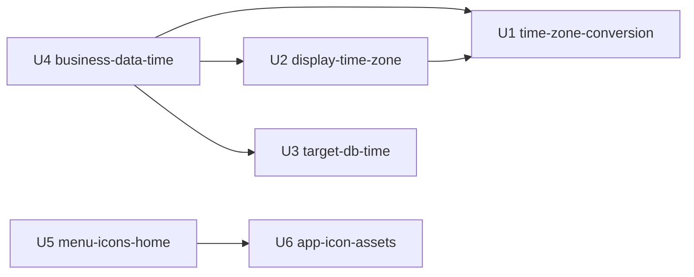

# 単位の依存（Unit of Work Dependency）— timezone-ui-polish

出典: `unit-of-work.md`、部品の一覧（`inception/domain-design/components.md` の `depends_on`）。この文書は、何が何に頼るか（トポロジー）だけを書く。作る順（経済的な順）・重要な経路は Delivery Planning が決める。

## 依存の図



- U1・U3・U6 は、ほかの単位に頼らない。
- U2 は U1 の変換の部品を使う（表示のタイムゾーンが解釈できるかの確かめ、管理の画面の時刻）。
- U4 は U1（表示と入力の変換）、U2（表示のタイムゾーンの配布）、U3（サーバー側の日時の値の読み書き）に頼る。
- U5 は U6 のアイコンの素材に頼る（上のバーのロゴ。Should）。

## 依存の根拠（部品の `depends_on` との対応）

| 辺 | 根拠（components.md） |
|---|---|
| U2 → U1 | DisplayTimeZoneContext → TimeZoneConversion、OtherScreenTimes → TimeZoneConversion |
| U4 → U1 | BusinessDataTimeView → TimeZoneConversion |
| U4 → U2 | BusinessDataTimeView → DisplayTimeZoneContext |
| U4 → U3 | BusinessDataTimeView → BusinessDataValueCodec |
| U5 → U6 | ShellFrame → AppIconAssets |

U5 の内側（HomeEntrance → NavigationMenu・WorkRoleSelection・AppIconPolicy、AppIconPolicy → NavigationMenu、ShellFrame → AppIconPolicy）、U2 の内側（DisplayTimeZoneContext → UserPreferences → TimeZoneNamePolicy）、U3 の内側（BusinessDataValueCodec・DslDefaultGenerator → TargetDbSession）、U6 の内側（LoginFrame → AppIconAssets）は、同じ単位の中の依存。

## 単位の間の接点

| 接点 | 提供する単位 → 使う単位 | 中身 |
|---|---|---|
| 変換の部品（`src/shared/format/`） | U1 → U2・U4 | 時点の表示・ローカル時刻から時点への変換・名前の解釈・元の時点の往復 |
| 表示のタイムゾーンの配布 | U2 → U4 | 設定があればその値・無ければブラウザ、読み込み中・解釈できない名前の状態 |
| 業務データの API（`/api/tables`） | U3 → U4 | 時点を表す型の値を UTC の時点で読み書きする（サーバーの入力の形は変えない。ADR-002）。秒の端数が落ちない |
| アプリのアイコンの素材 | U6 → U5 | 上のバーのロゴ（取り込み後。Should） |
| メニューの応答 | U5 の内側（NavigationMenu → AppIconPolicy・HomeEntrance） | 項目に足すテーブルかビューかの印 |

## 並行して作れる単位（トポロジー上）

依存の辺が無い単位の組は、同時に作れる（複数の正しい並びがある）。ただし、依頼者の決定（Q2: A）で、依存の順に1つずつ作る前提にする。

- 辺（直接・間接）が無い組: U1 と U3・U1 と U5・U1 と U6、U2 と U3・U2 と U5・U2 と U6、U3 と U5・U3 と U6、U4 と U5・U4 と U6。
- 根の単位（頼る先が無い）: U1・U3・U6。

## 辺の記述（機械が読む形）

```yaml
units:
  - name: u1-time-zone-conversion
    kind: library
    depends_on: []
  - name: u2-display-time-zone
    kind: service
    depends_on: [u1-time-zone-conversion]
  - name: u3-target-db-time
    kind: library
    depends_on: []
  - name: u4-business-data-time
    kind: ui
    depends_on: [u1-time-zone-conversion, u2-display-time-zone, u3-target-db-time]
  - name: u5-menu-icons-home
    kind: ui
    depends_on: [u6-app-icon-assets]
  - name: u6-app-icon-assets
    kind: packaging
    depends_on: []
```

## Sources

- Initial description: N6（業務データの日時のタイムゾーンの変換）と画面の仕上げの Intent [desc]
- Workflow-selected scope: classic [scope]
- `aidlc/spaces/default/intents/261102-timezone-ui-polish/inception/units-generation/unit-of-work.md`
- `aidlc/spaces/default/intents/261102-timezone-ui-polish/inception/domain-design/components.md`

## Assumptions & Open Questions

- 作る順は Delivery Planning が決める。この文書は、順序を勧めない。
