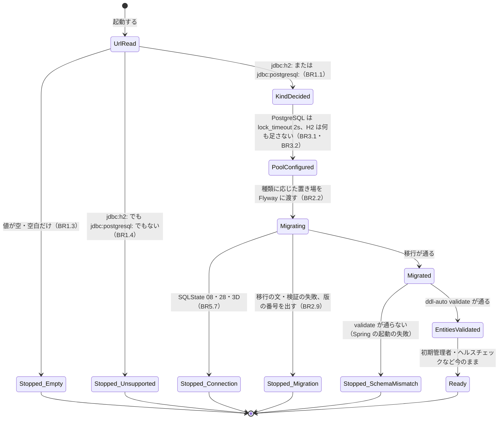
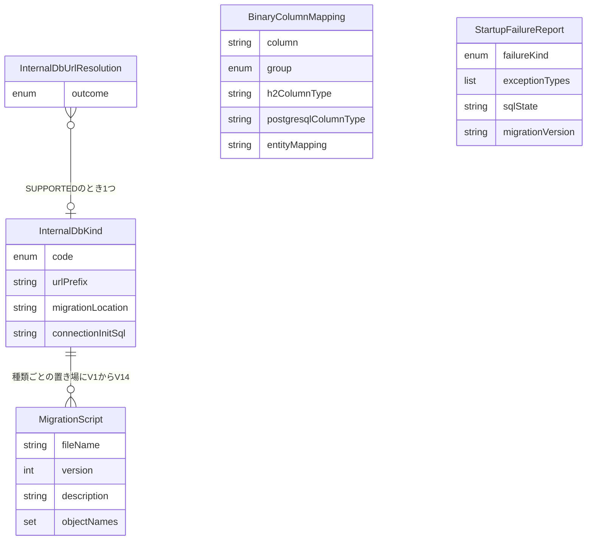

# 機能仕様: u1-internal-db-platform（機能設計。Intent 261114-internal-db-postgresql）

内部DB の種類を接続先から判断し、PostgreSQL のときに PostgreSQL 用の移行で表を作って起動できるようにする単位（U1）の、振る舞いの仕様です。この文書は、**ワークフロー（順を追う手順）と状態の移り変わりの正**です。データの形（エンティティ）は `entities.md`、決まり（BR）は `rules.md` が正で、この文書の ER 図と決まりの要約は読みやすさのために写したものです。

U1 は種類が `service` の単位で、画面は無いため `frontend-components.md` は作りません（この単位の成果物は `entities.md`・`rules.md`・`functional-spec.md`・`traceability.json` の4つ）。User Stories は飛ばしたため `stories.md` は無く、実装する要件は `unit-of-work-story-map.md` の U1 の行（FR1.1〜FR1.4・FR2.1〜FR2.5・FR3.2・FR3.3・FR3.6・FR3.7・FR3.9・FR3.10・FR5.1〜FR5.3・FR5.5 の19件）です。

## 1. 範囲と部品の置き場

| 部品（論理） | 置き場（Java・ファイル） | 役割 |
|---|---|---|
| InternalDbPlatform | `cherry.mastersmith.internaldb.platform`（新しい機能 `internaldb` の用途名の下位パッケージ。決定 D-1） | 接続先の判断・種類ごとの設定・起動時の失敗の記録・起動の入口 |
| InternalDbMigration | `backend/src/main/resources/db/migration`（H2。今のまま）と `backend/src/main/resources/db/migration-postgresql`（新しい。決定 D-3） | 表・制約・索引の作成 |
| InternalDbPostgresTestSuite の土台 | `backend/build.gradle.kts`・`backend/src/test/java/cherry/mastersmith/internaldb/testsupport`・`.github/workflows/ci.yml` | タスク・タグ・注釈・コンテナ |

論理の名前（InternalDbPlatform など）は `inception/domain-design/components.md` と同じです。Java のクラスの名前は、コード生成の計画で `internaldb.platform` の中に決めます（下の「3. 部品の分け方」は目安）。

### 1.1 この単位が変えるもの・変えないもの

- 変える: `backend/build.gradle.kts`・`gradle/libs.versions.toml`・`backend/gradle.lockfile`（依存の追加と専用タスク）、新しい `internaldb` の機能のコード、新しい移行の置き場、`.github/workflows/ci.yml`（手動の入力）、テスト。
- 変えない: 既存のアプリの本体のソース（`src/main` の既存の機能）。`application.yaml` の値（`spring.datasource`・`spring.flyway.locations`・`logging.level` はそのまま。H2 の既定の値のまま）。`org.postgresql: OFF` のログ設定。H2 の移行 V1〜V14。業務処理の層・repository の層。
- 後の単位に渡す: エンティティの写し方の変更（`@Lob` を外す。U2）、PostgreSQL での振る舞いの確かめ（U3）、compose・文書（U4）。

## 2. 捨ての試しで確かめた事実（設計の根拠）

リポジトリの外の使い捨てで、PostgreSQL 18.6（`TargetDbImages` と同じダイジェスト `sha256:e3d24f6906d0760bf4da0dae872415391ededefad23fd471c47dc53b0ddf3c42`）・Hibernate 7.4.13.Final・H2 2.4.240・Flyway 12.4.0・今のビルド済みの WAR（`backend/build/libs/mastersmith.war`、2026-11-13 のビルド）で確かめました。試しのコードは残していません（作り直し方は「確かめた事実」の下の注に書いた）。

| # | 確かめた事実 | 結果 | 設計への意味 |
|---|---|---|---|
| E1 | `@Lob byte[]` の列を PostgreSQL の `bytea` に対して `ddl-auto: validate` | 失敗（`bytea (Types#BINARY)` に対し `oid (Types#BLOB)` を期待） | 今の写し方は使えない（K-149 の見立てどおり）。BR4.1 |
| E2 | 写し方の候補ごとの validate と 10MB の往復（H2 の `BINARY LARGE OBJECT` ／ PostgreSQL の `bytea`） | 両方で通る: `@Column(length=10485760)` の `byte[]`・`@JdbcTypeCode(LONG32VARBINARY)`・`@JdbcTypeCode(VARBINARY)`＋長さ。通らない: `@Lob`（PostgreSQL）・何も付けない `byte[]`・`LONGVARBINARY`（H2） | 単一の写し方が見つかった。意図が最も表に出る `@JdbcTypeCode(SqlTypes.LONG32VARBINARY)` を選ぶ（決定 D-4）。依頼者に諮る行き詰まりは無い |
| E3 | 固定長のハッシュ（`@JdbcTypeCode(SqlTypes.BINARY)`・長さ 32）の validate と 32 バイトの往復 | H2 の `BINARY(32)`・PostgreSQL の `bytea` の両方で通り、往復が一致 | エンティティを変えない。BR4.2 |
| E4 | H2 の移行 V1〜V14 をそのまま PostgreSQL に流す | 通らないのは V3・V5・V8 の3本だけ（`type "binary" does not exist`・`syntax error at or near "LARGE"`・V8 の `BINARY(32)`）。ほかの11本はそのまま通る | 書き換えは3本だけ。BR2.6 |
| E5 | 書き換え後の一式（V3・V5 の型、V8 の STORED、ON DELETE の削除）の制約と索引の名前 | 名前付きの制約 24 件と `ix_*` の索引が H2 と同じ集まり。名前の無い主キー 9 件だけ別名（H2 `CONSTRAINT_xx`・PostgreSQL `<表>_pkey`） | 名前の突き合わせが成り立つ。名前の無い主キーは比べない。BR2.4 |
| E6 | V8 の「招待中のメールアドレスの一意」の置き換え（STORED の生成列＋`uk_invitations_pending_email`、条件つきの一意の索引） | どちらも重なると 23505 で制約の名前が取れ、COMPLETED は何件でも入り、PENDING は1件だけ。STORED の生成列なら H2 と同じ列・同じ制約の名前のまま作れる | 生成列を STORED にする（決定 D-5）。BR2.6 |
| E7 | 一意の判定の大文字と小文字（`uk_users_email`）。`A@example.com` と `a@example.com` | PostgreSQL でも別の値として入る（H2 と同じ）。末尾に空白のある値も別の値 | 一意の判定はアプリ側でそろえている（`EmailAddress.normalize`・`name_key`）ので、列の型を同じにするだけで同じ結果。追加の手当て無し |
| E8 | 主キーの採番（IDENTITY）に値を指定して入れた後の採番 | 指定した値では採番が進まず、次の採番が指定した値と重なりうる | 内部DB の移行で値を指定して IDENTITY の表に入れる行は無い（V3 の INSERT は IDENTITY ではない `login_attempt_states` だけ）。今は問題にならない。後の移行で IDENTITY の表に値を指定して入れるときは、採番を進める文を足す（移行の注に書く） |
| E9 | Flyway の PostgreSQL 用の部品と接続ごとの `lock_timeout` | `org.flywaydb:flyway-database-postgresql` 12.4.0（Apache License 2.0、依存は `flyway-core` だけ）。Spring Boot 4.1.2 の BOM が管理している。`lock_timeout`＝2 秒の接続で、空の PostgreSQL に V1〜V14 が 365 ms で全件通り、履歴14行 | 版は BOM に任せる。BR2.12・BR3.4 |
| E10 | 壊れた移行（H2 用をそのまま PostgreSQL に流す）の例外 | 例外の文に失敗した移行のファイル名（`V3__u2_authentication.sql`）と SQLState `42704`、ほかに Flyway が読んだファイルの場所が入る | 版の番号を文から取れる。BR5.3 |
| E11 | 今のアプリを PostgreSQL の接続先で起動して失敗させたときのログ | 接続できないとき、例外の文に接続先のホストとポート（`127.0.0.1:1 …拒絶`）と SQLState `08001`。パスワードが違うとき、サーバーの文に利用者名（`password authentication failed for user "…"`）と SQLState `28P01`。パスワードと資格情報つきの URL は出ない。Spring の WARN（context 初期化の取り消し）と ERROR（Application run failed）の両方に出る | 起動の入口で包む（質問 Q1: A）。BR5.1・BR5.2 |
| E12 | 接続先を空文字にして今のアプリを起動 | エラーにならず `jdbc:h2:mem:<UUID>`（メモリだけ）で起動する | 空は起動を止める（質問 Q2: A）。BR1.3 |
| E13 | 書き換え後の PostgreSQL 用の表に今のアプリを向けた起動（`@Lob` の2列だけ `oid` に変えて、エンティティの照合を通す） | `@Lob` 以外のすべてのエンティティの validate が通る | `@Lob` の2列を直せば PostgreSQL の validate が通る見込みが立った。確かめは PostgreSQL の結合テスト（BR2.10） |
| E15 | 兄弟の置き場の混ざり: `db/migration`・`db/migration-postgresql`・`db/postgresql/migration` を持つ jar と、同じ構成の手元のフォルダに対して、Flyway の置き場を `classpath:db/migration` にして探す | どちらも `db/migration` の1本だけが見つかり、`db/migration-postgresql` は混ざらない（逆も同じ）。入れ子にした `db/migration/…` の下に置いた場合に混ざるのは、Flyway が置き場を再帰して探す仕様のため | 兄弟の置き場なら H2 の一式に混ざらない。D-3 |
| E14 | PostgreSQL に流した Auth・招待・DSL の SQL | `LoginAttemptStateRepository` の `MERGE ... USING (VALUES ...)`・`RefreshTokenRepository`・`InvitationRepository` の `FETCH FIRST` つきの削除・`DslAppliedRevisionRepository` の `CAST(? AS ...)` を含む `INSERT ... SELECT` は、そのまま通った。`UPDATE ... RETURNING`・標準の `MERGE ... USING`（作業ロール・DSL のプレビュー）も通った。同時に同じ鍵への標準の `MERGE` は、後の側が確定を待ってから 23505（`pk_work_role_selections`）で失敗した。`LoginService.createRow` は `DataIntegrityViolationException` を受けて進む作り | U2 の範囲は増えない（契約 C5 の見込みどおり）。`copyFromPreview` の `CAST` は書き直し不要の見込み（H2 側の確かめと JDBC 経由の確かめは U2 の設計で行う） |

- 作り直し方: PostgreSQL 18.6 のコンテナを起動し、H2 の移行を `psql` で順に流して通らない所を洗い出す。Hibernate の確かめは、候補の写し方を付けた1列だけのエンティティを作って、H2 の内存の DB と PostgreSQL の両方で `hibernate.hbm2ddl.auto=validate` で起動し、10MB を書いて読み直す。部品の一覧は `./gradlew` の実行時のクラスパスをリポジトリの外の設定で取り出して使った。
- 確かめていないこと（U2・U3・NFR 設計に回す）: `FINAL TABLE`・`MERGE ... KEY` の書き直しの H2 側の結果（U2）、同時の標準の `MERGE` の H2 での振る舞い（U2）、行の排他のヒントの上書きと戻り（U3）、外の接続が移行の表を握っているときの `lock_timeout` の影響（NFR 設計）。

## 3. 部品の分け方（`internaldb.platform`。目安）

| 論理の名前（目安の Java の名前） | 種類 | 役割 | 対応する BR |
|---|---|---|---|
| `InternalDbKind` | 列挙 | ENT-001。H2・POSTGRESQL と、種類ごとの URL の先頭・移行の置き場・接続のたびの文 | BR1.1・BR2.2・BR3.1・BR3.2 |
| `InternalDbUrlResolver` と `InternalDbUrlResolution`（sealed な結果） | 純粋な判断 | ENT-002。接続先の値を `Supported(kind)`・`Empty`・`Unsupported` に分ける。判断だけで例外を投げない | BR1.1・BR1.3・BR1.4 |
| `InternalDbSettings` | 値 | Spring の環境から `spring.datasource.url` の値を1回だけ読み、判断した結果を起動の間じゅう持つ。ほかの3つの入口が同じ結果を使う | BR1.5 |
| `StartupFailureReport` と `StartupFailureReporter` | 値と純粋な整形 | ENT-005。例外の連なりから failureKind・例外の型の名前・SQLState・版の番号を取り出す。文は読まない（版の番号だけ文から数字を取る） | BR5.2・BR5.3・BR5.7 |
| `InternalDbStartupException` | 例外 | 起動を止める新しい例外。文は failureKind と固定の説明だけで、cause は付けない | BR5.1 |
| 起動の入口の3つ | Spring の設定 | (1) `FlywayConfigurationCustomizer`: 種類に応じた置き場を Flyway に渡す。(2) 接続プールの `BeanPostProcessor`: PostgreSQL のときだけ接続のたびの文を入れる。(3) `FlywayMigrationStrategy`: `flyway.migrate()` を呼んで失敗を受け、BR5.1 の形にして投げ直す | BR2.2・BR3.1・BR5.1 |

- (2) の `BeanPostProcessor` は、早い時期に作られるため静的な `@Bean` とし、ほかの Bean を受けず `Environment` だけを受ける。接続プールは、接続の設定を setter で入れた後、最初の接続を借りるときに初めて始まる（Spring Boot の `DataSourceBuilder` の作り）ので、プールを始める前に接続のたびの文を入れられる。この前提（`HikariDataSource` の setter が最初の接続を借りる前なら効く）はコード生成の最初の手順の単体テスト（T8）で確かめる。
- すべて `internaldb.platform` に置く（BR5.6、BR7.1）。web・service・domain・repository の層を持たない（画面入出力も DB アクセスも無い）。

## 4. ワークフロー

### W1 起動のときの判断と移行

1. Spring Boot が環境変数（`.env`）から `spring.datasource.url`・利用者・パスワード・プールの上限を束ねる。環境変数が無ければ `application.yaml` の既定（H2 のファイル）になる（BR1.2）。
2. 内部DB の接続プールを作るとき、接続プールの `BeanPostProcessor`（3(2)）が `InternalDbSettings` を使う。`InternalDbSettings` は `spring.datasource.url` の値を `InternalDbUrlResolver` に渡して1回だけ判断する（BR1.5）。結果が `Empty` または `Unsupported` なら W2 へ（起動を止める）。
3. 結果が `Supported(kind)` のとき:
   - kind が POSTGRESQL なら、接続プールの「接続のたびの文」に `SET lock_timeout = '2s'` を入れる（BR3.1）。
   - kind が H2 なら、何も足さない（BR3.2）。
4. Flyway の設定を組み立てるとき、`FlywayConfigurationCustomizer`（3(1)）が kind に応じた置き場を渡す: POSTGRESQL は `classpath:db/migration-postgresql`、H2 は `classpath:db/migration`（BR2.2）。
5. `FlywayMigrationStrategy`（3(3)）が `flyway.migrate()` を呼ぶ。成功したら W1 の次へ。例外を受けたら W2 へ（BR2.9・BR5.1）。移行は、接続プールの接続（PostgreSQL では `lock_timeout` 2 秒のもの）で流れる（BR3.4）。
6. Hibernate が、起動時のエンティティと表の照合（`ddl-auto: validate`）を行う。通らなければ今までどおり Spring の起動の失敗で止まる（Hibernate の文は表と列の名前だけで、接続先の値を含まない。この単位では置き換えない）。
7. 初期管理者の作成・ヘルスチェックの登録など、ほかの起動処理は今のまま進み、アプリが Ready になる（BR2.11・BR3.6）。

### W2 起動の失敗の記録

1. 失敗の入口: (a) 結果が `Empty`（BR1.3）、(b) 結果が `Unsupported`（BR1.4）、(c) `flyway.migrate()` が例外を投げた（BR2.9）。
2. `StartupFailureReporter` が `StartupFailureReport`（ENT-005）を作る:
   - (a) failureKind=EMPTY_URL・settingName=MASTERSMITH_DB_URL。
   - (b) failureKind=UNSUPPORTED_KIND・settingName・supportedKinds（H2・PostgreSQL）。接続先の値は読まない。
   - (c) 例外の連なり（深さの上限 10）から、クラスの名前・SQLState を集める。SQLState の先頭2文字が 08・28・3D なら CONNECTION_FAILED。そうでなく移行の文の失敗の例外があれば MIGRATION_FAILED、検証の例外なら MIGRATION_VALIDATION_FAILED、どれでもなければ UNKNOWN（BR5.7）。移行の失敗では、文からファイルの名前（`V<数字>__`）の数字を取り出して migrationVersion にする（BR5.3）。
3. ERROR を1回だけ、キーと値で出す（BR5.5）。文の中にホスト・ポート・利用者名・URL・パスワード・例外の文は入れない（BR5.2）。
4. `InternalDbStartupException`（文は failureKind と固定の説明だけ。cause 無し）を投げる。Spring が「context 初期化の取り消し」の WARN と「Application run failed」の ERROR を出すが、どちらにも元の例外の文は入らない（BR5.1）。
5. プロセスは終了コード 1 で止まる。

### W3 PostgreSQL の結合テストを流す

1. 開発者が `./gradlew :backend:internalDbPostgresTest` を流す（BR6.1）。CI では、手動の実行で入力 `internal_db_postgres` を真にしたときに、全件の `verify` の後で同じタスクを流す（BR6.8）。
2. タグ `internal-db-postgres` の `*IT` のクラスだけが選ばれる。クラスは共通の注釈 `@InternalDbPostgresIT`（タグと接続先の設定をまとめる）を付ける。
3. 拡張 `InternalDbPostgresRuntimeCheck`（BR6.4）がコンテナの実行環境を確かめる: 使えれば続ける。使えず、CI または `mastersmith.requireContainerRuntime=true` なら失敗。それ以外は警告を出してテストを中止扱いで飛ばす。
4. コンテナの部品が、JVM ごとに1つ、`TargetDbImages.postgres()` のコンテナを起動する（BR6.5）。空のデータベースが要るテストは、同じコンテナの中に実行ごとに一意の名前のデータベースを作る（BR6.6）。それ以外のテストは共有のデータベースを使う。
5. アプリが、接続先をコンテナのデータベースにして起動する（W1 を通る。`lock_timeout` 2 秒を含む）。
6. このIntent の最初の結合テストが、BR2.10（移行の全件・名前・validate・列の型・`lock_timeout`・移行の失敗）、BR2.11（初期管理者）、BR3.6（ヘルスチェック）を確かめる。U3 が、この土台の上に振る舞いの結合テストを足す。
7. 終わると、作ったデータベースを消し、JVM の終わりでコンテナを止める。

### W4 普段の `./gradlew verifyQuick`・`verify`・`-PitTests`

1. `integrationTest` はタグ `internal-db-postgres` を除外して流れる（BR6.2）。`verify`・`verifyQuick`・CI のプッシュは専用のタスクに依存しない（BR6.1）。
2. `-PitTests=<形>` を付けて `integrationTest` を流し、実行されたテストが 0 件のときは、「タグ付きのクラスは `:backend:internalDbPostgresTest` で流してください」という文で失敗にする（BR6.3。実行の終わりの集計で判定する）。
3. 普段の単体テスト（BR7.3 の T1〜T11）が、コンテナ無しに種類の判断・移行の突き合わせ・起動の失敗のログ・前の版の H2 のファイルでの起動を確かめる。

### W5 後の Intent で表を変えるとき

1. 両方の置き場に、同じ版の番号・同じ説明のファイルを同じコミットで足す（BR2.7）。PostgreSQL 用は、H2 用の文のうち BR2.5・BR2.6 の書き換えだけを当てる。
2. H2 の固定の一覧（BR2.1）に、足した H2 用のファイルの SHA-256 を足す。
3. 突き合わせの単体テスト（BR2.8）が、版・説明・名前の集まりの食い違いを拾う。PostgreSQL の結合テスト（BR2.10）で、実際の PostgreSQL への適用と validate を確かめる。
4. IDENTITY の表に値を指定して行を入れる移行を足すときは、採番を進める文（`setval` など）を PostgreSQL 用に足す（E8）。

## 5. 状態の移り変わり（起動）

起動は次の状態を順に通ります。失敗は、どの状態からも「止まった」になります。

<!-- Text fallback: 起動は UrlRead（接続先の値を読む）から始まる。値が空なら Stopped_Empty、jdbc:h2: でも jdbc:postgresql: でもなければ Stopped_Unsupported で止まる。どちらかで始まれば KindDecided。ここから PoolConfigured（PostgreSQL は接続のたびに lock_timeout 2s、H2 は何も足さない）、Migrating（種類に応じた置き場で Flyway が移行する）、Migrated、EntitiesValidated（ddl-auto validate）を経て Ready。Migrating の途中で、接続の失敗なら Stopped_Connection、移行の失敗なら Stopped_Migration（版の番号を出す）。Migrated の後で validate が通らなければ Stopped_SchemaMismatch（今までどおりの Spring の起動の失敗）。止まった状態はどれも終わり。 -->

| 状態 | 次の状態と条件 | ログ（ERROR）に出す failureKind |
|---|---|---|
| UrlRead | KindDecided（BR1.1）／Stopped_Empty（BR1.3）／Stopped_Unsupported（BR1.4） | EMPTY_URL・UNSUPPORTED_KIND |
| KindDecided → PoolConfigured → Migrating | 種類ごとの設定を当てて移行を始める | なし |
| Migrating | Migrated／Stopped_Connection／Stopped_Migration | CONNECTION_FAILED・MIGRATION_FAILED・MIGRATION_VALIDATION_FAILED・UNKNOWN |
| Migrated | EntitiesValidated／Stopped_SchemaMismatch | Stopped_SchemaMismatch はこの単位では置き換えない（表と列の名前だけの Spring の失敗） |
| EntitiesValidated → Ready | 今のままの起動処理 | なし |

## 6. ER 図（`entities.md` から写したもの。正は `entities.md`）

<!-- Text fallback: InternalDbKind（H2・POSTGRESQL）は種類ごとに多くの MigrationScript（V1〜V14）を持つ。InternalDbUrlResolution は SUPPORTED のとき1つの InternalDbKind を指す。BinaryColumnMapping（4行の参照データ）と StartupFailureReport は、ほかのエンティティへの参照を持たない。 -->

## 7. 決めたこと（この段で決めた判断）

| # | 決めたこと | 理由と、採らなかった案 |
|---|---|---|
| D-1 | 新しい機能 `cherry.mastersmith.internaldb` を作り、コードは用途名の下位パッケージ `internaldb.platform` に置く（ADR-001 の続く判断） | `config` に置く案は、全体に効く設定の置き場に種類の判断が混ざる。`common.persistence` に置く案は、共通の部品の中に新しい決まりが入る。新しい機能にすれば、境界テスト（BR7.2）で依存の向きを固定でき、PostgreSQL のときだけ通るコードが1か所に集まる（BR7.1）。層（web・service・domain・repository）に置かないのは、接続先の値を引数に取る部品を `TraceAspect` の対象の外に置くため（BR5.6）。unit-of-work.md の「既存の config の部品に手を入れる」という見込みは、この置き場の決定により当たらなくなる（上流との差 1） |
| D-2 | Spring Boot との組み立ては、設定の読み込みの時期に頼らず、起動の中の3つの入口で行う: Flyway の置き場は `FlywayConfigurationCustomizer`、接続のたびの文は接続プールの `BeanPostProcessor`、失敗の記録は `FlywayMigrationStrategy` | 接続先の値を `EnvironmentPostProcessor` で読んで設定を足す案は、PostgreSQL の結合テストが接続先をコンテナの起動の後に動的に渡す（`@DynamicPropertySource` など）ため、その値を読み逃す。起動の中の入口なら、どの経路で渡された値も同じように読める。接続の DataSource 全体を包む案は、接続プールの計測・JMX（`docker/hikari-pool.sh`）に影響する危険があり採らない（質問 Q1 の C と同じ理由） |
| D-3 | PostgreSQL 用の移行の置き場は `classpath:db/migration-postgresql`（H2 の `db/migration` の兄弟）にする | `db/migration/postgresql` のように H2 の置き場の下に置くと、Flyway が再帰して探すため H2 の一式に混ざり、版の番号が重なって失敗する。名前の `db/migration-postgresql` は `db/migration` の文字の前方一致になるが、Flyway はディレクトリ単位で探すため混ざらないことを、jar の中と手元のフォルダの両方で確かめた（E15）。WAR（Spring Boot の入れ子の jar）の中での確かめは、Build and Test の実行可能 WAR の起動確認（H2）で行う。普段の verify の単体テストでも、H2 の置き場を探して14本だけが見つかることを確かめる（BR2.8 (b)） |
| D-4 | バイナリの列の型と写し方の組（契約 C3）: 大きなバイナリの2列は PostgreSQL の `BYTEA`＋`@JdbcTypeCode(SqlTypes.LONG32VARBINARY)`（`@Lob` を外す）、固定長のハッシュの2列は `BYTEA`＋エンティティは今のまま | 捨ての試し E1〜E3。`@Column(length=10485760)` だけで通る写し方もあるが、上限の長さを写し方に埋めると上限が変わったときの食い違いが見えにくく、`LONG32VARBINARY` は「長さの限りが無い大きなバイナリ」と意図がそのまま読める。H2 の列は変えない。単一の写し方が見つかったため、依頼者に諮る必要が無かった |
| D-5 | V8 の招待中のメールアドレスの一意は、`GENERATED ALWAYS AS (...) STORED` の生成列＋同じ名前の一意の制約にする（条件つきの一意の索引にしない） | 列と制約の名前が H2 と同じになり、突き合わせ（BR2.4）と `isPendingEmailViolation`（制約の名前で照らす）が変わらない。条件つきの一意の索引にすると、制約ではなく索引になり、列 `pending_email` が無くなるため、表の形が H2 と違ってしまう |
| D-6 | 固定長のハッシュの PostgreSQL の列に長さの CHECK は足さない | 名前付きの制約の集まりを H2 と同じにするため（BR2.4）。長さは `Invitation.requireHash`・`RefreshToken` のコンストラクターが守っている |
| D-7 | 結合テストの土台の名前: 注釈 `@InternalDbPostgresIT`・コンテナの部品・確認の拡張 `InternalDbPostgresRuntimeCheck` は `src/test/java/cherry/mastersmith/internaldb/testsupport` に置く（契約 C4 の未決の点） | `team.md` の「テストの手伝いは `<機能>/testsupport`」に従う。`ContainerRuntimeCheck` の警告の文は「対象DB のテスト」と書かれ、判定の関数が同じパッケージの外から呼べないため、内部DB 用に別のクラスを作る（判定の考え方は同じ。重なるのは数行） |
| D-8 | `-PitTests` がタグ付きのクラスだけに当たったときの失敗は、`integrationTest` の実行の終わりの集計（実行された件数が 0）で判定する | Gradle のテストの絞り込みは名前で選ぶだけで、JUnit のタグでの除外は選んだ後に起きるため、絞り込みの「当たるものが無ければ失敗」には引っかからない。タグ付きのクラスの一覧を別に持つ案は、一覧の更新を忘れる |
| D-9 | 起動時の失敗は、起動の入口で受けて、例外の型の名前・SQLState・版の番号だけをログに出す形にする。動作中の失敗は今のまま（質問 Q1: A、依頼者の決定） | 上流との差 2（FR3.10 の「動作中」） |
| D-10 | 接続先が空・空白だけのときは起動を止める（質問 Q2: A、依頼者の決定） | 今のアプリはメモリだけの H2 で静かに起動するため、再起動で利用者・権限・DSL が消える（E12）。今の挙動を変えるため、README の注意と `.env.example` の注に書く（U4） |

## 8. 上流との差（承認済みの文書と違う所）

1. `unit-of-work.md` の U1 の注意「既存の `config` の部品に手を入れるため、その機能の境界テストが無ければ足す」は、D-1 により当たらない（このIntent は既存の `config` の本体のソースに手を入れない）。代わりに新しい機能 `internaldb` の境界テスト `InternalDbBoundaryArchitectureTest` を足す（BR7.2）。
2. 要件 FR3.10 は「起動時・動作中」の両方で接続情報を出さないことを求めるが、この単位は起動時だけ保証する（質問 Q1: A、依頼者の決定）。動作中の接続の失敗のログの例外の文にホスト・ポート・利用者名が出うることを、README の既知の制約として書く（U4）。パスワードと資格情報つきの URL は、起動時も動作中も出ない（今のとおり）。
3. 要件 FR1.1 の「何も設定しないときは今と同じ H2」の周辺で、「設定されているが空」のときの動きを新しく決めた（質問 Q2: A）。今の「メモリだけの H2 で起動」をやめ、起動を止める。
4. `decisions.md` の ADR-001 は「ヒントには手を入れない」「待ちの上限の渡し方は NFR 設計」としており、この段は接続のたびの文を接続プールの設定として入れる形（BR3.1）まで決めた。接続の別（移行の接続だけ上限を外すか）は NFR 設計のまま（BR3.4）。
5. `contract-summary.md` の C4 の「パッケージは機能設計で決める」「`ContainerRuntimeCheck` と同じ扱い」は、D-7 のとおり `internaldb/testsupport` と、別クラス `InternalDbPostgresRuntimeCheck` で決めた（判定の考え方は同じ）。
6. `contract-summary.md` の C3 の `if_no_single_mapping`（単一の写し方が無いときは依頼者に諮る）は、単一の写し方が見つかったため使わない。`study-internal-db-postgresql.md` に、この段の捨ての試しの結果を足す。

## 9. 次の段・後の単位に渡すこと

| 渡す先 | 内容 |
|---|---|
| U1 の NFR 要件・NFR 設計 | 外の接続が移行の表を握っているときの `lock_timeout` の影響と、移行の接続だけ上限を外すか（BR3.4、NFR4）。接続プールの `BeanPostProcessor` の前提（`HikariDataSource` の setter が最初の接続の前なら効く）の確かめの置き場。PostgreSQL の結合テストの時間の見積もり（NFR5 の外）。依存の追加の確かめの記録の置き場（BR2.12、NFR8）。`META-INF/third-party-licenses` の一覧の決まりの確認 |
| U1 のコード生成 | 最初の手順で依存（`flyway-database-postgresql`）・lockfile・OSV-Scanner・依存の木を確かめる。PostgreSQL 用の移行は H2 用をコピーして BR2.5・BR2.6 だけ当てる。H2 の固定の一覧は、移行のファイルから SHA-256 を計算して作る。`InternalDbBoundaryArchitectureTest`・T1〜T11・PostgreSQL の最初の結合テストを、層ごとに実装してから書く（`team.md` の Testing Posture）。Dockerfile・compose は変えない（U4 が compose） |
| U2 | `DslPreviewRecord`・`DslAppliedRevisionRecord` の `@Lob` を `@JdbcTypeCode(SqlTypes.LONG32VARBINARY)` に直す（BR4.1）。`DslAppliedRevisionRepository` の `CAST` は書き直し不要の見込み（E14。H2 側と JDBC 経由で確かめる）。Auth・招待の SQL は変えない見込み（E14） |
| U3 | 10MB の往復・32 バイトのハッシュ（BR4.4）・行の排他のヒントの上書きと戻り（BR3.3）・時刻の往復（BR4.5）・違反の区分の確かめ。`@InternalDbPostgresIT` と土台（BR6.x）を使う |
| U4 | README と `docs/internal-db.md` に、接続先が空のときの注意（D-10）・動作中の失敗のログの既知の制約（上流との差 2）・`spring.datasource.hikari.connection-init-sql` が PostgreSQL のときこの機能に置き換えられること（BR3.1）・PostgreSQL 用の移行の置き場（D-3）を書く |

## 10. 規則の要約（`rules.md` から写したもの。正は `rules.md`）

| グループ | 決まり | 件数 |
|---|---|---|
| BR1 種類の判断 | BR1.1〜BR1.7 | 7 |
| BR2 移行の置き場 | BR2.1〜BR2.12 | 12 |
| BR3 接続の設定 | BR3.1〜BR3.6 | 6 |
| BR4 バイナリと時刻の列 | BR4.1〜BR4.5 | 5 |
| BR5 起動時の失敗の記録 | BR5.1〜BR5.7 | 7 |
| BR6 結合テストの土台 | BR6.1〜BR6.8 | 8 |
| BR7 構造とテストの置き場 | BR7.1〜BR7.3 | 3 |
| 合計 | | 48 |

## 承認の場の決定

（まだありません。承認の場で依頼者が決めたことは、ここに書きます。）

## Sources

- `aidlc/spaces/default/intents/261114-internal-db-postgresql/construction/u1-internal-db-platform/functional-design/entities.md`・`rules.md`・`functional-design-questions.md`（Q1: A・Q2: A）
- `aidlc/spaces/default/intents/261114-internal-db-postgresql/inception/units-generation/unit-of-work.md`・`unit-of-work-story-map.md`
- `aidlc/spaces/default/intents/261114-internal-db-postgresql/inception/requirements-analysis/requirements.md`
- `aidlc/spaces/default/intents/261114-internal-db-postgresql/inception/domain-design/components.md`・`decisions.md`
- `aidlc/spaces/default/intents/261114-internal-db-postgresql/inception/contract-design/contract-summary.md`（C1〜C6）
- `aidlc/spaces/default/knowledge/aidlc-shared/study-internal-db-postgresql.md`・`checklist-auth-audit.md`・`checklist-dsl.md`・`checklist-timezone.md`
- `aidlc/spaces/default/memory/team.md`・`project.md`
- 捨ての試し（2026-11-17、リポジトリの外。コードは残していない）: PostgreSQL 18.6（`TargetDbImages` のダイジェスト）・Hibernate 7.4.13.Final・H2 2.4.240・Flyway 12.4.0・`flyway-database-postgresql` 12.4.0・今のビルド済みの WAR
