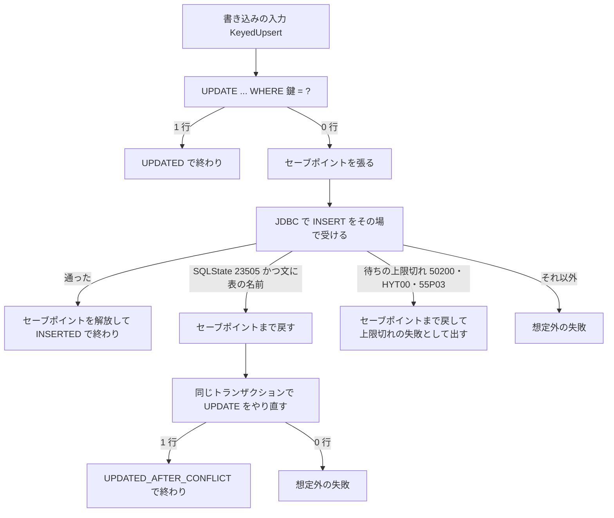
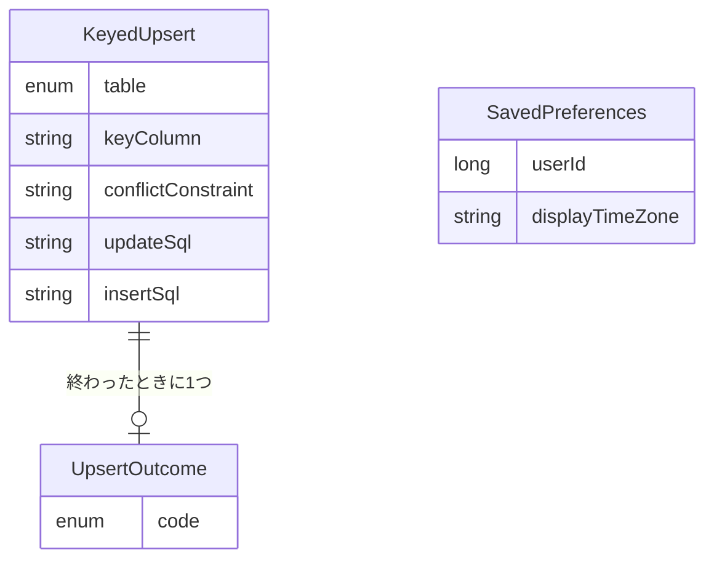

# 機能仕様: u2-portable-sql（機能設計。Intent 261114-internal-db-postgresql）

H2 にしか通らない書き込みの文を、H2 と PostgreSQL の両方に通る書き方に直す単位（U2）の、振る舞いの仕様です。この文書は**ワークフロー（順を追う手順）の正**です。データの形（エンティティ）は `entities.md`、決まり（BR）は `rules.md` が正で、この文書の ER 図と決まりの要約は読みやすさのために写したものです。

U2 は種類が `service` の単位で、画面は無いため `frontend-components.md` は作りません。User Stories は飛ばしたため `stories.md` は無く、実装する要件は `unit-of-work-story-map.md` の U2 の行（FR3.5・FR3.6・FR3.8・FR5.4。FR3.5・FR3.6 は U3 と分け合う）です。

## 1. 範囲と部品の置き場

| 部品（論理） | 置き場（Java） | 役割 |
|---|---|---|
| UserPersistence | `cherry.mastersmith.user.repository.UserRepository` | 本人の表示の設定の保存（BR1.1〜BR1.3） |
| RolePersistence | `cherry.mastersmith.role.store.RoleStore`・`RoleStoreClassifier` | 作業ロールの保存（BR2.1〜BR2.5） |
| DslManagePersistence | `cherry.mastersmith.dslmanage.repository.DslPreviewRepository` ほか | プレビューを置く（BR2.1〜BR2.5） |
| 共通の手順 | `cherry.mastersmith.common.persistence`（新しい部品 1 つ + `RowLockFailures` への 1 行） | 「あれば更新・無ければ挿入」の手順（BR2.7）と上限切れの分類（BR2.6） |

論理の名前は `inception/domain-design/components.md` と同じです。新しい部品の Java のクラスの名前は、コード生成の計画で `common.persistence` の中に決めます。

### 1.1 この単位が変えるもの・変えないもの

- 変える: `UserRepository.savePreferences` の文、`RoleStore` の作業ロールの保存、`DslPreviewRepository.place`、`common.persistence` に新しい部品と `RowLockFailures` の 1 行、それらのテスト（`WorkRoleSelectionMergeIT` の書き直しを含む）。
- 変えない: repository・store のメソッドの形（引数・戻り値。契約 C5）、業務処理の層、`copyFromPreview`・Auth・招待の SQL、利用者の検索、移行（U1 が持つ）、`application.yaml`。
- 後の単位に渡す: PostgreSQL での振る舞いの確かめ（U3）、既知の違い（検索の Unicode の端）の文書（U4）。

## 2. 捨ての試しで確かめた事実（設計の根拠）

リポジトリの外の使い捨てで、H2 2.4.240・PostgreSQL 18.6（`TargetDbImages` と同じダイジェスト）・Hibernate 7.4.13 と、実際のアプリの部品（`MastersmithApplication`・各 Repository の Bean）で確かめました（2026-11-22。試しのコードは残していません）。

| # | 確かめた事実 | 結果 | 設計への意味 |
|---|---|---|---|
| F1 | 今の 3 つの文（`FINAL TABLE`・`MERGE ... KEY` が 2 か所）を PostgreSQL に流す | すべて 42601（構文誤り）。H2 は通る | 書き直しが要る（BR1.1・BR2.1） |
| F2 | `copyFromPreview`・`createIfAbsent`・`FETCH FIRST` つきの 2 つの削除を実際の Bean 経由で両方に流す | 両方で同じ結果（10MB の SHA-256 一致。`createIfAbsent` の同時の実行は両方で 23505） | 書き直さない（BR3.1） |
| F3 | `savePreferences` の候補: 更新 → 同じトランザクションの `SELECT`（2 文）、`UPDATE ... RETURNING`、JDBC の生成キー | 2 文の形は両方で通る。`RETURNING` は H2 が 42000（通らない）。**生成キー（小文字の列名）は 1 文のまま両方で更新後の値を返す**。`change`・`zone` の `CASE` は両方に通る | 生成キーで 1 文（BR1.1。質問 Q1: A） |
| F4 | 標準の `MERGE ... USING (VALUES ...)` | 両方で通る。ただし PostgreSQL は時刻の束縛に `CAST(? AS TIMESTAMP WITH TIME ZONE)` が必須（42804）。バイト列に `CAST(? AS VARBINARY)` は PostgreSQL で 42704 | 標準の `MERGE` は使わない（F5）。更新・挿入の直接の代入には `CAST` が要らない（BR2.1） |
| F5 | 同じ鍵（行なし）への同時の標準の `MERGE`（先が保持） | 後の側は先のコミットを待って **23505**（H2・PostgreSQL とも）。H2 の今の `MERGE ... KEY` は後の側が**成功して上書き（後勝ち）**。上限切れ: H2 は約 4 秒（外側 `HYT00`/50200）、PostgreSQL は約 2 秒（`55P03`） | 標準の `MERGE` では H2 の結果が変わる → 更新 → 挿入の手順（BR2.1・BR2.2。質問 Q2: A） |
| F6 | 「更新 → 0 行なら挿入 → 23505 ならやり直して更新」 | 両方で最終は後の側の値になる。PostgreSQL は 23505 の後、セーブポイント無しだと次の文が **25P02（中断）**。H2 は中断しない | セーブポイントが要る（BR2.1・BR2.4） |
| F7 | 挿入を `createNativeQuery(...).executeUpdate()` で行い `PersistenceException` を受ける形 | 23505 の時点で Hibernate がトランザクションに rollback-only の印を付け、セーブポイントまで戻しても外れず、確定のときに `UnexpectedRollbackException`（H2・PostgreSQL とも）。**`Session.doWork` の中で JDBC の挿入を行い、例外をその中で受ける形は収束し、rollback-only にならない** | JDBC（`doWork`）の中で挿入する（BR2.4） |
| F8 | 上限切れの後 | JDBC 経路ではセーブポイントまで戻せば同じトランザクションの次の文が通る。EntityManager 経路は PostgreSQL で rollback-only が真になる | 上限切れは収束させず失敗として出す（BR2.5） |
| F9 | `RowLockFailures` の分類 | 型（`LockTimeoutException`・`PessimisticLockException`・`QueryTimeoutException`）か、誤りの番号 50200・40001・SQLState `HYT00`・`40001`。**PostgreSQL の `55P03` は、JDBC の中の生の例外では当たらない**（Hibernate の変換を通る経路は型で当たる）。`RoleStoreClassifier` の `SELECTION_KEY` は文を大文字にして照合するため、PostgreSQL の小文字の制約名でも当たる | `55P03` を足す（BR2.6）。判定の仕方は `RoleStoreClassifier` と同じ（BR2.3） |
| F10 | 10MB の本文をプレビューに置く（更新 → 挿入の形） | H2・PostgreSQL とも通り、SHA-256 一致（H2 約 10 ms、PostgreSQL 約 150〜470 ms） | 本文の大きさは問題にならない（BR4.1） |
| F11 | 利用者の検索（`ilike :pattern escape '\'`）を 36 人の見本・約 55 個の入力で両方に流す | 結果と順序は同じ。違いは `İ`・語末シグマ・`Dž` の 3 種だけ。`standard_conforming_strings` は on | 書き直さない。既知の違い（BR5.1。質問 Q3: A） |

- 作り直し方: PostgreSQL 18.6 のコンテナを起動し、リポジトリの外の Java（Gradle の実行時のクラスパス＋ビルド済みの本体のクラス）で `MastersmithApplication` を H2 のメモリのデータベースと PostgreSQL の両方の接続先で起動し、各 Repository の Bean・`EntityManager`・`TransactionTemplate` を使って候補の文を流す。同時の実行は 2 つのトランザクションを 150 ms ずらし、先の側の保持を 500 ms・3.5 s・6.5 s に変えて待ち時間と SQLState を記録する。
- 確かめていないこと: 同時の試しは各 1 回（統計なし）。H2 の未確定の挿入への待ちが約 4 秒になる理由は観測だけ（調べていない）。検索は 36 人・約 55 個の入力で、全 Unicode は見ていない（照合はコンテナ既定の `en_US.utf8`）。
- 後のコード生成の最初の手順で、新しい部品を H2 の結合テストで確かめる。PostgreSQL での確かめは U3。

## 3. ワークフロー

### W1 本人の表示の設定の保存（`savePreferences`）

1. サービス（`UserPreferencesService`）が 4 つの組と `change`・`zone` を渡して `savePreferences` を呼ぶ（呼び出しの形は今のまま）。
2. repository が、`Session.doReturningWork` の中で、`UPDATE users SET display_name = ?, language = ?, theme = ?, font_size = ?, display_time_zone = CASE WHEN ? = TRUE THEN CAST(? AS VARCHAR(64)) ELSE display_time_zone END WHERE user_id = ?` を、生成キーとして `user_id`・`display_time_zone`（小文字）を求めて流す（BR1.1・BR1.2）。値は束縛変数だけで渡す。氏名の伏せ字の型は、束縛の直前に取り出す（BR1.3）。
3. 更新が 1 行なら、生成キーの 2 列（利用者 ID・保存した後の表示のタイムゾーン）を `SavedPreferences` に写して返す。0 行（本人がいない）なら空を返す。
4. 同じ利用者への同時の更新は、行の排他で直列になる。待ちの上限切れは、今までと同じ失敗として出る（H2 は `HYT00`/50200、PostgreSQL は `55P03`。BR2.6）。

### W2 あれば更新・無ければ挿入（作業ロールの保存・プレビューを置く）

<!-- Text fallback: まず UPDATE を流す。1 行に当たれば UPDATED で終わる。0 行なら、セーブポイントを張って JDBC で INSERT を流す。通れば INSERTED で終わる。SQLState 23505 で文に表の名前を含む（鍵の重なり）なら、セーブポイントまで戻して同じトランザクションで UPDATE をやり直し、1 行に当たれば UPDATED_AFTER_CONFLICT、0 行なら想定外の失敗。待ちの上限切れ（H2 の 50200・HYT00、PostgreSQL の 55P03）はセーブポイントまで戻して上限切れの失敗として出す。それ以外の失敗は想定外の失敗。 -->

1. repository が、表ごとの更新の文・挿入の文と束縛を共通の手順（`common.persistence`）に渡す（BR2.7）。時刻・UUID・数値・バイト列は直接の代入のため `CAST` を付けない。
2. 手順が上の流れで書き、書いた行数 1 を返す。呼び出し側（`RoleStore.saveWorkRoleSelection`・`DslPreviewRepository.place`）の戻りと例外の分類は今のまま（`RoleStoreClassifier` は 23505 の `SELECTION_KEY` と上限切れを今までどおり分ける）。
3. 同時に同じ鍵へ書いた場合: 先の側が挿入を持ったまま、後の側が UPDATE（0 行）→ INSERT を流すと、先のコミットを待った後に 23505 になる。後の側はセーブポイントまで戻して UPDATE をやり直し、最終の行は後の側の値になる（後勝ち。BR2.2）。
4. 待ちの上限（H2 約 4 秒・PostgreSQL 約 2 秒）に当たったときは、収束させずに上限切れとして失敗させる。セーブポイントまで戻せば、トランザクションは使い続けられる（BR2.5）。

### W3 普段の `./gradlew verify` での確かめ

1. 書き直した文は H2 の結合テストの全件で確かめる（結果を変えない。BR6.1）。
2. `WorkRoleSelectionMergeIT` を新しい手順の期待に書き直し、同時の実行（後勝ち・上限切れ・上限切れの後の続行）を待ち合わせで確かめる。プレビューを置く経路の同時の実行の結合テストを足す（BR6.2）。
3. 新しい部品・書き換えた repository の分岐を単体テストで全部通す（鍵の重なりの判定の表・更新 0 行・挿入が通る・重なり・重なりの後の更新が 0 行・`RowLockFailures` の `55P03`。BR6.3）。
4. 既存の境界テストはそのまま通り、`common.persistence` の新しい部品が機能のパッケージに依存しないことを確かめる検査を足す（BR7.1）。

## 4. 状態の移り変わり

この単位は、状態を持つエンティティ（ライフサイクルを持つ業務データ）を持ちません。書き込みの結果の区分（`UpsertOutcome`）は 1 回の書き込みの終わりに決まるだけで、状態の移り変わりは W2 の流れが全部です。

## 5. ER 図（`entities.md` から写したもの。正は `entities.md`）

<!-- Text fallback: KeyedUpsert（書き込み 1 件の手順の入力。表・鍵の列・重なりの制約・更新の文・挿入の文）は、終わったときに UpsertOutcome（更新・挿入・重なりの後の更新）を 1 つ持つ。SavedPreferences（保存した後の利用者 ID と表示のタイムゾーン）は、ほかのエンティティへの参照を持たない。 -->

## 6. 決めたこと

| # | 決めたこと | 理由と、採らなかった案 |
|---|---|---|
| D-1 | `savePreferences` は JDBC の生成キー（`Session.doReturningWork`）で 1 文のまま（質問 Q1: A、依頼者の決定） | 内部DB の文の数を変えない（NFR2.1.2）。H2・PostgreSQL の両方で更新後の値を返すことを確かめた。採らなかった案: 更新と `SELECT` の 2 文（文が 1 本増える）、`UPDATE ... RETURNING`（H2 に通らない） |
| D-2 | 作業ロールの保存・プレビューを置くは、更新 → 挿入（セーブポイント）→ 重なりなら更新やり直し（質問 Q2: A、依頼者の決定） | H2 の今の「後勝ち」と、プレビューの「後に確定した方が残る」を両方の DB で守る。採らなかった案: 標準の `MERGE`（後の側が 23505 で失敗し H2 の結果が変わる）、`createNativeQuery` での挿入（rollback-only になり収束しない） |
| D-3 | 手順は `common.persistence` の 1 つの部品に閉じ込める | 2 表で同じ手順を使う。`RowLockFailures` と同じ置き場で、機能のパッケージに依存しない。採らなかった案: 各 repository に書き写す（分岐の重複・テストの重複） |
| D-4 | `RowLockFailures` に `55P03` を足す | JDBC の中で受けた生の例外は、今の分類に当たらない。H2 の分類は変えない |
| D-5 | 検索の Unicode の端の違いは既知の違いとして受け入れる（質問 Q3: A、依頼者の決定） | 日常の検索は同じ結果。そろえるには列・移行が要り、U1 の範囲と ADR-003 を超える。採らなかった案: アプリ側で畳み込みを合わせる |
| D-6 | 大きなバイナリの 2 列の写し方は U1 のコード生成で直した形を前提にし、U2 は H2 の確かめだけを持つ | U1 の質問 Q1: A（依頼者の決定）。U2 の責務が小さくなる（上流との差 1） |

## 7. 上流との差（承認済みの文書と違う所）

1. `unit-of-work.md` の U2 は「大きなバイナリの写し方を実装する（FR3.6）」を責務にしていたが、U1 のコード生成の質問 Q1: A（`@Lob` の 2 列を U1 で直す）で U1 が先に実装した。U2 は、直した後の形での H2 の確かめ（BR4.1）だけを持つ。
2. `unit-of-work.md` の U2 は `MERGE ... KEY` を「標準の `MERGE INTO ... USING` などに書き直す」としていたが、同時の実行で H2 の結果が変わるため、更新 → 挿入（セーブポイント）の手順にした（D-2、質問 Q2: A）。
3. 契約 C5 の「repository のメソッドの形を変えない」は守る。ただし `common.persistence` の `RowLockFailures` に 1 行足す（D-4）。この変更は機能の外の共通の部品で、`role`・`dslmanage` の境界テストの依存の向きは変わらない。
4. `unit-of-work.md` の「U1 の作業（コード）を含まない状態でも通る」は成り立つ。U1 のコードは U2 の H2 の確かめに要らない（セーブポイントの動作は H2 の接続で確かめる）。ただし、PostgreSQL での確かめ（U3）は U1 の土台に頼る。

## 8. 次の段・後の単位に渡すこと

| 渡す先 | 内容 |
|---|---|
| U2 の NFR 要件・NFR 設計 | 新しい手順の性能（H2・PostgreSQL とも更新 1 文＋0 行のときだけ挿入 1 文で、既存の経路より文が増えない見込み。文の数は表示の設定の保存では変えない）。同時の実行の確かめを待ち合わせで確実に作る設計（スレッドの数・実時刻に頼らない）。`RowLockFailures` への 1 行の変更の影響（`businessdata` の別の分類は触れない） |
| U2 のコード生成 | 最初の手順で、新しい部品の単体テスト（判定の表・分岐）と、セーブポイントの動作を H2 の結合テストで確かめる。`WorkRoleSelectionMergeIT` の書き直し。プレビューの同時の実行の結合テスト。`savePreferences` の既存の IT の全件（H2）。`common.persistence` の境界の検査 |
| U3 | 書き直した文の PostgreSQL での結果（FR3.5）、同時の実行（先の側が 500 ms・3.5 s・6.5 s を保持したときの後勝ちと 55P03）、10MB の往復（FR3.6）、検索の両方での結果（FR3.8）。PostgreSQL の `55P03` が上限切れとして分類されること |
| U4 | `docs/internal-db.md` に、検索の Unicode の端の違い（`İ`・語末シグマ・`Dž`）を既知の違いとして書く |

## 9. 規則の要約（`rules.md` から写したもの。正は `rules.md`）

| グループ | 決まり | 件数 |
|---|---|---|
| BR1 表示の設定の保存 | BR1.1〜BR1.3 | 3 |
| BR2 あれば更新・無ければ挿入 | BR2.1〜BR2.7 | 7 |
| BR3 書き直さない文 | BR3.1 | 1 |
| BR4 大きなバイナリの列 | BR4.1 | 1 |
| BR5 検索 | BR5.1 | 1 |
| BR6 テスト | BR6.1〜BR6.3 | 3 |
| BR7 構造 | BR7.1 | 1 |
| 合計 | | 17 |

## 承認の場の決定

（まだありません。承認の場で依頼者が決めたことは、ここに書きます。）

## Sources

- `aidlc/spaces/default/intents/261114-internal-db-postgresql/construction/u2-portable-sql/functional-design/entities.md`・`rules.md`・`functional-design-questions.md`（Q1: A・Q2: A・Q3: A）
- `aidlc/spaces/default/intents/261114-internal-db-postgresql/inception/units-generation/unit-of-work.md`・`unit-of-work-story-map.md`
- `aidlc/spaces/default/intents/261114-internal-db-postgresql/inception/requirements-analysis/requirements.md`
- `aidlc/spaces/default/intents/261114-internal-db-postgresql/inception/domain-design/components.md`・`decisions.md`（ADR-003・ADR-006）
- `aidlc/spaces/default/intents/261114-internal-db-postgresql/inception/contract-design/contract-summary.md`（C3・C5）
- `aidlc/spaces/default/intents/261114-internal-db-postgresql/construction/u1-internal-db-platform/functional-design/functional-spec.md`（E14）
- `aidlc/spaces/default/knowledge/aidlc-shared/study-internal-db-postgresql.md`・`checklist-dsl.md`・`checklist-timezone.md`・`checklist-auth-audit.md`
- `aidlc/spaces/default/memory/team.md`・`aidlc/spaces/default/memory/project.md`
- 捨ての試し（2026-11-22、リポジトリの外。コードは残していない）: H2 2.4.240・PostgreSQL 18.6（`TargetDbImages` のダイジェスト）・Hibernate 7.4.13・pgjdbc 42.7.14・実際のアプリの部品

## Assumptions & Open Questions

- [assumption] 新しい部品の Java のクラスの名前と、`UpsertOutcome` を単体テストに見せる形は、コード生成の計画で決める。役割と置き場（`common.persistence`）は決まり。
- [assumption] H2 の未確定の挿入への待ち（約 4 秒）は、H2 の版（2.4.240）に依る観測で、H2 を上げるときは `WorkRoleSelectionMergeIT` の期待の保持時間を見直す。
