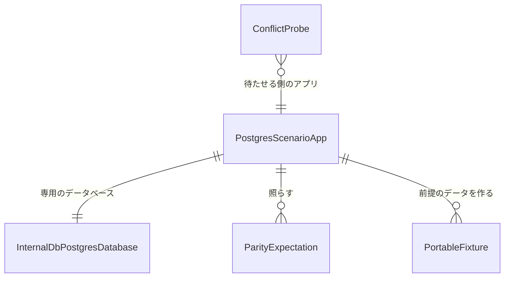

# 機能仕様: u3-postgres-behaviour-tests（機能設計。Intent 261114-internal-db-postgresql）

内部DB を PostgreSQL で動かす経路の振る舞いを、実際の PostgreSQL（版を固定したコンテナ）の結合テストで確かめる単位です。テストだけの単位で、`src/main` は変えず、WAR に入りません。流れと手順の正（source of truth）はこの文書、データの形は `entities.md`、決まりは `rules.md` です。

## 1. 決まっていること（上流・依頼者の決定）

- テストは、U1 の土台（`@InternalDbPostgresIT`・タグ `internal-db-postgres`・`internalDbPostgresTest`・実行ごとに一意の空のデータベース）の上に置き、明示したときだけ流す（FR5.2）。
- 機能ごとの代表の流れは、PostgreSQL 用の新しいテストとして書く。期待は H2 の既存のテストの値を写す。H2 のテストと部品は変えない（Q1: A、依頼者の決定、2026-11-28）。
- 本体のソース（`src/main`）は変えない。本体の差が見つかったら U2 に戻す（BR9.4）。
- U2 の Q3: A（検索の Unicode の端の 3 つの差を受け入れ、U4 の文書に書く）により、その 3 つは確かめの対象に入れない。
- U2 のレビューからの持ち越し（FR3.6 の PostgreSQL での確かめ・`isKeyConflict` の 3 つの重なり・`55P03`・小文字の制約名・セーブポイント）は U3 が持つ（BR5.2・BR5.3・BR6.1）。

## 2. 作るテストの一覧

置き場は `backend/src/test/java/cherry/mastersmith/` の下で、すべて `@InternalDbPostgresIT` を付けた `*IT` クラスです。名前の頭は `Pg` を付けて H2 の同名のテストと区別します。部品は `<機能>/testsupport` に置きます。

| 組 | クラス（案） | 確かめること | 決まり | アプリの寿命 |
|---|---|---|---|---|
| 流れ | `PgAuthFlowIT`・`PgPasswordFlowIT`・`PgUserAdminFlowIT`・`PgInvitationFlowIT`・`PgRoleFlowIT`・`PgWorkRoleFlowIT`・`PgGroupFlowIT`・`PgNavigationFlowIT`・`PgDslFlowIT`・`PgPreferencesFlowIT`・`PgAuditFlowIT` | 11 の機能の成功 1 本と代表の失敗 1 本 | BR1.1・BR1.2 | JVM で共有 |
| 違反 | `PgViolationClassificationIT`・`PgCaseSensitivityIT` | 重なり・親の無い子・参照のある行の削除・大文字と小文字 | BR2.1・BR2.2 | JVM で共有 |
| 待ち | `PgWriteWaitIT`・`PgRowLockWaitIT`・`PgDeadlockIT`・`PgSkipLockedLoginIT` | 書き込みの待ち・行の排他の待ちと上限の戻り・行き詰まり・SKIP LOCKED | BR3.1〜BR3.4 | クラスごと |
| 失敗後 | `PgFailureTransactionIT` | 書きかけが残らない・失敗の監査・次の要求 | BR4.1 | クラスごと |
| 書き直し | `PgPortableSqlIT`・`PgKeyConflictIT`・`PgLockFailureClassificationIT` | 結果と文の数・3 つの重なり・55P03 | BR5.1〜BR5.3 | クラスごと |
| 型 | `PgBinaryRoundTripIT`・`PgTimeRoundTripIT`・`PgUserSearchIT` | 10MB・32 バイト・時刻・検索 | BR6.1・BR6.2・BR7.1・BR7.2・BR8.1 | 共有（時刻はクラスごと） |
| 構造 | `PgTestBoundaryArchitectureTest`（`*Test`、普段の `verify` で流れる） | PostgreSQL のテストが H2 の部品に依存しない・タグが付く | BR9.1・BR9.2 | なし |

数は流れ 11・違反 2・待ち 4・失敗後 1・書き直し 3・型 3 の 24 の結合テストのクラスと、構造のテスト 1 です。1 クラスの中の件数は Code Generation の計画で決めます。

## 3. 手順（ワークフロー）

### W1. アプリの起動とデータベース（ENT-001）

1. `InternalDbPostgresDatabase.create()` で実行ごとに一意の空のデータベースを作る。
2. `SpringApplicationBuilder(MastersmithApplication.class).run(database.applicationArgs())` でアプリを起動する（移行 V1〜V14 が流れ、初期管理者が作られる）。
3. 共有のアプリは JVM ごとに最初の使用時に 1 回起動し、JVM の終了で閉じる。クラスごとのアプリは `@BeforeAll` で起動し `@AfterAll` で閉じ、データベースを `DROP DATABASE` で消す。
4. 接続先・利用者・パスワードは、起動の引数にだけ持ち、出力に出さない（BR9.5）。

### W2. 機能ごとの代表の流れ（BR1.1）

1. 参照の H2 のテスト（`rules.md` BR1.1 の一覧）を読み、成功の流れ 1 本と代表の失敗 1 本を選び、状態コード・`code`・応答の項目の名前を `ParityExpectation` として書く。
2. 利用者・ロール・グループなどを、アプリの API またはサービスで作る（PortableFixture。実行ごとの乱数の値）。
3. `HttpTestClient` で API を呼び、状態コード・`code`・項目を期待と照らす。応答の本文の個人に関する値は、照らすだけで出力しない。
4. 前の流れのデータに頼らない。

### W3. 違反の区分（BR2）

1. 利用者・ロール・グループに、重なる値・存在しない親・参照の残る削除の API を流す。
2. 大文字と小文字の組は、Code Generation の最初に H2 で実測した表（使い捨てのコード）から期待を決める。
3. 状態コードと `code` を H2 の既存のテストと照らし、想定外（500）が出ないことを確かめる。

### W4. 待ちの上限と行き詰まり（BR3・BR5.3）

1. 保持側: JDBC の接続で `BEGIN` し、対象の行を更新または排他で読み、確定しない。
2. 待つ側: アプリの経路（API またはサービス）を別のスレッドで呼ぶ。`pg_stat_activity` の `wait_event_type = 'Lock'` を観測してから時間を測り始める（sleep に頼らない）。
3. 切れた時間を測る（書き込み 2 秒以上 3 秒未満・行の排他 3 秒以上 4 秒未満）。応答の区分を H2 のときの区分と照らす。
4. 行の排他の後、同じプールの接続で続けて書き込み、2 秒で切れること（上限が戻ること）を確かめる。
5. 行き詰まり: 2 つの接続で互いの行を待たせ、検出された側の区分と、もう一方の続行を確かめる。
6. SKIP LOCKED: ダミーの行を保持側が持った状態で、存在しないメールアドレスのログインを流し、待たずに別の行を選ぶことと、全部持たれたときに 3 秒で切れることを確かめる。
7. 保持側は必ず `ROLLBACK` して閉じる（待ちが他のテストに残らない）。

### W5. 失敗の後のトランザクション（BR4.1）

1. 複数の文を持つ業務処理の 2 文目を、重なり・待ちの上限切れで失敗させる。
2. 1 文目の変更が残らないこと（行数）と、失敗の監査の行が残ること（別のトランザクション）を確かめる。
3. 同じ接続（同じプール）で次の要求が通ることを確かめる（25P02 を持ち越さない）。

### W6. 書き直した SQL と鍵の重なり（BR5）

1. `savePreferences`・作業ロールの保存・プレビューを置くを、本人なし・変更なし・NULL への変更・初回・2 回目の場合で流し、結果を H2 の既存のテストの値と照らす。文の数は U2 の `StatementCounter` と同じ数え方で確かめる（1 本の接続・文数）。
2. 3 つの重なりを起こす: 保持側が同じ鍵の行を確定せずに挿入し、アプリの upsert を待たせ、保持側が確定した後に、アプリ側が `UPDATED_AFTER_CONFLICT` で収束して最後に書いた値が残ることを確かめる。`preview_id` の一意の制約は重なりと扱われず、そのまま失敗になることを確かめる。
3. 待ちの上限が切れたときの 55P03 を、`KeyedUpsertExecutor` の中の生の例外と、Hibernate が変換した例外の両方で分類する。

### W7. 型・時刻・検索（BR6〜BR8）

1. 10,485,760 バイトちょうどの DSL の本文（全バイト値を含む）を保存して読み出し、長さと SHA-256 を照らす。+1 バイトの拒否を確かめる。
2. 全バイト値を含む 32 バイトのハッシュを、リフレッシュと招待の両方で保存し、同じ値で照合する。
3. JVM の `user.timezone` と PostgreSQL のセッションの `TimeZone` を変えた組で時刻を保存して読み、時点が同じであることを確かめる（アプリはクラスごとに起動し、`user.timezone` は起動前に設定する）。時計を進めて期限の境の判定を H2 の値と照らす。
4. 見本の利用者を作り、`%`・`_`・`\` と大文字小文字違いなどの検索を流し、返る集合を固定の期待と照らす（U2 の捨ての試しで H2 と一致した約 55 の入力のうち、Unicode の端の 3 つを除いたもの）。

## 4. 例外と境の扱い

| 場合 | 扱い |
|---|---|
| コンテナの実行環境が無い | U1 の `InternalDbPostgresRuntimeCheck` の扱い（手元は警告を出して飛ばす、CI は失敗にする） |
| PostgreSQL のテストの結果が H2 の期待と違う | 期待を弱めず、本体の差か作りの差かを分け、本体なら U2 に戻して依頼者に諮る（BR9.4） |
| 待ち合わせが観測できない | 時間の上限（観測は 10 秒）で失敗にし、無限に待たない |
| 保持側の接続が残る | `@AfterEach` で必ず `ROLLBACK` して閉じる |
| 共有のアプリの状態が前のテストに影響する | テストごとに自分の利用者を作り、同じ行を共有しない（BR1.2） |

## 5. 画面の部品（frontend-components）

この単位は画面を持たない（テストだけ）ため、`frontend-components.md` は作りません（`produces_kinds` で `ui` の単位だけの成果物）。

## 6. 関係の図（`entities.md` から導いた表示用）

## 7. 決まりの要約（`rules.md` から導いた表示用）

BR1 11 機能の代表の流れ / BR2 違反の区分と大文字小文字 / BR3 待ちの上限・行の排他の戻り・行き詰まり・SKIP LOCKED / BR4 失敗後のトランザクション / BR5 書き直した SQL・3 つの重なり・55P03 / BR6 10MB と 32 バイト / BR7 時刻 / BR8 検索 / BR9 タグ・H2 に頼らない・H2 を変えない・本体を変えない・値を出さない・時間の記録。

## 8. 上流の記録との差

- 要件 FR3.1 の「内部DB を使う機能」は、ヘルスチェック（FR3.9）を含む形で読めるが、ヘルスチェックの PostgreSQL の確かめは U1 の `InternalDbPostgresHealthIT` が持つため、U3 は数えない（11 の機能）。
- 「どの既存の結合テストを流用するか」（要件の未決の点）は、Q1: A により、流用せず参照だけにする。H2 のテストは変えない。

## Sources

- `aidlc/spaces/default/intents/261114-internal-db-postgresql/inception/units-generation/unit-of-work.md`（U3 の責務・境界）
- `aidlc/spaces/default/intents/261114-internal-db-postgresql/inception/units-generation/unit-of-work-story-map.md`
- `aidlc/spaces/default/intents/261114-internal-db-postgresql/inception/requirements-analysis/requirements.md`（FR3・FR5）
- `aidlc/spaces/default/intents/261114-internal-db-postgresql/inception/domain-design/components.md`
- `aidlc/spaces/default/intents/261114-internal-db-postgresql/construction/u2-portable-sql/functional-design/functional-spec.md`（捨ての試しの結果）
- `aidlc/spaces/default/intents/261114-internal-db-postgresql/construction/u2-portable-sql/code-generation/reviews/review-01.md`（持ち越し）
- `aidlc/spaces/default/intents/261114-internal-db-postgresql/construction/u3-postgres-behaviour-tests/functional-design/functional-design-questions.md`（Q1: A）
- `aidlc/spaces/default/knowledge/aidlc-shared/study-internal-db-postgresql.md`
- `aidlc/spaces/default/memory/team.md`・`project.md`
