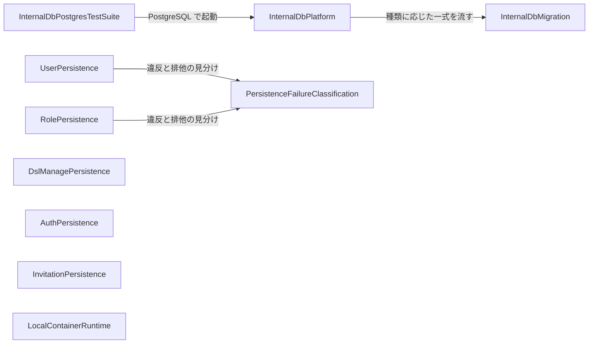

# 部品の一覧（Domain Design。Intent 261114-internal-db-postgresql）

内部DB に PostgreSQL を足すために、新しく作る部品と、手を入れる既存の部品だけを並べる（既存のアプリの全体の部品は `aidlc/spaces/default/codekb/mastersmith2/component-inventory.md` を正とする）。部品の名前は論理の名前で、Java のパッケージとクラスの名前は機能設計で決める。

- 新しく作る部品: `InternalDbPlatform`（内部DB の種類の判断と種類ごとの設定）、`InternalDbPostgresTestSuite`（PostgreSQL の結合テスト）
- 手を入れる既存の部品: `InternalDbMigration`（移行。PostgreSQL 用の一式を足す）、`UserPersistence`・`RolePersistence`・`DslManagePersistence`（H2 にしか通らない SQL の書き直し、大きなバイナリの写し方）、`LocalContainerRuntime`（手元の compose）
- 変えない既存の部品（参照のために載せる）: `PersistenceFailureClassification`（違反と排他の区分。Q3 の決定で区分の部品は変えない）、`AuthPersistence`・`InvitationPersistence`（今のネイティブの SQL は PostgreSQL でも通る見込み。機能設計の捨ての試しで確かめ、外れたら「手を入れる既存の部品」に移す）

```yaml
components:
  - name: InternalDbPlatform
    summary: 内部DB の種類（H2・PostgreSQL）を接続先から判断し、種類ごとの設定を選ぶ
    behaviour: >
      起動時に内部DB の接続先（環境変数 MASTERSMITH_DB_URL）から種類を1回だけ判断する。jdbc:h2: は H2、
      jdbc:postgresql: は PostgreSQL、それ以外は対応していない種類として起動を止める。止めるときのログには
      設定の名前と対応する種類だけを出し、URL・利用者・パスワードは出さない（FR1.3・NFR2）。
      種類に応じて、移行の置き場（H2 は今の置き場、PostgreSQL は PostgreSQL 用の置き場）を Flyway に渡す（ADR-002）。
      PostgreSQL のときは、接続ごとの待ちの上限（lock_timeout）を 2 秒として接続に設定し、H2 と同じ待ちの上限の
      振る舞いにする（FR3.3）。待ちの上限は2つの経路で決まる: (a) 書き込みの待ち・確定前の同じ一意の鍵への追加の待ちは、
      この接続ごとの 2 秒で切れる（2 秒台）。(b) 行の排他の読み取り（RoleStore・GroupStore・UserRowLockRepository・
      LoginAttemptStateRepository・InvitationLockQueriesImpl の jakarta.persistence.lock.timeout のヒント 3000ms）は、
      Hibernate が問い合わせの間だけ lock_timeout をヒントの値で上書きして 3 秒台で切れ、終わると接続の 2 秒へ戻る
      （下調べの3節で PostgreSQL 18.6 で確かめた）。この部品はヒントを変えず、(a) の接続の設定だけを持つ。
      起動時の移行がその上限で切れない形は NFR 設計で決める（NFR4）。H2 のときの設定は今と変えない（FR1.1）。
      業務処理の層と repository の層は種類で分岐しない（ADR-003）。種類の判断はこの部品の1か所に閉じる。
    responsibilities:
      - 接続先から内部DB の種類を判断する（H2・PostgreSQL・対応しない種類）
      - 対応しない種類の接続先で起動を止める
      - 種類に応じた移行の置き場を選ぶ
      - PostgreSQL のときの接続ごとの設定（待ちの上限）を当てる
    depends_on:
      - component: InternalDbMigration
        interaction: 種類に応じた移行の一式を選んで起動時に流させる
        style: sync
    dependents:
      - component: InternalDbPostgresTestSuite
        interaction: PostgreSQL を内部DB としてアプリを起動するときに種類の判断と設定を通る
    external_dependencies:
      - name: H2（組み込み、ファイル）
        kind: database
        purpose: 既定の内部DB
      - name: PostgreSQL 18 系
        kind: database
        purpose: 選べる内部DB（接続先を指定したときだけ）
      - name: Flyway
        kind: other
        purpose: 起動時の移行
    entities: []

  - name: InternalDbMigration
    summary: 内部DB の表・制約・索引を前進のみの移行で作る（H2 用と PostgreSQL 用の2つの一式）
    behaviour: >
      H2 用の一式（今の V1〜V14）は1文字も変えない（FR2.2）。PostgreSQL 用の一式を別の置き場に置き、同じ版の番号で
      同じ表・列・制約・索引を作る。制約と索引の名前は H2 と同じにする（違反の区分が名前で照らすため。FR2.1）。
      PostgreSQL 用では、H2 の型を PostgreSQL の型に置き換える（BINARY LARGE OBJECT・BINARY(32) の扱い、
      STORED の無い生成列の一意の扱い）。外部キーは ON DELETE の指定を付けず（NO ACTION）、参照のある行の削除が
      H2 と同じ区分（SQLState 23503）になるようにする（ADR-004）。後の Intent で表を変えるときは、両方の一式に
      同じ版の番号で足す（FR2.3）。
    responsibilities:
      - H2 用の移行の一式（今のまま）
      - PostgreSQL 用の移行の一式（同じ版の番号・同じ名前の制約と索引）
    depends_on: []
    dependents:
      - component: InternalDbPlatform
        interaction: 種類に応じて一式を選ばれる
    external_dependencies:
      - name: Flyway
        kind: other
        purpose: 移行の適用と検証（validate-on-migrate）
    entities: []

  - name: UserPersistence
    summary: 利用者の行の読み書き（自分の設定の保存を含む）
    behaviour: >
      自分の設定の保存（今の H2 にしか通らない FINAL TABLE (UPDATE ...)）を、H2 と PostgreSQL の両方に通る書き方
      （更新と読み直しを同じトランザクションで分けるなど）に書き直す。結果（返す値・更新の有無の判定）は今と同じにする
      （FR3.5、ADR-003）。利用者の検索（大文字と小文字を区別しない部分一致、エスケープ付き）は両方で同じ結果にする（FR3.8）。
      メールアドレスの一意の判定の大文字と小文字の扱いは H2 と同じにする（FR3.2）。今は DB の照合ではなくアプリの側で
      そろえている（EmailAddress.normalize で前後の空白を除いて小文字にしてから保存・検索する。内部DB の URL に
      IGNORECASE は無く、一意の制約 uk_users_email は H2 でも大文字と小文字を区別する）。PostgreSQL でも同じ列の型
      （大文字と小文字を区別する文字列）で作れば同じ結果になる見込みで、機能設計の捨ての試しで確かめる（ADR-006）。
    responsibilities:
      - 利用者の行と自分の設定の保存・読み出し
      - 利用者の検索
    depends_on:
      - component: PersistenceFailureClassification
        interaction: 一意の違反と排他の失敗の見分け
        style: sync
    dependents: []
    external_dependencies:
      - name: 内部DB（H2 または PostgreSQL）
        kind: database
        purpose: users 表
    entities:
      - name: User
        identifier: userId
        attributes: [email, passwordHash, adminFlag, createdAt, language, theme, fontSize, displayName, suspended, displayTimeZone]

  - name: RolePersistence
    summary: ロール・権限の設定・割り当て・作業ロールの読み書き
    behaviour: >
      作業ロールの保存（今の H2 にしか通らない MERGE INTO ... KEY）を、両方に通る標準の MERGE INTO ... USING などに
      書き直す（FR3.5、ADR-003）。ロールの削除で参照が残っているときは、PostgreSQL でも H2 と同じ応答になる
      （移行の外部キーを NO ACTION にするため、区分の部品は変えない。FR3.2、ADR-004）。名前の重なりの待ちは
      InternalDbPlatform の接続ごとの待ちの上限で H2 と同じに切れる（FR3.3）。名前の一意の判定は、アプリの側で作る
      nameKey（列 name_key、一意の制約 uk_roles_name_key）で行っており、DB の照合に頼らない（FR3.2）。
    responsibilities:
      - ロール・権限の設定・割り当て・作業ロールの保存と読み出し
    depends_on:
      - component: PersistenceFailureClassification
        interaction: 違反（名前の重なり・参照）と排他の失敗の見分け
        style: sync
    dependents: []
    external_dependencies:
      - name: 内部DB（H2 または PostgreSQL）
        kind: database
        purpose: roles・user_role_assignments・group_role_assignments・work_role_selections・permission_settings 表
    entities:
      - name: Role
        identifier: roleId
        attributes: [name, nameKey, createdAt, updatedAt]
      - name: WorkRoleSelection
        identifier: userId
        attributes: [roleId, updatedAt]
        references:
          - entity: User
            owned_by: UserPersistence
            relationship: 各作業ロールの選択は1人の利用者のもの

  - name: DslManagePersistence
    summary: DSL のプレビューの置き場と適用の履歴の読み書き
    behaviour: >
      プレビューの置き場の保存（今の H2 にしか通らない MERGE INTO ... KEY）と、適用の履歴の追加（CAST(? AS ...) を
      含む INSERT ... SELECT）を、両方に通る書き方に書き直す（FR3.5、ADR-003）。DSL の本文（最大 10MB）は、
      PostgreSQL でもちょうど上限まで保存・読み出しでき、起動時のエンティティと表の照合（ddl-auto: validate）が
      両方で通る写し方にする（FR3.6）。写し方の具体（エンティティの型と PostgreSQL の列の型）は機能設計で、
      捨ての試しで確かめてから決める。
    responsibilities:
      - DSL のプレビューの置き場（1件）と適用の履歴の保存・読み出し
    depends_on: []
    dependents: []
    external_dependencies:
      - name: 内部DB（H2 または PostgreSQL）
        kind: database
        purpose: dsl_previews・dsl_applied_revisions 表
    entities:
      - name: DslPreview
        identifier: previewSlot
        attributes: [previewId, yamlBytes, dslHash, source, placedByUserId, placedAt]
      - name: DslAppliedRevision
        identifier: sequenceNo
        attributes: [revisionId, yamlBytes, dslHash, source, appliedByUserId, appliedAt]

  - name: PersistenceFailureClassification
    summary: 違反（一意・参照）と排他の失敗の見分け（変えない部品。参照のために載せる）
    behaviour: >
      今の区分の部品（共通の排他の失敗の見分け、一意の違反の見分け、role と group の違反の区分）は、SQLState
      23505・23503・23506 と制約の名前、例外の型で見分ける。Q3 の決定により PostgreSQL の移行の外部キーを NO ACTION
      にするので、区分の部品の判定の表は変えずに H2 と同じ区分になる（ADR-004）。PostgreSQL の排他の失敗（55P03・40P01）
      は例外の型で当たる見込みで、足りない場合の手当ては機能設計で決める。違反の文に入る値（メールアドレスなど）を
      ログ・応答に出さない今の対策は変えない（NFR2）。
    responsibilities:
      - 違反と排他の失敗の区分（今のまま）
    depends_on: []
    dependents:
      - component: UserPersistence
        interaction: 一意の違反と排他の失敗の見分け
      - component: RolePersistence
        interaction: 違反と排他の失敗の見分け
    external_dependencies: []
    entities: []

  - name: AuthPersistence
    summary: ログインの状態とリフレッシュトークンの読み書き（変えない見込みの部品。機能設計で確かめる）
    behaviour: >
      LoginAttemptStateRepository（標準の MERGE INTO ... USING と行の排他のヒント）と RefreshTokenRepository の
      ネイティブの SQL は、PostgreSQL でも通る書き方の見込みで、変えない前提とする（FR3.1）。時刻の列の保存と読み出し
      （ロックの解除の時刻・トークンの有効期限）が両方で同じ時点になること（FR3.7）も含め、機能設計の捨ての試しで
      確かめる。見込みが外れたときは、ADR-003 と同じ形（両方に通る書き方への書き直し、DB の種類で分岐しない）で直し、
      この部品を「手を入れる既存の部品」に移す。
    responsibilities:
      - ログインの状態とリフレッシュトークンの保存・読み出し（今のまま）
    depends_on: []
    dependents: []
    external_dependencies:
      - name: 内部DB（H2 または PostgreSQL）
        kind: database
        purpose: login_attempt_states・refresh_tokens 表
    entities: []

  - name: InvitationPersistence
    summary: 招待の読み書き（変えない見込みの部品。機能設計で確かめる）
    behaviour: >
      InvitationRepository と InvitationLockQueriesImpl のネイティブの SQL（削除の副問い合わせの FETCH FIRST、行の排他の
      ヒント）は、PostgreSQL でも通る書き方の見込みで、変えない前提とする（FR3.1）。有効期限の時刻（FR3.7）と、V8 の
      生成列の一意（uk_invitations_pending_email。PostgreSQL 用の移行での形は InternalDbMigration が持つ）を含め、
      機能設計の捨ての試しで確かめる。見込みが外れたときの手当ては AuthPersistence と同じ。
    responsibilities:
      - 招待の保存・読み出し（今のまま）
    depends_on: []
    dependents: []
    external_dependencies:
      - name: 内部DB（H2 または PostgreSQL）
        kind: database
        purpose: invitations 表
    entities: []

  - name: InternalDbPostgresTestSuite
    summary: 内部DB を PostgreSQL で動かす経路の結合テスト（明示の指定でだけ流す）
    behaviour: >
      H2 の結合テストとは別に新しく作る（ADR-005）。版を固定したイメージ（対象DB の PostgreSQL と同じ版とダイジェスト）
      のコンテナの実際の PostgreSQL で、要件の FR5.1 に並べた振る舞い（移行・初期管理者・違反の区分・待ちの上限・
      失敗の後のトランザクション・書き直した SQL・大きなバイナリ・時刻・検索・ヘルスチェック）と、内部DB を使う機能ごとの
      代表の API の流れ1本ずつを確かめる。Gradle の明示の指定を付けたときだけ流し、通常の verify・verifyQuick・CI の
      プッシュでは流さない。コンテナの実行環境が無いときは警告を出して飛ばす（明示して CI で流したときは飛ばさない）。
      テストの部品は H2 に頼る書き方（INFORMATION_SCHEMA.SESSIONS・Java のトリガーなど）を使わない。
      待ちの上限（FR3.3）は、接続ごとの 2 秒で切れる書き込みの待ちと、ヒントで 3 秒台に上書きされる行の排他の読み取りの
      両方の経路を測り、行の排他の後に同じ接続の待ちの上限が 2 秒に戻ることも確かめる。失敗の後のトランザクション（FR3.4）は、
      違反・待ちの失敗の後に同じ要求の続きと次の要求が正しく進むことを、この部品のテストで確かめる。
      既存の H2 の結合テストとテストの部品は変えず、全件を残す（FR5.4、ADR-005）。
    responsibilities:
      - PostgreSQL の内部DB での振る舞いの確かめ
      - 明示の指定とコンテナの有無による流す・飛ばすの判断
    depends_on:
      - component: InternalDbPlatform
        interaction: PostgreSQL を内部DB としてアプリを起動する
        style: sync
    dependents: []
    external_dependencies:
      - name: Testcontainers と PostgreSQL のコンテナ
        kind: database
        purpose: テストの内部DB
    entities: []

  - name: LocalContainerRuntime
    summary: 手元の compose（内部DB 用の PostgreSQL のサービスを profile で足す）
    behaviour: >
      見本の対象DB とは別のサービス・別のボリューム・別の資格情報で、内部DB 用の PostgreSQL を置く。既定では起動せず、
      profile で選んだときだけ起動する。イメージは対象DB の PostgreSQL と同じ版とダイジェストに固定し、固定先を
      .github/dependabot.yml の一覧に足す。手元の配備の既定の内部DB は H2 のまま（FR4.1〜FR4.3）。
    responsibilities:
      - 内部DB 用の PostgreSQL のサービス（profile）
    depends_on: []
    dependents: []
    external_dependencies:
      - name: PostgreSQL 18 系のコンテナのイメージ
        kind: database
        purpose: 手元で選べる内部DB
    entities: []
```

## Component Diagram



<!-- Text fallback: InternalDbPlatform は InternalDbMigration を使い、種類に応じた移行の一式を流す。UserPersistence と RolePersistence は PersistenceFailureClassification で違反と排他の失敗を見分ける。InternalDbPostgresTestSuite は InternalDbPlatform を通して PostgreSQL を内部DB としてアプリを起動する。DslManagePersistence・AuthPersistence・InvitationPersistence・LocalContainerRuntime はこの一覧のほかの部品を呼ばない。 -->

## Component Summary

| Component | Purpose | Depends On | Dependents | Entities Owned |
|---|---|---|---|---|
| InternalDbPlatform（新） | 内部DB の種類の判断と種類ごとの設定 | InternalDbMigration | InternalDbPostgresTestSuite | なし |
| InternalDbMigration（既存・拡張） | H2 用と PostgreSQL 用の移行の一式 | なし | InternalDbPlatform | なし |
| UserPersistence（既存・変更） | 利用者の行と自分の設定の保存 | PersistenceFailureClassification | なし | User |
| RolePersistence（既存・変更） | ロール・割り当て・作業ロール | PersistenceFailureClassification | なし | Role・WorkRoleSelection |
| DslManagePersistence（既存・変更） | DSL のプレビューと適用の履歴 | なし | なし | DslPreview・DslAppliedRevision |
| PersistenceFailureClassification（既存・変えない） | 違反と排他の失敗の区分 | なし | UserPersistence・RolePersistence | なし |
| AuthPersistence（既存・変えない見込み） | ログインの状態とリフレッシュトークン | なし | なし | なし（この一覧では扱わない） |
| InvitationPersistence（既存・変えない見込み） | 招待 | なし | なし | なし（この一覧では扱わない） |
| InternalDbPostgresTestSuite（新） | PostgreSQL の結合テスト | InternalDbPlatform | なし | なし |
| LocalContainerRuntime（既存・拡張） | 手元の compose の内部DB 用の PostgreSQL | なし | なし | なし |


## Entity Ownership

| Entity | Owning Component | Identifier | Attributes | References |
|---|---|---|---|---|
| User | UserPersistence | userId | email・passwordHash・adminFlag・createdAt・language・theme・fontSize・displayName・suspended・displayTimeZone | なし |
| Role | RolePersistence | roleId | name・nameKey・createdAt・updatedAt | なし |
| WorkRoleSelection | RolePersistence | userId | roleId・updatedAt | User（UserPersistence） |
| DslPreview | DslManagePersistence | previewSlot | previewId・yamlBytes・dslHash・source・placedByUserId・placedAt | なし |
| DslAppliedRevision | DslManagePersistence | sequenceNo | revisionId・yamlBytes・dslHash・source・appliedByUserId・appliedAt | なし |

ここに載せていない内部DB のエンティティ（招待・ログインの状態・リフレッシュトークン・グループ・監査など）は、持ち主の部品と形を変えない（`component-inventory.md` のとおり）。表の形は PostgreSQL 用の移行で同じに作る。

## External Dependencies

| Component | Dependency | Kind | Purpose |
|---|---|---|---|
| InternalDbPlatform | H2（組み込み、ファイル） | database | 既定の内部DB |
| InternalDbPlatform | PostgreSQL 18 系 | database | 選べる内部DB |
| InternalDbPlatform・InternalDbMigration | Flyway | other | 起動時の移行と検証 |
| UserPersistence・RolePersistence・DslManagePersistence・AuthPersistence・InvitationPersistence | 内部DB（H2 または PostgreSQL） | database | 各表 |
| InternalDbPostgresTestSuite | Testcontainers と PostgreSQL のコンテナ | database | テストの内部DB |
| LocalContainerRuntime | PostgreSQL 18 系のコンテナのイメージ | database | 手元で選べる内部DB |

## Rationale

| Component | なぜ分けるか |
|---|---|
| InternalDbPlatform | 種類の判断を1か所に閉じる（関心の分離）。ここ以外は種類で分岐しないので、PostgreSQL のときだけ通るコードがこの部品と移行に集まり、普段の verify でのカバレッジの下限（NFR6）を単体テストで守りやすい。起動時に1回だけ動き、変わる理由（対応する種類が増える。後の Intent の MySQL・MariaDB）が業務の部品と違う |
| InternalDbMigration | 表の形の持ち主。種類ごとの一式を持つのは移行の書き方の差（型・制約）を SQL に閉じるため（ADR-002）。業務の部品とは変わる理由が違う（表の形が変わるとき） |
| UserPersistence・RolePersistence・DslManagePersistence | 今の持ち主のまま。書き直すのは H2 にしか通らない SQL と写し方だけで、持ち主を変える理由が無い |
| AuthPersistence・InvitationPersistence | 変えない見込み。FR3.1・FR3.7 の担当を見込みのままにせず、確かめる先と外れたときの手当てを明らかにするために載せる |
| PersistenceFailureClassification | 変えない。移行の外部キーを NO ACTION にすることで、PostgreSQL の差をこの部品に持ち込まない（ADR-004） |
| InternalDbPostgresTestSuite | 流す時（明示の指定だけ）と前提（コンテナ）が H2 の結合テストと違う。H2 に頼るテストの部品と混ぜない（ADR-005） |
| LocalContainerRuntime | 手元の配備の部品。内部DB と対象DB を別扱いにする前提に合わせ、別のサービスにする |

- テストの部品の依存の書き方: InternalDbPostgresTestSuite はアプリを PostgreSQL で起動して確かめる側で、本体の部品からは呼ばれない。依存の向きは一方向で、循環は無い。
- Alternatives Rejected（部品の分け方）: (1) 種類の判断を各 repository に持たせる形は、種類での分岐が業務の部品に散り、PostgreSQL のときだけ通るコードが増えてカバレッジの下限を守りにくくなるため採らない（ADR-001・ADR-003）。(2) 既存の H2 の結合テストを種類を切り替えて流す形は、H2 に頼るテストの部品を多く書き直すため採らない（ADR-005）。

## Sources

- 要件定義: `aidlc/spaces/default/intents/261114-internal-db-postgresql/inception/requirements-analysis/requirements.md`（FR1〜FR5・NFR1〜NFR9）
- 質問と答え: `aidlc/spaces/default/intents/261114-internal-db-postgresql/inception/domain-design/domain-design-questions.md`（Q1〜Q4、すべて A）
- 進め方: `aidlc/spaces/default/intents/261114-internal-db-postgresql/inception/practices-discovery/team-practices.md`
- コードの知識ベース: `aidlc/spaces/default/codekb/mastersmith2/architecture.md`（K-146〜K-148・K-154）・`aidlc/spaces/default/codekb/mastersmith2/component-inventory.md`（config・internal-db-migration・common-persistence・user・role・dslmanage・backend-test-support ほか）
- 下調べ: `aidlc/spaces/default/knowledge/aidlc-shared/study-internal-db-postgresql.md`
- 読んだ知識の置き場: `aidlc/spaces/default/knowledge/aidlc-shared/` の全ファイル（`team.md` の Knowledge Pointers）
- コードで確かめたこと（2026-11-15）: 移行は V1〜V14 の 14 本、表は 14（`users`・`refresh_tokens`・`login_attempt_states`・`audit_events`・`dsl_previews`・`dsl_applied_revisions`・`invitations`・`groups`・`group_members`・`roles`・`permission_settings`・`user_role_assignments`・`group_role_assignments`・`work_role_selections`）。`dsl_previews`・`dsl_applied_revisions` の列（V5）、`work_role_selections` の主キーと外部キー（V12）。招待の削除の `FETCH FIRST` は副問い合わせの中で、PostgreSQL でも通る書き方。
