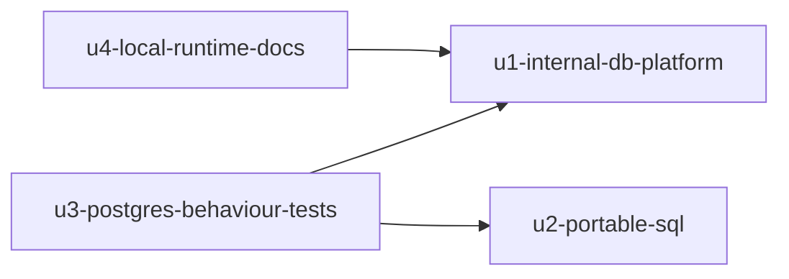

# 単位の依存（Intent 261114-internal-db-postgresql）

この文書は、単位の間の依存（何が何に頼るか）だけを書く。作る順と重要な経路は Delivery Planning が決める。

## 依存の図



<!-- Text fallback: u3-postgres-behaviour-tests は u1-internal-db-platform と u2-portable-sql に頼る。u4-local-runtime-docs は u1-internal-db-platform に頼る。u1 と u2 はほかの単位に頼らない。 -->

| 単位 | 頼る単位 | 理由 |
|---|---|---|
| u1-internal-db-platform | なし | 種類の判断・PostgreSQL 用の移行・結合テストの土台は、今のプロジェクトだけで作れて確かめられる |
| u2-portable-sql | なし | 書き直しは H2 の結合テストの全件で確かめられ、U1 の作業を含まなくても通る |
| u3-postgres-behaviour-tests | u1-internal-db-platform・u2-portable-sql | PostgreSQL で起動するには U1 の種類の判断・移行・土台が要る。書き直した SQL（U2）が無いと、H2 にしか通らない SQL の経路が PostgreSQL で失敗し、テストが通らない |
| u4-local-runtime-docs | u1-internal-db-platform | compose で内部DB を PostgreSQL にして起動するには U1 が要る。文書は U1 で決まる接続先の設定の決まり（対応する種類・環境変数）を書く |

```yaml
units:
  - name: u1-internal-db-platform
    kind: service
    depends_on: []
  - name: u2-portable-sql
    kind: service
    depends_on: []
  - name: u3-postgres-behaviour-tests
    depends_on: [u1-internal-db-platform, u2-portable-sql]
  - name: u4-local-runtime-docs
    kind: packaging
    depends_on: [u1-internal-db-platform]
```

## 単位の間のつなぎ目

| つなぎ目 | 提供する単位 | 使う単位 | 形 |
|---|---|---|---|
| 内部DB の種類の判断と、PostgreSQL のときの接続の設定 | U1 | U3・U4 | 起動時の設定（環境変数 `MASTERSMITH_DB_URL` と資格情報の環境変数）。アプリの中の API は持たない |
| PostgreSQL 用の移行の一式（表・制約・索引の名前） | U1 | U2・U3 | 移行のファイル。U2 のエンティティの写し方（大きなバイナリ）は、U1 の列の型と `ddl-auto: validate` で合う必要がある |
| PostgreSQL の結合テストの土台（明示の指定・コンテナの起動・テストの基底） | U1 | U3 | Gradle の明示の指定と、テストの共通の部品（`src/test/java` の testsupport） |
| 両方に通る SQL | U2 | U3 | repository の口（今の口の形は変えない） |
| コンテナのイメージの版とダイジェスト | U1（テストの定数）・U4（compose） | U1・U3・U4 | 対象DB の PostgreSQL と同じ値。`.github/dependabot.yml` の固定先の一覧に載せる |

U2 と U1 の間には依存の辺を置かない。U2 の大きなバイナリの写し方は H2 の `ddl-auto: validate` で確かめられ、PostgreSQL の列の型との一致は U1（移行の照合）と U3（10MB の往復）で確かめる。

- **列の型と写し方の組の持ち主は U1**（Units Generation のレビュー R-03）。U1 の機能設計の前の捨ての試しで組を確かめて U1 の機能設計に書き、U2 はその組を前提に写し方を実装する。組は Contract Design でつなぎ目として書く。コードの依存は無いため辺は置かないが、設計の順として U1 の機能設計を U2 の機能設計より前に置く（Delivery Planning で並べる）。
- **AuthPersistence・InvitationPersistence の見込みが外れたときの直しの持ち主は U2**（R-04）。見込みは U2 の機能設計の前の捨ての試しで確かめ、外れたものは U2 の範囲に足して直す。U3 で初めて分かったときも U2 の小さな直しとして行い、U3 はそれを待つ。U3 はもともと U2 に頼るため、依存の図は変わらない。

## 並行できる組

- `u1-internal-db-platform` と `u2-portable-sql` は互いに頼らず、並行できる。
- `u4-local-runtime-docs` と `u2-portable-sql`、`u4-local-runtime-docs` と `u3-postgres-behaviour-tests` は互いに頼らない。

`team.md` のとおり worktree を使わず同じ作業フォルダの短命のブランチで1つずつ作る前提のため、並行できる組は記録だけにする。作る順は Delivery Planning が決める。

## Walking Skeleton

`team.md` の Walking Skeleton のとおり特別な手順を行わない（アプリの骨格は既にある）。最初の単位を統合の薄い切れ目として形づくる必要は無い。

## Sources

- `aidlc/spaces/default/intents/261114-internal-db-postgresql/inception/domain-design/components.md`
- `aidlc/spaces/default/intents/261114-internal-db-postgresql/inception/domain-design/decisions.md`
- `aidlc/spaces/default/intents/261114-internal-db-postgresql/inception/requirements-analysis/requirements.md`
- `aidlc/spaces/default/intents/261114-internal-db-postgresql/inception/units-generation/units-generation-questions.md`（Q1: A・Q2: A）
- `aidlc/spaces/default/memory/team.md`（Way of Working・Walking Skeleton）
